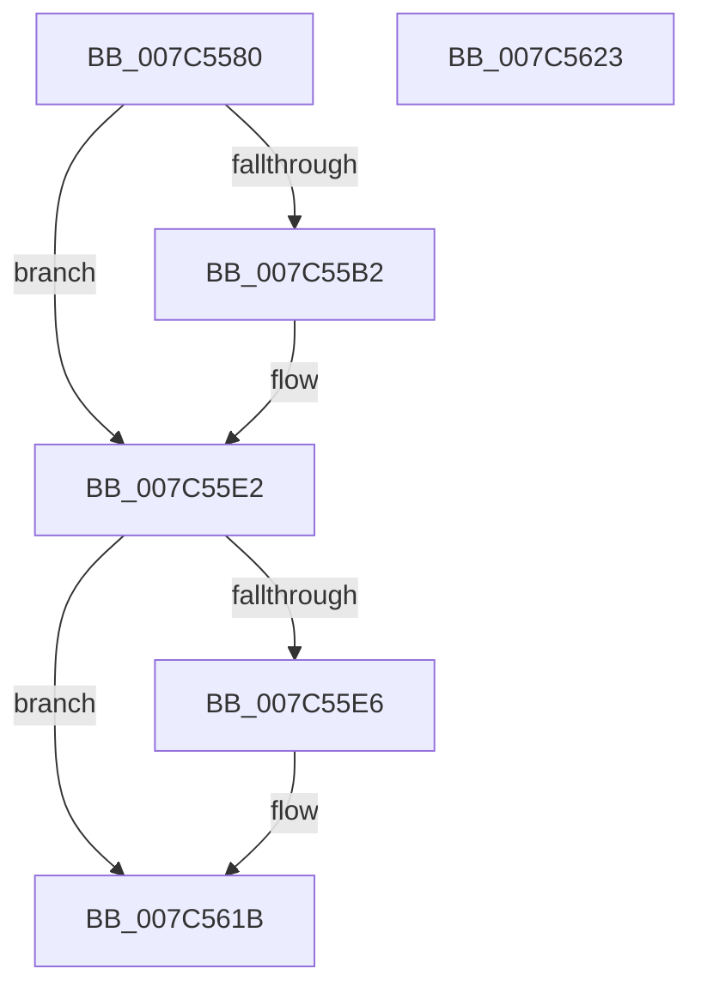

# ExpUpdateComPlusPackage

- RVA: `0x007C5580`–`0x007C5624` (길이 `164` bytes)
- VA: `0x00000001407C5580`
- 실행 섹션: `PAGE`
- PDB 이름 있음: `예`; PDB Function 태그: `아니요`
- unwind 정보 RVA: `0x000D4300`
- 디코드: `41`개 명령, `164/164` bytes 표시
- 미해석 바이트: `0` (있으면 어셈블리에 `.byte`로 보존)

> 이 문서는 커널 이미지의 기계어와 PDB 기호를 분석해 생성했습니다. 4번과 5번은 함수 원형과 자료형을 바이너리 사용 방식에서 추정한 C 해석이며 원본 소스 복구 결과는 아닙니다.

## 1. Dependencies

- 직접 호출 지점: **4**; 고유 호출 대상: **4**
- 직접 호출자로 확인된 함수: **1**
- RIP 상대 이미지 참조: **2**

### Outgoing calls
- `0x007C55A4` → [ZwOpenKey](../../text/6A/ZwOpenKey_function_006AD310.md) (function, `0x006AD310`)
- `0x007C55DB` → [ZwCreateKey](../../text/6A/ZwCreateKey_function_006AD470.md) (function, `0x006AD470`)
- `0x007C560A` → [ZwSetValueKey](../../text/6A/ZwSetValueKey_function_006ADCD0.md) (function, `0x006ADCD0`)
- `0x007C5616` → [ZwClose](../../text/6A/ZwClose_function_006AD2B0.md) (function, `0x006AD2B0`)

### Direct callers
- [NtSetSystemInformation](../AF/NtSetSystemInformation_function_00AF4A60.md) at `0x00AF532C`

### Static image references
- `0x007C558F` → RVA `0x00E092F0` (`.data`; read)
- `0x007C55F6` → RVA `0x00E092D0` (`.data`; read)

## 2. Other-region calls and transfers

- 다른 실행 섹션으로 향하는 call: **4**
  - `0x007C55A4` → [ZwOpenKey](../../text/6A/ZwOpenKey_function_006AD310.md) (`PAGE` → `.text`)
  - `0x007C55DB` → [ZwCreateKey](../../text/6A/ZwCreateKey_function_006AD470.md) (`PAGE` → `.text`)
  - `0x007C560A` → [ZwSetValueKey](../../text/6A/ZwSetValueKey_function_006ADCD0.md) (`PAGE` → `.text`)
  - `0x007C5616` → [ZwClose](../../text/6A/ZwClose_function_006AD2B0.md) (`PAGE` → `.text`)
- 별도 외부 분기/꼬리 이동을 확인하지 못했습니다.

## 3. Assembly (complete function range)

```asm
007C5580  48 8B C4                        mov rax, rsp
007C5583  89 48 08                        mov dword ptr [rax + 8], ecx
007C5586  53                              push rbx
007C5587  48 83 EC 40                     sub rsp, 0x40
007C558B  83 60 10 00                     and dword ptr [rax + 0x10], 0
007C558F  4C 8D 05 5A 3D 64 00            lea r8, [rip + 0x643d5a]
007C5596  48 83 60 18 00                  and qword ptr [rax + 0x18], 0
007C559B  48 8D 48 18                     lea rcx, [rax + 0x18]
007C559F  BA 00 00 00 40                  mov edx, 0x40000000
007C55A4  E8 67 7D EE FF                  call 0x1406ad310
007C55A9  8B D8                           mov ebx, eax
007C55AB  3D 34 00 00 C0                  cmp eax, 0xc0000034
007C55B0  75 30                           jne 0x1407c55e2
007C55B2  48 8D 44 24 58                  lea rax, [rsp + 0x58]
007C55B7  45 33 C9                        xor r9d, r9d
007C55BA  48 89 44 24 30                  mov qword ptr [rsp + 0x30], rax
007C55BF  4C 8D 05 2A 3D 64 00            lea r8, [rip + 0x643d2a]
007C55C6  83 64 24 28 00                  and dword ptr [rsp + 0x28], 0
007C55CB  48 8D 4C 24 60                  lea rcx, [rsp + 0x60]
007C55D0  48 83 64 24 20 00               and qword ptr [rsp + 0x20], 0
007C55D6  BA 00 00 00 40                  mov edx, 0x40000000
007C55DB  E8 90 7E EE FF                  call 0x1406ad470
007C55E0  8B D8                           mov ebx, eax
007C55E2  85 DB                           test ebx, ebx
007C55E4  78 35                           js 0x1407c561b
007C55E6  48 8B 4C 24 60                  mov rcx, qword ptr [rsp + 0x60]
007C55EB  48 8D 44 24 50                  lea rax, [rsp + 0x50]
007C55F0  41 B9 04 00 00 00               mov r9d, 4
007C55F6  48 8D 15 D3 3C 64 00            lea rdx, [rip + 0x643cd3]
007C55FD  44 89 4C 24 28                  mov dword ptr [rsp + 0x28], r9d
007C5602  45 33 C0                        xor r8d, r8d
007C5605  48 89 44 24 20                  mov qword ptr [rsp + 0x20], rax
007C560A  E8 C1 86 EE FF                  call 0x1406adcd0
007C560F  48 8B 4C 24 60                  mov rcx, qword ptr [rsp + 0x60]
007C5614  8B D8                           mov ebx, eax
007C5616  E8 95 7C EE FF                  call 0x1406ad2b0
007C561B  8B C3                           mov eax, ebx
007C561D  48 83 C4 40                     add rsp, 0x40
007C5621  5B                              pop rbx
007C5622  C3                              ret
007C5623  CC                              int3
```

## 4. C-style interpretation (structured pseudocode)

```c
__int64 __fastcall ExpUpdateComPlusPackage(int a1, __int64 a2, __int64 a3, int a4)
{
    __int64 result;
    __int64 v_rbx;
    __int64 v_rsp;
    unsigned __int64 v_stack_m18;
    unsigned int v_stack_m20;
    unsigned __int64 v_stack_m28;
    unsigned __int64 v_stack_p10;
    unsigned __int64 v_stack_p18;
    unsigned __int64 v_stack_p8;

    *(unsigned int *)(v_rsp + 8) = a1;
    v_rsp = (v_rsp) - (64);
    result = ZwOpenKey(v_rsp + 24, (unsigned int)(0x40000000ULL), v_rip + 6569306, a4);
    v_rbx = (unsigned int)((unsigned int)(result));
    if (((unsigned int)(result)) == 0xC0000034ULL) {
        result = v_stack_p10;
        a4 = 0;
        v_stack_m18 = result;
        a3 = v_rip + 6569258;
        a1 = v_stack_p18;
        a2 = 0x40000000ULL;
        result = ZwCreateKey(a1, a2, a3, a4);
        v_rbx = (unsigned int)(result);
    }
    if (!(sign_flag)) {
        a1 = v_stack_p18;
        result = v_stack_p8;
        a4 = 4;
        a2 = v_rip + 6569171;
        v_stack_m20 = a4;
        a3 = 0;
        v_stack_m28 = result;
        result = ZwSetValueKey(a1, a2, a3, a4);
        a1 = v_stack_p18;
        v_rbx = (unsigned int)(result);
        result = ZwClose(a1, a2, a3, a4);
    }
    v_rsp = (v_rsp) + (64);
    return (unsigned int)((unsigned int)(v_rbx));
}
```

## 5. (Beta) C Style

```c
int64_t ExpUpdateComPlusPackage(int32_t Arg1, int64_t Arg2, int64_t Arg3, int32_t Arg4)
{
    int64_t result;
    int64_t local_rbx;
    int64_t local_rsp;
    uint64_t v_stack_m18;
    uint32_t v_stack_m20;
    uint64_t v_stack_m28;
    uint64_t v_stack_p10;
    uint64_t v_stack_p18;
    uint64_t v_stack_p8;

    *(uint32_t *)(local_rsp + 0x8) = Arg1;
    local_rsp = (local_rsp) - (64);
    result = ZwOpenKey(local_rsp + 24, (uint32_t)(0x40000000ULL), v_rip + 6569306, Arg4);
    local_rbx = (uint32_t)((uint32_t)(result));
    if (((uint32_t)(result)) == 0xC0000034ULL) {
        result = v_stack_p10;
        Arg4 = 0;
        v_stack_m18 = result;
        Arg3 = v_rip + 6569258;
        Arg1 = v_stack_p18;
        Arg2 = 0x40000000ULL;
        result = ZwCreateKey(Arg1, Arg2, Arg3, Arg4);
        local_rbx = (uint32_t)(result);
    }
    if (!(sign_flag)) {
        Arg1 = v_stack_p18;
        result = v_stack_p8;
        Arg4 = 4;
        Arg2 = v_rip + 6569171;
        v_stack_m20 = Arg4;
        Arg3 = 0;
        v_stack_m28 = result;
        result = ZwSetValueKey(Arg1, Arg2, Arg3, Arg4);
        Arg1 = v_stack_p18;
        local_rbx = (uint32_t)(result);
        result = ZwClose(Arg1, Arg2, Arg3, Arg4);
    }
    local_rsp = (local_rsp) + (64);
    return (uint32_t)((uint32_t)(local_rbx));
}
```

## 6. Execution-region graph

[열기: 2D/3D 그래프와 함수 탐색 컨트롤 패널](../../../control-panel.html?section=page&rva=0x007C5580&view=graph)

- 2D 그래프는 위에서 아래로 흐르고, 3D 그래프는 빈 공간을 드래그해 회전합니다. Shift+드래그는 이동, 휠은 확대·축소, 함수 노드 선택은 대상 보고서 이동입니다.

### Static fallback


