# ExpWatchLicenseInfoWork

- RVA: `0x007C6DB0`–`0x007C725D` (길이 `1,197` bytes)
- VA: `0x00000001407C6DB0`
- 실행 섹션: `PAGE`
- PDB 이름 있음: `예`; PDB Function 태그: `예`
- unwind 정보 RVA: `0x000D4AEC`
- 디코드: `309`개 명령, `1,197/1,197` bytes 표시
- 미해석 바이트: `0` (있으면 어셈블리에 `.byte`로 보존)

> 이 문서는 커널 이미지의 기계어와 PDB 기호를 분석해 생성했습니다. 4번과 5번은 함수 원형과 자료형을 바이너리 사용 방식에서 추정한 C 해석이며 원본 소스 복구 결과는 아닙니다.

## 1. Dependencies

- 직접 호출 지점: **29**; 고유 호출 대상: **15**
- 직접 호출자로 확인된 함수: **0**
- RIP 상대 이미지 참조: **5**

### Outgoing calls
- `0x007C6E2E` → [RtlInitUnicodeString](../../text/42/RtlInitUnicodeString_function_0042A780.md) (function, `0x0042A780`)
- `0x007C6E59` → [NtClose](../86/NtClose_function_00868870.md) (function, `0x00868870`)
- `0x007C6E6D` → [NtOpenKeyEx](../A4/NtOpenKeyEx_function_00A45CC0.md) (function, `0x00A45CC0`)
- `0x007C6E87` → [KeBugCheckEx](../../text/4F/KeBugCheckEx_function_004FD660.md) (function, `0x004FD660`)
- `0x007C6EA5` → [NtQueryKey](../86/NtQueryKey_function_008676E0.md) (function, `0x008676E0`)
- `0x007C6EC2` → [KeBugCheckEx](../../text/4F/KeBugCheckEx_function_004FD660.md) (function, `0x004FD660`)
- `0x007C6EF7` → [ExAllocatePool2](../../poolcode/B8/ExAllocatePool2_function_00B820F0.md) (function, `0x00B820F0`)
- `0x007C6F82` → [ExAllocatePool2](../../poolcode/B8/ExAllocatePool2_function_00B820F0.md) (function, `0x00B820F0`)
- `0x007C6FA8` → [RtlInitUnicodeString](../../text/42/RtlInitUnicodeString_function_0042A780.md) (function, `0x0042A780`)
- `0x007C6FCC` → [NtSetValueKey](../84/NtSetValueKey_function_00844EA0.md) (function, `0x00844EA0`)
- `0x007C6FE9` → [KeBugCheckEx](../../text/4F/KeBugCheckEx_function_004FD660.md) (function, `0x004FD660`)
- `0x007C700B` → [NtEnumerateKey](../8B/NtEnumerateKey_function_008B1F70.md) (function, `0x008B1F70`)
- `0x007C703F` → [wcscpy_s](../../text/50/wcscpy_s_function_005064B0.md) (function, `0x005064B0`)
- `0x007C7056` → [wcscat_s](../../text/50/wcscat_s_function_00506410.md) (function, `0x00506410`)
- `0x007C706A` → [wcscat_s](../../text/50/wcscat_s_function_00506410.md) (function, `0x00506410`)
- `0x007C70BA` → [NtOpenKeyEx](../A4/NtOpenKeyEx_function_00A45CC0.md) (function, `0x00A45CC0`)
- `0x007C70DF` → [NtSetValueKey](../84/NtSetValueKey_function_00844EA0.md) (function, `0x00844EA0`)
- `0x007C70EC` → [NtClose](../86/NtClose_function_00868870.md) (function, `0x00868870`)
- `0x007C710C` → [KeBugCheckEx](../../text/4F/KeBugCheckEx_function_004FD660.md) (function, `0x004FD660`)
- `0x007C7126` → [KeBugCheckEx](../../text/4F/KeBugCheckEx_function_004FD660.md) (function, `0x004FD660`)
- `0x007C7131` → [ExFreePoolWithTag](../../poolcode/B8/ExFreePoolWithTag_function_00B82870.md) (function, `0x00B82870`)
- `0x007C713C` → [ExFreePoolWithTag](../../poolcode/B8/ExFreePoolWithTag_function_00B82870.md) (function, `0x00B82870`)
- `0x007C718A` → [NtNotifyChangeMultipleKeys](../9D/NtNotifyChangeMultipleKeys_function_009DC6B0.md) (function, `0x009DC6B0`)
- `0x007C71A7` → [KeBugCheckEx](../../text/4F/KeBugCheckEx_function_004FD660.md) (function, `0x004FD660`)
- `0x007C71C5` → [KeBugCheckEx](../../text/4F/KeBugCheckEx_function_004FD660.md) (function, `0x004FD660`)
- `0x007C71DF` → [KeBugCheckEx](../../text/4F/KeBugCheckEx_function_004FD660.md) (function, `0x004FD660`)
- `0x007C7222` → [PsCreateSystemThreadEx](../9E/PsCreateSystemThreadEx_function_009ED120.md) (function, `0x009ED120`)
- `0x007C722F` → [ZwClose](../../text/6A/ZwClose_function_006AD2B0.md) (function, `0x006AD2B0`)
- `0x007C723B` → [_security_check_cookie](../../text/6A/_security_check_cookie_function_006AC640.md) (function, `0x006AC640`)

### Direct callers
- 이 함수 시작 RVA로 연결되는 직접 call은 확인되지 않았습니다. 간접 호출은 완전히 역산할 수 없습니다.

### Static image references
- `0x007C6DCE` → RVA `0x00E0A740` (`.data`; read)
- `0x007C6DE8` → RVA `0x00EF0139` (`.data`; read)
- `0x007C6F9D` → RVA `0x00B4ADB0` (`PAGE`; read)
- `0x007C7048` → RVA `0x00AFC990` (` ?? ::NNGAKEGL::`string'`; read)
- `0x007C7209` → RVA `0x007C5AF0` (`ExpExpirationThread`; read)

## 2. Other-region calls and transfers

- 다른 실행 섹션으로 향하는 call: **19**
  - `0x007C6E2E` → [RtlInitUnicodeString](../../text/42/RtlInitUnicodeString_function_0042A780.md) (`PAGE` → `.text`)
  - `0x007C6E87` → [KeBugCheckEx](../../text/4F/KeBugCheckEx_function_004FD660.md) (`PAGE` → `.text`)
  - `0x007C6EC2` → [KeBugCheckEx](../../text/4F/KeBugCheckEx_function_004FD660.md) (`PAGE` → `.text`)
  - `0x007C6EF7` → [ExAllocatePool2](../../poolcode/B8/ExAllocatePool2_function_00B820F0.md) (`PAGE` → `POOLCODE`)
  - `0x007C6F82` → [ExAllocatePool2](../../poolcode/B8/ExAllocatePool2_function_00B820F0.md) (`PAGE` → `POOLCODE`)
  - `0x007C6FA8` → [RtlInitUnicodeString](../../text/42/RtlInitUnicodeString_function_0042A780.md) (`PAGE` → `.text`)
  - `0x007C6FE9` → [KeBugCheckEx](../../text/4F/KeBugCheckEx_function_004FD660.md) (`PAGE` → `.text`)
  - `0x007C703F` → [wcscpy_s](../../text/50/wcscpy_s_function_005064B0.md) (`PAGE` → `.text`)
  - `0x007C7056` → [wcscat_s](../../text/50/wcscat_s_function_00506410.md) (`PAGE` → `.text`)
  - `0x007C706A` → [wcscat_s](../../text/50/wcscat_s_function_00506410.md) (`PAGE` → `.text`)
  - `0x007C710C` → [KeBugCheckEx](../../text/4F/KeBugCheckEx_function_004FD660.md) (`PAGE` → `.text`)
  - `0x007C7126` → [KeBugCheckEx](../../text/4F/KeBugCheckEx_function_004FD660.md) (`PAGE` → `.text`)
  - `0x007C7131` → [ExFreePoolWithTag](../../poolcode/B8/ExFreePoolWithTag_function_00B82870.md) (`PAGE` → `POOLCODE`)
  - `0x007C713C` → [ExFreePoolWithTag](../../poolcode/B8/ExFreePoolWithTag_function_00B82870.md) (`PAGE` → `POOLCODE`)
  - `0x007C71A7` → [KeBugCheckEx](../../text/4F/KeBugCheckEx_function_004FD660.md) (`PAGE` → `.text`)
  - `0x007C71C5` → [KeBugCheckEx](../../text/4F/KeBugCheckEx_function_004FD660.md) (`PAGE` → `.text`)
  - `0x007C71DF` → [KeBugCheckEx](../../text/4F/KeBugCheckEx_function_004FD660.md) (`PAGE` → `.text`)
  - `0x007C722F` → [ZwClose](../../text/6A/ZwClose_function_006AD2B0.md) (`PAGE` → `.text`)
  - `0x007C723B` → [_security_check_cookie](../../text/6A/_security_check_cookie_function_006AC640.md) (`PAGE` → `.text`)
- 별도 외부 분기/꼬리 이동을 확인하지 못했습니다.

## 3. Assembly (complete function range)

```asm
007C6DB0  48 89 5C 24 10                  mov qword ptr [rsp + 0x10], rbx
007C6DB5  48 89 74 24 18                  mov qword ptr [rsp + 0x18], rsi
007C6DBA  55                              push rbp
007C6DBB  57                              push rdi
007C6DBC  41 54                           push r12
007C6DBE  41 56                           push r14
007C6DC0  41 57                           push r15
007C6DC2  48 8D 6C 24 C9                  lea rbp, [rsp - 0x37]
007C6DC7  48 81 EC 00 01 00 00            sub rsp, 0x100
007C6DCE  48 8B 05 6B 39 64 00            mov rax, qword ptr [rip + 0x64396b]
007C6DD5  48 33 C4                        xor rax, rsp
007C6DD8  48 89 45 2F                     mov qword ptr [rbp + 0x2f], rax
007C6DDC  0F 57 C0                        xorps xmm0, xmm0
007C6DDF  45 33 E4                        xor r12d, r12d
007C6DE2  33 C0                           xor eax, eax
007C6DE4  4C 89 65 B7                     mov qword ptr [rbp - 0x49], r12
007C6DE8  44 38 25 4A 93 72 00            cmp byte ptr [rip + 0x72934a], r12b
007C6DEF  48 8B D9                        mov rbx, rcx
007C6DF2  0F 11 45 FF                     movups xmmword ptr [rbp - 1], xmm0
007C6DF6  44 89 65 A7                     mov dword ptr [rbp - 0x59], r12d
007C6DFA  41 8A F4                        mov sil, r12b
007C6DFD  0F 11 45 0F                     movups xmmword ptr [rbp + 0xf], xmm0
007C6E01  4C 89 65 AF                     mov qword ptr [rbp - 0x51], r12
007C6E05  0F 11 45 1F                     movups xmmword ptr [rbp + 0x1f], xmm0
007C6E09  48 89 45 DF                     mov qword ptr [rbp - 0x21], rax
007C6E0D  0F 11 45 97                     movups xmmword ptr [rbp - 0x69], xmm0
007C6E11  89 45 E7                        mov dword ptr [rbp - 0x19], eax
007C6E14  0F 11 45 BF                     movups xmmword ptr [rbp - 0x41], xmm0
007C6E18  0F 11 45 CF                     movups xmmword ptr [rbp - 0x31], xmm0
007C6E1C  0F 11 45 EF                     movups xmmword ptr [rbp - 0x11], xmm0
007C6E20  0F 85 1B 03 00 00               jne 0x1407c7141
007C6E26  48 8B 51 10                     mov rdx, qword ptr [rcx + 0x10]
007C6E2A  48 8D 4D 97                     lea rcx, [rbp - 0x69]
007C6E2E  E8 4D 39 C6 FF                  call 0x14042a780
007C6E33  48 8B 0B                        mov rcx, qword ptr [rbx]
007C6E36  48 8D 45 97                     lea rax, [rbp - 0x69]
007C6E3A  0F 57 C0                        xorps xmm0, xmm0
007C6E3D  48 89 45 CF                     mov qword ptr [rbp - 0x31], rax
007C6E41  41 8D 7C 24 30                  lea edi, [r12 + 0x30]
007C6E46  4C 89 65 C7                     mov qword ptr [rbp - 0x39], r12
007C6E4A  F3 0F 7F 45 DF                  movdqu xmmword ptr [rbp - 0x21], xmm0
007C6E4F  89 7D BF                        mov dword ptr [rbp - 0x41], edi
007C6E52  C7 45 D7 40 02 00 00            mov dword ptr [rbp - 0x29], 0x240
007C6E59  E8 12 1A 0A 00                  call 0x140868870
007C6E5E  45 33 C9                        xor r9d, r9d
007C6E61  4C 8D 45 BF                     lea r8, [rbp - 0x41]
007C6E65  BA 1F 00 02 00                  mov edx, 0x2001f
007C6E6A  48 8B CB                        mov rcx, rbx
007C6E6D  E8 4E EE 27 00                  call 0x140a45cc0
007C6E72  85 C0                           test eax, eax
007C6E74  79 17                           jns 0x1407c6e8d
007C6E76  4C 63 C0                        movsxd r8, eax
007C6E79  8D 57 E2                        lea edx, [rdi - 0x1e]
007C6E7C  45 33 C9                        xor r9d, r9d
007C6E7F  4C 89 64 24 20                  mov qword ptr [rsp + 0x20], r12
007C6E84  8D 4F 6A                        lea ecx, [rdi + 0x6a]
007C6E87  E8 D4 67 D3 FF                  call 0x1404fd660
007C6E8C  CC                              int3
007C6E8D  48 8B 0B                        mov rcx, qword ptr [rbx]
007C6E90  48 8D 45 A7                     lea rax, [rbp - 0x59]
007C6E94  44 8B CF                        mov r9d, edi
007C6E97  48 89 44 24 20                  mov qword ptr [rsp + 0x20], rax
007C6E9C  4C 8D 45 FF                     lea r8, [rbp - 1]
007C6EA0  BA 02 00 00 00                  mov edx, 2
007C6EA5  E8 36 08 0A 00                  call 0x1408676e0
007C6EAA  85 C0                           test eax, eax
007C6EAC  79 1A                           jns 0x1407c6ec8
007C6EAE  45 33 C9                        xor r9d, r9d
007C6EB1  4C 63 C0                        movsxd r8, eax
007C6EB4  B9 9A 00 00 00                  mov ecx, 0x9a
007C6EB9  4C 89 64 24 20                  mov qword ptr [rsp + 0x20], r12
007C6EBE  41 8D 51 13                     lea edx, [r9 + 0x13]
007C6EC2  E8 99 67 D3 FF                  call 0x1404fd660
007C6EC7  CC                              int3
007C6EC8  8B 45 17                        mov eax, dword ptr [rbp + 0x17]
007C6ECB  44 8D 3C 45 38 00 00 00         lea r15d, [rax*2 + 0x38]
007C6ED3  41 8B FF                        mov edi, r15d
007C6ED6  44 3B F8                        cmp r15d, eax
007C6ED9  72 0B                           jb 0x1407c6ee6
007C6EDB  8D 48 10                        lea ecx, [rax + 0x10]
007C6EDE  48 03 C9                        add rcx, rcx
007C6EE1  48 3B F9                        cmp rdi, rcx
007C6EE4  73 03                           jae 0x1407c6ee9
007C6EE6  40 B6 01                        mov sil, 1
007C6EE9  41 B8 4B 65 79 20               mov r8d, 0x2079654b
007C6EEF  48 8B D7                        mov rdx, rdi
007C6EF2  B9 40 00 00 00                  mov ecx, 0x40
007C6EF7  E8 F4 B1 3B 00                  call 0x140b820f0
007C6EFC  4C 8B F0                        mov r14, rax
007C6EFF  48 85 C0                        test rax, rax
007C6F02  0F 84 C3 02 00 00               je 0x1407c71cb
007C6F08  40 84 F6                        test sil, sil
007C6F0B  0F 85 BA 02 00 00               jne 0x1407c71cb
007C6F11  4C 8B 53 10                     mov r10, qword ptr [rbx + 0x10]
007C6F15  48 83 CA FF                     or rdx, 0xffffffffffffffff
007C6F19  48 8B CA                        mov rcx, rdx
007C6F1C  48 FF C1                        inc rcx
007C6F1F  66 45 39 64 4A 20               cmp word ptr [r10 + rcx*2 + 0x20], r12w
007C6F25  75 F5                           jne 0x1407c6f1c
007C6F27  44 8B 5D 17                     mov r11d, dword ptr [rbp + 0x17]
007C6F2B  66 41 03 CB                     add cx, r11w
007C6F2F  66 03 C9                        add cx, cx
007C6F32  44 0F B7 C1                     movzx r8d, cx
007C6F36  66 44 89 45 97                  mov word ptr [rbp - 0x69], r8w
007C6F3B  45 3B C3                        cmp r8d, r11d
007C6F3E  72 29                           jb 0x1407c6f69
007C6F40  45 8B C8                        mov r9d, r8d
007C6F43  48 8B C2                        mov rax, rdx
007C6F46  48 FF C0                        inc rax
007C6F49  66 45 39 64 42 20               cmp word ptr [r10 + rax*2 + 0x20], r12w
007C6F4F  75 F5                           jne 0x1407c6f46
007C6F51  4C 3B C0                        cmp r8, rax
007C6F54  72 13                           jb 0x1407c6f69
007C6F56  48 FF C2                        inc rdx
007C6F59  66 45 39 64 52 20               cmp word ptr [r10 + rdx*2 + 0x20], r12w
007C6F5F  75 F5                           jne 0x1407c6f56
007C6F61  49 03 D3                        add rdx, r11
007C6F64  4C 3B C2                        cmp r8, rdx
007C6F67  73 06                           jae 0x1407c6f6f
007C6F69  40 B6 01                        mov sil, 1
007C6F6C  4D 8B C8                        mov r9, r8
007C6F6F  66 44 89 45 99                  mov word ptr [rbp - 0x67], r8w
007C6F74  49 8B D1                        mov rdx, r9
007C6F77  41 B8 4B 65 79 20               mov r8d, 0x2079654b
007C6F7D  B9 40 00 00 00                  mov ecx, 0x40
007C6F82  E8 69 B1 3B 00                  call 0x140b820f0
007C6F87  48 89 45 9F                     mov qword ptr [rbp - 0x61], rax
007C6F8B  48 85 C0                        test rax, rax
007C6F8E  0F 84 19 02 00 00               je 0x1407c71ad
007C6F94  40 84 F6                        test sil, sil
007C6F97  0F 85 10 02 00 00               jne 0x1407c71ad
007C6F9D  48 8B 15 0C 3E 38 00            mov rdx, qword ptr [rip + 0x383e0c]
007C6FA4  48 8D 4D EF                     lea rcx, [rbp - 0x11]
007C6FA8  E8 D3 37 C6 FF                  call 0x14042a780
007C6FAD  48 8B 0B                        mov rcx, qword ptr [rbx]
007C6FB0  48 8D 73 08                     lea rsi, [rbx + 8]
007C6FB4  B8 04 00 00 00                  mov eax, 4
007C6FB9  48 8D 55 EF                     lea rdx, [rbp - 0x11]
007C6FBD  89 44 24 28                     mov dword ptr [rsp + 0x28], eax
007C6FC1  44 8B C8                        mov r9d, eax
007C6FC4  45 33 C0                        xor r8d, r8d
007C6FC7  48 89 74 24 20                  mov qword ptr [rsp + 0x20], rsi
007C6FCC  E8 CF DE 07 00                  call 0x140844ea0
007C6FD1  85 C0                           test eax, eax
007C6FD3  79 1A                           jns 0x1407c6fef
007C6FD5  45 33 C9                        xor r9d, r9d
007C6FD8  4C 63 C0                        movsxd r8, eax
007C6FDB  B9 9A 00 00 00                  mov ecx, 0x9a
007C6FE0  4C 89 64 24 20                  mov qword ptr [rsp + 0x20], r12
007C6FE5  41 8D 51 15                     lea edx, [r9 + 0x15]
007C6FE9  E8 72 66 D3 FF                  call 0x1404fd660
007C6FEE  CC                              int3
007C6FEF  41 8B FC                        mov edi, r12d
007C6FF2  48 8B 0B                        mov rcx, qword ptr [rbx]
007C6FF5  48 8D 45 A7                     lea rax, [rbp - 0x59]
007C6FF9  48 89 44 24 28                  mov qword ptr [rsp + 0x28], rax
007C6FFE  4D 8B CE                        mov r9, r14
007C7001  45 33 C0                        xor r8d, r8d
007C7004  44 89 7C 24 20                  mov dword ptr [rsp + 0x20], r15d
007C7009  8B D7                           mov edx, edi
007C700B  E8 60 AF 0E 00                  call 0x1408b1f70
007C7010  3D 1A 00 00 80                  cmp eax, 0x8000001a
007C7015  0F 84 11 01 00 00               je 0x1407c712c
007C701B  85 C0                           test eax, eax
007C701D  0F 88 CE 00 00 00               js 0x1407c70f1
007C7023  41 8B 46 0C                     mov eax, dword ptr [r14 + 0xc]
007C7027  48 D1 E8                        shr rax, 1
007C702A  66 45 89 64 46 10               mov word ptr [r14 + rax*2 + 0x10], r12w
007C7030  0F B7 55 99                     movzx edx, word ptr [rbp - 0x67]
007C7034  4C 8B 43 10                     mov r8, qword ptr [rbx + 0x10]
007C7038  48 8B 4D 9F                     mov rcx, qword ptr [rbp - 0x61]
007C703C  48 D1 EA                        shr rdx, 1
007C703F  E8 6C F4 D3 FF                  call 0x1405064b0
007C7044  0F B7 55 99                     movzx edx, word ptr [rbp - 0x67]
007C7048  4C 8D 05 41 59 33 00            lea r8, [rip + 0x335941]
007C704F  48 8B 4D 9F                     mov rcx, qword ptr [rbp - 0x61]
007C7053  48 D1 EA                        shr rdx, 1
007C7056  E8 B5 F3 D3 FF                  call 0x140506410
007C705B  0F B7 55 99                     movzx edx, word ptr [rbp - 0x67]
007C705F  4D 8D 46 10                     lea r8, [r14 + 0x10]
007C7063  48 8B 4D 9F                     mov rcx, qword ptr [rbp - 0x61]
007C7067  48 D1 EA                        shr rdx, 1
007C706A  E8 A1 F3 D3 FF                  call 0x140506410
007C706F  48 8B 4D 9F                     mov rcx, qword ptr [rbp - 0x61]
007C7073  48 83 C8 FF                     or rax, 0xffffffffffffffff
007C7077  48 FF C0                        inc rax
007C707A  66 44 39 24 41                  cmp word ptr [rcx + rax*2], r12w
007C707F  75 F6                           jne 0x1407c7077
007C7081  66 03 C0                        add ax, ax
007C7084  C7 45 BF 30 00 00 00            mov dword ptr [rbp - 0x41], 0x30
007C708B  66 89 45 97                     mov word ptr [rbp - 0x69], ax
007C708F  4C 8D 45 BF                     lea r8, [rbp - 0x41]
007C7093  48 8D 45 97                     lea rax, [rbp - 0x69]
007C7097  4C 89 65 C7                     mov qword ptr [rbp - 0x39], r12
007C709B  0F 57 C0                        xorps xmm0, xmm0
007C709E  48 89 45 CF                     mov qword ptr [rbp - 0x31], rax
007C70A2  45 33 C9                        xor r9d, r9d
007C70A5  C7 45 D7 40 02 00 00            mov dword ptr [rbp - 0x29], 0x240
007C70AC  BA 1F 00 02 00                  mov edx, 0x2001f
007C70B1  48 8D 4D AF                     lea rcx, [rbp - 0x51]
007C70B5  F3 0F 7F 45 DF                  movdqu xmmword ptr [rbp - 0x21], xmm0
007C70BA  E8 01 EC 27 00                  call 0x140a45cc0
007C70BF  85 C0                           test eax, eax
007C70C1  78 4F                           js 0x1407c7112
007C70C3  48 8B 4D AF                     mov rcx, qword ptr [rbp - 0x51]
007C70C7  48 8D 55 EF                     lea rdx, [rbp - 0x11]
007C70CB  B8 04 00 00 00                  mov eax, 4
007C70D0  45 33 C0                        xor r8d, r8d
007C70D3  89 44 24 28                     mov dword ptr [rsp + 0x28], eax
007C70D7  44 8B C8                        mov r9d, eax
007C70DA  48 89 74 24 20                  mov qword ptr [rsp + 0x20], rsi
007C70DF  E8 BC DD 07 00                  call 0x140844ea0
007C70E4  85 C0                           test eax, eax
007C70E6  78 10                           js 0x1407c70f8
007C70E8  48 8B 4D AF                     mov rcx, qword ptr [rbp - 0x51]
007C70EC  E8 7F 17 0A 00                  call 0x140868870
007C70F1  FF C7                           inc edi
007C70F3  E9 FA FE FF FF                  jmp 0x1407c6ff2
007C70F8  45 33 C9                        xor r9d, r9d
007C70FB  4C 63 C0                        movsxd r8, eax
007C70FE  B9 9A 00 00 00                  mov ecx, 0x9a
007C7103  4C 89 64 24 20                  mov qword ptr [rsp + 0x20], r12
007C7108  41 8D 51 17                     lea edx, [r9 + 0x17]
007C710C  E8 4F 65 D3 FF                  call 0x1404fd660
007C7111  CC                              int3
007C7112  45 33 C9                        xor r9d, r9d
007C7115  4C 63 C0                        movsxd r8, eax
007C7118  B9 9A 00 00 00                  mov ecx, 0x9a
007C711D  4C 89 64 24 20                  mov qword ptr [rsp + 0x20], r12
007C7122  41 8D 51 16                     lea edx, [r9 + 0x16]
007C7126  E8 35 65 D3 FF                  call 0x1404fd660
007C712B  CC                              int3
007C712C  33 D2                           xor edx, edx
007C712E  49 8B CE                        mov rcx, r14
007C7131  E8 3A B7 3B 00                  call 0x140b82870
007C7136  48 8B 4D 9F                     mov rcx, qword ptr [rbp - 0x61]
007C713A  33 D2                           xor edx, edx
007C713C  E8 2F B7 3B 00                  call 0x140b82870
007C7141  48 8B 0B                        mov rcx, qword ptr [rbx]
007C7144  48 8D 53 38                     lea rdx, [rbx + 0x38]
007C7148  C6 44 24 58 01                  mov byte ptr [rsp + 0x58], 1
007C714D  48 8D 43 48                     lea rax, [rbx + 0x48]
007C7151  C7 44 24 50 04 00 00 00         mov dword ptr [rsp + 0x50], 4
007C7159  4C 8D 43 18                     lea r8, [rbx + 0x18]
007C715D  48 89 44 24 48                  mov qword ptr [rsp + 0x48], rax
007C7162  45 33 C9                        xor r9d, r9d
007C7165  C6 44 24 40 01                  mov byte ptr [rsp + 0x40], 1
007C716A  C7 44 24 38 05 00 00 10         mov dword ptr [rsp + 0x38], 0x10000005
007C7172  48 89 54 24 30                  mov qword ptr [rsp + 0x30], rdx
007C7177  33 D2                           xor edx, edx
007C7179  48 C7 44 24 28 01 00 00 00      mov qword ptr [rsp + 0x28], 1
007C7182  4C 89 44 24 20                  mov qword ptr [rsp + 0x20], r8
007C7187  45 33 C0                        xor r8d, r8d
007C718A  E8 21 55 21 00                  call 0x1409dc6b0
007C718F  85 C0                           test eax, eax
007C7191  79 52                           jns 0x1407c71e5
007C7193  45 33 C9                        xor r9d, r9d
007C7196  4C 63 C0                        movsxd r8, eax
007C7199  B9 9A 00 00 00                  mov ecx, 0x9a
007C719E  4C 89 64 24 20                  mov qword ptr [rsp + 0x20], r12
007C71A3  41 8D 51 18                     lea edx, [r9 + 0x18]
007C71A7  E8 B4 64 D3 FF                  call 0x1404fd660
007C71AC  CC                              int3
007C71AD  44 0F B7 45 97                  movzx r8d, word ptr [rbp - 0x69]
007C71B2  BA 14 00 00 00                  mov edx, 0x14
007C71B7  B9 9A 00 00 00                  mov ecx, 0x9a
007C71BC  4C 89 64 24 20                  mov qword ptr [rsp + 0x20], r12
007C71C1  44 8D 4A ED                     lea r9d, [rdx - 0x13]
007C71C5  E8 96 64 D3 FF                  call 0x1404fd660
007C71CA  CC                              int3
007C71CB  45 33 C9                        xor r9d, r9d
007C71CE  4C 89 64 24 20                  mov qword ptr [rsp + 0x20], r12
007C71D3  4C 8B C7                        mov r8, rdi
007C71D6  B9 9A 00 00 00                  mov ecx, 0x9a
007C71DB  41 8D 51 14                     lea edx, [r9 + 0x14]
007C71DF  E8 7C 64 D3 FF                  call 0x1404fd660
007C71E4  CC                              int3
007C71E5  44 38 25 4D 8F 72 00            cmp byte ptr [rip + 0x728f4d], r12b
007C71EC  75 46                           jne 0x1407c7234
007C71EE  4C 89 64 24 40                  mov qword ptr [rsp + 0x40], r12
007C71F3  48 8D 4D B7                     lea rcx, [rbp - 0x49]
007C71F7  4C 89 64 24 38                  mov qword ptr [rsp + 0x38], r12
007C71FC  B8 6A 02 00 C0                  mov eax, 0xc000026a
007C7201  48 89 44 24 30                  mov qword ptr [rsp + 0x30], rax
007C7206  45 33 C9                        xor r9d, r9d
007C7209  48 8D 05 E0 E8 FF FF            lea rax, [rip - 0x1720]
007C7210  45 33 C0                        xor r8d, r8d
007C7213  48 89 44 24 28                  mov qword ptr [rsp + 0x28], rax
007C7218  BA FF FF 1F 00                  mov edx, 0x1fffff
007C721D  4C 89 64 24 20                  mov qword ptr [rsp + 0x20], r12
007C7222  E8 F9 5E 22 00                  call 0x1409ed120
007C7227  85 C0                           test eax, eax
007C7229  78 09                           js 0x1407c7234
007C722B  48 8B 4D B7                     mov rcx, qword ptr [rbp - 0x49]
007C722F  E8 7C 60 EE FF                  call 0x1406ad2b0
007C7234  48 8B 4D 2F                     mov rcx, qword ptr [rbp + 0x2f]
007C7238  48 33 CC                        xor rcx, rsp
007C723B  E8 00 54 EE FF                  call 0x1406ac640
007C7240  4C 8D 9C 24 00 01 00 00         lea r11, [rsp + 0x100]
007C7248  49 8B 5B 38                     mov rbx, qword ptr [r11 + 0x38]
007C724C  49 8B 73 40                     mov rsi, qword ptr [r11 + 0x40]
007C7250  49 8B E3                        mov rsp, r11
007C7253  41 5F                           pop r15
007C7255  41 5E                           pop r14
007C7257  41 5C                           pop r12
007C7259  5F                              pop rdi
007C725A  5D                              pop rbp
007C725B  C3                              ret
007C725C  CC                              int3
```

## 4. C-style interpretation (structured pseudocode)

```c
__int64 __fastcall ExpWatchLicenseInfoWork(__int64 a1, __int64 a2, __int64 a3, int a4)
{
    __int64 result;
    __int64 v_r12;
    __int64 v_rdi;
    __int64 v_rsi;
    __int64 v_rsp;
    unsigned int v_stack_m100;
    unsigned __int64 v_stack_m108;
    unsigned __int64 v_stack_m28;
    unsigned __int64 v_stack_m30;
    unsigned __int64 v_stack_m40;
    unsigned int v_stack_m48;
    unsigned __int64 v_stack_m50;
    unsigned __int64 v_stack_m5F;
    unsigned __int64 v_stack_m60;
    unsigned __int64 v_stack_m70;
    unsigned int v_stack_m78;
    unsigned __int64 v_stack_m80;
    unsigned int v_stack_m88;
    unsigned __int64 v_stack_m90;
    unsigned __int64 v_stack_m98;
    unsigned __int64 v_stack_mA0;
    unsigned __int64 v_stack_mA8;
    unsigned __int64 v_stack_mB0;
    unsigned int v_stack_mB8;
    unsigned __int64 v_stack_mC0;
    unsigned __int16 v_stack_mC6;
    unsigned __int64 v_stack_mC8;
    unsigned __int8 v_stack_mD0;
    unsigned int v_stack_mD8;
    unsigned __int64 v_stack_mE0;
    unsigned __int8 v_stack_mE8;
    unsigned int v_stack_mF0;
    unsigned __int64 v_stack_mF8;
    unsigned __int64 v_stack_p10;
    unsigned __int64 v_stack_p18;

    v_stack_p10 = v_rbx;
    v_stack_p18 = v_rsi;
    v_rsp = (v_rsp) - (256);
    result = (*(unsigned __int64 *)(v_rip + 6568299)) ^ (v_rsp);
    v_stack_m30 = result;
    v_r12 = 0;
    result = 0;
    v_stack_mA8 = 0;
    v_stack_m60 = v_xmm0;
    v_stack_mB8 = 0;
    v_stack_m50 = v_xmm0;
    v_stack_mB0 = 0;
    v_stack_m40 = v_xmm0;
    v_stack_m80 = 0;
    v_stack_mC8 = v_xmm0;
    v_stack_m78 = 0;
    v_stack_mA0 = v_xmm0;
    v_stack_m90 = v_xmm0;
    v_stack_m70 = v_xmm0;
    if ((*(unsigned __int8 *)(v_rip + 7508810)) != 0) goto loc_007C7141;
    result = RtlInitUnicodeString(v_stack_mC8, *(unsigned __int64 *)(a1 + 16), a3, a4);
    v_stack_m90 = v_stack_mC8;
    v_stack_m98 = 0;
    v_stack_m80 = v_xmm0;
    v_stack_mA0 = (unsigned int)(v_r12 + 48);
    v_stack_m88 = 576;
    result = NtClose(*(unsigned __int64 *)(a1), *(unsigned __int64 *)(a1 + 16), a3, a4);
    a4 = 0;
    result = NtOpenKeyEx(a1, (unsigned int)(0x2001FULL), v_stack_mA0, a4);
    if (sign_flag) {
        a3 = (int)((unsigned int)(result));
        a2 = v_r12 + 48 - 30;
        a4 = 0;
        v_stack_m108 = 0;
        a1 = v_r12 + 48 + 106;
        result = KeBugCheckEx(a1, a2, a3, a4);
    }
    v_stack_m108 = v_stack_mB8;
    result = NtQueryKey(*(unsigned __int64 *)(a1), 2, v_stack_m60, (unsigned int)((unsigned int)(v_r12 + 48)));
    if (sign_flag) {
        a4 = 0;
        a3 = (int)((unsigned int)(result));
        a1 = 154;
        v_stack_m108 = 0;
        a2 = a4 + 19;
        result = KeBugCheckEx(a1, a2, a3, a4);
    }
    if (((unsigned int)((unsigned int)(v_stack_m48) * 2 + 56)) < ((unsigned int)((unsigned int)(v_stack_m48)))) goto loc_007C6EE6;
    a1 = ((unsigned int)(v_stack_m48) + 16) + ((unsigned int)(v_stack_m48) + 16);
    v_rsi = 0;
    if (((unsigned int)((unsigned int)((unsigned int)(v_stack_m48) * 2 + 56))) < a1) {
        v_rsi = 1;
    }
    result = ExAllocatePool2(64, (unsigned int)((unsigned int)((unsigned int)(v_stack_m48) * 2 + 56)), (unsigned int)(0x2079654BULL), a4);
    if (result == 0) goto loc_007C71CB;
    if ((unsigned __int8)(v_rsi) != 0) goto loc_007C71CB;
    a2 = ((unsigned int)((unsigned int)((unsigned int)(v_stack_m48) * 2 + 56))) | (-1);
loc_007C6F1C:
    a1 = (a2) + 1;
    if ((*(unsigned __int16 *)(*(unsigned __int64 *)(a1 + 16) + a1 * 2 + 32)) != 0) goto loc_007C6F1C;
    a1 = (unsigned __int16)((a1) + ((unsigned __int16)((unsigned int)(v_stack_m48))));
    a1 = (unsigned __int16)((a1) + ((unsigned __int16)(a1)));
    v_stack_mC8 = (unsigned __int16)((unsigned __int16)(a1));
    if (((unsigned int)((unsigned __int16)(a1))) < ((unsigned int)((unsigned int)(v_stack_m48)))) goto loc_007C6F69;
loc_007C6F46:
    result = (a2) + 1;
    if ((*(unsigned __int16 *)(*(unsigned __int64 *)(a1 + 16) + result * 2 + 32)) != 0) goto loc_007C6F46;
    if (((unsigned __int16)(a1)) < result) goto loc_007C6F69;
loc_007C6F56:
    a2 = (a2) + 1;
    if ((*(unsigned __int16 *)(*(unsigned __int64 *)(a1 + 16) + a2 * 2 + 32)) != 0) goto loc_007C6F56;
    a2 = (a2) + ((unsigned int)(v_stack_m48));
    if (((unsigned __int16)(a1)) < a2) {
        v_rsi = 1;
        a4 = (unsigned __int16)(a1);
    }
    v_stack_mC6 = (unsigned __int16)((unsigned __int16)(a1));
    result = ExAllocatePool2(64, a4, (unsigned int)(0x2079654BULL), a4);
    v_stack_mC0 = result;
    if (result == 0) goto loc_007C71AD;
    if ((unsigned __int8)(v_rsi) != 0) goto loc_007C71AD;
    result = RtlInitUnicodeString(v_stack_m70, *(unsigned __int64 *)(v_rip + 3685900), (unsigned int)(0x2079654BULL), a4);
    v_stack_m100 = 4;
    a3 = 0;
    v_stack_m108 = a1 + 8;
    result = NtSetValueKey(*(unsigned __int64 *)(a1), v_stack_m70, a3, 4);
    if (sign_flag) {
        a4 = 0;
        a3 = (int)((unsigned int)(result));
        a1 = 154;
        v_stack_m108 = 0;
        a2 = a4 + 21;
        result = KeBugCheckEx(a1, a2, a3, a4);
    }
loc_007C6FF2:
    v_stack_m100 = v_stack_mB8;
    a3 = 0;
    v_stack_m108 = (unsigned int)((unsigned int)(v_stack_m48) * 2 + 56);
    result = NtEnumerateKey(*(unsigned __int64 *)(a1), 0, a3, result);
    if (((unsigned int)(result)) == 0x8000001AULL) goto loc_007C712C;
    if (sign_flag) goto loc_007C70F1;
    result = ((unsigned int)(*(unsigned int *)(result + 12))) >> (1);
    *(unsigned __int16 *)(result + result * 2 + 16) = 0;
    a2 = (v_stack_mC6) >> (1);
    result = wcscpy_s(v_stack_mC0, a2, *(unsigned __int64 *)(a1 + 16), result);
    a2 = (v_stack_mC6) >> (1);
    result = wcscat_s(v_stack_mC0, a2, v_rip + 3365185, result);
    a2 = (v_stack_mC6) >> (1);
    result = wcscat_s(v_stack_mC0, a2, result + 16, result);
    result = (result) | (-1);
loc_007C7077:
    result = (result) + 1;
    if ((*(unsigned __int16 *)(v_stack_mC0 + result * 2)) != 0) goto loc_007C7077;
    result = (unsigned __int16)((result) + ((unsigned __int16)(result)));
    v_stack_mA0 = 48;
    v_stack_mC8 = (unsigned __int16)(result);
    v_stack_m98 = 0;
    v_stack_m90 = v_stack_mC8;
    a4 = 0;
    v_stack_m88 = 576;
    v_stack_m80 = v_xmm0;
    result = NtOpenKeyEx(v_stack_mB0, (unsigned int)(0x2001FULL), v_stack_mA0, a4);
    if (sign_flag) goto loc_007C7112;
    a3 = 0;
    v_stack_m100 = 4;
    v_stack_m108 = a1 + 8;
    result = NtSetValueKey(v_stack_mB0, v_stack_m70, a3, 4);
    if (sign_flag) goto loc_007C70F8;
    result = NtClose(v_stack_mB0, v_stack_m70, a3, 4);
loc_007C70F1:
    v_rdi = (unsigned int)((0) + 1);
    goto loc_007C6FF2;
loc_007C70F8:
    a4 = 0;
    v_stack_m108 = 0;
    result = KeBugCheckEx(154, a4 + 23, (int)((unsigned int)(result)), a4);
loc_007C7112:
    a4 = 0;
    v_stack_m108 = 0;
    result = KeBugCheckEx(154, a4 + 22, (int)((unsigned int)(result)), a4);
loc_007C712C:
    a2 = 0;
    result = ExFreePoolWithTag(result, a2, (int)((unsigned int)(result)), a4);
    a2 = 0;
    result = ExFreePoolWithTag(v_stack_mC0, a2, (int)((unsigned int)(result)), a4);
loc_007C7141:
    v_stack_mD0 = 1;
    v_stack_mD8 = 4;
    v_stack_mE0 = a1 + 72;
    a4 = 0;
    v_stack_mE8 = 1;
    v_stack_mF0 = 0x10000005ULL;
    v_stack_mF8 = a1 + 56;
    a2 = 0;
    v_stack_m100 = 1;
    v_stack_m108 = a1 + 24;
    a3 = 0;
    result = NtNotifyChangeMultipleKeys(*(unsigned __int64 *)(a1), a2, a3, a4);
    if (!sign_flag) goto loc_007C71E5;
    a4 = 0;
    v_stack_m108 = 0;
    result = KeBugCheckEx(154, a4 + 24, (int)((unsigned int)(result)), a4);
loc_007C71AD:
    v_stack_m108 = 0;
    result = KeBugCheckEx(154, 20, v_stack_mC8, 20 - 19);
loc_007C71CB:
    a4 = 0;
    v_stack_m108 = 0;
    result = KeBugCheckEx(154, a4 + 20, v_rdi, a4);
loc_007C71E5:
    if ((*(unsigned __int8 *)(v_rip + 7507789)) != 0) goto loc_007C7234;
    v_stack_mE8 = 0;
    v_stack_mF0 = 0;
    v_stack_mF8 = (unsigned int)(0xC000026AULL);
    a4 = 0;
    a3 = 0;
    v_stack_m100 = v_rip - 5920;
    v_stack_m108 = 0;
    result = PsCreateSystemThreadEx(v_stack_mA8, (unsigned int)(0x1FFFFFULL), a3, a4);
    if (!(sign_flag)) {
        a1 = v_stack_mA8;
        result = ZwClose(a1, (unsigned int)(0x1FFFFFULL), a3, a4);
    }
    a1 = (v_stack_m30) ^ (v_rsp);
    result = _security_check_cookie(a1, (unsigned int)(0x1FFFFFULL), a3, a4);
    return result;
}
```

## 5. (Beta) C Style

```c
int64_t ExpWatchLicenseInfoWork(void *Arg1, int64_t Arg2, int64_t Arg3, int32_t Arg4)
{
    uint8_t *arg1 = (uint8_t *)Arg1;

    int64_t result;
    int64_t local_r12;
    int64_t local_rdi;
    int64_t local_rsi;
    int64_t local_rsp;
    uint32_t v_stack_m100;
    uint64_t v_stack_m108;
    uint64_t v_stack_m28;
    uint64_t v_stack_m30;
    uint64_t v_stack_m40;
    uint32_t v_stack_m48;
    uint64_t v_stack_m50;
    uint64_t v_stack_m5F;
    uint64_t v_stack_m60;
    uint64_t v_stack_m70;
    uint32_t v_stack_m78;
    uint64_t v_stack_m80;
    uint32_t v_stack_m88;
    uint64_t v_stack_m90;
    uint64_t v_stack_m98;
    uint64_t v_stack_mA0;
    uint64_t v_stack_mA8;
    uint64_t v_stack_mB0;
    uint32_t v_stack_mB8;
    uint64_t v_stack_mC0;
    uint16_t v_stack_mC6;
    uint64_t v_stack_mC8;
    uint8_t v_stack_mD0;
    uint32_t v_stack_mD8;
    uint64_t v_stack_mE0;
    uint8_t v_stack_mE8;
    uint32_t v_stack_mF0;
    uint64_t v_stack_mF8;
    uint64_t v_stack_p10;
    uint64_t v_stack_p18;

    v_stack_p10 = local_rbx;
    v_stack_p18 = local_rsi;
    local_rsp = (local_rsp) - (256);
    result = (*(uint64_t *)(v_rip + 0x64396B)) ^ (local_rsp);
    v_stack_m30 = result;
    local_r12 = 0;
    result = 0;
    v_stack_mA8 = 0;
    v_stack_m60 = v_xmm0;
    v_stack_mB8 = 0;
    v_stack_m50 = v_xmm0;
    v_stack_mB0 = 0;
    v_stack_m40 = v_xmm0;
    v_stack_m80 = 0;
    v_stack_mC8 = v_xmm0;
    v_stack_m78 = 0;
    v_stack_mA0 = v_xmm0;
    v_stack_m90 = v_xmm0;
    v_stack_m70 = v_xmm0;
    if ((*(uint8_t *)(v_rip + 0x72934A)) != 0) goto loc_007C7141;
    result = RtlInitUnicodeString(v_stack_mC8, *(uint64_t *)(arg1 + 0x10), Arg3, Arg4);
    v_stack_m90 = v_stack_mC8;
    v_stack_m98 = 0;
    v_stack_m80 = v_xmm0;
    v_stack_mA0 = (uint32_t)(local_r12 + 48);
    v_stack_m88 = 576;
    result = NtClose(*(uint64_t *)(arg1), *(uint64_t *)(arg1 + 0x10), Arg3, Arg4);
    Arg4 = 0;
    result = NtOpenKeyEx(Arg1, (uint32_t)(0x2001FULL), v_stack_mA0, Arg4);
    if (sign_flag) {
        Arg3 = (int32_t)((uint32_t)(result));
        Arg2 = local_r12 + 48 - 30;
        Arg4 = 0;
        v_stack_m108 = 0;
        Arg1 = local_r12 + 48 + 106;
        result = KeBugCheckEx(Arg1, Arg2, Arg3, Arg4);
    }
    v_stack_m108 = v_stack_mB8;
    result = NtQueryKey(*(uint64_t *)(arg1), 2, v_stack_m60, (uint32_t)((uint32_t)(local_r12 + 48)));
    if (sign_flag) {
        Arg4 = 0;
        Arg3 = (int32_t)((uint32_t)(result));
        Arg1 = 154;
        v_stack_m108 = 0;
        Arg2 = Arg4 + 19;
        result = KeBugCheckEx(Arg1, Arg2, Arg3, Arg4);
    }
    if (((uint32_t)((uint32_t)(v_stack_m48) * 2 + 56)) < ((uint32_t)((uint32_t)(v_stack_m48)))) goto loc_007C6EE6;
    Arg1 = ((uint32_t)(v_stack_m48) + 16) + ((uint32_t)(v_stack_m48) + 16);
    local_rsi = 0;
    if (((uint32_t)((uint32_t)((uint32_t)(v_stack_m48) * 2 + 56))) < Arg1) {
        local_rsi = 1;
    }
    result = ExAllocatePool2(64, (uint32_t)((uint32_t)((uint32_t)(v_stack_m48) * 2 + 56)), (uint32_t)(0x2079654BULL), Arg4);
    if (result == 0) goto loc_007C71CB;
    if ((uint8_t)(local_rsi) != 0) goto loc_007C71CB;
    Arg2 = ((uint32_t)((uint32_t)((uint32_t)(v_stack_m48) * 2 + 56))) | (-1);
loc_007C6F1C:
    Arg1 = (Arg2) + 1;
    if ((*(uint16_t *)(*(uint64_t *)(arg1 + 0x10) + arg1 * 2 + 0x20)) != 0) goto loc_007C6F1C;
    Arg1 = (uint16_t)((Arg1) + ((uint16_t)((uint32_t)(v_stack_m48))));
    Arg1 = (uint16_t)((Arg1) + ((uint16_t)(Arg1)));
    v_stack_mC8 = (uint16_t)((uint16_t)(Arg1));
    if (((uint32_t)((uint16_t)(Arg1))) < ((uint32_t)((uint32_t)(v_stack_m48)))) goto loc_007C6F69;
loc_007C6F46:
    result = (Arg2) + 1;
    if ((*(uint16_t *)(*(uint64_t *)(arg1 + 0x10) + result * 2 + 0x20)) != 0) goto loc_007C6F46;
    if (((uint16_t)(Arg1)) < result) goto loc_007C6F69;
loc_007C6F56:
    Arg2 = (Arg2) + 1;
    if ((*(uint16_t *)(*(uint64_t *)(arg1 + 0x10) + Arg2 * 2 + 0x20)) != 0) goto loc_007C6F56;
    Arg2 = (Arg2) + ((uint32_t)(v_stack_m48));
    if (((uint16_t)(Arg1)) < Arg2) {
        local_rsi = 1;
        Arg4 = (uint16_t)(Arg1);
    }
    v_stack_mC6 = (uint16_t)((uint16_t)(Arg1));
    result = ExAllocatePool2(64, Arg4, (uint32_t)(0x2079654BULL), Arg4);
    v_stack_mC0 = result;
    if (result == 0) goto loc_007C71AD;
    if ((uint8_t)(local_rsi) != 0) goto loc_007C71AD;
    result = RtlInitUnicodeString(v_stack_m70, *(uint64_t *)(v_rip + 0x383E0C), (uint32_t)(0x2079654BULL), Arg4);
    v_stack_m100 = 4;
    Arg3 = 0;
    v_stack_m108 = Arg1 + 8;
    result = NtSetValueKey(*(uint64_t *)(arg1), v_stack_m70, Arg3, 4);
    if (sign_flag) {
        Arg4 = 0;
        Arg3 = (int32_t)((uint32_t)(result));
        Arg1 = 154;
        v_stack_m108 = 0;
        Arg2 = Arg4 + 21;
        result = KeBugCheckEx(Arg1, Arg2, Arg3, Arg4);
    }
loc_007C6FF2:
    v_stack_m100 = v_stack_mB8;
    Arg3 = 0;
    v_stack_m108 = (uint32_t)((uint32_t)(v_stack_m48) * 2 + 56);
    result = NtEnumerateKey(*(uint64_t *)(arg1), 0, Arg3, result);
    if (((uint32_t)(result)) == 0x8000001AULL) goto loc_007C712C;
    if (sign_flag) goto loc_007C70F1;
    result = ((uint32_t)(*(uint32_t *)(result + 0xC))) >> (1);
    *(uint16_t *)(result + result * 2 + 0x10) = 0;
    Arg2 = (v_stack_mC6) >> (1);
    result = wcscpy_s(v_stack_mC0, Arg2, *(uint64_t *)(arg1 + 0x10), result);
    Arg2 = (v_stack_mC6) >> (1);
    result = wcscat_s(v_stack_mC0, Arg2, v_rip + 3365185, result);
    Arg2 = (v_stack_mC6) >> (1);
    result = wcscat_s(v_stack_mC0, Arg2, result + 16, result);
    result = (result) | (-1);
loc_007C7077:
    result = (result) + 1;
    if ((*(uint16_t *)(v_stack_mC0 + result * 2)) != 0) goto loc_007C7077;
    result = (uint16_t)((result) + ((uint16_t)(result)));
    v_stack_mA0 = 48;
    v_stack_mC8 = (uint16_t)(result);
    v_stack_m98 = 0;
    v_stack_m90 = v_stack_mC8;
    Arg4 = 0;
    v_stack_m88 = 576;
    v_stack_m80 = v_xmm0;
    result = NtOpenKeyEx(v_stack_mB0, (uint32_t)(0x2001FULL), v_stack_mA0, Arg4);
    if (sign_flag) goto loc_007C7112;
    Arg3 = 0;
    v_stack_m100 = 4;
    v_stack_m108 = Arg1 + 8;
    result = NtSetValueKey(v_stack_mB0, v_stack_m70, Arg3, 4);
    if (sign_flag) goto loc_007C70F8;
    result = NtClose(v_stack_mB0, v_stack_m70, Arg3, 4);
loc_007C70F1:
    local_rdi = (uint32_t)((0) + 1);
    goto loc_007C6FF2;
loc_007C70F8:
    Arg4 = 0;
    v_stack_m108 = 0;
    result = KeBugCheckEx(154, Arg4 + 23, (int32_t)((uint32_t)(result)), Arg4);
loc_007C7112:
    Arg4 = 0;
    v_stack_m108 = 0;
    result = KeBugCheckEx(154, Arg4 + 22, (int32_t)((uint32_t)(result)), Arg4);
loc_007C712C:
    Arg2 = 0;
    result = ExFreePoolWithTag(result, Arg2, (int32_t)((uint32_t)(result)), Arg4);
    Arg2 = 0;
    result = ExFreePoolWithTag(v_stack_mC0, Arg2, (int32_t)((uint32_t)(result)), Arg4);
loc_007C7141:
    v_stack_mD0 = 1;
    v_stack_mD8 = 4;
    v_stack_mE0 = Arg1 + 72;
    Arg4 = 0;
    v_stack_mE8 = 1;
    v_stack_mF0 = 0x10000005ULL;
    v_stack_mF8 = Arg1 + 56;
    Arg2 = 0;
    v_stack_m100 = 1;
    v_stack_m108 = Arg1 + 24;
    Arg3 = 0;
    result = NtNotifyChangeMultipleKeys(*(uint64_t *)(arg1), Arg2, Arg3, Arg4);
    if (!sign_flag) goto loc_007C71E5;
    Arg4 = 0;
    v_stack_m108 = 0;
    result = KeBugCheckEx(154, Arg4 + 24, (int32_t)((uint32_t)(result)), Arg4);
loc_007C71AD:
    v_stack_m108 = 0;
    result = KeBugCheckEx(154, 20, v_stack_mC8, 20 - 19);
loc_007C71CB:
    Arg4 = 0;
    v_stack_m108 = 0;
    result = KeBugCheckEx(154, Arg4 + 20, local_rdi, Arg4);
loc_007C71E5:
    if ((*(uint8_t *)(v_rip + 0x728F4D)) != 0) goto loc_007C7234;
    v_stack_mE8 = 0;
    v_stack_mF0 = 0;
    v_stack_mF8 = (uint32_t)(0xC000026AULL);
    Arg4 = 0;
    Arg3 = 0;
    v_stack_m100 = v_rip - 5920;
    v_stack_m108 = 0;
    result = PsCreateSystemThreadEx(v_stack_mA8, (uint32_t)(0x1FFFFFULL), Arg3, Arg4);
    if (!(sign_flag)) {
        Arg1 = v_stack_mA8;
        result = ZwClose(Arg1, (uint32_t)(0x1FFFFFULL), Arg3, Arg4);
    }
    Arg1 = (v_stack_m30) ^ (local_rsp);
    result = _security_check_cookie(Arg1, (uint32_t)(0x1FFFFFULL), Arg3, Arg4);
    return result;
}
```

### 관측된 메모리 오프셋

구조체 형식이 확인되지 않은 접근은 인자 기준의 오프셋으로만 기록했습니다.

| 기준 인자 | 오프셋 표현 | 폭 (bit) | 접근 |
|---|---:|---:|---|
| `Arg1` | `+ 0x0` | `64` | `R` |
| `Arg1` | `+ 0x8` | `64` | `R` |
| `Arg1` | `+ 0x10` | `64` | `R` |
| `Arg1` | `+ 0x18` | `64` | `R` |
| `Arg1` | `+ 0x38` | `64` | `R` |
| `Arg1` | `+ 0x48` | `64` | `R` |

## 6. Execution-region graph

[열기: 2D/3D 그래프와 함수 탐색 컨트롤 패널](../../../control-panel.html?section=page&rva=0x007C6DB0&view=graph)

- 2D 그래프는 위에서 아래로 흐르고, 3D 그래프는 빈 공간을 드래그해 회전합니다. Shift+드래그는 이동, 휠은 확대·축소, 함수 노드 선택은 대상 보고서 이동입니다.

### Static fallback

```mermaid
flowchart TD
  bb_007C6DB0[BB_007C6DB0]
  bb_007C6E26[BB_007C6E26]
  bb_007C6E76[BB_007C6E76]
  bb_007C6E8D[BB_007C6E8D]
  bb_007C6EAE[BB_007C6EAE]
  bb_007C6EC8[BB_007C6EC8]
  bb_007C6EDB[BB_007C6EDB]
  bb_007C6EE6[BB_007C6EE6]
  bb_007C6EE9[BB_007C6EE9]
  bb_007C6F08[BB_007C6F08]
  bb_007C6F11[BB_007C6F11]
  bb_007C6F1C[BB_007C6F1C]
  bb_007C6F27[BB_007C6F27]
  bb_007C6F40[BB_007C6F40]
  bb_007C6F46[BB_007C6F46]
  bb_007C6F51[BB_007C6F51]
  bb_007C6F56[BB_007C6F56]
  bb_007C6F61[BB_007C6F61]
  bb_007C6F69[BB_007C6F69]
  bb_007C6F6F[BB_007C6F6F]
  bb_007C6F94[BB_007C6F94]
  bb_007C6F9D[BB_007C6F9D]
  bb_007C6FD5[BB_007C6FD5]
  bb_007C6FEF[BB_007C6FEF]
  bb_007C6FF2[BB_007C6FF2]
  bb_007C701B[BB_007C701B]
  bb_007C7023[BB_007C7023]
  bb_007C7077[BB_007C7077]
  bb_007C7081[BB_007C7081]
  bb_007C70C3[BB_007C70C3]
  bb_007C70E8[BB_007C70E8]
  bb_007C70F1[BB_007C70F1]
  bb_007C70F8[BB_007C70F8]
  bb_007C7112[BB_007C7112]
  bb_007C712C[BB_007C712C]
  bb_007C7141[BB_007C7141]
  bb_007C7193[BB_007C7193]
  bb_007C71AD[BB_007C71AD]
  bb_007C71CB[BB_007C71CB]
  bb_007C71E5[BB_007C71E5]
  bb_007C71EE[BB_007C71EE]
  bb_007C722B[BB_007C722B]
  bb_007C7234[BB_007C7234]
  bb_007C725C[BB_007C725C]
  bb_007C6DB0 -->|branch| bb_007C7141
  bb_007C6DB0 -->|fallthrough| bb_007C6E26
  bb_007C6E26 -->|branch| bb_007C6E8D
  bb_007C6E26 -->|fallthrough| bb_007C6E76
  bb_007C6E76 -->|flow| bb_007C6E8D
  bb_007C6E8D -->|branch| bb_007C6EC8
  bb_007C6E8D -->|fallthrough| bb_007C6EAE
  bb_007C6EAE -->|flow| bb_007C6EC8
  bb_007C6EC8 -->|branch| bb_007C6EE6
  bb_007C6EC8 -->|fallthrough| bb_007C6EDB
  bb_007C6EDB -->|branch| bb_007C6EE9
  bb_007C6EDB -->|fallthrough| bb_007C6EE6
  bb_007C6EE6 -->|flow| bb_007C6EE9
  bb_007C6EE9 -->|branch| bb_007C71CB
  bb_007C6EE9 -->|fallthrough| bb_007C6F08
  bb_007C6F08 -->|branch| bb_007C71CB
  bb_007C6F08 -->|fallthrough| bb_007C6F11
  bb_007C6F11 -->|flow| bb_007C6F1C
  bb_007C6F1C -->|branch| bb_007C6F1C
  bb_007C6F1C -->|fallthrough| bb_007C6F27
  bb_007C6F27 -->|branch| bb_007C6F69
  bb_007C6F27 -->|fallthrough| bb_007C6F40
  bb_007C6F40 -->|flow| bb_007C6F46
  bb_007C6F46 -->|branch| bb_007C6F46
  bb_007C6F46 -->|fallthrough| bb_007C6F51
  bb_007C6F51 -->|branch| bb_007C6F69
  bb_007C6F51 -->|fallthrough| bb_007C6F56
  bb_007C6F56 -->|branch| bb_007C6F56
  bb_007C6F56 -->|fallthrough| bb_007C6F61
  bb_007C6F61 -->|branch| bb_007C6F6F
  bb_007C6F61 -->|fallthrough| bb_007C6F69
  bb_007C6F69 -->|flow| bb_007C6F6F
  bb_007C6F6F -->|branch| bb_007C71AD
  bb_007C6F6F -->|fallthrough| bb_007C6F94
  bb_007C6F94 -->|branch| bb_007C71AD
  bb_007C6F94 -->|fallthrough| bb_007C6F9D
  bb_007C6F9D -->|branch| bb_007C6FEF
  bb_007C6F9D -->|fallthrough| bb_007C6FD5
  bb_007C6FD5 -->|flow| bb_007C6FEF
  bb_007C6FEF -->|flow| bb_007C6FF2
  bb_007C6FF2 -->|branch| bb_007C712C
  bb_007C6FF2 -->|fallthrough| bb_007C701B
  bb_007C701B -->|branch| bb_007C70F1
  bb_007C701B -->|fallthrough| bb_007C7023
  bb_007C7023 -->|flow| bb_007C7077
  bb_007C7077 -->|branch| bb_007C7077
  bb_007C7077 -->|fallthrough| bb_007C7081
  bb_007C7081 -->|branch| bb_007C7112
  bb_007C7081 -->|fallthrough| bb_007C70C3
  bb_007C70C3 -->|branch| bb_007C70F8
  bb_007C70C3 -->|fallthrough| bb_007C70E8
  bb_007C70E8 -->|flow| bb_007C70F1
  bb_007C70F1 -->|branch| bb_007C6FF2
  bb_007C70F8 -->|flow| bb_007C7112
  bb_007C7112 -->|flow| bb_007C712C
  bb_007C712C -->|flow| bb_007C7141
  bb_007C7141 -->|branch| bb_007C71E5
  bb_007C7141 -->|fallthrough| bb_007C7193
  bb_007C7193 -->|flow| bb_007C71AD
  bb_007C71AD -->|flow| bb_007C71CB
  bb_007C71CB -->|flow| bb_007C71E5
  bb_007C71E5 -->|branch| bb_007C7234
  bb_007C71E5 -->|fallthrough| bb_007C71EE
  bb_007C71EE -->|branch| bb_007C7234
  bb_007C71EE -->|fallthrough| bb_007C722B
  bb_007C722B -->|flow| bb_007C7234
```


