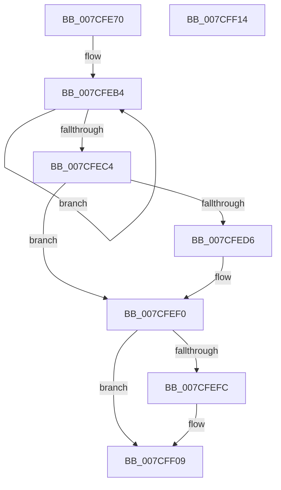

# ExpWorkQueueDestroy

- RVA: `0x007CFE70`–`0x007CFF15` (길이 `165` bytes)
- VA: `0x00000001407CFE70`
- 실행 섹션: `PAGE`
- PDB 이름 있음: `예`; PDB Function 태그: `아니요`
- unwind 정보 RVA: `0x0008A2AC`
- 디코드: `41`개 명령, `165/165` bytes 표시
- 미해석 바이트: `0` (있으면 어셈블리에 `.byte`로 보존)

> 이 문서는 커널 이미지의 기계어와 PDB 기호를 분석해 생성했습니다. 4번과 5번은 함수 원형과 자료형을 바이너리 사용 방식에서 추정한 C 해석이며 원본 소스 복구 결과는 아닙니다.

## 1. Dependencies

- 직접 호출 지점: **4**; 고유 호출 대상: **4**
- 직접 호출자로 확인된 함수: **3**
- RIP 상대 이미지 참조: **0**

### Outgoing calls
- `0x007CFE96` → [KeInitializeEvent](../../text/40/KeInitializeEvent_function_0040DD10.md) (function, `0x0040DD10`)
- `0x007CFEC9` → [KeRundownPriQueue](../../text/5C/KeRundownPriQueue_function_005CA930.md) (function, `0x005CA930`)
- `0x007CFEEB` → [KeWaitForSingleObject](../../text/20/KeWaitForSingleObject_function_0020E6B0.md) (function, `0x0020E6B0`)
- `0x007CFEFC` → [ExpWorkQueueHealthMetricsFree](../7D/ExpWorkQueueHealthMetricsFree_function_007D000C.md) (function, `0x007D000C`)

### Direct callers
- [ExpPartitionDestroy](ExpPartitionDestroy_function_007CF9B8.md) at `0x007CFB10`
- [ExpPartitionCreatePool](../AF/ExpPartitionCreatePool_function_00AF68A8.md) at `0x00AF6AE6`
- [ExpPartitionCreatePoolInternal](../AF/ExpPartitionCreatePoolInternal_function_00AF6C08.md) at `0x00AF6D15`

### Static image references
- 디코드된 RIP-relative 메모리 참조가 없습니다.

## 2. Other-region calls and transfers

- 다른 실행 섹션으로 향하는 call: **3**
  - `0x007CFE96` → [KeInitializeEvent](../../text/40/KeInitializeEvent_function_0040DD10.md) (`PAGE` → `.text`)
  - `0x007CFEC9` → [KeRundownPriQueue](../../text/5C/KeRundownPriQueue_function_005CA930.md) (`PAGE` → `.text`)
  - `0x007CFEEB` → [KeWaitForSingleObject](../../text/20/KeWaitForSingleObject_function_0020E6B0.md) (`PAGE` → `.text`)
- 별도 외부 분기/꼬리 이동을 확인하지 못했습니다.

## 3. Assembly (complete function range)

```asm
007CFE70  48 89 5C 24 08                  mov qword ptr [rsp + 8], rbx
007CFE75  57                              push rdi
007CFE76  48 83 EC 50                     sub rsp, 0x50
007CFE7A  48 8B F9                        mov rdi, rcx
007CFE7D  0F 57 C0                        xorps xmm0, xmm0
007CFE80  33 C0                           xor eax, eax
007CFE82  48 8D 4C 24 30                  lea rcx, [rsp + 0x30]
007CFE87  45 33 C0                        xor r8d, r8d
007CFE8A  48 89 44 24 40                  mov qword ptr [rsp + 0x40], rax
007CFE8F  33 D2                           xor edx, edx
007CFE91  0F 11 44 24 30                  movups xmmword ptr [rsp + 0x30], xmm0
007CFE96  E8 75 DE C3 FF                  call 0x14040dd10
007CFE9B  48 8D 44 24 30                  lea rax, [rsp + 0x30]
007CFEA0  48 89 87 E0 02 00 00            mov qword ptr [rdi + 0x2e0], rax
007CFEA7  0F 0D 8F C8 02 00 00            prefetchw byte ptr [rdi + 0x2c8]
007CFEAE  8B 87 C8 02 00 00               mov eax, dword ptr [rdi + 0x2c8]
007CFEB4  8B C8                           mov ecx, eax
007CFEB6  0F BA E9 0F                     bts ecx, 0xf
007CFEBA  F0 0F B1 8F C8 02 00 00         lock cmpxchg dword ptr [rdi + 0x2c8], ecx
007CFEC2  75 F0                           jne 0x1407cfeb4
007CFEC4  48 8B CF                        mov rcx, rdi
007CFEC7  8B D8                           mov ebx, eax
007CFEC9  E8 62 AA DF FF                  call 0x1405ca930
007CFECE  F7 C3 FF 3F 00 00               test ebx, 0x3fff
007CFED4  76 1A                           jbe 0x1407cfef0
007CFED6  48 83 64 24 20 00               and qword ptr [rsp + 0x20], 0
007CFEDC  45 33 C9                        xor r9d, r9d
007CFEDF  48 8B 8F E0 02 00 00            mov rcx, qword ptr [rdi + 0x2e0]
007CFEE6  45 33 C0                        xor r8d, r8d
007CFEE9  33 D2                           xor edx, edx
007CFEEB  E8 C0 E7 A3 FF                  call 0x14020e6b0
007CFEF0  48 8B 8F E8 02 00 00            mov rcx, qword ptr [rdi + 0x2e8]
007CFEF7  48 85 C9                        test rcx, rcx
007CFEFA  74 0D                           je 0x1407cff09
007CFEFC  E8 0B 01 00 00                  call 0x1407d000c
007CFF01  48 83 A7 E8 02 00 00 00         and qword ptr [rdi + 0x2e8], 0
007CFF09  48 8B 5C 24 60                  mov rbx, qword ptr [rsp + 0x60]
007CFF0E  48 83 C4 50                     add rsp, 0x50
007CFF12  5F                              pop rdi
007CFF13  C3                              ret
007CFF14  CC                              int3
```

## 4. C-style interpretation (structured pseudocode)

```c
__int64 __fastcall ExpWorkQueueDestroy(__int64 a1, int a2, int a3, int a4)
{
    __int64 result;
    __int64 v_rsp;
    unsigned __int64 v_stack_m18;
    unsigned __int64 v_stack_m28;
    unsigned __int64 v_stack_m38;
    unsigned __int64 v_stack_p8;

    v_stack_p8 = v_rbx;
    v_rsp = (v_rsp) - (80);
    result = 0;
    a3 = 0;
    v_stack_m18 = 0;
    a2 = 0;
    v_stack_m28 = v_xmm0;
    result = KeInitializeEvent(v_stack_m28, a2, a3, a4);
    *(unsigned __int64 *)(a1 + 736) = v_stack_m28;
loc_007CFEB4:
    if (condition_is_not_equal) goto loc_007CFEB4;
    result = KeRundownPriQueue(a1, a2, a3, a4);
    if (!(condition_is_below_or_equal)) {
        a4 = 0;
        a1 = *(unsigned __int64 *)(a1 + 736);
        a3 = 0;
        a2 = 0;
        result = KeWaitForSingleObject(a1, a2, a3, a4);
    }
    if (*(unsigned __int64 *)(a1 + 744) != 0) {
        result = ExpWorkQueueHealthMetricsFree(*(unsigned __int64 *)(a1 + 744), a2, a3, a4);
    }
    v_rsp = (v_rsp) + (80);
    return result;
}
```

## 5. (Beta) C Style

```c
int64_t ExpWorkQueueDestroy(void *Arg1, int32_t Arg2, int32_t Arg3, int32_t Arg4)
{
    uint8_t *arg1 = (uint8_t *)Arg1;

    int64_t result;
    int64_t local_rsp;
    uint64_t v_stack_m18;
    uint64_t v_stack_m28;
    uint64_t v_stack_m38;
    uint64_t v_stack_p8;

    v_stack_p8 = local_rbx;
    local_rsp = (local_rsp) - (80);
    result = 0;
    Arg3 = 0;
    v_stack_m18 = 0;
    Arg2 = 0;
    v_stack_m28 = v_xmm0;
    result = KeInitializeEvent(v_stack_m28, Arg2, Arg3, Arg4);
    *(uint64_t *)(arg1 + 0x2E0) = v_stack_m28;
loc_007CFEB4:
    if (condition_is_not_equal) goto loc_007CFEB4;
    result = KeRundownPriQueue(Arg1, Arg2, Arg3, Arg4);
    if (!(condition_is_below_or_equal)) {
        Arg4 = 0;
        Arg1 = *(uint64_t *)(arg1 + 0x2E0);
        Arg3 = 0;
        Arg2 = 0;
        result = KeWaitForSingleObject(Arg1, Arg2, Arg3, Arg4);
    }
    if (*(uint64_t *)(arg1 + 0x2E8) != 0) {
        result = ExpWorkQueueHealthMetricsFree(*(uint64_t *)(arg1 + 0x2E8), Arg2, Arg3, Arg4);
    }
    local_rsp = (local_rsp) + (80);
    return result;
}
```

### 관측된 메모리 오프셋

구조체 형식이 확인되지 않은 접근은 인자 기준의 오프셋으로만 기록했습니다.

| 기준 인자 | 오프셋 표현 | 폭 (bit) | 접근 |
|---|---:|---:|---|
| `Arg1` | `+ 0x2C8` | `8` | `R` |
| `Arg1` | `+ 0x2C8` | `32` | `R` |
| `Arg1` | `+ 0x2E0` | `64` | `R` |
| `Arg1` | `+ 0x2E0` | `64` | `W` |
| `Arg1` | `+ 0x2E8` | `64` | `R` |
| `Arg1` | `+ 0x2E8` | `64` | `R/W` |

## 6. Execution-region graph

[열기: 2D/3D 그래프와 함수 탐색 컨트롤 패널](../../../control-panel.html?section=page&rva=0x007CFE70&view=graph)

- 2D 그래프는 위에서 아래로 흐르고, 3D 그래프는 빈 공간을 드래그해 회전합니다. Shift+드래그는 이동, 휠은 확대·축소, 함수 노드 선택은 대상 보고서 이동입니다.

### Static fallback


