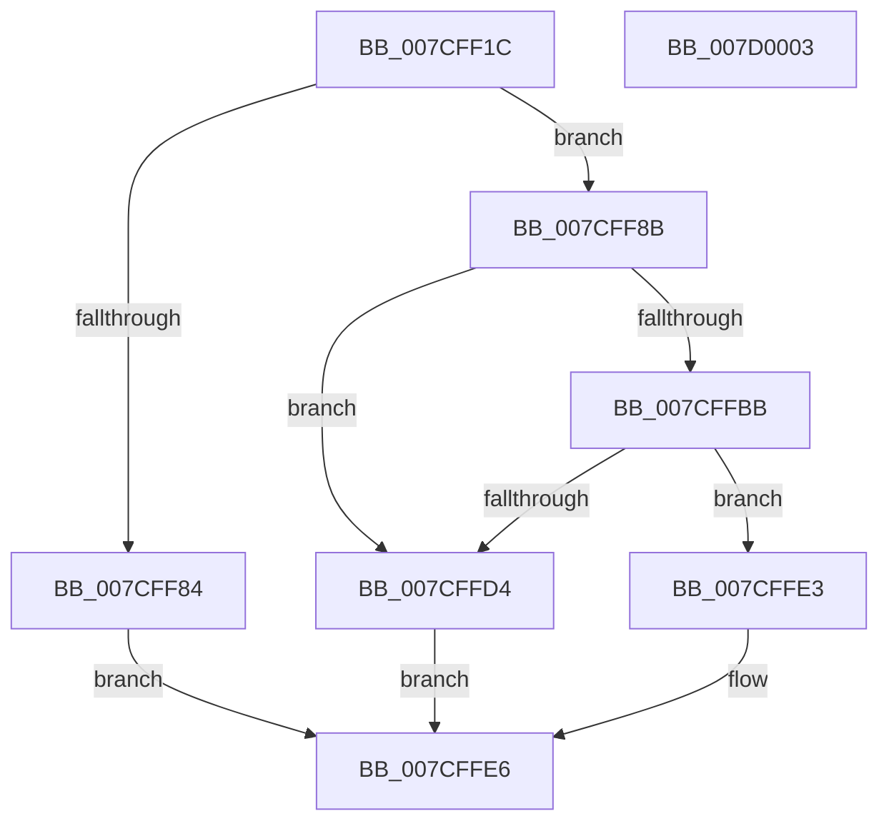

# ExpWorkQueueHealthMetricsAllocate

- RVA: `0x007CFF1C`–`0x007D0004` (길이 `232` bytes)
- VA: `0x00000001407CFF1C`
- 실행 섹션: `PAGE`
- PDB 이름 있음: `예`; PDB Function 태그: `아니요`
- unwind 정보 RVA: `0x000B5F04`
- 디코드: `61`개 명령, `232/232` bytes 표시
- 미해석 바이트: `0` (있으면 어셈블리에 `.byte`로 보존)

> 이 문서는 커널 이미지의 기계어와 PDB 기호를 분석해 생성했습니다. 4번과 5번은 함수 원형과 자료형을 바이너리 사용 방식에서 추정한 C 해석이며 원본 소스 복구 결과는 아닙니다.

## 1. Dependencies

- 직접 호출 지점: **4**; 고유 호출 대상: **3**
- 직접 호출자로 확인된 함수: **1**
- RIP 상대 이미지 참조: **1**

### Outgoing calls
- `0x007CFF75` → [ExAllocatePool3](../../poolcode/B8/ExAllocatePool3_function_00B84270.md) (function, `0x00B84270`)
- `0x007CFFAE` → [ExAllocatePool3](../../poolcode/B8/ExAllocatePool3_function_00B84270.md) (function, `0x00B84270`)
- `0x007CFFC6` → [ExAllocatePool2](../../poolcode/B8/ExAllocatePool2_function_00B820F0.md) (function, `0x00B820F0`)
- `0x007CFFDC` → [ExpWorkQueueHealthMetricsFree](../7D/ExpWorkQueueHealthMetricsFree_function_007D000C.md) (function, `0x007D000C`)

### Direct callers
- [ExpPartitionCreatePoolInternal](../AF/ExpPartitionCreatePoolInternal_function_00AF6C08.md) at `0x00AF6C84`

### Static image references
- `0x007CFF8B` → RVA `0x00E0EBDC` (`.data`; read)

## 2. Other-region calls and transfers

- 다른 실행 섹션으로 향하는 call: **3**
  - `0x007CFF75` → [ExAllocatePool3](../../poolcode/B8/ExAllocatePool3_function_00B84270.md) (`PAGE` → `POOLCODE`)
  - `0x007CFFAE` → [ExAllocatePool3](../../poolcode/B8/ExAllocatePool3_function_00B84270.md) (`PAGE` → `POOLCODE`)
  - `0x007CFFC6` → [ExAllocatePool2](../../poolcode/B8/ExAllocatePool2_function_00B820F0.md) (`PAGE` → `POOLCODE`)
- 별도 외부 분기/꼬리 이동을 확인하지 못했습니다.

## 3. Assembly (complete function range)

```asm
007CFF1C  48 8B C4                        mov rax, rsp
007CFF1F  48 89 58 08                     mov qword ptr [rax + 8], rbx
007CFF23  48 89 70 10                     mov qword ptr [rax + 0x10], rsi
007CFF27  48 89 78 18                     mov qword ptr [rax + 0x18], rdi
007CFF2B  4C 89 70 20                     mov qword ptr [rax + 0x20], r14
007CFF2F  41 57                           push r15
007CFF31  48 83 EC 40                     sub rsp, 0x40
007CFF35  0F 57 C0                        xorps xmm0, xmm0
007CFF38  C7 44 24 20 01 00 00 00         mov dword ptr [rsp + 0x20], 1
007CFF40  0F 11 40 E8                     movups xmmword ptr [rax - 0x18], xmm0
007CFF44  C6 40 E8 03                     mov byte ptr [rax - 0x18], 3
007CFF48  4C 8D 4C 24 30                  lea r9, [rsp + 0x30]
007CFF4D  48 0F BA 68 E8 08               bts qword ptr [rax - 0x18], 8
007CFF53  4C 8B F1                        mov r14, rcx
007CFF56  0F B7 C2                        movzx eax, dx
007CFF59  41 BF 40 00 00 00               mov r15d, 0x40
007CFF5F  0F BA E8 1F                     bts eax, 0x1f
007CFF63  BA 10 01 00 00                  mov edx, 0x110
007CFF68  41 B8 45 78 57 6C               mov r8d, 0x6c577845
007CFF6E  89 44 24 38                     mov dword ptr [rsp + 0x38], eax
007CFF72  41 8B CF                        mov ecx, r15d
007CFF75  E8 F6 42 3B 00                  call 0x140b84270
007CFF7A  33 DB                           xor ebx, ebx
007CFF7C  48 8B F8                        mov rdi, rax
007CFF7F  48 85 C0                        test rax, rax
007CFF82  75 07                           jne 0x1407cff8b
007CFF84  BB 9A 00 00 C0                  mov ebx, 0xc000009a
007CFF89  EB 5B                           jmp 0x1407cffe6
007CFF8B  8B 05 4B EC 63 00               mov eax, dword ptr [rip + 0x63ec4b]
007CFF91  4C 8D 4C 24 30                  lea r9, [rsp + 0x30]
007CFF96  C1 E0 08                        shl eax, 8
007CFF99  41 B8 45 78 57 6C               mov r8d, 0x6c577845
007CFF9F  8B D0                           mov edx, eax
007CFFA1  49 8B CF                        mov rcx, r15
007CFFA4  8B F0                           mov esi, eax
007CFFA6  C7 44 24 20 01 00 00 00         mov dword ptr [rsp + 0x20], 1
007CFFAE  E8 BD 42 3B 00                  call 0x140b84270
007CFFB3  48 89 07                        mov qword ptr [rdi], rax
007CFFB6  48 85 C0                        test rax, rax
007CFFB9  74 19                           je 0x1407cffd4
007CFFBB  41 B8 45 78 57 6C               mov r8d, 0x6c577845
007CFFC1  8B D6                           mov edx, esi
007CFFC3  49 8B CF                        mov rcx, r15
007CFFC6  E8 25 21 3B 00                  call 0x140b820f0
007CFFCB  48 89 47 08                     mov qword ptr [rdi + 8], rax
007CFFCF  48 85 C0                        test rax, rax
007CFFD2  75 0F                           jne 0x1407cffe3
007CFFD4  48 8B CF                        mov rcx, rdi
007CFFD7  BB 9A 00 00 C0                  mov ebx, 0xc000009a
007CFFDC  E8 2B 00 00 00                  call 0x1407d000c
007CFFE1  EB 03                           jmp 0x1407cffe6
007CFFE3  49 89 3E                        mov qword ptr [r14], rdi
007CFFE6  48 8B 74 24 58                  mov rsi, qword ptr [rsp + 0x58]
007CFFEB  8B C3                           mov eax, ebx
007CFFED  48 8B 5C 24 50                  mov rbx, qword ptr [rsp + 0x50]
007CFFF2  48 8B 7C 24 60                  mov rdi, qword ptr [rsp + 0x60]
007CFFF7  4C 8B 74 24 68                  mov r14, qword ptr [rsp + 0x68]
007CFFFC  48 83 C4 40                     add rsp, 0x40
007D0000  41 5F                           pop r15
007D0002  C3                              ret
007D0003  CC                              int3
```

## 4. C-style interpretation (structured pseudocode)

```c
__int64 __fastcall ExpWorkQueueHealthMetricsAllocate(__int64 a1, unsigned __int16 a2)
{
    __int64 result;
    __int64 v_rbx;
    __int64 v_rsp;
    unsigned int v_stack_m10;
    unsigned __int64 v_stack_m18;
    unsigned int v_stack_m28;
    unsigned __int64 v_stack_p10;
    unsigned __int64 v_stack_p18;
    unsigned __int64 v_stack_p20;
    unsigned __int64 v_stack_p8;

    *(unsigned __int64 *)(v_rsp + 8) = v_rbx;
    *(unsigned __int64 *)(v_rsp + 16) = v_rsi;
    *(unsigned __int64 *)(v_rsp + 24) = v_rdi;
    *(unsigned __int64 *)(v_rsp + 32) = v_r14;
    v_rsp = (v_rsp) - (64);
    v_stack_m28 = 1;
    *(unsigned __int64 *)(v_rsp - 24) = v_xmm0;
    *(unsigned __int8 *)(v_rsp - 24) = 3;
    v_stack_m10 = a2;
    result = ExAllocatePool3(64, 272, (unsigned int)(0x6C577845ULL), v_stack_m18);
    v_rbx = 0;
    if (result != 0) goto loc_007CFF8B;
    goto loc_007CFFE6;
loc_007CFF8B:
    result = (unsigned int)(((unsigned int)(*(unsigned int *)(v_rip + 6548555))) << (8));
    v_stack_m28 = 1;
    result = ExAllocatePool3(64, (unsigned int)((unsigned int)(result)), (unsigned int)(0x6C577845ULL), v_stack_m18);
    *(unsigned __int64 *)(result) = result;
    if (result == 0) goto loc_007CFFD4;
    result = ExAllocatePool2(64, (unsigned int)((unsigned int)((unsigned int)((unsigned int)(result)))), (unsigned int)(0x6C577845ULL), v_stack_m18);
    *(unsigned __int64 *)(result + 8) = result;
    if (result != 0) goto loc_007CFFE3;
loc_007CFFD4:
    result = ExpWorkQueueHealthMetricsFree(result, (unsigned int)((unsigned int)((unsigned int)((unsigned int)(result)))), (unsigned int)(0x6C577845ULL), v_stack_m18);
    goto loc_007CFFE6;
loc_007CFFE3:
    *(unsigned __int64 *)(a1) = result;
loc_007CFFE6:
    v_rsp = (v_rsp) + (64);
    return (unsigned int)((unsigned int)((unsigned int)(0xC000009AULL)));
}
```

## 5. (Beta) C Style

```c
int64_t ExpWorkQueueHealthMetricsAllocate(void *Arg1, uint16_t Arg2)
{
    uint8_t *arg1 = (uint8_t *)Arg1;

    int64_t result;
    int64_t local_rbx;
    int64_t local_rsp;
    uint32_t v_stack_m10;
    uint64_t v_stack_m18;
    uint32_t v_stack_m28;
    uint64_t v_stack_p10;
    uint64_t v_stack_p18;
    uint64_t v_stack_p20;
    uint64_t v_stack_p8;

    *(uint64_t *)(local_rsp + 0x8) = local_rbx;
    *(uint64_t *)(local_rsp + 0x10) = local_rsi;
    *(uint64_t *)(local_rsp + 0x18) = local_rdi;
    *(uint64_t *)(local_rsp + 0x20) = local_r14;
    local_rsp = (local_rsp) - (64);
    v_stack_m28 = 1;
    *(uint64_t *)(local_rsp - 0x18) = v_xmm0;
    *(uint8_t *)(local_rsp - 0x18) = 3;
    v_stack_m10 = Arg2;
    result = ExAllocatePool3(64, 272, (uint32_t)(0x6C577845ULL), v_stack_m18);
    local_rbx = 0;
    if (result != 0) goto loc_007CFF8B;
    goto loc_007CFFE6;
loc_007CFF8B:
    result = (uint32_t)(((uint32_t)(*(uint32_t *)(v_rip + 0x63EC4B))) << (8));
    v_stack_m28 = 1;
    result = ExAllocatePool3(64, (uint32_t)((uint32_t)(result)), (uint32_t)(0x6C577845ULL), v_stack_m18);
    *(uint64_t *)(result) = result;
    if (result == 0) goto loc_007CFFD4;
    result = ExAllocatePool2(64, (uint32_t)((uint32_t)((uint32_t)((uint32_t)(result)))), (uint32_t)(0x6C577845ULL), v_stack_m18);
    *(uint64_t *)(result + 0x8) = result;
    if (result != 0) goto loc_007CFFE3;
loc_007CFFD4:
    result = ExpWorkQueueHealthMetricsFree(result, (uint32_t)((uint32_t)((uint32_t)((uint32_t)(result)))), (uint32_t)(0x6C577845ULL), v_stack_m18);
    goto loc_007CFFE6;
loc_007CFFE3:
    *(uint64_t *)(arg1) = result;
loc_007CFFE6:
    local_rsp = (local_rsp) + (64);
    return (uint32_t)((uint32_t)((uint32_t)(0xC000009AULL)));
}
```

### 관측된 메모리 오프셋

구조체 형식이 확인되지 않은 접근은 인자 기준의 오프셋으로만 기록했습니다.

| 기준 인자 | 오프셋 표현 | 폭 (bit) | 접근 |
|---|---:|---:|---|
| `Arg1` | `+ 0x0` | `64` | `W` |

## 6. Execution-region graph

[열기: 2D/3D 그래프와 함수 탐색 컨트롤 패널](../../../control-panel.html?section=page&rva=0x007CFF1C&view=graph)

- 2D 그래프는 위에서 아래로 흐르고, 3D 그래프는 빈 공간을 드래그해 회전합니다. Shift+드래그는 이동, 휠은 확대·축소, 함수 노드 선택은 대상 보고서 이동입니다.

### Static fallback


