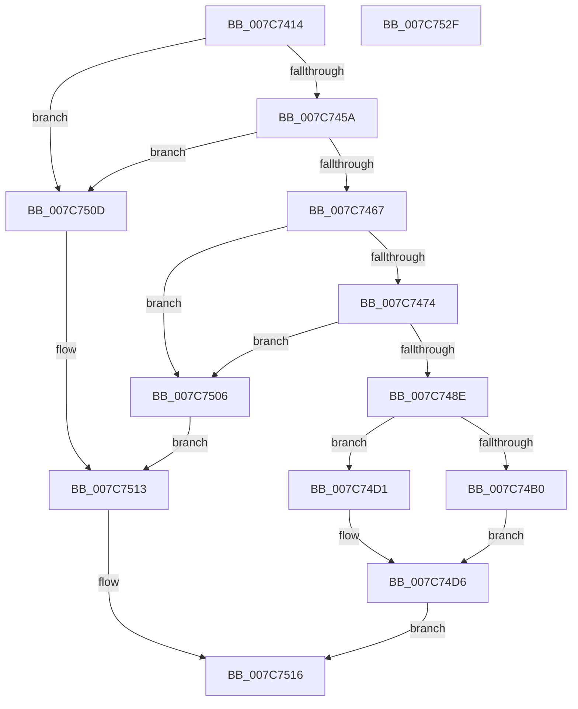

# HeadlessTerminalAddResources

- RVA: `0x007C7414`–`0x007C7530` (길이 `284` bytes)
- VA: `0x00000001407C7414`
- 실행 섹션: `PAGE`
- PDB 이름 있음: `예`; PDB Function 태그: `아니요`
- unwind 정보 RVA: `0x00093E28`
- 디코드: `76`개 명령, `284/284` bytes 표시
- 미해석 바이트: `0` (있으면 어셈블리에 `.byte`로 보존)

> 이 문서는 커널 이미지의 기계어와 PDB 기호를 분석해 생성했습니다. 4번과 5번은 함수 원형과 자료형을 바이너리 사용 방식에서 추정한 C 해석이며 원본 소스 복구 결과는 아닙니다.

## 1. Dependencies

- 직접 호출 지점: **3**; 고유 호출 대상: **3**
- 직접 호출자로 확인된 함수: **1**
- RIP 상대 이미지 참조: **1**

### Outgoing calls
- `0x007C7481` → [ExAllocatePool2](../../poolcode/B8/ExAllocatePool2_function_00B820F0.md) (function, `0x00B820F0`)
- `0x007C7497` → [memcpy](../../text/6C/memcpy_function_006C6840.md) (function, `0x006C6840`)
- `0x007C74CA` → [HalTranslateBusAddress](../../text/46/HalTranslateBusAddress_function_004610B0.md) (function, `0x004610B0`)

### Direct callers
- [IoReportHalResourceUsage](../../init/C3/IoReportHalResourceUsage_function_00C32FB0.md) at `0x00C33060`
- [IoReportHalResourceUsage](../../init/C3/IoReportHalResourceUsage_function_00C32FB0.md) at `0x00C330CB`

### Static image references
- `0x007C7445` → RVA `0x00E68578` (`.data`; read)

## 2. Other-region calls and transfers

- 다른 실행 섹션으로 향하는 call: **3**
  - `0x007C7481` → [ExAllocatePool2](../../poolcode/B8/ExAllocatePool2_function_00B820F0.md) (`PAGE` → `POOLCODE`)
  - `0x007C7497` → [memcpy](../../text/6C/memcpy_function_006C6840.md) (`PAGE` → `.text`)
  - `0x007C74CA` → [HalTranslateBusAddress](../../text/46/HalTranslateBusAddress_function_004610B0.md) (`PAGE` → `.text`)
- 별도 외부 분기/꼬리 이동을 확인하지 못했습니다.

## 3. Assembly (complete function range)

```asm
007C7414  48 8B C4                        mov rax, rsp
007C7417  48 89 58 08                     mov qword ptr [rax + 8], rbx
007C741B  48 89 68 10                     mov qword ptr [rax + 0x10], rbp
007C741F  48 89 70 18                     mov qword ptr [rax + 0x18], rsi
007C7423  57                              push rdi
007C7424  41 56                           push r14
007C7426  41 57                           push r15
007C7428  48 83 EC 40                     sub rsp, 0x40
007C742C  48 8B BC 24 80 00 00 00         mov rdi, qword ptr [rsp + 0x80]
007C7434  45 33 FF                        xor r15d, r15d
007C7437  4C 89 78 E0                     mov qword ptr [rax - 0x20], r15
007C743B  49 8B F1                        mov rsi, r9
007C743E  44 89 78 D8                     mov dword ptr [rax - 0x28], r15d
007C7442  41 8A E8                        mov bpl, r8b
007C7445  48 8B 05 2C 11 6A 00            mov rax, qword ptr [rip + 0x6a112c]
007C744C  4C 8B F1                        mov r14, rcx
007C744F  8B DA                           mov ebx, edx
007C7451  48 85 C0                        test rax, rax
007C7454  0F 84 B3 00 00 00               je 0x1407c750d
007C745A  F7 40 30 00 10 00 00            test dword ptr [rax + 0x30], 0x1000
007C7461  0F 85 A6 00 00 00               jne 0x1407c750d
007C7467  8D 43 24                        lea eax, [rbx + 0x24]
007C746A  89 07                           mov dword ptr [rdi], eax
007C746C  3B C3                           cmp eax, ebx
007C746E  0F 82 92 00 00 00               jb 0x1407c7506
007C7474  8B D0                           mov edx, eax
007C7476  B9 00 01 00 00                  mov ecx, 0x100
007C747B  41 B8 48 64 6C 73               mov r8d, 0x736c6448
007C7481  E8 6A AC 3B 00                  call 0x140b820f0
007C7486  48 89 06                        mov qword ptr [rsi], rax
007C7489  48 85 C0                        test rax, rax
007C748C  74 78                           je 0x1407c7506
007C748E  44 8B C3                        mov r8d, ebx
007C7491  49 8B D6                        mov rdx, r14
007C7494  48 8B C8                        mov rcx, rax
007C7497  E8 A4 F3 EF FF                  call 0x1406c6840
007C749C  48 8B 05 D5 10 6A 00            mov rax, qword ptr [rip + 0x6a10d5]
007C74A3  41 8D 7F 01                     lea edi, [r15 + 1]
007C74A7  48 8B 40 40                     mov rax, qword ptr [rax + 0x40]
007C74AB  40 84 ED                        test bpl, bpl
007C74AE  74 21                           je 0x1407c74d1
007C74B0  48 8D 4C 24 38                  lea rcx, [rsp + 0x38]
007C74B5  89 7C 24 30                     mov dword ptr [rsp + 0x30], edi
007C74B9  48 89 4C 24 20                  mov qword ptr [rsp + 0x20], rcx
007C74BE  4C 8D 4C 24 30                  lea r9, [rsp + 0x30]
007C74C3  33 C9                           xor ecx, ecx
007C74C5  4C 8B C0                        mov r8, rax
007C74C8  33 D2                           xor edx, edx
007C74CA  E8 E1 9B C9 FF                  call 0x1404610b0
007C74CF  EB 05                           jmp 0x1407c74d6
007C74D1  48 89 44 24 38                  mov qword ptr [rsp + 0x38], rax
007C74D6  48 8B 0E                        mov rcx, qword ptr [rsi]
007C74D9  01 39                           add dword ptr [rcx], edi
007C74DB  48 89 3C 19                     mov qword ptr [rcx + rbx], rdi
007C74DF  89 7C 19 0C                     mov dword ptr [rcx + rbx + 0xc], edi
007C74E3  44 89 7C 19 08                  mov dword ptr [rcx + rbx + 8], r15d
007C74E8  C7 44 19 10 01 02 01 00         mov dword ptr [rcx + rbx + 0x10], 0x10201
007C74F0  48 8B 44 24 38                  mov rax, qword ptr [rsp + 0x38]
007C74F5  48 89 44 19 14                  mov qword ptr [rcx + rbx + 0x14], rax
007C74FA  33 C0                           xor eax, eax
007C74FC  C7 44 19 1C 08 00 00 00         mov dword ptr [rcx + rbx + 0x1c], 8
007C7504  EB 10                           jmp 0x1407c7516
007C7506  B8 9A 00 00 C0                  mov eax, 0xc000009a
007C750B  EB 06                           jmp 0x1407c7513
007C750D  4D 89 39                        mov qword ptr [r9], r15
007C7510  41 8B C7                        mov eax, r15d
007C7513  44 89 3F                        mov dword ptr [rdi], r15d
007C7516  48 8B 5C 24 60                  mov rbx, qword ptr [rsp + 0x60]
007C751B  48 8B 6C 24 68                  mov rbp, qword ptr [rsp + 0x68]
007C7520  48 8B 74 24 70                  mov rsi, qword ptr [rsp + 0x70]
007C7525  48 83 C4 40                     add rsp, 0x40
007C7529  41 5F                           pop r15
007C752B  41 5E                           pop r14
007C752D  5F                              pop rdi
007C752E  C3                              ret
007C752F  CC                              int3
```

## 4. C-style interpretation (structured pseudocode)

```c
__int64 __fastcall HeadlessTerminalAddResources(__int64 a1, int a2, unsigned __int8 a3, __int64 a4, __int64 a5)
{
    __int64 result;
    __int64 v_r15;
    __int64 v_rsp;
    unsigned __int64 v_stack_m20;
    unsigned int v_stack_m28;
    unsigned __int64 v_stack_m38;
    unsigned __int64 v_stack_p10;
    unsigned __int64 v_stack_p18;
    unsigned __int64 v_stack_p8;

    *(unsigned __int64 *)(v_rsp + 8) = v_rbx;
    *(unsigned __int64 *)(v_rsp + 16) = v_rbp;
    *(unsigned __int64 *)(v_rsp + 24) = v_rsi;
    v_rsp = (v_rsp) - (64);
    v_r15 = 0;
    *(unsigned __int64 *)(v_rsp - 32) = 0;
    *(unsigned int *)(v_rsp - 40) = 0;
    if (*(unsigned __int64 *)(v_rip + 6951212) == 0) goto loc_007C750D;
    if (((*(unsigned int *)(*(unsigned __int64 *)(v_rip + 6951212) + 48)) & (0x1000ULL)) != 0) goto loc_007C750D;
    *(unsigned int *)(a5) = (unsigned int)((unsigned int)(a2) + 36);
    if (((unsigned int)((unsigned int)(a2) + 36)) < ((unsigned int)((unsigned int)(a2)))) goto loc_007C7506;
    result = ExAllocatePool2(256, (unsigned int)((unsigned int)((unsigned int)(a2) + 36)), (unsigned int)(0x736C6448ULL), a4);
    *(unsigned __int64 *)(a4) = result;
    if (result == 0) goto loc_007C7506;
    result = memcpy(result, a1, (unsigned int)((unsigned int)((unsigned int)(a2))), a4);
    if (a3 == 0) goto loc_007C74D1;
    v_stack_m28 = (unsigned int)(v_r15 + 1);
    v_stack_m38 = v_stack_m20;
    a1 = 0;
    a2 = 0;
    result = HalTranslateBusAddress(a1, a2, *(unsigned __int64 *)(*(unsigned __int64 *)(v_rip + 6951125) + 64), v_stack_m28);
    goto loc_007C74D6;
loc_007C74D1:
    v_stack_m20 = result;
loc_007C74D6:
    *(unsigned __int64 *)(*(unsigned __int64 *)(a4) + (unsigned int)(a2) * 1) = v_r15 + 1;
    *(unsigned int *)(*(unsigned __int64 *)(a4) + (unsigned int)(a2) * 1 + 12) = (unsigned int)(v_r15 + 1);
    *(unsigned int *)(*(unsigned __int64 *)(a4) + (unsigned int)(a2) * 1 + 8) = 0;
    *(unsigned int *)(*(unsigned __int64 *)(a4) + (unsigned int)(a2) * 1 + 16) = 0x10201ULL;
    *(unsigned __int64 *)(*(unsigned __int64 *)(a4) + (unsigned int)(a2) * 1 + 20) = v_stack_m20;
    result = 0;
    *(unsigned int *)(*(unsigned __int64 *)(a4) + (unsigned int)(a2) * 1 + 28) = 8;
    goto loc_007C7516;
loc_007C7506:
    goto loc_007C7513;
loc_007C750D:
    *(unsigned __int64 *)(v_stack_m28) = 0;
loc_007C7513:
    *(unsigned int *)(v_r15 + 1) = 0;
loc_007C7516:
    v_rsp = (v_rsp) + (64);
    return 0;
}
```

## 5. (Beta) C Style

```c
int64_t HeadlessTerminalAddResources(int64_t Arg1, void *Arg2, uint8_t Arg3, void *Arg4, void *Arg5)
{
    uint8_t *arg2 = (uint8_t *)Arg2;
    uint8_t *arg4 = (uint8_t *)Arg4;
    uint8_t *arg5 = (uint8_t *)Arg5;

    int64_t result;
    int64_t local_r15;
    int64_t local_rsp;
    uint64_t v_stack_m20;
    uint32_t v_stack_m28;
    uint64_t v_stack_m38;
    uint64_t v_stack_p10;
    uint64_t v_stack_p18;
    uint64_t v_stack_p8;

    *(uint64_t *)(local_rsp + 0x8) = local_rbx;
    *(uint64_t *)(local_rsp + 0x10) = local_rbp;
    *(uint64_t *)(local_rsp + 0x18) = local_rsi;
    local_rsp = (local_rsp) - (64);
    local_r15 = 0;
    *(uint64_t *)(local_rsp - 0x20) = 0;
    *(uint32_t *)(local_rsp - 0x28) = 0;
    if (*(uint64_t *)(v_rip + 0x6A112C) == 0) goto loc_007C750D;
    if (((*(uint32_t *)(*(uint64_t *)(v_rip + 0x6A112C) + 0x30)) & (0x1000ULL)) != 0) goto loc_007C750D;
    *(uint32_t *)(arg5) = (uint32_t)((uint32_t)(Arg2) + 36);
    if (((uint32_t)((uint32_t)(Arg2) + 36)) < ((uint32_t)((uint32_t)(Arg2)))) goto loc_007C7506;
    result = ExAllocatePool2(256, (uint32_t)((uint32_t)((uint32_t)(Arg2) + 36)), (uint32_t)(0x736C6448ULL), Arg4);
    *(uint64_t *)(arg4) = result;
    if (result == 0) goto loc_007C7506;
    result = memcpy(result, Arg1, (uint32_t)((uint32_t)((uint32_t)(Arg2))), Arg4);
    if (Arg3 == 0) goto loc_007C74D1;
    v_stack_m28 = (uint32_t)(local_r15 + 1);
    v_stack_m38 = v_stack_m20;
    Arg1 = 0;
    Arg2 = 0;
    result = HalTranslateBusAddress(Arg1, Arg2, *(uint64_t *)(*(uint64_t *)(v_rip + 0x6A10D5) + 0x40), v_stack_m28);
    goto loc_007C74D6;
loc_007C74D1:
    v_stack_m20 = result;
loc_007C74D6:
    *(uint64_t *)(*(uint64_t *)(arg4) + (uint32_t)(arg2) * 1) = local_r15 + 1;
    *(uint32_t *)(*(uint64_t *)(arg4) + (uint32_t)(arg2) * 1 + 0xC) = (uint32_t)(local_r15 + 1);
    *(uint32_t *)(*(uint64_t *)(arg4) + (uint32_t)(arg2) * 1 + 0x8) = 0;
    *(uint32_t *)(*(uint64_t *)(arg4) + (uint32_t)(arg2) * 1 + 0x10) = 0x10201ULL;
    *(uint64_t *)(*(uint64_t *)(arg4) + (uint32_t)(arg2) * 1 + 0x14) = v_stack_m20;
    result = 0;
    *(uint32_t *)(*(uint64_t *)(arg4) + (uint32_t)(arg2) * 1 + 0x1C) = 8;
    goto loc_007C7516;
loc_007C7506:
    goto loc_007C7513;
loc_007C750D:
    *(uint64_t *)(v_stack_m28) = 0;
loc_007C7513:
    *(uint32_t *)(local_r15 + 0x1) = 0;
loc_007C7516:
    local_rsp = (local_rsp) + (64);
    return 0;
}
```

### 관측된 메모리 오프셋

구조체 형식이 확인되지 않은 접근은 인자 기준의 오프셋으로만 기록했습니다.

| 기준 인자 | 오프셋 표현 | 폭 (bit) | 접근 |
|---|---:|---:|---|
| `Arg2` | `+ 0x24` | `32` | `R` |
| `Arg4` | `+ 0x0` | `64` | `R` |
| `Arg4` | `+ 0x0` | `64` | `W` |
| `Arg5` | `+ 0x0` | `32` | `W` |

## 6. Execution-region graph

[열기: 2D/3D 그래프와 함수 탐색 컨트롤 패널](../../../control-panel.html?section=page&rva=0x007C7414&view=graph)

- 2D 그래프는 위에서 아래로 흐르고, 3D 그래프는 빈 공간을 드래그해 회전합니다. Shift+드래그는 이동, 휠은 확대·축소, 함수 노드 선택은 대상 보고서 이동입니다.

### Static fallback


