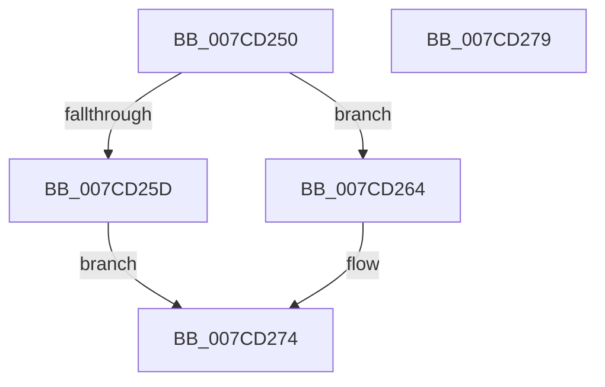

# NtAddBootEntry

- RVA: `0x007CD250`–`0x007CD27A` (길이 `42` bytes)
- VA: `0x00000001407CD250`
- 실행 섹션: `PAGE`
- PDB 이름 있음: `예`; PDB Function 태그: `아니요`
- unwind 정보 RVA: `0x0005C788`
- 디코드: `12`개 명령, `42/42` bytes 표시
- 미해석 바이트: `0` (있으면 어셈블리에 `.byte`로 보존)

> 이 문서는 커널 이미지의 기계어와 PDB 기호를 분석해 생성했습니다. 4번과 5번은 함수 원형과 자료형을 바이너리 사용 방식에서 추정한 C 해석이며 원본 소스 복구 결과는 아닙니다.

## 1. Dependencies

- 직접 호출 지점: **1**; 고유 호출 대상: **1**
- 직접 호출자로 확인된 함수: **0**
- RIP 상대 이미지 참조: **1**

### Outgoing calls
- `0x007CD26F` → [ExpSetBootEntry](ExpSetBootEntry_function_007CBD2C.md) (function, `0x007CBD2C`)

### Direct callers
- 이 함수 시작 RVA로 연결되는 직접 call은 확인되지 않았습니다. 간접 호출은 완전히 역산할 수 없습니다.

### Static image references
- `0x007CD254` → RVA `0x00EFF050` (`.data`; read)

## 2. Other-region calls and transfers

- 다른 실행 섹션으로 향하는 call: **0**
- 별도 외부 분기/꼬리 이동을 확인하지 못했습니다.

## 3. Assembly (complete function range)

```asm
007CD250  48 83 EC 28                     sub rsp, 0x28
007CD254  83 3D F5 1D 73 00 02            cmp dword ptr [rip + 0x731df5], 2
007CD25B  74 07                           je 0x1407cd264
007CD25D  B8 02 00 00 C0                  mov eax, 0xc0000002
007CD262  EB 10                           jmp 0x1407cd274
007CD264  4C 8B C2                        mov r8, rdx
007CD267  48 8B D1                        mov rdx, rcx
007CD26A  B9 01 00 00 00                  mov ecx, 1
007CD26F  E8 B8 EA FF FF                  call 0x1407cbd2c
007CD274  48 83 C4 28                     add rsp, 0x28
007CD278  C3                              ret
007CD279  CC                              int3
```

## 4. C-style interpretation (structured pseudocode)

```c
__int64 __fastcall NtAddBootEntry(__int64 a1, __int64 a2)
{
    __int64 result;
    __int64 v_rsp;

    v_rsp = (v_rsp) - (40);
    if ((*(unsigned int *)(v_rip + 7544309)) == 2) goto loc_007CD264;
    goto loc_007CD274;
loc_007CD264:
    result = ExpSetBootEntry(1, a1, a2, a4);
loc_007CD274:
    v_rsp = (v_rsp) + (40);
    return result;
}
```

## 5. (Beta) C Style

```c
int64_t NtAddBootEntry(int64_t Arg1, int64_t Arg2)
{
    int64_t result;
    int64_t local_rsp;

    local_rsp = (local_rsp) - (40);
    if ((*(uint32_t *)(v_rip + 0x731DF5)) == 2) goto loc_007CD264;
    goto loc_007CD274;
loc_007CD264:
    result = ExpSetBootEntry(1, Arg1, Arg2, a4);
loc_007CD274:
    local_rsp = (local_rsp) + (40);
    return result;
}
```

## 6. Execution-region graph

[열기: 2D/3D 그래프와 함수 탐색 컨트롤 패널](../../../control-panel.html?section=page&rva=0x007CD250&view=graph)

- 2D 그래프는 위에서 아래로 흐르고, 3D 그래프는 빈 공간을 드래그해 회전합니다. Shift+드래그는 이동, 휠은 확대·축소, 함수 노드 선택은 대상 보고서 이동입니다.

### Static fallback


