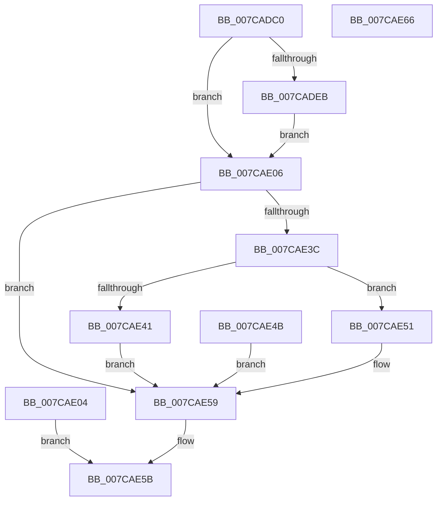

# NtCreateCrossVmEvent

- RVA: `0x007CADC0`–`0x007CAE67` (길이 `167` bytes)
- VA: `0x00000001407CADC0`
- 실행 섹션: `PAGE`
- PDB 이름 있음: `예`; PDB Function 태그: `아니요`
- unwind 정보 RVA: `0x000D50DC`
- 디코드: `44`개 명령, `167/167` bytes 표시
- 미해석 바이트: `0` (있으면 어셈블리에 `.byte`로 보존)

> 이 문서는 커널 이미지의 기계어와 PDB 기호를 분석해 생성했습니다. 4번과 5번은 함수 원형과 자료형을 바이너리 사용 방식에서 추정한 C 해석이며 원본 소스 복구 결과는 아닙니다.

## 1. Dependencies

- 직접 호출 지점: **1**; 고유 호출 대상: **1**
- 직접 호출자로 확인된 함수: **0**
- RIP 상대 이미지 참조: **0**

### Outgoing calls
- `0x007CAE2D` → [ExpCreateCrossVmEvent](../7D/ExpCreateCrossVmEvent_function_007D530C.md) (function, `0x007D530C`)

### Direct callers
- 이 함수 시작 RVA로 연결되는 직접 call은 확인되지 않았습니다. 간접 호출은 완전히 역산할 수 없습니다.

### Static image references
- 디코드된 RIP-relative 메모리 참조가 없습니다.

## 2. Other-region calls and transfers

- 다른 실행 섹션으로 향하는 call: **0**
- 별도 외부 분기/꼬리 이동을 확인하지 못했습니다.

## 3. Assembly (complete function range)

```asm
007CADC0  48 89 5C 24 08                  mov qword ptr [rsp + 8], rbx
007CADC5  57                              push rdi
007CADC6  48 83 EC 50                     sub rsp, 0x50
007CADCA  44 8B D2                        mov r10d, edx
007CADCD  48 8B D9                        mov rbx, rcx
007CADD0  48 83 64 24 48 00               and qword ptr [rsp + 0x48], 0
007CADD6  65 48 8B 04 25 88 01 00 00      mov rax, qword ptr gs:[0x188]
007CADDF  40 8A B8 32 02 00 00            mov dil, byte ptr [rax + 0x232]
007CADE6  40 84 FF                        test dil, dil
007CADE9  74 1B                           je 0x1407cae06
007CADEB  48 BA 00 00 FF FF FF 7F 00 00   movabs rdx, 0x7fffffff0000
007CADF5  48 3B CA                        cmp rcx, rdx
007CADF8  48 0F 42 D1                     cmovb rdx, rcx
007CADFC  48 8B 02                        mov rax, qword ptr [rdx]
007CADFF  48 89 02                        mov qword ptr [rdx], rax
007CAE02  EB 02                           jmp 0x1407cae06
007CAE04  EB 55                           jmp 0x1407cae5b
007CAE06  40 88 7C 24 30                  mov byte ptr [rsp + 0x30], dil
007CAE0B  48 8B 84 24 88 00 00 00         mov rax, qword ptr [rsp + 0x88]
007CAE13  48 89 44 24 28                  mov qword ptr [rsp + 0x28], rax
007CAE18  48 8B 84 24 80 00 00 00         mov rax, qword ptr [rsp + 0x80]
007CAE20  48 89 44 24 20                  mov qword ptr [rsp + 0x20], rax
007CAE25  41 8B D2                        mov edx, r10d
007CAE28  48 8D 4C 24 48                  lea rcx, [rsp + 0x48]
007CAE2D  E8 DA A4 00 00                  call 0x1407d530c
007CAE32  8B D0                           mov edx, eax
007CAE34  89 44 24 40                     mov dword ptr [rsp + 0x40], eax
007CAE38  85 C0                           test eax, eax
007CAE3A  78 1D                           js 0x1407cae59
007CAE3C  40 84 FF                        test dil, dil
007CAE3F  74 10                           je 0x1407cae51
007CAE41  48 8B 4C 24 48                  mov rcx, qword ptr [rsp + 0x48]
007CAE46  48 89 0B                        mov qword ptr [rbx], rcx
007CAE49  EB 0E                           jmp 0x1407cae59
007CAE4B  8B 54 24 40                     mov edx, dword ptr [rsp + 0x40]
007CAE4F  EB 08                           jmp 0x1407cae59
007CAE51  48 8B 44 24 48                  mov rax, qword ptr [rsp + 0x48]
007CAE56  48 89 03                        mov qword ptr [rbx], rax
007CAE59  8B C2                           mov eax, edx
007CAE5B  48 8B 5C 24 60                  mov rbx, qword ptr [rsp + 0x60]
007CAE60  48 83 C4 50                     add rsp, 0x50
007CAE64  5F                              pop rdi
007CAE65  C3                              ret
007CAE66  CC                              int3
```

## 4. C-style interpretation (structured pseudocode)

```c
__int64 __fastcall NtCreateCrossVmEvent(__int64 a1, int a2, __int64 a3, __int64 a4, __int64 a5, __int64 a6)
{
    __int64 result;
    __int64 v_rsp;
    unsigned __int64 v_stack_m10;
    unsigned int v_stack_m18;
    unsigned __int8 v_stack_m28;
    unsigned __int64 v_stack_m30;
    unsigned __int64 v_stack_m38;
    unsigned __int64 v_stack_p8;

    v_stack_p8 = v_rbx;
    v_rsp = (v_rsp) - (80);
    if ((unsigned __int8)(*(unsigned __int8 *)(*(unsigned __int64 *)(gs_base + (0 + 392)) + 562)) == 0) goto loc_007CAE06;
    if (a1 < a2) { a2 = a1; }
    *(unsigned __int64 *)(a2) = *(unsigned __int64 *)(a2);
    goto loc_007CAE06;
loc_007CAE06:
    v_stack_m28 = (unsigned __int8)(*(unsigned __int8 *)(*(unsigned __int64 *)(gs_base + (0 + 392)) + 562));
    v_stack_m30 = a6;
    v_stack_m38 = a5;
    result = ExpCreateCrossVmEvent(v_stack_m10, (unsigned int)((unsigned int)((unsigned int)(a2))), a3, a4);
    v_stack_m18 = (unsigned int)(result);
    if (sign_flag) goto loc_007CAE59;
    if ((unsigned __int8)(*(unsigned __int8 *)(*(unsigned __int64 *)(gs_base + (0 + 392)) + 562)) == 0) goto loc_007CAE51;
    *(unsigned __int64 *)(a1) = v_stack_m10;
    goto loc_007CAE59;
loc_007CAE51:
    *(unsigned __int64 *)(a1) = v_stack_m10;
loc_007CAE59:
loc_007CAE5B:
    v_rsp = (v_rsp) + (80);
    return (unsigned int)((unsigned int)((unsigned int)((unsigned int)(result))));
}
```

## 5. (Beta) C Style

```c
int64_t NtCreateCrossVmEvent(void *Arg1, int32_t Arg2, int64_t Arg3, int64_t Arg4, int64_t Arg5, int64_t Arg6)
{
    uint8_t *arg1 = (uint8_t *)Arg1;

    int64_t result;
    int64_t local_rsp;
    uint64_t v_stack_m10;
    uint32_t v_stack_m18;
    uint8_t v_stack_m28;
    uint64_t v_stack_m30;
    uint64_t v_stack_m38;
    uint64_t v_stack_p8;

    v_stack_p8 = local_rbx;
    local_rsp = (local_rsp) - (80);
    if ((uint8_t)(*(uint8_t *)(*(uint64_t *)(gs_base + (0 + 0x188)) + 0x232)) == 0) goto loc_007CAE06;
    if (Arg1 < Arg2) { Arg2 = Arg1; }
    *(uint64_t *)(Arg2) = *(uint64_t *)(Arg2);
    goto loc_007CAE06;
loc_007CAE06:
    v_stack_m28 = (uint8_t)(*(uint8_t *)(*(uint64_t *)(gs_base + (0 + 0x188)) + 0x232));
    v_stack_m30 = Arg6;
    v_stack_m38 = Arg5;
    result = ExpCreateCrossVmEvent(v_stack_m10, (uint32_t)((uint32_t)((uint32_t)(Arg2))), Arg3, Arg4);
    v_stack_m18 = (uint32_t)(result);
    if (sign_flag) goto loc_007CAE59;
    if ((uint8_t)(*(uint8_t *)(*(uint64_t *)(gs_base + (0 + 0x188)) + 0x232)) == 0) goto loc_007CAE51;
    *(uint64_t *)(arg1) = v_stack_m10;
    goto loc_007CAE59;
loc_007CAE51:
    *(uint64_t *)(arg1) = v_stack_m10;
loc_007CAE59:
loc_007CAE5B:
    local_rsp = (local_rsp) + (80);
    return (uint32_t)((uint32_t)((uint32_t)((uint32_t)(result))));
}
```

### 관측된 메모리 오프셋

구조체 형식이 확인되지 않은 접근은 인자 기준의 오프셋으로만 기록했습니다.

| 기준 인자 | 오프셋 표현 | 폭 (bit) | 접근 |
|---|---:|---:|---|
| `Arg1` | `+ 0x0` | `64` | `W` |

## 6. Execution-region graph

[열기: 2D/3D 그래프와 함수 탐색 컨트롤 패널](../../../control-panel.html?section=page&rva=0x007CADC0&view=graph)

- 2D 그래프는 위에서 아래로 흐르고, 3D 그래프는 빈 공간을 드래그해 회전합니다. Shift+드래그는 이동, 휠은 확대·축소, 함수 노드 선택은 대상 보고서 이동입니다.

### Static fallback


