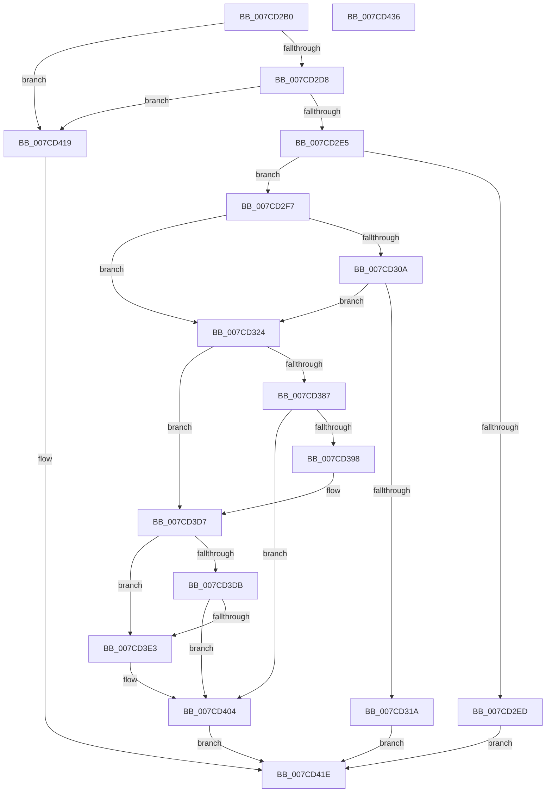

# NtDeleteBootEntry

- RVA: `0x007CD2B0`–`0x007CD437` (길이 `391` bytes)
- VA: `0x00000001407CD2B0`
- 실행 섹션: `PAGE`
- PDB 이름 있음: `예`; PDB Function 태그: `아니요`
- unwind 정보 RVA: `0x0005DD4C`
- 디코드: `90`개 명령, `391/391` bytes 표시
- 미해석 바이트: `0` (있으면 어셈블리에 `.byte`로 보존)

> 이 문서는 커널 이미지의 기계어와 PDB 기호를 분석해 생성했습니다. 4번과 5번은 함수 원형과 자료형을 바이너리 사용 방식에서 추정한 C 해석이며 원본 소스 복구 결과는 아닙니다.

## 1. Dependencies

- 직접 호출 지점: **11**; 고유 호출 대상: **9**
- 직접 호출자로 확인된 함수: **0**
- RIP 상대 이미지 참조: **7**

### Outgoing calls
- `0x007CD2D8` → [PsIsCurrentThreadInServerSilo](../../text/43/PsIsCurrentThreadInServerSilo_function_004362E0.md) (function, `0x004362E0`)
- `0x007CD311` → [SeSinglePrivilegeCheck](../87/SeSinglePrivilegeCheck_function_00871E20.md) (function, `0x00871E20`)
- `0x007CD33C` → [ExAcquireFastMutexUnsafe](../../text/3F/ExAcquireFastMutexUnsafe_function_003F3720.md) (function, `0x003F3720`)
- `0x007CD355` → [swprintf_s](../../text/50/swprintf_s_function_00504B20.md) (function, `0x00504B20`)
- `0x007CD379` → [IoGetEnvironmentVariableEx](../95/IoGetEnvironmentVariableEx_function_00952760.md) (function, `0x00952760`)
- `0x007CD3AC` → [swprintf_s](../../text/50/swprintf_s_function_00504B20.md) (function, `0x00504B20`)
- `0x007CD3D0` → [IoGetEnvironmentVariableEx](../95/IoGetEnvironmentVariableEx_function_00952760.md) (function, `0x00952760`)
- `0x007CD3FD` → [IoSetEnvironmentVariableEx](../A9/IoSetEnvironmentVariableEx_function_00A91A84.md) (function, `0x00A91A84`)
- `0x007CD40B` → [ExReleaseFastMutexUnsafe](../../text/25/ExReleaseFastMutexUnsafe_function_002503A0.md) (function, `0x002503A0`)
- `0x007CD410` → [KeLeaveCriticalRegion](../../text/25/KeLeaveCriticalRegion_function_0025D8B0.md) (function, `0x0025D8B0`)
- `0x007CD426` → [_security_check_cookie](../../text/6A/_security_check_cookie_function_006AC640.md) (function, `0x006AC640`)

### Direct callers
- 이 함수 시작 RVA로 연결되는 직접 call은 확인되지 않았습니다. 간접 호출은 완전히 역산할 수 없습니다.

### Static image references
- `0x007CD2BA` → RVA `0x00E0A740` (`.data`; read)
- `0x007CD2C9` → RVA `0x00EFF050` (`.data`; read)
- `0x007CD30A` → RVA `0x00FD9AB8` (`PAGEDATA`; read)
- `0x007CD32D` → RVA `0x00EFAB40` (`.data`; read)
- `0x007CD344` → RVA `0x00B08700` (` ?? ::NNGAKEGL::`string'`; read)
- `0x007CD36A` → RVA `0x00019EF0` (`.rdata`; read)
- `0x007CD39B` → RVA `0x00B08740` (` ?? ::NNGAKEGL::`string'`; read)

## 2. Other-region calls and transfers

- 다른 실행 섹션으로 향하는 call: **7**
  - `0x007CD2D8` → [PsIsCurrentThreadInServerSilo](../../text/43/PsIsCurrentThreadInServerSilo_function_004362E0.md) (`PAGE` → `.text`)
  - `0x007CD33C` → [ExAcquireFastMutexUnsafe](../../text/3F/ExAcquireFastMutexUnsafe_function_003F3720.md) (`PAGE` → `.text`)
  - `0x007CD355` → [swprintf_s](../../text/50/swprintf_s_function_00504B20.md) (`PAGE` → `.text`)
  - `0x007CD3AC` → [swprintf_s](../../text/50/swprintf_s_function_00504B20.md) (`PAGE` → `.text`)
  - `0x007CD40B` → [ExReleaseFastMutexUnsafe](../../text/25/ExReleaseFastMutexUnsafe_function_002503A0.md) (`PAGE` → `.text`)
  - `0x007CD410` → [KeLeaveCriticalRegion](../../text/25/KeLeaveCriticalRegion_function_0025D8B0.md) (`PAGE` → `.text`)
  - `0x007CD426` → [_security_check_cookie](../../text/6A/_security_check_cookie_function_006AC640.md) (`PAGE` → `.text`)
- 별도 외부 분기/꼬리 이동을 확인하지 못했습니다.

## 3. Assembly (complete function range)

```asm
007CD2B0  48 89 5C 24 10                  mov qword ptr [rsp + 0x10], rbx
007CD2B5  57                              push rdi
007CD2B6  48 83 EC 60                     sub rsp, 0x60
007CD2BA  48 8B 05 7F D4 63 00            mov rax, qword ptr [rip + 0x63d47f]
007CD2C1  48 33 C4                        xor rax, rsp
007CD2C4  48 89 44 24 50                  mov qword ptr [rsp + 0x50], rax
007CD2C9  83 3D 80 1D 73 00 02            cmp dword ptr [rip + 0x731d80], 2
007CD2D0  8B D9                           mov ebx, ecx
007CD2D2  0F 85 41 01 00 00               jne 0x1407cd419
007CD2D8  E8 03 90 C6 FF                  call 0x1404362e0
007CD2DD  84 C0                           test al, al
007CD2DF  0F 85 34 01 00 00               jne 0x1407cd419
007CD2E5  81 FB FF FF 00 00               cmp ebx, 0xffff
007CD2EB  76 0A                           jbe 0x1407cd2f7
007CD2ED  B8 0D 00 00 C0                  mov eax, 0xc000000d
007CD2F2  E9 27 01 00 00                  jmp 0x1407cd41e
007CD2F7  65 48 8B 04 25 88 01 00 00      mov rax, qword ptr gs:[0x188]
007CD300  8A 90 32 02 00 00               mov dl, byte ptr [rax + 0x232]
007CD306  84 D2                           test dl, dl
007CD308  74 1A                           je 0x1407cd324
007CD30A  48 8B 0D A7 C7 80 00            mov rcx, qword ptr [rip + 0x80c7a7]
007CD311  E8 0A 4B 0A 00                  call 0x140871e20
007CD316  84 C0                           test al, al
007CD318  75 0A                           jne 0x1407cd324
007CD31A  B8 61 00 00 C0                  mov eax, 0xc0000061
007CD31F  E9 FA 00 00 00                  jmp 0x1407cd41e
007CD324  65 48 8B 04 25 88 01 00 00      mov rax, qword ptr gs:[0x188]
007CD32D  48 8D 0D 0C D8 72 00            lea rcx, [rip + 0x72d80c]
007CD334  66 FF 88 E4 01 00 00            dec word ptr [rax + 0x1e4]
007CD33B  90                              nop
007CD33C  E8 DF 63 C2 FF                  call 0x1403f3720
007CD341  44 8B CB                        mov r9d, ebx
007CD344  4C 8D 05 B5 B3 33 00            lea r8, [rip + 0x33b3b5]
007CD34B  BA 09 00 00 00                  mov edx, 9
007CD350  48 8D 4C 24 38                  lea rcx, [rsp + 0x38]
007CD355  E8 C6 77 D3 FF                  call 0x140504b20
007CD35A  83 64 24 30 00                  and dword ptr [rsp + 0x30], 0
007CD35F  4C 8D 4C 24 30                  lea r9, [rsp + 0x30]
007CD364  48 83 64 24 20 00               and qword ptr [rsp + 0x20], 0
007CD36A  48 8D 15 7F CB 84 FF            lea rdx, [rip - 0x7b3481]
007CD371  45 33 C0                        xor r8d, r8d
007CD374  48 8D 4C 24 38                  lea rcx, [rsp + 0x38]
007CD379  E8 E2 53 18 00                  call 0x140952760
007CD37E  8B F8                           mov edi, eax
007CD380  3D 00 01 00 C0                  cmp eax, 0xc0000100
007CD385  75 50                           jne 0x1407cd3d7
007CD387  8D 0C 1B                        lea ecx, [rbx + rbx]
007CD38A  0B CB                           or ecx, ebx
007CD38C  81 E1 44 44 44 C4               and ecx, 0xc4444444
007CD392  03 C9                           add ecx, ecx
007CD394  85 CB                           test ebx, ecx
007CD396  74 6C                           je 0x1407cd404
007CD398  44 8B CB                        mov r9d, ebx
007CD39B  4C 8D 05 9E B3 33 00            lea r8, [rip + 0x33b39e]
007CD3A2  BA 09 00 00 00                  mov edx, 9
007CD3A7  48 8D 4C 24 38                  lea rcx, [rsp + 0x38]
007CD3AC  E8 6F 77 D3 FF                  call 0x140504b20
007CD3B1  83 64 24 30 00                  and dword ptr [rsp + 0x30], 0
007CD3B6  4C 8D 4C 24 30                  lea r9, [rsp + 0x30]
007CD3BB  48 83 64 24 20 00               and qword ptr [rsp + 0x20], 0
007CD3C1  48 8D 15 28 CB 84 FF            lea rdx, [rip - 0x7b34d8]
007CD3C8  45 33 C0                        xor r8d, r8d
007CD3CB  48 8D 4C 24 38                  lea rcx, [rsp + 0x38]
007CD3D0  E8 8B 53 18 00                  call 0x140952760
007CD3D5  8B F8                           mov edi, eax
007CD3D7  85 FF                           test edi, edi
007CD3D9  74 08                           je 0x1407cd3e3
007CD3DB  81 FF 23 00 00 C0               cmp edi, 0xc0000023
007CD3E1  75 21                           jne 0x1407cd404
007CD3E3  45 33 C9                        xor r9d, r9d
007CD3E6  C7 44 24 20 01 00 00 00         mov dword ptr [rsp + 0x20], 1
007CD3EE  45 33 C0                        xor r8d, r8d
007CD3F1  48 8D 15 F8 CA 84 FF            lea rdx, [rip - 0x7b3508]
007CD3F8  48 8D 4C 24 38                  lea rcx, [rsp + 0x38]
007CD3FD  E8 82 46 2C 00                  call 0x140a91a84
007CD402  8B F8                           mov edi, eax
007CD404  48 8D 0D 35 D7 72 00            lea rcx, [rip + 0x72d735]
007CD40B  E8 90 2F A8 FF                  call 0x1402503a0
007CD410  E8 9B 04 A9 FF                  call 0x14025d8b0
007CD415  8B C7                           mov eax, edi
007CD417  EB 05                           jmp 0x1407cd41e
007CD419  B8 02 00 00 C0                  mov eax, 0xc0000002
007CD41E  48 8B 4C 24 50                  mov rcx, qword ptr [rsp + 0x50]
007CD423  48 33 CC                        xor rcx, rsp
007CD426  E8 15 F2 ED FF                  call 0x1406ac640
007CD42B  48 8B 5C 24 78                  mov rbx, qword ptr [rsp + 0x78]
007CD430  48 83 C4 60                     add rsp, 0x60
007CD434  5F                              pop rdi
007CD435  C3                              ret
007CD436  CC                              int3
```

## 4. C-style interpretation (structured pseudocode)

```c
__int64 __fastcall NtDeleteBootEntry(int a1)
{
    __int64 result;
    __int64 v_rdi;
    __int64 v_rsp;
    unsigned __int64 v_stack_m18;
    unsigned __int64 v_stack_m30;
    unsigned int v_stack_m38;
    unsigned __int64 v_stack_m48;
    unsigned __int64 v_stack_p10;

    v_stack_p10 = v_rbx;
    v_rsp = (v_rsp) - (96);
    result = (*(unsigned __int64 *)(v_rip + 6542463)) ^ (v_rsp);
    v_stack_m18 = result;
    if ((*(unsigned int *)(v_rip + 7544192)) != 2) goto loc_007CD419;
    result = PsIsCurrentThreadInServerSilo(a1, a2, a3, a4);
    if ((unsigned __int8)(result) != 0) goto loc_007CD419;
    if (((unsigned int)((unsigned int)(a1))) <= 0xFFFFULL) goto loc_007CD2F7;
    goto loc_007CD41E;
loc_007CD2F7:
    if ((unsigned __int8)(*(unsigned __int8 *)(*(unsigned __int64 *)(gs_base + (0 + 392)) + 562)) == 0) goto loc_007CD324;
    result = SeSinglePrivilegeCheck(*(unsigned __int64 *)(v_rip + 8439719), *(unsigned __int8 *)(*(unsigned __int64 *)(gs_base + (0 + 392)) + 562), a3, a4);
    if ((unsigned __int8)(result) != 0) goto loc_007CD324;
    goto loc_007CD41E;
loc_007CD324:
    result = ExAcquireFastMutexUnsafe(v_rip + 7526412, *(unsigned __int8 *)(*(unsigned __int64 *)(gs_base + (0 + 392)) + 562), a3, a4);
    result = swprintf_s(v_stack_m30, 9, v_rip + 3388341, (unsigned int)((unsigned int)((unsigned int)(a1))));
    a3 = 0;
    result = IoGetEnvironmentVariableEx(v_stack_m30, v_rip - 8074369, a3, v_stack_m38);
    if (((unsigned int)(result)) != 0xC0000100ULL) goto loc_007CD3D7;
    a1 = (unsigned int)(((unsigned int)(a1) + (unsigned int)(a1) * 1) | ((unsigned int)((unsigned int)(a1))));
    a1 = (unsigned int)((a1) & (0xC4444444ULL));
    a1 = (unsigned int)((a1) + (a1));
    if ((((unsigned int)((unsigned int)(a1))) & (a1)) == 0) goto loc_007CD404;
    result = swprintf_s(v_stack_m30, 9, v_rip + 3388318, (unsigned int)((unsigned int)((unsigned int)(a1))));
    a3 = 0;
    result = IoGetEnvironmentVariableEx(v_stack_m30, v_rip - 8074456, a3, v_stack_m38);
loc_007CD3D7:
    if ((unsigned int)((unsigned int)((unsigned int)(result))) == 0) goto loc_007CD3E3;
    v_rdi = (unsigned int)((unsigned int)(result));
    if (((unsigned int)((unsigned int)((unsigned int)(result)))) == 0xC0000023ULL) {
        a4 = 0;
        v_stack_m48 = 1;
        a3 = 0;
        a2 = v_rip - 8074504;
        a1 = v_stack_m30;
        result = IoSetEnvironmentVariableEx(a1, a2, a3, a4);
        v_rdi = (unsigned int)(result);
    }
    result = ExReleaseFastMutexUnsafe(v_rip + 7526197, a2, a3, a4);
    result = KeLeaveCriticalRegion(v_rip + 7526197, a2, a3, a4);
    goto loc_007CD41E;
loc_007CD419:
loc_007CD41E:
    a1 = (v_stack_m18) ^ (v_rsp);
    result = _security_check_cookie(a1, a2, a3, a4);
    v_rsp = (v_rsp) + (96);
    return result;
}
```

## 5. (Beta) C Style

```c
int64_t NtDeleteBootEntry(int32_t Arg1)
{
    int64_t result;
    int64_t local_rdi;
    int64_t local_rsp;
    uint64_t v_stack_m18;
    uint64_t v_stack_m30;
    uint32_t v_stack_m38;
    uint64_t v_stack_m48;
    uint64_t v_stack_p10;

    v_stack_p10 = local_rbx;
    local_rsp = (local_rsp) - (96);
    result = (*(uint64_t *)(v_rip + 0x63D47F)) ^ (local_rsp);
    v_stack_m18 = result;
    if ((*(uint32_t *)(v_rip + 0x731D80)) != 2) goto loc_007CD419;
    result = PsIsCurrentThreadInServerSilo(Arg1, a2, a3, a4);
    if ((uint8_t)(result) != 0) goto loc_007CD419;
    if (((uint32_t)((uint32_t)(Arg1))) <= 0xFFFFULL) goto loc_007CD2F7;
    goto loc_007CD41E;
loc_007CD2F7:
    if ((uint8_t)(*(uint8_t *)(*(uint64_t *)(gs_base + (0 + 0x188)) + 0x232)) == 0) goto loc_007CD324;
    result = SeSinglePrivilegeCheck(*(uint64_t *)(v_rip + 0x80C7A7), *(uint8_t *)(*(uint64_t *)(gs_base + (0 + 0x188)) + 0x232), a3, a4);
    if ((uint8_t)(result) != 0) goto loc_007CD324;
    goto loc_007CD41E;
loc_007CD324:
    result = ExAcquireFastMutexUnsafe(v_rip + 7526412, *(uint8_t *)(*(uint64_t *)(gs_base + (0 + 0x188)) + 0x232), a3, a4);
    result = swprintf_s(v_stack_m30, 9, v_rip + 3388341, (uint32_t)((uint32_t)((uint32_t)(Arg1))));
    a3 = 0;
    result = IoGetEnvironmentVariableEx(v_stack_m30, v_rip - 8074369, a3, v_stack_m38);
    if (((uint32_t)(result)) != 0xC0000100ULL) goto loc_007CD3D7;
    Arg1 = (uint32_t)(((uint32_t)(Arg1) + (uint32_t)(Arg1) * 1) | ((uint32_t)((uint32_t)(Arg1))));
    Arg1 = (uint32_t)((Arg1) & (0xC4444444ULL));
    Arg1 = (uint32_t)((Arg1) + (Arg1));
    if ((((uint32_t)((uint32_t)(Arg1))) & (Arg1)) == 0) goto loc_007CD404;
    result = swprintf_s(v_stack_m30, 9, v_rip + 3388318, (uint32_t)((uint32_t)((uint32_t)(Arg1))));
    a3 = 0;
    result = IoGetEnvironmentVariableEx(v_stack_m30, v_rip - 8074456, a3, v_stack_m38);
loc_007CD3D7:
    if ((uint32_t)((uint32_t)((uint32_t)(result))) == 0) goto loc_007CD3E3;
    local_rdi = (uint32_t)((uint32_t)(result));
    if (((uint32_t)((uint32_t)((uint32_t)(result)))) == 0xC0000023ULL) {
        a4 = 0;
        v_stack_m48 = 1;
        a3 = 0;
        a2 = v_rip - 8074504;
        Arg1 = v_stack_m30;
        result = IoSetEnvironmentVariableEx(Arg1, a2, a3, a4);
        local_rdi = (uint32_t)(result);
    }
    result = ExReleaseFastMutexUnsafe(v_rip + 7526197, a2, a3, a4);
    result = KeLeaveCriticalRegion(v_rip + 7526197, a2, a3, a4);
    goto loc_007CD41E;
loc_007CD419:
loc_007CD41E:
    Arg1 = (v_stack_m18) ^ (local_rsp);
    result = _security_check_cookie(Arg1, a2, a3, a4);
    local_rsp = (local_rsp) + (96);
    return result;
}
```

## 6. Execution-region graph

[열기: 2D/3D 그래프와 함수 탐색 컨트롤 패널](../../../control-panel.html?section=page&rva=0x007CD2B0&view=graph)

- 2D 그래프는 위에서 아래로 흐르고, 3D 그래프는 빈 공간을 드래그해 회전합니다. Shift+드래그는 이동, 휠은 확대·축소, 함수 노드 선택은 대상 보고서 이동입니다.

### Static fallback


