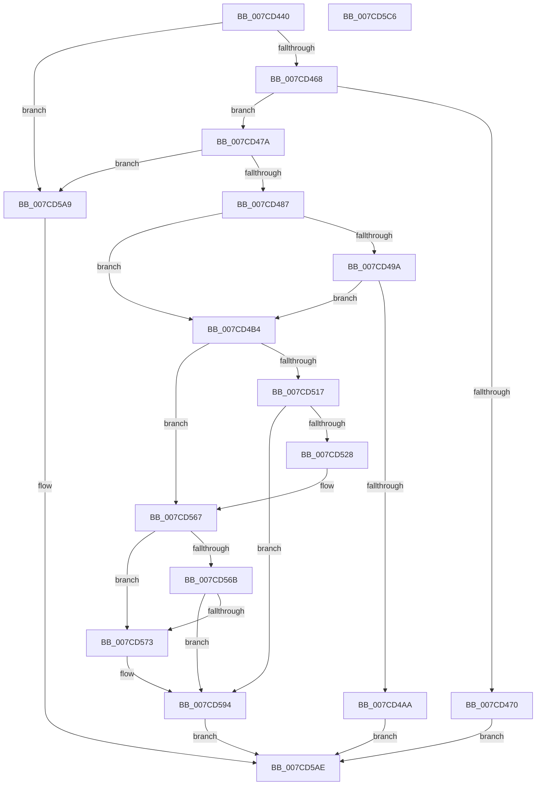

# NtDeleteDriverEntry

- RVA: `0x007CD440`–`0x007CD5C7` (길이 `391` bytes)
- VA: `0x00000001407CD440`
- 실행 섹션: `PAGE`
- PDB 이름 있음: `예`; PDB Function 태그: `아니요`
- unwind 정보 RVA: `0x0005DD4C`
- 디코드: `90`개 명령, `391/391` bytes 표시
- 미해석 바이트: `0` (있으면 어셈블리에 `.byte`로 보존)

> 이 문서는 커널 이미지의 기계어와 PDB 기호를 분석해 생성했습니다. 4번과 5번은 함수 원형과 자료형을 바이너리 사용 방식에서 추정한 C 해석이며 원본 소스 복구 결과는 아닙니다.

## 1. Dependencies

- 직접 호출 지점: **11**; 고유 호출 대상: **9**
- 직접 호출자로 확인된 함수: **0**
- RIP 상대 이미지 참조: **7**

### Outgoing calls
- `0x007CD47A` → [PsIsCurrentThreadInServerSilo](../../text/43/PsIsCurrentThreadInServerSilo_function_004362E0.md) (function, `0x004362E0`)
- `0x007CD4A1` → [SeSinglePrivilegeCheck](../87/SeSinglePrivilegeCheck_function_00871E20.md) (function, `0x00871E20`)
- `0x007CD4CC` → [ExAcquireFastMutexUnsafe](../../text/3F/ExAcquireFastMutexUnsafe_function_003F3720.md) (function, `0x003F3720`)
- `0x007CD4E5` → [swprintf_s](../../text/50/swprintf_s_function_00504B20.md) (function, `0x00504B20`)
- `0x007CD509` → [IoGetEnvironmentVariableEx](../95/IoGetEnvironmentVariableEx_function_00952760.md) (function, `0x00952760`)
- `0x007CD53C` → [swprintf_s](../../text/50/swprintf_s_function_00504B20.md) (function, `0x00504B20`)
- `0x007CD560` → [IoGetEnvironmentVariableEx](../95/IoGetEnvironmentVariableEx_function_00952760.md) (function, `0x00952760`)
- `0x007CD58D` → [IoSetEnvironmentVariableEx](../A9/IoSetEnvironmentVariableEx_function_00A91A84.md) (function, `0x00A91A84`)
- `0x007CD59B` → [ExReleaseFastMutexUnsafe](../../text/25/ExReleaseFastMutexUnsafe_function_002503A0.md) (function, `0x002503A0`)
- `0x007CD5A0` → [KeLeaveCriticalRegion](../../text/25/KeLeaveCriticalRegion_function_0025D8B0.md) (function, `0x0025D8B0`)
- `0x007CD5B6` → [_security_check_cookie](../../text/6A/_security_check_cookie_function_006AC640.md) (function, `0x006AC640`)

### Direct callers
- 이 함수 시작 RVA로 연결되는 직접 call은 확인되지 않았습니다. 간접 호출은 완전히 역산할 수 없습니다.

### Static image references
- `0x007CD44A` → RVA `0x00E0A740` (`.data`; read)
- `0x007CD459` → RVA `0x00EFF050` (`.data`; read)
- `0x007CD49A` → RVA `0x00FD9AB8` (`PAGEDATA`; read)
- `0x007CD4BD` → RVA `0x00EFAB40` (`.data`; read)
- `0x007CD4D4` → RVA `0x00B08900` (` ?? ::NNGAKEGL::`string'`; read)
- `0x007CD4FA` → RVA `0x000394B8` (`.rdata`; read)
- `0x007CD52B` → RVA `0x00B08990` (` ?? ::NNGAKEGL::`string'`; read)

## 2. Other-region calls and transfers

- 다른 실행 섹션으로 향하는 call: **7**
  - `0x007CD47A` → [PsIsCurrentThreadInServerSilo](../../text/43/PsIsCurrentThreadInServerSilo_function_004362E0.md) (`PAGE` → `.text`)
  - `0x007CD4CC` → [ExAcquireFastMutexUnsafe](../../text/3F/ExAcquireFastMutexUnsafe_function_003F3720.md) (`PAGE` → `.text`)
  - `0x007CD4E5` → [swprintf_s](../../text/50/swprintf_s_function_00504B20.md) (`PAGE` → `.text`)
  - `0x007CD53C` → [swprintf_s](../../text/50/swprintf_s_function_00504B20.md) (`PAGE` → `.text`)
  - `0x007CD59B` → [ExReleaseFastMutexUnsafe](../../text/25/ExReleaseFastMutexUnsafe_function_002503A0.md) (`PAGE` → `.text`)
  - `0x007CD5A0` → [KeLeaveCriticalRegion](../../text/25/KeLeaveCriticalRegion_function_0025D8B0.md) (`PAGE` → `.text`)
  - `0x007CD5B6` → [_security_check_cookie](../../text/6A/_security_check_cookie_function_006AC640.md) (`PAGE` → `.text`)
- 별도 외부 분기/꼬리 이동을 확인하지 못했습니다.

## 3. Assembly (complete function range)

```asm
007CD440  48 89 5C 24 10                  mov qword ptr [rsp + 0x10], rbx
007CD445  57                              push rdi
007CD446  48 83 EC 60                     sub rsp, 0x60
007CD44A  48 8B 05 EF D2 63 00            mov rax, qword ptr [rip + 0x63d2ef]
007CD451  48 33 C4                        xor rax, rsp
007CD454  48 89 44 24 50                  mov qword ptr [rsp + 0x50], rax
007CD459  83 3D F0 1B 73 00 02            cmp dword ptr [rip + 0x731bf0], 2
007CD460  8B D9                           mov ebx, ecx
007CD462  0F 85 41 01 00 00               jne 0x1407cd5a9
007CD468  81 F9 FF FF 00 00               cmp ecx, 0xffff
007CD46E  76 0A                           jbe 0x1407cd47a
007CD470  B8 0D 00 00 C0                  mov eax, 0xc000000d
007CD475  E9 34 01 00 00                  jmp 0x1407cd5ae
007CD47A  E8 61 8E C6 FF                  call 0x1404362e0
007CD47F  84 C0                           test al, al
007CD481  0F 85 22 01 00 00               jne 0x1407cd5a9
007CD487  65 48 8B 04 25 88 01 00 00      mov rax, qword ptr gs:[0x188]
007CD490  8A 90 32 02 00 00               mov dl, byte ptr [rax + 0x232]
007CD496  84 D2                           test dl, dl
007CD498  74 1A                           je 0x1407cd4b4
007CD49A  48 8B 0D 17 C6 80 00            mov rcx, qword ptr [rip + 0x80c617]
007CD4A1  E8 7A 49 0A 00                  call 0x140871e20
007CD4A6  84 C0                           test al, al
007CD4A8  75 0A                           jne 0x1407cd4b4
007CD4AA  B8 61 00 00 C0                  mov eax, 0xc0000061
007CD4AF  E9 FA 00 00 00                  jmp 0x1407cd5ae
007CD4B4  65 48 8B 04 25 88 01 00 00      mov rax, qword ptr gs:[0x188]
007CD4BD  48 8D 0D 7C D6 72 00            lea rcx, [rip + 0x72d67c]
007CD4C4  66 FF 88 E4 01 00 00            dec word ptr [rax + 0x1e4]
007CD4CB  90                              nop
007CD4CC  E8 4F 62 C2 FF                  call 0x1403f3720
007CD4D1  44 8B CB                        mov r9d, ebx
007CD4D4  4C 8D 05 25 B4 33 00            lea r8, [rip + 0x33b425]
007CD4DB  BA 0B 00 00 00                  mov edx, 0xb
007CD4E0  48 8D 4C 24 38                  lea rcx, [rsp + 0x38]
007CD4E5  E8 36 76 D3 FF                  call 0x140504b20
007CD4EA  83 64 24 30 00                  and dword ptr [rsp + 0x30], 0
007CD4EF  4C 8D 4C 24 30                  lea r9, [rsp + 0x30]
007CD4F4  48 83 64 24 20 00               and qword ptr [rsp + 0x20], 0
007CD4FA  48 8D 15 B7 BF 86 FF            lea rdx, [rip - 0x794049]
007CD501  45 33 C0                        xor r8d, r8d
007CD504  48 8D 4C 24 38                  lea rcx, [rsp + 0x38]
007CD509  E8 52 52 18 00                  call 0x140952760
007CD50E  8B F8                           mov edi, eax
007CD510  3D 00 01 00 C0                  cmp eax, 0xc0000100
007CD515  75 50                           jne 0x1407cd567
007CD517  8D 0C 1B                        lea ecx, [rbx + rbx]
007CD51A  0B CB                           or ecx, ebx
007CD51C  81 E1 44 44 44 C4               and ecx, 0xc4444444
007CD522  03 C9                           add ecx, ecx
007CD524  85 CB                           test ebx, ecx
007CD526  74 6C                           je 0x1407cd594
007CD528  44 8B CB                        mov r9d, ebx
007CD52B  4C 8D 05 5E B4 33 00            lea r8, [rip + 0x33b45e]
007CD532  BA 0B 00 00 00                  mov edx, 0xb
007CD537  48 8D 4C 24 38                  lea rcx, [rsp + 0x38]
007CD53C  E8 DF 75 D3 FF                  call 0x140504b20
007CD541  83 64 24 30 00                  and dword ptr [rsp + 0x30], 0
007CD546  4C 8D 4C 24 30                  lea r9, [rsp + 0x30]
007CD54B  48 83 64 24 20 00               and qword ptr [rsp + 0x20], 0
007CD551  48 8D 15 60 BF 86 FF            lea rdx, [rip - 0x7940a0]
007CD558  45 33 C0                        xor r8d, r8d
007CD55B  48 8D 4C 24 38                  lea rcx, [rsp + 0x38]
007CD560  E8 FB 51 18 00                  call 0x140952760
007CD565  8B F8                           mov edi, eax
007CD567  85 FF                           test edi, edi
007CD569  74 08                           je 0x1407cd573
007CD56B  81 FF 23 00 00 C0               cmp edi, 0xc0000023
007CD571  75 21                           jne 0x1407cd594
007CD573  45 33 C9                        xor r9d, r9d
007CD576  C7 44 24 20 01 00 00 00         mov dword ptr [rsp + 0x20], 1
007CD57E  45 33 C0                        xor r8d, r8d
007CD581  48 8D 15 30 BF 86 FF            lea rdx, [rip - 0x7940d0]
007CD588  48 8D 4C 24 38                  lea rcx, [rsp + 0x38]
007CD58D  E8 F2 44 2C 00                  call 0x140a91a84
007CD592  8B F8                           mov edi, eax
007CD594  48 8D 0D A5 D5 72 00            lea rcx, [rip + 0x72d5a5]
007CD59B  E8 00 2E A8 FF                  call 0x1402503a0
007CD5A0  E8 0B 03 A9 FF                  call 0x14025d8b0
007CD5A5  8B C7                           mov eax, edi
007CD5A7  EB 05                           jmp 0x1407cd5ae
007CD5A9  B8 02 00 00 C0                  mov eax, 0xc0000002
007CD5AE  48 8B 4C 24 50                  mov rcx, qword ptr [rsp + 0x50]
007CD5B3  48 33 CC                        xor rcx, rsp
007CD5B6  E8 85 F0 ED FF                  call 0x1406ac640
007CD5BB  48 8B 5C 24 78                  mov rbx, qword ptr [rsp + 0x78]
007CD5C0  48 83 C4 60                     add rsp, 0x60
007CD5C4  5F                              pop rdi
007CD5C5  C3                              ret
007CD5C6  CC                              int3
```

## 4. C-style interpretation (structured pseudocode)

```c
__int64 __fastcall NtDeleteDriverEntry(int a1)
{
    __int64 result;
    __int64 v_rdi;
    __int64 v_rsp;
    unsigned __int64 v_stack_m18;
    unsigned __int64 v_stack_m30;
    unsigned int v_stack_m38;
    unsigned __int64 v_stack_m48;
    unsigned __int64 v_stack_p10;

    v_stack_p10 = v_rbx;
    v_rsp = (v_rsp) - (96);
    result = (*(unsigned __int64 *)(v_rip + 6542063)) ^ (v_rsp);
    v_stack_m18 = result;
    if ((*(unsigned int *)(v_rip + 7543792)) != 2) goto loc_007CD5A9;
    if (a1 <= 0xFFFFULL) goto loc_007CD47A;
    goto loc_007CD5AE;
loc_007CD47A:
    result = PsIsCurrentThreadInServerSilo(a1, a2, a3, a4);
    if ((unsigned __int8)(result) != 0) goto loc_007CD5A9;
    if ((unsigned __int8)(*(unsigned __int8 *)(*(unsigned __int64 *)(gs_base + (0 + 392)) + 562)) == 0) goto loc_007CD4B4;
    result = SeSinglePrivilegeCheck(*(unsigned __int64 *)(v_rip + 8439319), *(unsigned __int8 *)(*(unsigned __int64 *)(gs_base + (0 + 392)) + 562), a3, a4);
    if ((unsigned __int8)(result) != 0) goto loc_007CD4B4;
    goto loc_007CD5AE;
loc_007CD4B4:
    result = ExAcquireFastMutexUnsafe(v_rip + 7526012, *(unsigned __int8 *)(*(unsigned __int64 *)(gs_base + (0 + 392)) + 562), a3, a4);
    result = swprintf_s(v_stack_m30, 11, v_rip + 3388453, (unsigned int)((unsigned int)((unsigned int)(a1))));
    a3 = 0;
    result = IoGetEnvironmentVariableEx(v_stack_m30, v_rip - 7946313, a3, v_stack_m38);
    if (((unsigned int)(result)) != 0xC0000100ULL) goto loc_007CD567;
    a1 = (unsigned int)(((unsigned int)(a1) + (unsigned int)(a1) * 1) | ((unsigned int)((unsigned int)(a1))));
    a1 = (unsigned int)((a1) & (0xC4444444ULL));
    a1 = (unsigned int)((a1) + (a1));
    if ((((unsigned int)((unsigned int)(a1))) & (a1)) == 0) goto loc_007CD594;
    result = swprintf_s(v_stack_m30, 11, v_rip + 3388510, (unsigned int)((unsigned int)((unsigned int)(a1))));
    a3 = 0;
    result = IoGetEnvironmentVariableEx(v_stack_m30, v_rip - 7946400, a3, v_stack_m38);
loc_007CD567:
    if ((unsigned int)((unsigned int)((unsigned int)(result))) == 0) goto loc_007CD573;
    v_rdi = (unsigned int)((unsigned int)(result));
    if (((unsigned int)((unsigned int)((unsigned int)(result)))) == 0xC0000023ULL) {
        a4 = 0;
        v_stack_m48 = 1;
        a3 = 0;
        a2 = v_rip - 7946448;
        a1 = v_stack_m30;
        result = IoSetEnvironmentVariableEx(a1, a2, a3, a4);
        v_rdi = (unsigned int)(result);
    }
    result = ExReleaseFastMutexUnsafe(v_rip + 7525797, a2, a3, a4);
    result = KeLeaveCriticalRegion(v_rip + 7525797, a2, a3, a4);
    goto loc_007CD5AE;
loc_007CD5A9:
loc_007CD5AE:
    a1 = (v_stack_m18) ^ (v_rsp);
    result = _security_check_cookie(a1, a2, a3, a4);
    v_rsp = (v_rsp) + (96);
    return result;
}
```

## 5. (Beta) C Style

```c
int64_t NtDeleteDriverEntry(void *Arg1)
{
    uint8_t *arg1 = (uint8_t *)Arg1;

    int64_t result;
    int64_t local_rdi;
    int64_t local_rsp;
    uint64_t v_stack_m18;
    uint64_t v_stack_m30;
    uint32_t v_stack_m38;
    uint64_t v_stack_m48;
    uint64_t v_stack_p10;

    v_stack_p10 = local_rbx;
    local_rsp = (local_rsp) - (96);
    result = (*(uint64_t *)(v_rip + 0x63D2EF)) ^ (local_rsp);
    v_stack_m18 = result;
    if ((*(uint32_t *)(v_rip + 0x731BF0)) != 2) goto loc_007CD5A9;
    if (Arg1 <= 0xFFFFULL) goto loc_007CD47A;
    goto loc_007CD5AE;
loc_007CD47A:
    result = PsIsCurrentThreadInServerSilo(Arg1, a2, a3, a4);
    if ((uint8_t)(result) != 0) goto loc_007CD5A9;
    if ((uint8_t)(*(uint8_t *)(*(uint64_t *)(gs_base + (0 + 0x188)) + 0x232)) == 0) goto loc_007CD4B4;
    result = SeSinglePrivilegeCheck(*(uint64_t *)(v_rip + 0x80C617), *(uint8_t *)(*(uint64_t *)(gs_base + (0 + 0x188)) + 0x232), a3, a4);
    if ((uint8_t)(result) != 0) goto loc_007CD4B4;
    goto loc_007CD5AE;
loc_007CD4B4:
    result = ExAcquireFastMutexUnsafe(v_rip + 7526012, *(uint8_t *)(*(uint64_t *)(gs_base + (0 + 0x188)) + 0x232), a3, a4);
    result = swprintf_s(v_stack_m30, 11, v_rip + 3388453, (uint32_t)((uint32_t)((uint32_t)(Arg1))));
    a3 = 0;
    result = IoGetEnvironmentVariableEx(v_stack_m30, v_rip - 7946313, a3, v_stack_m38);
    if (((uint32_t)(result)) != 0xC0000100ULL) goto loc_007CD567;
    Arg1 = (uint32_t)(((uint32_t)(Arg1) + (uint32_t)(Arg1) * 1) | ((uint32_t)((uint32_t)(Arg1))));
    Arg1 = (uint32_t)((Arg1) & (0xC4444444ULL));
    Arg1 = (uint32_t)((Arg1) + (Arg1));
    if ((((uint32_t)((uint32_t)(Arg1))) & (Arg1)) == 0) goto loc_007CD594;
    result = swprintf_s(v_stack_m30, 11, v_rip + 3388510, (uint32_t)((uint32_t)((uint32_t)(Arg1))));
    a3 = 0;
    result = IoGetEnvironmentVariableEx(v_stack_m30, v_rip - 7946400, a3, v_stack_m38);
loc_007CD567:
    if ((uint32_t)((uint32_t)((uint32_t)(result))) == 0) goto loc_007CD573;
    local_rdi = (uint32_t)((uint32_t)(result));
    if (((uint32_t)((uint32_t)((uint32_t)(result)))) == 0xC0000023ULL) {
        a4 = 0;
        v_stack_m48 = 1;
        a3 = 0;
        a2 = v_rip - 7946448;
        Arg1 = v_stack_m30;
        result = IoSetEnvironmentVariableEx(Arg1, a2, a3, a4);
        local_rdi = (uint32_t)(result);
    }
    result = ExReleaseFastMutexUnsafe(v_rip + 7525797, a2, a3, a4);
    result = KeLeaveCriticalRegion(v_rip + 7525797, a2, a3, a4);
    goto loc_007CD5AE;
loc_007CD5A9:
loc_007CD5AE:
    Arg1 = (v_stack_m18) ^ (local_rsp);
    result = _security_check_cookie(Arg1, a2, a3, a4);
    local_rsp = (local_rsp) + (96);
    return result;
}
```

### 관측된 메모리 오프셋

구조체 형식이 확인되지 않은 접근은 인자 기준의 오프셋으로만 기록했습니다.

| 기준 인자 | 오프셋 표현 | 폭 (bit) | 접근 |
|---|---:|---:|---|
| `Arg1` | `+ 0x0 + rbx*1` | `32` | `R` |

## 6. Execution-region graph

[열기: 2D/3D 그래프와 함수 탐색 컨트롤 패널](../../../control-panel.html?section=page&rva=0x007CD440&view=graph)

- 2D 그래프는 위에서 아래로 흐르고, 3D 그래프는 빈 공간을 드래그해 회전합니다. Shift+드래그는 이동, 휠은 확대·축소, 함수 노드 선택은 대상 보고서 이동입니다.

### Static fallback


