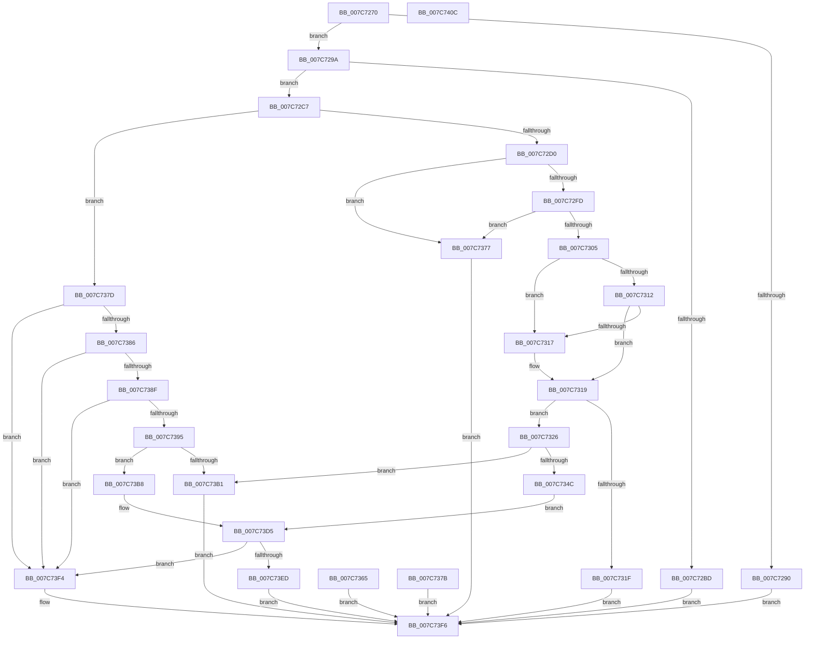

# NtDisplayString

- RVA: `0x007C7270`–`0x007C740D` (길이 `413` bytes)
- VA: `0x00000001407C7270`
- 실행 섹션: `PAGE`
- PDB 이름 있음: `예`; PDB Function 태그: `아니요`
- unwind 정보 RVA: `0x000D4B88`
- 디코드: `116`개 명령, `413/413` bytes 표시
- 미해석 바이트: `0` (있으면 어셈블리에 `.byte`로 보존)

> 이 문서는 커널 이미지의 기계어와 PDB 기호를 분석해 생성했습니다. 4번과 5번은 함수 원형과 자료형을 바이너리 사용 방식에서 추정한 C 해석이며 원본 소스 복구 결과는 아닙니다.

## 1. Dependencies

- 직접 호출 지점: **8**; 고유 호출 대상: **5**
- 직접 호출자로 확인된 함수: **0**
- RIP 상대 이미지 참조: **1**

### Outgoing calls
- `0x007C72B4` → [SeSinglePrivilegeCheck](../87/SeSinglePrivilegeCheck_function_00871E20.md) (function, `0x00871E20`)
- `0x007C733A` → [ExAllocatePool2](../../poolcode/B8/ExAllocatePool2_function_00B820F0.md) (function, `0x00B820F0`)
- `0x007C7355` → [memcpy](../../text/6C/memcpy_function_006C6840.md) (function, `0x006C6840`)
- `0x007C736E` → [ExFreePoolWithTag](../../poolcode/B8/ExFreePoolWithTag_function_00B82870.md) (function, `0x00B82870`)
- `0x007C73A4` → [ExAllocatePool2](../../poolcode/B8/ExAllocatePool2_function_00B820F0.md) (function, `0x00B820F0`)
- `0x007C73C4` → [memcpy](../../text/6C/memcpy_function_006C6840.md) (function, `0x006C6840`)
- `0x007C73D8` → [BgkDisplayStringEx](../../text/59/BgkDisplayStringEx_function_00590C04.md) (function, `0x00590C04`)
- `0x007C73E4` → [ExFreePoolWithTag](../../poolcode/B8/ExFreePoolWithTag_function_00B82870.md) (function, `0x00B82870`)

### Direct callers
- 이 함수 시작 RVA로 연결되는 직접 call은 확인되지 않았습니다. 간접 호출은 완전히 역산할 수 없습니다.

### Static image references
- `0x007C72AD` → RVA `0x00FD9A78` (`PAGEDATA`; read)

## 2. Other-region calls and transfers

- 다른 실행 섹션으로 향하는 call: **7**
  - `0x007C733A` → [ExAllocatePool2](../../poolcode/B8/ExAllocatePool2_function_00B820F0.md) (`PAGE` → `POOLCODE`)
  - `0x007C7355` → [memcpy](../../text/6C/memcpy_function_006C6840.md) (`PAGE` → `.text`)
  - `0x007C736E` → [ExFreePoolWithTag](../../poolcode/B8/ExFreePoolWithTag_function_00B82870.md) (`PAGE` → `POOLCODE`)
  - `0x007C73A4` → [ExAllocatePool2](../../poolcode/B8/ExAllocatePool2_function_00B820F0.md) (`PAGE` → `POOLCODE`)
  - `0x007C73C4` → [memcpy](../../text/6C/memcpy_function_006C6840.md) (`PAGE` → `.text`)
  - `0x007C73D8` → [BgkDisplayStringEx](../../text/59/BgkDisplayStringEx_function_00590C04.md) (`PAGE` → `.text`)
  - `0x007C73E4` → [ExFreePoolWithTag](../../poolcode/B8/ExFreePoolWithTag_function_00B82870.md) (`PAGE` → `POOLCODE`)
- 별도 외부 분기/꼬리 이동을 확인하지 못했습니다.

## 3. Assembly (complete function range)

```asm
007C7270  48 89 5C 24 10                  mov qword ptr [rsp + 0x10], rbx
007C7275  48 89 74 24 18                  mov qword ptr [rsp + 0x18], rsi
007C727A  48 89 7C 24 20                  mov qword ptr [rsp + 0x20], rdi
007C727F  41 56                           push r14
007C7281  48 83 EC 30                     sub rsp, 0x30
007C7285  48 8B D9                        mov rbx, rcx
007C7288  45 33 F6                        xor r14d, r14d
007C728B  48 85 C9                        test rcx, rcx
007C728E  75 0A                           jne 0x1407c729a
007C7290  B8 0D 00 00 C0                  mov eax, 0xc000000d
007C7295  E9 5C 01 00 00                  jmp 0x1407c73f6
007C729A  65 48 8B 04 25 88 01 00 00      mov rax, qword ptr gs:[0x188]
007C72A3  40 8A B8 32 02 00 00            mov dil, byte ptr [rax + 0x232]
007C72AA  40 8A D7                        mov dl, dil
007C72AD  48 8B 0D C4 27 81 00            mov rcx, qword ptr [rip + 0x8127c4]
007C72B4  E8 67 AB 0A 00                  call 0x140871e20
007C72B9  84 C0                           test al, al
007C72BB  75 0A                           jne 0x1407c72c7
007C72BD  B8 61 00 00 C0                  mov eax, 0xc0000061
007C72C2  E9 2F 01 00 00                  jmp 0x1407c73f6
007C72C7  40 84 FF                        test dil, dil
007C72CA  0F 84 AD 00 00 00               je 0x1407c737d
007C72D0  48 BA 00 00 FF FF FF 7F 00 00   movabs rdx, 0x7fffffff0000
007C72DA  48 8B C2                        mov rax, rdx
007C72DD  48 3B DA                        cmp rbx, rdx
007C72E0  48 0F 42 C3                     cmovb rax, rbx
007C72E4  90                              nop
007C72E5  8B 08                           mov ecx, dword ptr [rax]
007C72E7  89 4C 24 40                     mov dword ptr [rsp + 0x40], ecx
007C72EB  89 4C 24 20                     mov dword ptr [rsp + 0x20], ecx
007C72EF  48 8B 70 08                     mov rsi, qword ptr [rax + 8]
007C72F3  48 89 74 24 28                  mov qword ptr [rsp + 0x28], rsi
007C72F8  48 85 F6                        test rsi, rsi
007C72FB  74 7A                           je 0x1407c7377
007C72FD  C1 F9 10                        sar ecx, 0x10
007C7300  66 85 C9                        test cx, cx
007C7303  74 72                           je 0x1407c7377
007C7305  0F B7 4C 24 42                  movzx ecx, word ptr [rsp + 0x42]
007C730A  48 03 CE                        add rcx, rsi
007C730D  48 3B CA                        cmp rcx, rdx
007C7310  77 05                           ja 0x1407c7317
007C7312  48 3B CE                        cmp rcx, rsi
007C7315  73 02                           jae 0x1407c7319
007C7317  8A 02                           mov al, byte ptr [rdx]
007C7319  66 44 39 36                     cmp word ptr [rsi], r14w
007C731D  75 07                           jne 0x1407c7326
007C731F  33 C0                           xor eax, eax
007C7321  E9 D0 00 00 00                  jmp 0x1407c73f6
007C7326  0F B7 5C 24 42                  movzx ebx, word ptr [rsp + 0x42]
007C732B  48 8D 53 02                     lea rdx, [rbx + 2]
007C732F  B9 40 00 00 00                  mov ecx, 0x40
007C7334  41 B8 53 74 72 67               mov r8d, 0x67727453
007C733A  E8 B1 AD 3B 00                  call 0x140b820f0
007C733F  48 8B F8                        mov rdi, rax
007C7342  48 89 44 24 40                  mov qword ptr [rsp + 0x40], rax
007C7347  48 85 C0                        test rax, rax
007C734A  74 65                           je 0x1407c73b1
007C734C  44 8B C3                        mov r8d, ebx
007C734F  48 8B D6                        mov rdx, rsi
007C7352  48 8B C8                        mov rcx, rax
007C7355  E8 E6 F4 EF FF                  call 0x1406c6840
007C735A  90                              nop
007C735B  48 D1 EB                        shr rbx, 1
007C735E  66 44 89 34 5F                  mov word ptr [rdi + rbx*2], r14w
007C7363  EB 70                           jmp 0x1407c73d5
007C7365  8B D8                           mov ebx, eax
007C7367  33 D2                           xor edx, edx
007C7369  48 8B 4C 24 40                  mov rcx, qword ptr [rsp + 0x40]
007C736E  E8 FD B4 3B 00                  call 0x140b82870
007C7373  8B C3                           mov eax, ebx
007C7375  EB 7F                           jmp 0x1407c73f6
007C7377  33 C0                           xor eax, eax
007C7379  EB 7B                           jmp 0x1407c73f6
007C737B  EB 79                           jmp 0x1407c73f6
007C737D  48 8B 43 08                     mov rax, qword ptr [rbx + 8]
007C7381  48 85 C0                        test rax, rax
007C7384  74 6E                           je 0x1407c73f4
007C7386  0F B7 4B 02                     movzx ecx, word ptr [rbx + 2]
007C738A  66 85 C9                        test cx, cx
007C738D  74 65                           je 0x1407c73f4
007C738F  66 44 39 30                     cmp word ptr [rax], r14w
007C7393  74 5F                           je 0x1407c73f4
007C7395  48 8D 51 02                     lea rdx, [rcx + 2]
007C7399  B9 40 00 00 00                  mov ecx, 0x40
007C739E  41 B8 53 74 72 67               mov r8d, 0x67727453
007C73A4  E8 47 AD 3B 00                  call 0x140b820f0
007C73A9  48 8B F8                        mov rdi, rax
007C73AC  48 85 C0                        test rax, rax
007C73AF  75 07                           jne 0x1407c73b8
007C73B1  B8 17 00 00 C0                  mov eax, 0xc0000017
007C73B6  EB 3E                           jmp 0x1407c73f6
007C73B8  44 0F B7 43 02                  movzx r8d, word ptr [rbx + 2]
007C73BD  48 8B 53 08                     mov rdx, qword ptr [rbx + 8]
007C73C1  48 8B CF                        mov rcx, rdi
007C73C4  E8 77 F4 EF FF                  call 0x1406c6840
007C73C9  0F B7 43 02                     movzx eax, word ptr [rbx + 2]
007C73CD  48 D1 E8                        shr rax, 1
007C73D0  66 44 89 34 47                  mov word ptr [rdi + rax*2], r14w
007C73D5  48 8B CF                        mov rcx, rdi
007C73D8  E8 27 98 DC FF                  call 0x140590c04
007C73DD  8A D8                           mov bl, al
007C73DF  33 D2                           xor edx, edx
007C73E1  48 8B CF                        mov rcx, rdi
007C73E4  E8 87 B4 3B 00                  call 0x140b82870
007C73E9  84 DB                           test bl, bl
007C73EB  75 07                           jne 0x1407c73f4
007C73ED  B8 01 00 00 C0                  mov eax, 0xc0000001
007C73F2  EB 02                           jmp 0x1407c73f6
007C73F4  33 C0                           xor eax, eax
007C73F6  48 8B 5C 24 48                  mov rbx, qword ptr [rsp + 0x48]
007C73FB  48 8B 74 24 50                  mov rsi, qword ptr [rsp + 0x50]
007C7400  48 8B 7C 24 58                  mov rdi, qword ptr [rsp + 0x58]
007C7405  48 83 C4 30                     add rsp, 0x30
007C7409  41 5E                           pop r14
007C740B  C3                              ret
007C740C  CC                              int3
```

## 4. C-style interpretation (structured pseudocode)

```c
__int64 __fastcall NtDisplayString(__int64 a1)
{
    __int64 result;
    __int64 v_r14;
    __int64 v_rbx;
    __int64 v_rsp;
    unsigned __int64 v_stack_m10;
    unsigned int v_stack_m18;
    unsigned __int64 v_stack_p10;
    unsigned __int64 v_stack_p18;
    unsigned __int64 v_stack_p20;
    unsigned int v_stack_p8;
    unsigned __int16 v_stack_pA;

    v_stack_p10 = v_rbx;
    v_stack_p18 = v_rsi;
    v_stack_p20 = v_rdi;
    v_rsp = (v_rsp) - (48);
    v_r14 = 0;
    if (a1 != 0) goto loc_007C729A;
    goto loc_007C73F6;
loc_007C729A:
    result = SeSinglePrivilegeCheck(*(unsigned __int64 *)(v_rip + 8464324), (unsigned __int8)(*(unsigned __int8 *)(*(unsigned __int64 *)(gs_base + (0 + 392)) + 562)), a3, a4);
    if ((unsigned __int8)(result) != 0) goto loc_007C72C7;
    goto loc_007C73F6;
loc_007C72C7:
    if ((unsigned __int8)(*(unsigned __int8 *)(*(unsigned __int64 *)(gs_base + (0 + 392)) + 562)) == 0) goto loc_007C737D;
    result = (unsigned __int8)(*(unsigned __int8 *)(*(unsigned __int64 *)(gs_base + (0 + 392)) + 562));
    if (a1 < ((unsigned __int8)(*(unsigned __int8 *)(*(unsigned __int64 *)(gs_base + (0 + 392)) + 562)))) { result = a1; }
    v_stack_p8 = (unsigned int)((unsigned int)(*(unsigned int *)(result)));
    v_stack_m18 = (unsigned int)((unsigned int)(*(unsigned int *)(result)));
    v_stack_m10 = *(unsigned __int64 *)(result + 8);
    if (*(unsigned __int64 *)(result + 8) == 0) goto loc_007C7377;
    a1 = (unsigned int)(((unsigned int)(*(unsigned int *)(result))) >> (16));
    if ((unsigned __int16)(a1) == 0) goto loc_007C7377;
    a1 = (v_stack_pA) + (*(unsigned __int64 *)(result + 8));
    if (a1 > ((unsigned __int8)(*(unsigned __int8 *)(*(unsigned __int64 *)(gs_base + (0 + 392)) + 562)))) goto loc_007C7317;
    if (a1 < (*(unsigned __int64 *)(result + 8))) {
        result = *(unsigned __int8 *)((unsigned __int8)(*(unsigned __int8 *)(*(unsigned __int64 *)(gs_base + (0 + 392)) + 562)));
    }
    if ((*(unsigned __int16 *)(*(unsigned __int64 *)(result + 8))) != 0) goto loc_007C7326;
    result = 0;
    goto loc_007C73F6;
loc_007C7326:
    result = ExAllocatePool2(64, v_stack_pA + 2, (unsigned int)(0x67727453ULL), a4);
    v_stack_p8 = result;
    if (result == 0) goto loc_007C73B1;
    result = memcpy(result, *(unsigned __int64 *)(result + 8), (unsigned int)((unsigned int)(v_stack_pA)), a4);
    v_rbx = (v_stack_pA) >> (1);
    *(unsigned __int16 *)(result + v_rbx * 2) = 0;
    goto loc_007C73D5;
loc_007C7377:
    result = 0;
    goto loc_007C73F6;
loc_007C737D:
    if (*(unsigned __int64 *)(v_rbx + 8) == 0) goto loc_007C73F4;
    if ((unsigned __int16)(*(unsigned __int16 *)(v_rbx + 2)) == 0) goto loc_007C73F4;
    if ((*(unsigned __int16 *)(*(unsigned __int64 *)(v_rbx + 8))) == 0) goto loc_007C73F4;
    result = ExAllocatePool2(64, *(unsigned __int16 *)(v_rbx + 2) + 2, (unsigned int)(0x67727453ULL), a4);
    if (result != 0) goto loc_007C73B8;
loc_007C73B1:
    goto loc_007C73F6;
loc_007C73B8:
    result = memcpy(result, *(unsigned __int64 *)(v_rbx + 8), *(unsigned __int16 *)(v_rbx + 2), a4);
    result = (*(unsigned __int16 *)(v_rbx + 2)) >> (1);
    *(unsigned __int16 *)(result + result * 2) = 0;
loc_007C73D5:
    result = BgkDisplayStringEx(result, *(unsigned __int64 *)(v_rbx + 8), *(unsigned __int16 *)(v_rbx + 2), a4);
    a2 = 0;
    result = ExFreePoolWithTag(result, a2, *(unsigned __int16 *)(v_rbx + 2), a4);
    if ((unsigned __int8)((unsigned __int8)(result)) != 0) goto loc_007C73F4;
    goto loc_007C73F6;
loc_007C73F4:
    result = 0;
loc_007C73F6:
    v_rsp = (v_rsp) + (48);
    return result;
}
```

## 5. (Beta) C Style

```c
int64_t NtDisplayString(void *Arg1)
{
    uint8_t *arg1 = (uint8_t *)Arg1;

    int64_t result;
    int64_t local_r14;
    int64_t local_rbx;
    int64_t local_rsp;
    uint64_t v_stack_m10;
    uint32_t v_stack_m18;
    uint64_t v_stack_p10;
    uint64_t v_stack_p18;
    uint64_t v_stack_p20;
    uint32_t v_stack_p8;
    uint16_t v_stack_pA;

    v_stack_p10 = local_rbx;
    v_stack_p18 = local_rsi;
    v_stack_p20 = local_rdi;
    local_rsp = (local_rsp) - (48);
    local_r14 = 0;
    if (Arg1 != NULL) goto loc_007C729A;
    goto loc_007C73F6;
loc_007C729A:
    result = SeSinglePrivilegeCheck(*(uint64_t *)(v_rip + 0x8127C4), (uint8_t)(*(uint8_t *)(*(uint64_t *)(gs_base + (0 + 0x188)) + 0x232)), a3, a4);
    if ((uint8_t)(result) != 0) goto loc_007C72C7;
    goto loc_007C73F6;
loc_007C72C7:
    if ((uint8_t)(*(uint8_t *)(*(uint64_t *)(gs_base + (0 + 0x188)) + 0x232)) == 0) goto loc_007C737D;
    result = (uint8_t)(*(uint8_t *)(*(uint64_t *)(gs_base + (0 + 0x188)) + 0x232));
    if (Arg1 < ((uint8_t)(*(uint8_t *)(*(uint64_t *)(gs_base + (0 + 0x188)) + 0x232)))) { result = Arg1; }
    v_stack_p8 = (uint32_t)((uint32_t)(*(uint32_t *)(result)));
    v_stack_m18 = (uint32_t)((uint32_t)(*(uint32_t *)(result)));
    v_stack_m10 = *(uint64_t *)(result + 0x8);
    if (*(uint64_t *)(result + 0x8) == 0) goto loc_007C7377;
    Arg1 = (uint32_t)(((uint32_t)(*(uint32_t *)(result))) >> (16));
    if ((uint16_t)(Arg1) == 0) goto loc_007C7377;
    Arg1 = (v_stack_pA) + (*(uint64_t *)(result + 0x8));
    if (Arg1 > ((uint8_t)(*(uint8_t *)(*(uint64_t *)(gs_base + (0 + 0x188)) + 0x232)))) goto loc_007C7317;
    if (Arg1 < (*(uint64_t *)(result + 0x8))) {
        result = *(uint8_t *)((uint8_t)(*(uint8_t *)(*(uint64_t *)(gs_base + (0 + 0x188)) + 0x232)));
    }
    if ((*(uint16_t *)(*(uint64_t *)(result + 0x8))) != 0) goto loc_007C7326;
    result = 0;
    goto loc_007C73F6;
loc_007C7326:
    result = ExAllocatePool2(64, v_stack_pA + 2, (uint32_t)(0x67727453ULL), a4);
    v_stack_p8 = result;
    if (result == 0) goto loc_007C73B1;
    result = memcpy(result, *(uint64_t *)(result + 0x8), (uint32_t)((uint32_t)(v_stack_pA)), a4);
    local_rbx = (v_stack_pA) >> (1);
    *(uint16_t *)(result + local_rbx * 2) = 0;
    goto loc_007C73D5;
loc_007C7377:
    result = 0;
    goto loc_007C73F6;
loc_007C737D:
    if (*(uint64_t *)(local_rbx + 0x8) == 0) goto loc_007C73F4;
    if ((uint16_t)(*(uint16_t *)(local_rbx + 0x2)) == 0) goto loc_007C73F4;
    if ((*(uint16_t *)(*(uint64_t *)(local_rbx + 0x8))) == 0) goto loc_007C73F4;
    result = ExAllocatePool2(64, *(uint16_t *)(local_rbx + 0x2) + 2, (uint32_t)(0x67727453ULL), a4);
    if (result != 0) goto loc_007C73B8;
loc_007C73B1:
    goto loc_007C73F6;
loc_007C73B8:
    result = memcpy(result, *(uint64_t *)(local_rbx + 0x8), *(uint16_t *)(local_rbx + 0x2), a4);
    result = (*(uint16_t *)(local_rbx + 0x2)) >> (1);
    *(uint16_t *)(result + result * 2) = 0;
loc_007C73D5:
    result = BgkDisplayStringEx(result, *(uint64_t *)(local_rbx + 0x8), *(uint16_t *)(local_rbx + 0x2), a4);
    a2 = 0;
    result = ExFreePoolWithTag(result, a2, *(uint16_t *)(local_rbx + 0x2), a4);
    if ((uint8_t)((uint8_t)(result)) != 0) goto loc_007C73F4;
    goto loc_007C73F6;
loc_007C73F4:
    result = 0;
loc_007C73F6:
    local_rsp = (local_rsp) + (48);
    return result;
}
```

### 관측된 메모리 오프셋

구조체 형식이 확인되지 않은 접근은 인자 기준의 오프셋으로만 기록했습니다.

| 기준 인자 | 오프셋 표현 | 폭 (bit) | 접근 |
|---|---:|---:|---|
| `Arg1` | `+ 0x2` | `16` | `R` |
| `Arg1` | `+ 0x8` | `64` | `R` |

## 6. Execution-region graph

[열기: 2D/3D 그래프와 함수 탐색 컨트롤 패널](../../../control-panel.html?section=page&rva=0x007C7270&view=graph)

- 2D 그래프는 위에서 아래로 흐르고, 3D 그래프는 빈 공간을 드래그해 회전합니다. Shift+드래그는 이동, 휠은 확대·축소, 함수 노드 선택은 대상 보고서 이동입니다.

### Static fallback


