# NtEnumerateDriverEntries

- RVA: `0x007CD5D0`–`0x007CDA29` (길이 `1,113` bytes)
- VA: `0x00000001407CD5D0`
- 실행 섹션: `PAGE`
- PDB 이름 있음: `예`; PDB Function 태그: `아니요`
- unwind 정보 RVA: `0x000D5228`
- 디코드: `287`개 명령, `1,113/1,113` bytes 표시
- 미해석 바이트: `0` (있으면 어셈블리에 `.byte`로 보존)

> 이 문서는 커널 이미지의 기계어와 PDB 기호를 분석해 생성했습니다. 4번과 5번은 함수 원형과 자료형을 바이너리 사용 방식에서 추정한 C 해석이며 원본 소스 복구 결과는 아닙니다.

## 1. Dependencies

- 직접 호출 지점: **17**; 고유 호출 대상: **15**
- 직접 호출자로 확인된 함수: **0**
- RIP 상대 이미지 참조: **6**

### Outgoing calls
- `0x007CD620` → [PsIsCurrentThreadInServerSilo](../../text/43/PsIsCurrentThreadInServerSilo_function_004362E0.md) (function, `0x004362E0`)
- `0x007CD686` → [ProbeForWrite](../8E/ProbeForWrite_function_008E91C0.md) (function, `0x008E91C0`)
- `0x007CD69A` → [SeSinglePrivilegeCheck](../87/SeSinglePrivilegeCheck_function_00871E20.md) (function, `0x00871E20`)
- `0x007CD6EF` → [ExLockUserBuffer](../95/ExLockUserBuffer_function_009533B8.md) (function, `0x009533B8`)
- `0x007CD72B` → [ExAcquireFastMutexUnsafe](../../text/3F/ExAcquireFastMutexUnsafe_function_003F3720.md) (function, `0x003F3720`)
- `0x007CD74E` → [IoEnumerateEnvironmentVariablesEx](../A2/IoEnumerateEnvironmentVariablesEx_function_00A2592C.md) (function, `0x00A2592C`)
- `0x007CD77B` → [ExAllocatePool2](../../poolcode/B8/ExAllocatePool2_function_00B820F0.md) (function, `0x00B820F0`)
- `0x007CD7A7` → [IoEnumerateEnvironmentVariablesEx](../A2/IoEnumerateEnvironmentVariablesEx_function_00A2592C.md) (function, `0x00A2592C`)
- `0x007CD7B6` → [ExReleaseFastMutexUnsafe](../../text/25/ExReleaseFastMutexUnsafe_function_002503A0.md) (function, `0x002503A0`)
- `0x007CD7BB` → [KeLeaveCriticalRegion](../../text/25/KeLeaveCriticalRegion_function_0025D8B0.md) (function, `0x0025D8B0`)
- `0x007CD819` → [ExpTranslateDriverEntryNameToId](ExpTranslateDriverEntryNameToId_function_007CCB40.md) (function, `0x007CCB40`)
- `0x007CD856` → [ExpSafeWcslen](../A2/ExpSafeWcslen_function_00A25698.md) (function, `0x00A25698`)
- `0x007CD923` → [memset](../../text/6C/memset_function_006C6C40.md) (function, `0x006C6C40`)
- `0x007CD958` → [memcpy](../../text/6C/memcpy_function_006C6840.md) (function, `0x006C6840`)
- `0x007CD989` → [memcpy](../../text/6C/memcpy_function_006C6840.md) (function, `0x006C6840`)
- `0x007CD9E5` → [ExFreePoolWithTag](../../poolcode/B8/ExFreePoolWithTag_function_00B82870.md) (function, `0x00B82870`)
- `0x007CD9F4` → [ExUnlockUserBuffer](../../text/29/ExUnlockUserBuffer_function_0029F258.md) (function, `0x0029F258`)

### Direct callers
- 이 함수 시작 RVA로 연결되는 직접 call은 확인되지 않았습니다. 간접 호출은 완전히 역산할 수 없습니다.

### Static image references
- `0x007CD5FD` → RVA `0x00EFF050` (`.data`; read)
- `0x007CD693` → RVA `0x00FD9AB8` (`PAGEDATA`; read)
- `0x007CD724` → RVA `0x00EFAB40` (`.data`; read)
- `0x007CD743` → RVA `0x007CB8C0` (`ExpIsDriverEntry`; read)
- `0x007CD7E4` → RVA `0x000394C0` (`.rdata`; read)
- `0x007CD7EB` → RVA `0x000394B8` (`.rdata`; read)

## 2. Other-region calls and transfers

- 다른 실행 섹션으로 향하는 call: **10**
  - `0x007CD620` → [PsIsCurrentThreadInServerSilo](../../text/43/PsIsCurrentThreadInServerSilo_function_004362E0.md) (`PAGE` → `.text`)
  - `0x007CD72B` → [ExAcquireFastMutexUnsafe](../../text/3F/ExAcquireFastMutexUnsafe_function_003F3720.md) (`PAGE` → `.text`)
  - `0x007CD77B` → [ExAllocatePool2](../../poolcode/B8/ExAllocatePool2_function_00B820F0.md) (`PAGE` → `POOLCODE`)
  - `0x007CD7B6` → [ExReleaseFastMutexUnsafe](../../text/25/ExReleaseFastMutexUnsafe_function_002503A0.md) (`PAGE` → `.text`)
  - `0x007CD7BB` → [KeLeaveCriticalRegion](../../text/25/KeLeaveCriticalRegion_function_0025D8B0.md) (`PAGE` → `.text`)
  - `0x007CD923` → [memset](../../text/6C/memset_function_006C6C40.md) (`PAGE` → `.text`)
  - `0x007CD958` → [memcpy](../../text/6C/memcpy_function_006C6840.md) (`PAGE` → `.text`)
  - `0x007CD989` → [memcpy](../../text/6C/memcpy_function_006C6840.md) (`PAGE` → `.text`)
  - `0x007CD9E5` → [ExFreePoolWithTag](../../poolcode/B8/ExFreePoolWithTag_function_00B82870.md) (`PAGE` → `POOLCODE`)
  - `0x007CD9F4` → [ExUnlockUserBuffer](../../text/29/ExUnlockUserBuffer_function_0029F258.md) (`PAGE` → `.text`)
- 별도 외부 분기/꼬리 이동을 확인하지 못했습니다.

## 3. Assembly (complete function range)

```asm
007CD5D0  48 89 54 24 10                  mov qword ptr [rsp + 0x10], rdx
007CD5D5  53                              push rbx
007CD5D6  56                              push rsi
007CD5D7  57                              push rdi
007CD5D8  41 54                           push r12
007CD5DA  41 55                           push r13
007CD5DC  41 56                           push r14
007CD5DE  41 57                           push r15
007CD5E0  48 81 EC A0 00 00 00            sub rsp, 0xa0
007CD5E7  4C 8B FA                        mov r15, rdx
007CD5EA  48 8B D9                        mov rbx, rcx
007CD5ED  45 33 F6                        xor r14d, r14d
007CD5F0  4C 89 74 24 58                  mov qword ptr [rsp + 0x58], r14
007CD5F5  4C 89 74 24 60                  mov qword ptr [rsp + 0x60], r14
007CD5FA  45 8B E6                        mov r12d, r14d
007CD5FD  83 3D 4C 1A 73 00 02            cmp dword ptr [rip + 0x731a4c], 2
007CD604  0F 85 06 04 00 00               jne 0x1407cda10
007CD60A  48 8B C1                        mov rax, rcx
007CD60D  48 83 E0 FC                     and rax, 0xfffffffffffffffc
007CD611  48 3B C1                        cmp rax, rcx
007CD614  74 0A                           je 0x1407cd620
007CD616  B8 0D 00 00 C0                  mov eax, 0xc000000d
007CD61B  E9 F5 03 00 00                  jmp 0x1407cda15
007CD620  E8 BB 8C C6 FF                  call 0x1404362e0
007CD625  84 C0                           test al, al
007CD627  0F 85 E3 03 00 00               jne 0x1407cda10
007CD62D  65 48 8B 04 25 88 01 00 00      mov rax, qword ptr gs:[0x188]
007CD636  48 89 84 24 98 00 00 00         mov qword ptr [rsp + 0x98], rax
007CD63E  40 8A B0 32 02 00 00            mov sil, byte ptr [rax + 0x232]
007CD645  40 88 74 24 30                  mov byte ptr [rsp + 0x30], sil
007CD64A  40 84 F6                        test sil, sil
007CD64D  74 65                           je 0x1407cd6b4
007CD64F  48 B9 00 00 FF FF FF 7F 00 00   movabs rcx, 0x7fffffff0000
007CD659  4C 3B F9                        cmp r15, rcx
007CD65C  49 0F 42 CF                     cmovb rcx, r15
007CD660  8B 01                           mov eax, dword ptr [rcx]
007CD662  89 01                           mov dword ptr [rcx], eax
007CD664  41 8B 0F                        mov ecx, dword ptr [r15]
007CD667  89 4C 24 34                     mov dword ptr [rsp + 0x34], ecx
007CD66B  48 8B C3                        mov rax, rbx
007CD66E  48 F7 D8                        neg rax
007CD671  1B FF                           sbb edi, edi
007CD673  23 F9                           and edi, ecx
007CD675  89 7C 24 34                     mov dword ptr [rsp + 0x34], edi
007CD679  74 10                           je 0x1407cd68b
007CD67B  8B D7                           mov edx, edi
007CD67D  41 B8 04 00 00 00               mov r8d, 4
007CD683  48 8B CB                        mov rcx, rbx
007CD686  E8 35 BB 11 00                  call 0x1408e91c0
007CD68B  40 8A 74 24 30                  mov sil, byte ptr [rsp + 0x30]
007CD690  40 8A D6                        mov dl, sil
007CD693  48 8B 0D 1E C4 80 00            mov rcx, qword ptr [rip + 0x80c41e]
007CD69A  E8 81 47 0A 00                  call 0x140871e20
007CD69F  88 84 24 F0 00 00 00            mov byte ptr [rsp + 0xf0], al
007CD6A6  84 C0                           test al, al
007CD6A8  75 1F                           jne 0x1407cd6c9
007CD6AA  B8 61 00 00 C0                  mov eax, 0xc0000061
007CD6AF  E9 61 03 00 00                  jmp 0x1407cda15
007CD6B4  41 8B 0F                        mov ecx, dword ptr [r15]
007CD6B7  89 4C 24 34                     mov dword ptr [rsp + 0x34], ecx
007CD6BB  48 8B C3                        mov rax, rbx
007CD6BE  48 F7 D8                        neg rax
007CD6C1  1B FF                           sbb edi, edi
007CD6C3  23 F9                           and edi, ecx
007CD6C5  89 7C 24 34                     mov dword ptr [rsp + 0x34], edi
007CD6C9  85 FF                           test edi, edi
007CD6CB  74 2F                           je 0x1407cd6fc
007CD6CD  48 8D 44 24 60                  lea rax, [rsp + 0x60]
007CD6D2  48 89 44 24 28                  mov qword ptr [rsp + 0x28], rax
007CD6D7  48 8D 44 24 58                  lea rax, [rsp + 0x58]
007CD6DC  48 89 44 24 20                  mov qword ptr [rsp + 0x20], rax
007CD6E1  41 B9 01 00 00 00               mov r9d, 1
007CD6E7  44 8A C6                        mov r8b, sil
007CD6EA  8B D7                           mov edx, edi
007CD6EC  48 8B CB                        mov rcx, rbx
007CD6EF  E8 C4 5C 18 00                  call 0x1409533b8
007CD6F4  85 C0                           test eax, eax
007CD6F6  0F 88 19 03 00 00               js 0x1407cda15
007CD6FC  48 8B 74 24 58                  mov rsi, qword ptr [rsp + 0x58]
007CD701  41 8B DE                        mov ebx, r14d
007CD704  41 8B C6                        mov eax, r14d
007CD707  85 FF                           test edi, edi
007CD709  0F 95 C0                        setne al
007CD70C  89 44 24 38                     mov dword ptr [rsp + 0x38], eax
007CD710  4D 8B EE                        mov r13, r14
007CD713  65 48 8B 04 25 88 01 00 00      mov rax, qword ptr gs:[0x188]
007CD71C  66 FF 88 E4 01 00 00            dec word ptr [rax + 0x1e4]
007CD723  90                              nop
007CD724  48 8D 0D 15 D4 72 00            lea rcx, [rip + 0x72d415]
007CD72B  E8 F0 5F C2 FF                  call 0x1403f3720
007CD730  44 89 B4 24 F8 00 00 00         mov dword ptr [rsp + 0xf8], r14d
007CD738  4C 8D 8C 24 F8 00 00 00         lea r9, [rsp + 0xf8]
007CD740  45 33 C0                        xor r8d, r8d
007CD743  48 8D 15 76 E1 FF FF            lea rdx, [rip - 0x1e8a]
007CD74A  41 8D 48 02                     lea ecx, [r8 + 2]
007CD74E  E8 D9 81 25 00                  call 0x140a2592c
007CD753  44 8B F0                        mov r14d, eax
007CD756  B8 23 00 00 C0                  mov eax, 0xc0000023
007CD75B  44 3B F0                        cmp r14d, eax
007CD75E  74 09                           je 0x1407cd769
007CD760  21 9C 24 F8 00 00 00            and dword ptr [rsp + 0xf8], ebx
007CD767  EB 46                           jmp 0x1407cd7af
007CD769  8B 94 24 F8 00 00 00            mov edx, dword ptr [rsp + 0xf8]
007CD770  B9 40 00 00 00                  mov ecx, 0x40
007CD775  41 B8 45 6E 76 72               mov r8d, 0x72766e45
007CD77B  E8 70 49 3B 00                  call 0x140b820f0
007CD780  4C 8B E0                        mov r12, rax
007CD783  48 85 C0                        test rax, rax
007CD786  75 08                           jne 0x1407cd790
007CD788  41 BE 9A 00 00 C0               mov r14d, 0xc000009a
007CD78E  EB 1F                           jmp 0x1407cd7af
007CD790  4C 8D 8C 24 F8 00 00 00         lea r9, [rsp + 0xf8]
007CD798  4C 8B C0                        mov r8, rax
007CD79B  48 8D 15 1E E1 FF FF            lea rdx, [rip - 0x1ee2]
007CD7A2  B9 02 00 00 00                  mov ecx, 2
007CD7A7  E8 80 81 25 00                  call 0x140a2592c
007CD7AC  44 8B F0                        mov r14d, eax
007CD7AF  48 8D 0D 8A D3 72 00            lea rcx, [rip + 0x72d38a]
007CD7B6  E8 E5 2B A8 FF                  call 0x1402503a0
007CD7BB  E8 F0 00 A9 FF                  call 0x14025d8b0
007CD7C0  45 85 F6                        test r14d, r14d
007CD7C3  0F 85 12 02 00 00               jne 0x1407cd9db
007CD7C9  8B 84 24 F8 00 00 00            mov eax, dword ptr [rsp + 0xf8]
007CD7D0  85 C0                           test eax, eax
007CD7D2  0F 84 03 02 00 00               je 0x1407cd9db
007CD7D8  4D 8B FC                        mov r15, r12
007CD7DB  49 8D 04 44                     lea rax, [r12 + rax*2]
007CD7DF  48 89 44 24 68                  mov qword ptr [rsp + 0x68], rax
007CD7E4  48 8B 0D D5 BC 86 FF            mov rcx, qword ptr [rip - 0x79432b]
007CD7EB  48 8B 15 C6 BC 86 FF            mov rdx, qword ptr [rip - 0x79433a]
007CD7F2  83 64 24 3C 00                  and dword ptr [rsp + 0x3c], 0
007CD7F7  49 8B 47 10                     mov rax, qword ptr [r15 + 0x10]
007CD7FB  48 2B C2                        sub rax, rdx
007CD7FE  75 07                           jne 0x1407cd807
007CD800  49 8B 47 18                     mov rax, qword ptr [r15 + 0x18]
007CD804  48 2B C1                        sub rax, rcx
007CD807  48 85 C0                        test rax, rax
007CD80A  0F 85 AA 01 00 00               jne 0x1407cd9ba
007CD810  49 8D 4F 20                     lea rcx, [r15 + 0x20]
007CD814  48 8D 54 24 3C                  lea rdx, [rsp + 0x3c]
007CD819  E8 22 F3 FF FF                  call 0x1407ccb40
007CD81E  85 C0                           test eax, eax
007CD820  0F 84 86 01 00 00               je 0x1407cd9ac
007CD826  45 8B 4F 08                     mov r9d, dword ptr [r15 + 8]
007CD82A  41 83 F9 08                     cmp r9d, 8
007CD82E  0F 82 78 01 00 00               jb 0x1407cd9ac
007CD834  45 8B 47 04                     mov r8d, dword ptr [r15 + 4]
007CD838  4D 03 C7                        add r8, r15
007CD83B  45 0F B7 50 04                  movzx r10d, word ptr [r8 + 4]
007CD840  44 89 54 24 48                  mov dword ptr [rsp + 0x48], r10d
007CD845  49 8D 40 06                     lea rax, [r8 + 6]
007CD849  48 89 44 24 78                  mov qword ptr [rsp + 0x78], rax
007CD84E  48 8B 54 24 68                  mov rdx, qword ptr [rsp + 0x68]
007CD853  48 8B C8                        mov rcx, rax
007CD856  E8 3D 7E 25 00                  call 0x140a25698
007CD85B  83 F8 FF                        cmp eax, -1
007CD85E  74 07                           je 0x1407cd867
007CD860  8D 04 45 02 00 00 00            lea eax, [rax*2 + 2]
007CD867  8D 48 06                        lea ecx, [rax + 6]
007CD86A  41 03 CA                        add ecx, r10d
007CD86D  83 F8 FF                        cmp eax, -1
007CD870  0F 84 36 01 00 00               je 0x1407cd9ac
007CD876  45 3B D1                        cmp r10d, r9d
007CD879  0F 83 2D 01 00 00               jae 0x1407cd9ac
007CD87F  44 3B C9                        cmp r9d, ecx
007CD882  0F 82 24 01 00 00               jb 0x1407cd9ac
007CD888  8B C8                           mov ecx, eax
007CD88A  48 89 4C 24 70                  mov qword ptr [rsp + 0x70], rcx
007CD88F  48 83 C1 06                     add rcx, 6
007CD893  49 03 C8                        add rcx, r8
007CD896  48 89 8C 24 80 00 00 00         mov qword ptr [rsp + 0x80], rcx
007CD89E  48 8D 4E 03                     lea rcx, [rsi + 3]
007CD8A2  48 83 E1 FC                     and rcx, 0xfffffffffffffffc
007CD8A6  48 3B CE                        cmp rcx, rsi
007CD8A9  74 19                           je 0x1407cd8c4
007CD8AB  8B D1                           mov edx, ecx
007CD8AD  2B D6                           sub edx, esi
007CD8AF  48 8B F1                        mov rsi, rcx
007CD8B2  3B FA                           cmp edi, edx
007CD8B4  73 0C                           jae 0x1407cd8c2
007CD8B6  45 33 C0                        xor r8d, r8d
007CD8B9  33 FF                           xor edi, edi
007CD8BB  BB 23 00 00 C0                  mov ebx, 0xc0000023
007CD8C0  EB 07                           jmp 0x1407cd8c9
007CD8C2  2B FA                           sub edi, edx
007CD8C4  44 8B 44 24 38                  mov r8d, dword ptr [rsp + 0x38]
007CD8C9  83 C0 17                        add eax, 0x17
007CD8CC  83 E0 FC                        and eax, 0xfffffffc
007CD8CF  89 44 24 40                     mov dword ptr [rsp + 0x40], eax
007CD8D3  8D 50 0C                        lea edx, [rax + 0xc]
007CD8D6  41 03 D2                        add edx, r10d
007CD8D9  89 54 24 44                     mov dword ptr [rsp + 0x44], edx
007CD8DD  83 C2 04                        add edx, 4
007CD8E0  89 54 24 4C                     mov dword ptr [rsp + 0x4c], edx
007CD8E4  3B FA                           cmp edi, edx
007CD8E6  B8 23 00 00 C0                  mov eax, 0xc0000023
007CD8EB  0F 42 D8                        cmovb ebx, eax
007CD8EE  89 5C 24 50                     mov dword ptr [rsp + 0x50], ebx
007CD8F2  33 C0                           xor eax, eax
007CD8F4  3B FA                           cmp edi, edx
007CD8F6  41 0F 43 C0                     cmovae eax, r8d
007CD8FA  44 8B C0                        mov r8d, eax
007CD8FD  89 44 24 38                     mov dword ptr [rsp + 0x38], eax
007CD901  8B CF                           mov ecx, edi
007CD903  8B C7                           mov eax, edi
007CD905  2B C2                           sub eax, edx
007CD907  33 FF                           xor edi, edi
007CD909  3B CA                           cmp ecx, edx
007CD90B  0F 43 F8                        cmovae edi, eax
007CD90E  45 85 C0                        test r8d, r8d
007CD911  0F 84 90 00 00 00               je 0x1407cd9a7
007CD917  48 8D 5E 04                     lea rbx, [rsi + 4]
007CD91B  44 8B C2                        mov r8d, edx
007CD91E  33 D2                           xor edx, edx
007CD920  48 8B CE                        mov rcx, rsi
007CD923  E8 18 93 EF FF                  call 0x1406c6c40
007CD928  C7 03 01 00 00 00               mov dword ptr [rbx], 1
007CD92E  8B 44 24 44                     mov eax, dword ptr [rsp + 0x44]
007CD932  89 43 04                        mov dword ptr [rbx + 4], eax
007CD935  8B 44 24 3C                     mov eax, dword ptr [rsp + 0x3c]
007CD939  89 43 08                        mov dword ptr [rbx + 8], eax
007CD93C  C7 43 0C 14 00 00 00            mov dword ptr [rbx + 0xc], 0x14
007CD943  8B 44 24 40                     mov eax, dword ptr [rsp + 0x40]
007CD947  89 43 10                        mov dword ptr [rbx + 0x10], eax
007CD94A  48 8D 4B 14                     lea rcx, [rbx + 0x14]
007CD94E  4C 8B 44 24 70                  mov r8, qword ptr [rsp + 0x70]
007CD953  48 8B 54 24 78                  mov rdx, qword ptr [rsp + 0x78]
007CD958  E8 E3 8E EF FF                  call 0x1406c6840
007CD95D  8B 4C 24 40                     mov ecx, dword ptr [rsp + 0x40]
007CD961  48 03 CB                        add rcx, rbx
007CD964  C7 01 01 00 00 00               mov dword ptr [rcx], 1
007CD96A  44 8B 44 24 48                  mov r8d, dword ptr [rsp + 0x48]
007CD96F  41 8D 40 0C                     lea eax, [r8 + 0xc]
007CD973  89 41 04                        mov dword ptr [rcx + 4], eax
007CD976  C7 41 08 04 00 00 00            mov dword ptr [rcx + 8], 4
007CD97D  48 83 C1 0C                     add rcx, 0xc
007CD981  48 8B 94 24 80 00 00 00         mov rdx, qword ptr [rsp + 0x80]
007CD989  E8 B2 8E EF FF                  call 0x1406c6840
007CD98E  4D 85 ED                        test r13, r13
007CD991  74 09                           je 0x1407cd99c
007CD993  8B C6                           mov eax, esi
007CD995  41 2B C5                        sub eax, r13d
007CD998  41 89 45 00                     mov dword ptr [r13], eax
007CD99C  4C 8B EE                        mov r13, rsi
007CD99F  8B 54 24 4C                     mov edx, dword ptr [rsp + 0x4c]
007CD9A3  8B 5C 24 50                     mov ebx, dword ptr [rsp + 0x50]
007CD9A7  8B C2                           mov eax, edx
007CD9A9  48 03 F0                        add rsi, rax
007CD9AC  48 8B 15 05 BB 86 FF            mov rdx, qword ptr [rip - 0x7944fb]
007CD9B3  48 8B 0D 06 BB 86 FF            mov rcx, qword ptr [rip - 0x7944fa]
007CD9BA  41 8B 07                        mov eax, dword ptr [r15]
007CD9BD  85 C0                           test eax, eax
007CD9BF  74 08                           je 0x1407cd9c9
007CD9C1  4C 03 F8                        add r15, rax
007CD9C4  E9 29 FE FF FF                  jmp 0x1407cd7f2
007CD9C9  4C 8B BC 24 E8 00 00 00         mov r15, qword ptr [rsp + 0xe8]
007CD9D1  4D 85 ED                        test r13, r13
007CD9D4  74 05                           je 0x1407cd9db
007CD9D6  41 83 65 00 00                  and dword ptr [r13], 0
007CD9DB  4D 85 E4                        test r12, r12
007CD9DE  74 0A                           je 0x1407cd9ea
007CD9E0  33 D2                           xor edx, edx
007CD9E2  49 8B CC                        mov rcx, r12
007CD9E5  E8 86 4E 3B 00                  call 0x140b82870
007CD9EA  48 8B 4C 24 60                  mov rcx, qword ptr [rsp + 0x60]
007CD9EF  48 85 C9                        test rcx, rcx
007CD9F2  74 05                           je 0x1407cd9f9
007CD9F4  E8 5F 18 AD FF                  call 0x14029f258
007CD9F9  45 85 F6                        test r14d, r14d
007CD9FC  44 0F 49 F3                     cmovns r14d, ebx
007CDA00  2B 74 24 58                     sub esi, dword ptr [rsp + 0x58]
007CDA04  41 89 37                        mov dword ptr [r15], esi
007CDA07  41 8B C6                        mov eax, r14d
007CDA0A  EB 09                           jmp 0x1407cda15
007CDA0C  EB 07                           jmp 0x1407cda15
007CDA0E  EB 05                           jmp 0x1407cda15
007CDA10  B8 02 00 00 C0                  mov eax, 0xc0000002
007CDA15  48 81 C4 A0 00 00 00            add rsp, 0xa0
007CDA1C  41 5F                           pop r15
007CDA1E  41 5E                           pop r14
007CDA20  41 5D                           pop r13
007CDA22  41 5C                           pop r12
007CDA24  5F                              pop rdi
007CDA25  5E                              pop rsi
007CDA26  5B                              pop rbx
007CDA27  C3                              ret
007CDA28  CC                              int3
```

## 4. C-style interpretation (structured pseudocode)

```c
__int64 __fastcall NtEnumerateDriverEntries(__int64 a1, __int64 a2)
{
    __int64 result;
    __int64 v_r14;
    __int64 v_r15;
    __int64 v_rbx;
    __int64 v_rdi;
    __int64 v_rsi;
    __int64 v_rsp;
    unsigned __int64 v_stack_m40;
    unsigned __int64 v_stack_m58;
    unsigned __int64 v_stack_m60;
    unsigned __int64 v_stack_m68;
    unsigned __int64 v_stack_m70;
    unsigned __int64 v_stack_m78;
    unsigned __int64 v_stack_m80;
    unsigned int v_stack_m88;
    unsigned int v_stack_m8C;
    unsigned int v_stack_m90;
    unsigned int v_stack_m94;
    unsigned int v_stack_m98;
    unsigned int v_stack_m9C;
    unsigned int v_stack_mA0;
    unsigned int v_stack_mA4;
    unsigned __int8 v_stack_mA8;
    unsigned __int64 v_stack_mB0;
    unsigned __int64 v_stack_mB8;
    unsigned __int64 v_stack_p10;
    unsigned __int8 v_stack_p18;
    unsigned int v_stack_p20;

    v_stack_p10 = a2;
    v_rsp = (v_rsp) - (160);
    v_r14 = 0;
    v_stack_m80 = 0;
    v_stack_m78 = 0;
    if ((*(unsigned int *)(v_rip + 7543372)) != 2) goto loc_007CDA10;
    result = (a1) & (-4);
    if (result == a1) goto loc_007CD620;
    goto loc_007CDA15;
loc_007CD620:
    result = PsIsCurrentThreadInServerSilo(a1, a2, a3, a4);
    if ((unsigned __int8)(result) != 0) goto loc_007CDA10;
    v_stack_m40 = *(unsigned __int64 *)(gs_base + (0 + 392));
    v_stack_mA8 = (unsigned __int8)(*(unsigned __int8 *)(*(unsigned __int64 *)(gs_base + (0 + 392)) + 562));
    if ((unsigned __int8)(*(unsigned __int8 *)(*(unsigned __int64 *)(gs_base + (0 + 392)) + 562)) == 0) goto loc_007CD6B4;
    if (a2 < a1) { a1 = a2; }
    *(unsigned int *)(a1) = (unsigned int)((unsigned int)(*(unsigned int *)(a1)));
    v_stack_mA4 = (unsigned int)((unsigned int)(*(unsigned int *)(a2)));
    result = -(a1);
    v_rdi = (unsigned int)((v_rdi) & ((unsigned int)((unsigned int)(*(unsigned int *)(a2)))));
    v_stack_mA4 = (unsigned int)(v_rdi);
    if (!(condition_is_equal)) {
        a2 = (unsigned int)(v_rdi);
        a3 = 4;
        a1 = a1;
        result = ProbeForWrite(a1, a2, a3, a4);
    }
    result = SeSinglePrivilegeCheck(*(unsigned __int64 *)(v_rip + 8438814), (unsigned __int8)(v_stack_mA8), a3, a4);
    v_stack_p18 = (unsigned __int8)(result);
    if ((unsigned __int8)(result) != 0) goto loc_007CD6C9;
    goto loc_007CDA15;
loc_007CD6B4:
    v_stack_mA4 = (unsigned int)((unsigned int)(*(unsigned int *)(a2)));
    result = -(a1);
    v_rdi = (unsigned int)((v_rdi) & ((unsigned int)((unsigned int)(*(unsigned int *)(a2)))));
    v_stack_mA4 = (unsigned int)(v_rdi);
loc_007CD6C9:
    if ((unsigned int)(v_rdi) == 0) goto loc_007CD6FC;
    v_stack_mB0 = v_stack_m78;
    v_stack_mB8 = v_stack_m80;
    result = ExLockUserBuffer(a1, (unsigned int)((unsigned int)(v_rdi)), (unsigned __int8)(v_stack_mA8), 1);
    if (sign_flag) goto loc_007CDA15;
loc_007CD6FC:
    result = ((unsigned int)(v_rdi) != 0) ? 1 : 0;
    v_stack_mA0 = (unsigned int)(result);
    result = ExAcquireFastMutexUnsafe(v_rip + 7525397, (unsigned int)((unsigned int)(v_rdi)), (unsigned __int8)(v_stack_mA8), 1);
    v_stack_p20 = 0;
    a3 = 0;
    result = IoEnumerateEnvironmentVariablesEx(a3 + 2, v_rip - 7818, a3, v_stack_p20);
    if (((unsigned int)((unsigned int)((unsigned int)(result)))) == ((unsigned int)((unsigned int)(0xC0000023ULL)))) goto loc_007CD769;
    goto loc_007CD7AF;
loc_007CD769:
    result = ExAllocatePool2(64, (unsigned int)(v_stack_p20), (unsigned int)(0x72766E45ULL), v_stack_p20);
    if (result != 0) goto loc_007CD790;
    goto loc_007CD7AF;
loc_007CD790:
    result = IoEnumerateEnvironmentVariablesEx(2, v_rip - 7906, result, v_stack_p20);
loc_007CD7AF:
    result = ExReleaseFastMutexUnsafe(v_rip + 7525258, v_rip - 7906, result, v_stack_p20);
    result = KeLeaveCriticalRegion(v_rip + 7525258, v_rip - 7906, result, v_stack_p20);
    if ((unsigned int)((unsigned int)((unsigned int)(result))) != 0) goto loc_007CD9DB;
    if ((unsigned int)((unsigned int)(v_stack_p20)) == 0) goto loc_007CD9DB;
    v_stack_m70 = result + (unsigned int)(v_stack_p20) * 2;
loc_007CD7F2:
    result = (*(unsigned __int64 *)(result + 16)) - (*(unsigned __int64 *)(v_rip - 7947066));
    if (!(condition_is_not_equal)) {
        result = *(unsigned __int64 *)(result + 24);
        result = (result) - (*(unsigned __int64 *)(v_rip - 7947051));
    }
    if (result != 0) goto loc_007CD9BA;
    result = ExpTranslateDriverEntryNameToId(result + 32, v_stack_m9C, result, v_stack_p20);
    if ((unsigned int)(result) == 0) goto loc_007CD9AC;
    if (((unsigned int)((unsigned int)(*(unsigned int *)(result + 8)))) < 8) goto loc_007CD9AC;
    a3 = ((unsigned int)(*(unsigned int *)(result + 4))) + (result);
    v_stack_m90 = (unsigned int)(*(unsigned __int16 *)(a3 + 4));
    v_stack_m60 = a3 + 6;
    result = ExpSafeWcslen(a3 + 6, v_stack_m70, a3, (unsigned int)(*(unsigned int *)(result + 8)));
    if (((unsigned int)(result)) != -1) {
        result = result * 2 + 2;
    }
    a1 = (unsigned int)((result + 6) + ((unsigned int)(*(unsigned __int16 *)(a3 + 4))));
    if (((unsigned int)(result)) == -1) goto loc_007CD9AC;
    if (((unsigned int)(*(unsigned __int16 *)(a3 + 4))) >= ((unsigned int)((unsigned int)(*(unsigned int *)(result + 8))))) goto loc_007CD9AC;
    if (((unsigned int)((unsigned int)(*(unsigned int *)(result + 8)))) < ((unsigned int)(a1))) goto loc_007CD9AC;
    v_stack_m68 = (unsigned int)((unsigned int)(result));
    a1 = ((unsigned int)((unsigned int)(result))) + (6);
    a1 = (a1) + (a3);
    v_stack_m58 = a1;
    a1 = (v_stack_m80 + 3) & (-4);
    if (a1 == v_stack_m80) goto loc_007CD8C4;
    a2 = (unsigned int)(((unsigned int)((unsigned int)(a1))) - ((unsigned int)(v_stack_m80)));
    if (((unsigned int)(v_rdi)) >= ((unsigned int)(a2))) goto loc_007CD8C2;
    a3 = 0;
    v_rdi = 0;
    goto loc_007CD8C9;
loc_007CD8C2:
    v_rdi = (unsigned int)((v_rdi) - ((unsigned int)(a2)));
loc_007CD8C4:
loc_007CD8C9:
    result = (unsigned int)((result) + (23));
    result = (unsigned int)((result) & (0xFFFFFFFCULL));
    v_stack_m98 = (unsigned int)(result);
    a2 = (unsigned int)((result + 12) + ((unsigned int)(*(unsigned __int16 *)(a3 + 4))));
    v_stack_m94 = (unsigned int)(a2);
    a2 = (unsigned int)((a2) + (4));
    v_stack_m8C = (unsigned int)(a2);
    v_rbx = (unsigned int)(0xC0000023ULL);
    if (((unsigned int)(v_rdi)) < ((unsigned int)(a2))) { v_rbx = (unsigned int)((unsigned int)(0xC0000023ULL)); }
    v_stack_m88 = (unsigned int)(v_rbx);
    result = 0;
    if (((unsigned int)(v_rdi)) >= ((unsigned int)(a2))) { result = (unsigned int)((unsigned int)(v_stack_mA0)); }
    v_stack_mA0 = (unsigned int)(result);
    result = (unsigned int)(((unsigned int)((unsigned int)(v_rdi))) - ((unsigned int)(a2)));
    v_rdi = 0;
    if (((unsigned int)((unsigned int)((unsigned int)(v_rdi)))) >= ((unsigned int)(a2))) { v_rdi = (unsigned int)(result); }
    if ((unsigned int)((unsigned int)((unsigned int)(result))) == 0) goto loc_007CD9A7;
    a2 = 0;
    result = memset(a1, a2, (unsigned int)((unsigned int)(a2)), (unsigned int)(*(unsigned int *)(result + 8)));
    *(unsigned int *)(a1 + 4) = 1;
    *(unsigned int *)(a1 + 4 + 4) = (unsigned int)((unsigned int)(v_stack_m94));
    *(unsigned int *)(a1 + 4 + 8) = (unsigned int)((unsigned int)(v_stack_m9C));
    *(unsigned int *)(a1 + 4 + 12) = 20;
    *(unsigned int *)(a1 + 4 + 16) = (unsigned int)((unsigned int)(v_stack_m98));
    result = memcpy(a1 + 4 + 20, v_stack_m60, v_stack_m68, (unsigned int)(*(unsigned int *)(result + 8)));
    a1 = ((unsigned int)(v_stack_m98)) + (a1 + 4);
    *(unsigned int *)(a1) = 1;
    *(unsigned int *)(a1 + 4) = (unsigned int)((unsigned int)(v_stack_m90) + 12);
    *(unsigned int *)(a1 + 8) = 4;
    a1 = (a1) + (12);
    result = memcpy(a1, v_stack_m58, (unsigned int)(v_stack_m90), (unsigned int)(*(unsigned int *)(result + 8)));
    if (0 != 0) {
        result = (unsigned int)(a1);
        result = (unsigned int)((result) - (0));
        *(unsigned int *)(0) = (unsigned int)(result);
    }
loc_007CD9A7:
    v_rsi = (a1) + ((unsigned int)((unsigned int)((unsigned int)(v_stack_m8C))));
loc_007CD9AC:
loc_007CD9BA:
    if ((unsigned int)((unsigned int)(*(unsigned int *)(result))) == 0) goto loc_007CD9C9;
    v_r15 = (result) + ((unsigned int)(*(unsigned int *)(result)));
    goto loc_007CD7F2;
loc_007CD9C9:
    if (a1 != 0) {
    }
    result = (unsigned int)(*(unsigned int *)(result));
    if (result != 0) {
        a2 = 0;
        a1 = result;
        result = ExFreePoolWithTag(a1, a2, (unsigned int)(v_stack_m90), (unsigned int)(*(unsigned int *)(result + 8)));
    }
    if (v_stack_m78 != 0) {
        result = ExUnlockUserBuffer(v_stack_m78, a2, (unsigned int)(v_stack_m90), (unsigned int)(*(unsigned int *)(result + 8)));
    }
    v_r14 = (unsigned int)((unsigned int)(result));
    if (!sign_flag) { v_r14 = (unsigned int)((unsigned int)(v_stack_m88)); }
    v_rsi = (unsigned int)((v_rsi) - (v_stack_m80));
    *(unsigned int *)(v_stack_p10) = (unsigned int)(v_rsi);
    goto loc_007CDA15;
loc_007CDA10:
loc_007CDA15:
    v_rsp = (v_rsp) + (160);
    return (unsigned int)(0xC0000002ULL);
}
```

## 5. (Beta) C Style

```c
int64_t NtEnumerateDriverEntries(int64_t Arg1, void *Arg2)
{
    uint8_t *arg2 = (uint8_t *)Arg2;

    int64_t result;
    int64_t local_r14;
    int64_t local_r15;
    int64_t local_rbx;
    int64_t local_rdi;
    int64_t local_rsi;
    int64_t local_rsp;
    uint64_t v_stack_m40;
    uint64_t v_stack_m58;
    uint64_t v_stack_m60;
    uint64_t v_stack_m68;
    uint64_t v_stack_m70;
    uint64_t v_stack_m78;
    uint64_t v_stack_m80;
    uint32_t v_stack_m88;
    uint32_t v_stack_m8C;
    uint32_t v_stack_m90;
    uint32_t v_stack_m94;
    uint32_t v_stack_m98;
    uint32_t v_stack_m9C;
    uint32_t v_stack_mA0;
    uint32_t v_stack_mA4;
    uint8_t v_stack_mA8;
    uint64_t v_stack_mB0;
    uint64_t v_stack_mB8;
    uint64_t v_stack_p10;
    uint8_t v_stack_p18;
    uint32_t v_stack_p20;

    v_stack_p10 = Arg2;
    local_rsp = (local_rsp) - (160);
    local_r14 = 0;
    v_stack_m80 = 0;
    v_stack_m78 = 0;
    if ((*(uint32_t *)(v_rip + 0x731A4C)) != 2) goto loc_007CDA10;
    result = (Arg1) & (-4);
    if (result == Arg1) goto loc_007CD620;
    goto loc_007CDA15;
loc_007CD620:
    result = PsIsCurrentThreadInServerSilo(Arg1, Arg2, a3, a4);
    if ((uint8_t)(result) != 0) goto loc_007CDA10;
    v_stack_m40 = *(uint64_t *)(gs_base + (0 + 0x188));
    v_stack_mA8 = (uint8_t)(*(uint8_t *)(*(uint64_t *)(gs_base + (0 + 0x188)) + 0x232));
    if ((uint8_t)(*(uint8_t *)(*(uint64_t *)(gs_base + (0 + 0x188)) + 0x232)) == 0) goto loc_007CD6B4;
    if (Arg2 < Arg1) { Arg1 = Arg2; }
    *(uint32_t *)(Arg1) = (uint32_t)((uint32_t)(*(uint32_t *)(Arg1)));
    v_stack_mA4 = (uint32_t)((uint32_t)(*(uint32_t *)(arg2)));
    result = -(Arg1);
    local_rdi = (uint32_t)((local_rdi) & ((uint32_t)((uint32_t)(*(uint32_t *)(arg2)))));
    v_stack_mA4 = (uint32_t)(local_rdi);
    if (!(condition_is_equal)) {
        Arg2 = (uint32_t)(local_rdi);
        a3 = 4;
        Arg1 = Arg1;
        result = ProbeForWrite(Arg1, Arg2, a3, a4);
    }
    result = SeSinglePrivilegeCheck(*(uint64_t *)(v_rip + 0x80C41E), (uint8_t)(v_stack_mA8), a3, a4);
    v_stack_p18 = (uint8_t)(result);
    if ((uint8_t)(result) != 0) goto loc_007CD6C9;
    goto loc_007CDA15;
loc_007CD6B4:
    v_stack_mA4 = (uint32_t)((uint32_t)(*(uint32_t *)(arg2)));
    result = -(Arg1);
    local_rdi = (uint32_t)((local_rdi) & ((uint32_t)((uint32_t)(*(uint32_t *)(arg2)))));
    v_stack_mA4 = (uint32_t)(local_rdi);
loc_007CD6C9:
    if ((uint32_t)(local_rdi) == 0) goto loc_007CD6FC;
    v_stack_mB0 = v_stack_m78;
    v_stack_mB8 = v_stack_m80;
    result = ExLockUserBuffer(Arg1, (uint32_t)((uint32_t)(local_rdi)), (uint8_t)(v_stack_mA8), 1);
    if (sign_flag) goto loc_007CDA15;
loc_007CD6FC:
    result = ((uint32_t)(local_rdi) != 0) ? 1 : 0;
    v_stack_mA0 = (uint32_t)(result);
    result = ExAcquireFastMutexUnsafe(v_rip + 7525397, (uint32_t)((uint32_t)(local_rdi)), (uint8_t)(v_stack_mA8), 1);
    v_stack_p20 = 0;
    a3 = 0;
    result = IoEnumerateEnvironmentVariablesEx(a3 + 2, v_rip - 7818, a3, v_stack_p20);
    if (((uint32_t)((uint32_t)((uint32_t)(result)))) == ((uint32_t)((uint32_t)(0xC0000023ULL)))) goto loc_007CD769;
    goto loc_007CD7AF;
loc_007CD769:
    result = ExAllocatePool2(64, (uint32_t)(v_stack_p20), (uint32_t)(0x72766E45ULL), v_stack_p20);
    if (result != 0) goto loc_007CD790;
    goto loc_007CD7AF;
loc_007CD790:
    result = IoEnumerateEnvironmentVariablesEx(2, v_rip - 7906, result, v_stack_p20);
loc_007CD7AF:
    result = ExReleaseFastMutexUnsafe(v_rip + 7525258, v_rip - 7906, result, v_stack_p20);
    result = KeLeaveCriticalRegion(v_rip + 7525258, v_rip - 7906, result, v_stack_p20);
    if ((uint32_t)((uint32_t)((uint32_t)(result))) != 0) goto loc_007CD9DB;
    if ((uint32_t)((uint32_t)(v_stack_p20)) == 0) goto loc_007CD9DB;
    v_stack_m70 = result + (uint32_t)(v_stack_p20) * 2;
loc_007CD7F2:
    result = (*(uint64_t *)(result + 0x10)) - (*(uint64_t *)(v_rip - 0x79433A));
    if (!(condition_is_not_equal)) {
        result = *(uint64_t *)(result + 0x18);
        result = (result) - (*(uint64_t *)(v_rip - 0x79432B));
    }
    if (result != 0) goto loc_007CD9BA;
    result = ExpTranslateDriverEntryNameToId(result + 32, v_stack_m9C, result, v_stack_p20);
    if ((uint32_t)(result) == 0) goto loc_007CD9AC;
    if (((uint32_t)((uint32_t)(*(uint32_t *)(result + 0x8)))) < 8) goto loc_007CD9AC;
    a3 = ((uint32_t)(*(uint32_t *)(result + 0x4))) + (result);
    v_stack_m90 = (uint32_t)(*(uint16_t *)(a3 + 0x4));
    v_stack_m60 = a3 + 6;
    result = ExpSafeWcslen(a3 + 6, v_stack_m70, a3, (uint32_t)(*(uint32_t *)(result + 0x8)));
    if (((uint32_t)(result)) != -1) {
        result = result * 2 + 2;
    }
    Arg1 = (uint32_t)((result + 6) + ((uint32_t)(*(uint16_t *)(a3 + 0x4))));
    if (((uint32_t)(result)) == -1) goto loc_007CD9AC;
    if (((uint32_t)(*(uint16_t *)(a3 + 0x4))) >= ((uint32_t)((uint32_t)(*(uint32_t *)(result + 0x8))))) goto loc_007CD9AC;
    if (((uint32_t)((uint32_t)(*(uint32_t *)(result + 0x8)))) < ((uint32_t)(Arg1))) goto loc_007CD9AC;
    v_stack_m68 = (uint32_t)((uint32_t)(result));
    Arg1 = ((uint32_t)((uint32_t)(result))) + (6);
    Arg1 = (Arg1) + (a3);
    v_stack_m58 = Arg1;
    Arg1 = (v_stack_m80 + 3) & (-4);
    if (Arg1 == v_stack_m80) goto loc_007CD8C4;
    Arg2 = (uint32_t)(((uint32_t)((uint32_t)(Arg1))) - ((uint32_t)(v_stack_m80)));
    if (((uint32_t)(local_rdi)) >= ((uint32_t)(Arg2))) goto loc_007CD8C2;
    a3 = 0;
    local_rdi = 0;
    goto loc_007CD8C9;
loc_007CD8C2:
    local_rdi = (uint32_t)((local_rdi) - ((uint32_t)(Arg2)));
loc_007CD8C4:
loc_007CD8C9:
    result = (uint32_t)((result) + (23));
    result = (uint32_t)((result) & (0xFFFFFFFCULL));
    v_stack_m98 = (uint32_t)(result);
    Arg2 = (uint32_t)((result + 12) + ((uint32_t)(*(uint16_t *)(a3 + 0x4))));
    v_stack_m94 = (uint32_t)(Arg2);
    Arg2 = (uint32_t)((Arg2) + (4));
    v_stack_m8C = (uint32_t)(Arg2);
    local_rbx = (uint32_t)(0xC0000023ULL);
    if (((uint32_t)(local_rdi)) < ((uint32_t)(Arg2))) { local_rbx = (uint32_t)((uint32_t)(0xC0000023ULL)); }
    v_stack_m88 = (uint32_t)(local_rbx);
    result = 0;
    if (((uint32_t)(local_rdi)) >= ((uint32_t)(Arg2))) { result = (uint32_t)((uint32_t)(v_stack_mA0)); }
    v_stack_mA0 = (uint32_t)(result);
    result = (uint32_t)(((uint32_t)((uint32_t)(local_rdi))) - ((uint32_t)(Arg2)));
    local_rdi = 0;
    if (((uint32_t)((uint32_t)((uint32_t)(local_rdi)))) >= ((uint32_t)(Arg2))) { local_rdi = (uint32_t)(result); }
    if ((uint32_t)((uint32_t)((uint32_t)(result))) == 0) goto loc_007CD9A7;
    Arg2 = 0;
    result = memset(Arg1, Arg2, (uint32_t)((uint32_t)(Arg2)), (uint32_t)(*(uint32_t *)(result + 0x8)));
    *(uint32_t *)(Arg1 + 0x4) = 1;
    *(uint32_t *)(Arg1 + 0x4 + 0x4) = (uint32_t)((uint32_t)(v_stack_m94));
    *(uint32_t *)(Arg1 + 0x4 + 0x8) = (uint32_t)((uint32_t)(v_stack_m9C));
    *(uint32_t *)(Arg1 + 0x4 + 0xC) = 20;
    *(uint32_t *)(Arg1 + 0x4 + 0x10) = (uint32_t)((uint32_t)(v_stack_m98));
    result = memcpy(Arg1 + 4 + 20, v_stack_m60, v_stack_m68, (uint32_t)(*(uint32_t *)(result + 0x8)));
    Arg1 = ((uint32_t)(v_stack_m98)) + (Arg1 + 4);
    *(uint32_t *)(Arg1) = 1;
    *(uint32_t *)(Arg1 + 0x4) = (uint32_t)((uint32_t)(v_stack_m90) + 12);
    *(uint32_t *)(Arg1 + 0x8) = 4;
    Arg1 = (Arg1) + (12);
    result = memcpy(Arg1, v_stack_m58, (uint32_t)(v_stack_m90), (uint32_t)(*(uint32_t *)(result + 0x8)));
    if (0 != 0) {
        result = (uint32_t)(Arg1);
        result = (uint32_t)((result) - (0));
        *(uint32_t *)(0) = (uint32_t)(result);
    }
loc_007CD9A7:
    local_rsi = (Arg1) + ((uint32_t)((uint32_t)((uint32_t)(v_stack_m8C))));
loc_007CD9AC:
loc_007CD9BA:
    if ((uint32_t)((uint32_t)(*(uint32_t *)(result))) == 0) goto loc_007CD9C9;
    local_r15 = (result) + ((uint32_t)(*(uint32_t *)(result)));
    goto loc_007CD7F2;
loc_007CD9C9:
    if (Arg1 != 0) {
    }
    result = (uint32_t)(*(uint32_t *)(result));
    if (result != 0) {
        Arg2 = 0;
        Arg1 = result;
        result = ExFreePoolWithTag(Arg1, Arg2, (uint32_t)(v_stack_m90), (uint32_t)(*(uint32_t *)(result + 0x8)));
    }
    if (v_stack_m78 != 0) {
        result = ExUnlockUserBuffer(v_stack_m78, Arg2, (uint32_t)(v_stack_m90), (uint32_t)(*(uint32_t *)(result + 0x8)));
    }
    local_r14 = (uint32_t)((uint32_t)(result));
    if (!sign_flag) { local_r14 = (uint32_t)((uint32_t)(v_stack_m88)); }
    local_rsi = (uint32_t)((local_rsi) - (v_stack_m80));
    *(uint32_t *)(v_stack_p10) = (uint32_t)(local_rsi);
    goto loc_007CDA15;
loc_007CDA10:
loc_007CDA15:
    local_rsp = (local_rsp) + (160);
    return (uint32_t)(0xC0000002ULL);
}
```

### 관측된 메모리 오프셋

구조체 형식이 확인되지 않은 접근은 인자 기준의 오프셋으로만 기록했습니다.

| 기준 인자 | 오프셋 표현 | 폭 (bit) | 접근 |
|---|---:|---:|---|
| `Arg2` | `+ 0x0` | `32` | `R` |

## 6. Execution-region graph

[열기: 2D/3D 그래프와 함수 탐색 컨트롤 패널](../../../control-panel.html?section=page&rva=0x007CD5D0&view=graph)

- 2D 그래프는 위에서 아래로 흐르고, 3D 그래프는 빈 공간을 드래그해 회전합니다. Shift+드래그는 이동, 휠은 확대·축소, 함수 노드 선택은 대상 보고서 이동입니다.

### Static fallback

```mermaid
flowchart TD
  bb_007CD5D0[BB_007CD5D0]
  bb_007CD60A[BB_007CD60A]
  bb_007CD616[BB_007CD616]
  bb_007CD620[BB_007CD620]
  bb_007CD62D[BB_007CD62D]
  bb_007CD64F[BB_007CD64F]
  bb_007CD67B[BB_007CD67B]
  bb_007CD68B[BB_007CD68B]
  bb_007CD6AA[BB_007CD6AA]
  bb_007CD6B4[BB_007CD6B4]
  bb_007CD6C9[BB_007CD6C9]
  bb_007CD6CD[BB_007CD6CD]
  bb_007CD6FC[BB_007CD6FC]
  bb_007CD760[BB_007CD760]
  bb_007CD769[BB_007CD769]
  bb_007CD788[BB_007CD788]
  bb_007CD790[BB_007CD790]
  bb_007CD7AF[BB_007CD7AF]
  bb_007CD7C9[BB_007CD7C9]
  bb_007CD7D8[BB_007CD7D8]
  bb_007CD7F2[BB_007CD7F2]
  bb_007CD800[BB_007CD800]
  bb_007CD807[BB_007CD807]
  bb_007CD810[BB_007CD810]
  bb_007CD826[BB_007CD826]
  bb_007CD834[BB_007CD834]
  bb_007CD860[BB_007CD860]
  bb_007CD867[BB_007CD867]
  bb_007CD876[BB_007CD876]
  bb_007CD87F[BB_007CD87F]
  bb_007CD888[BB_007CD888]
  bb_007CD8AB[BB_007CD8AB]
  bb_007CD8B6[BB_007CD8B6]
  bb_007CD8C2[BB_007CD8C2]
  bb_007CD8C4[BB_007CD8C4]
  bb_007CD8C9[BB_007CD8C9]
  bb_007CD917[BB_007CD917]
  bb_007CD993[BB_007CD993]
  bb_007CD99C[BB_007CD99C]
  bb_007CD9A7[BB_007CD9A7]
  bb_007CD9AC[BB_007CD9AC]
  bb_007CD9BA[BB_007CD9BA]
  bb_007CD9C1[BB_007CD9C1]
  bb_007CD9C9[BB_007CD9C9]
  bb_007CD9D6[BB_007CD9D6]
  bb_007CD9DB[BB_007CD9DB]
  bb_007CD9E0[BB_007CD9E0]
  bb_007CD9EA[BB_007CD9EA]
  bb_007CD9F4[BB_007CD9F4]
  bb_007CD9F9[BB_007CD9F9]
  bb_007CDA0C[BB_007CDA0C]
  bb_007CDA0E[BB_007CDA0E]
  bb_007CDA10[BB_007CDA10]
  bb_007CDA15[BB_007CDA15]
  bb_007CDA28[BB_007CDA28]
  bb_007CD5D0 -->|branch| bb_007CDA10
  bb_007CD5D0 -->|fallthrough| bb_007CD60A
  bb_007CD60A -->|branch| bb_007CD620
  bb_007CD60A -->|fallthrough| bb_007CD616
  bb_007CD616 -->|branch| bb_007CDA15
  bb_007CD620 -->|branch| bb_007CDA10
  bb_007CD620 -->|fallthrough| bb_007CD62D
  bb_007CD62D -->|branch| bb_007CD6B4
  bb_007CD62D -->|fallthrough| bb_007CD64F
  bb_007CD64F -->|branch| bb_007CD68B
  bb_007CD64F -->|fallthrough| bb_007CD67B
  bb_007CD67B -->|flow| bb_007CD68B
  bb_007CD68B -->|branch| bb_007CD6C9
  bb_007CD68B -->|fallthrough| bb_007CD6AA
  bb_007CD6AA -->|branch| bb_007CDA15
  bb_007CD6B4 -->|flow| bb_007CD6C9
  bb_007CD6C9 -->|branch| bb_007CD6FC
  bb_007CD6C9 -->|fallthrough| bb_007CD6CD
  bb_007CD6CD -->|branch| bb_007CDA15
  bb_007CD6CD -->|fallthrough| bb_007CD6FC
  bb_007CD6FC -->|branch| bb_007CD769
  bb_007CD6FC -->|fallthrough| bb_007CD760
  bb_007CD760 -->|branch| bb_007CD7AF
  bb_007CD769 -->|branch| bb_007CD790
  bb_007CD769 -->|fallthrough| bb_007CD788
  bb_007CD788 -->|branch| bb_007CD7AF
  bb_007CD790 -->|flow| bb_007CD7AF
  bb_007CD7AF -->|branch| bb_007CD9DB
  bb_007CD7AF -->|fallthrough| bb_007CD7C9
  bb_007CD7C9 -->|branch| bb_007CD9DB
  bb_007CD7C9 -->|fallthrough| bb_007CD7D8
  bb_007CD7D8 -->|flow| bb_007CD7F2
  bb_007CD7F2 -->|branch| bb_007CD807
  bb_007CD7F2 -->|fallthrough| bb_007CD800
  bb_007CD800 -->|flow| bb_007CD807
  bb_007CD807 -->|branch| bb_007CD9BA
  bb_007CD807 -->|fallthrough| bb_007CD810
  bb_007CD810 -->|branch| bb_007CD9AC
  bb_007CD810 -->|fallthrough| bb_007CD826
  bb_007CD826 -->|branch| bb_007CD9AC
  bb_007CD826 -->|fallthrough| bb_007CD834
  bb_007CD834 -->|branch| bb_007CD867
  bb_007CD834 -->|fallthrough| bb_007CD860
  bb_007CD860 -->|flow| bb_007CD867
  bb_007CD867 -->|branch| bb_007CD9AC
  bb_007CD867 -->|fallthrough| bb_007CD876
  bb_007CD876 -->|branch| bb_007CD9AC
  bb_007CD876 -->|fallthrough| bb_007CD87F
  bb_007CD87F -->|branch| bb_007CD9AC
  bb_007CD87F -->|fallthrough| bb_007CD888
  bb_007CD888 -->|branch| bb_007CD8C4
  bb_007CD888 -->|fallthrough| bb_007CD8AB
  bb_007CD8AB -->|branch| bb_007CD8C2
  bb_007CD8AB -->|fallthrough| bb_007CD8B6
  bb_007CD8B6 -->|branch| bb_007CD8C9
  bb_007CD8C2 -->|flow| bb_007CD8C4
  bb_007CD8C4 -->|flow| bb_007CD8C9
  bb_007CD8C9 -->|branch| bb_007CD9A7
  bb_007CD8C9 -->|fallthrough| bb_007CD917
  bb_007CD917 -->|branch| bb_007CD99C
  bb_007CD917 -->|fallthrough| bb_007CD993
  bb_007CD993 -->|flow| bb_007CD99C
  bb_007CD99C -->|flow| bb_007CD9A7
  bb_007CD9A7 -->|flow| bb_007CD9AC
  bb_007CD9AC -->|flow| bb_007CD9BA
  bb_007CD9BA -->|branch| bb_007CD9C9
  bb_007CD9BA -->|fallthrough| bb_007CD9C1
  bb_007CD9C1 -->|branch| bb_007CD7F2
  bb_007CD9C9 -->|branch| bb_007CD9DB
  bb_007CD9C9 -->|fallthrough| bb_007CD9D6
  bb_007CD9D6 -->|flow| bb_007CD9DB
  bb_007CD9DB -->|branch| bb_007CD9EA
  bb_007CD9DB -->|fallthrough| bb_007CD9E0
  bb_007CD9E0 -->|flow| bb_007CD9EA
  bb_007CD9EA -->|branch| bb_007CD9F9
  bb_007CD9EA -->|fallthrough| bb_007CD9F4
  bb_007CD9F4 -->|flow| bb_007CD9F9
  bb_007CD9F9 -->|branch| bb_007CDA15
  bb_007CDA0C -->|branch| bb_007CDA15
  bb_007CDA0E -->|branch| bb_007CDA15
  bb_007CDA10 -->|flow| bb_007CDA15
```


