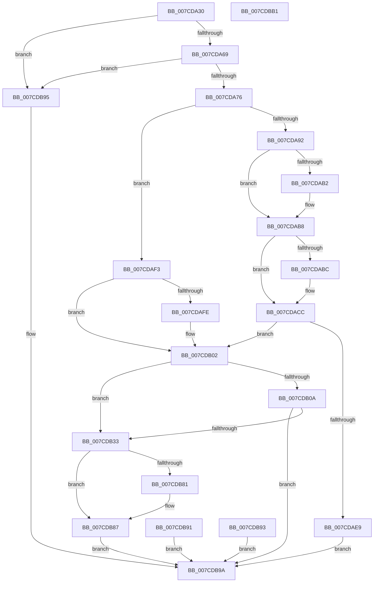

# NtEnumerateSystemEnvironmentValuesEx

- RVA: `0x007CDA30`–`0x007CDBB2` (길이 `386` bytes)
- VA: `0x00000001407CDA30`
- 실행 섹션: `PAGE`
- PDB 이름 있음: `예`; PDB Function 태그: `아니요`
- unwind 정보 RVA: `0x000D526C`
- 디코드: `101`개 명령, `386/386` bytes 표시
- 미해석 바이트: `0` (있으면 어셈블리에 `.byte`로 보존)

> 이 문서는 커널 이미지의 기계어와 PDB 기호를 분석해 생성했습니다. 4번과 5번은 함수 원형과 자료형을 바이너리 사용 방식에서 추정한 C 해석이며 원본 소스 복구 결과는 아닙니다.

## 1. Dependencies

- 직접 호출 지점: **9**; 고유 호출 대상: **9**
- 직접 호출자로 확인된 함수: **0**
- RIP 상대 이미지 참조: **3**

### Outgoing calls
- `0x007CDA69` → [PsIsCurrentThreadInServerSilo](../../text/43/PsIsCurrentThreadInServerSilo_function_004362E0.md) (function, `0x004362E0`)
- `0x007CDAC7` → [ProbeForWrite](../8E/ProbeForWrite_function_008E91C0.md) (function, `0x008E91C0`)
- `0x007CDAD9` → [SeSinglePrivilegeCheck](../87/SeSinglePrivilegeCheck_function_00871E20.md) (function, `0x00871E20`)
- `0x007CDB2A` → [ExLockUserBuffer](../95/ExLockUserBuffer_function_009533B8.md) (function, `0x009533B8`)
- `0x007CDB4B` → [ExAcquireFastMutexUnsafe](../../text/3F/ExAcquireFastMutexUnsafe_function_003F3720.md) (function, `0x003F3720`)
- `0x007CDB5F` → [IoEnumerateEnvironmentVariablesEx](../A2/IoEnumerateEnvironmentVariablesEx_function_00A2592C.md) (function, `0x00A2592C`)
- `0x007CDB6D` → [ExReleaseFastMutexUnsafe](../../text/25/ExReleaseFastMutexUnsafe_function_002503A0.md) (function, `0x002503A0`)
- `0x007CDB72` → [KeLeaveCriticalRegion](../../text/25/KeLeaveCriticalRegion_function_0025D8B0.md) (function, `0x0025D8B0`)
- `0x007CDB81` → [ExUnlockUserBuffer](../../text/29/ExUnlockUserBuffer_function_0029F258.md) (function, `0x0029F258`)

### Direct callers
- 이 함수 시작 RVA로 연결되는 직접 call은 확인되지 않았습니다. 간접 호출은 완전히 역산할 수 없습니다.

### Static image references
- `0x007CDA5C` → RVA `0x00EFF050` (`.data`; read)
- `0x007CDAD2` → RVA `0x00FD9AB8` (`PAGEDATA`; read)
- `0x007CDB44` → RVA `0x00EFAB40` (`.data`; read)

## 2. Other-region calls and transfers

- 다른 실행 섹션으로 향하는 call: **5**
  - `0x007CDA69` → [PsIsCurrentThreadInServerSilo](../../text/43/PsIsCurrentThreadInServerSilo_function_004362E0.md) (`PAGE` → `.text`)
  - `0x007CDB4B` → [ExAcquireFastMutexUnsafe](../../text/3F/ExAcquireFastMutexUnsafe_function_003F3720.md) (`PAGE` → `.text`)
  - `0x007CDB6D` → [ExReleaseFastMutexUnsafe](../../text/25/ExReleaseFastMutexUnsafe_function_002503A0.md) (`PAGE` → `.text`)
  - `0x007CDB72` → [KeLeaveCriticalRegion](../../text/25/KeLeaveCriticalRegion_function_0025D8B0.md) (`PAGE` → `.text`)
  - `0x007CDB81` → [ExUnlockUserBuffer](../../text/29/ExUnlockUserBuffer_function_0029F258.md) (`PAGE` → `.text`)
- 별도 외부 분기/꼬리 이동을 확인하지 못했습니다.

## 3. Assembly (complete function range)

```asm
007CDA30  48 8B C4                        mov rax, rsp
007CDA33  48 89 58 08                     mov qword ptr [rax + 8], rbx
007CDA37  48 89 70 10                     mov qword ptr [rax + 0x10], rsi
007CDA3B  48 89 78 18                     mov qword ptr [rax + 0x18], rdi
007CDA3F  41 56                           push r14
007CDA41  48 83 EC 60                     sub rsp, 0x60
007CDA45  49 8B F8                        mov rdi, r8
007CDA48  48 8B F2                        mov rsi, rdx
007CDA4B  44 8B F1                        mov r14d, ecx
007CDA4E  48 83 60 D0 00                  and qword ptr [rax - 0x30], 0
007CDA53  83 60 CC 00                     and dword ptr [rax - 0x34], 0
007CDA57  48 83 60 D8 00                  and qword ptr [rax - 0x28], 0
007CDA5C  83 3D ED 15 73 00 02            cmp dword ptr [rip + 0x7315ed], 2
007CDA63  0F 85 2C 01 00 00               jne 0x1407cdb95
007CDA69  E8 72 88 C6 FF                  call 0x1404362e0
007CDA6E  84 C0                           test al, al
007CDA70  0F 85 1F 01 00 00               jne 0x1407cdb95
007CDA76  65 48 8B 04 25 88 01 00 00      mov rax, qword ptr gs:[0x188]
007CDA7F  48 89 44 24 58                  mov qword ptr [rsp + 0x58], rax
007CDA84  8A 98 32 02 00 00               mov bl, byte ptr [rax + 0x232]
007CDA8A  88 5C 24 30                     mov byte ptr [rsp + 0x30], bl
007CDA8E  84 DB                           test bl, bl
007CDA90  74 61                           je 0x1407cdaf3
007CDA92  48 B9 00 00 FF FF FF 7F 00 00   movabs rcx, 0x7fffffff0000
007CDA9C  48 3B F9                        cmp rdi, rcx
007CDA9F  48 0F 42 CF                     cmovb rcx, rdi
007CDAA3  8B 01                           mov eax, dword ptr [rcx]
007CDAA5  89 01                           mov dword ptr [rcx], eax
007CDAA7  8B 07                           mov eax, dword ptr [rdi]
007CDAA9  89 44 24 34                     mov dword ptr [rsp + 0x34], eax
007CDAAD  48 85 F6                        test rsi, rsi
007CDAB0  75 06                           jne 0x1407cdab8
007CDAB2  21 74 24 34                     and dword ptr [rsp + 0x34], esi
007CDAB6  33 C0                           xor eax, eax
007CDAB8  85 C0                           test eax, eax
007CDABA  74 10                           je 0x1407cdacc
007CDABC  8B D0                           mov edx, eax
007CDABE  41 B8 04 00 00 00               mov r8d, 4
007CDAC4  48 8B CE                        mov rcx, rsi
007CDAC7  E8 F4 B6 11 00                  call 0x1408e91c0
007CDACC  8A 5C 24 30                     mov bl, byte ptr [rsp + 0x30]
007CDAD0  8A D3                           mov dl, bl
007CDAD2  48 8B 0D DF BF 80 00            mov rcx, qword ptr [rip + 0x80bfdf]
007CDAD9  E8 42 43 0A 00                  call 0x140871e20
007CDADE  88 84 24 88 00 00 00            mov byte ptr [rsp + 0x88], al
007CDAE5  84 C0                           test al, al
007CDAE7  75 19                           jne 0x1407cdb02
007CDAE9  B8 61 00 00 C0                  mov eax, 0xc0000061
007CDAEE  E9 A7 00 00 00                  jmp 0x1407cdb9a
007CDAF3  8B 07                           mov eax, dword ptr [rdi]
007CDAF5  89 44 24 34                     mov dword ptr [rsp + 0x34], eax
007CDAF9  48 85 F6                        test rsi, rsi
007CDAFC  75 04                           jne 0x1407cdb02
007CDAFE  21 74 24 34                     and dword ptr [rsp + 0x34], esi
007CDB02  8B 54 24 34                     mov edx, dword ptr [rsp + 0x34]
007CDB06  85 D2                           test edx, edx
007CDB08  74 29                           je 0x1407cdb33
007CDB0A  48 8D 44 24 40                  lea rax, [rsp + 0x40]
007CDB0F  48 89 44 24 28                  mov qword ptr [rsp + 0x28], rax
007CDB14  48 8D 44 24 38                  lea rax, [rsp + 0x38]
007CDB19  48 89 44 24 20                  mov qword ptr [rsp + 0x20], rax
007CDB1E  41 B9 01 00 00 00               mov r9d, 1
007CDB24  44 8A C3                        mov r8b, bl
007CDB27  48 8B CE                        mov rcx, rsi
007CDB2A  E8 89 58 18 00                  call 0x1409533b8
007CDB2F  85 C0                           test eax, eax
007CDB31  78 67                           js 0x1407cdb9a
007CDB33  65 48 8B 04 25 88 01 00 00      mov rax, qword ptr gs:[0x188]
007CDB3C  66 FF 88 E4 01 00 00            dec word ptr [rax + 0x1e4]
007CDB43  90                              nop
007CDB44  48 8D 0D F5 CF 72 00            lea rcx, [rip + 0x72cff5]
007CDB4B  E8 D0 5B C2 FF                  call 0x1403f3720
007CDB50  4C 8D 4C 24 34                  lea r9, [rsp + 0x34]
007CDB55  4C 8B 44 24 38                  mov r8, qword ptr [rsp + 0x38]
007CDB5A  33 D2                           xor edx, edx
007CDB5C  41 8B CE                        mov ecx, r14d
007CDB5F  E8 C8 7D 25 00                  call 0x140a2592c
007CDB64  8B D8                           mov ebx, eax
007CDB66  48 8D 0D D3 CF 72 00            lea rcx, [rip + 0x72cfd3]
007CDB6D  E8 2E 28 A8 FF                  call 0x1402503a0
007CDB72  E8 39 FD A8 FF                  call 0x14025d8b0
007CDB77  48 8B 4C 24 40                  mov rcx, qword ptr [rsp + 0x40]
007CDB7C  48 85 C9                        test rcx, rcx
007CDB7F  74 06                           je 0x1407cdb87
007CDB81  E8 D2 16 AD FF                  call 0x14029f258
007CDB86  90                              nop
007CDB87  8B 44 24 34                     mov eax, dword ptr [rsp + 0x34]
007CDB8B  89 07                           mov dword ptr [rdi], eax
007CDB8D  8B C3                           mov eax, ebx
007CDB8F  EB 09                           jmp 0x1407cdb9a
007CDB91  EB 07                           jmp 0x1407cdb9a
007CDB93  EB 05                           jmp 0x1407cdb9a
007CDB95  B8 02 00 00 C0                  mov eax, 0xc0000002
007CDB9A  4C 8D 5C 24 60                  lea r11, [rsp + 0x60]
007CDB9F  49 8B 5B 10                     mov rbx, qword ptr [r11 + 0x10]
007CDBA3  49 8B 73 18                     mov rsi, qword ptr [r11 + 0x18]
007CDBA7  49 8B 7B 20                     mov rdi, qword ptr [r11 + 0x20]
007CDBAB  49 8B E3                        mov rsp, r11
007CDBAE  41 5E                           pop r14
007CDBB0  C3                              ret
007CDBB1  CC                              int3
```

## 4. C-style interpretation (structured pseudocode)

```c
__int64 __fastcall NtEnumerateSystemEnvironmentValuesEx(int a1, __int64 a2, __int64 a3)
{
    __int64 result;
    __int64 v_rsp;
    unsigned __int64 v_stack_m10;
    unsigned __int64 v_stack_m28;
    unsigned __int64 v_stack_m30;
    unsigned int v_stack_m34;
    unsigned __int8 v_stack_m38;
    unsigned __int64 v_stack_m40;
    unsigned __int64 v_stack_m48;
    unsigned __int64 v_stack_m8;
    unsigned __int8 v_stack_p20;

    *(unsigned __int64 *)(v_rsp + 8) = v_rbx;
    *(unsigned __int64 *)(v_rsp + 16) = v_rsi;
    *(unsigned __int64 *)(v_rsp + 24) = v_rdi;
    v_rsp = (v_rsp) - (96);
    if ((*(unsigned int *)(v_rip + 7542253)) != 2) goto loc_007CDB95;
    result = PsIsCurrentThreadInServerSilo(a1, a2, a3, a4);
    if ((unsigned __int8)(result) != 0) goto loc_007CDB95;
    v_stack_m10 = *(unsigned __int64 *)(gs_base + (0 + 392));
    v_stack_m38 = (unsigned __int8)(*(unsigned __int8 *)(*(unsigned __int64 *)(gs_base + (0 + 392)) + 562));
    if ((unsigned __int8)(*(unsigned __int8 *)(*(unsigned __int64 *)(gs_base + (0 + 392)) + 562)) == 0) goto loc_007CDAF3;
    if (a3 < a1) { a1 = a3; }
    *(unsigned int *)(a1) = (unsigned int)((unsigned int)(*(unsigned int *)(a1)));
    v_stack_m34 = (unsigned int)((unsigned int)(*(unsigned int *)(a3)));
    result = (unsigned int)(*(unsigned int *)(a3));
    if (a2 == 0) {
        result = 0;
    }
    if (0 != 0) {
        a2 = 0;
        a3 = 4;
        a1 = a2;
        result = ProbeForWrite(a1, a2, a3, a4);
    }
    result = SeSinglePrivilegeCheck(*(unsigned __int64 *)(v_rip + 8437727), (unsigned __int8)(v_stack_m38), a3, a4);
    v_stack_p20 = (unsigned __int8)(result);
    if ((unsigned __int8)(result) != 0) goto loc_007CDB02;
    goto loc_007CDB9A;
loc_007CDAF3:
    v_stack_m34 = (unsigned int)((unsigned int)(*(unsigned int *)(a3)));
    if (a2 == 0) {
    }
    if ((unsigned int)((unsigned int)(v_stack_m34)) == 0) goto loc_007CDB33;
    v_stack_m40 = v_stack_m28;
    v_stack_m48 = v_stack_m30;
    result = ExLockUserBuffer(a2, (unsigned int)(v_stack_m34), (unsigned __int8)(v_stack_m38), 1);
    if (sign_flag) goto loc_007CDB9A;
loc_007CDB33:
    result = ExAcquireFastMutexUnsafe(v_rip + 7524341, (unsigned int)(v_stack_m34), (unsigned __int8)(v_stack_m38), 1);
    a2 = 0;
    result = IoEnumerateEnvironmentVariablesEx((unsigned int)((unsigned int)((unsigned int)(a1))), a2, v_stack_m30, v_stack_m34);
    result = ExReleaseFastMutexUnsafe(v_rip + 7524307, a2, v_stack_m30, v_stack_m34);
    result = KeLeaveCriticalRegion(v_rip + 7524307, a2, v_stack_m30, v_stack_m34);
    if (v_stack_m28 != 0) {
        result = ExUnlockUserBuffer(v_stack_m28, a2, v_stack_m30, v_stack_m34);
    }
    *(unsigned int *)(a3) = (unsigned int)((unsigned int)(v_stack_m34));
    goto loc_007CDB9A;
loc_007CDB95:
loc_007CDB9A:
    return (unsigned int)(0xC0000002ULL);
}
```

## 5. (Beta) C Style

```c
int64_t NtEnumerateSystemEnvironmentValuesEx(int32_t Arg1, int64_t Arg2, void *Arg3)
{
    uint8_t *arg3 = (uint8_t *)Arg3;

    int64_t result;
    int64_t local_rsp;
    uint64_t v_stack_m10;
    uint64_t v_stack_m28;
    uint64_t v_stack_m30;
    uint32_t v_stack_m34;
    uint8_t v_stack_m38;
    uint64_t v_stack_m40;
    uint64_t v_stack_m48;
    uint64_t v_stack_m8;
    uint8_t v_stack_p20;

    *(uint64_t *)(local_rsp + 0x8) = local_rbx;
    *(uint64_t *)(local_rsp + 0x10) = local_rsi;
    *(uint64_t *)(local_rsp + 0x18) = local_rdi;
    local_rsp = (local_rsp) - (96);
    if ((*(uint32_t *)(v_rip + 0x7315ED)) != 2) goto loc_007CDB95;
    result = PsIsCurrentThreadInServerSilo(Arg1, Arg2, Arg3, a4);
    if ((uint8_t)(result) != 0) goto loc_007CDB95;
    v_stack_m10 = *(uint64_t *)(gs_base + (0 + 0x188));
    v_stack_m38 = (uint8_t)(*(uint8_t *)(*(uint64_t *)(gs_base + (0 + 0x188)) + 0x232));
    if ((uint8_t)(*(uint8_t *)(*(uint64_t *)(gs_base + (0 + 0x188)) + 0x232)) == 0) goto loc_007CDAF3;
    if (Arg3 < Arg1) { Arg1 = Arg3; }
    *(uint32_t *)(Arg1) = (uint32_t)((uint32_t)(*(uint32_t *)(Arg1)));
    v_stack_m34 = (uint32_t)((uint32_t)(*(uint32_t *)(arg3)));
    result = (uint32_t)(*(uint32_t *)(arg3));
    if (Arg2 == 0) {
        result = 0;
    }
    if (0 != 0) {
        Arg2 = 0;
        Arg3 = 4;
        Arg1 = Arg2;
        result = ProbeForWrite(Arg1, Arg2, Arg3, a4);
    }
    result = SeSinglePrivilegeCheck(*(uint64_t *)(v_rip + 0x80BFDF), (uint8_t)(v_stack_m38), Arg3, a4);
    v_stack_p20 = (uint8_t)(result);
    if ((uint8_t)(result) != 0) goto loc_007CDB02;
    goto loc_007CDB9A;
loc_007CDAF3:
    v_stack_m34 = (uint32_t)((uint32_t)(*(uint32_t *)(arg3)));
    if (Arg2 == 0) {
    }
    if ((uint32_t)((uint32_t)(v_stack_m34)) == 0) goto loc_007CDB33;
    v_stack_m40 = v_stack_m28;
    v_stack_m48 = v_stack_m30;
    result = ExLockUserBuffer(Arg2, (uint32_t)(v_stack_m34), (uint8_t)(v_stack_m38), 1);
    if (sign_flag) goto loc_007CDB9A;
loc_007CDB33:
    result = ExAcquireFastMutexUnsafe(v_rip + 7524341, (uint32_t)(v_stack_m34), (uint8_t)(v_stack_m38), 1);
    Arg2 = 0;
    result = IoEnumerateEnvironmentVariablesEx((uint32_t)((uint32_t)((uint32_t)(Arg1))), Arg2, v_stack_m30, v_stack_m34);
    result = ExReleaseFastMutexUnsafe(v_rip + 7524307, Arg2, v_stack_m30, v_stack_m34);
    result = KeLeaveCriticalRegion(v_rip + 7524307, Arg2, v_stack_m30, v_stack_m34);
    if (v_stack_m28 != 0) {
        result = ExUnlockUserBuffer(v_stack_m28, Arg2, v_stack_m30, v_stack_m34);
    }
    *(uint32_t *)(arg3) = (uint32_t)((uint32_t)(v_stack_m34));
    goto loc_007CDB9A;
loc_007CDB95:
loc_007CDB9A:
    return (uint32_t)(0xC0000002ULL);
}
```

### 관측된 메모리 오프셋

구조체 형식이 확인되지 않은 접근은 인자 기준의 오프셋으로만 기록했습니다.

| 기준 인자 | 오프셋 표현 | 폭 (bit) | 접근 |
|---|---:|---:|---|
| `Arg3` | `+ 0x0` | `32` | `R` |

## 6. Execution-region graph

[열기: 2D/3D 그래프와 함수 탐색 컨트롤 패널](../../../control-panel.html?section=page&rva=0x007CDA30&view=graph)

- 2D 그래프는 위에서 아래로 흐르고, 3D 그래프는 빈 공간을 드래그해 회전합니다. Shift+드래그는 이동, 휠은 확대·축소, 함수 노드 선택은 대상 보고서 이동입니다.

### Static fallback


