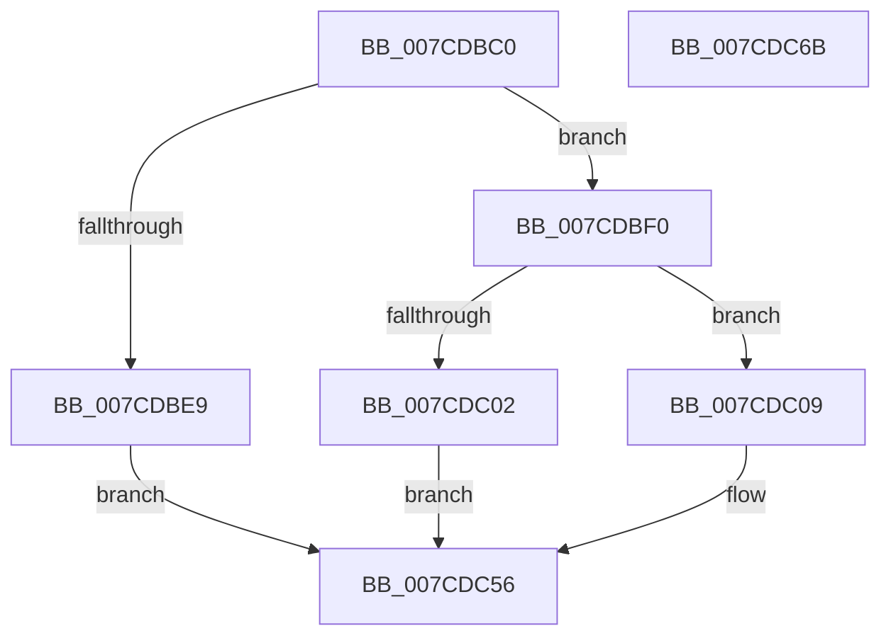

# NtGetEnvironmentVariableEx

- RVA: `0x007CDBC0`–`0x007CDC6C` (길이 `172` bytes)
- VA: `0x00000001407CDBC0`
- 실행 섹션: `PAGE`
- PDB 이름 있음: `예`; PDB Function 태그: `아니요`
- unwind 정보 RVA: `0x00066400`
- 디코드: `42`개 명령, `172/172` bytes 표시
- 미해석 바이트: `0` (있으면 어셈블리에 `.byte`로 보존)

> 이 문서는 커널 이미지의 기계어와 PDB 기호를 분석해 생성했습니다. 4번과 5번은 함수 원형과 자료형을 바이너리 사용 방식에서 추정한 C 해석이며 원본 소스 복구 결과는 아닙니다.

## 1. Dependencies

- 직접 호출 지점: **4**; 고유 호출 대상: **4**
- 직접 호출자로 확인된 함수: **0**
- RIP 상대 이미지 참조: **2**

### Outgoing calls
- `0x007CDC21` → [ExAcquireFastMutexUnsafe](../../text/3F/ExAcquireFastMutexUnsafe_function_003F3720.md) (function, `0x003F3720`)
- `0x007CDC3C` → [IoGetEnvironmentVariableEx](../95/IoGetEnvironmentVariableEx_function_00952760.md) (function, `0x00952760`)
- `0x007CDC4A` → [ExReleaseFastMutexUnsafe](../../text/25/ExReleaseFastMutexUnsafe_function_002503A0.md) (function, `0x002503A0`)
- `0x007CDC4F` → [KeLeaveCriticalRegion](../../text/25/KeLeaveCriticalRegion_function_0025D8B0.md) (function, `0x0025D8B0`)

### Direct callers
- 이 함수 시작 RVA로 연결되는 직접 call은 확인되지 않았습니다. 간접 호출은 완전히 역산할 수 없습니다.

### Static image references
- `0x007CDBD4` → RVA `0x00EFF050` (`.data`; read)
- `0x007CDC12` → RVA `0x00EFAB40` (`.data`; read)

## 2. Other-region calls and transfers

- 다른 실행 섹션으로 향하는 call: **3**
  - `0x007CDC21` → [ExAcquireFastMutexUnsafe](../../text/3F/ExAcquireFastMutexUnsafe_function_003F3720.md) (`PAGE` → `.text`)
  - `0x007CDC4A` → [ExReleaseFastMutexUnsafe](../../text/25/ExReleaseFastMutexUnsafe_function_002503A0.md) (`PAGE` → `.text`)
  - `0x007CDC4F` → [KeLeaveCriticalRegion](../../text/25/KeLeaveCriticalRegion_function_0025D8B0.md) (`PAGE` → `.text`)
- 별도 외부 분기/꼬리 이동을 확인하지 못했습니다.

## 3. Assembly (complete function range)

```asm
007CDBC0  48 89 5C 24 08                  mov qword ptr [rsp + 8], rbx
007CDBC5  48 89 6C 24 10                  mov qword ptr [rsp + 0x10], rbp
007CDBCA  48 89 74 24 18                  mov qword ptr [rsp + 0x18], rsi
007CDBCF  57                              push rdi
007CDBD0  48 83 EC 30                     sub rsp, 0x30
007CDBD4  83 3D 75 14 73 00 02            cmp dword ptr [rip + 0x731475], 2
007CDBDB  49 8B D9                        mov rbx, r9
007CDBDE  49 8B F8                        mov rdi, r8
007CDBE1  48 8B F2                        mov rsi, rdx
007CDBE4  48 8B E9                        mov rbp, rcx
007CDBE7  74 07                           je 0x1407cdbf0
007CDBE9  B8 02 00 00 C0                  mov eax, 0xc0000002
007CDBEE  EB 66                           jmp 0x1407cdc56
007CDBF0  65 48 8B 04 25 88 01 00 00      mov rax, qword ptr gs:[0x188]
007CDBF9  80 B8 32 02 00 00 00            cmp byte ptr [rax + 0x232], 0
007CDC00  74 07                           je 0x1407cdc09
007CDC02  B8 61 00 00 C0                  mov eax, 0xc0000061
007CDC07  EB 4D                           jmp 0x1407cdc56
007CDC09  65 48 8B 04 25 88 01 00 00      mov rax, qword ptr gs:[0x188]
007CDC12  48 8D 0D 27 CF 72 00            lea rcx, [rip + 0x72cf27]
007CDC19  66 FF 88 E4 01 00 00            dec word ptr [rax + 0x1e4]
007CDC20  90                              nop
007CDC21  E8 FA 5A C2 FF                  call 0x1403f3720
007CDC26  48 8B 44 24 60                  mov rax, qword ptr [rsp + 0x60]
007CDC2B  4C 8B CB                        mov r9, rbx
007CDC2E  4C 8B C7                        mov r8, rdi
007CDC31  48 89 44 24 20                  mov qword ptr [rsp + 0x20], rax
007CDC36  48 8B D6                        mov rdx, rsi
007CDC39  48 8B CD                        mov rcx, rbp
007CDC3C  E8 1F 4B 18 00                  call 0x140952760
007CDC41  48 8D 0D F8 CE 72 00            lea rcx, [rip + 0x72cef8]
007CDC48  8B D8                           mov ebx, eax
007CDC4A  E8 51 27 A8 FF                  call 0x1402503a0
007CDC4F  E8 5C FC A8 FF                  call 0x14025d8b0
007CDC54  8B C3                           mov eax, ebx
007CDC56  48 8B 5C 24 40                  mov rbx, qword ptr [rsp + 0x40]
007CDC5B  48 8B 6C 24 48                  mov rbp, qword ptr [rsp + 0x48]
007CDC60  48 8B 74 24 50                  mov rsi, qword ptr [rsp + 0x50]
007CDC65  48 83 C4 30                     add rsp, 0x30
007CDC69  5F                              pop rdi
007CDC6A  C3                              ret
007CDC6B  CC                              int3
```

## 4. C-style interpretation (structured pseudocode)

```c
__int64 __fastcall NtGetEnvironmentVariableEx(__int64 a1, __int64 a2, __int64 a3, __int64 a4, __int64 a5)
{
    __int64 result;
    __int64 v_rsp;
    unsigned __int64 v_stack_m18;
    unsigned __int64 v_stack_p10;
    unsigned __int64 v_stack_p18;
    unsigned __int64 v_stack_p8;

    v_stack_p8 = v_rbx;
    v_stack_p10 = v_rbp;
    v_stack_p18 = v_rsi;
    v_rsp = (v_rsp) - (48);
    if ((*(unsigned int *)(v_rip + 7541877)) == 2) goto loc_007CDBF0;
    goto loc_007CDC56;
loc_007CDBF0:
    if ((*(unsigned __int8 *)(*(unsigned __int64 *)(gs_base + (0 + 392)) + 562)) == 0) goto loc_007CDC09;
    goto loc_007CDC56;
loc_007CDC09:
    result = ExAcquireFastMutexUnsafe(v_rip + 7524135, a2, a3, a4);
    v_stack_m18 = a5;
    result = IoGetEnvironmentVariableEx(a1, a2, a3, a4);
    result = ExReleaseFastMutexUnsafe(v_rip + 7524088, a2, a3, a4);
    result = KeLeaveCriticalRegion(v_rip + 7524088, a2, a3, a4);
loc_007CDC56:
    v_rsp = (v_rsp) + (48);
    return (unsigned int)((unsigned int)((unsigned int)((unsigned int)(result))));
}
```

## 5. (Beta) C Style

```c
int64_t NtGetEnvironmentVariableEx(int64_t Arg1, int64_t Arg2, int64_t Arg3, int64_t Arg4, int64_t Arg5)
{
    int64_t result;
    int64_t local_rsp;
    uint64_t v_stack_m18;
    uint64_t v_stack_p10;
    uint64_t v_stack_p18;
    uint64_t v_stack_p8;

    v_stack_p8 = local_rbx;
    v_stack_p10 = local_rbp;
    v_stack_p18 = local_rsi;
    local_rsp = (local_rsp) - (48);
    if ((*(uint32_t *)(v_rip + 0x731475)) == 2) goto loc_007CDBF0;
    goto loc_007CDC56;
loc_007CDBF0:
    if ((*(uint8_t *)(*(uint64_t *)(gs_base + (0 + 0x188)) + 0x232)) == 0) goto loc_007CDC09;
    goto loc_007CDC56;
loc_007CDC09:
    result = ExAcquireFastMutexUnsafe(v_rip + 7524135, Arg2, Arg3, Arg4);
    v_stack_m18 = Arg5;
    result = IoGetEnvironmentVariableEx(Arg1, Arg2, Arg3, Arg4);
    result = ExReleaseFastMutexUnsafe(v_rip + 7524088, Arg2, Arg3, Arg4);
    result = KeLeaveCriticalRegion(v_rip + 7524088, Arg2, Arg3, Arg4);
loc_007CDC56:
    local_rsp = (local_rsp) + (48);
    return (uint32_t)((uint32_t)((uint32_t)((uint32_t)(result))));
}
```

## 6. Execution-region graph

[열기: 2D/3D 그래프와 함수 탐색 컨트롤 패널](../../../control-panel.html?section=page&rva=0x007CDBC0&view=graph)

- 2D 그래프는 위에서 아래로 흐르고, 3D 그래프는 빈 공간을 드래그해 회전합니다. Shift+드래그는 이동, 휠은 확대·축소, 함수 노드 선택은 대상 보고서 이동입니다.

### Static fallback


