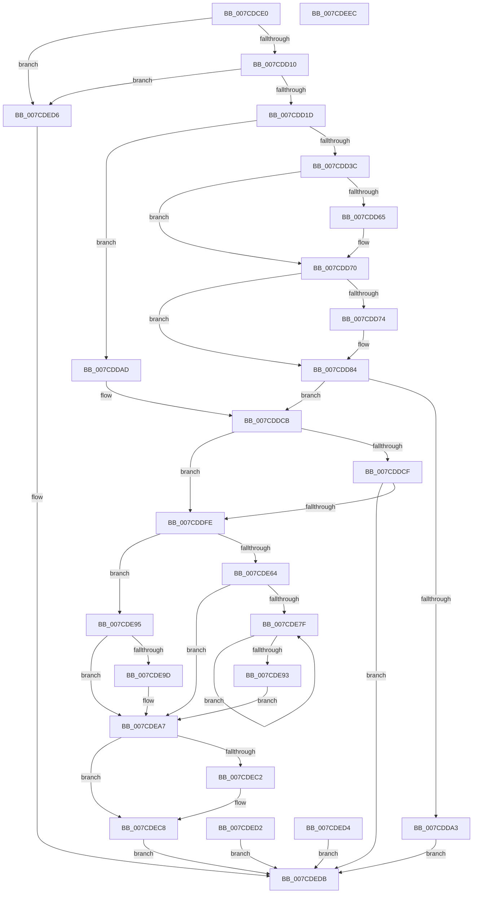

# NtQueryDriverEntryOrder

- RVA: `0x007CDCE0`–`0x007CDEED` (길이 `525` bytes)
- VA: `0x00000001407CDCE0`
- 실행 섹션: `PAGE`
- PDB 이름 있음: `예`; PDB Function 태그: `아니요`
- unwind 정보 RVA: `0x000D53D0`
- 디코드: `132`개 명령, `525/525` bytes 표시
- 미해석 바이트: `0` (있으면 어셈블리에 `.byte`로 보존)

> 이 문서는 커널 이미지의 기계어와 PDB 기호를 분석해 생성했습니다. 4번과 5번은 함수 원형과 자료형을 바이너리 사용 방식에서 추정한 C 해석이며 원본 소스 복구 결과는 아닙니다.

## 1. Dependencies

- 직접 호출 지점: **9**; 고유 호출 대상: **9**
- 직접 호출자로 확인된 함수: **0**
- RIP 상대 이미지 참조: **5**

### Outgoing calls
- `0x007CDD10` → [PsIsCurrentThreadInServerSilo](../../text/43/PsIsCurrentThreadInServerSilo_function_004362E0.md) (function, `0x004362E0`)
- `0x007CDD7F` → [ProbeForWrite](../8E/ProbeForWrite_function_008E91C0.md) (function, `0x008E91C0`)
- `0x007CDD93` → [SeSinglePrivilegeCheck](../87/SeSinglePrivilegeCheck_function_00871E20.md) (function, `0x00871E20`)
- `0x007CDDF1` → [ExLockUserBuffer](../95/ExLockUserBuffer_function_009533B8.md) (function, `0x009533B8`)
- `0x007CDE1F` → [ExAcquireFastMutexUnsafe](../../text/3F/ExAcquireFastMutexUnsafe_function_003F3720.md) (function, `0x003F3720`)
- `0x007CDE48` → [HalGetEnvironmentVariableEx](../../text/44/HalGetEnvironmentVariableEx_function_00449100.md) (function, `0x00449100`)
- `0x007CDE56` → [ExReleaseFastMutexUnsafe](../../text/25/ExReleaseFastMutexUnsafe_function_002503A0.md) (function, `0x002503A0`)
- `0x007CDE5B` → [KeLeaveCriticalRegion](../../text/25/KeLeaveCriticalRegion_function_0025D8B0.md) (function, `0x0025D8B0`)
- `0x007CDEC2` → [ExUnlockUserBuffer](../../text/29/ExUnlockUserBuffer_function_0029F258.md) (function, `0x0029F258`)

### Direct callers
- 이 함수 시작 RVA로 연결되는 직접 call은 확인되지 않았습니다. 간접 호출은 완전히 역산할 수 없습니다.

### Static image references
- `0x007CDD03` → RVA `0x00EFF050` (`.data`; read)
- `0x007CDD8C` → RVA `0x00FD9AB8` (`PAGEDATA`; read)
- `0x007CDE18` → RVA `0x00EFAB40` (`.data`; read)
- `0x007CDE3A` → RVA `0x000394B8` (`.rdata`; read)
- `0x007CDE41` → RVA `0x00B08920` (` ?? ::NNGAKEGL::`string'`; read)

## 2. Other-region calls and transfers

- 다른 실행 섹션으로 향하는 call: **6**
  - `0x007CDD10` → [PsIsCurrentThreadInServerSilo](../../text/43/PsIsCurrentThreadInServerSilo_function_004362E0.md) (`PAGE` → `.text`)
  - `0x007CDE1F` → [ExAcquireFastMutexUnsafe](../../text/3F/ExAcquireFastMutexUnsafe_function_003F3720.md) (`PAGE` → `.text`)
  - `0x007CDE48` → [HalGetEnvironmentVariableEx](../../text/44/HalGetEnvironmentVariableEx_function_00449100.md) (`PAGE` → `.text`)
  - `0x007CDE56` → [ExReleaseFastMutexUnsafe](../../text/25/ExReleaseFastMutexUnsafe_function_002503A0.md) (`PAGE` → `.text`)
  - `0x007CDE5B` → [KeLeaveCriticalRegion](../../text/25/KeLeaveCriticalRegion_function_0025D8B0.md) (`PAGE` → `.text`)
  - `0x007CDEC2` → [ExUnlockUserBuffer](../../text/29/ExUnlockUserBuffer_function_0029F258.md) (`PAGE` → `.text`)
- 별도 외부 분기/꼬리 이동을 확인하지 못했습니다.

## 3. Assembly (complete function range)

```asm
007CDCE0  48 8B C4                        mov rax, rsp
007CDCE3  48 89 58 08                     mov qword ptr [rax + 8], rbx
007CDCE7  56                              push rsi
007CDCE8  57                              push rdi
007CDCE9  41 56                           push r14
007CDCEB  48 83 EC 60                     sub rsp, 0x60
007CDCEF  4C 8B F2                        mov r14, rdx
007CDCF2  48 8B F1                        mov rsi, rcx
007CDCF5  48 83 60 C0 00                  and qword ptr [rax - 0x40], 0
007CDCFA  83 60 20 00                     and dword ptr [rax + 0x20], 0
007CDCFE  48 83 60 C8 00                  and qword ptr [rax - 0x38], 0
007CDD03  83 3D 46 13 73 00 02            cmp dword ptr [rip + 0x731346], 2
007CDD0A  0F 85 C6 01 00 00               jne 0x1407cded6
007CDD10  E8 CB 85 C6 FF                  call 0x1404362e0
007CDD15  84 C0                           test al, al
007CDD17  0F 85 B9 01 00 00               jne 0x1407cded6
007CDD1D  65 48 8B 04 25 88 01 00 00      mov rax, qword ptr gs:[0x188]
007CDD26  48 89 44 24 58                  mov qword ptr [rsp + 0x58], rax
007CDD2B  40 8A B8 32 02 00 00            mov dil, byte ptr [rax + 0x232]
007CDD32  40 88 7C 24 30                  mov byte ptr [rsp + 0x30], dil
007CDD37  40 84 FF                        test dil, dil
007CDD3A  74 71                           je 0x1407cddad
007CDD3C  48 B9 00 00 FF FF FF 7F 00 00   movabs rcx, 0x7fffffff0000
007CDD46  4C 3B F1                        cmp r14, rcx
007CDD49  49 0F 42 CE                     cmovb rcx, r14
007CDD4D  8B 01                           mov eax, dword ptr [rcx]
007CDD4F  89 01                           mov dword ptr [rcx], eax
007CDD51  41 8B 1E                        mov ebx, dword ptr [r14]
007CDD54  C1 E3 02                        shl ebx, 2
007CDD57  89 9C 24 98 00 00 00            mov dword ptr [rsp + 0x98], ebx
007CDD5E  8B C3                           mov eax, ebx
007CDD60  48 85 F6                        test rsi, rsi
007CDD63  75 0B                           jne 0x1407cdd70
007CDD65  33 DB                           xor ebx, ebx
007CDD67  89 9C 24 98 00 00 00            mov dword ptr [rsp + 0x98], ebx
007CDD6E  33 C0                           xor eax, eax
007CDD70  85 C0                           test eax, eax
007CDD72  74 10                           je 0x1407cdd84
007CDD74  8B D0                           mov edx, eax
007CDD76  41 B8 04 00 00 00               mov r8d, 4
007CDD7C  48 8B CE                        mov rcx, rsi
007CDD7F  E8 3C B4 11 00                  call 0x1408e91c0
007CDD84  40 8A 7C 24 30                  mov dil, byte ptr [rsp + 0x30]
007CDD89  40 8A D7                        mov dl, dil
007CDD8C  48 8B 0D 25 BD 80 00            mov rcx, qword ptr [rip + 0x80bd25]
007CDD93  E8 88 40 0A 00                  call 0x140871e20
007CDD98  88 84 24 90 00 00 00            mov byte ptr [rsp + 0x90], al
007CDD9F  84 C0                           test al, al
007CDDA1  75 28                           jne 0x1407cddcb
007CDDA3  B8 61 00 00 C0                  mov eax, 0xc0000061
007CDDA8  E9 2E 01 00 00                  jmp 0x1407cdedb
007CDDAD  41 8B 0E                        mov ecx, dword ptr [r14]
007CDDB0  C1 E1 02                        shl ecx, 2
007CDDB3  89 8C 24 98 00 00 00            mov dword ptr [rsp + 0x98], ecx
007CDDBA  48 8B C6                        mov rax, rsi
007CDDBD  48 F7 D8                        neg rax
007CDDC0  1B DB                           sbb ebx, ebx
007CDDC2  23 D9                           and ebx, ecx
007CDDC4  89 9C 24 98 00 00 00            mov dword ptr [rsp + 0x98], ebx
007CDDCB  85 DB                           test ebx, ebx
007CDDCD  74 2F                           je 0x1407cddfe
007CDDCF  48 8D 44 24 40                  lea rax, [rsp + 0x40]
007CDDD4  48 89 44 24 28                  mov qword ptr [rsp + 0x28], rax
007CDDD9  48 8D 44 24 38                  lea rax, [rsp + 0x38]
007CDDDE  48 89 44 24 20                  mov qword ptr [rsp + 0x20], rax
007CDDE3  41 B9 01 00 00 00               mov r9d, 1
007CDDE9  44 8A C7                        mov r8b, dil
007CDDEC  8B D3                           mov edx, ebx
007CDDEE  48 8B CE                        mov rcx, rsi
007CDDF1  E8 C2 55 18 00                  call 0x1409533b8
007CDDF6  85 C0                           test eax, eax
007CDDF8  0F 88 DD 00 00 00               js 0x1407cdedb
007CDDFE  D1 EB                           shr ebx, 1
007CDE00  89 9C 24 98 00 00 00            mov dword ptr [rsp + 0x98], ebx
007CDE07  65 48 8B 04 25 88 01 00 00      mov rax, qword ptr gs:[0x188]
007CDE10  66 FF 88 E4 01 00 00            dec word ptr [rax + 0x1e4]
007CDE17  90                              nop
007CDE18  48 8D 0D 21 CD 72 00            lea rcx, [rip + 0x72cd21]
007CDE1F  E8 FC 58 C2 FF                  call 0x1403f3720
007CDE24  48 83 64 24 20 00               and qword ptr [rsp + 0x20], 0
007CDE2A  4C 8D 8C 24 98 00 00 00         lea r9, [rsp + 0x98]
007CDE32  48 8B 5C 24 38                  mov rbx, qword ptr [rsp + 0x38]
007CDE37  4C 8B C3                        mov r8, rbx
007CDE3A  48 8D 15 77 B6 86 FF            lea rdx, [rip - 0x794989]
007CDE41  48 8D 0D D8 AA 33 00            lea rcx, [rip + 0x33aad8]
007CDE48  E8 B3 B2 C7 FF                  call 0x140449100
007CDE4D  8B F8                           mov edi, eax
007CDE4F  48 8D 0D EA CC 72 00            lea rcx, [rip + 0x72ccea]
007CDE56  E8 45 25 A8 FF                  call 0x1402503a0
007CDE5B  E8 50 FA A8 FF                  call 0x14025d8b0
007CDE60  85 FF                           test edi, edi
007CDE62  78 31                           js 0x1407cde95
007CDE64  44 8B 84 24 98 00 00 00         mov r8d, dword ptr [rsp + 0x98]
007CDE6C  41 D1 E8                        shr r8d, 1
007CDE6F  41 8D 48 FF                     lea ecx, [r8 - 1]
007CDE73  8B D1                           mov edx, ecx
007CDE75  48 8D 0C 4B                     lea rcx, [rbx + rcx*2]
007CDE79  4C 8D 0C 93                     lea r9, [rbx + rdx*4]
007CDE7D  74 28                           je 0x1407cdea7
007CDE7F  0F B7 01                        movzx eax, word ptr [rcx]
007CDE82  41 89 01                        mov dword ptr [r9], eax
007CDE85  4D 8D 49 FC                     lea r9, [r9 - 4]
007CDE89  48 8D 49 FE                     lea rcx, [rcx - 2]
007CDE8D  41 83 C0 FF                     add r8d, -1
007CDE91  75 EC                           jne 0x1407cde7f
007CDE93  EB 12                           jmp 0x1407cdea7
007CDE95  81 FF 00 01 00 C0               cmp edi, 0xc0000100
007CDE9B  75 0A                           jne 0x1407cdea7
007CDE9D  83 A4 24 98 00 00 00 00         and dword ptr [rsp + 0x98], 0
007CDEA5  33 FF                           xor edi, edi
007CDEA7  8B 84 24 98 00 00 00            mov eax, dword ptr [rsp + 0x98]
007CDEAE  8D 1C 00                        lea ebx, [rax + rax]
007CDEB1  89 9C 24 98 00 00 00            mov dword ptr [rsp + 0x98], ebx
007CDEB8  48 8B 4C 24 40                  mov rcx, qword ptr [rsp + 0x40]
007CDEBD  48 85 C9                        test rcx, rcx
007CDEC0  74 06                           je 0x1407cdec8
007CDEC2  E8 91 13 AD FF                  call 0x14029f258
007CDEC7  90                              nop
007CDEC8  C1 EB 02                        shr ebx, 2
007CDECB  41 89 1E                        mov dword ptr [r14], ebx
007CDECE  8B C7                           mov eax, edi
007CDED0  EB 09                           jmp 0x1407cdedb
007CDED2  EB 07                           jmp 0x1407cdedb
007CDED4  EB 05                           jmp 0x1407cdedb
007CDED6  B8 02 00 00 C0                  mov eax, 0xc0000002
007CDEDB  48 8B 9C 24 80 00 00 00         mov rbx, qword ptr [rsp + 0x80]
007CDEE3  48 83 C4 60                     add rsp, 0x60
007CDEE7  41 5E                           pop r14
007CDEE9  5F                              pop rdi
007CDEEA  5E                              pop rsi
007CDEEB  C3                              ret
007CDEEC  CC                              int3
```

## 4. C-style interpretation (structured pseudocode)

```c
__int64 __fastcall NtQueryDriverEntryOrder(__int64 a1, __int64 a2)
{
    __int64 result;
    __int64 v_rbx;
    __int64 v_rdi;
    __int64 v_rsp;
    unsigned __int64 v_stack_m20;
    unsigned __int64 v_stack_m38;
    unsigned __int64 v_stack_m40;
    unsigned __int8 v_stack_m48;
    unsigned __int64 v_stack_m50;
    unsigned __int64 v_stack_m58;
    unsigned __int8 v_stack_p18;
    unsigned int v_stack_p20;
    unsigned __int64 v_stack_p8;

    *(unsigned __int64 *)(v_rsp + 8) = v_rbx;
    v_rsp = (v_rsp) - (96);
    if ((*(unsigned int *)(v_rip + 7541574)) != 2) goto loc_007CDED6;
    result = PsIsCurrentThreadInServerSilo(a1, a2, a3, a4);
    if ((unsigned __int8)(result) != 0) goto loc_007CDED6;
    v_stack_m20 = *(unsigned __int64 *)(gs_base + (0 + 392));
    v_stack_m48 = (unsigned __int8)(*(unsigned __int8 *)(*(unsigned __int64 *)(gs_base + (0 + 392)) + 562));
    if ((unsigned __int8)(*(unsigned __int8 *)(*(unsigned __int64 *)(gs_base + (0 + 392)) + 562)) == 0) goto loc_007CDDAD;
    if (a2 < a1) { a1 = a2; }
    *(unsigned int *)(a1) = (unsigned int)((unsigned int)(*(unsigned int *)(a1)));
    v_rbx = (unsigned int)(((unsigned int)(*(unsigned int *)(a2))) << (2));
    v_stack_p20 = (unsigned int)(v_rbx);
    result = (unsigned int)((unsigned int)(v_rbx));
    if (a1 == 0) {
        v_rbx = 0;
        v_stack_p20 = 0;
        result = 0;
    }
    if (0 != 0) {
        a2 = 0;
        a3 = 4;
        a1 = a1;
        result = ProbeForWrite(a1, a2, a3, a4);
    }
    result = SeSinglePrivilegeCheck(*(unsigned __int64 *)(v_rip + 8437029), (unsigned __int8)(v_stack_m48), a3, a4);
    v_stack_p18 = (unsigned __int8)(result);
    if ((unsigned __int8)(result) != 0) goto loc_007CDDCB;
    goto loc_007CDEDB;
loc_007CDDAD:
    a1 = (unsigned int)(((unsigned int)(*(unsigned int *)(a2))) << (2));
    v_stack_p20 = (unsigned int)(a1);
    result = -(a1);
    v_rbx = (unsigned int)((v_rbx) & ((unsigned int)(a1)));
    v_stack_p20 = (unsigned int)(v_rbx);
loc_007CDDCB:
    if ((unsigned int)(v_rbx) == 0) goto loc_007CDDFE;
    v_stack_m50 = v_stack_m38;
    v_stack_m58 = v_stack_m40;
    result = ExLockUserBuffer(a1, (unsigned int)((unsigned int)(v_rbx)), (unsigned __int8)(v_stack_m48), 1);
    if (sign_flag) goto loc_007CDEDB;
loc_007CDDFE:
    v_rbx = (unsigned int)((v_rbx) >> (1));
    v_stack_p20 = (unsigned int)(v_rbx);
    result = ExAcquireFastMutexUnsafe(v_rip + 7523617, (unsigned int)((unsigned int)(v_rbx)), (unsigned __int8)(v_stack_m48), 1);
    result = HalGetEnvironmentVariableEx(v_rip + 3386072, v_rip - 7948681, v_stack_m40, v_stack_p20);
    result = ExReleaseFastMutexUnsafe(v_rip + 7523562, v_rip - 7948681, v_stack_m40, v_stack_p20);
    result = KeLeaveCriticalRegion(v_rip + 7523562, v_rip - 7948681, v_stack_m40, v_stack_p20);
    if (sign_flag) goto loc_007CDE95;
    a3 = (unsigned int)(((unsigned int)(v_stack_p20)) >> (1));
    if (condition_is_equal) goto loc_007CDEA7;
loc_007CDE7F:
    *(unsigned int *)(v_stack_m40 + (unsigned int)((unsigned int)(a3 - 1)) * 4) = (unsigned int)(*(unsigned __int16 *)(v_stack_m40 + a3 - 1 * 2));
    a3 = (unsigned int)((a3) + (-1));
    if (condition_is_not_equal) goto loc_007CDE7F;
    goto loc_007CDEA7;
loc_007CDE95:
    v_rdi = (unsigned int)((unsigned int)(result));
    if (((unsigned int)((unsigned int)((unsigned int)(result)))) == 0xC0000100ULL) {
        v_rdi = 0;
    }
    v_stack_p20 = (unsigned int)((unsigned int)(v_stack_p20) + (unsigned int)(v_stack_p20) * 1);
    result = (unsigned int)(v_stack_p20);
    if (v_stack_m38 != 0) {
        result = ExUnlockUserBuffer(v_stack_m38, (unsigned int)((unsigned int)(a3 - 1)), a3, v_stack_m40 + (unsigned int)((unsigned int)(a3 - 1)) * 4 - 4);
    }
    v_rbx = (unsigned int)(((unsigned int)(v_stack_p20) + (unsigned int)(v_stack_p20) * 1) >> (2));
    *(unsigned int *)(a2) = (unsigned int)(v_rbx);
    goto loc_007CDEDB;
loc_007CDED6:
loc_007CDEDB:
    v_rsp = (v_rsp) + (96);
    return (unsigned int)(0xC0000002ULL);
}
```

## 5. (Beta) C Style

```c
int64_t NtQueryDriverEntryOrder(int64_t Arg1, void *Arg2)
{
    uint8_t *arg2 = (uint8_t *)Arg2;

    int64_t result;
    int64_t local_rbx;
    int64_t local_rdi;
    int64_t local_rsp;
    uint64_t v_stack_m20;
    uint64_t v_stack_m38;
    uint64_t v_stack_m40;
    uint8_t v_stack_m48;
    uint64_t v_stack_m50;
    uint64_t v_stack_m58;
    uint8_t v_stack_p18;
    uint32_t v_stack_p20;
    uint64_t v_stack_p8;

    *(uint64_t *)(local_rsp + 0x8) = local_rbx;
    local_rsp = (local_rsp) - (96);
    if ((*(uint32_t *)(v_rip + 0x731346)) != 2) goto loc_007CDED6;
    result = PsIsCurrentThreadInServerSilo(Arg1, Arg2, a3, a4);
    if ((uint8_t)(result) != 0) goto loc_007CDED6;
    v_stack_m20 = *(uint64_t *)(gs_base + (0 + 0x188));
    v_stack_m48 = (uint8_t)(*(uint8_t *)(*(uint64_t *)(gs_base + (0 + 0x188)) + 0x232));
    if ((uint8_t)(*(uint8_t *)(*(uint64_t *)(gs_base + (0 + 0x188)) + 0x232)) == 0) goto loc_007CDDAD;
    if (Arg2 < Arg1) { Arg1 = Arg2; }
    *(uint32_t *)(Arg1) = (uint32_t)((uint32_t)(*(uint32_t *)(Arg1)));
    local_rbx = (uint32_t)(((uint32_t)(*(uint32_t *)(arg2))) << (2));
    v_stack_p20 = (uint32_t)(local_rbx);
    result = (uint32_t)((uint32_t)(local_rbx));
    if (Arg1 == 0) {
        local_rbx = 0;
        v_stack_p20 = 0;
        result = 0;
    }
    if (0 != 0) {
        Arg2 = 0;
        a3 = 4;
        Arg1 = Arg1;
        result = ProbeForWrite(Arg1, Arg2, a3, a4);
    }
    result = SeSinglePrivilegeCheck(*(uint64_t *)(v_rip + 0x80BD25), (uint8_t)(v_stack_m48), a3, a4);
    v_stack_p18 = (uint8_t)(result);
    if ((uint8_t)(result) != 0) goto loc_007CDDCB;
    goto loc_007CDEDB;
loc_007CDDAD:
    Arg1 = (uint32_t)(((uint32_t)(*(uint32_t *)(arg2))) << (2));
    v_stack_p20 = (uint32_t)(Arg1);
    result = -(Arg1);
    local_rbx = (uint32_t)((local_rbx) & ((uint32_t)(Arg1)));
    v_stack_p20 = (uint32_t)(local_rbx);
loc_007CDDCB:
    if ((uint32_t)(local_rbx) == 0) goto loc_007CDDFE;
    v_stack_m50 = v_stack_m38;
    v_stack_m58 = v_stack_m40;
    result = ExLockUserBuffer(Arg1, (uint32_t)((uint32_t)(local_rbx)), (uint8_t)(v_stack_m48), 1);
    if (sign_flag) goto loc_007CDEDB;
loc_007CDDFE:
    local_rbx = (uint32_t)((local_rbx) >> (1));
    v_stack_p20 = (uint32_t)(local_rbx);
    result = ExAcquireFastMutexUnsafe(v_rip + 7523617, (uint32_t)((uint32_t)(local_rbx)), (uint8_t)(v_stack_m48), 1);
    result = HalGetEnvironmentVariableEx(v_rip + 3386072, v_rip - 7948681, v_stack_m40, v_stack_p20);
    result = ExReleaseFastMutexUnsafe(v_rip + 7523562, v_rip - 7948681, v_stack_m40, v_stack_p20);
    result = KeLeaveCriticalRegion(v_rip + 7523562, v_rip - 7948681, v_stack_m40, v_stack_p20);
    if (sign_flag) goto loc_007CDE95;
    a3 = (uint32_t)(((uint32_t)(v_stack_p20)) >> (1));
    if (condition_is_equal) goto loc_007CDEA7;
loc_007CDE7F:
    *(uint32_t *)(v_stack_m40 + (uint32_t)((uint32_t)(a3 - 0x1)) * 4) = (uint32_t)(*(uint16_t *)(v_stack_m40 + a3 - 0x1 * 2));
    a3 = (uint32_t)((a3) + (-1));
    if (condition_is_not_equal) goto loc_007CDE7F;
    goto loc_007CDEA7;
loc_007CDE95:
    local_rdi = (uint32_t)((uint32_t)(result));
    if (((uint32_t)((uint32_t)((uint32_t)(result)))) == 0xC0000100ULL) {
        local_rdi = 0;
    }
    v_stack_p20 = (uint32_t)((uint32_t)(v_stack_p20) + (uint32_t)(v_stack_p20) * 1);
    result = (uint32_t)(v_stack_p20);
    if (v_stack_m38 != 0) {
        result = ExUnlockUserBuffer(v_stack_m38, (uint32_t)((uint32_t)(a3 - 1)), a3, v_stack_m40 + (uint32_t)((uint32_t)(a3 - 1)) * 4 - 4);
    }
    local_rbx = (uint32_t)(((uint32_t)(v_stack_p20) + (uint32_t)(v_stack_p20) * 1) >> (2));
    *(uint32_t *)(arg2) = (uint32_t)(local_rbx);
    goto loc_007CDEDB;
loc_007CDED6:
loc_007CDEDB:
    local_rsp = (local_rsp) + (96);
    return (uint32_t)(0xC0000002ULL);
}
```

### 관측된 메모리 오프셋

구조체 형식이 확인되지 않은 접근은 인자 기준의 오프셋으로만 기록했습니다.

| 기준 인자 | 오프셋 표현 | 폭 (bit) | 접근 |
|---|---:|---:|---|
| `Arg2` | `+ 0x0` | `32` | `R` |

## 6. Execution-region graph

[열기: 2D/3D 그래프와 함수 탐색 컨트롤 패널](../../../control-panel.html?section=page&rva=0x007CDCE0&view=graph)

- 2D 그래프는 위에서 아래로 흐르고, 3D 그래프는 빈 공간을 드래그해 회전합니다. Shift+드래그는 이동, 휠은 확대·축소, 함수 노드 선택은 대상 보고서 이동입니다.

### Static fallback


