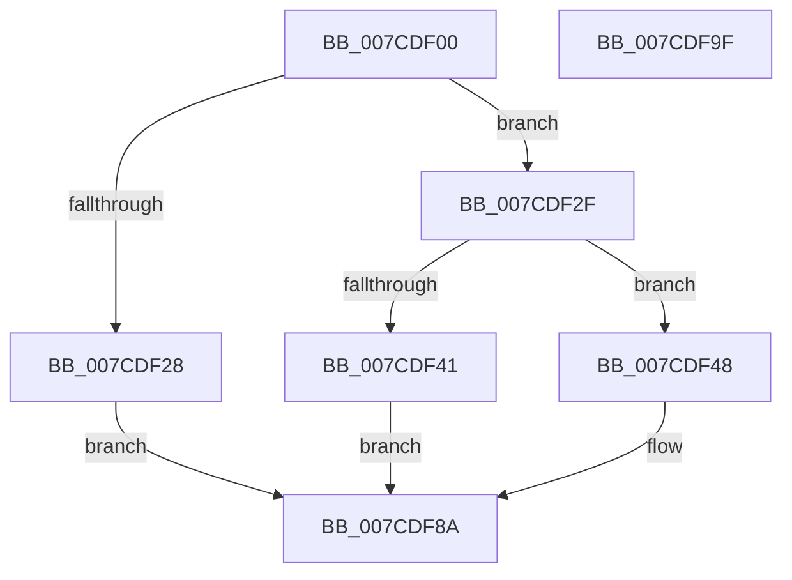

# NtQueryEnvironmentVariableInfoEx

- RVA: `0x007CDF00`–`0x007CDFA0` (길이 `160` bytes)
- VA: `0x00000001407CDF00`
- 실행 섹션: `PAGE`
- PDB 이름 있음: `예`; PDB Function 태그: `아니요`
- unwind 정보 RVA: `0x0005C954`
- 디코드: `40`개 명령, `160/160` bytes 표시
- 미해석 바이트: `0` (있으면 어셈블리에 `.byte`로 보존)

> 이 문서는 커널 이미지의 기계어와 PDB 기호를 분석해 생성했습니다. 4번과 5번은 함수 원형과 자료형을 바이너리 사용 방식에서 추정한 C 해석이며 원본 소스 복구 결과는 아닙니다.

## 1. Dependencies

- 직접 호출 지점: **4**; 고유 호출 대상: **4**
- 직접 호출자로 확인된 함수: **1**
- RIP 상대 이미지 참조: **2**

### Outgoing calls
- `0x007CDF60` → [ExAcquireFastMutexUnsafe](../../text/3F/ExAcquireFastMutexUnsafe_function_003F3720.md) (function, `0x003F3720`)
- `0x007CDF70` → [IoQueryEnvironmentVariableInfoEx](../72/IoQueryEnvironmentVariableInfoEx_function_00721CA8.md) (function, `0x00721CA8`)
- `0x007CDF7E` → [ExReleaseFastMutexUnsafe](../../text/25/ExReleaseFastMutexUnsafe_function_002503A0.md) (function, `0x002503A0`)
- `0x007CDF83` → [KeLeaveCriticalRegion](../../text/25/KeLeaveCriticalRegion_function_0025D8B0.md) (function, `0x0025D8B0`)

### Direct callers
- [PopEnableSystemSleepCheckpoint](../AC/PopEnableSystemSleepCheckpoint_function_00AC4F50.md) at `0x00AC4FF6`

### Static image references
- `0x007CDF14` → RVA `0x00EFF050` (`.data`; read)
- `0x007CDF51` → RVA `0x00EFAB40` (`.data`; read)

## 2. Other-region calls and transfers

- 다른 실행 섹션으로 향하는 call: **3**
  - `0x007CDF60` → [ExAcquireFastMutexUnsafe](../../text/3F/ExAcquireFastMutexUnsafe_function_003F3720.md) (`PAGE` → `.text`)
  - `0x007CDF7E` → [ExReleaseFastMutexUnsafe](../../text/25/ExReleaseFastMutexUnsafe_function_002503A0.md) (`PAGE` → `.text`)
  - `0x007CDF83` → [KeLeaveCriticalRegion](../../text/25/KeLeaveCriticalRegion_function_0025D8B0.md) (`PAGE` → `.text`)
- 별도 외부 분기/꼬리 이동을 확인하지 못했습니다.

## 3. Assembly (complete function range)

```asm
007CDF00  48 89 5C 24 08                  mov qword ptr [rsp + 8], rbx
007CDF05  48 89 6C 24 10                  mov qword ptr [rsp + 0x10], rbp
007CDF0A  48 89 74 24 18                  mov qword ptr [rsp + 0x18], rsi
007CDF0F  57                              push rdi
007CDF10  48 83 EC 20                     sub rsp, 0x20
007CDF14  83 3D 35 11 73 00 02            cmp dword ptr [rip + 0x731135], 2
007CDF1B  49 8B D9                        mov rbx, r9
007CDF1E  49 8B F8                        mov rdi, r8
007CDF21  48 8B F2                        mov rsi, rdx
007CDF24  8B E9                           mov ebp, ecx
007CDF26  74 07                           je 0x1407cdf2f
007CDF28  B8 02 00 00 C0                  mov eax, 0xc0000002
007CDF2D  EB 5B                           jmp 0x1407cdf8a
007CDF2F  65 48 8B 04 25 88 01 00 00      mov rax, qword ptr gs:[0x188]
007CDF38  80 B8 32 02 00 00 00            cmp byte ptr [rax + 0x232], 0
007CDF3F  74 07                           je 0x1407cdf48
007CDF41  B8 61 00 00 C0                  mov eax, 0xc0000061
007CDF46  EB 42                           jmp 0x1407cdf8a
007CDF48  65 48 8B 04 25 88 01 00 00      mov rax, qword ptr gs:[0x188]
007CDF51  48 8D 0D E8 CB 72 00            lea rcx, [rip + 0x72cbe8]
007CDF58  66 FF 88 E4 01 00 00            dec word ptr [rax + 0x1e4]
007CDF5F  90                              nop
007CDF60  E8 BB 57 C2 FF                  call 0x1403f3720
007CDF65  4C 8B CB                        mov r9, rbx
007CDF68  4C 8B C7                        mov r8, rdi
007CDF6B  48 8B D6                        mov rdx, rsi
007CDF6E  8B CD                           mov ecx, ebp
007CDF70  E8 33 3D F5 FF                  call 0x140721ca8
007CDF75  48 8D 0D C4 CB 72 00            lea rcx, [rip + 0x72cbc4]
007CDF7C  8B D8                           mov ebx, eax
007CDF7E  E8 1D 24 A8 FF                  call 0x1402503a0
007CDF83  E8 28 F9 A8 FF                  call 0x14025d8b0
007CDF88  8B C3                           mov eax, ebx
007CDF8A  48 8B 5C 24 30                  mov rbx, qword ptr [rsp + 0x30]
007CDF8F  48 8B 6C 24 38                  mov rbp, qword ptr [rsp + 0x38]
007CDF94  48 8B 74 24 40                  mov rsi, qword ptr [rsp + 0x40]
007CDF99  48 83 C4 20                     add rsp, 0x20
007CDF9D  5F                              pop rdi
007CDF9E  C3                              ret
007CDF9F  CC                              int3
```

## 4. C-style interpretation (structured pseudocode)

```c
__int64 __fastcall NtQueryEnvironmentVariableInfoEx(int a1, __int64 a2, __int64 a3, __int64 a4)
{
    __int64 result;
    __int64 v_rsp;
    unsigned __int64 v_stack_p10;
    unsigned __int64 v_stack_p18;
    unsigned __int64 v_stack_p8;

    v_stack_p8 = v_rbx;
    v_stack_p10 = v_rbp;
    v_stack_p18 = v_rsi;
    v_rsp = (v_rsp) - (32);
    if ((*(unsigned int *)(v_rip + 7541045)) == 2) goto loc_007CDF2F;
    goto loc_007CDF8A;
loc_007CDF2F:
    if ((*(unsigned __int8 *)(*(unsigned __int64 *)(gs_base + (0 + 392)) + 562)) == 0) goto loc_007CDF48;
    goto loc_007CDF8A;
loc_007CDF48:
    result = ExAcquireFastMutexUnsafe(v_rip + 7523304, a2, a3, a4);
    result = IoQueryEnvironmentVariableInfoEx((unsigned int)((unsigned int)((unsigned int)(a1))), a2, a3, a4);
    result = ExReleaseFastMutexUnsafe(v_rip + 7523268, a2, a3, a4);
    result = KeLeaveCriticalRegion(v_rip + 7523268, a2, a3, a4);
loc_007CDF8A:
    v_rsp = (v_rsp) + (32);
    return (unsigned int)((unsigned int)((unsigned int)((unsigned int)(result))));
}
```

## 5. (Beta) C Style

```c
int64_t NtQueryEnvironmentVariableInfoEx(int32_t Arg1, int64_t Arg2, int64_t Arg3, int64_t Arg4)
{
    int64_t result;
    int64_t local_rsp;
    uint64_t v_stack_p10;
    uint64_t v_stack_p18;
    uint64_t v_stack_p8;

    v_stack_p8 = local_rbx;
    v_stack_p10 = local_rbp;
    v_stack_p18 = local_rsi;
    local_rsp = (local_rsp) - (32);
    if ((*(uint32_t *)(v_rip + 0x731135)) == 2) goto loc_007CDF2F;
    goto loc_007CDF8A;
loc_007CDF2F:
    if ((*(uint8_t *)(*(uint64_t *)(gs_base + (0 + 0x188)) + 0x232)) == 0) goto loc_007CDF48;
    goto loc_007CDF8A;
loc_007CDF48:
    result = ExAcquireFastMutexUnsafe(v_rip + 7523304, Arg2, Arg3, Arg4);
    result = IoQueryEnvironmentVariableInfoEx((uint32_t)((uint32_t)((uint32_t)(Arg1))), Arg2, Arg3, Arg4);
    result = ExReleaseFastMutexUnsafe(v_rip + 7523268, Arg2, Arg3, Arg4);
    result = KeLeaveCriticalRegion(v_rip + 7523268, Arg2, Arg3, Arg4);
loc_007CDF8A:
    local_rsp = (local_rsp) + (32);
    return (uint32_t)((uint32_t)((uint32_t)((uint32_t)(result))));
}
```

## 6. Execution-region graph

[열기: 2D/3D 그래프와 함수 탐색 컨트롤 패널](../../../control-panel.html?section=page&rva=0x007CDF00&view=graph)

- 2D 그래프는 위에서 아래로 흐르고, 3D 그래프는 빈 공간을 드래그해 회전합니다. Shift+드래그는 이동, 휠은 확대·축소, 함수 노드 선택은 대상 보고서 이동입니다.

### Static fallback


