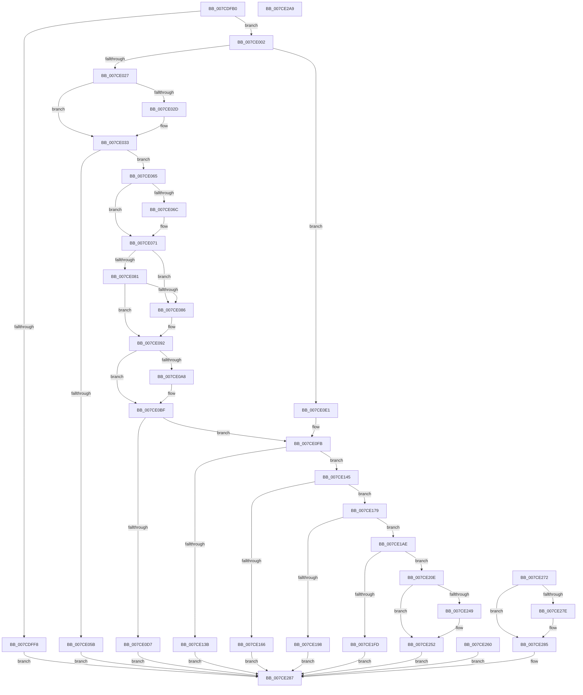

# NtQuerySystemEnvironmentValue

- RVA: `0x007CDFB0`–`0x007CE2AA` (길이 `762` bytes)
- VA: `0x00000001407CDFB0`
- 실행 섹션: `PAGE`
- PDB 이름 있음: `예`; PDB Function 태그: `아니요`
- unwind 정보 RVA: `0x000D52DC`
- 디코드: `201`개 명령, `762/762` bytes 표시
- 미해석 바이트: `0` (있으면 어셈블리에 `.byte`로 보존)

> 이 문서는 커널 이미지의 기계어와 PDB 기호를 분석해 생성했습니다. 4번과 5번은 함수 원형과 자료형을 바이너리 사용 방식에서 추정한 C 해석이며 원본 소스 복구 결과는 아닙니다.

## 1. Dependencies

- 직접 호출 지점: **22**; 고유 호출 대상: **14**
- 직접 호출자로 확인된 함수: **0**
- RIP 상대 이미지 참조: **2**

### Outgoing calls
- `0x007CDFEF` → [PsIsCurrentThreadInServerSilo](../../text/43/PsIsCurrentThreadInServerSilo_function_004362E0.md) (function, `0x004362E0`)
- `0x007CE02D` → [ExRaiseDatatypeMisalignment](../89/ExRaiseDatatypeMisalignment_function_00899FD0.md) (function, `0x00899FD0`)
- `0x007CE06C` → [ExRaiseDatatypeMisalignment](../89/ExRaiseDatatypeMisalignment_function_00899FD0.md) (function, `0x00899FD0`)
- `0x007CE09E` → [ProbeForWrite](../8E/ProbeForWrite_function_008E91C0.md) (function, `0x008E91C0`)
- `0x007CE0CA` → [SeSinglePrivilegeCheck](../87/SeSinglePrivilegeCheck_function_00871E20.md) (function, `0x00871E20`)
- `0x007CE10C` → [RtlUnicodeToMultiByteSize](../90/RtlUnicodeToMultiByteSize_function_0090D110.md) (function, `0x0090D110`)
- `0x007CE12C` → [ExAllocatePool2](../../poolcode/B8/ExAllocatePool2_function_00B820F0.md) (function, `0x00B820F0`)
- `0x007CE157` → [RtlUnicodeStringToAnsiString](../90/RtlUnicodeStringToAnsiString_function_0090D1F0.md) (function, `0x0090D1F0`)
- `0x007CE16D` → [ExFreePoolWithTag](../../poolcode/B8/ExFreePoolWithTag_function_00B82870.md) (function, `0x00B82870`)
- `0x007CE186` → [ExAllocatePool2](../../poolcode/B8/ExAllocatePool2_function_00B820F0.md) (function, `0x00B820F0`)
- `0x007CE19F` → [ExFreePoolWithTag](../../poolcode/B8/ExFreePoolWithTag_function_00B82870.md) (function, `0x00B82870`)
- `0x007CE1C6` → [ExAcquireFastMutexUnsafe](../../text/3F/ExAcquireFastMutexUnsafe_function_003F3720.md) (function, `0x003F3720`)
- `0x007CE1D5` → [HalGetEnvironmentVariable](../../text/54/HalGetEnvironmentVariable_function_005430E0.md) (function, `0x005430E0`)
- `0x007CE1E3` → [ExReleaseFastMutexUnsafe](../../text/25/ExReleaseFastMutexUnsafe_function_002503A0.md) (function, `0x002503A0`)
- `0x007CE1E8` → [KeLeaveCriticalRegion](../../text/25/KeLeaveCriticalRegion_function_0025D8B0.md) (function, `0x0025D8B0`)
- `0x007CE1F4` → [ExFreePoolWithTag](../../poolcode/B8/ExFreePoolWithTag_function_00B82870.md) (function, `0x00B82870`)
- `0x007CE202` → [ExFreePoolWithTag](../../poolcode/B8/ExFreePoolWithTag_function_00B82870.md) (function, `0x00B82870`)
- `0x007CE216` → [RtlInitAnsiString](../../text/47/RtlInitAnsiString_function_00470F40.md) (function, `0x00470F40`)
- `0x007CE239` → [RtlAnsiStringToUnicodeString](../90/RtlAnsiStringToUnicodeString_function_0090BEA0.md) (function, `0x0090BEA0`)
- `0x007CE257` → [ExFreePoolWithTag](../../poolcode/B8/ExFreePoolWithTag_function_00B82870.md) (function, `0x00B82870`)
- `0x007CE269` → [ExFreePoolWithTag](../../poolcode/B8/ExFreePoolWithTag_function_00B82870.md) (function, `0x00B82870`)
- `0x007CE280` → [ExFreePoolWithTag](../../poolcode/B8/ExFreePoolWithTag_function_00B82870.md) (function, `0x00B82870`)

### Direct callers
- 이 함수 시작 RVA로 연결되는 직접 call은 확인되지 않았습니다. 간접 호출은 완전히 역산할 수 없습니다.

### Static image references
- `0x007CE0C3` → RVA `0x00FD9AB8` (`PAGEDATA`; read)
- `0x007CE1BF` → RVA `0x00EFAB40` (`.data`; read)

## 2. Other-region calls and transfers

- 다른 실행 섹션으로 향하는 call: **15**
  - `0x007CDFEF` → [PsIsCurrentThreadInServerSilo](../../text/43/PsIsCurrentThreadInServerSilo_function_004362E0.md) (`PAGE` → `.text`)
  - `0x007CE12C` → [ExAllocatePool2](../../poolcode/B8/ExAllocatePool2_function_00B820F0.md) (`PAGE` → `POOLCODE`)
  - `0x007CE16D` → [ExFreePoolWithTag](../../poolcode/B8/ExFreePoolWithTag_function_00B82870.md) (`PAGE` → `POOLCODE`)
  - `0x007CE186` → [ExAllocatePool2](../../poolcode/B8/ExAllocatePool2_function_00B820F0.md) (`PAGE` → `POOLCODE`)
  - `0x007CE19F` → [ExFreePoolWithTag](../../poolcode/B8/ExFreePoolWithTag_function_00B82870.md) (`PAGE` → `POOLCODE`)
  - `0x007CE1C6` → [ExAcquireFastMutexUnsafe](../../text/3F/ExAcquireFastMutexUnsafe_function_003F3720.md) (`PAGE` → `.text`)
  - `0x007CE1D5` → [HalGetEnvironmentVariable](../../text/54/HalGetEnvironmentVariable_function_005430E0.md) (`PAGE` → `.text`)
  - `0x007CE1E3` → [ExReleaseFastMutexUnsafe](../../text/25/ExReleaseFastMutexUnsafe_function_002503A0.md) (`PAGE` → `.text`)
  - `0x007CE1E8` → [KeLeaveCriticalRegion](../../text/25/KeLeaveCriticalRegion_function_0025D8B0.md) (`PAGE` → `.text`)
  - `0x007CE1F4` → [ExFreePoolWithTag](../../poolcode/B8/ExFreePoolWithTag_function_00B82870.md) (`PAGE` → `POOLCODE`)
  - `0x007CE202` → [ExFreePoolWithTag](../../poolcode/B8/ExFreePoolWithTag_function_00B82870.md) (`PAGE` → `POOLCODE`)
  - `0x007CE216` → [RtlInitAnsiString](../../text/47/RtlInitAnsiString_function_00470F40.md) (`PAGE` → `.text`)
  - `0x007CE257` → [ExFreePoolWithTag](../../poolcode/B8/ExFreePoolWithTag_function_00B82870.md) (`PAGE` → `POOLCODE`)
  - `0x007CE269` → [ExFreePoolWithTag](../../poolcode/B8/ExFreePoolWithTag_function_00B82870.md) (`PAGE` → `POOLCODE`)
  - `0x007CE280` → [ExFreePoolWithTag](../../poolcode/B8/ExFreePoolWithTag_function_00B82870.md) (`PAGE` → `POOLCODE`)
- 별도 외부 분기/꼬리 이동을 확인하지 못했습니다.

## 3. Assembly (complete function range)

```asm
007CDFB0  48 8B C4                        mov rax, rsp
007CDFB3  48 89 58 08                     mov qword ptr [rax + 8], rbx
007CDFB7  48 89 70 10                     mov qword ptr [rax + 0x10], rsi
007CDFBB  48 89 78 18                     mov qword ptr [rax + 0x18], rdi
007CDFBF  4C 89 60 20                     mov qword ptr [rax + 0x20], r12
007CDFC3  41 55                           push r13
007CDFC5  41 56                           push r14
007CDFC7  41 57                           push r15
007CDFC9  48 81 EC 80 00 00 00            sub rsp, 0x80
007CDFD0  4D 8B F1                        mov r14, r9
007CDFD3  45 0F B7 F8                     movzx r15d, r8w
007CDFD7  4C 8B E2                        mov r12, rdx
007CDFDA  48 8B F9                        mov rdi, rcx
007CDFDD  45 33 ED                        xor r13d, r13d
007CDFE0  44 89 68 B8                     mov dword ptr [rax - 0x48], r13d
007CDFE4  4C 89 68 A8                     mov qword ptr [rax - 0x58], r13
007CDFE8  0F 57 C0                        xorps xmm0, xmm0
007CDFEB  0F 11 40 90                     movups xmmword ptr [rax - 0x70], xmm0
007CDFEF  E8 EC 82 C6 FF                  call 0x1404362e0
007CDFF4  84 C0                           test al, al
007CDFF6  74 0A                           je 0x1407ce002
007CDFF8  B8 02 00 00 C0                  mov eax, 0xc0000002
007CDFFD  E9 85 02 00 00                  jmp 0x1407ce287
007CE002  4C 89 6C 24 48                  mov qword ptr [rsp + 0x48], r13
007CE007  65 48 8B 04 25 88 01 00 00      mov rax, qword ptr gs:[0x188]
007CE010  48 89 44 24 70                  mov qword ptr [rsp + 0x70], rax
007CE015  8A 80 32 02 00 00               mov al, byte ptr [rax + 0x232]
007CE01B  88 44 24 20                     mov byte ptr [rsp + 0x20], al
007CE01F  84 C0                           test al, al
007CE021  0F 84 BA 00 00 00               je 0x1407ce0e1
007CE027  40 F6 C7 03                     test dil, 3
007CE02B  74 06                           je 0x1407ce033
007CE02D  E8 9E BF 0C 00                  call 0x140899fd0
007CE032  CC                              int3
007CE033  48 BB 00 00 FF FF FF 7F 00 00   movabs rbx, 0x7fffffff0000
007CE03D  48 8B C3                        mov rax, rbx
007CE040  48 3B FB                        cmp rdi, rbx
007CE043  48 0F 42 C7                     cmovb rax, rdi
007CE047  90                              nop
007CE048  8A 00                           mov al, byte ptr [rax]
007CE04A  0F 10 07                        movups xmm0, xmmword ptr [rdi]
007CE04D  0F 11 44 24 28                  movups xmmword ptr [rsp + 0x28], xmm0
007CE052  66 0F 7E C6                     movd esi, xmm0
007CE056  66 85 F6                        test si, si
007CE059  75 0A                           jne 0x1407ce065
007CE05B  B8 05 00 00 C0                  mov eax, 0xc0000005
007CE060  E9 22 02 00 00                  jmp 0x1407ce287
007CE065  F6 44 24 30 01                  test byte ptr [rsp + 0x30], 1
007CE06A  74 05                           je 0x1407ce071
007CE06C  E8 5F BF 0C 00                  call 0x140899fd0
007CE071  0F B7 CE                        movzx ecx, si
007CE074  48 8B 7C 24 30                  mov rdi, qword ptr [rsp + 0x30]
007CE079  48 03 CF                        add rcx, rdi
007CE07C  48 3B CB                        cmp rcx, rbx
007CE07F  77 05                           ja 0x1407ce086
007CE081  48 3B CF                        cmp rcx, rdi
007CE084  73 0C                           jae 0x1407ce092
007CE086  8A 03                           mov al, byte ptr [rbx]
007CE088  48 8B 7C 24 30                  mov rdi, qword ptr [rsp + 0x30]
007CE08D  0F B7 74 24 28                  movzx esi, word ptr [rsp + 0x28]
007CE092  49 8B D7                        mov rdx, r15
007CE095  41 B8 02 00 00 00               mov r8d, 2
007CE09B  49 8B CC                        mov rcx, r12
007CE09E  E8 1D B1 11 00                  call 0x1408e91c0
007CE0A3  4D 85 F6                        test r14, r14
007CE0A6  74 17                           je 0x1407ce0bf
007CE0A8  4C 3B F3                        cmp r14, rbx
007CE0AB  49 0F 42 DE                     cmovb rbx, r14
007CE0AF  0F B7 03                        movzx eax, word ptr [rbx]
007CE0B2  66 89 03                        mov word ptr [rbx], ax
007CE0B5  48 8B 7C 24 30                  mov rdi, qword ptr [rsp + 0x30]
007CE0BA  0F B7 74 24 28                  movzx esi, word ptr [rsp + 0x28]
007CE0BF  8A 54 24 20                     mov dl, byte ptr [rsp + 0x20]
007CE0C3  48 8B 0D EE B9 80 00            mov rcx, qword ptr [rip + 0x80b9ee]
007CE0CA  E8 51 3D 0A 00                  call 0x140871e20
007CE0CF  88 44 24 23                     mov byte ptr [rsp + 0x23], al
007CE0D3  84 C0                           test al, al
007CE0D5  75 24                           jne 0x1407ce0fb
007CE0D7  B8 61 00 00 C0                  mov eax, 0xc0000061
007CE0DC  E9 A6 01 00 00                  jmp 0x1407ce287
007CE0E1  0F 10 0F                        movups xmm1, xmmword ptr [rdi]
007CE0E4  0F 11 4C 24 28                  movups xmmword ptr [rsp + 0x28], xmm1
007CE0E9  66 0F 6F C1                     movdqa xmm0, xmm1
007CE0ED  66 0F 73 D8 08                  psrldq xmm0, 8
007CE0F2  66 48 0F 7E C7                  movq rdi, xmm0
007CE0F7  66 0F 7E CE                     movd esi, xmm1
007CE0FB  44 89 6C 24 38                  mov dword ptr [rsp + 0x38], r13d
007CE100  44 0F B7 C6                     movzx r8d, si
007CE104  48 8B D7                        mov rdx, rdi
007CE107  48 8D 4C 24 38                  lea rcx, [rsp + 0x38]
007CE10C  E8 FF EF 13 00                  call 0x14090d110
007CE111  8B 5C 24 38                     mov ebx, dword ptr [rsp + 0x38]
007CE115  FF C3                           inc ebx
007CE117  89 5C 24 50                     mov dword ptr [rsp + 0x50], ebx
007CE11B  8B D3                           mov edx, ebx
007CE11D  BF 45 6E 76 72                  mov edi, 0x72766e45
007CE122  44 8B C7                        mov r8d, edi
007CE125  BE 40 00 00 00                  mov esi, 0x40
007CE12A  8B CE                           mov ecx, esi
007CE12C  E8 BF 3F 3B 00                  call 0x140b820f0
007CE131  48 89 44 24 48                  mov qword ptr [rsp + 0x48], rax
007CE136  48 85 C0                        test rax, rax
007CE139  75 0A                           jne 0x1407ce145
007CE13B  B8 9A 00 00 C0                  mov eax, 0xc000009a
007CE140  E9 42 01 00 00                  jmp 0x1407ce287
007CE145  66 89 5C 24 42                  mov word ptr [rsp + 0x42], bx
007CE14A  45 33 C0                        xor r8d, r8d
007CE14D  48 8D 54 24 28                  lea rdx, [rsp + 0x28]
007CE152  48 8D 4C 24 40                  lea rcx, [rsp + 0x40]
007CE157  E8 94 F0 13 00                  call 0x14090d1f0
007CE15C  8B D8                           mov ebx, eax
007CE15E  89 44 24 54                     mov dword ptr [rsp + 0x54], eax
007CE162  85 C0                           test eax, eax
007CE164  79 13                           jns 0x1407ce179
007CE166  33 D2                           xor edx, edx
007CE168  48 8B 4C 24 48                  mov rcx, qword ptr [rsp + 0x48]
007CE16D  E8 FE 46 3B 00                  call 0x140b82870
007CE172  8B C3                           mov eax, ebx
007CE174  E9 0E 01 00 00                  jmp 0x1407ce287
007CE179  44 8B C7                        mov r8d, edi
007CE17C  BB 00 04 00 00                  mov ebx, 0x400
007CE181  8B D3                           mov edx, ebx
007CE183  48 8B CE                        mov rcx, rsi
007CE186  E8 65 3F 3B 00                  call 0x140b820f0
007CE18B  48 8B F8                        mov rdi, rax
007CE18E  48 89 44 24 60                  mov qword ptr [rsp + 0x60], rax
007CE193  48 85 C0                        test rax, rax
007CE196  75 16                           jne 0x1407ce1ae
007CE198  33 D2                           xor edx, edx
007CE19A  48 8B 4C 24 48                  mov rcx, qword ptr [rsp + 0x48]
007CE19F  E8 CC 46 3B 00                  call 0x140b82870
007CE1A4  B8 9A 00 00 C0                  mov eax, 0xc000009a
007CE1A9  E9 D9 00 00 00                  jmp 0x1407ce287
007CE1AE  65 48 8B 04 25 88 01 00 00      mov rax, qword ptr gs:[0x188]
007CE1B7  66 FF 88 E4 01 00 00            dec word ptr [rax + 0x1e4]
007CE1BE  90                              nop
007CE1BF  48 8D 0D 7A C9 72 00            lea rcx, [rip + 0x72c97a]
007CE1C6  E8 55 55 C2 FF                  call 0x1403f3720
007CE1CB  8B D3                           mov edx, ebx
007CE1CD  4C 8B C7                        mov r8, rdi
007CE1D0  48 8B 4C 24 48                  mov rcx, qword ptr [rsp + 0x48]
007CE1D5  E8 06 4F D7 FF                  call 0x1405430e0
007CE1DA  8B D8                           mov ebx, eax
007CE1DC  48 8D 0D 5D C9 72 00            lea rcx, [rip + 0x72c95d]
007CE1E3  E8 B8 21 A8 FF                  call 0x1402503a0
007CE1E8  E8 C3 F6 A8 FF                  call 0x14025d8b0
007CE1ED  33 D2                           xor edx, edx
007CE1EF  48 8B 4C 24 48                  mov rcx, qword ptr [rsp + 0x48]
007CE1F4  E8 77 46 3B 00                  call 0x140b82870
007CE1F9  85 DB                           test ebx, ebx
007CE1FB  74 11                           je 0x1407ce20e
007CE1FD  33 D2                           xor edx, edx
007CE1FF  48 8B CF                        mov rcx, rdi
007CE202  E8 69 46 3B 00                  call 0x140b82870
007CE207  B8 01 00 00 C0                  mov eax, 0xc0000001
007CE20C  EB 79                           jmp 0x1407ce287
007CE20E  48 8B D7                        mov rdx, rdi
007CE211  48 8D 4C 24 40                  lea rcx, [rsp + 0x40]
007CE216  E8 25 2D CA FF                  call 0x140470f40
007CE21B  4C 89 64 24 30                  mov qword ptr [rsp + 0x30], r12
007CE220  66 44 89 7C 24 2A               mov word ptr [rsp + 0x2a], r15w
007CE226  66 44 89 6C 24 28               mov word ptr [rsp + 0x28], r13w
007CE22C  45 33 C0                        xor r8d, r8d
007CE22F  48 8D 54 24 40                  lea rdx, [rsp + 0x40]
007CE234  48 8D 4C 24 28                  lea rcx, [rsp + 0x28]
007CE239  E8 62 DC 13 00                  call 0x14090bea0
007CE23E  8B D8                           mov ebx, eax
007CE240  89 44 24 54                     mov dword ptr [rsp + 0x54], eax
007CE244  4D 85 F6                        test r14, r14
007CE247  74 09                           je 0x1407ce252
007CE249  0F B7 4C 24 28                  movzx ecx, word ptr [rsp + 0x28]
007CE24E  66 41 89 0E                     mov word ptr [r14], cx
007CE252  33 D2                           xor edx, edx
007CE254  48 8B CF                        mov rcx, rdi
007CE257  E8 14 46 3B 00                  call 0x140b82870
007CE25C  8B C3                           mov eax, ebx
007CE25E  EB 27                           jmp 0x1407ce287
007CE260  8B D8                           mov ebx, eax
007CE262  33 D2                           xor edx, edx
007CE264  48 8B 4C 24 60                  mov rcx, qword ptr [rsp + 0x60]
007CE269  E8 02 46 3B 00                  call 0x140b82870
007CE26E  8B C3                           mov eax, ebx
007CE270  EB 15                           jmp 0x1407ce287
007CE272  8B D8                           mov ebx, eax
007CE274  48 8B 4C 24 48                  mov rcx, qword ptr [rsp + 0x48]
007CE279  48 85 C9                        test rcx, rcx
007CE27C  74 07                           je 0x1407ce285
007CE27E  33 D2                           xor edx, edx
007CE280  E8 EB 45 3B 00                  call 0x140b82870
007CE285  8B C3                           mov eax, ebx
007CE287  4C 8D 9C 24 80 00 00 00         lea r11, [rsp + 0x80]
007CE28F  49 8B 5B 20                     mov rbx, qword ptr [r11 + 0x20]
007CE293  49 8B 73 28                     mov rsi, qword ptr [r11 + 0x28]
007CE297  49 8B 7B 30                     mov rdi, qword ptr [r11 + 0x30]
007CE29B  4D 8B 63 38                     mov r12, qword ptr [r11 + 0x38]
007CE29F  49 8B E3                        mov rsp, r11
007CE2A2  41 5F                           pop r15
007CE2A4  41 5E                           pop r14
007CE2A6  41 5D                           pop r13
007CE2A8  C3                              ret
007CE2A9  CC                              int3
```

## 4. C-style interpretation (structured pseudocode)

```c
__int64 __fastcall NtQuerySystemEnvironmentValue(__int64 a1, __int64 a2, unsigned __int16 a3, __int64 a4)
{
    __int64 result;
    __int64 v_r13;
    __int64 v_rbx;
    __int64 v_rdi;
    __int64 v_rsi;
    __int64 v_rsp;
    unsigned __int64 v_stack_m18;
    unsigned __int64 v_stack_m28;
    unsigned __int64 v_stack_m38;
    unsigned int v_stack_m44;
    unsigned int v_stack_m48;
    unsigned __int64 v_stack_m50;
    unsigned __int16 v_stack_m56;
    unsigned __int64 v_stack_m58;
    unsigned int v_stack_m60;
    unsigned __int8 v_stack_m68;
    unsigned __int16 v_stack_m6E;
    unsigned __int64 v_stack_m70;
    unsigned __int8 v_stack_m75;
    unsigned __int8 v_stack_m78;

    *(unsigned __int64 *)(v_rsp + 8) = v_rbx;
    *(unsigned __int64 *)(v_rsp + 16) = v_rsi;
    *(unsigned __int64 *)(v_rsp + 24) = v_rdi;
    *(unsigned __int64 *)(v_rsp + 32) = v_r12;
    v_rsp = (v_rsp) - (128);
    v_r13 = 0;
    *(unsigned int *)(v_rsp - 72) = 0;
    *(unsigned __int64 *)(v_rsp - 88) = 0;
    *(unsigned __int64 *)(v_rsp - 112) = v_xmm0;
    result = PsIsCurrentThreadInServerSilo(a1, a2, a3, a4);
    if ((unsigned __int8)(result) == 0) goto loc_007CE002;
    goto loc_007CE287;
loc_007CE002:
    v_stack_m50 = 0;
    v_stack_m28 = *(unsigned __int64 *)(gs_base + (0 + 392));
    v_stack_m78 = (unsigned __int8)(*(unsigned __int8 *)(*(unsigned __int64 *)(gs_base + (0 + 392)) + 562));
    if ((unsigned __int8)(*(unsigned __int8 *)(*(unsigned __int64 *)(gs_base + (0 + 392)) + 562)) == 0) goto loc_007CE0E1;
    result = *(unsigned __int8 *)(*(unsigned __int64 *)(gs_base + (0 + 392)) + 562);
    if ((((unsigned __int8)(a1)) & (3)) != 0) {
        result = ExRaiseDatatypeMisalignment(a1, a2, a3, a4);
    }
    result = v_rbx;
    if (a1 < v_rbx) { result = a1; }
    v_stack_m70 = v_xmm0;
    if ((unsigned __int16)(v_rsi) != 0) goto loc_007CE065;
    goto loc_007CE287;
loc_007CE065:
    result = (unsigned int)(0xC0000005ULL);
    if (((v_stack_m68) & (1)) != 0) {
        result = ExRaiseDatatypeMisalignment(a1, a2, a3, a4);
    }
    a1 = ((unsigned __int16)(v_rsi)) + (v_stack_m68);
    if (a1 > v_rbx) goto loc_007CE086;
    v_rdi = v_stack_m68;
    if (a1 < v_stack_m68) {
        result = *(unsigned __int8 *)(v_rbx);
        v_rdi = v_stack_m68;
        v_rsi = v_stack_m70;
    }
    result = ProbeForWrite(a2, a3, 2, a4);
    if (a4 != 0) {
        if (a4 < v_rbx) { v_rbx = a4; }
        result = *(unsigned __int16 *)(v_rbx);
        *(unsigned __int16 *)(v_rbx) = (unsigned __int16)(result);
        v_rdi = v_stack_m68;
        v_rsi = v_stack_m70;
    }
    result = SeSinglePrivilegeCheck(*(unsigned __int64 *)(v_rip + 8436206), v_stack_m78, 2, a4);
    v_stack_m75 = (unsigned __int8)(result);
    if ((unsigned __int8)(result) != 0) goto loc_007CE0FB;
    goto loc_007CE287;
loc_007CE0E1:
    v_stack_m70 = v_xmm1;
loc_007CE0FB:
    v_stack_m60 = 0;
    result = RtlUnicodeToMultiByteSize(v_stack_m60, v_rdi, (unsigned __int16)(v_rsi), a4);
    v_rbx = (unsigned int)(((unsigned int)(v_stack_m60)) + 1);
    v_stack_m48 = (unsigned int)(v_rbx);
    result = ExAllocatePool2(64, (unsigned int)((unsigned int)(v_rbx)), (unsigned int)((unsigned int)((unsigned int)(0x72766E45ULL))), a4);
    v_stack_m50 = result;
    if (result != 0) goto loc_007CE145;
    goto loc_007CE287;
loc_007CE145:
    v_stack_m56 = (unsigned __int16)(v_rbx);
    a3 = 0;
    result = RtlUnicodeStringToAnsiString(v_stack_m58, v_stack_m70, a3, a4);
    v_stack_m44 = (unsigned int)(result);
    if (!sign_flag) goto loc_007CE179;
    a2 = 0;
    result = ExFreePoolWithTag(v_stack_m50, a2, a3, a4);
    goto loc_007CE287;
loc_007CE179:
    result = ExAllocatePool2(64, (unsigned int)((unsigned int)((unsigned int)(0x400ULL))), (unsigned int)((unsigned int)((unsigned int)(0x72766E45ULL))), a4);
    v_stack_m38 = result;
    if (result != 0) goto loc_007CE1AE;
    a2 = 0;
    result = ExFreePoolWithTag(v_stack_m50, a2, (unsigned int)((unsigned int)((unsigned int)(0x72766E45ULL))), a4);
    goto loc_007CE287;
loc_007CE1AE:
    result = ExAcquireFastMutexUnsafe(v_rip + 7522682, a2, (unsigned int)((unsigned int)((unsigned int)(0x72766E45ULL))), a4);
    result = HalGetEnvironmentVariable(v_stack_m50, (unsigned int)((unsigned int)((unsigned int)(0x400ULL))), result, a4);
    result = ExReleaseFastMutexUnsafe(v_rip + 7522653, (unsigned int)((unsigned int)((unsigned int)(0x400ULL))), result, a4);
    result = KeLeaveCriticalRegion(v_rip + 7522653, (unsigned int)((unsigned int)((unsigned int)(0x400ULL))), result, a4);
    a2 = 0;
    result = ExFreePoolWithTag(v_stack_m50, a2, result, a4);
    if ((unsigned int)((unsigned int)((unsigned int)(result))) == 0) goto loc_007CE20E;
    a2 = 0;
    result = ExFreePoolWithTag(result, a2, result, a4);
    goto loc_007CE287;
loc_007CE20E:
    result = RtlInitAnsiString(v_stack_m58, result, result, a4);
    v_stack_m68 = 0;
    v_stack_m6E = 0;
    v_stack_m70 = 0;
    a3 = 0;
    result = RtlAnsiStringToUnicodeString(v_stack_m70, v_stack_m58, a3, a4);
    v_stack_m44 = (unsigned int)(result);
    if (a4 != 0) {
        a1 = v_stack_m70;
        *(unsigned __int16 *)(a4) = (unsigned __int16)(a1);
    }
    a2 = 0;
    result = ExFreePoolWithTag(result, a2, a3, a4);
    goto loc_007CE287;
loc_007CE287:
    return (unsigned int)((unsigned int)((unsigned int)((unsigned int)(result))));
}
```

## 5. (Beta) C Style

```c
int64_t NtQuerySystemEnvironmentValue(void *Arg1, int64_t Arg2, uint16_t Arg3, int64_t Arg4)
{
    uint8_t *arg1 = (uint8_t *)Arg1;

    int64_t result;
    int64_t local_r13;
    int64_t local_rbx;
    int64_t local_rdi;
    int64_t local_rsi;
    int64_t local_rsp;
    uint64_t v_stack_m18;
    uint64_t v_stack_m28;
    uint64_t v_stack_m38;
    uint32_t v_stack_m44;
    uint32_t v_stack_m48;
    uint64_t v_stack_m50;
    uint16_t v_stack_m56;
    uint64_t v_stack_m58;
    uint32_t v_stack_m60;
    uint8_t v_stack_m68;
    uint16_t v_stack_m6E;
    uint64_t v_stack_m70;
    uint8_t v_stack_m75;
    uint8_t v_stack_m78;

    *(uint64_t *)(local_rsp + 0x8) = local_rbx;
    *(uint64_t *)(local_rsp + 0x10) = local_rsi;
    *(uint64_t *)(local_rsp + 0x18) = local_rdi;
    *(uint64_t *)(local_rsp + 0x20) = local_r12;
    local_rsp = (local_rsp) - (128);
    local_r13 = 0;
    *(uint32_t *)(local_rsp - 0x48) = 0;
    *(uint64_t *)(local_rsp - 0x58) = 0;
    *(uint64_t *)(local_rsp - 0x70) = v_xmm0;
    result = PsIsCurrentThreadInServerSilo(Arg1, Arg2, Arg3, Arg4);
    if ((uint8_t)(result) == 0) goto loc_007CE002;
    goto loc_007CE287;
loc_007CE002:
    v_stack_m50 = 0;
    v_stack_m28 = *(uint64_t *)(gs_base + (0 + 0x188));
    v_stack_m78 = (uint8_t)(*(uint8_t *)(*(uint64_t *)(gs_base + (0 + 0x188)) + 0x232));
    if ((uint8_t)(*(uint8_t *)(*(uint64_t *)(gs_base + (0 + 0x188)) + 0x232)) == 0) goto loc_007CE0E1;
    result = *(uint8_t *)(*(uint64_t *)(gs_base + (0 + 0x188)) + 0x232);
    if ((((uint8_t)(Arg1)) & (3)) != 0) {
        result = ExRaiseDatatypeMisalignment(Arg1, Arg2, Arg3, Arg4);
    }
    result = local_rbx;
    if (Arg1 < local_rbx) { result = Arg1; }
    v_stack_m70 = v_xmm0;
    if ((uint16_t)(local_rsi) != 0) goto loc_007CE065;
    goto loc_007CE287;
loc_007CE065:
    result = (uint32_t)(0xC0000005ULL);
    if (((v_stack_m68) & (1)) != 0) {
        result = ExRaiseDatatypeMisalignment(Arg1, Arg2, Arg3, Arg4);
    }
    Arg1 = ((uint16_t)(local_rsi)) + (v_stack_m68);
    if (Arg1 > local_rbx) goto loc_007CE086;
    local_rdi = v_stack_m68;
    if (Arg1 < v_stack_m68) {
        result = *(uint8_t *)(local_rbx);
        local_rdi = v_stack_m68;
        local_rsi = v_stack_m70;
    }
    result = ProbeForWrite(Arg2, Arg3, 2, Arg4);
    if (Arg4 != 0) {
        if (Arg4 < local_rbx) { local_rbx = Arg4; }
        result = *(uint16_t *)(local_rbx);
        *(uint16_t *)(local_rbx) = (uint16_t)(result);
        local_rdi = v_stack_m68;
        local_rsi = v_stack_m70;
    }
    result = SeSinglePrivilegeCheck(*(uint64_t *)(v_rip + 0x80B9EE), v_stack_m78, 2, Arg4);
    v_stack_m75 = (uint8_t)(result);
    if ((uint8_t)(result) != 0) goto loc_007CE0FB;
    goto loc_007CE287;
loc_007CE0E1:
    v_stack_m70 = v_xmm1;
loc_007CE0FB:
    v_stack_m60 = 0;
    result = RtlUnicodeToMultiByteSize(v_stack_m60, local_rdi, (uint16_t)(local_rsi), Arg4);
    local_rbx = (uint32_t)(((uint32_t)(v_stack_m60)) + 1);
    v_stack_m48 = (uint32_t)(local_rbx);
    result = ExAllocatePool2(64, (uint32_t)((uint32_t)(local_rbx)), (uint32_t)((uint32_t)((uint32_t)(0x72766E45ULL))), Arg4);
    v_stack_m50 = result;
    if (result != 0) goto loc_007CE145;
    goto loc_007CE287;
loc_007CE145:
    v_stack_m56 = (uint16_t)(local_rbx);
    Arg3 = 0;
    result = RtlUnicodeStringToAnsiString(v_stack_m58, v_stack_m70, Arg3, Arg4);
    v_stack_m44 = (uint32_t)(result);
    if (!sign_flag) goto loc_007CE179;
    Arg2 = 0;
    result = ExFreePoolWithTag(v_stack_m50, Arg2, Arg3, Arg4);
    goto loc_007CE287;
loc_007CE179:
    result = ExAllocatePool2(64, (uint32_t)((uint32_t)((uint32_t)(0x400ULL))), (uint32_t)((uint32_t)((uint32_t)(0x72766E45ULL))), Arg4);
    v_stack_m38 = result;
    if (result != 0) goto loc_007CE1AE;
    Arg2 = 0;
    result = ExFreePoolWithTag(v_stack_m50, Arg2, (uint32_t)((uint32_t)((uint32_t)(0x72766E45ULL))), Arg4);
    goto loc_007CE287;
loc_007CE1AE:
    result = ExAcquireFastMutexUnsafe(v_rip + 7522682, Arg2, (uint32_t)((uint32_t)((uint32_t)(0x72766E45ULL))), Arg4);
    result = HalGetEnvironmentVariable(v_stack_m50, (uint32_t)((uint32_t)((uint32_t)(0x400ULL))), result, Arg4);
    result = ExReleaseFastMutexUnsafe(v_rip + 7522653, (uint32_t)((uint32_t)((uint32_t)(0x400ULL))), result, Arg4);
    result = KeLeaveCriticalRegion(v_rip + 7522653, (uint32_t)((uint32_t)((uint32_t)(0x400ULL))), result, Arg4);
    Arg2 = 0;
    result = ExFreePoolWithTag(v_stack_m50, Arg2, result, Arg4);
    if ((uint32_t)((uint32_t)((uint32_t)(result))) == 0) goto loc_007CE20E;
    Arg2 = 0;
    result = ExFreePoolWithTag(result, Arg2, result, Arg4);
    goto loc_007CE287;
loc_007CE20E:
    result = RtlInitAnsiString(v_stack_m58, result, result, Arg4);
    v_stack_m68 = 0;
    v_stack_m6E = 0;
    v_stack_m70 = 0;
    Arg3 = 0;
    result = RtlAnsiStringToUnicodeString(v_stack_m70, v_stack_m58, Arg3, Arg4);
    v_stack_m44 = (uint32_t)(result);
    if (Arg4 != 0) {
        Arg1 = v_stack_m70;
        *(uint16_t *)(Arg4) = (uint16_t)(Arg1);
    }
    Arg2 = 0;
    result = ExFreePoolWithTag(result, Arg2, Arg3, Arg4);
    goto loc_007CE287;
loc_007CE287:
    return (uint32_t)((uint32_t)((uint32_t)((uint32_t)(result))));
}
```

### 관측된 메모리 오프셋

구조체 형식이 확인되지 않은 접근은 인자 기준의 오프셋으로만 기록했습니다.

| 기준 인자 | 오프셋 표현 | 폭 (bit) | 접근 |
|---|---:|---:|---|
| `Arg1` | `+ 0x0` | `128` | `R` |

## 6. Execution-region graph

[열기: 2D/3D 그래프와 함수 탐색 컨트롤 패널](../../../control-panel.html?section=page&rva=0x007CDFB0&view=graph)

- 2D 그래프는 위에서 아래로 흐르고, 3D 그래프는 빈 공간을 드래그해 회전합니다. Shift+드래그는 이동, 휠은 확대·축소, 함수 노드 선택은 대상 보고서 이동입니다.

### Static fallback


