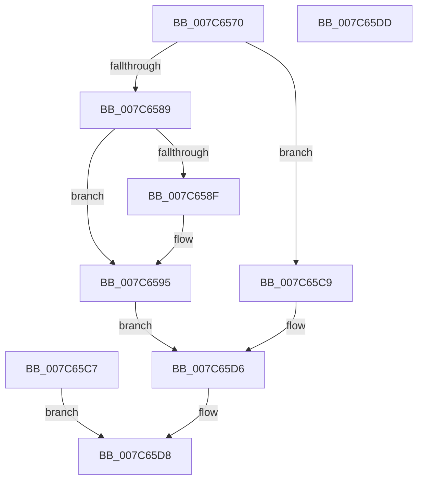

# NtQuerySystemTime

- RVA: `0x007C6570`–`0x007C65DE` (길이 `110` bytes)
- VA: `0x00000001407C6570`
- 실행 섹션: `PAGE`
- PDB 이름 있음: `예`; PDB Function 태그: `아니요`
- unwind 정보 RVA: `0x000D49BC`
- 디코드: `28`개 명령, `110/110` bytes 표시
- 미해석 바이트: `0` (있으면 어셈블리에 `.byte`로 보존)

> 이 문서는 커널 이미지의 기계어와 PDB 기호를 분석해 생성했습니다. 4번과 5번은 함수 원형과 자료형을 바이너리 사용 방식에서 추정한 C 해석이며 원본 소스 복구 결과는 아닙니다.

## 1. Dependencies

- 직접 호출 지점: **1**; 고유 호출 대상: **1**
- 직접 호출자로 확인된 함수: **0**
- RIP 상대 이미지 참조: **0**

### Outgoing calls
- `0x007C658F` → [ExRaiseDatatypeMisalignment](../89/ExRaiseDatatypeMisalignment_function_00899FD0.md) (function, `0x00899FD0`)

### Direct callers
- 이 함수 시작 RVA로 연결되는 직접 call은 확인되지 않았습니다. 간접 호출은 완전히 역산할 수 없습니다.

### Static image references
- 디코드된 RIP-relative 메모리 참조가 없습니다.

## 2. Other-region calls and transfers

- 다른 실행 섹션으로 향하는 call: **0**
- 별도 외부 분기/꼬리 이동을 확인하지 못했습니다.

## 3. Assembly (complete function range)

```asm
007C6570  48 83 EC 28                     sub rsp, 0x28
007C6574  4C 8B C1                        mov r8, rcx
007C6577  65 48 8B 04 25 88 01 00 00      mov rax, qword ptr gs:[0x188]
007C6580  80 B8 32 02 00 00 00            cmp byte ptr [rax + 0x232], 0
007C6587  74 40                           je 0x1407c65c9
007C6589  41 F6 C0 03                     test r8b, 3
007C658D  74 06                           je 0x1407c6595
007C658F  E8 3C 3A 0D 00                  call 0x140899fd0
007C6594  CC                              int3
007C6595  48 B9 00 00 FF FF FF 7F 00 00   movabs rcx, 0x7fffffff0000
007C659F  4C 3B C1                        cmp r8, rcx
007C65A2  49 0F 42 C8                     cmovb rcx, r8
007C65A6  8A 01                           mov al, byte ptr [rcx]
007C65A8  88 01                           mov byte ptr [rcx], al
007C65AA  8A 41 07                        mov al, byte ptr [rcx + 7]
007C65AD  88 41 07                        mov byte ptr [rcx + 7], al
007C65B0  48 B8 14 00 00 00 80 F7 FF FF   movabs rax, 0xfffff78000000014
007C65BA  48 8B 00                        mov rax, qword ptr [rax]
007C65BD  48 89 44 24 38                  mov qword ptr [rsp + 0x38], rax
007C65C2  49 89 00                        mov qword ptr [r8], rax
007C65C5  EB 0F                           jmp 0x1407c65d6
007C65C7  EB 0F                           jmp 0x1407c65d8
007C65C9  48 A1 14 00 00 00 80 F7 FF FF   movabs rax, qword ptr [0xfffff78000000014]
007C65D3  48 89 01                        mov qword ptr [rcx], rax
007C65D6  33 C0                           xor eax, eax
007C65D8  48 83 C4 28                     add rsp, 0x28
007C65DC  C3                              ret
007C65DD  CC                              int3
```

## 4. C-style interpretation (structured pseudocode)

```c
__int64 __fastcall NtQuerySystemTime(__int64 a1)
{
    __int64 result;
    __int64 v_rsp;
    unsigned __int64 v_stack_p10;

    v_rsp = (v_rsp) - (40);
    if ((*(unsigned __int8 *)(*(unsigned __int64 *)(gs_base + (0 + 392)) + 562)) == 0) goto loc_007C65C9;
    result = *(unsigned __int64 *)(gs_base + (0 + 392));
    if ((((unsigned __int8)(a1)) & (3)) != 0) {
        result = ExRaiseDatatypeMisalignment(a1, a2, a1, a4);
    }
    if (a1 < a1) { a1 = a1; }
    *(unsigned __int8 *)(a1) = (unsigned __int8)(*(unsigned __int8 *)(a1));
    *(unsigned __int8 *)(a1 + 7) = (unsigned __int8)(*(unsigned __int8 *)(a1 + 7));
    v_stack_p10 = *(unsigned __int64 *)(*(unsigned __int8 *)(a1 + 7));
    *(unsigned __int64 *)(a1) = *(unsigned __int64 *)(*(unsigned __int8 *)(a1 + 7));
    goto loc_007C65D6;
loc_007C65C9:
    *(unsigned __int64 *)(a1) = *(unsigned __int64 *)(*(unsigned __int8 *)(a1 + 7));
loc_007C65D6:
    result = 0;
loc_007C65D8:
    v_rsp = (v_rsp) + (40);
    return result;
}
```

## 5. (Beta) C Style

```c
int64_t NtQuerySystemTime(void *Arg1)
{
    uint8_t *arg1 = (uint8_t *)Arg1;

    int64_t result;
    int64_t local_rsp;
    uint64_t v_stack_p10;

    local_rsp = (local_rsp) - (40);
    if ((*(uint8_t *)(*(uint64_t *)(gs_base + (0 + 0x188)) + 0x232)) == 0) goto loc_007C65C9;
    result = *(uint64_t *)(gs_base + (0 + 0x188));
    if ((((uint8_t)(Arg1)) & (3)) != 0) {
        result = ExRaiseDatatypeMisalignment(Arg1, a2, Arg1, a4);
    }
    if (Arg1 < Arg1) { Arg1 = Arg1; }
    *(uint8_t *)(arg1) = (uint8_t)(*(uint8_t *)(arg1));
    *(uint8_t *)(arg1 + 0x7) = (uint8_t)(*(uint8_t *)(arg1 + 0x7));
    v_stack_p10 = *(uint64_t *)(*(uint8_t *)(arg1 + 0x7));
    *(uint64_t *)(arg1) = *(uint64_t *)(*(uint8_t *)(arg1 + 0x7));
    goto loc_007C65D6;
loc_007C65C9:
    *(uint64_t *)(arg1) = *(uint64_t *)(*(uint8_t *)(arg1 + 0x7));
loc_007C65D6:
    result = 0;
loc_007C65D8:
    local_rsp = (local_rsp) + (40);
    return result;
}
```

### 관측된 메모리 오프셋

구조체 형식이 확인되지 않은 접근은 인자 기준의 오프셋으로만 기록했습니다.

| 기준 인자 | 오프셋 표현 | 폭 (bit) | 접근 |
|---|---:|---:|---|
| `Arg1` | `+ 0x0` | `64` | `W` |

## 6. Execution-region graph

[열기: 2D/3D 그래프와 함수 탐색 컨트롤 패널](../../../control-panel.html?section=page&rva=0x007C6570&view=graph)

- 2D 그래프는 위에서 아래로 흐르고, 3D 그래프는 빈 공간을 드래그해 회전합니다. Shift+드래그는 이동, 휠은 확대·축소, 함수 노드 선택은 대상 보고서 이동입니다.

### Static fallback


