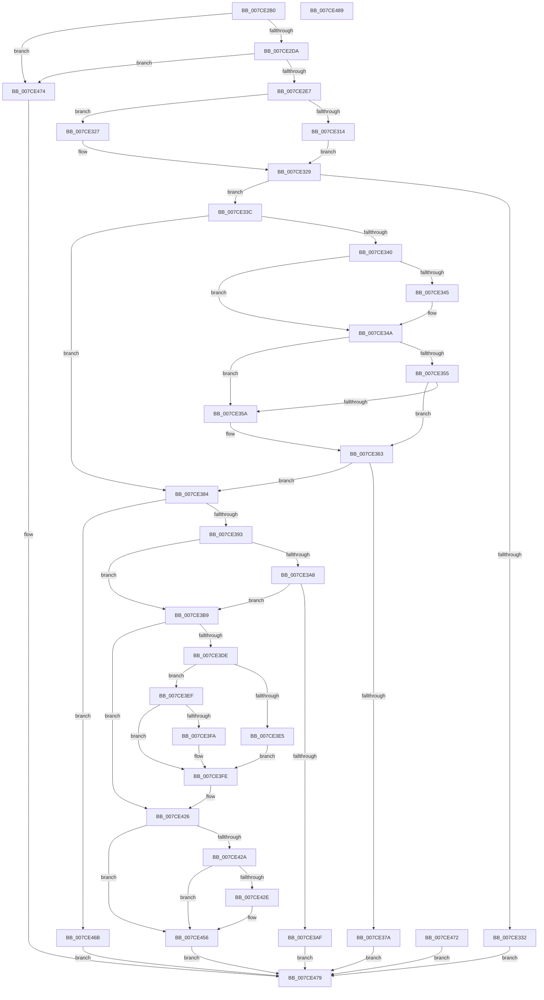

# NtSetBootOptions

- RVA: `0x007CE2B0`–`0x007CE48A` (길이 `474` bytes)
- VA: `0x00000001407CE2B0`
- 실행 섹션: `PAGE`
- PDB 이름 있음: `예`; PDB Function 태그: `아니요`
- unwind 정보 RVA: `0x000D5324`
- 디코드: `118`개 명령, `474/474` bytes 표시
- 미해석 바이트: `0` (있으면 어셈블리에 `.byte`로 보존)

> 이 문서는 커널 이미지의 기계어와 PDB 기호를 분석해 생성했습니다. 4번과 5번은 함수 원형과 자료형을 바이너리 사용 방식에서 추정한 C 해석이며 원본 소스 복구 결과는 아닙니다.

## 1. Dependencies

- 직접 호출 지점: **8**; 고유 호출 대상: **7**
- 직접 호출자로 확인된 함수: **0**
- RIP 상대 이미지 참조: **6**

### Outgoing calls
- `0x007CE2DA` → [PsIsCurrentThreadInServerSilo](../../text/43/PsIsCurrentThreadInServerSilo_function_004362E0.md) (function, `0x004362E0`)
- `0x007CE345` → [ExRaiseDatatypeMisalignment](../89/ExRaiseDatatypeMisalignment_function_00899FD0.md) (function, `0x00899FD0`)
- `0x007CE36A` → [SeSinglePrivilegeCheck](../87/SeSinglePrivilegeCheck_function_00871E20.md) (function, `0x00871E20`)
- `0x007CE3D1` → [ExAcquireFastMutexUnsafe](../../text/3F/ExAcquireFastMutexUnsafe_function_003F3720.md) (function, `0x003F3720`)
- `0x007CE41F` → [IoSetEnvironmentVariableEx](../A9/IoSetEnvironmentVariableEx_function_00A91A84.md) (function, `0x00A91A84`)
- `0x007CE44F` → [IoSetEnvironmentVariableEx](../A9/IoSetEnvironmentVariableEx_function_00A91A84.md) (function, `0x00A91A84`)
- `0x007CE45D` → [ExReleaseFastMutexUnsafe](../../text/25/ExReleaseFastMutexUnsafe_function_002503A0.md) (function, `0x002503A0`)
- `0x007CE462` → [KeLeaveCriticalRegion](../../text/25/KeLeaveCriticalRegion_function_0025D8B0.md) (function, `0x0025D8B0`)

### Direct callers
- 이 함수 시작 RVA로 연결되는 직접 call은 확인되지 않았습니다. 간접 호출은 완전히 역산할 수 없습니다.

### Static image references
- `0x007CE2CD` → RVA `0x00EFF050` (`.data`; read)
- `0x007CE363` → RVA `0x00FD9AB8` (`PAGEDATA`; read)
- `0x007CE3CA` → RVA `0x00EFAB40` (`.data`; read)
- `0x007CE411` → RVA `0x00019EF0` (`.rdata`; read)
- `0x007CE418` → RVA `0x00B089B0` (` ?? ::NNGAKEGL::`string'`; read)
- `0x007CE448` → RVA `0x00B089E0` (` ?? ::NNGAKEGL::`string'`; read)

## 2. Other-region calls and transfers

- 다른 실행 섹션으로 향하는 call: **4**
  - `0x007CE2DA` → [PsIsCurrentThreadInServerSilo](../../text/43/PsIsCurrentThreadInServerSilo_function_004362E0.md) (`PAGE` → `.text`)
  - `0x007CE3D1` → [ExAcquireFastMutexUnsafe](../../text/3F/ExAcquireFastMutexUnsafe_function_003F3720.md) (`PAGE` → `.text`)
  - `0x007CE45D` → [ExReleaseFastMutexUnsafe](../../text/25/ExReleaseFastMutexUnsafe_function_002503A0.md) (`PAGE` → `.text`)
  - `0x007CE462` → [KeLeaveCriticalRegion](../../text/25/KeLeaveCriticalRegion_function_0025D8B0.md) (`PAGE` → `.text`)
- 별도 외부 분기/꼬리 이동을 확인하지 못했습니다.

## 3. Assembly (complete function range)

```asm
007CE2B0  48 8B C4                        mov rax, rsp
007CE2B3  48 89 58 08                     mov qword ptr [rax + 8], rbx
007CE2B7  48 89 70 10                     mov qword ptr [rax + 0x10], rsi
007CE2BB  57                              push rdi
007CE2BC  48 83 EC 60                     sub rsp, 0x60
007CE2C0  8B F2                           mov esi, edx
007CE2C2  48 8B D9                        mov rbx, rcx
007CE2C5  83 60 CC 00                     and dword ptr [rax - 0x34], 0
007CE2C9  83 60 D0 00                     and dword ptr [rax - 0x30], 0
007CE2CD  83 3D 7C 0D 73 00 02            cmp dword ptr [rip + 0x730d7c], 2
007CE2D4  0F 85 9A 01 00 00               jne 0x1407ce474
007CE2DA  E8 01 80 C6 FF                  call 0x1404362e0
007CE2DF  84 C0                           test al, al
007CE2E1  0F 85 8D 01 00 00               jne 0x1407ce474
007CE2E7  65 48 8B 04 25 88 01 00 00      mov rax, qword ptr gs:[0x188]
007CE2F0  48 89 44 24 50                  mov qword ptr [rsp + 0x50], rax
007CE2F5  8A 90 32 02 00 00               mov dl, byte ptr [rax + 0x232]
007CE2FB  88 94 24 80 00 00 00            mov byte ptr [rsp + 0x80], dl
007CE302  48 8D 43 04                     lea rax, [rbx + 4]
007CE306  48 B9 00 00 FF FF FF 7F 00 00   movabs rcx, 0x7fffffff0000
007CE310  84 D2                           test dl, dl
007CE312  74 13                           je 0x1407ce327
007CE314  48 3B C1                        cmp rax, rcx
007CE317  48 0F 43 C1                     cmovae rax, rcx
007CE31B  90                              nop
007CE31C  8B 00                           mov eax, dword ptr [rax]
007CE31E  8A 94 24 80 00 00 00            mov dl, byte ptr [rsp + 0x80]
007CE325  EB 02                           jmp 0x1407ce329
007CE327  8B 00                           mov eax, dword ptr [rax]
007CE329  89 44 24 3C                     mov dword ptr [rsp + 0x3c], eax
007CE32D  83 F8 14                        cmp eax, 0x14
007CE330  73 0A                           jae 0x1407ce33c
007CE332  B8 0D 00 00 C0                  mov eax, 0xc000000d
007CE337  E9 3D 01 00 00                  jmp 0x1407ce479
007CE33C  84 D2                           test dl, dl
007CE33E  74 44                           je 0x1407ce384
007CE340  F6 C3 03                        test bl, 3
007CE343  74 05                           je 0x1407ce34a
007CE345  E8 86 BC 0C 00                  call 0x140899fd0
007CE34A  44 8B C0                        mov r8d, eax
007CE34D  4C 03 C3                        add r8, rbx
007CE350  4C 3B C1                        cmp r8, rcx
007CE353  77 05                           ja 0x1407ce35a
007CE355  4C 3B C3                        cmp r8, rbx
007CE358  73 09                           jae 0x1407ce363
007CE35A  8A 01                           mov al, byte ptr [rcx]
007CE35C  8A 94 24 80 00 00 00            mov dl, byte ptr [rsp + 0x80]
007CE363  48 8B 0D 4E B7 80 00            mov rcx, qword ptr [rip + 0x80b74e]
007CE36A  E8 B1 3A 0A 00                  call 0x140871e20
007CE36F  88 84 24 88 00 00 00            mov byte ptr [rsp + 0x88], al
007CE376  84 C0                           test al, al
007CE378  75 0A                           jne 0x1407ce384
007CE37A  B8 61 00 00 C0                  mov eax, 0xc0000061
007CE37F  E9 F5 00 00 00                  jmp 0x1407ce479
007CE384  8B 03                           mov eax, dword ptr [rbx]
007CE386  89 44 24 40                     mov dword ptr [rsp + 0x40], eax
007CE38A  83 F8 01                        cmp eax, 1
007CE38D  0F 85 D8 00 00 00               jne 0x1407ce46b
007CE393  8B 43 08                        mov eax, dword ptr [rbx + 8]
007CE396  89 44 24 34                     mov dword ptr [rsp + 0x34], eax
007CE39A  8B 43 10                        mov eax, dword ptr [rbx + 0x10]
007CE39D  89 44 24 38                     mov dword ptr [rsp + 0x38], eax
007CE3A1  8B FE                           mov edi, esi
007CE3A3  83 E7 02                        and edi, 2
007CE3A6  74 11                           je 0x1407ce3b9
007CE3A8  3D FF FF 00 00                  cmp eax, 0xffff
007CE3AD  76 0A                           jbe 0x1407ce3b9
007CE3AF  B8 0D 00 00 C0                  mov eax, 0xc000000d
007CE3B4  E9 C0 00 00 00                  jmp 0x1407ce479
007CE3B9  65 48 8B 04 25 88 01 00 00      mov rax, qword ptr gs:[0x188]
007CE3C2  66 FF 88 E4 01 00 00            dec word ptr [rax + 0x1e4]
007CE3C9  90                              nop
007CE3CA  48 8D 0D 6F C7 72 00            lea rcx, [rip + 0x72c76f]
007CE3D1  E8 4A 53 C2 FF                  call 0x1403f3720
007CE3D6  33 DB                           xor ebx, ebx
007CE3D8  40 F6 C6 01                     test sil, 1
007CE3DC  74 48                           je 0x1407ce426
007CE3DE  83 7C 24 34 FF                  cmp dword ptr [rsp + 0x34], -1
007CE3E3  75 0A                           jne 0x1407ce3ef
007CE3E5  C7 44 24 34 FF FF 00 00         mov dword ptr [rsp + 0x34], 0xffff
007CE3ED  EB 0F                           jmp 0x1407ce3fe
007CE3EF  B8 FE FF 00 00                  mov eax, 0xfffe
007CE3F4  39 44 24 34                     cmp dword ptr [rsp + 0x34], eax
007CE3F8  76 04                           jbe 0x1407ce3fe
007CE3FA  89 44 24 34                     mov dword ptr [rsp + 0x34], eax
007CE3FE  C7 44 24 20 01 00 00 00         mov dword ptr [rsp + 0x20], 1
007CE406  41 B9 02 00 00 00               mov r9d, 2
007CE40C  4C 8D 44 24 34                  lea r8, [rsp + 0x34]
007CE411  48 8D 15 D8 BA 84 FF            lea rdx, [rip - 0x7b4528]
007CE418  48 8D 0D 91 A5 33 00            lea rcx, [rip + 0x33a591]
007CE41F  E8 60 36 2C 00                  call 0x140a91a84
007CE424  8B D8                           mov ebx, eax
007CE426  85 DB                           test ebx, ebx
007CE428  78 2C                           js 0x1407ce456
007CE42A  85 FF                           test edi, edi
007CE42C  74 28                           je 0x1407ce456
007CE42E  C7 44 24 20 01 00 00 00         mov dword ptr [rsp + 0x20], 1
007CE436  41 B9 02 00 00 00               mov r9d, 2
007CE43C  4C 8D 44 24 38                  lea r8, [rsp + 0x38]
007CE441  48 8D 15 A8 BA 84 FF            lea rdx, [rip - 0x7b4558]
007CE448  48 8D 0D 91 A5 33 00            lea rcx, [rip + 0x33a591]
007CE44F  E8 30 36 2C 00                  call 0x140a91a84
007CE454  8B D8                           mov ebx, eax
007CE456  48 8D 0D E3 C6 72 00            lea rcx, [rip + 0x72c6e3]
007CE45D  E8 3E 1F A8 FF                  call 0x1402503a0
007CE462  E8 49 F4 A8 FF                  call 0x14025d8b0
007CE467  8B C3                           mov eax, ebx
007CE469  EB 0E                           jmp 0x1407ce479
007CE46B  B8 0D 00 00 C0                  mov eax, 0xc000000d
007CE470  EB 07                           jmp 0x1407ce479
007CE472  EB 05                           jmp 0x1407ce479
007CE474  B8 02 00 00 C0                  mov eax, 0xc0000002
007CE479  48 8B 5C 24 70                  mov rbx, qword ptr [rsp + 0x70]
007CE47E  48 8B 74 24 78                  mov rsi, qword ptr [rsp + 0x78]
007CE483  48 83 C4 60                     add rsp, 0x60
007CE487  5F                              pop rdi
007CE488  C3                              ret
007CE489  CC                              int3
```

## 4. C-style interpretation (structured pseudocode)

```c
__int64 __fastcall NtSetBootOptions(__int64 a1, int a2)
{
    __int64 result;
    __int64 v_rbx;
    __int64 v_rdi;
    __int64 v_rsp;
    unsigned __int64 v_stack_m18;
    unsigned int v_stack_m28;
    unsigned int v_stack_m2C;
    unsigned int v_stack_m30;
    unsigned int v_stack_m34;
    unsigned int v_stack_m48;
    unsigned __int64 v_stack_p10;
    unsigned __int8 v_stack_p18;
    unsigned __int8 v_stack_p20;
    unsigned __int64 v_stack_p8;

    *(unsigned __int64 *)(v_rsp + 8) = v_rbx;
    *(unsigned __int64 *)(v_rsp + 16) = v_rsi;
    v_rsp = (v_rsp) - (96);
    if ((*(unsigned int *)(v_rip + 7540092)) != 2) goto loc_007CE474;
    result = PsIsCurrentThreadInServerSilo(a1, a2, a3, a4);
    if ((unsigned __int8)(result) != 0) goto loc_007CE474;
    v_stack_m18 = *(unsigned __int64 *)(gs_base + (0 + 392));
    v_stack_p18 = (unsigned __int8)(*(unsigned __int8 *)(*(unsigned __int64 *)(gs_base + (0 + 392)) + 562));
    if ((unsigned __int8)(*(unsigned __int8 *)(*(unsigned __int64 *)(gs_base + (0 + 392)) + 562)) == 0) goto loc_007CE327;
    result = a1 + 4;
    if ((a1 + 4) >= a1) { result = a1; }
    goto loc_007CE329;
loc_007CE327:
loc_007CE329:
    v_stack_m2C = (unsigned int)((unsigned int)(*(unsigned int *)((unsigned int)(*(unsigned int *)(result)))));
    if (((unsigned int)((unsigned int)(*(unsigned int *)((unsigned int)(*(unsigned int *)(result)))))) >= 20) goto loc_007CE33C;
    goto loc_007CE479;
loc_007CE33C:
    if ((unsigned __int8)(v_stack_p18) == 0) goto loc_007CE384;
    result = (unsigned int)(0xC000000DULL);
    if ((((unsigned __int8)(a1)) & (3)) != 0) {
        result = ExRaiseDatatypeMisalignment(a1, v_stack_p18, a3, a4);
    }
    a3 = ((unsigned int)((unsigned int)(result))) + (a1);
    if (a3 > a1) goto loc_007CE35A;
    if (a3 < a1) {
        result = *(unsigned __int8 *)(a1);
        a2 = v_stack_p18;
    }
    result = SeSinglePrivilegeCheck(*(unsigned __int64 *)(v_rip + 8435534), a2, a3, a4);
    v_stack_p20 = (unsigned __int8)(result);
    if ((unsigned __int8)(result) != 0) goto loc_007CE384;
    goto loc_007CE479;
loc_007CE384:
    v_stack_m28 = (unsigned int)((unsigned int)(*(unsigned int *)(a1)));
    if (((unsigned int)((unsigned int)(*(unsigned int *)(a1)))) != 1) goto loc_007CE46B;
    v_stack_m34 = (unsigned int)((unsigned int)(*(unsigned int *)(a1 + 8)));
    v_stack_m30 = (unsigned int)((unsigned int)(*(unsigned int *)(a1 + 16)));
    v_rdi = (unsigned int)(((unsigned int)((unsigned int)((unsigned int)(a2)))) & (2));
    if (condition_is_equal) goto loc_007CE3B9;
    if (((unsigned int)((unsigned int)(*(unsigned int *)(a1 + 16)))) <= 0xFFFFULL) goto loc_007CE3B9;
    goto loc_007CE479;
loc_007CE3B9:
    result = ExAcquireFastMutexUnsafe(v_rip + 7522159, a2, a3, a4);
    v_rbx = 0;
    if ((((unsigned __int8)((unsigned int)(a2))) & (1)) == 0) goto loc_007CE426;
    if (v_stack_m34 != -1) goto loc_007CE3EF;
    v_stack_m34 = 0xFFFFULL;
    goto loc_007CE3FE;
loc_007CE3EF:
    if (v_stack_m34 >= = ((unsigned int)((unsigned int)(0xFFFEULL)))) {
        v_stack_m34 = (unsigned int)((unsigned int)(0xFFFEULL));
    }
    v_stack_m48 = 1;
    result = IoSetEnvironmentVariableEx(v_rip + 3384721, v_rip - 8078632, v_stack_m34, 2);
loc_007CE426:
    if (sign_flag) goto loc_007CE456;
    v_rbx = (unsigned int)((unsigned int)(result));
    if ((unsigned int)(v_rdi) != 0) {
        v_stack_m48 = 1;
        a4 = 2;
        a3 = v_stack_m30;
        a2 = v_rip - 8078680;
        a1 = v_rip + 3384721;
        result = IoSetEnvironmentVariableEx(a1, a2, a3, a4);
        v_rbx = (unsigned int)(result);
    }
    result = ExReleaseFastMutexUnsafe(v_rip + 7522019, a2, a3, a4);
    result = KeLeaveCriticalRegion(v_rip + 7522019, a2, a3, a4);
    goto loc_007CE479;
loc_007CE46B:
    goto loc_007CE479;
loc_007CE474:
loc_007CE479:
    v_rsp = (v_rsp) + (96);
    return (unsigned int)(0xC0000002ULL);
}
```

## 5. (Beta) C Style

```c
int64_t NtSetBootOptions(void *Arg1, int32_t Arg2)
{
    uint8_t *arg1 = (uint8_t *)Arg1;

    int64_t result;
    int64_t local_rbx;
    int64_t local_rdi;
    int64_t local_rsp;
    uint64_t v_stack_m18;
    uint32_t v_stack_m28;
    uint32_t v_stack_m2C;
    uint32_t v_stack_m30;
    uint32_t v_stack_m34;
    uint32_t v_stack_m48;
    uint64_t v_stack_p10;
    uint8_t v_stack_p18;
    uint8_t v_stack_p20;
    uint64_t v_stack_p8;

    *(uint64_t *)(local_rsp + 0x8) = local_rbx;
    *(uint64_t *)(local_rsp + 0x10) = local_rsi;
    local_rsp = (local_rsp) - (96);
    if ((*(uint32_t *)(v_rip + 0x730D7C)) != 2) goto loc_007CE474;
    result = PsIsCurrentThreadInServerSilo(Arg1, Arg2, a3, a4);
    if ((uint8_t)(result) != 0) goto loc_007CE474;
    v_stack_m18 = *(uint64_t *)(gs_base + (0 + 0x188));
    v_stack_p18 = (uint8_t)(*(uint8_t *)(*(uint64_t *)(gs_base + (0 + 0x188)) + 0x232));
    if ((uint8_t)(*(uint8_t *)(*(uint64_t *)(gs_base + (0 + 0x188)) + 0x232)) == 0) goto loc_007CE327;
    result = Arg1 + 4;
    if ((Arg1 + 4) >= Arg1) { result = Arg1; }
    goto loc_007CE329;
loc_007CE327:
loc_007CE329:
    v_stack_m2C = (uint32_t)((uint32_t)(*(uint32_t *)((uint32_t)(*(uint32_t *)(result)))));
    if (((uint32_t)((uint32_t)(*(uint32_t *)((uint32_t)(*(uint32_t *)(result)))))) >= 20) goto loc_007CE33C;
    goto loc_007CE479;
loc_007CE33C:
    if ((uint8_t)(v_stack_p18) == 0) goto loc_007CE384;
    result = (uint32_t)(0xC000000DULL);
    if ((((uint8_t)(Arg1)) & (3)) != 0) {
        result = ExRaiseDatatypeMisalignment(Arg1, v_stack_p18, a3, a4);
    }
    a3 = ((uint32_t)((uint32_t)(result))) + (Arg1);
    if (a3 > Arg1) goto loc_007CE35A;
    if (a3 < Arg1) {
        result = *(uint8_t *)(arg1);
        Arg2 = v_stack_p18;
    }
    result = SeSinglePrivilegeCheck(*(uint64_t *)(v_rip + 0x80B74E), Arg2, a3, a4);
    v_stack_p20 = (uint8_t)(result);
    if ((uint8_t)(result) != 0) goto loc_007CE384;
    goto loc_007CE479;
loc_007CE384:
    v_stack_m28 = (uint32_t)((uint32_t)(*(uint32_t *)(arg1)));
    if (((uint32_t)((uint32_t)(*(uint32_t *)(arg1)))) != 1) goto loc_007CE46B;
    v_stack_m34 = (uint32_t)((uint32_t)(*(uint32_t *)(arg1 + 0x8)));
    v_stack_m30 = (uint32_t)((uint32_t)(*(uint32_t *)(arg1 + 0x10)));
    local_rdi = (uint32_t)(((uint32_t)((uint32_t)((uint32_t)(Arg2)))) & (2));
    if (condition_is_equal) goto loc_007CE3B9;
    if (((uint32_t)((uint32_t)(*(uint32_t *)(arg1 + 0x10)))) <= 0xFFFFULL) goto loc_007CE3B9;
    goto loc_007CE479;
loc_007CE3B9:
    result = ExAcquireFastMutexUnsafe(v_rip + 7522159, Arg2, a3, a4);
    local_rbx = 0;
    if ((((uint8_t)((uint32_t)(Arg2))) & (1)) == 0) goto loc_007CE426;
    if (v_stack_m34 != -1) goto loc_007CE3EF;
    v_stack_m34 = 0xFFFFULL;
    goto loc_007CE3FE;
loc_007CE3EF:
    if (v_stack_m34 >= = ((uint32_t)((uint32_t)(0xFFFEULL)))) {
        v_stack_m34 = (uint32_t)((uint32_t)(0xFFFEULL));
    }
    v_stack_m48 = 1;
    result = IoSetEnvironmentVariableEx(v_rip + 3384721, v_rip - 8078632, v_stack_m34, 2);
loc_007CE426:
    if (sign_flag) goto loc_007CE456;
    local_rbx = (uint32_t)((uint32_t)(result));
    if ((uint32_t)(local_rdi) != 0) {
        v_stack_m48 = 1;
        a4 = 2;
        a3 = v_stack_m30;
        Arg2 = v_rip - 8078680;
        Arg1 = v_rip + 3384721;
        result = IoSetEnvironmentVariableEx(Arg1, Arg2, a3, a4);
        local_rbx = (uint32_t)(result);
    }
    result = ExReleaseFastMutexUnsafe(v_rip + 7522019, Arg2, a3, a4);
    result = KeLeaveCriticalRegion(v_rip + 7522019, Arg2, a3, a4);
    goto loc_007CE479;
loc_007CE46B:
    goto loc_007CE479;
loc_007CE474:
loc_007CE479:
    local_rsp = (local_rsp) + (96);
    return (uint32_t)(0xC0000002ULL);
}
```

### 관측된 메모리 오프셋

구조체 형식이 확인되지 않은 접근은 인자 기준의 오프셋으로만 기록했습니다.

| 기준 인자 | 오프셋 표현 | 폭 (bit) | 접근 |
|---|---:|---:|---|
| `Arg1` | `+ 0x0` | `32` | `R` |
| `Arg1` | `+ 0x4` | `64` | `R` |

## 6. Execution-region graph

[열기: 2D/3D 그래프와 함수 탐색 컨트롤 패널](../../../control-panel.html?section=page&rva=0x007CE2B0&view=graph)

- 2D 그래프는 위에서 아래로 흐르고, 3D 그래프는 빈 공간을 드래그해 회전합니다. Shift+드래그는 이동, 휠은 확대·축소, 함수 노드 선택은 대상 보고서 이동입니다.

### Static fallback


