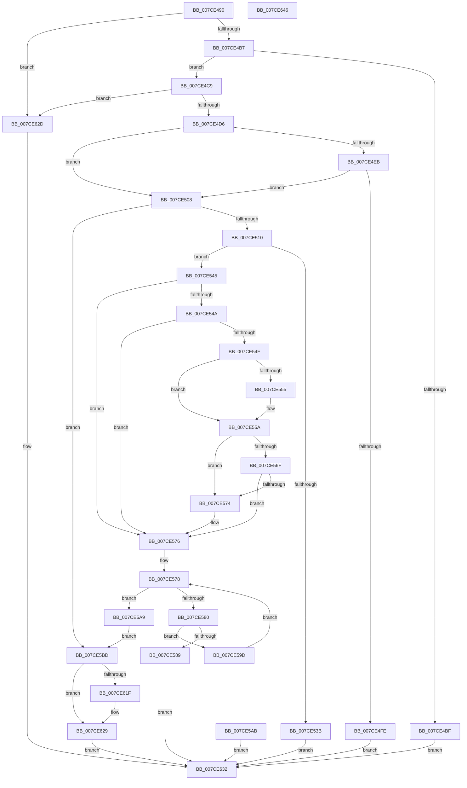

# NtSetDriverEntryOrder

- RVA: `0x007CE490`–`0x007CE647` (길이 `439` bytes)
- VA: `0x00000001407CE490`
- 실행 섹션: `PAGE`
- PDB 이름 있음: `예`; PDB Function 태그: `아니요`
- unwind 정보 RVA: `0x000D52AC`
- 디코드: `114`개 명령, `439/439` bytes 표시
- 미해석 바이트: `0` (있으면 어셈블리에 `.byte`로 보존)

> 이 문서는 커널 이미지의 기계어와 PDB 기호를 분석해 생성했습니다. 4번과 5번은 함수 원형과 자료형을 바이너리 사용 방식에서 추정한 C 해석이며 원본 소스 복구 결과는 아닙니다.

## 1. Dependencies

- 직접 호출 지점: **11**; 고유 호출 대상: **9**
- 직접 호출자로 확인된 함수: **0**
- RIP 상대 이미지 참조: **5**

### Outgoing calls
- `0x007CE4C9` → [PsIsCurrentThreadInServerSilo](../../text/43/PsIsCurrentThreadInServerSilo_function_004362E0.md) (function, `0x004362E0`)
- `0x007CE4F5` → [SeSinglePrivilegeCheck](../87/SeSinglePrivilegeCheck_function_00871E20.md) (function, `0x00871E20`)
- `0x007CE529` → [ExAllocatePool2](../../poolcode/B8/ExAllocatePool2_function_00B820F0.md) (function, `0x00B820F0`)
- `0x007CE555` → [ExRaiseDatatypeMisalignment](../89/ExRaiseDatatypeMisalignment_function_00899FD0.md) (function, `0x00899FD0`)
- `0x007CE58E` → [ExFreePoolWithTag](../../poolcode/B8/ExFreePoolWithTag_function_00B82870.md) (function, `0x00B82870`)
- `0x007CE5B4` → [ExFreePoolWithTag](../../poolcode/B8/ExFreePoolWithTag_function_00B82870.md) (function, `0x00B82870`)
- `0x007CE5D5` → [ExAcquireFastMutexUnsafe](../../text/3F/ExAcquireFastMutexUnsafe_function_003F3720.md) (function, `0x003F3720`)
- `0x007CE5F7` → [IoSetEnvironmentVariableEx](../A9/IoSetEnvironmentVariableEx_function_00A91A84.md) (function, `0x00A91A84`)
- `0x007CE605` → [ExReleaseFastMutexUnsafe](../../text/25/ExReleaseFastMutexUnsafe_function_002503A0.md) (function, `0x002503A0`)
- `0x007CE60A` → [KeLeaveCriticalRegion](../../text/25/KeLeaveCriticalRegion_function_0025D8B0.md) (function, `0x0025D8B0`)
- `0x007CE624` → [ExFreePoolWithTag](../../poolcode/B8/ExFreePoolWithTag_function_00B82870.md) (function, `0x00B82870`)

### Direct callers
- 이 함수 시작 RVA로 연결되는 직접 call은 확인되지 않았습니다. 간접 호출은 완전히 역산할 수 없습니다.

### Static image references
- `0x007CE4AA` → RVA `0x00EFF050` (`.data`; read)
- `0x007CE4EE` → RVA `0x00FD9AB8` (`PAGEDATA`; read)
- `0x007CE5CE` → RVA `0x00EFAB40` (`.data`; read)
- `0x007CE5E9` → RVA `0x000394B8` (`.rdata`; read)
- `0x007CE5F0` → RVA `0x00B08920` (` ?? ::NNGAKEGL::`string'`; read)

## 2. Other-region calls and transfers

- 다른 실행 섹션으로 향하는 call: **8**
  - `0x007CE4C9` → [PsIsCurrentThreadInServerSilo](../../text/43/PsIsCurrentThreadInServerSilo_function_004362E0.md) (`PAGE` → `.text`)
  - `0x007CE529` → [ExAllocatePool2](../../poolcode/B8/ExAllocatePool2_function_00B820F0.md) (`PAGE` → `POOLCODE`)
  - `0x007CE58E` → [ExFreePoolWithTag](../../poolcode/B8/ExFreePoolWithTag_function_00B82870.md) (`PAGE` → `POOLCODE`)
  - `0x007CE5B4` → [ExFreePoolWithTag](../../poolcode/B8/ExFreePoolWithTag_function_00B82870.md) (`PAGE` → `POOLCODE`)
  - `0x007CE5D5` → [ExAcquireFastMutexUnsafe](../../text/3F/ExAcquireFastMutexUnsafe_function_003F3720.md) (`PAGE` → `.text`)
  - `0x007CE605` → [ExReleaseFastMutexUnsafe](../../text/25/ExReleaseFastMutexUnsafe_function_002503A0.md) (`PAGE` → `.text`)
  - `0x007CE60A` → [KeLeaveCriticalRegion](../../text/25/KeLeaveCriticalRegion_function_0025D8B0.md) (`PAGE` → `.text`)
  - `0x007CE624` → [ExFreePoolWithTag](../../poolcode/B8/ExFreePoolWithTag_function_00B82870.md) (`PAGE` → `POOLCODE`)
- 별도 외부 분기/꼬리 이동을 확인하지 못했습니다.

## 3. Assembly (complete function range)

```asm
007CE490  48 89 5C 24 08                  mov qword ptr [rsp + 8], rbx
007CE495  48 89 74 24 10                  mov qword ptr [rsp + 0x10], rsi
007CE49A  57                              push rdi
007CE49B  41 56                           push r14
007CE49D  41 57                           push r15
007CE49F  48 83 EC 40                     sub rsp, 0x40
007CE4A3  8B DA                           mov ebx, edx
007CE4A5  48 8B F1                        mov rsi, rcx
007CE4A8  33 FF                           xor edi, edi
007CE4AA  83 3D 9F 0B 73 00 02            cmp dword ptr [rip + 0x730b9f], 2
007CE4B1  0F 85 76 01 00 00               jne 0x1407ce62d
007CE4B7  81 FB FF FF FF 3F               cmp ebx, 0x3fffffff
007CE4BD  76 0A                           jbe 0x1407ce4c9
007CE4BF  B8 0D 00 00 C0                  mov eax, 0xc000000d
007CE4C4  E9 69 01 00 00                  jmp 0x1407ce632
007CE4C9  E8 12 7E C6 FF                  call 0x1404362e0
007CE4CE  84 C0                           test al, al
007CE4D0  0F 85 57 01 00 00               jne 0x1407ce62d
007CE4D6  65 48 8B 04 25 88 01 00 00      mov rax, qword ptr gs:[0x188]
007CE4DF  44 8A B0 32 02 00 00            mov r14b, byte ptr [rax + 0x232]
007CE4E6  45 84 F6                        test r14b, r14b
007CE4E9  74 1D                           je 0x1407ce508
007CE4EB  41 8A D6                        mov dl, r14b
007CE4EE  48 8B 0D C3 B5 80 00            mov rcx, qword ptr [rip + 0x80b5c3]
007CE4F5  E8 26 39 0A 00                  call 0x140871e20
007CE4FA  84 C0                           test al, al
007CE4FC  75 0A                           jne 0x1407ce508
007CE4FE  B8 61 00 00 C0                  mov eax, 0xc0000061
007CE503  E9 2A 01 00 00                  jmp 0x1407ce632
007CE508  85 DB                           test ebx, ebx
007CE50A  0F 84 AD 00 00 00               je 0x1407ce5bd
007CE510  44 8D 3C 9D 00 00 00 00         lea r15d, [rbx*4]
007CE518  48 8B D3                        mov rdx, rbx
007CE51B  48 03 D2                        add rdx, rdx
007CE51E  B9 40 00 00 00                  mov ecx, 0x40
007CE523  41 B8 45 6E 76 72               mov r8d, 0x72766e45
007CE529  E8 C2 3B 3B 00                  call 0x140b820f0
007CE52E  48 8B F8                        mov rdi, rax
007CE531  48 89 44 24 70                  mov qword ptr [rsp + 0x70], rax
007CE536  48 85 C0                        test rax, rax
007CE539  75 0A                           jne 0x1407ce545
007CE53B  B8 9A 00 00 C0                  mov eax, 0xc000009a
007CE540  E9 ED 00 00 00                  jmp 0x1407ce632
007CE545  45 84 F6                        test r14b, r14b
007CE548  74 2C                           je 0x1407ce576
007CE54A  45 85 FF                        test r15d, r15d
007CE54D  74 27                           je 0x1407ce576
007CE54F  40 F6 C6 03                     test sil, 3
007CE553  74 05                           je 0x1407ce55a
007CE555  E8 76 BA 0C 00                  call 0x140899fd0
007CE55A  41 8B CF                        mov ecx, r15d
007CE55D  48 03 CE                        add rcx, rsi
007CE560  48 B8 00 00 FF FF FF 7F 00 00   movabs rax, 0x7fffffff0000
007CE56A  48 3B C8                        cmp rcx, rax
007CE56D  77 05                           ja 0x1407ce574
007CE56F  48 3B CE                        cmp rcx, rsi
007CE572  73 02                           jae 0x1407ce576
007CE574  8A 00                           mov al, byte ptr [rax]
007CE576  33 C9                           xor ecx, ecx
007CE578  89 4C 24 34                     mov dword ptr [rsp + 0x34], ecx
007CE57C  3B CB                           cmp ecx, ebx
007CE57E  73 29                           jae 0x1407ce5a9
007CE580  81 3C 8E FF FF 00 00            cmp dword ptr [rsi + rcx*4], 0xffff
007CE587  76 14                           jbe 0x1407ce59d
007CE589  33 D2                           xor edx, edx
007CE58B  48 8B CF                        mov rcx, rdi
007CE58E  E8 DD 42 3B 00                  call 0x140b82870
007CE593  B8 0D 00 00 C0                  mov eax, 0xc000000d
007CE598  E9 95 00 00 00                  jmp 0x1407ce632
007CE59D  0F B7 04 8E                     movzx eax, word ptr [rsi + rcx*4]
007CE5A1  66 89 04 4F                     mov word ptr [rdi + rcx*2], ax
007CE5A5  FF C1                           inc ecx
007CE5A7  EB CF                           jmp 0x1407ce578
007CE5A9  EB 12                           jmp 0x1407ce5bd
007CE5AB  8B D8                           mov ebx, eax
007CE5AD  33 D2                           xor edx, edx
007CE5AF  48 8B 4C 24 70                  mov rcx, qword ptr [rsp + 0x70]
007CE5B4  E8 B7 42 3B 00                  call 0x140b82870
007CE5B9  8B C3                           mov eax, ebx
007CE5BB  EB 75                           jmp 0x1407ce632
007CE5BD  65 48 8B 04 25 88 01 00 00      mov rax, qword ptr gs:[0x188]
007CE5C6  66 FF 88 E4 01 00 00            dec word ptr [rax + 0x1e4]
007CE5CD  90                              nop
007CE5CE  48 8D 0D 6B C5 72 00            lea rcx, [rip + 0x72c56b]
007CE5D5  E8 46 51 C2 FF                  call 0x1403f3720
007CE5DA  44 8D 0C 1B                     lea r9d, [rbx + rbx]
007CE5DE  C7 44 24 20 01 00 00 00         mov dword ptr [rsp + 0x20], 1
007CE5E6  4C 8B C7                        mov r8, rdi
007CE5E9  48 8D 15 C8 AE 86 FF            lea rdx, [rip - 0x795138]
007CE5F0  48 8D 0D 29 A3 33 00            lea rcx, [rip + 0x33a329]
007CE5F7  E8 88 34 2C 00                  call 0x140a91a84
007CE5FC  8B D8                           mov ebx, eax
007CE5FE  48 8D 0D 3B C5 72 00            lea rcx, [rip + 0x72c53b]
007CE605  E8 96 1D A8 FF                  call 0x1402503a0
007CE60A  E8 A1 F2 A8 FF                  call 0x14025d8b0
007CE60F  33 F6                           xor esi, esi
007CE611  81 FB 00 01 00 C0               cmp ebx, 0xc0000100
007CE617  0F 45 F3                        cmovne esi, ebx
007CE61A  48 85 FF                        test rdi, rdi
007CE61D  74 0A                           je 0x1407ce629
007CE61F  33 D2                           xor edx, edx
007CE621  48 8B CF                        mov rcx, rdi
007CE624  E8 47 42 3B 00                  call 0x140b82870
007CE629  8B C6                           mov eax, esi
007CE62B  EB 05                           jmp 0x1407ce632
007CE62D  B8 02 00 00 C0                  mov eax, 0xc0000002
007CE632  48 8B 5C 24 60                  mov rbx, qword ptr [rsp + 0x60]
007CE637  48 8B 74 24 68                  mov rsi, qword ptr [rsp + 0x68]
007CE63C  48 83 C4 40                     add rsp, 0x40
007CE640  41 5F                           pop r15
007CE642  41 5E                           pop r14
007CE644  5F                              pop rdi
007CE645  C3                              ret
007CE646  CC                              int3
```

## 4. C-style interpretation (structured pseudocode)

```c
__int64 __fastcall NtSetDriverEntryOrder(__int64 a1, int a2)
{
    __int64 result;
    __int64 v_rdi;
    __int64 v_rsi;
    __int64 v_rsp;
    unsigned int v_stack_m24;
    unsigned int v_stack_m38;
    unsigned __int64 v_stack_p10;
    unsigned __int64 v_stack_p18;
    unsigned __int64 v_stack_p8;

    v_stack_p8 = v_rbx;
    v_stack_p10 = v_rsi;
    v_rsp = (v_rsp) - (64);
    v_rdi = 0;
    if ((*(unsigned int *)(v_rip + 7539615)) != 2) goto loc_007CE62D;
    if (((unsigned int)((unsigned int)(a2))) <= 0x3FFFFFFFULL) goto loc_007CE4C9;
    goto loc_007CE632;
loc_007CE4C9:
    result = PsIsCurrentThreadInServerSilo(a1, a2, a3, a4);
    if ((unsigned __int8)(result) != 0) goto loc_007CE62D;
    if ((unsigned __int8)(*(unsigned __int8 *)(*(unsigned __int64 *)(gs_base + (0 + 392)) + 562)) == 0) goto loc_007CE508;
    result = SeSinglePrivilegeCheck(*(unsigned __int64 *)(v_rip + 8435139), (unsigned __int8)(*(unsigned __int8 *)(*(unsigned __int64 *)(gs_base + (0 + 392)) + 562)), a3, a4);
    if ((unsigned __int8)(result) != 0) goto loc_007CE508;
    goto loc_007CE632;
loc_007CE508:
    if ((unsigned int)((unsigned int)(a2)) == 0) goto loc_007CE5BD;
    a2 = ((unsigned int)(a2)) + ((unsigned int)(a2));
    result = ExAllocatePool2(64, a2, (unsigned int)(0x72766E45ULL), a4);
    v_stack_p18 = result;
    if (result != 0) goto loc_007CE545;
    goto loc_007CE632;
loc_007CE545:
    if ((unsigned __int8)(*(unsigned __int8 *)(*(unsigned __int64 *)(gs_base + (0 + 392)) + 562)) == 0) goto loc_007CE576;
    if ((unsigned int)((unsigned int)(a2) * 4) == 0) goto loc_007CE576;
    result = (unsigned int)(0xC000009AULL);
    if ((((unsigned __int8)(a1)) & (3)) != 0) {
        result = ExRaiseDatatypeMisalignment(64, a2, (unsigned int)(0x72766E45ULL), a4);
    }
    a1 = ((unsigned int)((unsigned int)((unsigned int)(a2) * 4))) + (a1);
    if (a1 > result) goto loc_007CE574;
    if (a1 < a1) {
        result = *(unsigned __int8 *)(result);
    }
    a1 = 0;
loc_007CE578:
    v_stack_m24 = 0;
    if (0 >= ((unsigned int)((unsigned int)(a2)))) goto loc_007CE5A9;
    if ((*(unsigned int *)(a1 + a1 * 4)) <= 0xFFFFULL) goto loc_007CE59D;
    a2 = 0;
    result = ExFreePoolWithTag(result, a2, (unsigned int)(0x72766E45ULL), a4);
    goto loc_007CE632;
loc_007CE59D:
    *(unsigned __int16 *)(result + result * 2) = (unsigned __int16)(*(unsigned __int16 *)(a1 + result * 4));
    a1 = (unsigned int)((result) + 1);
    goto loc_007CE578;
loc_007CE5A9:
    goto loc_007CE5BD;
loc_007CE5BD:
    result = ExAcquireFastMutexUnsafe(v_rip + 7521643, a2, (unsigned int)(0x72766E45ULL), a4);
    v_stack_m38 = 1;
    result = IoSetEnvironmentVariableEx(v_rip + 3384105, v_rip - 7950648, result, (unsigned int)(a2) + (unsigned int)(a2) * 1);
    result = ExReleaseFastMutexUnsafe(v_rip + 7521595, v_rip - 7950648, result, (unsigned int)(a2) + (unsigned int)(a2) * 1);
    result = KeLeaveCriticalRegion(v_rip + 7521595, v_rip - 7950648, result, (unsigned int)(a2) + (unsigned int)(a2) * 1);
    v_rsi = 0;
    if (((unsigned int)((unsigned int)((unsigned int)(result)))) != 0xC0000100ULL) { v_rsi = (unsigned int)((unsigned int)((unsigned int)(result))); }
    if (result != 0) {
        a2 = 0;
        a1 = result;
        result = ExFreePoolWithTag(a1, a2, result, (unsigned int)(a2) + (unsigned int)(a2) * 1);
    }
    goto loc_007CE632;
loc_007CE62D:
loc_007CE632:
    v_rsp = (v_rsp) + (64);
    return (unsigned int)(0xC0000002ULL);
}
```

## 5. (Beta) C Style

```c
int64_t NtSetDriverEntryOrder(int64_t Arg1, int32_t Arg2)
{
    int64_t result;
    int64_t local_rdi;
    int64_t local_rsi;
    int64_t local_rsp;
    uint32_t v_stack_m24;
    uint32_t v_stack_m38;
    uint64_t v_stack_p10;
    uint64_t v_stack_p18;
    uint64_t v_stack_p8;

    v_stack_p8 = local_rbx;
    v_stack_p10 = local_rsi;
    local_rsp = (local_rsp) - (64);
    local_rdi = 0;
    if ((*(uint32_t *)(v_rip + 0x730B9F)) != 2) goto loc_007CE62D;
    if (((uint32_t)((uint32_t)(Arg2))) <= 0x3FFFFFFFULL) goto loc_007CE4C9;
    goto loc_007CE632;
loc_007CE4C9:
    result = PsIsCurrentThreadInServerSilo(Arg1, Arg2, a3, a4);
    if ((uint8_t)(result) != 0) goto loc_007CE62D;
    if ((uint8_t)(*(uint8_t *)(*(uint64_t *)(gs_base + (0 + 0x188)) + 0x232)) == 0) goto loc_007CE508;
    result = SeSinglePrivilegeCheck(*(uint64_t *)(v_rip + 0x80B5C3), (uint8_t)(*(uint8_t *)(*(uint64_t *)(gs_base + (0 + 0x188)) + 0x232)), a3, a4);
    if ((uint8_t)(result) != 0) goto loc_007CE508;
    goto loc_007CE632;
loc_007CE508:
    if ((uint32_t)((uint32_t)(Arg2)) == 0) goto loc_007CE5BD;
    Arg2 = ((uint32_t)(Arg2)) + ((uint32_t)(Arg2));
    result = ExAllocatePool2(64, Arg2, (uint32_t)(0x72766E45ULL), a4);
    v_stack_p18 = result;
    if (result != 0) goto loc_007CE545;
    goto loc_007CE632;
loc_007CE545:
    if ((uint8_t)(*(uint8_t *)(*(uint64_t *)(gs_base + (0 + 0x188)) + 0x232)) == 0) goto loc_007CE576;
    if ((uint32_t)((uint32_t)(Arg2) * 4) == 0) goto loc_007CE576;
    result = (uint32_t)(0xC000009AULL);
    if ((((uint8_t)(Arg1)) & (3)) != 0) {
        result = ExRaiseDatatypeMisalignment(64, Arg2, (uint32_t)(0x72766E45ULL), a4);
    }
    Arg1 = ((uint32_t)((uint32_t)((uint32_t)(Arg2) * 4))) + (Arg1);
    if (Arg1 > result) goto loc_007CE574;
    if (Arg1 < Arg1) {
        result = *(uint8_t *)(result);
    }
    Arg1 = 0;
loc_007CE578:
    v_stack_m24 = 0;
    if (0 >= ((uint32_t)((uint32_t)(Arg2)))) goto loc_007CE5A9;
    if ((*(uint32_t *)(Arg1 + Arg1 * 4)) <= 0xFFFFULL) goto loc_007CE59D;
    Arg2 = 0;
    result = ExFreePoolWithTag(result, Arg2, (uint32_t)(0x72766E45ULL), a4);
    goto loc_007CE632;
loc_007CE59D:
    *(uint16_t *)(result + result * 2) = (uint16_t)(*(uint16_t *)(Arg1 + result * 4));
    Arg1 = (uint32_t)((result) + 1);
    goto loc_007CE578;
loc_007CE5A9:
    goto loc_007CE5BD;
loc_007CE5BD:
    result = ExAcquireFastMutexUnsafe(v_rip + 7521643, Arg2, (uint32_t)(0x72766E45ULL), a4);
    v_stack_m38 = 1;
    result = IoSetEnvironmentVariableEx(v_rip + 3384105, v_rip - 7950648, result, (uint32_t)(Arg2) + (uint32_t)(Arg2) * 1);
    result = ExReleaseFastMutexUnsafe(v_rip + 7521595, v_rip - 7950648, result, (uint32_t)(Arg2) + (uint32_t)(Arg2) * 1);
    result = KeLeaveCriticalRegion(v_rip + 7521595, v_rip - 7950648, result, (uint32_t)(Arg2) + (uint32_t)(Arg2) * 1);
    local_rsi = 0;
    if (((uint32_t)((uint32_t)((uint32_t)(result)))) != 0xC0000100ULL) { local_rsi = (uint32_t)((uint32_t)((uint32_t)(result))); }
    if (result != 0) {
        Arg2 = 0;
        Arg1 = result;
        result = ExFreePoolWithTag(Arg1, Arg2, result, (uint32_t)(Arg2) + (uint32_t)(Arg2) * 1);
    }
    goto loc_007CE632;
loc_007CE62D:
loc_007CE632:
    local_rsp = (local_rsp) + (64);
    return (uint32_t)(0xC0000002ULL);
}
```

## 6. Execution-region graph

[열기: 2D/3D 그래프와 함수 탐색 컨트롤 패널](../../../control-panel.html?section=page&rva=0x007CE490&view=graph)

- 2D 그래프는 위에서 아래로 흐르고, 3D 그래프는 빈 공간을 드래그해 회전합니다. Shift+드래그는 이동, 휠은 확대·축소, 함수 노드 선택은 대상 보고서 이동입니다.

### Static fallback


