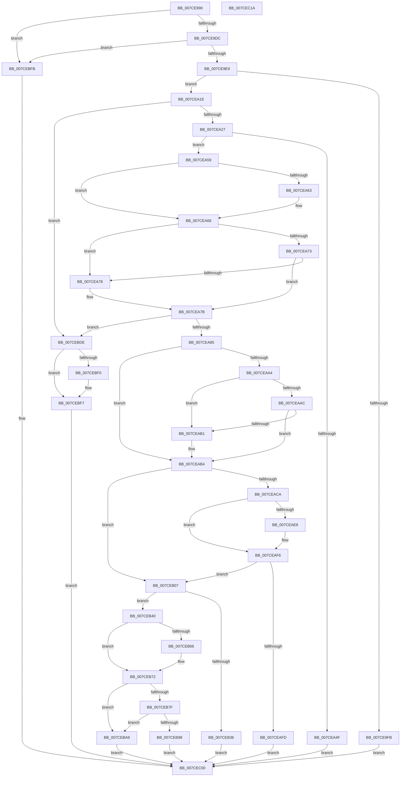

# NtSetSystemEnvironmentValueEx

- RVA: `0x007CE990`–`0x007CEC1B` (길이 `651` bytes)
- VA: `0x00000001407CE990`
- 실행 섹션: `PAGE`
- PDB 이름 있음: `예`; PDB Function 태그: `아니요`
- unwind 정보 RVA: `0x000D5390`
- 디코드: `172`개 명령, `651/651` bytes 표시
- 미해석 바이트: `0` (있으면 어셈블리에 `.byte`로 보존)

> 이 문서는 커널 이미지의 기계어와 PDB 기호를 분석해 생성했습니다. 4번과 5번은 함수 원형과 자료형을 바이너리 사용 방식에서 추정한 C 해석이며 원본 소스 복구 결과는 아닙니다.

## 1. Dependencies

- 직접 호출 지점: **15**; 고유 호출 대상: **12**
- 직접 호출자로 확인된 함수: **0**
- RIP 상대 이미지 참조: **6**

### Outgoing calls
- `0x007CE9DC` → [PsIsCurrentThreadInServerSilo](../../text/43/PsIsCurrentThreadInServerSilo_function_004362E0.md) (function, `0x004362E0`)
- `0x007CEA14` → [ExSetFirmwareEnvironmentVariable](ExSetFirmwareEnvironmentVariable_function_007CAE70.md) (function, `0x007CAE70`)
- `0x007CEA63` → [ExRaiseDatatypeMisalignment](../89/ExRaiseDatatypeMisalignment_function_00899FD0.md) (function, `0x00899FD0`)
- `0x007CEABD` → [SeSinglePrivilegeCheck](../87/SeSinglePrivilegeCheck_function_00871E20.md) (function, `0x00871E20`)
- `0x007CEADF` → [PsIsProcessAppContainer](../A3/PsIsProcessAppContainer_function_00A38C44.md) (function, `0x00A38C44`)
- `0x007CEAED` → [ExpFirmwareAccessAppContainerCheck](../AB/ExpFirmwareAccessAppContainerCheck_function_00AB7AFC.md) (function, `0x00AB7AFC`)
- `0x007CEB24` → [ExAllocatePool2](../../poolcode/B8/ExAllocatePool2_function_00B820F0.md) (function, `0x00B820F0`)
- `0x007CEB4B` → [memcpy](../../text/6C/memcpy_function_006C6840.md) (function, `0x006C6840`)
- `0x007CEB8F` → [wcsnicmp](../../text/50/wcsnicmp_function_005001C0.md) (function, `0x005001C0`)
- `0x007CEB9D` → [ExFreePoolWithTag](../../poolcode/B8/ExFreePoolWithTag_function_00B82870.md) (function, `0x00B82870`)
- `0x007CEBC9` → [ExpSetFirmwareEnvironmentVariable](ExpSetFirmwareEnvironmentVariable_function_007CC9A8.md) (function, `0x007CC9A8`)
- `0x007CEBD5` → [ExFreePoolWithTag](../../poolcode/B8/ExFreePoolWithTag_function_00B82870.md) (function, `0x00B82870`)
- `0x007CEBDE` → [ExRaiseDatatypeMisalignment](../89/ExRaiseDatatypeMisalignment_function_00899FD0.md) (function, `0x00899FD0`)
- `0x007CEBF2` → [ExFreePoolWithTag](../../poolcode/B8/ExFreePoolWithTag_function_00B82870.md) (function, `0x00B82870`)
- `0x007CEC08` → [_security_check_cookie](../../text/6A/_security_check_cookie_function_006AC640.md) (function, `0x006AC640`)

### Direct callers
- 이 함수 시작 RVA로 연결되는 직접 call은 확인되지 않았습니다. 간접 호출은 완전히 역산할 수 없습니다.

### Static image references
- `0x007CE99D` → RVA `0x00E0A740` (`.data`; read)
- `0x007CE9CF` → RVA `0x00EFF050` (`.data`; read)
- `0x007CEAB6` → RVA `0x00FD9AB8` (`PAGEDATA`; read)
- `0x007CEB5D` → RVA `0x000394C8` (`.rdata`; read)
- `0x007CEB6B` → RVA `0x000394D0` (`.rdata`; read)
- `0x007CEB85` → RVA `0x00B08720` (` ?? ::NNGAKEGL::`string'`; read)

## 2. Other-region calls and transfers

- 다른 실행 섹션으로 향하는 call: **8**
  - `0x007CE9DC` → [PsIsCurrentThreadInServerSilo](../../text/43/PsIsCurrentThreadInServerSilo_function_004362E0.md) (`PAGE` → `.text`)
  - `0x007CEB24` → [ExAllocatePool2](../../poolcode/B8/ExAllocatePool2_function_00B820F0.md) (`PAGE` → `POOLCODE`)
  - `0x007CEB4B` → [memcpy](../../text/6C/memcpy_function_006C6840.md) (`PAGE` → `.text`)
  - `0x007CEB8F` → [wcsnicmp](../../text/50/wcsnicmp_function_005001C0.md) (`PAGE` → `.text`)
  - `0x007CEB9D` → [ExFreePoolWithTag](../../poolcode/B8/ExFreePoolWithTag_function_00B82870.md) (`PAGE` → `POOLCODE`)
  - `0x007CEBD5` → [ExFreePoolWithTag](../../poolcode/B8/ExFreePoolWithTag_function_00B82870.md) (`PAGE` → `POOLCODE`)
  - `0x007CEBF2` → [ExFreePoolWithTag](../../poolcode/B8/ExFreePoolWithTag_function_00B82870.md) (`PAGE` → `POOLCODE`)
  - `0x007CEC08` → [_security_check_cookie](../../text/6A/_security_check_cookie_function_006AC640.md) (`PAGE` → `.text`)
- 별도 외부 분기/꼬리 이동을 확인하지 못했습니다.

## 3. Assembly (complete function range)

```asm
007CE990  40 53                           push rbx
007CE992  56                              push rsi
007CE993  57                              push rdi
007CE994  41 56                           push r14
007CE996  48 81 EC 88 00 00 00            sub rsp, 0x88
007CE99D  48 8B 05 9C BD 63 00            mov rax, qword ptr [rip + 0x63bd9c]
007CE9A4  48 33 C4                        xor rax, rsp
007CE9A7  48 89 44 24 78                  mov qword ptr [rsp + 0x78], rax
007CE9AC  49 8B F0                        mov rsi, r8
007CE9AF  48 8B FA                        mov rdi, rdx
007CE9B2  48 8B D9                        mov rbx, rcx
007CE9B5  44 89 4C 24 38                  mov dword ptr [rsp + 0x38], r9d
007CE9BA  0F 57 C0                        xorps xmm0, xmm0
007CE9BD  0F 11 44 24 48                  movups xmmword ptr [rsp + 0x48], xmm0
007CE9C2  45 33 F6                        xor r14d, r14d
007CE9C5  4C 89 74 24 40                  mov qword ptr [rsp + 0x40], r14
007CE9CA  0F 11 44 24 68                  movups xmmword ptr [rsp + 0x68], xmm0
007CE9CF  83 3D 7A 06 73 00 02            cmp dword ptr [rip + 0x73067a], 2
007CE9D6  0F 85 1F 02 00 00               jne 0x1407cebfb
007CE9DC  E8 FF 78 C6 FF                  call 0x1404362e0
007CE9E1  84 C0                           test al, al
007CE9E3  0F 85 12 02 00 00               jne 0x1407cebfb
007CE9E9  65 48 8B 04 25 88 01 00 00      mov rax, qword ptr gs:[0x188]
007CE9F2  44 38 B0 32 02 00 00            cmp byte ptr [rax + 0x232], r14b
007CE9F9  75 23                           jne 0x1407cea1e
007CE9FB  8B 84 24 D0 00 00 00            mov eax, dword ptr [rsp + 0xd0]
007CEA02  89 44 24 20                     mov dword ptr [rsp + 0x20], eax
007CEA06  44 8B 4C 24 38                  mov r9d, dword ptr [rsp + 0x38]
007CEA0B  4C 8B C6                        mov r8, rsi
007CEA0E  48 8B D7                        mov rdx, rdi
007CEA11  48 8B CB                        mov rcx, rbx
007CEA14  E8 57 C4 FF FF                  call 0x1407cae70
007CEA19  E9 E2 01 00 00                  jmp 0x1407cec00
007CEA1E  F6 C3 03                        test bl, 3
007CEA21  0F 85 B7 01 00 00               jne 0x1407cebde
007CEA27  49 B8 00 00 FF FF FF 7F 00 00   movabs r8, 0x7fffffff0000
007CEA31  49 8B C0                        mov rax, r8
007CEA34  49 3B D8                        cmp rbx, r8
007CEA37  48 0F 42 C3                     cmovb rax, rbx
007CEA3B  90                              nop
007CEA3C  8A 00                           mov al, byte ptr [rax]
007CEA3E  0F 10 03                        movups xmm0, xmmword ptr [rbx]
007CEA41  0F 11 44 24 48                  movups xmmword ptr [rsp + 0x48], xmm0
007CEA46  66 0F 7E C0                     movd eax, xmm0
007CEA4A  66 85 C0                        test ax, ax
007CEA4D  75 0A                           jne 0x1407cea59
007CEA4F  B8 05 00 00 C0                  mov eax, 0xc0000005
007CEA54  E9 A7 01 00 00                  jmp 0x1407cec00
007CEA59  48 8B 4C 24 50                  mov rcx, qword ptr [rsp + 0x50]
007CEA5E  F6 C1 01                        test cl, 1
007CEA61  74 05                           je 0x1407cea68
007CEA63  E8 68 B5 0C 00                  call 0x140899fd0
007CEA68  0F B7 D0                        movzx edx, ax
007CEA6B  48 03 D1                        add rdx, rcx
007CEA6E  49 3B D0                        cmp rdx, r8
007CEA71  77 05                           ja 0x1407cea78
007CEA73  48 3B D1                        cmp rdx, rcx
007CEA76  73 03                           jae 0x1407cea7b
007CEA78  41 8A 00                        mov al, byte ptr [r8]
007CEA7B  40 F6 C7 03                     test dil, 3
007CEA7F  0F 85 59 01 00 00               jne 0x1407cebde
007CEA85  49 8B C0                        mov rax, r8
007CEA88  49 3B F8                        cmp rdi, r8
007CEA8B  48 0F 42 C7                     cmovb rax, rdi
007CEA8F  90                              nop
007CEA90  8A 00                           mov al, byte ptr [rax]
007CEA92  48 8B C6                        mov rax, rsi
007CEA95  48 F7 D8                        neg rax
007CEA98  1B C9                           sbb ecx, ecx
007CEA9A  23 4C 24 38                     and ecx, dword ptr [rsp + 0x38]
007CEA9E  89 4C 24 38                     mov dword ptr [rsp + 0x38], ecx
007CEAA2  74 10                           je 0x1407ceab4
007CEAA4  48 03 CE                        add rcx, rsi
007CEAA7  49 3B C8                        cmp rcx, r8
007CEAAA  77 05                           ja 0x1407ceab1
007CEAAC  48 3B CE                        cmp rcx, rsi
007CEAAF  73 03                           jae 0x1407ceab4
007CEAB1  41 8A 00                        mov al, byte ptr [r8]
007CEAB4  B2 01                           mov dl, 1
007CEAB6  48 8B 0D FB AF 80 00            mov rcx, qword ptr [rip + 0x80affb]
007CEABD  E8 5E 33 0A 00                  call 0x140871e20
007CEAC2  88 44 24 30                     mov byte ptr [rsp + 0x30], al
007CEAC6  84 C0                           test al, al
007CEAC8  75 3D                           jne 0x1407ceb07
007CEACA  65 48 8B 0C 25 88 01 00 00      mov rcx, qword ptr gs:[0x188]
007CEAD3  48 89 4C 24 60                  mov qword ptr [rsp + 0x60], rcx
007CEAD8  48 8B 89 B8 00 00 00            mov rcx, qword ptr [rcx + 0xb8]
007CEADF  E8 60 A1 26 00                  call 0x140a38c44
007CEAE4  84 C0                           test al, al
007CEAE6  74 0E                           je 0x1407ceaf6
007CEAE8  B9 02 00 00 00                  mov ecx, 2
007CEAED  E8 0A 90 2E 00                  call 0x140ab7afc
007CEAF2  88 44 24 30                     mov byte ptr [rsp + 0x30], al
007CEAF6  44 38 74 24 30                  cmp byte ptr [rsp + 0x30], r14b
007CEAFB  75 0A                           jne 0x1407ceb07
007CEAFD  B8 61 00 00 C0                  mov eax, 0xc0000061
007CEB02  E9 F9 00 00 00                  jmp 0x1407cec00
007CEB07  0F 10 07                        movups xmm0, xmmword ptr [rdi]
007CEB0A  F3 0F 7F 44 24 68               movdqu xmmword ptr [rsp + 0x68], xmm0
007CEB10  0F B7 5C 24 48                  movzx ebx, word ptr [rsp + 0x48]
007CEB15  48 8D 53 02                     lea rdx, [rbx + 2]
007CEB19  B9 40 00 00 00                  mov ecx, 0x40
007CEB1E  41 B8 45 6E 76 72               mov r8d, 0x72766e45
007CEB24  E8 C7 35 3B 00                  call 0x140b820f0
007CEB29  48 8B F8                        mov rdi, rax
007CEB2C  48 89 44 24 40                  mov qword ptr [rsp + 0x40], rax
007CEB31  48 85 C0                        test rax, rax
007CEB34  75 0A                           jne 0x1407ceb40
007CEB36  B8 9A 00 00 C0                  mov eax, 0xc000009a
007CEB3B  E9 C0 00 00 00                  jmp 0x1407cec00
007CEB40  4C 8B C3                        mov r8, rbx
007CEB43  48 8B 54 24 50                  mov rdx, qword ptr [rsp + 0x50]
007CEB48  48 8B CF                        mov rcx, rdi
007CEB4B  E8 F0 7C EF FF                  call 0x1406c6840
007CEB50  48 D1 EB                        shr rbx, 1
007CEB53  66 44 89 34 5F                  mov word ptr [rdi + rbx*2], r14w
007CEB58  48 8B 4C 24 68                  mov rcx, qword ptr [rsp + 0x68]
007CEB5D  48 2B 0D 64 A9 86 FF            sub rcx, qword ptr [rip - 0x79569c]
007CEB64  75 0C                           jne 0x1407ceb72
007CEB66  48 8B 4C 24 70                  mov rcx, qword ptr [rsp + 0x70]
007CEB6B  48 2B 0D 5E A9 86 FF            sub rcx, qword ptr [rip - 0x7956a2]
007CEB72  41 8B C6                        mov eax, r14d
007CEB75  48 85 C9                        test rcx, rcx
007CEB78  0F 94 C0                        sete al
007CEB7B  85 C0                           test eax, eax
007CEB7D  74 2A                           je 0x1407ceba9
007CEB7F  41 B8 07 00 00 00               mov r8d, 7
007CEB85  48 8D 15 94 9B 33 00            lea rdx, [rip + 0x339b94]
007CEB8C  48 8B CF                        mov rcx, rdi
007CEB8F  E8 2C 16 D3 FF                  call 0x1405001c0
007CEB94  85 C0                           test eax, eax
007CEB96  75 11                           jne 0x1407ceba9
007CEB98  33 D2                           xor edx, edx
007CEB9A  48 8B CF                        mov rcx, rdi
007CEB9D  E8 CE 3C 3B 00                  call 0x140b82870
007CEBA2  B8 22 00 00 C0                  mov eax, 0xc0000022
007CEBA7  EB 57                           jmp 0x1407cec00
007CEBA9  C6 44 24 28 01                  mov byte ptr [rsp + 0x28], 1
007CEBAE  8B 84 24 D0 00 00 00            mov eax, dword ptr [rsp + 0xd0]
007CEBB5  89 44 24 20                     mov dword ptr [rsp + 0x20], eax
007CEBB9  44 8B 4C 24 38                  mov r9d, dword ptr [rsp + 0x38]
007CEBBE  4C 8B C6                        mov r8, rsi
007CEBC1  48 8D 54 24 68                  lea rdx, [rsp + 0x68]
007CEBC6  48 8B CF                        mov rcx, rdi
007CEBC9  E8 DA DD FF FF                  call 0x1407cc9a8
007CEBCE  8B D8                           mov ebx, eax
007CEBD0  33 D2                           xor edx, edx
007CEBD2  48 8B CF                        mov rcx, rdi
007CEBD5  E8 96 3C 3B 00                  call 0x140b82870
007CEBDA  8B C3                           mov eax, ebx
007CEBDC  EB 22                           jmp 0x1407cec00
007CEBDE  E8 ED B3 0C 00                  call 0x140899fd0
007CEBE3  90                              nop
007CEBE4  8B D8                           mov ebx, eax
007CEBE6  48 8B 4C 24 40                  mov rcx, qword ptr [rsp + 0x40]
007CEBEB  48 85 C9                        test rcx, rcx
007CEBEE  74 07                           je 0x1407cebf7
007CEBF0  33 D2                           xor edx, edx
007CEBF2  E8 79 3C 3B 00                  call 0x140b82870
007CEBF7  8B C3                           mov eax, ebx
007CEBF9  EB 05                           jmp 0x1407cec00
007CEBFB  B8 02 00 00 C0                  mov eax, 0xc0000002
007CEC00  48 8B 4C 24 78                  mov rcx, qword ptr [rsp + 0x78]
007CEC05  48 33 CC                        xor rcx, rsp
007CEC08  E8 33 DA ED FF                  call 0x1406ac640
007CEC0D  48 81 C4 88 00 00 00            add rsp, 0x88
007CEC14  41 5E                           pop r14
007CEC16  5F                              pop rdi
007CEC17  5E                              pop rsi
007CEC18  5B                              pop rbx
007CEC19  C3                              ret
007CEC1A  CC                              int3
```

## 4. C-style interpretation (structured pseudocode)

```c
__int64 __fastcall NtSetSystemEnvironmentValueEx(__int64 a1, __int64 a2, __int64 a3, int a4, unsigned int a5)
{
    __int64 result;
    __int64 v_r14;
    __int64 v_rbx;
    __int64 v_rsp;
    unsigned __int64 v_stack_m30;
    unsigned __int64 v_stack_m38;
    unsigned __int64 v_stack_m40;
    unsigned __int64 v_stack_m48;
    unsigned __int64 v_stack_m58;
    unsigned __int64 v_stack_m60;
    unsigned __int64 v_stack_m68;
    unsigned int v_stack_m70;
    unsigned __int8 v_stack_m78;
    unsigned __int8 v_stack_m80;
    unsigned int v_stack_m88;

    v_rsp = (v_rsp) - (136);
    result = (*(unsigned __int64 *)(v_rip + 6536604)) ^ (v_rsp);
    v_stack_m30 = result;
    v_stack_m70 = a4;
    v_stack_m60 = v_xmm0;
    v_r14 = 0;
    v_stack_m68 = 0;
    v_stack_m40 = v_xmm0;
    if ((*(unsigned int *)(v_rip + 7538298)) != 2) goto loc_007CEBFB;
    result = PsIsCurrentThreadInServerSilo(a1, a2, a3, a4);
    if ((unsigned __int8)(result) != 0) goto loc_007CEBFB;
    if ((*(unsigned __int8 *)(*(unsigned __int64 *)(gs_base + (0 + 392)) + 562)) != 0) goto loc_007CEA1E;
    v_stack_m88 = (unsigned int)((unsigned int)(a5));
    result = ExSetFirmwareEnvironmentVariable(a1, a2, a3, (unsigned int)(v_stack_m70));
    goto loc_007CEC00;
loc_007CEA1E:
    if ((((unsigned __int8)(a1)) & (3)) != 0) goto loc_007CEBDE;
    if (a1 < a3) { a3 = a1; }
    v_stack_m60 = v_xmm0;
    if ((unsigned __int16)(*(unsigned __int8 *)(a3)) != 0) goto loc_007CEA59;
    goto loc_007CEC00;
loc_007CEA59:
    result = (unsigned int)(0xC0000005ULL);
    if ((((unsigned __int8)(v_stack_m58)) & (1)) != 0) {
        result = ExRaiseDatatypeMisalignment(v_stack_m58, a2, a3, (unsigned int)(v_stack_m70));
    }
    a2 = ((unsigned __int16)(result)) + (v_stack_m58);
    if (a2 > a3) goto loc_007CEA78;
    if (a2 < v_stack_m58) {
        result = *(unsigned __int8 *)(a3);
    }
    if ((((unsigned __int8)(a2)) & (3)) != 0) goto loc_007CEBDE;
    if (a2 < a3) { a3 = a2; }
    result = -(a3);
    a1 = (unsigned int)((v_stack_m58) & (v_stack_m70));
    v_stack_m70 = (unsigned int)(a1);
    if (condition_is_equal) goto loc_007CEAB4;
    a1 = (a1) + (a3);
    if (a1 > a3) goto loc_007CEAB1;
    if (a1 < a3) {
        result = *(unsigned __int8 *)(a3);
    }
    result = SeSinglePrivilegeCheck(*(unsigned __int64 *)(v_rip + 8433659), 1, a3, (unsigned int)(v_stack_m70));
    v_stack_m78 = (unsigned __int8)(result);
    if ((unsigned __int8)(result) != 0) goto loc_007CEB07;
    v_stack_m48 = *(unsigned __int64 *)(gs_base + (0 + 392));
    result = PsIsProcessAppContainer(*(unsigned __int64 *)(*(unsigned __int64 *)(gs_base + (0 + 392)) + 184), 1, a3, (unsigned int)(v_stack_m70));
    if ((unsigned __int8)(result) != 0) {
        a1 = 2;
        result = ExpFirmwareAccessAppContainerCheck(a1, 1, a3, (unsigned int)(v_stack_m70));
        v_stack_m78 = (unsigned __int8)(result);
    }
    if (v_stack_m78 != 0) goto loc_007CEB07;
    goto loc_007CEC00;
loc_007CEB07:
    v_stack_m40 = v_xmm0;
    result = ExAllocatePool2(64, v_stack_m60 + 2, (unsigned int)(0x72766E45ULL), (unsigned int)(v_stack_m70));
    v_stack_m68 = result;
    if (result != 0) goto loc_007CEB40;
    goto loc_007CEC00;
loc_007CEB40:
    result = memcpy(result, v_stack_m58, v_stack_m60, (unsigned int)(v_stack_m70));
    v_rbx = (v_stack_m60) >> (1);
    *(unsigned __int16 *)(result + v_rbx * 2) = 0;
    a1 = (v_stack_m40) - (*(unsigned __int64 *)(v_rip - 7952028));
    if (!(condition_is_not_equal)) {
        a1 = v_stack_m38;
        a1 = (a1) - (*(unsigned __int64 *)(v_rip - 7952034));
    }
    result = (a1 == 0) ? 1 : 0;
    if ((unsigned int)(result) == 0) goto loc_007CEBA9;
    result = wcsnicmp(result, v_rip + 3382164, 7, (unsigned int)(v_stack_m70));
    if ((unsigned int)(result) != 0) goto loc_007CEBA9;
    a2 = 0;
    result = ExFreePoolWithTag(result, a2, 7, (unsigned int)(v_stack_m70));
    goto loc_007CEC00;
loc_007CEBA9:
    v_stack_m80 = 1;
    v_stack_m88 = (unsigned int)((unsigned int)(a5));
    result = ExpSetFirmwareEnvironmentVariable(result, v_stack_m40, a3, (unsigned int)(v_stack_m70));
    a2 = 0;
    result = ExFreePoolWithTag(result, a2, a3, (unsigned int)(v_stack_m70));
    goto loc_007CEC00;
loc_007CEBDE:
    result = ExRaiseDatatypeMisalignment(result, a2, a3, (unsigned int)(v_stack_m70));
    if (v_stack_m68 != 0) {
        a2 = 0;
        result = ExFreePoolWithTag(v_stack_m68, a2, a3, (unsigned int)(v_stack_m70));
    }
    goto loc_007CEC00;
loc_007CEBFB:
loc_007CEC00:
    a1 = (v_stack_m30) ^ (v_rsp);
    result = _security_check_cookie(a1, a2, a3, (unsigned int)(v_stack_m70));
    v_rsp = (v_rsp) + (136);
    return result;
}
```

## 5. (Beta) C Style

```c
int64_t NtSetSystemEnvironmentValueEx(int64_t Arg1, int64_t Arg2, int64_t Arg3, int32_t Arg4, uint32_t Arg5)
{
    int64_t result;
    int64_t local_r14;
    int64_t local_rbx;
    int64_t local_rsp;
    uint64_t v_stack_m30;
    uint64_t v_stack_m38;
    uint64_t v_stack_m40;
    uint64_t v_stack_m48;
    uint64_t v_stack_m58;
    uint64_t v_stack_m60;
    uint64_t v_stack_m68;
    uint32_t v_stack_m70;
    uint8_t v_stack_m78;
    uint8_t v_stack_m80;
    uint32_t v_stack_m88;

    local_rsp = (local_rsp) - (136);
    result = (*(uint64_t *)(v_rip + 0x63BD9C)) ^ (local_rsp);
    v_stack_m30 = result;
    v_stack_m70 = Arg4;
    v_stack_m60 = v_xmm0;
    local_r14 = 0;
    v_stack_m68 = 0;
    v_stack_m40 = v_xmm0;
    if ((*(uint32_t *)(v_rip + 0x73067A)) != 2) goto loc_007CEBFB;
    result = PsIsCurrentThreadInServerSilo(Arg1, Arg2, Arg3, Arg4);
    if ((uint8_t)(result) != 0) goto loc_007CEBFB;
    if ((*(uint8_t *)(*(uint64_t *)(gs_base + (0 + 0x188)) + 0x232)) != 0) goto loc_007CEA1E;
    v_stack_m88 = (uint32_t)((uint32_t)(Arg5));
    result = ExSetFirmwareEnvironmentVariable(Arg1, Arg2, Arg3, (uint32_t)(v_stack_m70));
    goto loc_007CEC00;
loc_007CEA1E:
    if ((((uint8_t)(Arg1)) & (3)) != 0) goto loc_007CEBDE;
    if (Arg1 < Arg3) { Arg3 = Arg1; }
    v_stack_m60 = v_xmm0;
    if ((uint16_t)(*(uint8_t *)(Arg3)) != 0) goto loc_007CEA59;
    goto loc_007CEC00;
loc_007CEA59:
    result = (uint32_t)(0xC0000005ULL);
    if ((((uint8_t)(v_stack_m58)) & (1)) != 0) {
        result = ExRaiseDatatypeMisalignment(v_stack_m58, Arg2, Arg3, (uint32_t)(v_stack_m70));
    }
    Arg2 = ((uint16_t)(result)) + (v_stack_m58);
    if (Arg2 > Arg3) goto loc_007CEA78;
    if (Arg2 < v_stack_m58) {
        result = *(uint8_t *)(Arg3);
    }
    if ((((uint8_t)(Arg2)) & (3)) != 0) goto loc_007CEBDE;
    if (Arg2 < Arg3) { Arg3 = Arg2; }
    result = -(Arg3);
    Arg1 = (uint32_t)((v_stack_m58) & (v_stack_m70));
    v_stack_m70 = (uint32_t)(Arg1);
    if (condition_is_equal) goto loc_007CEAB4;
    Arg1 = (Arg1) + (Arg3);
    if (Arg1 > Arg3) goto loc_007CEAB1;
    if (Arg1 < Arg3) {
        result = *(uint8_t *)(Arg3);
    }
    result = SeSinglePrivilegeCheck(*(uint64_t *)(v_rip + 0x80AFFB), 1, Arg3, (uint32_t)(v_stack_m70));
    v_stack_m78 = (uint8_t)(result);
    if ((uint8_t)(result) != 0) goto loc_007CEB07;
    v_stack_m48 = *(uint64_t *)(gs_base + (0 + 0x188));
    result = PsIsProcessAppContainer(*(uint64_t *)(*(uint64_t *)(gs_base + (0 + 0x188)) + 0xB8), 1, Arg3, (uint32_t)(v_stack_m70));
    if ((uint8_t)(result) != 0) {
        Arg1 = 2;
        result = ExpFirmwareAccessAppContainerCheck(Arg1, 1, Arg3, (uint32_t)(v_stack_m70));
        v_stack_m78 = (uint8_t)(result);
    }
    if (v_stack_m78 != 0) goto loc_007CEB07;
    goto loc_007CEC00;
loc_007CEB07:
    v_stack_m40 = v_xmm0;
    result = ExAllocatePool2(64, v_stack_m60 + 2, (uint32_t)(0x72766E45ULL), (uint32_t)(v_stack_m70));
    v_stack_m68 = result;
    if (result != 0) goto loc_007CEB40;
    goto loc_007CEC00;
loc_007CEB40:
    result = memcpy(result, v_stack_m58, v_stack_m60, (uint32_t)(v_stack_m70));
    local_rbx = (v_stack_m60) >> (1);
    *(uint16_t *)(result + local_rbx * 2) = 0;
    Arg1 = (v_stack_m40) - (*(uint64_t *)(v_rip - 0x79569C));
    if (!(condition_is_not_equal)) {
        Arg1 = v_stack_m38;
        Arg1 = (Arg1) - (*(uint64_t *)(v_rip - 0x7956A2));
    }
    result = (Arg1 == 0) ? 1 : 0;
    if ((uint32_t)(result) == 0) goto loc_007CEBA9;
    result = wcsnicmp(result, v_rip + 3382164, 7, (uint32_t)(v_stack_m70));
    if ((uint32_t)(result) != 0) goto loc_007CEBA9;
    Arg2 = 0;
    result = ExFreePoolWithTag(result, Arg2, 7, (uint32_t)(v_stack_m70));
    goto loc_007CEC00;
loc_007CEBA9:
    v_stack_m80 = 1;
    v_stack_m88 = (uint32_t)((uint32_t)(Arg5));
    result = ExpSetFirmwareEnvironmentVariable(result, v_stack_m40, Arg3, (uint32_t)(v_stack_m70));
    Arg2 = 0;
    result = ExFreePoolWithTag(result, Arg2, Arg3, (uint32_t)(v_stack_m70));
    goto loc_007CEC00;
loc_007CEBDE:
    result = ExRaiseDatatypeMisalignment(result, Arg2, Arg3, (uint32_t)(v_stack_m70));
    if (v_stack_m68 != 0) {
        Arg2 = 0;
        result = ExFreePoolWithTag(v_stack_m68, Arg2, Arg3, (uint32_t)(v_stack_m70));
    }
    goto loc_007CEC00;
loc_007CEBFB:
loc_007CEC00:
    Arg1 = (v_stack_m30) ^ (local_rsp);
    result = _security_check_cookie(Arg1, Arg2, Arg3, (uint32_t)(v_stack_m70));
    local_rsp = (local_rsp) + (136);
    return result;
}
```

## 6. Execution-region graph

[열기: 2D/3D 그래프와 함수 탐색 컨트롤 패널](../../../control-panel.html?section=page&rva=0x007CE990&view=graph)

- 2D 그래프는 위에서 아래로 흐르고, 3D 그래프는 빈 공간을 드래그해 회전합니다. Shift+드래그는 이동, 휠은 확대·축소, 함수 노드 선택은 대상 보고서 이동입니다.

### Static fallback


