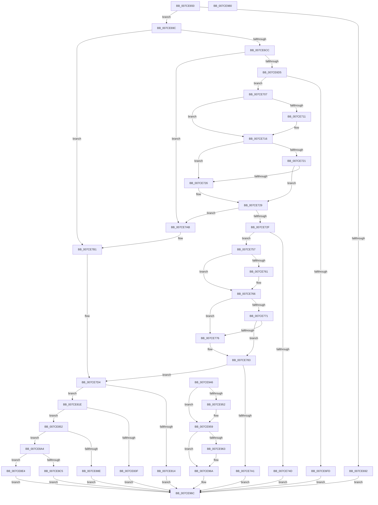

# NtSetSystemEnvironmentValue

- RVA: `0x007CE650`–`0x007CE981` (길이 `817` bytes)
- VA: `0x00000001407CE650`
- 실행 섹션: `PAGE`
- PDB 이름 있음: `예`; PDB Function 태그: `아니요`
- unwind 정보 RVA: `0x000D5360`
- 디코드: `210`개 명령, `817/817` bytes 표시
- 미해석 바이트: `0` (있으면 어셈블리에 `.byte`로 보존)

> 이 문서는 커널 이미지의 기계어와 PDB 기호를 분석해 생성했습니다. 4번과 5번은 함수 원형과 자료형을 바이너리 사용 방식에서 추정한 C 해석이며 원본 소스 복구 결과는 아닙니다.

## 1. Dependencies

- 직접 호출 지점: **23**; 고유 호출 대상: **11**
- 직접 호출자로 확인된 함수: **0**
- RIP 상대 이미지 참조: **2**

### Outgoing calls
- `0x007CE689` → [PsIsCurrentThreadInServerSilo](../../text/43/PsIsCurrentThreadInServerSilo_function_004362E0.md) (function, `0x004362E0`)
- `0x007CE711` → [ExRaiseDatatypeMisalignment](../89/ExRaiseDatatypeMisalignment_function_00899FD0.md) (function, `0x00899FD0`)
- `0x007CE761` → [ExRaiseDatatypeMisalignment](../89/ExRaiseDatatypeMisalignment_function_00899FD0.md) (function, `0x00899FD0`)
- `0x007CE791` → [SeSinglePrivilegeCheck](../87/SeSinglePrivilegeCheck_function_00871E20.md) (function, `0x00871E20`)
- `0x007CE7AB` → [ExRaiseDatatypeMisalignment](../89/ExRaiseDatatypeMisalignment_function_00899FD0.md) (function, `0x00899FD0`)
- `0x007CE7E9` → [RtlUnicodeToMultiByteSize](../90/RtlUnicodeToMultiByteSize_function_0090D110.md) (function, `0x0090D110`)
- `0x007CE805` → [ExAllocatePool2](../../poolcode/B8/ExAllocatePool2_function_00B820F0.md) (function, `0x00B820F0`)
- `0x007CE830` → [RtlUnicodeStringToAnsiString](../90/RtlUnicodeStringToAnsiString_function_0090D1F0.md) (function, `0x0090D1F0`)
- `0x007CE846` → [ExFreePoolWithTag](../../poolcode/B8/ExFreePoolWithTag_function_00B82870.md) (function, `0x00B82870`)
- `0x007CE863` → [RtlUnicodeToMultiByteSize](../90/RtlUnicodeToMultiByteSize_function_0090D110.md) (function, `0x0090D110`)
- `0x007CE87F` → [ExAllocatePool2](../../poolcode/B8/ExAllocatePool2_function_00B820F0.md) (function, `0x00B820F0`)
- `0x007CE895` → [ExFreePoolWithTag](../../poolcode/B8/ExFreePoolWithTag_function_00B82870.md) (function, `0x00B82870`)
- `0x007CE8B6` → [RtlUnicodeStringToAnsiString](../90/RtlUnicodeStringToAnsiString_function_0090D1F0.md) (function, `0x0090D1F0`)
- `0x007CE8CC` → [ExFreePoolWithTag](../../poolcode/B8/ExFreePoolWithTag_function_00B82870.md) (function, `0x00B82870`)
- `0x007CE8D8` → [ExFreePoolWithTag](../../poolcode/B8/ExFreePoolWithTag_function_00B82870.md) (function, `0x00B82870`)
- `0x007CE8FC` → [ExAcquireFastMutexUnsafe](../../text/3F/ExAcquireFastMutexUnsafe_function_003F3720.md) (function, `0x003F3720`)
- `0x007CE90B` → [HalSetEnvironmentVariable](../../text/54/HalSetEnvironmentVariable_function_00543170.md) (function, `0x00543170`)
- `0x007CE919` → [ExReleaseFastMutexUnsafe](../../text/25/ExReleaseFastMutexUnsafe_function_002503A0.md) (function, `0x002503A0`)
- `0x007CE91E` → [KeLeaveCriticalRegion](../../text/25/KeLeaveCriticalRegion_function_0025D8B0.md) (function, `0x0025D8B0`)
- `0x007CE92A` → [ExFreePoolWithTag](../../poolcode/B8/ExFreePoolWithTag_function_00B82870.md) (function, `0x00B82870`)
- `0x007CE936` → [ExFreePoolWithTag](../../poolcode/B8/ExFreePoolWithTag_function_00B82870.md) (function, `0x00B82870`)
- `0x007CE954` → [ExFreePoolWithTag](../../poolcode/B8/ExFreePoolWithTag_function_00B82870.md) (function, `0x00B82870`)
- `0x007CE965` → [ExFreePoolWithTag](../../poolcode/B8/ExFreePoolWithTag_function_00B82870.md) (function, `0x00B82870`)

### Direct callers
- 이 함수 시작 RVA로 연결되는 직접 call은 확인되지 않았습니다. 간접 호출은 완전히 역산할 수 없습니다.

### Static image references
- `0x007CE78A` → RVA `0x00FD9AB8` (`PAGEDATA`; read)
- `0x007CE8F5` → RVA `0x00EFAB40` (`.data`; read)

## 2. Other-region calls and transfers

- 다른 실행 섹션으로 향하는 call: **15**
  - `0x007CE689` → [PsIsCurrentThreadInServerSilo](../../text/43/PsIsCurrentThreadInServerSilo_function_004362E0.md) (`PAGE` → `.text`)
  - `0x007CE805` → [ExAllocatePool2](../../poolcode/B8/ExAllocatePool2_function_00B820F0.md) (`PAGE` → `POOLCODE`)
  - `0x007CE846` → [ExFreePoolWithTag](../../poolcode/B8/ExFreePoolWithTag_function_00B82870.md) (`PAGE` → `POOLCODE`)
  - `0x007CE87F` → [ExAllocatePool2](../../poolcode/B8/ExAllocatePool2_function_00B820F0.md) (`PAGE` → `POOLCODE`)
  - `0x007CE895` → [ExFreePoolWithTag](../../poolcode/B8/ExFreePoolWithTag_function_00B82870.md) (`PAGE` → `POOLCODE`)
  - `0x007CE8CC` → [ExFreePoolWithTag](../../poolcode/B8/ExFreePoolWithTag_function_00B82870.md) (`PAGE` → `POOLCODE`)
  - `0x007CE8D8` → [ExFreePoolWithTag](../../poolcode/B8/ExFreePoolWithTag_function_00B82870.md) (`PAGE` → `POOLCODE`)
  - `0x007CE8FC` → [ExAcquireFastMutexUnsafe](../../text/3F/ExAcquireFastMutexUnsafe_function_003F3720.md) (`PAGE` → `.text`)
  - `0x007CE90B` → [HalSetEnvironmentVariable](../../text/54/HalSetEnvironmentVariable_function_00543170.md) (`PAGE` → `.text`)
  - `0x007CE919` → [ExReleaseFastMutexUnsafe](../../text/25/ExReleaseFastMutexUnsafe_function_002503A0.md) (`PAGE` → `.text`)
  - `0x007CE91E` → [KeLeaveCriticalRegion](../../text/25/KeLeaveCriticalRegion_function_0025D8B0.md) (`PAGE` → `.text`)
  - `0x007CE92A` → [ExFreePoolWithTag](../../poolcode/B8/ExFreePoolWithTag_function_00B82870.md) (`PAGE` → `POOLCODE`)
  - `0x007CE936` → [ExFreePoolWithTag](../../poolcode/B8/ExFreePoolWithTag_function_00B82870.md) (`PAGE` → `POOLCODE`)
  - `0x007CE954` → [ExFreePoolWithTag](../../poolcode/B8/ExFreePoolWithTag_function_00B82870.md) (`PAGE` → `POOLCODE`)
  - `0x007CE965` → [ExFreePoolWithTag](../../poolcode/B8/ExFreePoolWithTag_function_00B82870.md) (`PAGE` → `POOLCODE`)
- 별도 외부 분기/꼬리 이동을 확인하지 못했습니다.

## 3. Assembly (complete function range)

```asm
007CE650  48 8B C4                        mov rax, rsp
007CE653  48 89 58 08                     mov qword ptr [rax + 8], rbx
007CE657  56                              push rsi
007CE658  57                              push rdi
007CE659  41 56                           push r14
007CE65B  48 81 EC 90 00 00 00            sub rsp, 0x90
007CE662  48 8B FA                        mov rdi, rdx
007CE665  48 8B D9                        mov rbx, rcx
007CE668  45 33 F6                        xor r14d, r14d
007CE66B  44 89 70 A8                     mov dword ptr [rax - 0x58], r14d
007CE66F  44 89 70 AC                     mov dword ptr [rax - 0x54], r14d
007CE673  4C 89 70 88                     mov qword ptr [rax - 0x78], r14
007CE677  4C 89 70 98                     mov qword ptr [rax - 0x68], r14
007CE67B  0F 57 C0                        xorps xmm0, xmm0
007CE67E  0F 11 40 B8                     movups xmmword ptr [rax - 0x48], xmm0
007CE682  0F 57 C9                        xorps xmm1, xmm1
007CE685  0F 11 48 C8                     movups xmmword ptr [rax - 0x38], xmm1
007CE689  E8 52 7C C6 FF                  call 0x1404362e0
007CE68E  84 C0                           test al, al
007CE690  74 0A                           je 0x1407ce69c
007CE692  B8 02 00 00 C0                  mov eax, 0xc0000002
007CE697  E9 D0 02 00 00                  jmp 0x1407ce96c
007CE69C  4C 89 74 24 38                  mov qword ptr [rsp + 0x38], r14
007CE6A1  4C 89 74 24 48                  mov qword ptr [rsp + 0x48], r14
007CE6A6  65 48 8B 04 25 88 01 00 00      mov rax, qword ptr gs:[0x188]
007CE6AF  48 89 84 24 88 00 00 00         mov qword ptr [rsp + 0x88], rax
007CE6B7  8A 80 32 02 00 00               mov al, byte ptr [rax + 0x232]
007CE6BD  88 84 24 C0 00 00 00            mov byte ptr [rsp + 0xc0], al
007CE6C4  84 C0                           test al, al
007CE6C6  0F 84 E5 00 00 00               je 0x1407ce7b1
007CE6CC  F6 C3 03                        test bl, 3
007CE6CF  0F 85 D6 00 00 00               jne 0x1407ce7ab
007CE6D5  49 B8 00 00 FF FF FF 7F 00 00   movabs r8, 0x7fffffff0000
007CE6DF  49 8B C0                        mov rax, r8
007CE6E2  49 3B D8                        cmp rbx, r8
007CE6E5  48 0F 42 C3                     cmovb rax, rbx
007CE6E9  90                              nop
007CE6EA  8A 00                           mov al, byte ptr [rax]
007CE6EC  0F 10 03                        movups xmm0, xmmword ptr [rbx]
007CE6EF  0F 11 44 24 60                  movups xmmword ptr [rsp + 0x60], xmm0
007CE6F4  66 0F 7E C0                     movd eax, xmm0
007CE6F8  66 85 C0                        test ax, ax
007CE6FB  75 0A                           jne 0x1407ce707
007CE6FD  B8 9A 00 00 C0                  mov eax, 0xc000009a
007CE702  E9 65 02 00 00                  jmp 0x1407ce96c
007CE707  48 8B 4C 24 68                  mov rcx, qword ptr [rsp + 0x68]
007CE70C  F6 C1 01                        test cl, 1
007CE70F  74 05                           je 0x1407ce716
007CE711  E8 BA B8 0C 00                  call 0x140899fd0
007CE716  0F B7 D0                        movzx edx, ax
007CE719  48 03 D1                        add rdx, rcx
007CE71C  49 3B D0                        cmp rdx, r8
007CE71F  77 05                           ja 0x1407ce726
007CE721  48 3B D1                        cmp rdx, rcx
007CE724  73 03                           jae 0x1407ce729
007CE726  41 8A 00                        mov al, byte ptr [r8]
007CE729  40 F6 C7 03                     test dil, 3
007CE72D  75 7C                           jne 0x1407ce7ab
007CE72F  49 8B C0                        mov rax, r8
007CE732  49 3B F8                        cmp rdi, r8
007CE735  48 0F 42 C7                     cmovb rax, rdi
007CE739  90                              nop
007CE73A  8A 00                           mov al, byte ptr [rax]
007CE73C  0F 10 07                        movups xmm0, xmmword ptr [rdi]
007CE73F  0F 11 44 24 70                  movups xmmword ptr [rsp + 0x70], xmm0
007CE744  66 0F 7E C7                     movd edi, xmm0
007CE748  66 85 FF                        test di, di
007CE74B  75 0A                           jne 0x1407ce757
007CE74D  B8 9A 00 00 C0                  mov eax, 0xc000009a
007CE752  E9 15 02 00 00                  jmp 0x1407ce96c
007CE757  48 8B 5C 24 78                  mov rbx, qword ptr [rsp + 0x78]
007CE75C  F6 C3 01                        test bl, 1
007CE75F  74 05                           je 0x1407ce766
007CE761  E8 6A B8 0C 00                  call 0x140899fd0
007CE766  0F B7 CF                        movzx ecx, di
007CE769  48 03 CB                        add rcx, rbx
007CE76C  49 3B C8                        cmp rcx, r8
007CE76F  77 05                           ja 0x1407ce776
007CE771  48 3B CB                        cmp rcx, rbx
007CE774  73 0D                           jae 0x1407ce783
007CE776  41 8A 00                        mov al, byte ptr [r8]
007CE779  48 8B 5C 24 78                  mov rbx, qword ptr [rsp + 0x78]
007CE77E  0F B7 7C 24 70                  movzx edi, word ptr [rsp + 0x70]
007CE783  8A 94 24 C0 00 00 00            mov dl, byte ptr [rsp + 0xc0]
007CE78A  48 8B 0D 27 B3 80 00            mov rcx, qword ptr [rip + 0x80b327]
007CE791  E8 8A 36 0A 00                  call 0x140871e20
007CE796  88 84 24 C8 00 00 00            mov byte ptr [rsp + 0xc8], al
007CE79D  84 C0                           test al, al
007CE79F  75 33                           jne 0x1407ce7d4
007CE7A1  B8 61 00 00 C0                  mov eax, 0xc0000061
007CE7A6  E9 C1 01 00 00                  jmp 0x1407ce96c
007CE7AB  E8 20 B8 0C 00                  call 0x140899fd0
007CE7B0  CC                              int3
007CE7B1  0F 10 03                        movups xmm0, xmmword ptr [rbx]
007CE7B4  F3 0F 7F 44 24 60               movdqu xmmword ptr [rsp + 0x60], xmm0
007CE7BA  0F 10 0F                        movups xmm1, xmmword ptr [rdi]
007CE7BD  0F 11 4C 24 70                  movups xmmword ptr [rsp + 0x70], xmm1
007CE7C2  66 0F 6F C1                     movdqa xmm0, xmm1
007CE7C6  66 0F 73 D8 08                  psrldq xmm0, 8
007CE7CB  66 48 0F 7E C3                  movq rbx, xmm0
007CE7D0  66 0F 7E CF                     movd edi, xmm1
007CE7D4  44 89 74 24 24                  mov dword ptr [rsp + 0x24], r14d
007CE7D9  44 0F B7 44 24 60               movzx r8d, word ptr [rsp + 0x60]
007CE7DF  48 8B 54 24 68                  mov rdx, qword ptr [rsp + 0x68]
007CE7E4  48 8D 4C 24 24                  lea rcx, [rsp + 0x24]
007CE7E9  E8 22 E9 13 00                  call 0x14090d110
007CE7EE  8B 74 24 24                     mov esi, dword ptr [rsp + 0x24]
007CE7F2  FF C6                           inc esi
007CE7F4  89 74 24 50                     mov dword ptr [rsp + 0x50], esi
007CE7F8  8B D6                           mov edx, esi
007CE7FA  B9 40 00 00 00                  mov ecx, 0x40
007CE7FF  41 B8 45 6E 76 72               mov r8d, 0x72766e45
007CE805  E8 E6 38 3B 00                  call 0x140b820f0
007CE80A  48 89 44 24 38                  mov qword ptr [rsp + 0x38], rax
007CE80F  48 85 C0                        test rax, rax
007CE812  75 0A                           jne 0x1407ce81e
007CE814  B8 9A 00 00 C0                  mov eax, 0xc000009a
007CE819  E9 4E 01 00 00                  jmp 0x1407ce96c
007CE81E  66 89 74 24 32                  mov word ptr [rsp + 0x32], si
007CE823  45 33 C0                        xor r8d, r8d
007CE826  48 8D 54 24 60                  lea rdx, [rsp + 0x60]
007CE82B  48 8D 4C 24 30                  lea rcx, [rsp + 0x30]
007CE830  E8 BB E9 13 00                  call 0x14090d1f0
007CE835  8B F0                           mov esi, eax
007CE837  89 44 24 58                     mov dword ptr [rsp + 0x58], eax
007CE83B  85 C0                           test eax, eax
007CE83D  79 13                           jns 0x1407ce852
007CE83F  33 D2                           xor edx, edx
007CE841  48 8B 4C 24 38                  mov rcx, qword ptr [rsp + 0x38]
007CE846  E8 25 40 3B 00                  call 0x140b82870
007CE84B  8B C6                           mov eax, esi
007CE84D  E9 1A 01 00 00                  jmp 0x1407ce96c
007CE852  44 89 74 24 28                  mov dword ptr [rsp + 0x28], r14d
007CE857  44 0F B7 C7                     movzx r8d, di
007CE85B  48 8B D3                        mov rdx, rbx
007CE85E  48 8D 4C 24 28                  lea rcx, [rsp + 0x28]
007CE863  E8 A8 E8 13 00                  call 0x14090d110
007CE868  8B 5C 24 28                     mov ebx, dword ptr [rsp + 0x28]
007CE86C  FF C3                           inc ebx
007CE86E  89 5C 24 54                     mov dword ptr [rsp + 0x54], ebx
007CE872  8B D3                           mov edx, ebx
007CE874  B9 40 00 00 00                  mov ecx, 0x40
007CE879  41 B8 45 6E 76 72               mov r8d, 0x72766e45
007CE87F  E8 6C 38 3B 00                  call 0x140b820f0
007CE884  48 89 44 24 48                  mov qword ptr [rsp + 0x48], rax
007CE889  48 85 C0                        test rax, rax
007CE88C  75 16                           jne 0x1407ce8a4
007CE88E  33 D2                           xor edx, edx
007CE890  48 8B 4C 24 38                  mov rcx, qword ptr [rsp + 0x38]
007CE895  E8 D6 3F 3B 00                  call 0x140b82870
007CE89A  B8 9A 00 00 C0                  mov eax, 0xc000009a
007CE89F  E9 C8 00 00 00                  jmp 0x1407ce96c
007CE8A4  66 89 5C 24 42                  mov word ptr [rsp + 0x42], bx
007CE8A9  45 33 C0                        xor r8d, r8d
007CE8AC  48 8D 54 24 70                  lea rdx, [rsp + 0x70]
007CE8B1  48 8D 4C 24 40                  lea rcx, [rsp + 0x40]
007CE8B6  E8 35 E9 13 00                  call 0x14090d1f0
007CE8BB  8B D8                           mov ebx, eax
007CE8BD  89 44 24 58                     mov dword ptr [rsp + 0x58], eax
007CE8C1  85 C0                           test eax, eax
007CE8C3  79 1F                           jns 0x1407ce8e4
007CE8C5  33 D2                           xor edx, edx
007CE8C7  48 8B 4C 24 38                  mov rcx, qword ptr [rsp + 0x38]
007CE8CC  E8 9F 3F 3B 00                  call 0x140b82870
007CE8D1  33 D2                           xor edx, edx
007CE8D3  48 8B 4C 24 48                  mov rcx, qword ptr [rsp + 0x48]
007CE8D8  E8 93 3F 3B 00                  call 0x140b82870
007CE8DD  8B C3                           mov eax, ebx
007CE8DF  E9 88 00 00 00                  jmp 0x1407ce96c
007CE8E4  65 48 8B 04 25 88 01 00 00      mov rax, qword ptr gs:[0x188]
007CE8ED  66 FF 88 E4 01 00 00            dec word ptr [rax + 0x1e4]
007CE8F4  90                              nop
007CE8F5  48 8D 0D 44 C2 72 00            lea rcx, [rip + 0x72c244]
007CE8FC  E8 1F 4E C2 FF                  call 0x1403f3720
007CE901  48 8B 54 24 48                  mov rdx, qword ptr [rsp + 0x48]
007CE906  48 8B 4C 24 38                  mov rcx, qword ptr [rsp + 0x38]
007CE90B  E8 60 48 D7 FF                  call 0x140543170
007CE910  8B D8                           mov ebx, eax
007CE912  48 8D 0D 27 C2 72 00            lea rcx, [rip + 0x72c227]
007CE919  E8 82 1A A8 FF                  call 0x1402503a0
007CE91E  E8 8D EF A8 FF                  call 0x14025d8b0
007CE923  33 D2                           xor edx, edx
007CE925  48 8B 4C 24 38                  mov rcx, qword ptr [rsp + 0x38]
007CE92A  E8 41 3F 3B 00                  call 0x140b82870
007CE92F  33 D2                           xor edx, edx
007CE931  48 8B 4C 24 48                  mov rcx, qword ptr [rsp + 0x48]
007CE936  E8 35 3F 3B 00                  call 0x140b82870
007CE93B  F7 DB                           neg ebx
007CE93D  1B C0                           sbb eax, eax
007CE93F  25 9A 00 00 C0                  and eax, 0xc000009a
007CE944  EB 26                           jmp 0x1407ce96c
007CE946  8B D8                           mov ebx, eax
007CE948  48 8B 4C 24 38                  mov rcx, qword ptr [rsp + 0x38]
007CE94D  48 85 C9                        test rcx, rcx
007CE950  74 07                           je 0x1407ce959
007CE952  33 D2                           xor edx, edx
007CE954  E8 17 3F 3B 00                  call 0x140b82870
007CE959  48 8B 4C 24 48                  mov rcx, qword ptr [rsp + 0x48]
007CE95E  48 85 C9                        test rcx, rcx
007CE961  74 07                           je 0x1407ce96a
007CE963  33 D2                           xor edx, edx
007CE965  E8 06 3F 3B 00                  call 0x140b82870
007CE96A  8B C3                           mov eax, ebx
007CE96C  48 8B 9C 24 B0 00 00 00         mov rbx, qword ptr [rsp + 0xb0]
007CE974  48 81 C4 90 00 00 00            add rsp, 0x90
007CE97B  41 5E                           pop r14
007CE97D  5F                              pop rdi
007CE97E  5E                              pop rsi
007CE97F  C3                              ret
007CE980  CC                              int3
```

## 4. C-style interpretation (structured pseudocode)

```c
__int64 __fastcall NtSetSystemEnvironmentValue(__int64 a1, __int64 a2)
{
    __int64 result;
    __int64 v_r14;
    __int64 v_rbx;
    __int64 v_rdi;
    __int64 v_rsi;
    __int64 v_rsp;
    unsigned __int64 v_stack_m20;
    unsigned __int64 v_stack_m30;
    unsigned __int64 v_stack_m38;
    unsigned __int64 v_stack_m40;
    unsigned __int64 v_stack_m48;
    unsigned int v_stack_m50;
    unsigned int v_stack_m54;
    unsigned int v_stack_m58;
    unsigned __int64 v_stack_m60;
    unsigned __int16 v_stack_m66;
    unsigned __int64 v_stack_m68;
    unsigned __int64 v_stack_m70;
    unsigned __int16 v_stack_m76;
    unsigned __int64 v_stack_m78;
    unsigned int v_stack_m80;
    unsigned int v_stack_m84;
    unsigned __int8 v_stack_p18;
    unsigned __int8 v_stack_p20;
    unsigned __int64 v_stack_p8;

    *(unsigned __int64 *)(v_rsp + 8) = v_rbx;
    v_rsp = (v_rsp) - (144);
    v_r14 = 0;
    *(unsigned int *)(v_rsp - 88) = 0;
    *(unsigned int *)(v_rsp - 84) = 0;
    *(unsigned __int64 *)(v_rsp - 120) = 0;
    *(unsigned __int64 *)(v_rsp - 104) = 0;
    *(unsigned __int64 *)(v_rsp - 72) = v_xmm0;
    *(unsigned __int64 *)(v_rsp - 56) = v_xmm1;
    result = PsIsCurrentThreadInServerSilo(a1, a2, a3, a4);
    if ((unsigned __int8)(result) == 0) goto loc_007CE69C;
    goto loc_007CE96C;
loc_007CE69C:
    v_stack_m70 = 0;
    v_stack_m60 = 0;
    v_stack_m20 = *(unsigned __int64 *)(gs_base + (0 + 392));
    v_stack_p18 = (unsigned __int8)(*(unsigned __int8 *)(*(unsigned __int64 *)(gs_base + (0 + 392)) + 562));
    if ((unsigned __int8)(*(unsigned __int8 *)(*(unsigned __int64 *)(gs_base + (0 + 392)) + 562)) == 0) goto loc_007CE7B1;
    if ((((unsigned __int8)(a1)) & (3)) != 0) goto loc_007CE7AB;
    if (a1 < a3) { a3 = a1; }
    v_stack_m48 = v_xmm0;
    if ((unsigned __int16)(*(unsigned __int8 *)(a3)) != 0) goto loc_007CE707;
    goto loc_007CE96C;
loc_007CE707:
    result = (unsigned int)(0xC000009AULL);
    if ((((unsigned __int8)(v_stack_m40)) & (1)) != 0) {
        result = ExRaiseDatatypeMisalignment(v_stack_m40, a2, a3, a4);
    }
    a2 = ((unsigned __int16)(result)) + (v_stack_m40);
    if (a2 > a3) goto loc_007CE726;
    if (a2 < v_stack_m40) {
        result = *(unsigned __int8 *)(a3);
    }
    if ((((unsigned __int8)(a2)) & (3)) != 0) goto loc_007CE7AB;
    if (a2 < a3) { a3 = a2; }
    v_stack_m38 = v_xmm0;
    if ((unsigned __int16)(a2) != 0) goto loc_007CE757;
    goto loc_007CE96C;
loc_007CE757:
    result = (unsigned int)(0xC000009AULL);
    if ((((unsigned __int8)(v_stack_m30)) & (1)) != 0) {
        result = ExRaiseDatatypeMisalignment(v_stack_m40, a2, a3, a4);
    }
    a1 = ((unsigned __int16)(a2)) + (v_stack_m30);
    if (a1 > a3) goto loc_007CE776;
    v_rbx = v_stack_m30;
    v_rdi = a2;
    if (a1 < v_stack_m30) {
        result = *(unsigned __int8 *)(a3);
        v_rbx = v_stack_m30;
        v_rdi = v_stack_m38;
    }
    result = SeSinglePrivilegeCheck(*(unsigned __int64 *)(v_rip + 8434471), v_stack_p18, a3, a4);
    v_stack_p20 = (unsigned __int8)(result);
    if ((unsigned __int8)(result) != 0) goto loc_007CE7D4;
    goto loc_007CE96C;
loc_007CE7AB:
    result = ExRaiseDatatypeMisalignment(*(unsigned __int64 *)(v_rip + 8434471), v_stack_p18, a3, a4);
loc_007CE7B1:
    v_stack_m48 = v_xmm0;
    v_stack_m38 = v_xmm1;
loc_007CE7D4:
    v_stack_m84 = 0;
    result = RtlUnicodeToMultiByteSize(v_stack_m84, v_stack_m40, v_stack_m48, a4);
    v_rsi = (unsigned int)(((unsigned int)(v_stack_m84)) + 1);
    v_stack_m58 = (unsigned int)(v_rsi);
    result = ExAllocatePool2(64, (unsigned int)((unsigned int)(v_rsi)), (unsigned int)(0x72766E45ULL), a4);
    v_stack_m70 = result;
    if (result != 0) goto loc_007CE81E;
    goto loc_007CE96C;
loc_007CE81E:
    v_stack_m76 = (unsigned __int16)(v_rsi);
    a3 = 0;
    result = RtlUnicodeStringToAnsiString(v_stack_m78, v_stack_m48, a3, a4);
    v_stack_m50 = (unsigned int)(result);
    if (!sign_flag) goto loc_007CE852;
    a2 = 0;
    result = ExFreePoolWithTag(v_stack_m70, a2, a3, a4);
    goto loc_007CE96C;
loc_007CE852:
    v_stack_m80 = 0;
    result = RtlUnicodeToMultiByteSize(v_stack_m80, v_rbx, (unsigned __int16)(v_rdi), a4);
    v_rbx = (unsigned int)(((unsigned int)(v_stack_m80)) + 1);
    v_stack_m54 = (unsigned int)(v_rbx);
    result = ExAllocatePool2(64, (unsigned int)((unsigned int)(v_rbx)), (unsigned int)(0x72766E45ULL), a4);
    v_stack_m60 = result;
    if (result != 0) goto loc_007CE8A4;
    a2 = 0;
    result = ExFreePoolWithTag(v_stack_m70, a2, (unsigned int)(0x72766E45ULL), a4);
    goto loc_007CE96C;
loc_007CE8A4:
    v_stack_m66 = (unsigned __int16)(v_rbx);
    a3 = 0;
    result = RtlUnicodeStringToAnsiString(v_stack_m68, v_stack_m38, a3, a4);
    v_stack_m50 = (unsigned int)(result);
    if (!sign_flag) goto loc_007CE8E4;
    a2 = 0;
    result = ExFreePoolWithTag(v_stack_m70, a2, a3, a4);
    a2 = 0;
    result = ExFreePoolWithTag(v_stack_m60, a2, a3, a4);
    goto loc_007CE96C;
loc_007CE8E4:
    result = ExAcquireFastMutexUnsafe(v_rip + 7520836, a2, a3, a4);
    result = HalSetEnvironmentVariable(v_stack_m70, v_stack_m60, a3, a4);
    result = ExReleaseFastMutexUnsafe(v_rip + 7520807, v_stack_m60, a3, a4);
    result = KeLeaveCriticalRegion(v_rip + 7520807, v_stack_m60, a3, a4);
    a2 = 0;
    result = ExFreePoolWithTag(v_stack_m70, a2, a3, a4);
    a2 = 0;
    result = ExFreePoolWithTag(v_stack_m60, a2, a3, a4);
    v_rbx = (unsigned int)(-((unsigned int)((unsigned int)(result))));
    result = (unsigned int)((result) & (0xC000009AULL));
    goto loc_007CE96C;
loc_007CE96C:
    v_rsp = (v_rsp) + (144);
    return result;
}
```

## 5. (Beta) C Style

```c
int64_t NtSetSystemEnvironmentValue(int64_t Arg1, int64_t Arg2)
{
    int64_t result;
    int64_t local_r14;
    int64_t local_rbx;
    int64_t local_rdi;
    int64_t local_rsi;
    int64_t local_rsp;
    uint64_t v_stack_m20;
    uint64_t v_stack_m30;
    uint64_t v_stack_m38;
    uint64_t v_stack_m40;
    uint64_t v_stack_m48;
    uint32_t v_stack_m50;
    uint32_t v_stack_m54;
    uint32_t v_stack_m58;
    uint64_t v_stack_m60;
    uint16_t v_stack_m66;
    uint64_t v_stack_m68;
    uint64_t v_stack_m70;
    uint16_t v_stack_m76;
    uint64_t v_stack_m78;
    uint32_t v_stack_m80;
    uint32_t v_stack_m84;
    uint8_t v_stack_p18;
    uint8_t v_stack_p20;
    uint64_t v_stack_p8;

    *(uint64_t *)(local_rsp + 0x8) = local_rbx;
    local_rsp = (local_rsp) - (144);
    local_r14 = 0;
    *(uint32_t *)(local_rsp - 0x58) = 0;
    *(uint32_t *)(local_rsp - 0x54) = 0;
    *(uint64_t *)(local_rsp - 0x78) = 0;
    *(uint64_t *)(local_rsp - 0x68) = 0;
    *(uint64_t *)(local_rsp - 0x48) = v_xmm0;
    *(uint64_t *)(local_rsp - 0x38) = v_xmm1;
    result = PsIsCurrentThreadInServerSilo(Arg1, Arg2, a3, a4);
    if ((uint8_t)(result) == 0) goto loc_007CE69C;
    goto loc_007CE96C;
loc_007CE69C:
    v_stack_m70 = 0;
    v_stack_m60 = 0;
    v_stack_m20 = *(uint64_t *)(gs_base + (0 + 0x188));
    v_stack_p18 = (uint8_t)(*(uint8_t *)(*(uint64_t *)(gs_base + (0 + 0x188)) + 0x232));
    if ((uint8_t)(*(uint8_t *)(*(uint64_t *)(gs_base + (0 + 0x188)) + 0x232)) == 0) goto loc_007CE7B1;
    if ((((uint8_t)(Arg1)) & (3)) != 0) goto loc_007CE7AB;
    if (Arg1 < a3) { a3 = Arg1; }
    v_stack_m48 = v_xmm0;
    if ((uint16_t)(*(uint8_t *)(a3)) != 0) goto loc_007CE707;
    goto loc_007CE96C;
loc_007CE707:
    result = (uint32_t)(0xC000009AULL);
    if ((((uint8_t)(v_stack_m40)) & (1)) != 0) {
        result = ExRaiseDatatypeMisalignment(v_stack_m40, Arg2, a3, a4);
    }
    Arg2 = ((uint16_t)(result)) + (v_stack_m40);
    if (Arg2 > a3) goto loc_007CE726;
    if (Arg2 < v_stack_m40) {
        result = *(uint8_t *)(a3);
    }
    if ((((uint8_t)(Arg2)) & (3)) != 0) goto loc_007CE7AB;
    if (Arg2 < a3) { a3 = Arg2; }
    v_stack_m38 = v_xmm0;
    if ((uint16_t)(Arg2) != 0) goto loc_007CE757;
    goto loc_007CE96C;
loc_007CE757:
    result = (uint32_t)(0xC000009AULL);
    if ((((uint8_t)(v_stack_m30)) & (1)) != 0) {
        result = ExRaiseDatatypeMisalignment(v_stack_m40, Arg2, a3, a4);
    }
    Arg1 = ((uint16_t)(Arg2)) + (v_stack_m30);
    if (Arg1 > a3) goto loc_007CE776;
    local_rbx = v_stack_m30;
    local_rdi = Arg2;
    if (Arg1 < v_stack_m30) {
        result = *(uint8_t *)(a3);
        local_rbx = v_stack_m30;
        local_rdi = v_stack_m38;
    }
    result = SeSinglePrivilegeCheck(*(uint64_t *)(v_rip + 0x80B327), v_stack_p18, a3, a4);
    v_stack_p20 = (uint8_t)(result);
    if ((uint8_t)(result) != 0) goto loc_007CE7D4;
    goto loc_007CE96C;
loc_007CE7AB:
    result = ExRaiseDatatypeMisalignment(*(uint64_t *)(v_rip + 0x80B327), v_stack_p18, a3, a4);
loc_007CE7B1:
    v_stack_m48 = v_xmm0;
    v_stack_m38 = v_xmm1;
loc_007CE7D4:
    v_stack_m84 = 0;
    result = RtlUnicodeToMultiByteSize(v_stack_m84, v_stack_m40, v_stack_m48, a4);
    local_rsi = (uint32_t)(((uint32_t)(v_stack_m84)) + 1);
    v_stack_m58 = (uint32_t)(local_rsi);
    result = ExAllocatePool2(64, (uint32_t)((uint32_t)(local_rsi)), (uint32_t)(0x72766E45ULL), a4);
    v_stack_m70 = result;
    if (result != 0) goto loc_007CE81E;
    goto loc_007CE96C;
loc_007CE81E:
    v_stack_m76 = (uint16_t)(local_rsi);
    a3 = 0;
    result = RtlUnicodeStringToAnsiString(v_stack_m78, v_stack_m48, a3, a4);
    v_stack_m50 = (uint32_t)(result);
    if (!sign_flag) goto loc_007CE852;
    Arg2 = 0;
    result = ExFreePoolWithTag(v_stack_m70, Arg2, a3, a4);
    goto loc_007CE96C;
loc_007CE852:
    v_stack_m80 = 0;
    result = RtlUnicodeToMultiByteSize(v_stack_m80, local_rbx, (uint16_t)(local_rdi), a4);
    local_rbx = (uint32_t)(((uint32_t)(v_stack_m80)) + 1);
    v_stack_m54 = (uint32_t)(local_rbx);
    result = ExAllocatePool2(64, (uint32_t)((uint32_t)(local_rbx)), (uint32_t)(0x72766E45ULL), a4);
    v_stack_m60 = result;
    if (result != 0) goto loc_007CE8A4;
    Arg2 = 0;
    result = ExFreePoolWithTag(v_stack_m70, Arg2, (uint32_t)(0x72766E45ULL), a4);
    goto loc_007CE96C;
loc_007CE8A4:
    v_stack_m66 = (uint16_t)(local_rbx);
    a3 = 0;
    result = RtlUnicodeStringToAnsiString(v_stack_m68, v_stack_m38, a3, a4);
    v_stack_m50 = (uint32_t)(result);
    if (!sign_flag) goto loc_007CE8E4;
    Arg2 = 0;
    result = ExFreePoolWithTag(v_stack_m70, Arg2, a3, a4);
    Arg2 = 0;
    result = ExFreePoolWithTag(v_stack_m60, Arg2, a3, a4);
    goto loc_007CE96C;
loc_007CE8E4:
    result = ExAcquireFastMutexUnsafe(v_rip + 7520836, Arg2, a3, a4);
    result = HalSetEnvironmentVariable(v_stack_m70, v_stack_m60, a3, a4);
    result = ExReleaseFastMutexUnsafe(v_rip + 7520807, v_stack_m60, a3, a4);
    result = KeLeaveCriticalRegion(v_rip + 7520807, v_stack_m60, a3, a4);
    Arg2 = 0;
    result = ExFreePoolWithTag(v_stack_m70, Arg2, a3, a4);
    Arg2 = 0;
    result = ExFreePoolWithTag(v_stack_m60, Arg2, a3, a4);
    local_rbx = (uint32_t)(-((uint32_t)((uint32_t)(result))));
    result = (uint32_t)((result) & (0xC000009AULL));
    goto loc_007CE96C;
loc_007CE96C:
    local_rsp = (local_rsp) + (144);
    return result;
}
```

## 6. Execution-region graph

[열기: 2D/3D 그래프와 함수 탐색 컨트롤 패널](../../../control-panel.html?section=page&rva=0x007CE650&view=graph)

- 2D 그래프는 위에서 아래로 흐르고, 3D 그래프는 빈 공간을 드래그해 회전합니다. Shift+드래그는 이동, 휠은 확대·축소, 함수 노드 선택은 대상 보고서 이동입니다.

### Static fallback


