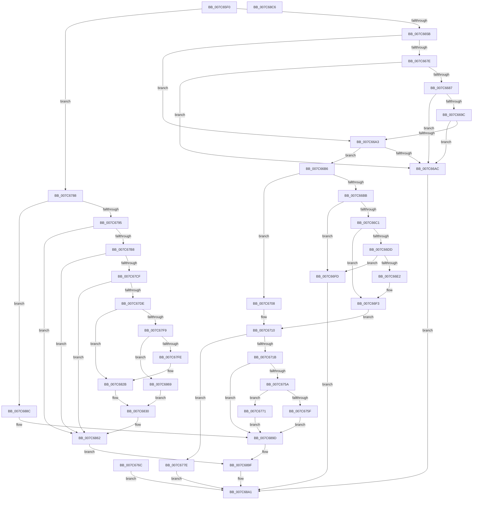

# NtSetSystemTime

- RVA: `0x007C65F0`–`0x007C68C7` (길이 `727` bytes)
- VA: `0x00000001407C65F0`
- 실행 섹션: `PAGE`
- PDB 이름 있음: `예`; PDB Function 태그: `아니요`
- unwind 정보 RVA: `0x000D49E0`
- 디코드: `174`개 명령, `727/727` bytes 표시
- 미해석 바이트: `0` (있으면 어셈블리에 `.byte`로 보존)

> 이 문서는 커널 이미지의 기계어와 PDB 기호를 분석해 생성했습니다. 4번과 5번은 함수 원형과 자료형을 바이너리 사용 방식에서 추정한 C 해석이며 원본 소스 복구 결과는 아닙니다.

## 1. Dependencies

- 직접 호출 지점: **26**; 고유 호출 대상: **20**
- 직접 호출자로 확인된 함수: **1**
- RIP 상대 이미지 참조: **5**

### Outgoing calls
- `0x007C664A` → [PsGetCurrentServerSiloGlobals](../../text/2F/PsGetCurrentServerSiloGlobals_function_002FE1F0.md) (function, `0x002FE1F0`)
- `0x007C6675` → [SeSinglePrivilegeCheck](../87/SeSinglePrivilegeCheck_function_00871E20.md) (function, `0x00871E20`)
- `0x007C667E` → [RtlIsMultiSessionSku](../A2/RtlIsMultiSessionSku_function_00A20730.md) (function, `0x00A20730`)
- `0x007C6693` → [RtlCapabilityCheck](../A2/RtlCapabilityCheck_function_00A20340.md) (function, `0x00A20340`)
- `0x007C66A3` → [PsIsCurrentThreadInServerSilo](../../text/43/PsIsCurrentThreadInServerSilo_function_004362E0.md) (function, `0x004362E0`)
- `0x007C66FD` → [ExRaiseDatatypeMisalignment](../89/ExRaiseDatatypeMisalignment_function_00899FD0.md) (function, `0x00899FD0`)
- `0x007C671B` → [ExAcquireTimeRefreshLockExclusive](../9C/ExAcquireTimeRefreshLockExclusive_function_009C5810.md) (function, `0x009C5810`)
- `0x007C6738` → [ExpSetSystemTime](../../pagelk/B7/ExpSetSystemTime_function_00B7C838.md) (function, `0x00B7C838`)
- `0x007C6747` → [SeAuditSystemTimeChange](../79/SeAuditSystemTimeChange_function_0079EB8C.md) (function, `0x0079EB8C`)
- `0x007C674C` → [ExReleaseTimeRefreshLockExclusive](../9C/ExReleaseTimeRefreshLockExclusive_function_009C5874.md) (function, `0x009C5874`)
- `0x007C6788` → [PsIsCurrentThreadInServerSilo](../../text/43/PsIsCurrentThreadInServerSilo_function_004362E0.md) (function, `0x004362E0`)
- `0x007C679A` → [ExAcquireTimeRefreshLockExclusive](../9C/ExAcquireTimeRefreshLockExclusive_function_009C5810.md) (function, `0x009C5810`)
- `0x007C67AB` → [HalQueryRealTimeClock](../../text/42/HalQueryRealTimeClock_function_0042D810.md) (function, `0x0042D810`)
- `0x007C67C2` → [RtlTimeFieldsToTime](../../text/42/RtlTimeFieldsToTime_function_0042E6B0.md) (function, `0x0042E6B0`)
- `0x007C67D1` → [ExpRefreshTimeZoneInformation](../A6/ExpRefreshTimeZoneInformation_function_00A6B46C.md) (function, `0x00A6B46C`)
- `0x007C6808` → [ExSystemTimeToLocalTime](../../text/2F/ExSystemTimeToLocalTime_function_002FE1C0.md) (function, `0x002FE1C0`)
- `0x007C6817` → [RtlTimeToTimeFields](../../text/42/RtlTimeToTimeFields_function_0042E0F0.md) (function, `0x0042E0F0`)
- `0x007C6821` → [HalSetRealTimeClock](../../text/42/HalSetRealTimeClock_function_0042D310.md) (function, `0x0042D310`)
- `0x007C685B` → [PoNotifySystemTimeSet](../../text/4D/PoNotifySystemTimeSet_function_004D4F7C.md) (function, `0x004D4F7C`)
- `0x007C6862` → [ExReleaseTimeRefreshLockExclusive](../9C/ExReleaseTimeRefreshLockExclusive_function_009C5874.md) (function, `0x009C5874`)
- `0x007C6873` → [ExLocalTimeToSystemTime](../../text/49/ExLocalTimeToSystemTime_function_00494BC0.md) (function, `0x00494BC0`)
- `0x007C6885` → [KeSetSystemTime](../../text/2C/KeSetSystemTime_function_002C8E5C.md) (function, `0x002C8E5C`)
- `0x007C688C` → [ExAcquireTimeRefreshLockExclusive](../9C/ExAcquireTimeRefreshLockExclusive_function_009C5810.md) (function, `0x009C5810`)
- `0x007C6893` → [ExpRefreshTimeZoneInformation](../A6/ExpRefreshTimeZoneInformation_function_00A6B46C.md) (function, `0x00A6B46C`)
- `0x007C6898` → [ExReleaseTimeRefreshLockExclusive](../9C/ExReleaseTimeRefreshLockExclusive_function_009C5874.md) (function, `0x009C5874`)
- `0x007C68AC` → [_security_check_cookie](../../text/6A/_security_check_cookie_function_006AC640.md) (function, `0x006AC640`)

### Direct callers
- [ExpSetTimeZoneInformation](ExpSetTimeZoneInformation_function_007C5240.md) at `0x007C54EB`

### Static image references
- `0x007C6603` → RVA `0x00E0A740` (`.data`; read)
- `0x007C663F` → RVA `0x00B01CB0` (` ?? ::NNGAKEGL::`string'`; read)
- `0x007C666E` → RVA `0x00FD9BE0` (`PAGEDATA`; read)
- `0x007C679F` → RVA `0x00E0EB98` (`.data`; read)
- `0x007C67F0` → RVA `0x00E68570` (`.data`; read)

## 2. Other-region calls and transfers

- 다른 실행 섹션으로 향하는 call: **13**
  - `0x007C664A` → [PsGetCurrentServerSiloGlobals](../../text/2F/PsGetCurrentServerSiloGlobals_function_002FE1F0.md) (`PAGE` → `.text`)
  - `0x007C66A3` → [PsIsCurrentThreadInServerSilo](../../text/43/PsIsCurrentThreadInServerSilo_function_004362E0.md) (`PAGE` → `.text`)
  - `0x007C6738` → [ExpSetSystemTime](../../pagelk/B7/ExpSetSystemTime_function_00B7C838.md) (`PAGE` → `PAGELK`)
  - `0x007C6788` → [PsIsCurrentThreadInServerSilo](../../text/43/PsIsCurrentThreadInServerSilo_function_004362E0.md) (`PAGE` → `.text`)
  - `0x007C67AB` → [HalQueryRealTimeClock](../../text/42/HalQueryRealTimeClock_function_0042D810.md) (`PAGE` → `.text`)
  - `0x007C67C2` → [RtlTimeFieldsToTime](../../text/42/RtlTimeFieldsToTime_function_0042E6B0.md) (`PAGE` → `.text`)
  - `0x007C6808` → [ExSystemTimeToLocalTime](../../text/2F/ExSystemTimeToLocalTime_function_002FE1C0.md) (`PAGE` → `.text`)
  - `0x007C6817` → [RtlTimeToTimeFields](../../text/42/RtlTimeToTimeFields_function_0042E0F0.md) (`PAGE` → `.text`)
  - `0x007C6821` → [HalSetRealTimeClock](../../text/42/HalSetRealTimeClock_function_0042D310.md) (`PAGE` → `.text`)
  - `0x007C685B` → [PoNotifySystemTimeSet](../../text/4D/PoNotifySystemTimeSet_function_004D4F7C.md) (`PAGE` → `.text`)
  - `0x007C6873` → [ExLocalTimeToSystemTime](../../text/49/ExLocalTimeToSystemTime_function_00494BC0.md) (`PAGE` → `.text`)
  - `0x007C6885` → [KeSetSystemTime](../../text/2C/KeSetSystemTime_function_002C8E5C.md) (`PAGE` → `.text`)
  - `0x007C68AC` → [_security_check_cookie](../../text/6A/_security_check_cookie_function_006AC640.md) (`PAGE` → `.text`)
- 별도 외부 분기/꼬리 이동을 확인하지 못했습니다.

## 3. Assembly (complete function range)

```asm
007C65F0  4C 8B DC                        mov r11, rsp
007C65F3  49 89 5B 08                     mov qword ptr [r11 + 8], rbx
007C65F7  49 89 73 10                     mov qword ptr [r11 + 0x10], rsi
007C65FB  57                              push rdi
007C65FC  48 81 EC 90 00 00 00            sub rsp, 0x90
007C6603  48 8B 05 36 41 64 00            mov rax, qword ptr [rip + 0x644136]
007C660A  48 33 C4                        xor rax, rsp
007C660D  48 89 84 24 80 00 00 00         mov qword ptr [rsp + 0x80], rax
007C6615  48 8B DA                        mov rbx, rdx
007C6618  48 8B F9                        mov rdi, rcx
007C661B  49 83 63 B0 00                  and qword ptr [r11 - 0x50], 0
007C6620  49 83 63 B8 00                  and qword ptr [r11 - 0x48], 0
007C6625  49 83 63 C0 00                  and qword ptr [r11 - 0x40], 0
007C662A  0F 57 C0                        xorps xmm0, xmm0
007C662D  0F 11 44 24 70                  movups xmmword ptr [rsp + 0x70], xmm0
007C6632  C6 44 24 40 00                  mov byte ptr [rsp + 0x40], 0
007C6637  49 C7 43 C8 20 00 22 00         mov qword ptr [r11 - 0x38], 0x220020
007C663F  48 8D 05 6A B6 33 00            lea rax, [rip + 0x33b66a]
007C6646  49 89 43 D0                     mov qword ptr [r11 - 0x30], rax
007C664A  E8 A1 7B B3 FF                  call 0x1402fe1f0
007C664F  48 8B F0                        mov rsi, rax
007C6652  48 85 FF                        test rdi, rdi
007C6655  0F 84 2D 01 00 00               je 0x1407c6788
007C665B  65 48 8B 04 25 88 01 00 00      mov rax, qword ptr gs:[0x188]
007C6664  40 8A B0 32 02 00 00            mov sil, byte ptr [rax + 0x232]
007C666B  40 8A D6                        mov dl, sil
007C666E  48 8B 0D 6B 35 81 00            mov rcx, qword ptr [rip + 0x81356b]
007C6675  E8 A6 B7 0A 00                  call 0x140871e20
007C667A  84 C0                           test al, al
007C667C  75 25                           jne 0x1407c66a3
007C667E  E8 AD A0 25 00                  call 0x140a20730
007C6683  84 C0                           test al, al
007C6685  75 25                           jne 0x1407c66ac
007C6687  4C 8D 44 24 40                  lea r8, [rsp + 0x40]
007C668C  48 8D 54 24 60                  lea rdx, [rsp + 0x60]
007C6691  33 C9                           xor ecx, ecx
007C6693  E8 A8 9C 25 00                  call 0x140a20340
007C6698  85 C0                           test eax, eax
007C669A  78 10                           js 0x1407c66ac
007C669C  80 7C 24 40 00                  cmp byte ptr [rsp + 0x40], 0
007C66A1  74 09                           je 0x1407c66ac
007C66A3  E8 38 FC C6 FF                  call 0x1404362e0
007C66A8  84 C0                           test al, al
007C66AA  74 0A                           je 0x1407c66b6
007C66AC  B8 61 00 00 C0                  mov eax, 0xc0000061
007C66B1  E9 EB 01 00 00                  jmp 0x1407c68a1
007C66B6  40 84 F6                        test sil, sil
007C66B9  74 4D                           je 0x1407c6708
007C66BB  40 F6 C7 03                     test dil, 3
007C66BF  75 3C                           jne 0x1407c66fd
007C66C1  48 B9 00 00 FF FF FF 7F 00 00   movabs rcx, 0x7fffffff0000
007C66CB  48 8B C1                        mov rax, rcx
007C66CE  48 3B F9                        cmp rdi, rcx
007C66D1  48 0F 42 C7                     cmovb rax, rdi
007C66D5  90                              nop
007C66D6  8A 00                           mov al, byte ptr [rax]
007C66D8  48 85 DB                        test rbx, rbx
007C66DB  74 16                           je 0x1407c66f3
007C66DD  F6 C3 03                        test bl, 3
007C66E0  75 1B                           jne 0x1407c66fd
007C66E2  48 3B D9                        cmp rbx, rcx
007C66E5  48 0F 42 CB                     cmovb rcx, rbx
007C66E9  8A 01                           mov al, byte ptr [rcx]
007C66EB  88 01                           mov byte ptr [rcx], al
007C66ED  8A 41 07                        mov al, byte ptr [rcx + 7]
007C66F0  88 41 07                        mov byte ptr [rcx + 7], al
007C66F3  48 8B 07                        mov rax, qword ptr [rdi]
007C66F6  48 89 44 24 50                  mov qword ptr [rsp + 0x50], rax
007C66FB  EB 13                           jmp 0x1407c6710
007C66FD  E8 CE 38 0D 00                  call 0x140899fd0
007C6702  90                              nop
007C6703  E9 99 01 00 00                  jmp 0x1407c68a1
007C6708  48 8B 07                        mov rax, qword ptr [rdi]
007C670B  48 89 44 24 50                  mov qword ptr [rsp + 0x50], rax
007C6710  48 C1 E8 20                     shr rax, 0x20
007C6714  3D 00 00 00 20                  cmp eax, 0x20000000
007C6719  77 63                           ja 0x1407c677e
007C671B  E8 F0 F0 1F 00                  call 0x1409c5810
007C6720  48 8D 44 24 48                  lea rax, [rsp + 0x48]
007C6725  48 89 44 24 20                  mov qword ptr [rsp + 0x20], rax
007C672A  4C 8B 4C 24 50                  mov r9, qword ptr [rsp + 0x50]
007C672F  33 D2                           xor edx, edx
007C6731  44 8D 42 01                     lea r8d, [rdx + 1]
007C6735  41 8A C8                        mov cl, r8b
007C6738  E8 FB 60 3B 00                  call 0x140b7c838
007C673D  48 8B 54 24 50                  mov rdx, qword ptr [rsp + 0x50]
007C6742  48 8B 4C 24 48                  mov rcx, qword ptr [rsp + 0x48]
007C6747  E8 40 84 FD FF                  call 0x14079eb8c
007C674C  E8 23 F1 1F 00                  call 0x1409c5874
007C6751  48 85 DB                        test rbx, rbx
007C6754  0F 84 43 01 00 00               je 0x1407c689d
007C675A  40 84 F6                        test sil, sil
007C675D  74 12                           je 0x1407c6771
007C675F  48 8B 44 24 48                  mov rax, qword ptr [rsp + 0x48]
007C6764  48 89 03                        mov qword ptr [rbx], rax
007C6767  E9 31 01 00 00                  jmp 0x1407c689d
007C676C  E9 30 01 00 00                  jmp 0x1407c68a1
007C6771  48 8B 44 24 48                  mov rax, qword ptr [rsp + 0x48]
007C6776  48 89 03                        mov qword ptr [rbx], rax
007C6779  E9 1F 01 00 00                  jmp 0x1407c689d
007C677E  B8 0D 00 00 C0                  mov eax, 0xc000000d
007C6783  E9 19 01 00 00                  jmp 0x1407c68a1
007C6788  E8 53 FB C6 FF                  call 0x1404362e0
007C678D  84 C0                           test al, al
007C678F  0F 85 F7 00 00 00               jne 0x1407c688c
007C6795  BB 0D 00 00 C0                  mov ebx, 0xc000000d
007C679A  E8 71 F0 1F 00                  call 0x1409c5810
007C679F  40 8A 3D F2 83 64 00            mov dil, byte ptr [rip + 0x6483f2]
007C67A6  48 8D 4C 24 70                  lea rcx, [rsp + 0x70]
007C67AB  E8 60 70 C6 FF                  call 0x14042d810
007C67B0  84 C0                           test al, al
007C67B2  0F 84 AA 00 00 00               je 0x1407c6862
007C67B8  48 8D 54 24 58                  lea rdx, [rsp + 0x58]
007C67BD  48 8D 4C 24 70                  lea rcx, [rsp + 0x70]
007C67C2  E8 E9 7E C6 FF                  call 0x14042e6b0
007C67C7  84 C0                           test al, al
007C67C9  0F 84 93 00 00 00               je 0x1407c6862
007C67CF  33 C9                           xor ecx, ecx
007C67D1  E8 96 4C 2A 00                  call 0x140a6b46c
007C67D6  84 C0                           test al, al
007C67D8  0F 84 84 00 00 00               je 0x1407c6862
007C67DE  48 B8 14 00 00 00 80 F7 FF FF   movabs rax, 0xfffff78000000014
007C67E8  48 8B 00                        mov rax, qword ptr [rax]
007C67EB  48 89 44 24 48                  mov qword ptr [rsp + 0x48], rax
007C67F0  83 3D 79 1D 6A 00 00            cmp dword ptr [rip + 0x6a1d79], 0
007C67F7  75 32                           jne 0x1407c682b
007C67F9  40 84 FF                        test dil, dil
007C67FC  75 6B                           jne 0x1407c6869
007C67FE  48 8D 54 24 58                  lea rdx, [rsp + 0x58]
007C6803  48 8D 4C 24 48                  lea rcx, [rsp + 0x48]
007C6808  E8 B3 79 B3 FF                  call 0x1402fe1c0
007C680D  48 8D 54 24 70                  lea rdx, [rsp + 0x70]
007C6812  48 8D 4C 24 58                  lea rcx, [rsp + 0x58]
007C6817  E8 D4 78 C6 FF                  call 0x14042e0f0
007C681C  48 8D 4C 24 70                  lea rcx, [rsp + 0x70]
007C6821  E8 EA 6A C6 FF                  call 0x14042d310
007C6826  48 8B 44 24 48                  mov rax, qword ptr [rsp + 0x48]
007C682B  48 89 44 24 50                  mov qword ptr [rsp + 0x50], rax
007C6830  48 8B 86 C8 04 00 00            mov rax, qword ptr [rsi + 0x4c8]
007C6837  40 88 7C 24 30                  mov byte ptr [rsp + 0x30], dil
007C683C  8B 80 B4 01 00 00               mov eax, dword ptr [rax + 0x1b4]
007C6842  89 44 24 20                     mov dword ptr [rsp + 0x20], eax
007C6846  4C 8D 4C 24 58                  lea r9, [rsp + 0x58]
007C684B  41 B8 03 00 00 00               mov r8d, 3
007C6851  48 8D 54 24 48                  lea rdx, [rsp + 0x48]
007C6856  48 8D 4C 24 50                  lea rcx, [rsp + 0x50]
007C685B  E8 1C E7 D0 FF                  call 0x1404d4f7c
007C6860  33 DB                           xor ebx, ebx
007C6862  E8 0D F0 1F 00                  call 0x1409c5874
007C6867  EB 36                           jmp 0x1407c689f
007C6869  48 8D 54 24 50                  lea rdx, [rsp + 0x50]
007C686E  48 8D 4C 24 58                  lea rcx, [rsp + 0x58]
007C6873  E8 48 E3 CC FF                  call 0x140494bc0
007C6878  45 33 C0                        xor r8d, r8d
007C687B  48 8D 54 24 48                  lea rdx, [rsp + 0x48]
007C6880  48 8D 4C 24 50                  lea rcx, [rsp + 0x50]
007C6885  E8 D2 25 B0 FF                  call 0x1402c8e5c
007C688A  EB A4                           jmp 0x1407c6830
007C688C  E8 7F EF 1F 00                  call 0x1409c5810
007C6891  33 C9                           xor ecx, ecx
007C6893  E8 D4 4B 2A 00                  call 0x140a6b46c
007C6898  E8 D7 EF 1F 00                  call 0x1409c5874
007C689D  33 DB                           xor ebx, ebx
007C689F  8B C3                           mov eax, ebx
007C68A1  48 8B 8C 24 80 00 00 00         mov rcx, qword ptr [rsp + 0x80]
007C68A9  48 33 CC                        xor rcx, rsp
007C68AC  E8 8F 5D EE FF                  call 0x1406ac640
007C68B1  4C 8D 9C 24 90 00 00 00         lea r11, [rsp + 0x90]
007C68B9  49 8B 5B 10                     mov rbx, qword ptr [r11 + 0x10]
007C68BD  49 8B 73 18                     mov rsi, qword ptr [r11 + 0x18]
007C68C1  49 8B E3                        mov rsp, r11
007C68C4  5F                              pop rdi
007C68C5  C3                              ret
007C68C6  CC                              int3
```

## 4. C-style interpretation (structured pseudocode)

```c
__int64 __fastcall NtSetSystemTime(__int64 a1, __int64 a2)
{
    __int64 result;
    __int64 v_rbx;
    __int64 v_rsp;
    unsigned __int64 v_stack_m18;
    unsigned __int64 v_stack_m28;
    unsigned __int64 v_stack_m38;
    unsigned __int64 v_stack_m40;
    unsigned __int64 v_stack_m48;
    unsigned __int64 v_stack_m50;
    unsigned __int8 v_stack_m58;
    unsigned __int8 v_stack_m68;
    unsigned __int64 v_stack_m78;
    unsigned __int64 v_stack_m8;

    *(unsigned __int64 *)(v_rsp + 8) = v_rbx;
    *(unsigned __int64 *)(v_rsp + 16) = v_rsi;
    v_rsp = (v_rsp) - (144);
    result = (*(unsigned __int64 *)(v_rip + 6570294)) ^ (v_rsp);
    v_stack_m18 = result;
    v_stack_m28 = v_xmm0;
    v_stack_m58 = 0;
    *(unsigned __int64 *)(v_rsp - 56) = 0x220020ULL;
    *(unsigned __int64 *)(v_rsp - 48) = v_rip + 3389034;
    result = PsGetCurrentServerSiloGlobals(a1, a2, a3, a4);
    if (a1 == 0) goto loc_007C6788;
    result = SeSinglePrivilegeCheck(*(unsigned __int64 *)(v_rip + 8467819), (unsigned __int8)(*(unsigned __int8 *)(*(unsigned __int64 *)(gs_base + (0 + 392)) + 562)), a3, a4);
    if ((unsigned __int8)(result) != 0) goto loc_007C66A3;
    result = RtlIsMultiSessionSku(*(unsigned __int64 *)(v_rip + 8467819), (unsigned __int8)(*(unsigned __int8 *)(*(unsigned __int64 *)(gs_base + (0 + 392)) + 562)), a3, a4);
    if ((unsigned __int8)(result) != 0) goto loc_007C66AC;
    a1 = 0;
    result = RtlCapabilityCheck(a1, v_stack_m38, v_stack_m58, a4);
    if (sign_flag) goto loc_007C66AC;
    if (v_stack_m58 == 0) goto loc_007C66AC;
loc_007C66A3:
    result = PsIsCurrentThreadInServerSilo(a1, v_stack_m38, v_stack_m58, a4);
    if ((unsigned __int8)(result) == 0) goto loc_007C66B6;
loc_007C66AC:
    goto loc_007C68A1;
loc_007C66B6:
    if ((unsigned __int8)(*(unsigned __int8 *)(*(unsigned __int64 *)(gs_base + (0 + 392)) + 562)) == 0) goto loc_007C6708;
    if (((0) & (3)) != 0) goto loc_007C66FD;
    result = 0;
    if (0 < 0) { result = 0; }
    if (a2 == 0) goto loc_007C66F3;
    if ((((unsigned __int8)(a2)) & (3)) != 0) goto loc_007C66FD;
    if (a2 < 0) { a1 = a2; }
    *(unsigned __int8 *)(a1) = (unsigned __int8)(*(unsigned __int8 *)(a1));
    *(unsigned __int8 *)(a1 + 7) = (unsigned __int8)(*(unsigned __int8 *)(a1 + 7));
loc_007C66F3:
    v_stack_m48 = *(unsigned __int64 *)(a1);
    goto loc_007C6710;
loc_007C66FD:
    result = ExRaiseDatatypeMisalignment(a1, v_stack_m38, v_stack_m58, a4);
    goto loc_007C68A1;
loc_007C6708:
    v_stack_m48 = *(unsigned __int64 *)(a1);
loc_007C6710:
    result = (*(unsigned __int64 *)(a1)) >> (32);
    if (((unsigned int)(result)) > 0x20000000ULL) goto loc_007C677E;
    result = ExAcquireTimeRefreshLockExclusive(a1, v_stack_m38, v_stack_m58, a4);
    v_stack_m78 = v_stack_m50;
    a2 = 0;
    result = ExpSetSystemTime((unsigned __int8)(a2 + 1), a2, a2 + 1, v_stack_m48);
    result = SeAuditSystemTimeChange(v_stack_m50, v_stack_m48, a2 + 1, v_stack_m48);
    result = ExReleaseTimeRefreshLockExclusive(v_stack_m50, v_stack_m48, a2 + 1, v_stack_m48);
    if (0 == 0) goto loc_007C689D;
    if ((unsigned __int8)(*(unsigned __int8 *)(*(unsigned __int64 *)(gs_base + (0 + 392)) + 562)) == 0) goto loc_007C6771;
    *(unsigned __int64 *)(a2) = v_stack_m50;
    goto loc_007C689D;
loc_007C6771:
    *(unsigned __int64 *)(a2) = v_stack_m50;
    goto loc_007C689D;
loc_007C677E:
    goto loc_007C68A1;
loc_007C6788:
    result = PsIsCurrentThreadInServerSilo(v_stack_m50, v_stack_m48, a2 + 1, v_stack_m48);
    if ((unsigned __int8)(result) != 0) goto loc_007C688C;
    result = ExAcquireTimeRefreshLockExclusive(v_stack_m50, v_stack_m48, a2 + 1, v_stack_m48);
    result = HalQueryRealTimeClock(v_stack_m28, v_stack_m48, a2 + 1, v_stack_m48);
    if ((unsigned __int8)(result) == 0) goto loc_007C6862;
    result = RtlTimeFieldsToTime(v_stack_m28, v_stack_m40, a2 + 1, v_stack_m48);
    if ((unsigned __int8)(result) == 0) goto loc_007C6862;
    a1 = 0;
    result = ExpRefreshTimeZoneInformation(a1, v_stack_m40, a2 + 1, v_stack_m48);
    if ((unsigned __int8)(result) == 0) goto loc_007C6862;
    v_stack_m50 = *(unsigned __int64 *)(result);
    if ((*(unsigned int *)(v_rip + 6954361)) != 0) goto loc_007C682B;
    if ((unsigned __int8)(*(unsigned __int8 *)(v_rip + 6587378)) != 0) goto loc_007C6869;
    result = ExSystemTimeToLocalTime(v_stack_m50, v_stack_m40, a2 + 1, v_stack_m48);
    result = RtlTimeToTimeFields(v_stack_m40, v_stack_m28, a2 + 1, v_stack_m48);
    result = HalSetRealTimeClock(v_stack_m28, v_stack_m28, a2 + 1, v_stack_m48);
loc_007C682B:
    v_stack_m48 = v_stack_m50;
loc_007C6830:
    v_stack_m68 = (unsigned __int8)(*(unsigned __int8 *)(v_rip + 6587378));
    v_stack_m78 = (unsigned int)((unsigned int)(*(unsigned int *)(*(unsigned __int64 *)(*(unsigned __int8 *)(*(unsigned __int64 *)(gs_base + (0 + 392)) + 562) + 1224) + 436)));
    result = PoNotifySystemTimeSet(v_stack_m48, v_stack_m50, 3, v_stack_m40);
    v_rbx = 0;
loc_007C6862:
    result = ExReleaseTimeRefreshLockExclusive(v_stack_m48, v_stack_m50, 3, v_stack_m40);
    goto loc_007C689F;
loc_007C6869:
    result = ExLocalTimeToSystemTime(v_stack_m40, v_stack_m48, 3, v_stack_m40);
    a3 = 0;
    result = KeSetSystemTime(v_stack_m48, v_stack_m50, a3, v_stack_m40);
    goto loc_007C6830;
loc_007C688C:
    result = ExAcquireTimeRefreshLockExclusive(v_stack_m48, v_stack_m50, a3, v_stack_m40);
    a1 = 0;
    result = ExpRefreshTimeZoneInformation(a1, v_stack_m50, a3, v_stack_m40);
    result = ExReleaseTimeRefreshLockExclusive(a1, v_stack_m50, a3, v_stack_m40);
loc_007C689D:
    v_rbx = 0;
loc_007C689F:
loc_007C68A1:
    a1 = (v_stack_m18) ^ (v_rsp);
    result = _security_check_cookie(a1, v_stack_m50, a3, v_stack_m40);
    return result;
}
```

## 5. (Beta) C Style

```c
int64_t NtSetSystemTime(int64_t Arg1, int64_t Arg2)
{
    int64_t result;
    int64_t local_rbx;
    int64_t local_rsp;
    uint64_t v_stack_m18;
    uint64_t v_stack_m28;
    uint64_t v_stack_m38;
    uint64_t v_stack_m40;
    uint64_t v_stack_m48;
    uint64_t v_stack_m50;
    uint8_t v_stack_m58;
    uint8_t v_stack_m68;
    uint64_t v_stack_m78;
    uint64_t v_stack_m8;

    *(uint64_t *)(local_rsp + 0x8) = local_rbx;
    *(uint64_t *)(local_rsp + 0x10) = local_rsi;
    local_rsp = (local_rsp) - (144);
    result = (*(uint64_t *)(v_rip + 0x644136)) ^ (local_rsp);
    v_stack_m18 = result;
    v_stack_m28 = v_xmm0;
    v_stack_m58 = 0;
    *(uint64_t *)(local_rsp - 0x38) = 0x220020ULL;
    *(uint64_t *)(local_rsp - 0x30) = v_rip + 3389034;
    result = PsGetCurrentServerSiloGlobals(Arg1, Arg2, a3, a4);
    if (Arg1 == 0) goto loc_007C6788;
    result = SeSinglePrivilegeCheck(*(uint64_t *)(v_rip + 0x81356B), (uint8_t)(*(uint8_t *)(*(uint64_t *)(gs_base + (0 + 0x188)) + 0x232)), a3, a4);
    if ((uint8_t)(result) != 0) goto loc_007C66A3;
    result = RtlIsMultiSessionSku(*(uint64_t *)(v_rip + 0x81356B), (uint8_t)(*(uint8_t *)(*(uint64_t *)(gs_base + (0 + 0x188)) + 0x232)), a3, a4);
    if ((uint8_t)(result) != 0) goto loc_007C66AC;
    Arg1 = 0;
    result = RtlCapabilityCheck(Arg1, v_stack_m38, v_stack_m58, a4);
    if (sign_flag) goto loc_007C66AC;
    if (v_stack_m58 == 0) goto loc_007C66AC;
loc_007C66A3:
    result = PsIsCurrentThreadInServerSilo(Arg1, v_stack_m38, v_stack_m58, a4);
    if ((uint8_t)(result) == 0) goto loc_007C66B6;
loc_007C66AC:
    goto loc_007C68A1;
loc_007C66B6:
    if ((uint8_t)(*(uint8_t *)(*(uint64_t *)(gs_base + (0 + 0x188)) + 0x232)) == 0) goto loc_007C6708;
    if (((0) & (3)) != 0) goto loc_007C66FD;
    result = 0;
    if (0 < 0) { result = 0; }
    if (Arg2 == 0) goto loc_007C66F3;
    if ((((uint8_t)(Arg2)) & (3)) != 0) goto loc_007C66FD;
    if (Arg2 < 0) { Arg1 = Arg2; }
    *(uint8_t *)(Arg1) = (uint8_t)(*(uint8_t *)(Arg1));
    *(uint8_t *)(Arg1 + 0x7) = (uint8_t)(*(uint8_t *)(Arg1 + 0x7));
loc_007C66F3:
    v_stack_m48 = *(uint64_t *)(Arg1);
    goto loc_007C6710;
loc_007C66FD:
    result = ExRaiseDatatypeMisalignment(Arg1, v_stack_m38, v_stack_m58, a4);
    goto loc_007C68A1;
loc_007C6708:
    v_stack_m48 = *(uint64_t *)(Arg1);
loc_007C6710:
    result = (*(uint64_t *)(Arg1)) >> (32);
    if (((uint32_t)(result)) > 0x20000000ULL) goto loc_007C677E;
    result = ExAcquireTimeRefreshLockExclusive(Arg1, v_stack_m38, v_stack_m58, a4);
    v_stack_m78 = v_stack_m50;
    Arg2 = 0;
    result = ExpSetSystemTime((uint8_t)(Arg2 + 1), Arg2, Arg2 + 1, v_stack_m48);
    result = SeAuditSystemTimeChange(v_stack_m50, v_stack_m48, Arg2 + 1, v_stack_m48);
    result = ExReleaseTimeRefreshLockExclusive(v_stack_m50, v_stack_m48, Arg2 + 1, v_stack_m48);
    if (0 == 0) goto loc_007C689D;
    if ((uint8_t)(*(uint8_t *)(*(uint64_t *)(gs_base + (0 + 0x188)) + 0x232)) == 0) goto loc_007C6771;
    *(uint64_t *)(Arg2) = v_stack_m50;
    goto loc_007C689D;
loc_007C6771:
    *(uint64_t *)(Arg2) = v_stack_m50;
    goto loc_007C689D;
loc_007C677E:
    goto loc_007C68A1;
loc_007C6788:
    result = PsIsCurrentThreadInServerSilo(v_stack_m50, v_stack_m48, Arg2 + 1, v_stack_m48);
    if ((uint8_t)(result) != 0) goto loc_007C688C;
    result = ExAcquireTimeRefreshLockExclusive(v_stack_m50, v_stack_m48, Arg2 + 1, v_stack_m48);
    result = HalQueryRealTimeClock(v_stack_m28, v_stack_m48, Arg2 + 1, v_stack_m48);
    if ((uint8_t)(result) == 0) goto loc_007C6862;
    result = RtlTimeFieldsToTime(v_stack_m28, v_stack_m40, Arg2 + 1, v_stack_m48);
    if ((uint8_t)(result) == 0) goto loc_007C6862;
    Arg1 = 0;
    result = ExpRefreshTimeZoneInformation(Arg1, v_stack_m40, Arg2 + 1, v_stack_m48);
    if ((uint8_t)(result) == 0) goto loc_007C6862;
    v_stack_m50 = *(uint64_t *)(result);
    if ((*(uint32_t *)(v_rip + 0x6A1D79)) != 0) goto loc_007C682B;
    if ((uint8_t)(*(uint8_t *)(v_rip + 0x6483F2)) != 0) goto loc_007C6869;
    result = ExSystemTimeToLocalTime(v_stack_m50, v_stack_m40, Arg2 + 1, v_stack_m48);
    result = RtlTimeToTimeFields(v_stack_m40, v_stack_m28, Arg2 + 1, v_stack_m48);
    result = HalSetRealTimeClock(v_stack_m28, v_stack_m28, Arg2 + 1, v_stack_m48);
loc_007C682B:
    v_stack_m48 = v_stack_m50;
loc_007C6830:
    v_stack_m68 = (uint8_t)(*(uint8_t *)(v_rip + 0x6483F2));
    v_stack_m78 = (uint32_t)((uint32_t)(*(uint32_t *)(*(uint64_t *)(*(uint8_t *)(*(uint64_t *)(gs_base + (0 + 0x188)) + 0x232) + 0x4C8) + 0x1B4)));
    result = PoNotifySystemTimeSet(v_stack_m48, v_stack_m50, 3, v_stack_m40);
    local_rbx = 0;
loc_007C6862:
    result = ExReleaseTimeRefreshLockExclusive(v_stack_m48, v_stack_m50, 3, v_stack_m40);
    goto loc_007C689F;
loc_007C6869:
    result = ExLocalTimeToSystemTime(v_stack_m40, v_stack_m48, 3, v_stack_m40);
    a3 = 0;
    result = KeSetSystemTime(v_stack_m48, v_stack_m50, a3, v_stack_m40);
    goto loc_007C6830;
loc_007C688C:
    result = ExAcquireTimeRefreshLockExclusive(v_stack_m48, v_stack_m50, a3, v_stack_m40);
    Arg1 = 0;
    result = ExpRefreshTimeZoneInformation(Arg1, v_stack_m50, a3, v_stack_m40);
    result = ExReleaseTimeRefreshLockExclusive(Arg1, v_stack_m50, a3, v_stack_m40);
loc_007C689D:
    local_rbx = 0;
loc_007C689F:
loc_007C68A1:
    Arg1 = (v_stack_m18) ^ (local_rsp);
    result = _security_check_cookie(Arg1, v_stack_m50, a3, v_stack_m40);
    return result;
}
```

## 6. Execution-region graph

[열기: 2D/3D 그래프와 함수 탐색 컨트롤 패널](../../../control-panel.html?section=page&rva=0x007C65F0&view=graph)

- 2D 그래프는 위에서 아래로 흐르고, 3D 그래프는 빈 공간을 드래그해 회전합니다. Shift+드래그는 이동, 휠은 확대·축소, 함수 노드 선택은 대상 보고서 이동입니다.

### Static fallback


