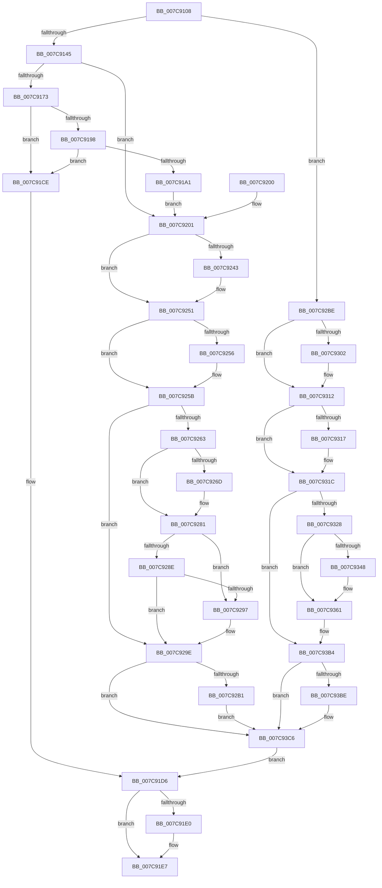

# SLGetSubscriptionPfn

- RVA: `0x007C9108`–`0x007C93E6` (길이 `734` bytes)
- VA: `0x00000001407C9108`
- 실행 섹션: `PAGE`
- PDB 이름 있음: `예`; PDB Function 태그: `아니요`
- unwind 정보 RVA: `0x000D4ED8`
- 디코드: `180`개 명령, `734/734` bytes 표시
- 미해석 바이트: `0` (있으면 어셈블리에 `.byte`로 보존)

> 이 문서는 커널 이미지의 기계어와 PDB 기호를 분석해 생성했습니다. 4번과 5번은 함수 원형과 자료형을 바이너리 사용 방식에서 추정한 C 해석이며 원본 소스 복구 결과는 아닙니다.

## 1. Dependencies

- 직접 호출 지점: **15**; 고유 호출 대상: **12**
- 직접 호출자로 확인된 함수: **1**
- RIP 상대 이미지 참조: **2**

### Outgoing calls
- `0x007C915F` → [sub_004BA83C](../../text/4B/Unknown_function_004BA83C.md) (function, `0x004BA83C`)
- `0x007C9189` → [ExAllocatePool2](../../poolcode/B8/ExAllocatePool2_function_00B820F0.md) (function, `0x00B820F0`)
- `0x007C91C3` → [sub_004BA83C](../../text/4B/Unknown_function_004BA83C.md) (function, `0x004BA83C`)
- `0x007C91E2` → [ExFreePoolWithTag](../../poolcode/B8/ExFreePoolWithTag_function_00B82870.md) (function, `0x00B82870`)
- `0x007C9233` → [KeAbPreAcquire](../../text/21/KeAbPreAcquire_function_00210230.md) (function, `0x00210230`)
- `0x007C924C` → [ExfAcquirePushLockExclusiveEx](../../text/20/ExfAcquirePushLockExclusiveEx_function_0020FC90.md) (function, `0x0020FC90`)
- `0x007C927C` → [memcpy](../../text/6C/memcpy_function_006C6840.md) (function, `0x006C6840`)
- `0x007C92B4` → [ExfTryToWakePushLock](../../text/26/ExfTryToWakePushLock_function_00265DD0.md) (function, `0x00265DD0`)
- `0x007C92ED` → [KeAbPreAcquire](../../text/21/KeAbPreAcquire_function_00210230.md) (function, `0x00210230`)
- `0x007C930D` → [ExfAcquirePushLockSharedEx](../../text/21/ExfAcquirePushLockSharedEx_function_0021044C.md) (function, `0x0021044C`)
- `0x007C9336` → [ExAllocatePool2](../../poolcode/B8/ExAllocatePool2_function_00B820F0.md) (function, `0x00B820F0`)
- `0x007C935C` → [local_unwind](../../text/4F/local_unwind_function_004FFB40.md) (function, `0x004FFB40`)
- `0x007C93C1` → [ExfReleasePushLockShared](../../text/26/ExfReleasePushLockShared_function_00263440.md) (function, `0x00263440`)
- `0x007C93C9` → [KeAbPostRelease](../../text/2E/KeAbPostRelease_function_002E1600.md) (function, `0x002E1600`)
- `0x007C93CE` → [KeLeaveCriticalRegion](../../text/25/KeLeaveCriticalRegion_function_0025D8B0.md) (function, `0x0025D8B0`)

### Direct callers
- [SLQueryLicenseValueInternal](SLQueryLicenseValueInternal_function_007C93EC.md) at `0x007C9947`

### Static image references
- `0x007C9158` → RVA `0x00B4B500` (`PAGE`; read)
- `0x007C9350` → RVA `0x007C91D6` (`PAGE`; read)

## 2. Other-region calls and transfers

- 다른 실행 섹션으로 향하는 call: **15**
  - `0x007C915F` → [sub_004BA83C](../../text/4B/Unknown_function_004BA83C.md) (`PAGE` → `.text`)
  - `0x007C9189` → [ExAllocatePool2](../../poolcode/B8/ExAllocatePool2_function_00B820F0.md) (`PAGE` → `POOLCODE`)
  - `0x007C91C3` → [sub_004BA83C](../../text/4B/Unknown_function_004BA83C.md) (`PAGE` → `.text`)
  - `0x007C91E2` → [ExFreePoolWithTag](../../poolcode/B8/ExFreePoolWithTag_function_00B82870.md) (`PAGE` → `POOLCODE`)
  - `0x007C9233` → [KeAbPreAcquire](../../text/21/KeAbPreAcquire_function_00210230.md) (`PAGE` → `.text`)
  - `0x007C924C` → [ExfAcquirePushLockExclusiveEx](../../text/20/ExfAcquirePushLockExclusiveEx_function_0020FC90.md) (`PAGE` → `.text`)
  - `0x007C927C` → [memcpy](../../text/6C/memcpy_function_006C6840.md) (`PAGE` → `.text`)
  - `0x007C92B4` → [ExfTryToWakePushLock](../../text/26/ExfTryToWakePushLock_function_00265DD0.md) (`PAGE` → `.text`)
  - `0x007C92ED` → [KeAbPreAcquire](../../text/21/KeAbPreAcquire_function_00210230.md) (`PAGE` → `.text`)
  - `0x007C930D` → [ExfAcquirePushLockSharedEx](../../text/21/ExfAcquirePushLockSharedEx_function_0021044C.md) (`PAGE` → `.text`)
  - `0x007C9336` → [ExAllocatePool2](../../poolcode/B8/ExAllocatePool2_function_00B820F0.md) (`PAGE` → `POOLCODE`)
  - `0x007C935C` → [local_unwind](../../text/4F/local_unwind_function_004FFB40.md) (`PAGE` → `.text`)
  - `0x007C93C1` → [ExfReleasePushLockShared](../../text/26/ExfReleasePushLockShared_function_00263440.md) (`PAGE` → `.text`)
  - `0x007C93C9` → [KeAbPostRelease](../../text/2E/KeAbPostRelease_function_002E1600.md) (`PAGE` → `.text`)
  - `0x007C93CE` → [KeLeaveCriticalRegion](../../text/25/KeLeaveCriticalRegion_function_0025D8B0.md) (`PAGE` → `.text`)
- 별도 외부 분기/꼬리 이동을 확인하지 못했습니다.

## 3. Assembly (complete function range)

```asm
007C9108  48 8B C4                        mov rax, rsp
007C910B  48 89 58 10                     mov qword ptr [rax + 0x10], rbx
007C910F  48 89 48 08                     mov qword ptr [rax + 8], rcx
007C9113  56                              push rsi
007C9114  57                              push rdi
007C9115  41 54                           push r12
007C9117  41 56                           push r14
007C9119  41 57                           push r15
007C911B  48 83 EC 60                     sub rsp, 0x60
007C911F  48 89 64 24 50                  mov qword ptr [rsp + 0x50], rsp
007C9124  4C 8B E2                        mov r12, rdx
007C9127  48 8B F1                        mov rsi, rcx
007C912A  33 DB                           xor ebx, ebx
007C912C  89 58 A8                        mov dword ptr [rax - 0x58], ebx
007C912F  48 89 58 B0                     mov qword ptr [rax - 0x50], rbx
007C9133  44 8B F3                        mov r14d, ebx
007C9136  89 58 18                        mov dword ptr [rax + 0x18], ebx
007C9139  38 99 08 B7 00 00               cmp byte ptr [rcx + 0xb708], bl
007C913F  0F 85 79 01 00 00               jne 0x1407c92be
007C9145  48 8D 40 18                     lea rax, [rax + 0x18]
007C9149  48 89 44 24 28                  mov qword ptr [rsp + 0x28], rax
007C914E  89 5C 24 20                     mov dword ptr [rsp + 0x20], ebx
007C9152  45 33 C9                        xor r9d, r9d
007C9155  45 33 C0                        xor r8d, r8d
007C9158  48 8D 15 A1 23 38 00            lea rdx, [rip + 0x3823a1]
007C915F  E8 D8 16 CF FF                  call 0x1404ba83c
007C9164  89 44 24 30                     mov dword ptr [rsp + 0x30], eax
007C9168  3D 23 00 00 C0                  cmp eax, 0xc0000023
007C916D  0F 85 8E 00 00 00               jne 0x1407c9201
007C9173  44 8B B4 24 A0 00 00 00         mov r14d, dword ptr [rsp + 0xa0]
007C917B  41 8B D6                        mov edx, r14d
007C917E  B9 00 01 00 00                  mov ecx, 0x100
007C9183  41 B8 53 4C 53 20               mov r8d, 0x20534c53
007C9189  E8 62 8F 3B 00                  call 0x140b820f0
007C918E  48 89 44 24 38                  mov qword ptr [rsp + 0x38], rax
007C9193  48 85 C0                        test rax, rax
007C9196  74 36                           je 0x1407c91ce
007C9198  41 81 FE 82 00 00 00            cmp r14d, 0x82
007C919F  77 2D                           ja 0x1407c91ce
007C91A1  48 8D 8C 24 A0 00 00 00         lea rcx, [rsp + 0xa0]
007C91A9  48 89 4C 24 28                  mov qword ptr [rsp + 0x28], rcx
007C91AE  44 89 74 24 20                  mov dword ptr [rsp + 0x20], r14d
007C91B3  4C 8B C8                        mov r9, rax
007C91B6  45 33 C0                        xor r8d, r8d
007C91B9  48 8D 15 40 23 38 00            lea rdx, [rip + 0x382340]
007C91C0  48 8B CE                        mov rcx, rsi
007C91C3  E8 74 16 CF FF                  call 0x1404ba83c
007C91C8  89 44 24 30                     mov dword ptr [rsp + 0x30], eax
007C91CC  EB 33                           jmp 0x1407c9201
007C91CE  C7 44 24 30 E5 00 00 C0         mov dword ptr [rsp + 0x30], 0xc00000e5
007C91D6  48 8B 4C 24 38                  mov rcx, qword ptr [rsp + 0x38]
007C91DB  48 85 C9                        test rcx, rcx
007C91DE  74 07                           je 0x1407c91e7
007C91E0  33 D2                           xor edx, edx
007C91E2  E8 89 96 3B 00                  call 0x140b82870
007C91E7  8B 44 24 30                     mov eax, dword ptr [rsp + 0x30]
007C91EB  48 8B 9C 24 98 00 00 00         mov rbx, qword ptr [rsp + 0x98]
007C91F3  48 83 C4 60                     add rsp, 0x60
007C91F7  41 5F                           pop r15
007C91F9  41 5E                           pop r14
007C91FB  41 5C                           pop r12
007C91FD  5F                              pop rdi
007C91FE  5E                              pop rsi
007C91FF  C3                              ret
007C9200  CC                              int3
007C9201  65 48 8B 0C 25 88 01 00 00      mov rcx, qword ptr gs:[0x188]
007C920A  48 89 8C 24 A8 00 00 00         mov qword ptr [rsp + 0xa8], rcx
007C9212  0F B7 81 E4 01 00 00            movzx eax, word ptr [rcx + 0x1e4]
007C9219  66 FF C8                        dec ax
007C921C  66 89 81 E4 01 00 00            mov word ptr [rcx + 0x1e4], ax
007C9223  90                              nop
007C9224  48 8D BE F8 B6 00 00            lea rdi, [rsi + 0xb6f8]
007C922B  45 33 C0                        xor r8d, r8d
007C922E  33 D2                           xor edx, edx
007C9230  48 8B CF                        mov rcx, rdi
007C9233  E8 F8 6F A4 FF                  call 0x140210230
007C9238  4C 8B F8                        mov r15, rax
007C923B  F0 48 0F BA 2F 00               lock bts qword ptr [rdi], 0
007C9241  73 0E                           jae 0x1407c9251
007C9243  4C 8B C7                        mov r8, rdi
007C9246  48 8B D0                        mov rdx, rax
007C9249  48 8B CF                        mov rcx, rdi
007C924C  E8 3F 6A A4 FF                  call 0x14020fc90
007C9251  4D 85 FF                        test r15, r15
007C9254  74 05                           je 0x1407c925b
007C9256  41 C6 47 0A 01                  mov byte ptr [r15 + 0xa], 1
007C925B  38 9E 08 B7 00 00               cmp byte ptr [rsi + 0xb708], bl
007C9261  75 3B                           jne 0x1407c929e
007C9263  44 8B 7C 24 30                  mov r15d, dword ptr [rsp + 0x30]
007C9268  45 85 FF                        test r15d, r15d
007C926B  78 14                           js 0x1407c9281
007C926D  45 8B C6                        mov r8d, r14d
007C9270  48 8D 8E 0A B7 00 00            lea rcx, [rsi + 0xb70a]
007C9277  48 8B 54 24 38                  mov rdx, qword ptr [rsp + 0x38]
007C927C  E8 BF D5 EF FF                  call 0x1406c6840
007C9281  B9 00 00 00 80                  mov ecx, 0x80000000
007C9286  41 8D 04 0F                     lea eax, [r15 + rcx]
007C928A  85 C1                           test ecx, eax
007C928C  75 09                           jne 0x1407c9297
007C928E  41 81 FF 34 00 00 C0            cmp r15d, 0xc0000034
007C9295  75 07                           jne 0x1407c929e
007C9297  C6 86 08 B7 00 00 01            mov byte ptr [rsi + 0xb708], 1
007C929E  48 83 C8 FF                     or rax, 0xffffffffffffffff
007C92A2  F0 48 0F C1 07                  lock xadd qword ptr [rdi], rax
007C92A7  24 06                           and al, 6
007C92A9  3C 02                           cmp al, 2
007C92AB  0F 85 15 01 00 00               jne 0x1407c93c6
007C92B1  48 8B CF                        mov rcx, rdi
007C92B4  E8 17 CB A9 FF                  call 0x140265dd0
007C92B9  E9 08 01 00 00                  jmp 0x1407c93c6
007C92BE  65 48 8B 0C 25 88 01 00 00      mov rcx, qword ptr gs:[0x188]
007C92C7  48 89 4C 24 40                  mov qword ptr [rsp + 0x40], rcx
007C92CC  0F B7 81 E4 01 00 00            movzx eax, word ptr [rcx + 0x1e4]
007C92D3  66 FF C8                        dec ax
007C92D6  66 89 81 E4 01 00 00            mov word ptr [rcx + 0x1e4], ax
007C92DD  90                              nop
007C92DE  48 8D BE F8 B6 00 00            lea rdi, [rsi + 0xb6f8]
007C92E5  45 33 C0                        xor r8d, r8d
007C92E8  33 D2                           xor edx, edx
007C92EA  48 8B CF                        mov rcx, rdi
007C92ED  E8 3E 6F A4 FF                  call 0x140210230
007C92F2  4C 8B F0                        mov r14, rax
007C92F5  33 C0                           xor eax, eax
007C92F7  44 8D 78 11                     lea r15d, [rax + 0x11]
007C92FB  F0 4C 0F B1 3F                  lock cmpxchg qword ptr [rdi], r15
007C9300  74 10                           je 0x1407c9312
007C9302  4C 8B CF                        mov r9, rdi
007C9305  4D 8B C6                        mov r8, r14
007C9308  33 D2                           xor edx, edx
007C930A  48 8B CF                        mov rcx, rdi
007C930D  E8 3A 71 A4 FF                  call 0x14021044c
007C9312  4D 85 F6                        test r14, r14
007C9315  74 05                           je 0x1407c931c
007C9317  41 C6 46 0A 01                  mov byte ptr [r14 + 0xa], 1
007C931C  38 9E 08 B7 00 00               cmp byte ptr [rsi + 0xb708], bl
007C9322  0F 84 8C 00 00 00               je 0x1407c93b4
007C9328  BA 82 00 00 00                  mov edx, 0x82
007C932D  8D 4A 7E                        lea ecx, [rdx + 0x7e]
007C9330  41 B8 53 4C 53 20               mov r8d, 0x20534c53
007C9336  E8 B5 8D 3B 00                  call 0x140b820f0
007C933B  48 8B C8                        mov rcx, rax
007C933E  48 89 44 24 38                  mov qword ptr [rsp + 0x38], rax
007C9343  48 85 C0                        test rax, rax
007C9346  75 19                           jne 0x1407c9361
007C9348  C7 44 24 30 E5 00 00 C0         mov dword ptr [rsp + 0x30], 0xc00000e5
007C9350  48 8D 15 7F FE FF FF            lea rdx, [rip - 0x181]
007C9357  48 8B 4C 24 50                  mov rcx, qword ptr [rsp + 0x50]
007C935C  E8 DF 67 D3 FF                  call 0x1404ffb40
007C9361  48 8D 86 0A B7 00 00            lea rax, [rsi + 0xb70a]
007C9368  0F 10 00                        movups xmm0, xmmword ptr [rax]
007C936B  0F 11 01                        movups xmmword ptr [rcx], xmm0
007C936E  0F 10 48 10                     movups xmm1, xmmword ptr [rax + 0x10]
007C9372  0F 11 49 10                     movups xmmword ptr [rcx + 0x10], xmm1
007C9376  0F 10 40 20                     movups xmm0, xmmword ptr [rax + 0x20]
007C937A  0F 11 41 20                     movups xmmword ptr [rcx + 0x20], xmm0
007C937E  0F 10 48 30                     movups xmm1, xmmword ptr [rax + 0x30]
007C9382  0F 11 49 30                     movups xmmword ptr [rcx + 0x30], xmm1
007C9386  0F 10 40 40                     movups xmm0, xmmword ptr [rax + 0x40]
007C938A  0F 11 41 40                     movups xmmword ptr [rcx + 0x40], xmm0
007C938E  0F 10 48 50                     movups xmm1, xmmword ptr [rax + 0x50]
007C9392  0F 11 49 50                     movups xmmword ptr [rcx + 0x50], xmm1
007C9396  0F 10 40 60                     movups xmm0, xmmword ptr [rax + 0x60]
007C939A  0F 11 41 60                     movups xmmword ptr [rcx + 0x60], xmm0
007C939E  BA 80 00 00 00                  mov edx, 0x80
007C93A3  0F 10 40 70                     movups xmm0, xmmword ptr [rax + 0x70]
007C93A7  0F 11 44 11 F0                  movups xmmword ptr [rcx + rdx - 0x10], xmm0
007C93AC  0F B7 04 10                     movzx eax, word ptr [rax + rdx]
007C93B0  66 89 04 11                     mov word ptr [rcx + rdx], ax
007C93B4  49 8B C7                        mov rax, r15
007C93B7  F0 48 0F B1 1F                  lock cmpxchg qword ptr [rdi], rbx
007C93BC  74 08                           je 0x1407c93c6
007C93BE  48 8B CF                        mov rcx, rdi
007C93C1  E8 7A A0 A9 FF                  call 0x140263440
007C93C6  48 8B CF                        mov rcx, rdi
007C93C9  E8 32 82 B1 FF                  call 0x1402e1600
007C93CE  E8 DD 44 A9 FF                  call 0x14025d8b0
007C93D3  48 8B 44 24 38                  mov rax, qword ptr [rsp + 0x38]
007C93D8  49 89 04 24                     mov qword ptr [r12], rax
007C93DC  48 89 5C 24 38                  mov qword ptr [rsp + 0x38], rbx
007C93E1  E9 F0 FD FF FF                  jmp 0x1407c91d6
```

## 4. C-style interpretation (structured pseudocode)

```c
__int64 __fastcall SLGetSubscriptionPfn(__int64 a1, __int64 a2, int a3, int a4)
{
    __int64 result;
    __int64 v_rbx;
    __int64 v_rsp;
    unsigned __int64 v_stack_m38;
    unsigned __int64 v_stack_m50;
    unsigned int v_stack_m58;
    unsigned __int64 v_stack_m60;
    unsigned int v_stack_m68;
    unsigned __int64 v_stack_p10;
    unsigned int v_stack_p18;
    unsigned int v_stack_p30;
    unsigned __int64 v_stack_p38;
    unsigned __int64 v_stack_p40;
    unsigned __int64 v_stack_p50;
    unsigned __int64 v_stack_pA8;

    *(unsigned __int64 *)(v_rsp + 16) = v_rbx;
    *(unsigned __int64 *)(v_rsp + 8) = a1;
    v_rsp = (v_rsp) - (96);
    v_stack_m38 = v_rsp;
    v_rbx = 0;
    *(unsigned int *)(v_rsp - 88) = 0;
    *(unsigned __int64 *)(v_rsp - 80) = 0;
    *(unsigned int *)(v_rsp + 24) = 0;
    if ((*(unsigned __int8 *)(a1 + 46856)) != 0) goto loc_007C92BE;
    v_stack_m60 = v_rsp + 24;
    v_stack_m68 = 0;
    a4 = 0;
    a3 = 0;
    result = sub_004BA83C(a1, v_rip + 3679137, a3, a4);
    v_stack_m58 = (unsigned int)(result);
    if (((unsigned int)(result)) != 0xC0000023ULL) goto loc_007C9201;
    result = ExAllocatePool2(256, (unsigned int)((unsigned int)((unsigned int)(v_stack_p18))), (unsigned int)(0x20534C53ULL), a4);
    v_stack_m50 = result;
    if (result == 0) goto loc_007C91CE;
    if (((unsigned int)((unsigned int)(v_stack_p18))) > 130) goto loc_007C91CE;
    v_stack_m60 = v_stack_p18;
    v_stack_m68 = (unsigned int)((unsigned int)(v_stack_p18));
    a3 = 0;
    result = sub_004BA83C(a1, v_rip + 3679040, a3, result);
    v_stack_m58 = (unsigned int)(result);
    goto loc_007C9201;
loc_007C91CE:
    v_stack_m58 = 0xC00000E5ULL;
loc_007C91D6:
    if (v_stack_m50 != 0) {
        a2 = 0;
        result = ExFreePoolWithTag(v_stack_m50, a2, a3, result);
    }
    v_rsp = (v_rsp) + (96);
    return (unsigned int)(v_stack_m58);
loc_007C9201:
    v_stack_pA8 = *(unsigned __int64 *)(gs_base + (0 + 392));
    result = (unsigned __int16)((*(unsigned __int16 *)(*(unsigned __int64 *)(gs_base + (0 + 392)) + 484)) - 1);
    *(unsigned __int16 *)(*(unsigned __int64 *)(gs_base + (0 + 392)) + 484) = (unsigned __int16)(result);
    a3 = 0;
    a2 = 0;
    result = KeAbPreAcquire(a1 + 46840, a2, a3, result);
    if (!(condition_is_above_or_equal)) {
        a3 = a1 + 46840;
        a2 = result;
        a1 = a1 + 46840;
        result = ExfAcquirePushLockExclusiveEx(a1, a2, a3, result);
    }
    if (result != 0) {
        *(unsigned __int8 *)(result + 10) = 1;
    }
    if ((*(unsigned __int8 *)(a1 + 46856)) != ((unsigned __int8)(v_stack_p10))) goto loc_007C929E;
    if (!(sign_flag)) {
        a3 = (unsigned int)((unsigned int)(v_stack_p18));
        a1 = a1 + 46858;
        a2 = v_stack_p38;
        result = memcpy(a1, a2, a3, result);
    }
    if ((((unsigned int)((unsigned int)(0x80000000ULL))) & ((unsigned int)((unsigned int)(v_stack_p30) + (unsigned int)(0x80000000ULL) * 1))) != 0) goto loc_007C9297;
    if (((unsigned int)((unsigned int)(v_stack_p30))) == 0xC0000034ULL) {
        *(unsigned __int8 *)(a1 + 46856) = 1;
    }
    result = ((unsigned int)(v_stack_p30) + (unsigned int)(0x80000000ULL) * 1) | (-1);
    result = (unsigned __int8)((result) & (6));
    if (((unsigned __int8)(result)) != 2) goto loc_007C93C6;
    result = ExfTryToWakePushLock(a1 + 46840, a2, a3, result);
    goto loc_007C93C6;
loc_007C92BE:
    v_stack_p40 = *(unsigned __int64 *)(gs_base + (0 + 392));
    result = (unsigned __int16)((*(unsigned __int16 *)(*(unsigned __int64 *)(gs_base + (0 + 392)) + 484)) - 1);
    *(unsigned __int16 *)(*(unsigned __int64 *)(gs_base + (0 + 392)) + 484) = (unsigned __int16)(result);
    a3 = 0;
    a2 = 0;
    result = KeAbPreAcquire(a1 + 46840, a2, a3, result);
    result = 0;
    if (!(condition_is_equal)) {
        a4 = a1 + 46840;
        a3 = 0;
        a2 = 0;
        a1 = a1 + 46840;
        result = ExfAcquirePushLockSharedEx(a1, a2, a3, a4);
    }
    if (result != 0) {
        *(unsigned __int8 *)(result + 10) = 1;
    }
    if ((*(unsigned __int8 *)(a1 + 46856)) == ((unsigned __int8)(v_stack_p10))) goto loc_007C93B4;
    result = ExAllocatePool2(130 + 126, 130, (unsigned int)(0x20534C53ULL), a4);
    v_stack_p38 = result;
    if (result == 0) {
        v_stack_p30 = 0xC00000E5ULL;
        a2 = v_rip - 385;
        a1 = v_stack_p50;
        result = local_unwind(a1, a2, (unsigned int)(0x20534C53ULL), a4);
    }
    *(unsigned __int64 *)(a1) = v_xmm0;
    *(unsigned __int64 *)(a1 + 16) = v_xmm1;
    *(unsigned __int64 *)(a1 + 32) = v_xmm0;
    *(unsigned __int64 *)(a1 + 48) = v_xmm1;
    *(unsigned __int64 *)(a1 + 64) = v_xmm0;
    *(unsigned __int64 *)(a1 + 80) = v_xmm1;
    *(unsigned __int64 *)(a1 + 96) = v_xmm0;
    *(unsigned __int64 *)(a1 + 128 * 1 - 16) = v_xmm0;
    *(unsigned __int16 *)(a1 + 128 * 1) = (unsigned __int16)(*(unsigned __int16 *)(a1 + 46858 + 128 * 1));
loc_007C93B4:
    result = result + 17;
    if (result != 0) {
        a1 = a1 + 46840;
        result = ExfReleasePushLockShared(a1, 128, (unsigned int)(0x20534C53ULL), a4);
    }
    result = KeAbPostRelease(a1 + 46840, 128, (unsigned int)(0x20534C53ULL), a4);
    result = KeLeaveCriticalRegion(a1 + 46840, 128, (unsigned int)(0x20534C53ULL), a4);
    *(unsigned __int64 *)(a2) = v_stack_p38;
    v_stack_p38 = v_stack_p10;
    goto loc_007C91D6;
}
```

## 5. (Beta) C Style

```c
int64_t SLGetSubscriptionPfn(void *Arg1, void *Arg2, int32_t Arg3, int32_t Arg4)
{
    uint8_t *arg1 = (uint8_t *)Arg1;
    uint8_t *arg2 = (uint8_t *)Arg2;

    int64_t result;
    int64_t local_rbx;
    int64_t local_rsp;
    uint64_t v_stack_m38;
    uint64_t v_stack_m50;
    uint32_t v_stack_m58;
    uint64_t v_stack_m60;
    uint32_t v_stack_m68;
    uint64_t v_stack_p10;
    uint32_t v_stack_p18;
    uint32_t v_stack_p30;
    uint64_t v_stack_p38;
    uint64_t v_stack_p40;
    uint64_t v_stack_p50;
    uint64_t v_stack_pA8;

    *(uint64_t *)(local_rsp + 0x10) = local_rbx;
    *(void **)(local_rsp + 0x8) = Arg1;
    local_rsp = (local_rsp) - (96);
    v_stack_m38 = local_rsp;
    local_rbx = 0;
    *(uint32_t *)(local_rsp - 0x58) = 0;
    *(uint64_t *)(local_rsp - 0x50) = 0;
    *(uint32_t *)(local_rsp + 0x18) = 0;
    if ((*(uint8_t *)(arg1 + 0xB708)) != 0) goto loc_007C92BE;
    v_stack_m60 = local_rsp + 24;
    v_stack_m68 = 0;
    Arg4 = 0;
    Arg3 = 0;
    result = sub_004BA83C(Arg1, v_rip + 3679137, Arg3, Arg4);
    v_stack_m58 = (uint32_t)(result);
    if (((uint32_t)(result)) != 0xC0000023ULL) goto loc_007C9201;
    result = ExAllocatePool2(256, (uint32_t)((uint32_t)((uint32_t)(v_stack_p18))), (uint32_t)(0x20534C53ULL), Arg4);
    v_stack_m50 = result;
    if (result == 0) goto loc_007C91CE;
    if (((uint32_t)((uint32_t)(v_stack_p18))) > 130) goto loc_007C91CE;
    v_stack_m60 = v_stack_p18;
    v_stack_m68 = (uint32_t)((uint32_t)(v_stack_p18));
    Arg3 = 0;
    result = sub_004BA83C(Arg1, v_rip + 3679040, Arg3, result);
    v_stack_m58 = (uint32_t)(result);
    goto loc_007C9201;
loc_007C91CE:
    v_stack_m58 = 0xC00000E5ULL;
loc_007C91D6:
    if (v_stack_m50 != 0) {
        Arg2 = 0;
        result = ExFreePoolWithTag(v_stack_m50, Arg2, Arg3, result);
    }
    local_rsp = (local_rsp) + (96);
    return (uint32_t)(v_stack_m58);
loc_007C9201:
    v_stack_pA8 = *(uint64_t *)(gs_base + (0 + 0x188));
    result = (uint16_t)((*(uint16_t *)(*(uint64_t *)(gs_base + (0 + 0x188)) + 0x1E4)) - 1);
    *(uint16_t *)(*(uint64_t *)(gs_base + (0 + 0x188)) + 0x1E4) = (uint16_t)(result);
    Arg3 = 0;
    Arg2 = 0;
    result = KeAbPreAcquire(Arg1 + 46840, Arg2, Arg3, result);
    if (!(condition_is_above_or_equal)) {
        Arg3 = Arg1 + 46840;
        Arg2 = result;
        Arg1 = Arg1 + 46840;
        result = ExfAcquirePushLockExclusiveEx(Arg1, Arg2, Arg3, result);
    }
    if (result != 0) {
        *(uint8_t *)(result + 0xA) = 1;
    }
    if ((*(uint8_t *)(arg1 + 0xB708)) != ((uint8_t)(v_stack_p10))) goto loc_007C929E;
    if (!(sign_flag)) {
        Arg3 = (uint32_t)((uint32_t)(v_stack_p18));
        Arg1 = Arg1 + 46858;
        Arg2 = v_stack_p38;
        result = memcpy(Arg1, Arg2, Arg3, result);
    }
    if ((((uint32_t)((uint32_t)(0x80000000ULL))) & ((uint32_t)((uint32_t)(v_stack_p30) + (uint32_t)(0x80000000ULL) * 1))) != 0) goto loc_007C9297;
    if (((uint32_t)((uint32_t)(v_stack_p30))) == 0xC0000034ULL) {
        *(uint8_t *)(arg1 + 0xB708) = 1;
    }
    result = ((uint32_t)(v_stack_p30) + (uint32_t)(0x80000000ULL) * 1) | (-1);
    result = (uint8_t)((result) & (6));
    if (((uint8_t)(result)) != 2) goto loc_007C93C6;
    result = ExfTryToWakePushLock(Arg1 + 46840, Arg2, Arg3, result);
    goto loc_007C93C6;
loc_007C92BE:
    v_stack_p40 = *(uint64_t *)(gs_base + (0 + 0x188));
    result = (uint16_t)((*(uint16_t *)(*(uint64_t *)(gs_base + (0 + 0x188)) + 0x1E4)) - 1);
    *(uint16_t *)(*(uint64_t *)(gs_base + (0 + 0x188)) + 0x1E4) = (uint16_t)(result);
    Arg3 = 0;
    Arg2 = 0;
    result = KeAbPreAcquire(Arg1 + 46840, Arg2, Arg3, result);
    result = 0;
    if (!(condition_is_equal)) {
        Arg4 = Arg1 + 46840;
        Arg3 = 0;
        Arg2 = 0;
        Arg1 = Arg1 + 46840;
        result = ExfAcquirePushLockSharedEx(Arg1, Arg2, Arg3, Arg4);
    }
    if (result != 0) {
        *(uint8_t *)(result + 0xA) = 1;
    }
    if ((*(uint8_t *)(arg1 + 0xB708)) == ((uint8_t)(v_stack_p10))) goto loc_007C93B4;
    result = ExAllocatePool2(130 + 126, 130, (uint32_t)(0x20534C53ULL), Arg4);
    v_stack_p38 = result;
    if (result == 0) {
        v_stack_p30 = 0xC00000E5ULL;
        Arg2 = v_rip - 385;
        Arg1 = v_stack_p50;
        result = local_unwind(Arg1, Arg2, (uint32_t)(0x20534C53ULL), Arg4);
    }
    *(uint64_t *)(arg1) = v_xmm0;
    *(uint64_t *)(arg1 + 0x10) = v_xmm1;
    *(uint64_t *)(arg1 + 0x20) = v_xmm0;
    *(uint64_t *)(arg1 + 0x30) = v_xmm1;
    *(uint64_t *)(arg1 + 0x40) = v_xmm0;
    *(uint64_t *)(arg1 + 0x50) = v_xmm1;
    *(uint64_t *)(arg1 + 0x60) = v_xmm0;
    *(uint64_t *)(arg1 + 0x80 * 1 - 0x10) = v_xmm0;
    *(uint16_t *)(arg1 + 0x80 * 1) = (uint16_t)(*(uint16_t *)(arg1 + 0xB70A + 0x80 * 1));
loc_007C93B4:
    result = result + 17;
    if (result != 0) {
        Arg1 = Arg1 + 46840;
        result = ExfReleasePushLockShared(Arg1, 128, (uint32_t)(0x20534C53ULL), Arg4);
    }
    result = KeAbPostRelease(Arg1 + 46840, 128, (uint32_t)(0x20534C53ULL), Arg4);
    result = KeLeaveCriticalRegion(Arg1 + 46840, 128, (uint32_t)(0x20534C53ULL), Arg4);
    *(uint64_t *)(arg2) = v_stack_p38;
    v_stack_p38 = v_stack_p10;
    goto loc_007C91D6;
}
```

### 관측된 메모리 오프셋

구조체 형식이 확인되지 않은 접근은 인자 기준의 오프셋으로만 기록했습니다.

| 기준 인자 | 오프셋 표현 | 폭 (bit) | 접근 |
|---|---:|---:|---|
| `Arg1` | `+ 0x0` | `64` | `R` |
| `Arg1` | `+ 0x0` | `64` | `R/W` |
| `Arg1` | `+ 0x0` | `128` | `R` |
| `Arg1` | `+ 0x0 + rdx*1` | `16` | `R` |
| `Arg1` | `+ 0x10` | `128` | `R` |
| `Arg1` | `+ 0x20` | `128` | `R` |
| `Arg1` | `+ 0x30` | `128` | `R` |
| `Arg1` | `+ 0x40` | `128` | `R` |
| `Arg1` | `+ 0x50` | `128` | `R` |
| `Arg1` | `+ 0x60` | `128` | `R` |
| `Arg1` | `+ 0x70` | `128` | `R` |
| `Arg1` | `+ 0xB6F8` | `64` | `R` |
| `Arg1` | `+ 0xB708` | `8` | `R` |
| `Arg1` | `+ 0xB708` | `8` | `W` |
| `Arg1` | `+ 0xB70A` | `64` | `R` |
| `Arg2` | `+ 0x0` | `64` | `W` |

## 6. Execution-region graph

[열기: 2D/3D 그래프와 함수 탐색 컨트롤 패널](../../../control-panel.html?section=page&rva=0x007C9108&view=graph)

- 2D 그래프는 위에서 아래로 흐르고, 3D 그래프는 빈 공간을 드래그해 회전합니다. Shift+드래그는 이동, 휠은 확대·축소, 함수 노드 선택은 대상 보고서 이동입니다.

### Static fallback


