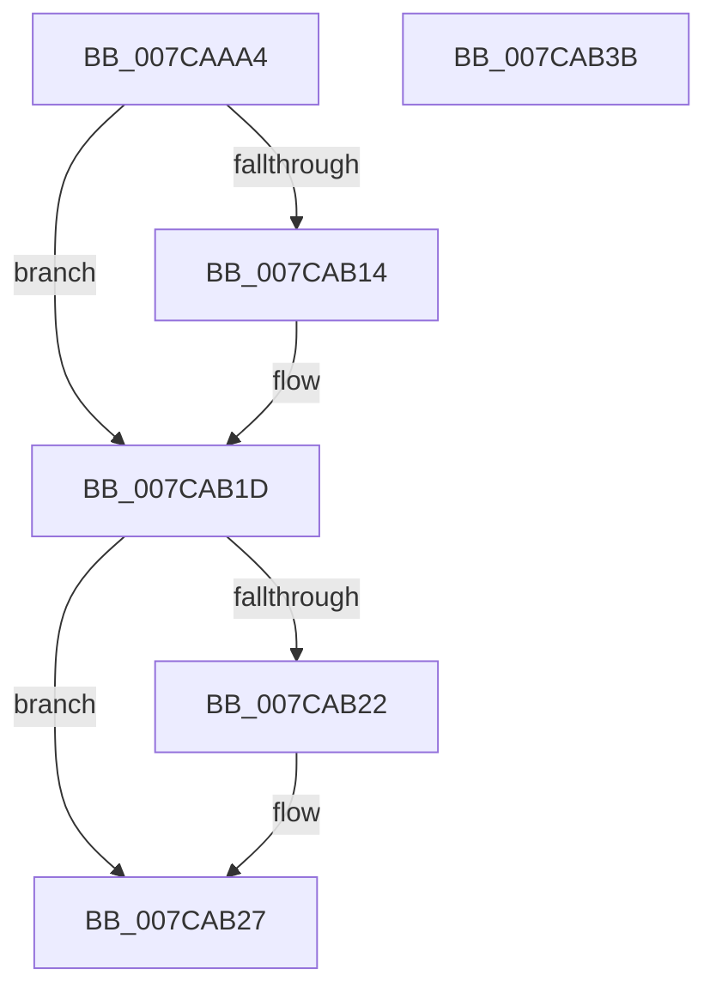

# SpRegOpenKey

- RVA: `0x007CAAA4`–`0x007CAB3C` (길이 `152` bytes)
- VA: `0x00000001407CAAA4`
- 실행 섹션: `PAGE`
- PDB 이름 있음: `예`; PDB Function 태그: `아니요`
- unwind 정보 RVA: `0x000D4DD4`
- 디코드: `42`개 명령, `152/152` bytes 표시
- 미해석 바이트: `0` (있으면 어셈블리에 `.byte`로 보존)

> 이 문서는 커널 이미지의 기계어와 PDB 기호를 분석해 생성했습니다. 4번과 5번은 함수 원형과 자료형을 바이너리 사용 방식에서 추정한 C 해석이며 원본 소스 복구 결과는 아닙니다.

## 1. Dependencies

- 직접 호출 지점: **2**; 고유 호출 대상: **2**
- 직접 호출자로 확인된 함수: **1**
- RIP 상대 이미지 참조: **0**

### Outgoing calls
- `0x007CAB05` → [ZwCreateKey](../../text/6A/ZwCreateKey_function_006AD470.md) (function, `0x006AD470`)
- `0x007CAB22` → [ZwClose](../../text/6A/ZwClose_function_006AD2B0.md) (function, `0x006AD2B0`)

### Direct callers
- [SpRegOpenRedirectedKey](SpRegOpenRedirectedKey_function_007CAB44.md) at `0x007CAC0F`

### Static image references
- 디코드된 RIP-relative 메모리 참조가 없습니다.

## 2. Other-region calls and transfers

- 다른 실행 섹션으로 향하는 call: **2**
  - `0x007CAB05` → [ZwCreateKey](../../text/6A/ZwCreateKey_function_006AD470.md) (`PAGE` → `.text`)
  - `0x007CAB22` → [ZwClose](../../text/6A/ZwClose_function_006AD2B0.md) (`PAGE` → `.text`)
- 별도 외부 분기/꼬리 이동을 확인하지 못했습니다.

## 3. Assembly (complete function range)

```asm
007CAAA4  48 8B C4                        mov rax, rsp
007CAAA7  48 89 58 10                     mov qword ptr [rax + 0x10], rbx
007CAAAB  48 89 78 18                     mov qword ptr [rax + 0x18], rdi
007CAAAF  55                              push rbp
007CAAB0  48 8B EC                        mov rbp, rsp
007CAAB3  48 83 EC 70                     sub rsp, 0x70
007CAAB7  48 83 60 B8 00                  and qword ptr [rax - 0x48], 0
007CAABC  4C 8D 45 D0                     lea r8, [rbp - 0x30]
007CAAC0  83 60 B0 00                     and dword ptr [rax - 0x50], 0
007CAAC4  48 8B FA                        mov rdi, rdx
007CAAC7  48 83 60 A8 00                  and qword ptr [rax - 0x58], 0
007CAACC  0F 57 C0                        xorps xmm0, xmm0
007CAACF  48 83 65 10 00                  and qword ptr [rbp + 0x10], 0
007CAAD4  BA 3F 00 0F 00                  mov edx, 0xf003f
007CAAD9  83 65 EC 00                     and dword ptr [rbp - 0x14], 0
007CAADD  45 33 C9                        xor r9d, r9d
007CAAE0  48 83 65 D8 00                  and qword ptr [rbp - 0x28], 0
007CAAE5  48 89 4D E0                     mov qword ptr [rbp - 0x20], rcx
007CAAE9  48 8D 4D 10                     lea rcx, [rbp + 0x10]
007CAAED  48 C7 45 D0 30 00 00 00         mov qword ptr [rbp - 0x30], 0x30
007CAAF5  83 65 D4 00                     and dword ptr [rbp - 0x2c], 0
007CAAF9  F3 0F 7F 45 F0                  movdqu xmmword ptr [rbp - 0x10], xmm0
007CAAFE  C7 45 E8 40 02 00 00            mov dword ptr [rbp - 0x18], 0x240
007CAB05  E8 66 29 EE FF                  call 0x1406ad470
007CAB0A  48 8B 4D 10                     mov rcx, qword ptr [rbp + 0x10]
007CAB0E  8B D8                           mov ebx, eax
007CAB10  85 C0                           test eax, eax
007CAB12  78 09                           js 0x1407cab1d
007CAB14  48 89 0F                        mov qword ptr [rdi], rcx
007CAB17  33 C9                           xor ecx, ecx
007CAB19  48 89 4D 10                     mov qword ptr [rbp + 0x10], rcx
007CAB1D  48 85 C9                        test rcx, rcx
007CAB20  74 05                           je 0x1407cab27
007CAB22  E8 89 27 EE FF                  call 0x1406ad2b0
007CAB27  4C 8D 5C 24 70                  lea r11, [rsp + 0x70]
007CAB2C  8B C3                           mov eax, ebx
007CAB2E  49 8B 5B 18                     mov rbx, qword ptr [r11 + 0x18]
007CAB32  49 8B 7B 20                     mov rdi, qword ptr [r11 + 0x20]
007CAB36  49 8B E3                        mov rsp, r11
007CAB39  5D                              pop rbp
007CAB3A  C3                              ret
007CAB3B  CC                              int3
```

## 4. C-style interpretation (structured pseudocode)

```c
__int64 __fastcall SpRegOpenKey(__int64 a1, __int64 a2, __int64 a3, int a4)
{
    __int64 result;
    __int64 v_rsp;
    unsigned __int64 v_stack_m18;
    unsigned int v_stack_m1C;
    unsigned int v_stack_m20;
    unsigned __int64 v_stack_m28;
    unsigned __int64 v_stack_m30;
    unsigned int v_stack_m34;
    unsigned __int64 v_stack_m38;
    unsigned __int64 v_stack_m8;
    unsigned __int64 v_stack_p8;

    *(unsigned __int64 *)(v_rsp + 16) = v_rbx;
    *(unsigned __int64 *)(v_rsp + 24) = v_rdi;
    v_rsp = (v_rsp) - (112);
    a4 = 0;
    v_stack_m28 = a1;
    v_stack_m38 = 48;
    v_stack_m18 = v_xmm0;
    v_stack_m20 = 576;
    result = ZwCreateKey(v_stack_p8, (unsigned int)(0xF003FULL), v_stack_m38, a4);
    if (!(sign_flag)) {
        *(unsigned __int64 *)(a2) = v_stack_p8;
        a1 = 0;
        v_stack_p8 = 0;
    }
    if (0 != 0) {
        result = ZwClose(a1, (unsigned int)(0xF003FULL), v_stack_m38, a4);
    }
    return (unsigned int)((unsigned int)((unsigned int)((unsigned int)(result))));
}
```

## 5. (Beta) C Style

```c
int64_t SpRegOpenKey(int64_t Arg1, void *Arg2, int64_t Arg3, int32_t Arg4)
{
    uint8_t *arg2 = (uint8_t *)Arg2;

    int64_t result;
    int64_t local_rsp;
    uint64_t v_stack_m18;
    uint32_t v_stack_m1C;
    uint32_t v_stack_m20;
    uint64_t v_stack_m28;
    uint64_t v_stack_m30;
    uint32_t v_stack_m34;
    uint64_t v_stack_m38;
    uint64_t v_stack_m8;
    uint64_t v_stack_p8;

    *(uint64_t *)(local_rsp + 0x10) = local_rbx;
    *(uint64_t *)(local_rsp + 0x18) = local_rdi;
    local_rsp = (local_rsp) - (112);
    Arg4 = 0;
    v_stack_m28 = Arg1;
    v_stack_m38 = 48;
    v_stack_m18 = v_xmm0;
    v_stack_m20 = 576;
    result = ZwCreateKey(v_stack_p8, (uint32_t)(0xF003FULL), v_stack_m38, Arg4);
    if (!(sign_flag)) {
        *(uint64_t *)(arg2) = v_stack_p8;
        Arg1 = 0;
        v_stack_p8 = 0;
    }
    if (0 != 0) {
        result = ZwClose(Arg1, (uint32_t)(0xF003FULL), v_stack_m38, Arg4);
    }
    return (uint32_t)((uint32_t)((uint32_t)((uint32_t)(result))));
}
```

### 관측된 메모리 오프셋

구조체 형식이 확인되지 않은 접근은 인자 기준의 오프셋으로만 기록했습니다.

| 기준 인자 | 오프셋 표현 | 폭 (bit) | 접근 |
|---|---:|---:|---|
| `Arg2` | `+ 0x0` | `64` | `W` |

## 6. Execution-region graph

[열기: 2D/3D 그래프와 함수 탐색 컨트롤 패널](../../../control-panel.html?section=page&rva=0x007CAAA4&view=graph)

- 2D 그래프는 위에서 아래로 흐르고, 3D 그래프는 빈 공간을 드래그해 회전합니다. Shift+드래그는 이동, 휠은 확대·축소, 함수 노드 선택은 대상 보고서 이동입니다.

### Static fallback


