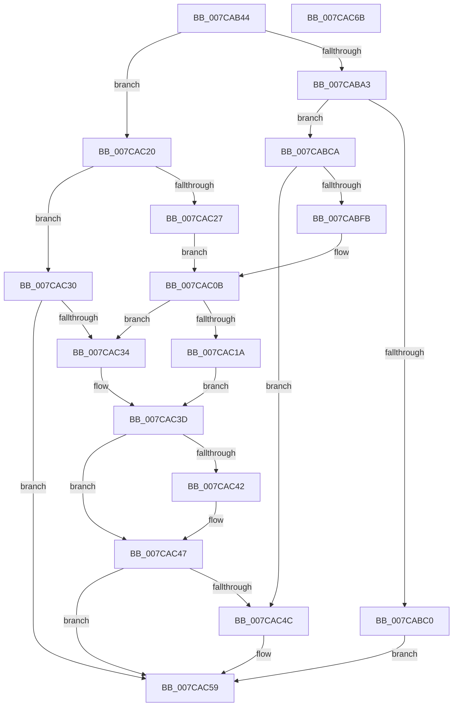

# SpRegOpenRedirectedKey

- RVA: `0x007CAB44`–`0x007CAC6C` (길이 `296` bytes)
- VA: `0x00000001407CAB44`
- 실행 섹션: `PAGE`
- PDB 이름 있음: `예`; PDB Function 태그: `아니요`
- unwind 정보 RVA: `0x000D4DE8`
- 디코드: `85`개 명령, `296/296` bytes 표시
- 미해석 바이트: `0` (있으면 어셈블리에 `.byte`로 보존)

> 이 문서는 커널 이미지의 기계어와 PDB 기호를 분석해 생성했습니다. 4번과 5번은 함수 원형과 자료형을 바이너리 사용 방식에서 추정한 C 해석이며 원본 소스 복구 결과는 아닙니다.

## 1. Dependencies

- 직접 호출 지점: **7**; 고유 호출 대상: **6**
- 직접 호출자로 확인된 함수: **2**
- RIP 상대 이미지 참조: **3**

### Outgoing calls
- `0x007CAB95` → [RtlGetPersistedStateLocation](../8C/RtlGetPersistedStateLocation_function_008C8DE0.md) (function, `0x008C8DE0`)
- `0x007CABB3` → [ExAllocatePool2](../../poolcode/B8/ExAllocatePool2_function_00B820F0.md) (function, `0x00B820F0`)
- `0x007CABF0` → [RtlGetPersistedStateLocation](../8C/RtlGetPersistedStateLocation_function_008C8DE0.md) (function, `0x008C8DE0`)
- `0x007CAC02` → [RtlInitUnicodeString](../../text/42/RtlInitUnicodeString_function_0042A780.md) (function, `0x0042A780`)
- `0x007CAC0F` → [SpRegOpenKey](SpRegOpenKey_function_007CAAA4.md) (function, `0x007CAAA4`)
- `0x007CAC42` → [ZwClose](../../text/6A/ZwClose_function_006AD2B0.md) (function, `0x006AD2B0`)
- `0x007CAC54` → [ExFreePoolWithTag](../../poolcode/B8/ExFreePoolWithTag_function_00B82870.md) (function, `0x00B82870`)

### Direct callers
- [ExpOsProductCacheProviderHelper](ExpOsProductCacheProviderHelper_function_007C8A58.md) at `0x007C8A92`
- [sub_007C8D5C](Unknown_function_007C8D5C.md) at `0x007C8DED`

### Static image references
- `0x007CAB5D` → RVA `0x00FD8610` (`PAGEDATA`; read)
- `0x007CAB6D` → RVA `0x00B056B0` (` ?? ::NNGAKEGL::`string'`; read)
- `0x007CAC27` → RVA `0x00FD85F8` (`PAGEDATA`; read)

## 2. Other-region calls and transfers

- 다른 실행 섹션으로 향하는 call: **4**
  - `0x007CABB3` → [ExAllocatePool2](../../poolcode/B8/ExAllocatePool2_function_00B820F0.md) (`PAGE` → `POOLCODE`)
  - `0x007CAC02` → [RtlInitUnicodeString](../../text/42/RtlInitUnicodeString_function_0042A780.md) (`PAGE` → `.text`)
  - `0x007CAC42` → [ZwClose](../../text/6A/ZwClose_function_006AD2B0.md) (`PAGE` → `.text`)
  - `0x007CAC54` → [ExFreePoolWithTag](../../poolcode/B8/ExFreePoolWithTag_function_00B82870.md) (`PAGE` → `POOLCODE`)
- 별도 외부 분기/꼬리 이동을 확인하지 못했습니다.

## 3. Assembly (complete function range)

```asm
007CAB44  4C 8B DC                        mov r11, rsp
007CAB47  49 89 5B 18                     mov qword ptr [r11 + 0x18], rbx
007CAB4B  49 89 53 10                     mov qword ptr [r11 + 0x10], rdx
007CAB4F  49 89 4B 08                     mov qword ptr [r11 + 8], rcx
007CAB53  55                              push rbp
007CAB54  56                              push rsi
007CAB55  57                              push rdi
007CAB56  48 8B EC                        mov rbp, rsp
007CAB59  48 83 EC 50                     sub rsp, 0x50
007CAB5D  48 8B 0D AC DA 80 00            mov rcx, qword ptr [rip + 0x80daac]
007CAB64  48 8D 45 28                     lea rax, [rbp + 0x28]
007CAB68  48 83 65 20 00                  and qword ptr [rbp + 0x20], 0
007CAB6D  48 8D 15 3C AB 33 00            lea rdx, [rip + 0x33ab3c]
007CAB74  33 FF                           xor edi, edi
007CAB76  49 89 43 C8                     mov qword ptr [r11 - 0x38], rax
007CAB7A  21 7C 24 28                     and dword ptr [rsp + 0x28], edi
007CAB7E  49 8B F0                        mov rsi, r8
007CAB81  49 21 7B B8                     and qword ptr [r11 - 0x48], rdi
007CAB85  0F 57 C0                        xorps xmm0, xmm0
007CAB88  21 7D 28                        and dword ptr [rbp + 0x28], edi
007CAB8B  45 33 C9                        xor r9d, r9d
007CAB8E  45 33 C0                        xor r8d, r8d
007CAB91  0F 11 45 F0                     movups xmmword ptr [rbp - 0x10], xmm0
007CAB95  E8 46 E2 0F 00                  call 0x1408c8de0
007CAB9A  8B D8                           mov ebx, eax
007CAB9C  3D 05 00 00 80                  cmp eax, 0x80000005
007CABA1  75 7D                           jne 0x1407cac20
007CABA3  8B 5D 28                        mov ebx, dword ptr [rbp + 0x28]
007CABA6  B9 00 01 00 00                  mov ecx, 0x100
007CABAB  8B D3                           mov edx, ebx
007CABAD  41 B8 53 4C 53 20               mov r8d, 0x20534c53
007CABB3  E8 38 75 3B 00                  call 0x140b820f0
007CABB8  48 8B F8                        mov rdi, rax
007CABBB  48 85 C0                        test rax, rax
007CABBE  75 0A                           jne 0x1407cabca
007CABC0  BB 17 00 00 C0                  mov ebx, 0xc0000017
007CABC5  E9 8F 00 00 00                  jmp 0x1407cac59
007CABCA  48 8B 0D 3F DA 80 00            mov rcx, qword ptr [rip + 0x80da3f]
007CABD1  48 8D 45 28                     lea rax, [rbp + 0x28]
007CABD5  48 89 44 24 30                  mov qword ptr [rsp + 0x30], rax
007CABDA  48 8D 15 CF AA 33 00            lea rdx, [rip + 0x33aacf]
007CABE1  89 5C 24 28                     mov dword ptr [rsp + 0x28], ebx
007CABE5  45 33 C9                        xor r9d, r9d
007CABE8  45 33 C0                        xor r8d, r8d
007CABEB  48 89 7C 24 20                  mov qword ptr [rsp + 0x20], rdi
007CABF0  E8 EB E1 0F 00                  call 0x1408c8de0
007CABF5  8B D8                           mov ebx, eax
007CABF7  85 C0                           test eax, eax
007CABF9  78 51                           js 0x1407cac4c
007CABFB  48 8B D7                        mov rdx, rdi
007CABFE  48 8D 4D F0                     lea rcx, [rbp - 0x10]
007CAC02  E8 79 FB C5 FF                  call 0x14042a780
007CAC07  48 8D 4D F0                     lea rcx, [rbp - 0x10]
007CAC0B  48 8D 55 20                     lea rdx, [rbp + 0x20]
007CAC0F  E8 90 FE FF FF                  call 0x1407caaa4
007CAC14  8B D8                           mov ebx, eax
007CAC16  85 C0                           test eax, eax
007CAC18  79 1A                           jns 0x1407cac34
007CAC1A  48 8B 4D 20                     mov rcx, qword ptr [rbp + 0x20]
007CAC1E  EB 1D                           jmp 0x1407cac3d
007CAC20  3D 34 00 00 C0                  cmp eax, 0xc0000034
007CAC25  75 09                           jne 0x1407cac30
007CAC27  48 8D 0D CA D9 80 00            lea rcx, [rip + 0x80d9ca]
007CAC2E  EB DB                           jmp 0x1407cac0b
007CAC30  85 C0                           test eax, eax
007CAC32  78 25                           js 0x1407cac59
007CAC34  48 8B 45 20                     mov rax, qword ptr [rbp + 0x20]
007CAC38  33 C9                           xor ecx, ecx
007CAC3A  48 89 06                        mov qword ptr [rsi], rax
007CAC3D  48 85 C9                        test rcx, rcx
007CAC40  74 05                           je 0x1407cac47
007CAC42  E8 69 26 EE FF                  call 0x1406ad2b0
007CAC47  48 85 FF                        test rdi, rdi
007CAC4A  74 0D                           je 0x1407cac59
007CAC4C  BA 53 4C 53 20                  mov edx, 0x20534c53
007CAC51  48 8B CF                        mov rcx, rdi
007CAC54  E8 17 7C 3B 00                  call 0x140b82870
007CAC59  8B C3                           mov eax, ebx
007CAC5B  48 8B 9C 24 80 00 00 00         mov rbx, qword ptr [rsp + 0x80]
007CAC63  48 83 C4 50                     add rsp, 0x50
007CAC67  5F                              pop rdi
007CAC68  5E                              pop rsi
007CAC69  5D                              pop rbp
007CAC6A  C3                              ret
007CAC6B  CC                              int3
```

## 4. C-style interpretation (structured pseudocode)

```c
__int64 __fastcall SpRegOpenRedirectedKey(__int64 a1, __int64 a2, __int64 a3, int a4)
{
    __int64 result;
    __int64 v_rdi;
    __int64 v_rsp;
    unsigned __int64 v_stack_m28;
    unsigned __int64 v_stack_m38;
    unsigned int v_stack_m40;
    unsigned __int64 v_stack_m48;
    unsigned __int64 v_stack_p10;
    unsigned __int64 v_stack_p18;
    unsigned __int64 v_stack_p8;

    *(unsigned __int64 *)(v_rsp + 24) = v_rbx;
    *(unsigned __int64 *)(v_rsp + 16) = a2;
    *(unsigned __int64 *)(v_rsp + 8) = a1;
    v_rsp = (v_rsp) - (80);
    v_rdi = 0;
    *(unsigned __int64 *)(v_rsp - 56) = v_stack_p10;
    a4 = 0;
    a3 = 0;
    v_stack_m28 = v_xmm0;
    result = RtlGetPersistedStateLocation(*(unsigned __int64 *)(v_rip + 8444588), v_rip + 3386172, a3, a4);
    if (((unsigned int)(result)) != 0x80000005ULL) goto loc_007CAC20;
    result = ExAllocatePool2(256, (unsigned int)((unsigned int)((unsigned int)(v_stack_p10))), (unsigned int)(0x20534C53ULL), a4);
    if (result != 0) goto loc_007CABCA;
    goto loc_007CAC59;
loc_007CABCA:
    v_stack_m38 = v_stack_p10;
    v_stack_m40 = (unsigned int)((unsigned int)(0xC0000017ULL));
    a4 = 0;
    a3 = 0;
    v_stack_m48 = result;
    result = RtlGetPersistedStateLocation(*(unsigned __int64 *)(v_rip + 8444479), v_rip + 3386063, a3, a4);
    if (sign_flag) goto loc_007CAC4C;
    result = RtlInitUnicodeString(v_stack_m28, result, a3, a4);
loc_007CAC0B:
    result = SpRegOpenKey(v_stack_m28, v_stack_p8, a3, a4);
    if (!sign_flag) goto loc_007CAC34;
    goto loc_007CAC3D;
loc_007CAC20:
    if (((unsigned int)(result)) != 0xC0000034ULL) goto loc_007CAC30;
    goto loc_007CAC0B;
loc_007CAC30:
    if (sign_flag) goto loc_007CAC59;
loc_007CAC34:
    a1 = 0;
    *(unsigned __int64 *)(a3) = v_stack_p8;
loc_007CAC3D:
    result = v_stack_p8;
    if (0 != 0) {
        result = ZwClose(a1, v_stack_p8, a3, a4);
    }
    if (result != 0) {
        a2 = 0x20534C53ULL;
        a1 = result;
        result = ExFreePoolWithTag(a1, a2, a3, a4);
    }
    v_rsp = (v_rsp) + (80);
    return (unsigned int)((unsigned int)((unsigned int)((unsigned int)(result))));
}
```

## 5. (Beta) C Style

```c
int64_t SpRegOpenRedirectedKey(int64_t Arg1, int64_t Arg2, void *Arg3, int32_t Arg4)
{
    uint8_t *arg3 = (uint8_t *)Arg3;

    int64_t result;
    int64_t local_rdi;
    int64_t local_rsp;
    uint64_t v_stack_m28;
    uint64_t v_stack_m38;
    uint32_t v_stack_m40;
    uint64_t v_stack_m48;
    uint64_t v_stack_p10;
    uint64_t v_stack_p18;
    uint64_t v_stack_p8;

    *(uint64_t *)(local_rsp + 0x18) = local_rbx;
    *(uint64_t *)(local_rsp + 0x10) = Arg2;
    *(uint64_t *)(local_rsp + 0x8) = Arg1;
    local_rsp = (local_rsp) - (80);
    local_rdi = 0;
    *(uint64_t *)(local_rsp - 0x38) = v_stack_p10;
    Arg4 = 0;
    Arg3 = 0;
    v_stack_m28 = v_xmm0;
    result = RtlGetPersistedStateLocation(*(uint64_t *)(v_rip + 0x80DAAC), v_rip + 3386172, Arg3, Arg4);
    if (((uint32_t)(result)) != 0x80000005ULL) goto loc_007CAC20;
    result = ExAllocatePool2(256, (uint32_t)((uint32_t)((uint32_t)(v_stack_p10))), (uint32_t)(0x20534C53ULL), Arg4);
    if (result != 0) goto loc_007CABCA;
    goto loc_007CAC59;
loc_007CABCA:
    v_stack_m38 = v_stack_p10;
    v_stack_m40 = (uint32_t)((uint32_t)(0xC0000017ULL));
    Arg4 = 0;
    Arg3 = 0;
    v_stack_m48 = result;
    result = RtlGetPersistedStateLocation(*(uint64_t *)(v_rip + 0x80DA3F), v_rip + 3386063, Arg3, Arg4);
    if (sign_flag) goto loc_007CAC4C;
    result = RtlInitUnicodeString(v_stack_m28, result, Arg3, Arg4);
loc_007CAC0B:
    result = SpRegOpenKey(v_stack_m28, v_stack_p8, Arg3, Arg4);
    if (!sign_flag) goto loc_007CAC34;
    goto loc_007CAC3D;
loc_007CAC20:
    if (((uint32_t)(result)) != 0xC0000034ULL) goto loc_007CAC30;
    goto loc_007CAC0B;
loc_007CAC30:
    if (sign_flag) goto loc_007CAC59;
loc_007CAC34:
    Arg1 = 0;
    *(uint64_t *)(arg3) = v_stack_p8;
loc_007CAC3D:
    result = v_stack_p8;
    if (0 != 0) {
        result = ZwClose(Arg1, v_stack_p8, Arg3, Arg4);
    }
    if (result != 0) {
        Arg2 = 0x20534C53ULL;
        Arg1 = result;
        result = ExFreePoolWithTag(Arg1, Arg2, Arg3, Arg4);
    }
    local_rsp = (local_rsp) + (80);
    return (uint32_t)((uint32_t)((uint32_t)((uint32_t)(result))));
}
```

### 관측된 메모리 오프셋

구조체 형식이 확인되지 않은 접근은 인자 기준의 오프셋으로만 기록했습니다.

| 기준 인자 | 오프셋 표현 | 폭 (bit) | 접근 |
|---|---:|---:|---|
| `Arg3` | `+ 0x0` | `64` | `W` |

## 6. Execution-region graph

[열기: 2D/3D 그래프와 함수 탐색 컨트롤 패널](../../../control-panel.html?section=page&rva=0x007CAB44&view=graph)

- 2D 그래프는 위에서 아래로 흐르고, 3D 그래프는 빈 공간을 드래그해 회전합니다. Shift+드래그는 이동, 휠은 확대·축소, 함수 노드 선택은 대상 보고서 이동입니다.

### Static fallback


