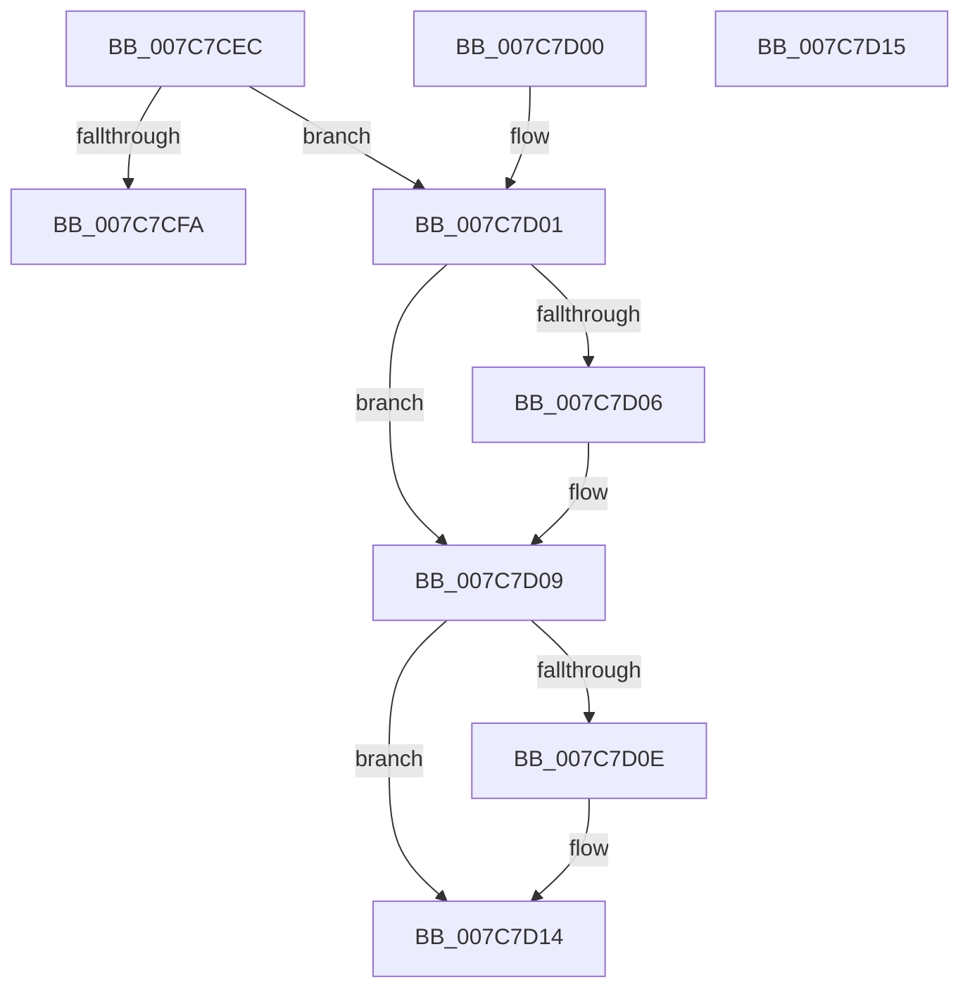

# sub_007C7CEC

- RVA: `0x007C7CEC`–`0x007C7D16` (길이 `42` bytes)
- VA: `0x00000001407C7CEC`
- 실행 섹션: `PAGE`
- PDB 이름 있음: `아니요`; PDB Function 태그: `아니요`
- unwind 정보 RVA: `0x000DB714`
- 디코드: `17`개 명령, `42/42` bytes 표시
- 미해석 바이트: `0` (있으면 어셈블리에 `.byte`로 보존)

> 이 문서는 커널 이미지의 기계어와 PDB 기호를 분석해 생성했습니다. 4번과 5번은 함수 원형과 자료형을 바이너리 사용 방식에서 추정한 C 해석이며 원본 소스 복구 결과는 아닙니다.

## 1. Dependencies

- 직접 호출 지점: **0**; 고유 호출 대상: **0**
- 직접 호출자로 확인된 함수: **5**
- RIP 상대 이미지 참조: **0**

### Outgoing calls
- 직접 디코드된 call 명령이 없습니다.

### Direct callers
- [sub_00657B00](../../text/65/Unknown_function_00657B00.md) at `0x00657B2C`
- [sub_007C7FB0](Unknown_function_007C7FB0.md) at `0x007C834C`
- [ExpGenuinePolicyPostProcess](ExpGenuinePolicyPostProcess_function_007C8380.md) at `0x007C83F8`
- [ExpGenuinePolicyPostProcess](ExpGenuinePolicyPostProcess_function_007C8380.md) at `0x007C8577`
- [sub_007C8FB0](Unknown_function_007C8FB0.md) at `0x007C9002`
- [sub_007C9030](Unknown_function_007C9030.md) at `0x007C9085`

### Static image references
- 디코드된 RIP-relative 메모리 참조가 없습니다.

## 2. Other-region calls and transfers

- 다른 실행 섹션으로 향하는 call: **0**
- 별도 외부 분기/꼬리 이동을 확인하지 못했습니다.

## 3. Assembly (complete function range)

```asm
007C7CEC  33 C0                           xor eax, eax
007C7CEE  44 8D 50 04                     lea r10d, [rax + 4]
007C7CF2  45 89 11                        mov dword ptr [r9], r10d
007C7CF5  45 3B C2                        cmp r8d, r10d
007C7CF8  73 07                           jae 0x1407c7d01
007C7CFA  B8 23 00 00 C0                  mov eax, 0xc0000023
007C7CFF  C3                              ret
007C7D00  CC                              int3
007C7D01  48 85 C9                        test rcx, rcx
007C7D04  74 03                           je 0x1407c7d09
007C7D06  44 89 11                        mov dword ptr [rcx], r10d
007C7D09  48 85 D2                        test rdx, rdx
007C7D0C  74 06                           je 0x1407c7d14
007C7D0E  8B 4C 24 28                     mov ecx, dword ptr [rsp + 0x28]
007C7D12  89 0A                           mov dword ptr [rdx], ecx
007C7D14  C3                              ret
007C7D15  CC                              int3
```

## 4. C-style interpretation (structured pseudocode)

```c
__int64 __fastcall sub_007C7CEC(__int64 a1, __int64 a2, int a3, __int64 a4, unsigned int a5)
{
    __int64 result;

    result = 0;
    *(unsigned int *)(a4) = (unsigned int)(result + 4);
    if (a3 >= ((unsigned int)(result + 4))) goto loc_007C7D01;
    return (unsigned int)(0xC0000023ULL);
loc_007C7D01:
    if (a1 != 0) {
        *(unsigned int *)(a1) = (unsigned int)(result + 4);
    }
    if (a2 != 0) {
        a1 = a5;
        *(unsigned int *)(a2) = (unsigned int)(a1);
    }
    return (unsigned int)(0xC0000023ULL);
}
```

## 5. (Beta) C Style

```c
int64_t sub_007C7CEC(int64_t Arg1, int64_t Arg2, int32_t Arg3, void *Arg4, uint32_t Arg5)
{
    uint8_t *arg4 = (uint8_t *)Arg4;

    int64_t result;

    result = 0;
    *(uint32_t *)(arg4) = (uint32_t)(result + 4);
    if (Arg3 >= ((uint32_t)(result + 4))) goto loc_007C7D01;
    return (uint32_t)(0xC0000023ULL);
loc_007C7D01:
    if (Arg1 != 0) {
        *(uint32_t *)(Arg1) = (uint32_t)(result + 4);
    }
    if (Arg2 != 0) {
        Arg1 = Arg5;
        *(uint32_t *)(Arg2) = (uint32_t)(Arg1);
    }
    return (uint32_t)(0xC0000023ULL);
}
```

### 관측된 메모리 오프셋

구조체 형식이 확인되지 않은 접근은 인자 기준의 오프셋으로만 기록했습니다.

| 기준 인자 | 오프셋 표현 | 폭 (bit) | 접근 |
|---|---:|---:|---|
| `Arg4` | `+ 0x0` | `32` | `W` |

## 6. Execution-region graph

[열기: 2D/3D 그래프와 함수 탐색 컨트롤 패널](../../../control-panel.html?section=page&rva=0x007C7CEC&view=graph)

- 2D 그래프는 위에서 아래로 흐르고, 3D 그래프는 빈 공간을 드래그해 회전합니다. Shift+드래그는 이동, 휠은 확대·축소, 함수 노드 선택은 대상 보고서 이동입니다.

### Static fallback


