# sub_007C7FB0

- RVA: `0x007C7FB0`–`0x007C8371` (길이 `961` bytes)
- VA: `0x00000001407C7FB0`
- 실행 섹션: `PAGE`
- PDB 이름 있음: `아니요`; PDB Function 태그: `아니요`
- unwind 정보 RVA: `0x000D4E70`
- 디코드: `263`개 명령, `961/961` bytes 표시
- 미해석 바이트: `0` (있으면 어셈블리에 `.byte`로 보존)

> 이 문서는 커널 이미지의 기계어와 PDB 기호를 분석해 생성했습니다. 4번과 5번은 함수 원형과 자료형을 바이너리 사용 방식에서 추정한 C 해석이며 원본 소스 복구 결과는 아닙니다.

## 1. Dependencies

- 직접 호출 지점: **21**; 고유 호출 대상: **14**
- 직접 호출자로 확인된 함수: **0**
- RIP 상대 이미지 참조: **0**

### Outgoing calls
- `0x007C8018` → [KeAbPreAcquire](../../text/21/KeAbPreAcquire_function_00210230.md) (function, `0x00210230`)
- `0x007C8038` → [ExfAcquirePushLockSharedEx](../../text/21/ExfAcquirePushLockSharedEx_function_0021044C.md) (function, `0x0021044C`)
- `0x007C8065` → [ExfReleasePushLockShared](../../text/26/ExfReleasePushLockShared_function_00263440.md) (function, `0x00263440`)
- `0x007C806D` → [KeAbPostRelease](../../text/2E/KeAbPostRelease_function_002E1600.md) (function, `0x002E1600`)
- `0x007C807E` → [sub_00967060](../96/Unknown_function_00967060.md) (function, `0x00967060`)
- `0x007C80B8` → [KeQueryTimeIncrement](../../text/44/KeQueryTimeIncrement_function_0044B4C0.md) (function, `0x0044B4C0`)
- `0x007C8121` → [KeAbPreAcquire](../../text/21/KeAbPreAcquire_function_00210230.md) (function, `0x00210230`)
- `0x007C813A` → [ExfAcquirePushLockExclusiveEx](../../text/20/ExfAcquirePushLockExclusiveEx_function_0020FC90.md) (function, `0x0020FC90`)
- `0x007C8161` → [ExfTryToWakePushLock](../../text/26/ExfTryToWakePushLock_function_00265DD0.md) (function, `0x00265DD0`)
- `0x007C8169` → [KeAbPostRelease](../../text/2E/KeAbPostRelease_function_002E1600.md) (function, `0x002E1600`)
- `0x007C8179` → [ExpSetLicenseTamperState](../../text/65/ExpSetLicenseTamperState_function_00657AC4.md) (function, `0x00657AC4`)
- `0x007C81E2` → [ExpLicUpdateChecksum](../../text/65/ExpLicUpdateChecksum_function_006578AC.md) (function, `0x006578AC`)
- `0x007C8213` → [ExpLicUpdateChecksum](../../text/65/ExpLicUpdateChecksum_function_006578AC.md) (function, `0x006578AC`)
- `0x007C8255` → [sub_00967060](../96/Unknown_function_00967060.md) (function, `0x00967060`)
- `0x007C827D` → [KeQueryTimeIncrement](../../text/44/KeQueryTimeIncrement_function_0044B4C0.md) (function, `0x0044B4C0`)
- `0x007C82B4` → [sub_00966DF0](../96/Unknown_function_00966DF0.md) (function, `0x00966DF0`)
- `0x007C82C4` → [KiQueryUnbiasedInterruptTime](../../text/42/KiQueryUnbiasedInterruptTime_function_0042D180.md) (function, `0x0042D180`)
- `0x007C82EE` → [ExpSetLicenseTamperState](../../text/65/ExpSetLicenseTamperState_function_00657AC4.md) (function, `0x00657AC4`)
- `0x007C8312` → [sub_00966DF0](../96/Unknown_function_00966DF0.md) (function, `0x00966DF0`)
- `0x007C831E` → [ExpGetLicenseTamperState](../../text/65/ExpGetLicenseTamperState_function_00657740.md) (function, `0x00657740`)
- `0x007C834C` → [sub_007C7CEC](Unknown_function_007C7CEC.md) (function, `0x007C7CEC`)

### Direct callers
- 이 함수 시작 RVA로 연결되는 직접 call은 확인되지 않았습니다. 간접 호출은 완전히 역산할 수 없습니다.

### Static image references
- 디코드된 RIP-relative 메모리 참조가 없습니다.

## 2. Other-region calls and transfers

- 다른 실행 섹션으로 향하는 call: **16**
  - `0x007C8018` → [KeAbPreAcquire](../../text/21/KeAbPreAcquire_function_00210230.md) (`PAGE` → `.text`)
  - `0x007C8038` → [ExfAcquirePushLockSharedEx](../../text/21/ExfAcquirePushLockSharedEx_function_0021044C.md) (`PAGE` → `.text`)
  - `0x007C8065` → [ExfReleasePushLockShared](../../text/26/ExfReleasePushLockShared_function_00263440.md) (`PAGE` → `.text`)
  - `0x007C806D` → [KeAbPostRelease](../../text/2E/KeAbPostRelease_function_002E1600.md) (`PAGE` → `.text`)
  - `0x007C80B8` → [KeQueryTimeIncrement](../../text/44/KeQueryTimeIncrement_function_0044B4C0.md) (`PAGE` → `.text`)
  - `0x007C8121` → [KeAbPreAcquire](../../text/21/KeAbPreAcquire_function_00210230.md) (`PAGE` → `.text`)
  - `0x007C813A` → [ExfAcquirePushLockExclusiveEx](../../text/20/ExfAcquirePushLockExclusiveEx_function_0020FC90.md) (`PAGE` → `.text`)
  - `0x007C8161` → [ExfTryToWakePushLock](../../text/26/ExfTryToWakePushLock_function_00265DD0.md) (`PAGE` → `.text`)
  - `0x007C8169` → [KeAbPostRelease](../../text/2E/KeAbPostRelease_function_002E1600.md) (`PAGE` → `.text`)
  - `0x007C8179` → [ExpSetLicenseTamperState](../../text/65/ExpSetLicenseTamperState_function_00657AC4.md) (`PAGE` → `.text`)
  - `0x007C81E2` → [ExpLicUpdateChecksum](../../text/65/ExpLicUpdateChecksum_function_006578AC.md) (`PAGE` → `.text`)
  - `0x007C8213` → [ExpLicUpdateChecksum](../../text/65/ExpLicUpdateChecksum_function_006578AC.md) (`PAGE` → `.text`)
  - `0x007C827D` → [KeQueryTimeIncrement](../../text/44/KeQueryTimeIncrement_function_0044B4C0.md) (`PAGE` → `.text`)
  - `0x007C82C4` → [KiQueryUnbiasedInterruptTime](../../text/42/KiQueryUnbiasedInterruptTime_function_0042D180.md) (`PAGE` → `.text`)
  - `0x007C82EE` → [ExpSetLicenseTamperState](../../text/65/ExpSetLicenseTamperState_function_00657AC4.md) (`PAGE` → `.text`)
  - `0x007C831E` → [ExpGetLicenseTamperState](../../text/65/ExpGetLicenseTamperState_function_00657740.md) (`PAGE` → `.text`)
- 별도 외부 분기/꼬리 이동을 확인하지 못했습니다.

## 3. Assembly (complete function range)

```asm
007C7FB0  48 89 5C 24 18                  mov qword ptr [rsp + 0x18], rbx
007C7FB5  48 89 54 24 10                  mov qword ptr [rsp + 0x10], rdx
007C7FBA  55                              push rbp
007C7FBB  56                              push rsi
007C7FBC  57                              push rdi
007C7FBD  41 54                           push r12
007C7FBF  41 55                           push r13
007C7FC1  41 56                           push r14
007C7FC3  41 57                           push r15
007C7FC5  48 8D 6C 24 E9                  lea rbp, [rsp - 0x17]
007C7FCA  48 81 EC D0 00 00 00            sub rsp, 0xd0
007C7FD1  0F 57 C0                        xorps xmm0, xmm0
007C7FD4  45 33 F6                        xor r14d, r14d
007C7FD7  45 8B E1                        mov r12d, r9d
007C7FDA  4D 8B E8                        mov r13, r8
007C7FDD  48 8B DA                        mov rbx, rdx
007C7FE0  48 8B F9                        mov rdi, rcx
007C7FE3  44 89 75 57                     mov dword ptr [rbp + 0x57], r14d
007C7FE7  0F 11 45 AF                     movups xmmword ptr [rbp - 0x51], xmm0
007C7FEB  0F 11 45 BF                     movups xmmword ptr [rbp - 0x41], xmm0
007C7FEF  0F 11 45 CF                     movups xmmword ptr [rbp - 0x31], xmm0
007C7FF3  4C 39 31                        cmp qword ptr [rcx], r14
007C7FF6  0F 85 C1 02 00 00               jne 0x1407c82bd
007C7FFC  4C 39 B1 F0 B6 00 00            cmp qword ptr [rcx + 0xb6f0], r14
007C8003  0F 84 B4 02 00 00               je 0x1407c82bd
007C8009  48 8D B1 B0 B7 00 00            lea rsi, [rcx + 0xb7b0]
007C8010  45 33 C0                        xor r8d, r8d
007C8013  48 8B CE                        mov rcx, rsi
007C8016  33 D2                           xor edx, edx
007C8018  E8 13 82 A4 FF                  call 0x140210230
007C801D  48 8B D8                        mov rbx, rax
007C8020  41 8D 4E 11                     lea ecx, [r14 + 0x11]
007C8024  33 C0                           xor eax, eax
007C8026  F0 48 0F B1 0E                  lock cmpxchg qword ptr [rsi], rcx
007C802B  74 14                           je 0x1407c8041
007C802D  4C 8B CE                        mov r9, rsi
007C8030  4C 8B C3                        mov r8, rbx
007C8033  33 D2                           xor edx, edx
007C8035  48 8B CE                        mov rcx, rsi
007C8038  E8 0F 84 A4 FF                  call 0x14021044c
007C803D  41 8D 4E 11                     lea ecx, [r14 + 0x11]
007C8041  48 85 DB                        test rbx, rbx
007C8044  74 04                           je 0x1407c804a
007C8046  C6 43 0A 01                     mov byte ptr [rbx + 0xa], 1
007C804A  48 8B 9F A8 B7 00 00            mov rbx, qword ptr [rdi + 0xb7a8]
007C8051  48 8B C1                        mov rax, rcx
007C8054  48 85 DB                        test rbx, rbx
007C8057  41 0F 94 C7                     sete r15b
007C805B  F0 4C 0F B1 36                  lock cmpxchg qword ptr [rsi], r14
007C8060  74 08                           je 0x1407c806a
007C8062  48 8B CE                        mov rcx, rsi
007C8065  E8 D6 B3 A9 FF                  call 0x140263440
007C806A  48 8B CE                        mov rcx, rsi
007C806D  E8 8E 95 B1 FF                  call 0x1402e1600
007C8072  48 85 DB                        test rbx, rbx
007C8075  74 6F                           je 0x1407c80e6
007C8077  48 8D 55 AF                     lea rdx, [rbp - 0x51]
007C807B  48 8B CF                        mov rcx, rdi
007C807E  E8 DD EF 19 00                  call 0x140967060
007C8083  85 C0                           test eax, eax
007C8085  78 6D                           js 0x1407c80f4
007C8087  48 8B 55 BF                     mov rdx, qword ptr [rbp - 0x41]
007C808B  48 85 D2                        test rdx, rdx
007C808E  74 64                           je 0x1407c80f4
007C8090  8B 87 B8 B7 00 00               mov eax, dword ptr [rdi + 0xb7b8]
007C8096  B9 A0 BB 0D 00                  mov ecx, 0xdbba0
007C809B  3B C1                           cmp eax, ecx
007C809D  0F 42 C8                        cmovb ecx, eax
007C80A0  44 8B F1                        mov r14d, ecx
007C80A3  4C 03 F2                        add r14, rdx
007C80A6  4C 3B F2                        cmp r14, rdx
007C80A9  7C 46                           jl 0x1407c80f1
007C80AB  48 BB 20 03 00 00 80 F7 FF FF   movabs rbx, 0xfffff78000000320
007C80B5  48 8B 1B                        mov rbx, qword ptr [rbx]
007C80B8  E8 03 34 C8 FF                  call 0x14044b4c0
007C80BD  8B C8                           mov ecx, eax
007C80BF  48 B8 4B 59 86 38 D6 C5 6D 34   movabs rax, 0x346dc5d63886594b
007C80C9  48 0F AF CB                     imul rcx, rbx
007C80CD  48 F7 E9                        imul rcx
007C80D0  48 C1 FA 0B                     sar rdx, 0xb
007C80D4  48 8B C2                        mov rax, rdx
007C80D7  48 C1 E8 3F                     shr rax, 0x3f
007C80DB  48 03 D0                        add rdx, rax
007C80DE  4C 3B F2                        cmp r14, rdx
007C80E1  7E 0E                           jle 0x1407c80f1
007C80E3  45 33 F6                        xor r14d, r14d
007C80E6  45 84 FF                        test r15b, r15b
007C80E9  0F 84 CA 01 00 00               je 0x1407c82b9
007C80EF  EB 03                           jmp 0x1407c80f4
007C80F1  45 33 F6                        xor r14d, r14d
007C80F4  0F 57 C0                        xorps xmm0, xmm0
007C80F7  0F 11 45 DF                     movups xmmword ptr [rbp - 0x21], xmm0
007C80FB  0F 11 45 EF                     movups xmmword ptr [rbp - 0x11], xmm0
007C80FF  0F 11 45 FF                     movups xmmword ptr [rbp - 1], xmm0
007C8103  4C 39 37                        cmp qword ptr [rdi], r14
007C8106  0F 85 AD 01 00 00               jne 0x1407c82b9
007C810C  4C 39 B7 F0 B6 00 00            cmp qword ptr [rdi + 0xb6f0], r14
007C8113  0F 84 A0 01 00 00               je 0x1407c82b9
007C8119  45 33 C0                        xor r8d, r8d
007C811C  33 D2                           xor edx, edx
007C811E  48 8B CE                        mov rcx, rsi
007C8121  E8 0A 81 A4 FF                  call 0x140210230
007C8126  F0 48 0F BA 2E 00               lock bts qword ptr [rsi], 0
007C812C  48 8B D8                        mov rbx, rax
007C812F  73 0E                           jae 0x1407c813f
007C8131  4C 8B C6                        mov r8, rsi
007C8134  48 8B D0                        mov rdx, rax
007C8137  48 8B CE                        mov rcx, rsi
007C813A  E8 51 7B A4 FF                  call 0x14020fc90
007C813F  48 85 DB                        test rbx, rbx
007C8142  74 04                           je 0x1407c8148
007C8144  C6 43 0A 01                     mov byte ptr [rbx + 0xa], 1
007C8148  48 8B 9F A8 B7 00 00            mov rbx, qword ptr [rdi + 0xb7a8]
007C814F  48 83 C8 FF                     or rax, 0xffffffffffffffff
007C8153  F0 48 0F C1 06                  lock xadd qword ptr [rsi], rax
007C8158  24 06                           and al, 6
007C815A  3C 02                           cmp al, 2
007C815C  75 08                           jne 0x1407c8166
007C815E  48 8B CE                        mov rcx, rsi
007C8161  E8 6A DC A9 FF                  call 0x140265dd0
007C8166  48 8B CE                        mov rcx, rsi
007C8169  E8 92 94 B1 FF                  call 0x1402e1600
007C816E  48 85 DB                        test rbx, rbx
007C8171  75 10                           jne 0x1407c8183
007C8173  8D 53 05                        lea edx, [rbx + 5]
007C8176  48 8B CF                        mov rcx, rdi
007C8179  E8 46 F9 E8 FF                  call 0x140657ac4
007C817E  E9 36 01 00 00                  jmp 0x1407c82b9
007C8183  48 8B 8F F0 B6 00 00            mov rcx, qword ptr [rdi + 0xb6f0]
007C818A  4C 8D 4F 18                     lea r9, [rdi + 0x18]
007C818E  8B 97 E8 B6 00 00               mov edx, dword ptr [rdi + 0xb6e8]
007C8194  44 89 75 83                     mov dword ptr [rbp - 0x7d], r14d
007C8198  44 89 75 A0                     mov dword ptr [rbp - 0x60], r14d
007C819C  66 44 89 75 A4                  mov word ptr [rbp - 0x5c], r14w
007C81A1  44 88 75 A6                     mov byte ptr [rbp - 0x5a], r14b
007C81A5  48 85 C9                        test rcx, rcx
007C81A8  0F 84 0B 01 00 00               je 0x1407c82b9
007C81AE  85 D2                           test edx, edx
007C81B0  74 09                           je 0x1407c81bb
007C81B2  4D 85 C9                        test r9, r9
007C81B5  0F 84 FE 00 00 00               je 0x1407c82b9
007C81BB  BE 04 00 00 00                  mov esi, 4
007C81C0  4C 89 74 24 30                  mov qword ptr [rsp + 0x30], r14
007C81C5  48 83 C1 14                     add rcx, 0x14
007C81C9  89 74 24 38                     mov dword ptr [rsp + 0x38], esi
007C81CD  4C 8D 44 24 30                  lea r8, [rsp + 0x30]
007C81D2  4C 89 75 87                     mov qword ptr [rbp - 0x79], r14
007C81D6  4C 89 75 8F                     mov qword ptr [rbp - 0x71], r14
007C81DA  4C 89 75 97                     mov qword ptr [rbp - 0x69], r14
007C81DE  C6 45 9F 01                     mov byte ptr [rbp - 0x61], 1
007C81E2  E8 C5 F6 E8 FF                  call 0x1406578ac
007C81E7  8B C8                           mov ecx, eax
007C81E9  85 C0                           test eax, eax
007C81EB  75 2D                           jne 0x1407c821a
007C81ED  85 D2                           test edx, edx
007C81EF  74 29                           je 0x1407c821a
007C81F1  48 8B C2                        mov rax, rdx
007C81F4  B9 FF FF FF FF                  mov ecx, 0xffffffff
007C81F9  48 C1 E0 04                     shl rax, 4
007C81FD  48 3B C1                        cmp rax, rcx
007C8200  76 09                           jbe 0x1407c820b
007C8202  B9 95 00 00 C0                  mov ecx, 0xc0000095
007C8207  8B D1                           mov edx, ecx
007C8209  EB 15                           jmp 0x1407c8220
007C820B  4C 8D 44 24 30                  lea r8, [rsp + 0x30]
007C8210  49 8B C9                        mov rcx, r9
007C8213  E8 94 F6 E8 FF                  call 0x1406578ac
007C8218  8B C8                           mov ecx, eax
007C821A  8B D1                           mov edx, ecx
007C821C  85 C9                           test ecx, ecx
007C821E  74 09                           je 0x1407c8229
007C8220  4C 89 74 24 30                  mov qword ptr [rsp + 0x30], r14
007C8225  89 74 24 38                     mov dword ptr [rsp + 0x38], esi
007C8229  0F 10 44 24 30                  movups xmm0, xmmword ptr [rsp + 0x30]
007C822E  85 C9                           test ecx, ecx
007C8230  41 8B C6                        mov eax, r14d
007C8233  0F 10 4D 87                     movups xmm1, xmmword ptr [rbp - 0x79]
007C8237  0F 44 C2                        cmove eax, edx
007C823A  0F 11 45 AF                     movups xmmword ptr [rbp - 0x51], xmm0
007C823E  0F 10 45 97                     movups xmm0, xmmword ptr [rbp - 0x69]
007C8242  0F 11 4D BF                     movups xmmword ptr [rbp - 0x41], xmm1
007C8246  0F 11 45 CF                     movups xmmword ptr [rbp - 0x31], xmm0
007C824A  85 C0                           test eax, eax
007C824C  75 6B                           jne 0x1407c82b9
007C824E  48 8D 55 DF                     lea rdx, [rbp - 0x21]
007C8252  48 8B CF                        mov rcx, rdi
007C8255  E8 06 EE 19 00                  call 0x140967060
007C825A  85 C0                           test eax, eax
007C825C  78 5B                           js 0x1407c82b9
007C825E  48 8B 4D AF                     mov rcx, qword ptr [rbp - 0x51]
007C8262  48 39 4D DF                     cmp qword ptr [rbp - 0x21], rcx
007C8266  74 08                           je 0x1407c8270
007C8268  89 75 B7                        mov dword ptr [rbp - 0x49], esi
007C826B  BE 06 00 00 00                  mov esi, 6
007C8270  48 B8 20 03 00 00 80 F7 FF FF   movabs rax, 0xfffff78000000320
007C827A  48 8B 18                        mov rbx, qword ptr [rax]
007C827D  E8 3E 32 C8 FF                  call 0x14044b4c0
007C8282  8B C8                           mov ecx, eax
007C8284  45 33 C9                        xor r9d, r9d
007C8287  48 0F AF CB                     imul rcx, rbx
007C828B  48 B8 4B 59 86 38 D6 C5 6D 34   movabs rax, 0x346dc5d63886594b
007C8295  44 8B C6                        mov r8d, esi
007C8298  48 F7 E9                        imul rcx
007C829B  48 8B CF                        mov rcx, rdi
007C829E  48 C1 FA 0B                     sar rdx, 0xb
007C82A2  48 8B C2                        mov rax, rdx
007C82A5  48 C1 E8 3F                     shr rax, 0x3f
007C82A9  48 03 D0                        add rdx, rax
007C82AC  48 89 55 BF                     mov qword ptr [rbp - 0x41], rdx
007C82B0  48 8D 55 AF                     lea rdx, [rbp - 0x51]
007C82B4  E8 37 EB 19 00                  call 0x140966df0
007C82B9  48 8B 5D 5F                     mov rbx, qword ptr [rbp + 0x5f]
007C82BD  4C 39 37                        cmp qword ptr [rdi], r14
007C82C0  74 55                           je 0x1407c8317
007C82C2  B1 01                           mov cl, 1
007C82C4  E8 B7 4E C6 FF                  call 0x14042d180
007C82C9  48 8B C8                        mov rcx, rax
007C82CC  48 B8 BD 42 7A E5 D5 94 BF D6   movabs rax, 0xd6bf94d5e57a42bd
007C82D6  48 F7 E1                        mul rcx
007C82D9  48 C1 EA 17                     shr rdx, 0x17
007C82DD  48 81 FA 30 2A 00 00            cmp rdx, 0x2a30
007C82E4  76 31                           jbe 0x1407c8317
007C82E6  BA 02 00 00 00                  mov edx, 2
007C82EB  48 8B CF                        mov rcx, rdi
007C82EE  E8 D1 F7 E8 FF                  call 0x140657ac4
007C82F3  0F 57 C0                        xorps xmm0, xmm0
007C82F6  48 8D 54 24 30                  lea rdx, [rsp + 0x30]
007C82FB  45 33 C9                        xor r9d, r9d
007C82FE  48 8B CF                        mov rcx, rdi
007C8301  0F 11 44 24 30                  movups xmmword ptr [rsp + 0x30], xmm0
007C8306  0F 11 45 87                     movups xmmword ptr [rbp - 0x79], xmm0
007C830A  45 8D 41 20                     lea r8d, [r9 + 0x20]
007C830E  0F 11 45 97                     movups xmmword ptr [rbp - 0x69], xmm0
007C8312  E8 D9 EA 19 00                  call 0x140966df0
007C8317  48 8D 55 57                     lea rdx, [rbp + 0x57]
007C831B  48 8B CF                        mov rcx, rdi
007C831E  E8 1D F4 E8 FF                  call 0x140657740
007C8323  48 8B 45 7F                     mov rax, qword ptr [rbp + 0x7f]
007C8327  44 39 75 57                     cmp dword ptr [rbp + 0x57], r14d
007C832B  75 0A                           jne 0x1407c8337
007C832D  B9 34 00 00 C0                  mov ecx, 0xc0000034
007C8332  44 88 30                        mov byte ptr [rax], r14b
007C8335  EB 1C                           jmp 0x1407c8353
007C8337  4C 8B 4D 77                     mov r9, qword ptr [rbp + 0x77]
007C833B  45 8B C4                        mov r8d, r12d
007C833E  49 8B D5                        mov rdx, r13
007C8341  C6 00 01                        mov byte ptr [rax], 1
007C8344  48 8B CB                        mov rcx, rbx
007C8347  44 89 74 24 20                  mov dword ptr [rsp + 0x20], r14d
007C834C  E8 9B F9 FF FF                  call 0x1407c7cec
007C8351  8B C8                           mov ecx, eax
007C8353  48 8B 9C 24 20 01 00 00         mov rbx, qword ptr [rsp + 0x120]
007C835B  8B C1                           mov eax, ecx
007C835D  48 81 C4 D0 00 00 00            add rsp, 0xd0
007C8364  41 5F                           pop r15
007C8366  41 5E                           pop r14
007C8368  41 5D                           pop r13
007C836A  41 5C                           pop r12
007C836C  5F                              pop rdi
007C836D  5E                              pop rsi
007C836E  5D                              pop rbp
007C836F  C3                              ret
007C8370  CC                              int3
```

## 4. C-style interpretation (structured pseudocode)

```c
__int64 __fastcall sub_007C7FB0(__int64 a1, __int64 a2, __int64 a3, int a4, __int64 a5, __int64 a6)
{
    __int64 result;
    __int64 v_r14;
    __int64 v_r15;
    __int64 v_rsi;
    __int64 v_rsp;
    unsigned __int64 v_stack_m4F;
    unsigned __int64 v_stack_m50;
    unsigned __int64 v_stack_m60;
    unsigned __int64 v_stack_m70;
    unsigned __int64 v_stack_m80;
    unsigned __int64 v_stack_m90;
    unsigned int v_stack_m98;
    unsigned __int64 v_stack_mA0;
    unsigned __int8 v_stack_mA9;
    unsigned __int16 v_stack_mAB;
    unsigned int v_stack_mAF;
    unsigned __int8 v_stack_mB0;
    unsigned __int64 v_stack_mB8;
    unsigned __int64 v_stack_mC0;
    unsigned __int64 v_stack_mC8;
    unsigned int v_stack_mCC;
    unsigned int v_stack_mD0;
    unsigned __int64 v_stack_mD8;
    unsigned int v_stack_mE8;
    unsigned __int64 v_stack_p10;
    unsigned __int64 v_stack_p18;
    unsigned int v_stack_p8;

    v_stack_p18 = v_rbx;
    v_stack_p10 = a2;
    v_rsp = (v_rsp) - (208);
    v_r14 = 0;
    v_stack_p8 = 0;
    v_stack_mA0 = v_xmm0;
    v_stack_m90 = v_xmm0;
    v_stack_m80 = v_xmm0;
    if ((*(unsigned __int64 *)(a1)) != 0) goto loc_007C82BD;
    if ((*(unsigned __int64 *)(a1 + 46832)) == 0) goto loc_007C82BD;
    a3 = 0;
    a2 = 0;
    result = KeAbPreAcquire(a1 + 47024, a2, a3, a4);
    result = 0;
    if (!(condition_is_equal)) {
        a4 = a1 + 47024;
        a3 = 0;
        a2 = 0;
        a1 = a1 + 47024;
        result = ExfAcquirePushLockSharedEx(a1, a2, a3, a4);
        a1 = v_r14 + 17;
    }
    if (result != 0) {
        *(unsigned __int8 *)(result + 10) = 1;
    }
    v_r15 = (*(unsigned __int64 *)(a1 + 47016) == 0) ? 1 : 0;
    result = a1;
    if (*(unsigned __int64 *)(a1 + 47016) != 0) {
        a1 = a1 + 47024;
        result = ExfReleasePushLockShared(a1, a2, a3, a4);
    }
    result = KeAbPostRelease(a1 + 47024, a2, a3, a4);
    if (*(unsigned __int64 *)(a1 + 47016) == 0) goto loc_007C80E6;
    result = sub_00967060(a1, v_stack_mA0, a3, a4);
    if (sign_flag) goto loc_007C80F4;
    if (v_stack_m90 == 0) goto loc_007C80F4;
    a1 = (unsigned int)(0xDBBA0ULL);
    if (((unsigned int)((unsigned int)(*(unsigned int *)(a1 + 47032)))) < ((unsigned int)((unsigned int)(0xDBBA0ULL)))) { a1 = (unsigned int)((unsigned int)(*(unsigned int *)(a1 + 47032))); }
    v_r14 = ((unsigned int)((unsigned int)(a1))) + (v_stack_m90);
    if (v_r14 < v_stack_m90) goto loc_007C80F1;
    result = KeQueryTimeIncrement(a1, v_stack_m90, a3, a4);
    a1 = ((unsigned int)((unsigned int)(result))) * (*(unsigned __int64 *)(*(unsigned __int64 *)(a1 + 47016)));
    a2 = (v_stack_m90) >> (11);
    result = (a2) >> (63);
    a2 = (a2) + (result);
    if (v_r14 <= a2) goto loc_007C80F1;
    v_r14 = 0;
loc_007C80E6:
    if ((unsigned __int8)(v_r15) == 0) goto loc_007C82B9;
    goto loc_007C80F4;
loc_007C80F1:
    v_r14 = 0;
loc_007C80F4:
    v_stack_m70 = v_xmm0;
    v_stack_m60 = v_xmm0;
    v_stack_m50 = v_xmm0;
    if ((*(unsigned __int64 *)(a1)) != 0) goto loc_007C82B9;
    if ((*(unsigned __int64 *)(a1 + 46832)) == 0) goto loc_007C82B9;
    a3 = 0;
    a2 = 0;
    result = KeAbPreAcquire(a1 + 47024, a2, a3, a4);
    if (!(condition_is_above_or_equal)) {
        a3 = a1 + 47024;
        a2 = result;
        a1 = a1 + 47024;
        result = ExfAcquirePushLockExclusiveEx(a1, a2, a3, a4);
    }
    if (result != 0) {
        *(unsigned __int8 *)(result + 10) = 1;
    }
    result = (result) | (-1);
    result = (unsigned __int8)((result) & (6));
    if (((unsigned __int8)(result)) == 2) {
        a1 = a1 + 47024;
        result = ExfTryToWakePushLock(a1, a2, a3, a4);
    }
    result = KeAbPostRelease(a1 + 47024, a2, a3, a4);
    if (*(unsigned __int64 *)(a1 + 47016) != 0) goto loc_007C8183;
    result = ExpSetLicenseTamperState(a1, *(unsigned __int64 *)(a1 + 47016) + 5, a3, a4);
    goto loc_007C82B9;
loc_007C8183:
    v_stack_mCC = 0;
    v_stack_mAF = 0;
    v_stack_mAB = 0;
    v_stack_mA9 = 0;
    if (*(unsigned __int64 *)(a1 + 46832) == 0) goto loc_007C82B9;
    if ((unsigned int)((unsigned int)(*(unsigned int *)(a1 + 46824))) == 0) goto loc_007C81BB;
    if (a1 + 24 == 0) goto loc_007C82B9;
loc_007C81BB:
    v_stack_mD8 = 0;
    a1 = (*(unsigned __int64 *)(a1 + 46832)) + (20);
    v_stack_mD0 = 4;
    v_stack_mC8 = 0;
    v_stack_mC0 = 0;
    v_stack_mB8 = 0;
    v_stack_mB0 = 1;
    result = ExpLicUpdateChecksum(a1, (unsigned int)(*(unsigned int *)(a1 + 46824)), v_stack_mD8, a1 + 24);
    if ((unsigned int)(result) != 0) goto loc_007C821A;
    if ((unsigned int)((unsigned int)(*(unsigned int *)(a1 + 46824))) == 0) goto loc_007C821A;
    result = ((unsigned int)(*(unsigned int *)(a1 + 46824))) << (4);
    if (result <= ((unsigned int)(0xFFFFFFFFULL))) goto loc_007C820B;
    goto loc_007C8220;
loc_007C820B:
    result = ExpLicUpdateChecksum(a1 + 24, (unsigned int)((unsigned int)((unsigned int)(0xC0000095ULL))), v_stack_mD8, a1 + 24);
loc_007C821A:
    if ((unsigned int)((unsigned int)((unsigned int)(result))) != 0) {
        v_stack_mD8 = 0;
        v_stack_mD0 = 4;
    }
    result = 0;
    if ((unsigned int)((unsigned int)((unsigned int)(result))) == 0) { result = (unsigned int)((unsigned int)((unsigned int)((unsigned int)((unsigned int)(result))))); }
    v_stack_mA0 = v_xmm0;
    v_stack_m90 = v_xmm1;
    v_stack_m80 = v_xmm0;
    if ((unsigned int)(result) != 0) goto loc_007C82B9;
    result = sub_00967060(a1, v_stack_m70, v_stack_mD8, a1 + 24);
    if (sign_flag) goto loc_007C82B9;
    v_rsi = 4;
    if (v_stack_m70 != v_stack_mA0) {
        v_stack_m98 = 4;
        v_rsi = 6;
    }
    result = KeQueryTimeIncrement(v_stack_mA0, v_stack_m70, v_stack_mD8, a1 + 24);
    a4 = 0;
    a1 = ((unsigned int)((unsigned int)(result))) * (*(unsigned __int64 *)(result));
    a2 = (v_stack_m70) >> (11);
    result = (a2) >> (63);
    a2 = (a2) + (result);
    v_stack_m90 = a2;
    result = sub_00966DF0(a1, v_stack_mA0, (unsigned int)((unsigned int)(v_rsi)), a4);
loc_007C82B9:
loc_007C82BD:
    if ((*(unsigned __int64 *)(a1)) == 0) goto loc_007C8317;
    result = KiQueryUnbiasedInterruptTime(1, v_stack_mA0, (unsigned int)((unsigned int)(v_rsi)), a4);
    a2 = (v_stack_mA0) >> (23);
    if (a2 >= = 0x2A30ULL) {
        a2 = 2;
        a1 = a1;
        result = ExpSetLicenseTamperState(a1, a2, (unsigned int)((unsigned int)(v_rsi)), a4);
        a2 = v_stack_mD8;
        a4 = 0;
        a1 = a1;
        v_stack_mD8 = v_xmm0;
        v_stack_mC8 = v_xmm0;
        a3 = a4 + 32;
        v_stack_mB8 = v_xmm0;
        result = sub_00966DF0(a1, a2, a3, a4);
    }
    result = ExpGetLicenseTamperState(a1, v_stack_p8, a3, a4);
    if (v_stack_p8 != 0) goto loc_007C8337;
    *(unsigned __int8 *)(a6) = 0;
    goto loc_007C8353;
loc_007C8337:
    *(unsigned __int8 *)(a6) = 1;
    v_stack_mE8 = 0;
    result = sub_007C7CEC(v_stack_p10, a3, (unsigned int)((unsigned int)((unsigned int)(a4))), a5);
loc_007C8353:
    v_rsp = (v_rsp) + (208);
    return (unsigned int)((unsigned int)((unsigned int)((unsigned int)(result))));
}
```

## 5. (Beta) C Style

```c
int64_t sub_007C7FB0(void *Arg1, int64_t Arg2, int64_t Arg3, int32_t Arg4, int64_t Arg5, void *Arg6)
{
    uint8_t *arg1 = (uint8_t *)Arg1;
    uint8_t *arg6 = (uint8_t *)Arg6;

    int64_t result;
    int64_t local_r14;
    int64_t local_r15;
    int64_t local_rsi;
    int64_t local_rsp;
    uint64_t v_stack_m4F;
    uint64_t v_stack_m50;
    uint64_t v_stack_m60;
    uint64_t v_stack_m70;
    uint64_t v_stack_m80;
    uint64_t v_stack_m90;
    uint32_t v_stack_m98;
    uint64_t v_stack_mA0;
    uint8_t v_stack_mA9;
    uint16_t v_stack_mAB;
    uint32_t v_stack_mAF;
    uint8_t v_stack_mB0;
    uint64_t v_stack_mB8;
    uint64_t v_stack_mC0;
    uint64_t v_stack_mC8;
    uint32_t v_stack_mCC;
    uint32_t v_stack_mD0;
    uint64_t v_stack_mD8;
    uint32_t v_stack_mE8;
    uint64_t v_stack_p10;
    uint64_t v_stack_p18;
    uint32_t v_stack_p8;

    v_stack_p18 = local_rbx;
    v_stack_p10 = Arg2;
    local_rsp = (local_rsp) - (208);
    local_r14 = 0;
    v_stack_p8 = 0;
    v_stack_mA0 = v_xmm0;
    v_stack_m90 = v_xmm0;
    v_stack_m80 = v_xmm0;
    if ((*(uint64_t *)(arg1)) != 0) goto loc_007C82BD;
    if ((*(uint64_t *)(arg1 + 0xB6F0)) == 0) goto loc_007C82BD;
    Arg3 = 0;
    Arg2 = 0;
    result = KeAbPreAcquire(Arg1 + 47024, Arg2, Arg3, Arg4);
    result = 0;
    if (!(condition_is_equal)) {
        Arg4 = Arg1 + 47024;
        Arg3 = 0;
        Arg2 = 0;
        Arg1 = Arg1 + 47024;
        result = ExfAcquirePushLockSharedEx(Arg1, Arg2, Arg3, Arg4);
        Arg1 = local_r14 + 17;
    }
    if (result != 0) {
        *(uint8_t *)(result + 0xA) = 1;
    }
    local_r15 = (*(uint64_t *)(arg1 + 0xB7A8) == 0) ? 1 : 0;
    result = Arg1;
    if (*(uint64_t *)(arg1 + 0xB7A8) != 0) {
        Arg1 = Arg1 + 47024;
        result = ExfReleasePushLockShared(Arg1, Arg2, Arg3, Arg4);
    }
    result = KeAbPostRelease(Arg1 + 47024, Arg2, Arg3, Arg4);
    if (*(uint64_t *)(arg1 + 0xB7A8) == 0) goto loc_007C80E6;
    result = sub_00967060(Arg1, v_stack_mA0, Arg3, Arg4);
    if (sign_flag) goto loc_007C80F4;
    if (v_stack_m90 == 0) goto loc_007C80F4;
    Arg1 = (uint32_t)(0xDBBA0ULL);
    if (((uint32_t)((uint32_t)(*(uint32_t *)(arg1 + 0xB7B8)))) < ((uint32_t)((uint32_t)(0xDBBA0ULL)))) { Arg1 = (uint32_t)((uint32_t)(*(uint32_t *)(arg1 + 0xB7B8))); }
    local_r14 = ((uint32_t)((uint32_t)(Arg1))) + (v_stack_m90);
    if (local_r14 < v_stack_m90) goto loc_007C80F1;
    result = KeQueryTimeIncrement(Arg1, v_stack_m90, Arg3, Arg4);
    Arg1 = ((uint32_t)((uint32_t)(result))) * (*(uint64_t *)(*(uint64_t *)(arg1 + 0xB7A8)));
    Arg2 = (v_stack_m90) >> (11);
    result = (Arg2) >> (63);
    Arg2 = (Arg2) + (result);
    if (local_r14 <= Arg2) goto loc_007C80F1;
    local_r14 = 0;
loc_007C80E6:
    if ((uint8_t)(local_r15) == 0) goto loc_007C82B9;
    goto loc_007C80F4;
loc_007C80F1:
    local_r14 = 0;
loc_007C80F4:
    v_stack_m70 = v_xmm0;
    v_stack_m60 = v_xmm0;
    v_stack_m50 = v_xmm0;
    if ((*(uint64_t *)(arg1)) != 0) goto loc_007C82B9;
    if ((*(uint64_t *)(arg1 + 0xB6F0)) == 0) goto loc_007C82B9;
    Arg3 = 0;
    Arg2 = 0;
    result = KeAbPreAcquire(Arg1 + 47024, Arg2, Arg3, Arg4);
    if (!(condition_is_above_or_equal)) {
        Arg3 = Arg1 + 47024;
        Arg2 = result;
        Arg1 = Arg1 + 47024;
        result = ExfAcquirePushLockExclusiveEx(Arg1, Arg2, Arg3, Arg4);
    }
    if (result != 0) {
        *(uint8_t *)(result + 0xA) = 1;
    }
    result = (result) | (-1);
    result = (uint8_t)((result) & (6));
    if (((uint8_t)(result)) == 2) {
        Arg1 = Arg1 + 47024;
        result = ExfTryToWakePushLock(Arg1, Arg2, Arg3, Arg4);
    }
    result = KeAbPostRelease(Arg1 + 47024, Arg2, Arg3, Arg4);
    if (*(uint64_t *)(arg1 + 0xB7A8) != 0) goto loc_007C8183;
    result = ExpSetLicenseTamperState(Arg1, *(uint64_t *)(arg1 + 0xB7A8) + 5, Arg3, Arg4);
    goto loc_007C82B9;
loc_007C8183:
    v_stack_mCC = 0;
    v_stack_mAF = 0;
    v_stack_mAB = 0;
    v_stack_mA9 = 0;
    if (*(uint64_t *)(arg1 + 0xB6F0) == 0) goto loc_007C82B9;
    if ((uint32_t)((uint32_t)(*(uint32_t *)(arg1 + 0xB6E8))) == 0) goto loc_007C81BB;
    if (Arg1 + 24 == 0) goto loc_007C82B9;
loc_007C81BB:
    v_stack_mD8 = 0;
    Arg1 = (*(uint64_t *)(arg1 + 0xB6F0)) + (20);
    v_stack_mD0 = 4;
    v_stack_mC8 = 0;
    v_stack_mC0 = 0;
    v_stack_mB8 = 0;
    v_stack_mB0 = 1;
    result = ExpLicUpdateChecksum(Arg1, (uint32_t)(*(uint32_t *)(arg1 + 0xB6E8)), v_stack_mD8, Arg1 + 24);
    if ((uint32_t)(result) != 0) goto loc_007C821A;
    if ((uint32_t)((uint32_t)(*(uint32_t *)(arg1 + 0xB6E8))) == 0) goto loc_007C821A;
    result = ((uint32_t)(*(uint32_t *)(arg1 + 0xB6E8))) << (4);
    if (result <= ((uint32_t)(0xFFFFFFFFULL))) goto loc_007C820B;
    goto loc_007C8220;
loc_007C820B:
    result = ExpLicUpdateChecksum(Arg1 + 24, (uint32_t)((uint32_t)((uint32_t)(0xC0000095ULL))), v_stack_mD8, Arg1 + 24);
loc_007C821A:
    if ((uint32_t)((uint32_t)((uint32_t)(result))) != 0) {
        v_stack_mD8 = 0;
        v_stack_mD0 = 4;
    }
    result = 0;
    if ((uint32_t)((uint32_t)((uint32_t)(result))) == 0) { result = (uint32_t)((uint32_t)((uint32_t)((uint32_t)((uint32_t)(result))))); }
    v_stack_mA0 = v_xmm0;
    v_stack_m90 = v_xmm1;
    v_stack_m80 = v_xmm0;
    if ((uint32_t)(result) != 0) goto loc_007C82B9;
    result = sub_00967060(Arg1, v_stack_m70, v_stack_mD8, Arg1 + 24);
    if (sign_flag) goto loc_007C82B9;
    local_rsi = 4;
    if (v_stack_m70 != v_stack_mA0) {
        v_stack_m98 = 4;
        local_rsi = 6;
    }
    result = KeQueryTimeIncrement(v_stack_mA0, v_stack_m70, v_stack_mD8, Arg1 + 24);
    Arg4 = 0;
    Arg1 = ((uint32_t)((uint32_t)(result))) * (*(uint64_t *)(result));
    Arg2 = (v_stack_m70) >> (11);
    result = (Arg2) >> (63);
    Arg2 = (Arg2) + (result);
    v_stack_m90 = Arg2;
    result = sub_00966DF0(Arg1, v_stack_mA0, (uint32_t)((uint32_t)(local_rsi)), Arg4);
loc_007C82B9:
loc_007C82BD:
    if ((*(uint64_t *)(arg1)) == 0) goto loc_007C8317;
    result = KiQueryUnbiasedInterruptTime(1, v_stack_mA0, (uint32_t)((uint32_t)(local_rsi)), Arg4);
    Arg2 = (v_stack_mA0) >> (23);
    if (Arg2 >= = 0x2A30ULL) {
        Arg2 = 2;
        Arg1 = Arg1;
        result = ExpSetLicenseTamperState(Arg1, Arg2, (uint32_t)((uint32_t)(local_rsi)), Arg4);
        Arg2 = v_stack_mD8;
        Arg4 = 0;
        Arg1 = Arg1;
        v_stack_mD8 = v_xmm0;
        v_stack_mC8 = v_xmm0;
        Arg3 = Arg4 + 32;
        v_stack_mB8 = v_xmm0;
        result = sub_00966DF0(Arg1, Arg2, Arg3, Arg4);
    }
    result = ExpGetLicenseTamperState(Arg1, v_stack_p8, Arg3, Arg4);
    if (v_stack_p8 != 0) goto loc_007C8337;
    *(uint8_t *)(arg6) = 0;
    goto loc_007C8353;
loc_007C8337:
    *(uint8_t *)(arg6) = 1;
    v_stack_mE8 = 0;
    result = sub_007C7CEC(v_stack_p10, Arg3, (uint32_t)((uint32_t)((uint32_t)(Arg4))), Arg5);
loc_007C8353:
    local_rsp = (local_rsp) + (208);
    return (uint32_t)((uint32_t)((uint32_t)((uint32_t)(result))));
}
```

### 관측된 메모리 오프셋

구조체 형식이 확인되지 않은 접근은 인자 기준의 오프셋으로만 기록했습니다.

| 기준 인자 | 오프셋 표현 | 폭 (bit) | 접근 |
|---|---:|---:|---|
| `Arg1` | `+ 0x0` | `64` | `R` |
| `Arg1` | `+ 0x0` | `64` | `R/W` |
| `Arg1` | `+ 0x18` | `64` | `R` |
| `Arg1` | `+ 0xB6E8` | `32` | `R` |
| `Arg1` | `+ 0xB6F0` | `64` | `R` |
| `Arg1` | `+ 0xB7A8` | `64` | `R` |
| `Arg1` | `+ 0xB7B0` | `64` | `R` |
| `Arg1` | `+ 0xB7B8` | `32` | `R` |
| `Arg6` | `+ 0x0` | `8` | `W` |

## 6. Execution-region graph

[열기: 2D/3D 그래프와 함수 탐색 컨트롤 패널](../../../control-panel.html?section=page&rva=0x007C7FB0&view=graph)

- 2D 그래프는 위에서 아래로 흐르고, 3D 그래프는 빈 공간을 드래그해 회전합니다. Shift+드래그는 이동, 휠은 확대·축소, 함수 노드 선택은 대상 보고서 이동입니다.

### Static fallback

```mermaid
flowchart TD
  bb_007C7FB0[BB_007C7FB0]
  bb_007C7FFC[BB_007C7FFC]
  bb_007C8009[BB_007C8009]
  bb_007C802D[BB_007C802D]
  bb_007C8041[BB_007C8041]
  bb_007C8046[BB_007C8046]
  bb_007C804A[BB_007C804A]
  bb_007C8062[BB_007C8062]
  bb_007C806A[BB_007C806A]
  bb_007C8077[BB_007C8077]
  bb_007C8087[BB_007C8087]
  bb_007C8090[BB_007C8090]
  bb_007C80AB[BB_007C80AB]
  bb_007C80E3[BB_007C80E3]
  bb_007C80E6[BB_007C80E6]
  bb_007C80EF[BB_007C80EF]
  bb_007C80F1[BB_007C80F1]
  bb_007C80F4[BB_007C80F4]
  bb_007C810C[BB_007C810C]
  bb_007C8119[BB_007C8119]
  bb_007C8131[BB_007C8131]
  bb_007C813F[BB_007C813F]
  bb_007C8144[BB_007C8144]
  bb_007C8148[BB_007C8148]
  bb_007C815E[BB_007C815E]
  bb_007C8166[BB_007C8166]
  bb_007C8173[BB_007C8173]
  bb_007C8183[BB_007C8183]
  bb_007C81AE[BB_007C81AE]
  bb_007C81B2[BB_007C81B2]
  bb_007C81BB[BB_007C81BB]
  bb_007C81ED[BB_007C81ED]
  bb_007C81F1[BB_007C81F1]
  bb_007C8202[BB_007C8202]
  bb_007C820B[BB_007C820B]
  bb_007C821A[BB_007C821A]
  bb_007C8220[BB_007C8220]
  bb_007C8229[BB_007C8229]
  bb_007C824E[BB_007C824E]
  bb_007C825E[BB_007C825E]
  bb_007C8268[BB_007C8268]
  bb_007C8270[BB_007C8270]
  bb_007C82B9[BB_007C82B9]
  bb_007C82BD[BB_007C82BD]
  bb_007C82C2[BB_007C82C2]
  bb_007C82E6[BB_007C82E6]
  bb_007C8317[BB_007C8317]
  bb_007C832D[BB_007C832D]
  bb_007C8337[BB_007C8337]
  bb_007C8353[BB_007C8353]
  bb_007C8370[BB_007C8370]
  bb_007C7FB0 -->|branch| bb_007C82BD
  bb_007C7FB0 -->|fallthrough| bb_007C7FFC
  bb_007C7FFC -->|branch| bb_007C82BD
  bb_007C7FFC -->|fallthrough| bb_007C8009
  bb_007C8009 -->|branch| bb_007C8041
  bb_007C8009 -->|fallthrough| bb_007C802D
  bb_007C802D -->|flow| bb_007C8041
  bb_007C8041 -->|branch| bb_007C804A
  bb_007C8041 -->|fallthrough| bb_007C8046
  bb_007C8046 -->|flow| bb_007C804A
  bb_007C804A -->|branch| bb_007C806A
  bb_007C804A -->|fallthrough| bb_007C8062
  bb_007C8062 -->|flow| bb_007C806A
  bb_007C806A -->|branch| bb_007C80E6
  bb_007C806A -->|fallthrough| bb_007C8077
  bb_007C8077 -->|branch| bb_007C80F4
  bb_007C8077 -->|fallthrough| bb_007C8087
  bb_007C8087 -->|branch| bb_007C80F4
  bb_007C8087 -->|fallthrough| bb_007C8090
  bb_007C8090 -->|branch| bb_007C80F1
  bb_007C8090 -->|fallthrough| bb_007C80AB
  bb_007C80AB -->|branch| bb_007C80F1
  bb_007C80AB -->|fallthrough| bb_007C80E3
  bb_007C80E3 -->|flow| bb_007C80E6
  bb_007C80E6 -->|branch| bb_007C82B9
  bb_007C80E6 -->|fallthrough| bb_007C80EF
  bb_007C80EF -->|branch| bb_007C80F4
  bb_007C80F1 -->|flow| bb_007C80F4
  bb_007C80F4 -->|branch| bb_007C82B9
  bb_007C80F4 -->|fallthrough| bb_007C810C
  bb_007C810C -->|branch| bb_007C82B9
  bb_007C810C -->|fallthrough| bb_007C8119
  bb_007C8119 -->|branch| bb_007C813F
  bb_007C8119 -->|fallthrough| bb_007C8131
  bb_007C8131 -->|flow| bb_007C813F
  bb_007C813F -->|branch| bb_007C8148
  bb_007C813F -->|fallthrough| bb_007C8144
  bb_007C8144 -->|flow| bb_007C8148
  bb_007C8148 -->|branch| bb_007C8166
  bb_007C8148 -->|fallthrough| bb_007C815E
  bb_007C815E -->|flow| bb_007C8166
  bb_007C8166 -->|branch| bb_007C8183
  bb_007C8166 -->|fallthrough| bb_007C8173
  bb_007C8173 -->|branch| bb_007C82B9
  bb_007C8183 -->|branch| bb_007C82B9
  bb_007C8183 -->|fallthrough| bb_007C81AE
  bb_007C81AE -->|branch| bb_007C81BB
  bb_007C81AE -->|fallthrough| bb_007C81B2
  bb_007C81B2 -->|branch| bb_007C82B9
  bb_007C81B2 -->|fallthrough| bb_007C81BB
  bb_007C81BB -->|branch| bb_007C821A
  bb_007C81BB -->|fallthrough| bb_007C81ED
  bb_007C81ED -->|branch| bb_007C821A
  bb_007C81ED -->|fallthrough| bb_007C81F1
  bb_007C81F1 -->|branch| bb_007C820B
  bb_007C81F1 -->|fallthrough| bb_007C8202
  bb_007C8202 -->|branch| bb_007C8220
  bb_007C820B -->|flow| bb_007C821A
  bb_007C821A -->|branch| bb_007C8229
  bb_007C821A -->|fallthrough| bb_007C8220
  bb_007C8220 -->|flow| bb_007C8229
  bb_007C8229 -->|branch| bb_007C82B9
  bb_007C8229 -->|fallthrough| bb_007C824E
  bb_007C824E -->|branch| bb_007C82B9
  bb_007C824E -->|fallthrough| bb_007C825E
  bb_007C825E -->|branch| bb_007C8270
  bb_007C825E -->|fallthrough| bb_007C8268
  bb_007C8268 -->|flow| bb_007C8270
  bb_007C8270 -->|flow| bb_007C82B9
  bb_007C82B9 -->|flow| bb_007C82BD
  bb_007C82BD -->|branch| bb_007C8317
  bb_007C82BD -->|fallthrough| bb_007C82C2
  bb_007C82C2 -->|branch| bb_007C8317
  bb_007C82C2 -->|fallthrough| bb_007C82E6
  bb_007C82E6 -->|flow| bb_007C8317
  bb_007C8317 -->|branch| bb_007C8337
  bb_007C8317 -->|fallthrough| bb_007C832D
  bb_007C832D -->|branch| bb_007C8353
  bb_007C8337 -->|flow| bb_007C8353
```


