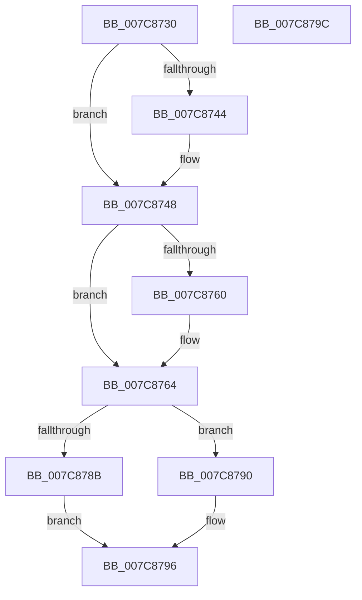

# sub_007C8730

- RVA: `0x007C8730`–`0x007C879D` (길이 `109` bytes)
- VA: `0x00000001407C8730`
- 실행 섹션: `PAGE`
- PDB 이름 있음: `아니요`; PDB Function 태그: `아니요`
- unwind 정보 RVA: `0x00064C80`
- 디코드: `36`개 명령, `109/109` bytes 표시
- 미해석 바이트: `0` (있으면 어셈블리에 `.byte`로 보존)

> 이 문서는 커널 이미지의 기계어와 PDB 기호를 분석해 생성했습니다. 4번과 5번은 함수 원형과 자료형을 바이너리 사용 방식에서 추정한 C 해석이며 원본 소스 복구 결과는 아닙니다.

## 1. Dependencies

- 직접 호출 지점: **1**; 고유 호출 대상: **1**
- 직접 호출자로 확인된 함수: **1**
- RIP 상대 이미지 참조: **0**

### Outgoing calls
- `0x007C8782` → [RtlCompareUnicodeStrings](../97/RtlCompareUnicodeStrings_function_009727E0.md) (function, `0x009727E0`)

### Direct callers
- [SLUpdateLicenseDataInternal](SLUpdateLicenseDataInternal_function_007C9C04.md) at `0x007CA429`

### Static image references
- 디코드된 RIP-relative 메모리 참조가 없습니다.

## 2. Other-region calls and transfers

- 다른 실행 섹션으로 향하는 call: **0**
- 별도 외부 분기/꼬리 이동을 확인하지 못했습니다.

## 3. Assembly (complete function range)

```asm
007C8730  40 53                           push rbx
007C8732  48 83 EC 30                     sub rsp, 0x30
007C8736  4C 8B 41 08                     mov r8, qword ptr [rcx + 8]
007C873A  B3 02                           mov bl, 2
007C873C  4D 8D 50 10                     lea r10, [r8 + 0x10]
007C8740  38 19                           cmp byte ptr [rcx], bl
007C8742  74 04                           je 0x1407c8748
007C8744  4D 8B 50 08                     mov r10, qword ptr [r8 + 8]
007C8748  48 8B 4A 08                     mov rcx, qword ptr [rdx + 8]
007C874C  49 8D 40 02                     lea rax, [r8 + 2]
007C8750  49 0F 45 C0                     cmovne rax, r8
007C8754  4C 8D 41 10                     lea r8, [rcx + 0x10]
007C8758  44 0F B7 18                     movzx r11d, word ptr [rax]
007C875C  38 1A                           cmp byte ptr [rdx], bl
007C875E  74 04                           je 0x1407c8764
007C8760  4C 8B 41 08                     mov r8, qword ptr [rcx + 8]
007C8764  48 8D 41 02                     lea rax, [rcx + 2]
007C8768  49 8B D3                        mov rdx, r11
007C876B  48 0F 45 C1                     cmovne rax, rcx
007C876F  33 DB                           xor ebx, ebx
007C8771  48 D1 EA                        shr rdx, 1
007C8774  49 8B CA                        mov rcx, r10
007C8777  88 5C 24 20                     mov byte ptr [rsp + 0x20], bl
007C877B  44 0F B7 08                     movzx r9d, word ptr [rax]
007C877F  49 D1 E9                        shr r9, 1
007C8782  E8 59 A0 1A 00                  call 0x1409727e0
007C8787  85 C0                           test eax, eax
007C8789  7E 05                           jle 0x1407c8790
007C878B  8D 43 01                        lea eax, [rbx + 1]
007C878E  EB 06                           jmp 0x1407c8796
007C8790  0F 99 C3                        setns bl
007C8793  8D 43 FF                        lea eax, [rbx - 1]
007C8796  48 83 C4 30                     add rsp, 0x30
007C879A  5B                              pop rbx
007C879B  C3                              ret
007C879C  CC                              int3
```

## 4. C-style interpretation (structured pseudocode)

```c
__int64 __fastcall sub_007C8730(__int64 a1, __int64 a2)
{
    __int64 result;
    __int64 v_r10;
    __int64 v_rbx;
    __int64 v_rsp;
    unsigned __int8 v_stack_m18;

    v_rsp = (v_rsp) - (48);
    v_r10 = *(unsigned __int64 *)(a1 + 8) + 16;
    if ((*(unsigned __int8 *)(a1)) != 2) {
        v_r10 = *(unsigned __int64 *)(*(unsigned __int64 *)(a1 + 8) + 8);
    }
    result = *(unsigned __int64 *)(a1 + 8) + 2;
    if ((*(unsigned __int8 *)(a1)) != 2) { result = *(unsigned __int64 *)(a1 + 8); }
    if ((*(unsigned __int8 *)(a2)) != 2) {
        a3 = *(unsigned __int64 *)(*(unsigned __int64 *)(a2 + 8) + 8);
    }
    result = *(unsigned __int64 *)(a2 + 8) + 2;
    if ((*(unsigned __int8 *)(a2)) != 2) { result = *(unsigned __int64 *)(a2 + 8); }
    v_rbx = 0;
    a2 = (*(unsigned __int16 *)(result)) >> (1);
    v_stack_m18 = 0;
    a4 = (*(unsigned __int16 *)(result)) >> (1);
    result = RtlCompareUnicodeStrings(v_r10, a2, a3, a4);
    if (condition_is_less_or_equal) goto loc_007C8790;
    goto loc_007C8796;
loc_007C8790:
    v_rbx = (!sign_flag) ? 1 : 0;
loc_007C8796:
    v_rsp = (v_rsp) + (48);
    return v_rbx - 1;
}
```

## 5. (Beta) C Style

```c
int64_t sub_007C8730(void *Arg1, void *Arg2)
{
    uint8_t *arg1 = (uint8_t *)Arg1;
    uint8_t *arg2 = (uint8_t *)Arg2;

    int64_t result;
    int64_t local_r10;
    int64_t local_rbx;
    int64_t local_rsp;
    uint8_t v_stack_m18;

    local_rsp = (local_rsp) - (48);
    local_r10 = *(uint64_t *)(arg1 + 0x8) + 16;
    if ((*(uint8_t *)(arg1)) != 2) {
        local_r10 = *(uint64_t *)(*(uint64_t *)(arg1 + 0x8) + 0x8);
    }
    result = *(uint64_t *)(arg1 + 0x8) + 2;
    if ((*(uint8_t *)(arg1)) != 2) { result = *(uint64_t *)(arg1 + 0x8); }
    if ((*(uint8_t *)(arg2)) != 2) {
        a3 = *(uint64_t *)(*(uint64_t *)(arg2 + 0x8) + 0x8);
    }
    result = *(uint64_t *)(arg2 + 0x8) + 2;
    if ((*(uint8_t *)(arg2)) != 2) { result = *(uint64_t *)(arg2 + 0x8); }
    local_rbx = 0;
    Arg2 = (*(uint16_t *)(result)) >> (1);
    v_stack_m18 = 0;
    a4 = (*(uint16_t *)(result)) >> (1);
    result = RtlCompareUnicodeStrings(local_r10, Arg2, a3, a4);
    if (condition_is_less_or_equal) goto loc_007C8790;
    goto loc_007C8796;
loc_007C8790:
    local_rbx = (!sign_flag) ? 1 : 0;
loc_007C8796:
    local_rsp = (local_rsp) + (48);
    return local_rbx - 1;
}
```

### 관측된 메모리 오프셋

구조체 형식이 확인되지 않은 접근은 인자 기준의 오프셋으로만 기록했습니다.

| 기준 인자 | 오프셋 표현 | 폭 (bit) | 접근 |
|---|---:|---:|---|
| `Arg1` | `+ 0x0` | `8` | `R` |
| `Arg1` | `+ 0x8` | `64` | `R` |
| `Arg2` | `+ 0x0` | `8` | `R` |
| `Arg2` | `+ 0x8` | `64` | `R` |

## 6. Execution-region graph

[열기: 2D/3D 그래프와 함수 탐색 컨트롤 패널](../../../control-panel.html?section=page&rva=0x007C8730&view=graph)

- 2D 그래프는 위에서 아래로 흐르고, 3D 그래프는 빈 공간을 드래그해 회전합니다. Shift+드래그는 이동, 휠은 확대·축소, 함수 노드 선택은 대상 보고서 이동입니다.

### Static fallback


