# sub_007C87A4

- RVA: `0x007C87A4`–`0x007C8A4F` (길이 `683` bytes)
- VA: `0x00000001407C87A4`
- 실행 섹션: `PAGE`
- PDB 이름 있음: `아니요`; PDB Function 태그: `아니요`
- unwind 정보 RVA: `0x000D4F9C`
- 디코드: `172`개 명령, `683/683` bytes 표시
- 미해석 바이트: `0` (있으면 어셈블리에 `.byte`로 보존)

> 이 문서는 커널 이미지의 기계어와 PDB 기호를 분석해 생성했습니다. 4번과 5번은 함수 원형과 자료형을 바이너리 사용 방식에서 추정한 C 해석이며 원본 소스 복구 결과는 아닙니다.

## 1. Dependencies

- 직접 호출 지점: **15**; 고유 호출 대상: **12**
- 직접 호출자로 확인된 함수: **1**
- RIP 상대 이미지 참조: **2**

### Outgoing calls
- `0x007C8800` → [KeAbPreAcquire](../../text/21/KeAbPreAcquire_function_00210230.md) (function, `0x00210230`)
- `0x007C8820` → [ExfAcquirePushLockSharedEx](../../text/21/ExfAcquirePushLockSharedEx_function_0021044C.md) (function, `0x0021044C`)
- `0x007C887A` → [ExfReleasePushLockShared](../../text/26/ExfReleasePushLockShared_function_00263440.md) (function, `0x00263440`)
- `0x007C8882` → [KeAbPostRelease](../../text/2E/KeAbPostRelease_function_002E1600.md) (function, `0x002E1600`)
- `0x007C8887` → [KeLeaveCriticalRegion](../../text/25/KeLeaveCriticalRegion_function_0025D8B0.md) (function, `0x0025D8B0`)
- `0x007C88CF` → [KeAbPreAcquire](../../text/21/KeAbPreAcquire_function_00210230.md) (function, `0x00210230`)
- `0x007C88E8` → [ExfAcquirePushLockExclusiveEx](../../text/20/ExfAcquirePushLockExclusiveEx_function_0020FC90.md) (function, `0x0020FC90`)
- `0x007C890E` → [sub_007C90A8](Unknown_function_007C90A8.md) (function, `0x007C90A8`)
- `0x007C8951` → [ExpSetLicenseTamperState](../../text/65/ExpSetLicenseTamperState_function_00657AC4.md) (function, `0x00657AC4`)
- `0x007C8977` → [sub_007C8C1C](Unknown_function_007C8C1C.md) (function, `0x007C8C1C`)
- `0x007C89D9` → [qsort](../../text/50/qsort_function_005009F0.md) (function, `0x005009F0`)
- `0x007C8A10` → [ExfTryToWakePushLock](../../text/26/ExfTryToWakePushLock_function_00265DD0.md) (function, `0x00265DD0`)
- `0x007C8A18` → [KeAbPostRelease](../../text/2E/KeAbPostRelease_function_002E1600.md) (function, `0x002E1600`)
- `0x007C8A1D` → [KeLeaveCriticalRegion](../../text/25/KeLeaveCriticalRegion_function_0025D8B0.md) (function, `0x0025D8B0`)
- `0x007C8A37` → [sub_007C7F80](Unknown_function_007C7F80.md) (function, `0x007C7F80`)

### Direct callers
- [SLQueryLicenseValueInternal](SLQueryLicenseValueInternal_function_007C93EC.md) at `0x007C94ED`

### Static image references
- `0x007C89C8` → RVA `0x007C8730` (`PAGE`; read)
- `0x007C8A30` → RVA `0x00022610` (`.rdata`; read)

## 2. Other-region calls and transfers

- 다른 실행 섹션으로 향하는 call: **12**
  - `0x007C8800` → [KeAbPreAcquire](../../text/21/KeAbPreAcquire_function_00210230.md) (`PAGE` → `.text`)
  - `0x007C8820` → [ExfAcquirePushLockSharedEx](../../text/21/ExfAcquirePushLockSharedEx_function_0021044C.md) (`PAGE` → `.text`)
  - `0x007C887A` → [ExfReleasePushLockShared](../../text/26/ExfReleasePushLockShared_function_00263440.md) (`PAGE` → `.text`)
  - `0x007C8882` → [KeAbPostRelease](../../text/2E/KeAbPostRelease_function_002E1600.md) (`PAGE` → `.text`)
  - `0x007C8887` → [KeLeaveCriticalRegion](../../text/25/KeLeaveCriticalRegion_function_0025D8B0.md) (`PAGE` → `.text`)
  - `0x007C88CF` → [KeAbPreAcquire](../../text/21/KeAbPreAcquire_function_00210230.md) (`PAGE` → `.text`)
  - `0x007C88E8` → [ExfAcquirePushLockExclusiveEx](../../text/20/ExfAcquirePushLockExclusiveEx_function_0020FC90.md) (`PAGE` → `.text`)
  - `0x007C8951` → [ExpSetLicenseTamperState](../../text/65/ExpSetLicenseTamperState_function_00657AC4.md) (`PAGE` → `.text`)
  - `0x007C89D9` → [qsort](../../text/50/qsort_function_005009F0.md) (`PAGE` → `.text`)
  - `0x007C8A10` → [ExfTryToWakePushLock](../../text/26/ExfTryToWakePushLock_function_00265DD0.md) (`PAGE` → `.text`)
  - `0x007C8A18` → [KeAbPostRelease](../../text/2E/KeAbPostRelease_function_002E1600.md) (`PAGE` → `.text`)
  - `0x007C8A1D` → [KeLeaveCriticalRegion](../../text/25/KeLeaveCriticalRegion_function_0025D8B0.md) (`PAGE` → `.text`)
- 별도 외부 분기/꼬리 이동을 확인하지 못했습니다.

## 3. Assembly (complete function range)

```asm
007C87A4  48 8B C4                        mov rax, rsp
007C87A7  48 89 48 08                     mov qword ptr [rax + 8], rcx
007C87AB  53                              push rbx
007C87AC  56                              push rsi
007C87AD  57                              push rdi
007C87AE  41 54                           push r12
007C87B0  41 55                           push r13
007C87B2  41 56                           push r14
007C87B4  41 57                           push r15
007C87B6  48 83 EC 50                     sub rsp, 0x50
007C87BA  48 8B D9                        mov rbx, rcx
007C87BD  45 33 FF                        xor r15d, r15d
007C87C0  44 89 78 A8                     mov dword ptr [rax - 0x58], r15d
007C87C4  44 88 78 18                     mov byte ptr [rax + 0x18], r15b
007C87C8  44 88 78 10                     mov byte ptr [rax + 0x10], r15b
007C87CC  65 48 8B 14 25 88 01 00 00      mov rdx, qword ptr gs:[0x188]
007C87D5  48 89 50 B0                     mov qword ptr [rax - 0x50], rdx
007C87D9  0F B7 82 E4 01 00 00            movzx eax, word ptr [rdx + 0x1e4]
007C87E0  66 41 BD 01 00                  mov r13w, 1
007C87E5  66 41 2B C5                     sub ax, r13w
007C87E9  66 89 82 E4 01 00 00            mov word ptr [rdx + 0x1e4], ax
007C87F0  90                              nop
007C87F1  48 8D B9 F8 B6 00 00            lea rdi, [rcx + 0xb6f8]
007C87F8  45 33 C0                        xor r8d, r8d
007C87FB  33 D2                           xor edx, edx
007C87FD  48 8B CF                        mov rcx, rdi
007C8800  E8 2B 7A A4 FF                  call 0x140210230
007C8805  48 8B F0                        mov rsi, rax
007C8808  33 C0                           xor eax, eax
007C880A  45 8D 77 11                     lea r14d, [r15 + 0x11]
007C880E  F0 4C 0F B1 37                  lock cmpxchg qword ptr [rdi], r14
007C8813  74 10                           je 0x1407c8825
007C8815  4C 8B CF                        mov r9, rdi
007C8818  4C 8B C6                        mov r8, rsi
007C881B  33 D2                           xor edx, edx
007C881D  48 8B CF                        mov rcx, rdi
007C8820  E8 27 7C A4 FF                  call 0x14021044c
007C8825  48 85 F6                        test rsi, rsi
007C8828  74 04                           je 0x1407c882e
007C882A  44 88 6E 0A                     mov byte ptr [rsi + 0xa], r13b
007C882E  41 BC 34 00 00 C0               mov r12d, 0xc0000034
007C8834  44 38 BB 90 B7 00 00            cmp byte ptr [rbx + 0xb790], r15b
007C883B  74 0A                           je 0x1407c8847
007C883D  C7 44 24 30 3E 00 00 C0         mov dword ptr [rsp + 0x30], 0xc000003e
007C8845  EB 26                           jmp 0x1407c886d
007C8847  44 38 BB EC B6 00 00            cmp byte ptr [rbx + 0xb6ec], r15b
007C884E  75 0A                           jne 0x1407c885a
007C8850  44 88 AC 24 A0 00 00 00         mov byte ptr [rsp + 0xa0], r13b
007C8858  EB 13                           jmp 0x1407c886d
007C885A  8B 44 24 30                     mov eax, dword ptr [rsp + 0x30]
007C885E  44 39 BB E8 B6 00 00            cmp dword ptr [rbx + 0xb6e8], r15d
007C8865  41 0F 44 C4                     cmove eax, r12d
007C8869  89 44 24 30                     mov dword ptr [rsp + 0x30], eax
007C886D  49 8B C6                        mov rax, r14
007C8870  F0 4C 0F B1 3F                  lock cmpxchg qword ptr [rdi], r15
007C8875  74 08                           je 0x1407c887f
007C8877  48 8B CF                        mov rcx, rdi
007C887A  E8 C1 AB A9 FF                  call 0x140263440
007C887F  48 8B CF                        mov rcx, rdi
007C8882  E8 79 8D B1 FF                  call 0x1402e1600
007C8887  E8 24 50 A9 FF                  call 0x14025d8b0
007C888C  8B 74 24 30                     mov esi, dword ptr [rsp + 0x30]
007C8890  85 F6                           test esi, esi
007C8892  0F 88 8E 01 00 00               js 0x1407c8a26
007C8898  44 38 AC 24 A0 00 00 00         cmp byte ptr [rsp + 0xa0], r13b
007C88A0  0F 85 80 01 00 00               jne 0x1407c8a26
007C88A6  65 48 8B 0C 25 88 01 00 00      mov rcx, qword ptr gs:[0x188]
007C88AF  48 89 4C 24 48                  mov qword ptr [rsp + 0x48], rcx
007C88B4  0F B7 81 E4 01 00 00            movzx eax, word ptr [rcx + 0x1e4]
007C88BB  66 41 2B C5                     sub ax, r13w
007C88BF  66 89 81 E4 01 00 00            mov word ptr [rcx + 0x1e4], ax
007C88C6  90                              nop
007C88C7  45 33 C0                        xor r8d, r8d
007C88CA  33 D2                           xor edx, edx
007C88CC  48 8B CF                        mov rcx, rdi
007C88CF  E8 5C 79 A4 FF                  call 0x140210230
007C88D4  48 8B F0                        mov rsi, rax
007C88D7  F0 48 0F BA 2F 00               lock bts qword ptr [rdi], 0
007C88DD  73 0E                           jae 0x1407c88ed
007C88DF  4C 8B C7                        mov r8, rdi
007C88E2  48 8B D0                        mov rdx, rax
007C88E5  48 8B CF                        mov rcx, rdi
007C88E8  E8 A3 73 A4 FF                  call 0x14020fc90
007C88ED  48 85 F6                        test rsi, rsi
007C88F0  74 04                           je 0x1407c88f6
007C88F2  44 88 6E 0A                     mov byte ptr [rsi + 0xa], r13b
007C88F6  44 38 AB EC B6 00 00            cmp byte ptr [rbx + 0xb6ec], r13b
007C88FD  0F 84 FB 00 00 00               je 0x1407c89fe
007C8903  48 8B 33                        mov rsi, qword ptr [rbx]
007C8906  48 85 F6                        test rsi, rsi
007C8909  74 19                           je 0x1407c8924
007C890B  48 8B CB                        mov rcx, rbx
007C890E  E8 95 07 00 00                  call 0x1407c90a8
007C8913  44 8B F0                        mov r14d, eax
007C8916  89 44 24 30                     mov dword ptr [rsp + 0x30], eax
007C891A  85 C0                           test eax, eax
007C891C  0F 88 DC 00 00 00               js 0x1407c89fe
007C8922  EB 15                           jmp 0x1407c8939
007C8924  48 8B B3 F0 B6 00 00            mov rsi, qword ptr [rbx + 0xb6f0]
007C892B  48 85 F6                        test rsi, rsi
007C892E  0F 84 B3 00 00 00               je 0x1407c89e7
007C8934  44 8B 74 24 30                  mov r14d, dword ptr [rsp + 0x30]
007C8939  48 89 B4 24 A8 00 00 00         mov qword ptr [rsp + 0xa8], rsi
007C8941  8B 46 0C                        mov eax, dword ptr [rsi + 0xc]
007C8944  41 84 C5                        test r13b, al
007C8947  74 0D                           je 0x1407c8956
007C8949  BA 02 00 00 00                  mov edx, 2
007C894E  48 8B CB                        mov rcx, rbx
007C8951  E8 6E F1 E8 FF                  call 0x140657ac4
007C8956  4C 8D BB E8 B6 00 00            lea r15, [rbx + 0xb6e8]
007C895D  41 83 3F 00                     cmp dword ptr [r15], 0
007C8961  75 20                           jne 0x1407c8983
007C8963  4C 89 7C 24 20                  mov qword ptr [rsp + 0x20], r15
007C8968  41 B9 6D 0B 00 00               mov r9d, 0xb6d
007C896E  4C 8D 43 18                     lea r8, [rbx + 0x18]
007C8972  B2 01                           mov dl, 1
007C8974  48 8B CE                        mov rcx, rsi
007C8977  E8 A0 02 00 00                  call 0x1407c8c1c
007C897C  44 8B F0                        mov r14d, eax
007C897F  89 44 24 30                     mov dword ptr [rsp + 0x30], eax
007C8983  45 85 F6                        test r14d, r14d
007C8986  79 25                           jns 0x1407c89ad
007C8988  45 33 FF                        xor r15d, r15d
007C898B  41 81 FE 23 00 00 C0            cmp r14d, 0xc0000023
007C8992  75 6A                           jne 0x1407c89fe
007C8994  C7 44 24 30 3E 00 00 C0         mov dword ptr [rsp + 0x30], 0xc000003e
007C899C  C6 83 90 B7 00 00 01            mov byte ptr [rbx + 0xb790], 1
007C89A3  C6 84 24 98 00 00 00 01         mov byte ptr [rsp + 0x98], 1
007C89AB  EB 51                           jmp 0x1407c89fe
007C89AD  41 8B 07                        mov eax, dword ptr [r15]
007C89B0  45 33 FF                        xor r15d, r15d
007C89B3  85 C0                           test eax, eax
007C89B5  75 0E                           jne 0x1407c89c5
007C89B7  C6 83 EC B6 00 00 01            mov byte ptr [rbx + 0xb6ec], 1
007C89BE  44 89 64 24 30                  mov dword ptr [rsp + 0x30], r12d
007C89C3  EB 39                           jmp 0x1407c89fe
007C89C5  48 8B D0                        mov rdx, rax
007C89C8  4C 8D 0D 61 FD FF FF            lea r9, [rip - 0x29f]
007C89CF  41 B8 10 00 00 00               mov r8d, 0x10
007C89D5  48 8D 4B 18                     lea rcx, [rbx + 0x18]
007C89D9  E8 12 80 D3 FF                  call 0x1405009f0
007C89DE  C6 83 EC B6 00 00 01            mov byte ptr [rbx + 0xb6ec], 1
007C89E5  EB 17                           jmp 0x1407c89fe
007C89E7  C7 44 24 30 3E 00 00 C0         mov dword ptr [rsp + 0x30], 0xc000003e
007C89EF  44 88 AB 90 B7 00 00            mov byte ptr [rbx + 0xb790], r13b
007C89F6  44 88 AC 24 98 00 00 00         mov byte ptr [rsp + 0x98], r13b
007C89FE  48 83 C8 FF                     or rax, 0xffffffffffffffff
007C8A02  F0 48 0F C1 07                  lock xadd qword ptr [rdi], rax
007C8A07  24 06                           and al, 6
007C8A09  3C 02                           cmp al, 2
007C8A0B  75 08                           jne 0x1407c8a15
007C8A0D  48 8B CF                        mov rcx, rdi
007C8A10  E8 BB D3 A9 FF                  call 0x140265dd0
007C8A15  48 8B CF                        mov rcx, rdi
007C8A18  E8 E3 8B B1 FF                  call 0x1402e1600
007C8A1D  E8 8E 4E A9 FF                  call 0x14025d8b0
007C8A22  8B 74 24 30                     mov esi, dword ptr [rsp + 0x30]
007C8A26  44 38 BC 24 98 00 00 00         cmp byte ptr [rsp + 0x98], r15b
007C8A2E  74 0C                           je 0x1407c8a3c
007C8A30  48 8D 0D D9 9B 85 FF            lea rcx, [rip - 0x7a6427]
007C8A37  E8 44 F5 FF FF                  call 0x1407c7f80
007C8A3C  8B C6                           mov eax, esi
007C8A3E  48 83 C4 50                     add rsp, 0x50
007C8A42  41 5F                           pop r15
007C8A44  41 5E                           pop r14
007C8A46  41 5D                           pop r13
007C8A48  41 5C                           pop r12
007C8A4A  5F                              pop rdi
007C8A4B  5E                              pop rsi
007C8A4C  5B                              pop rbx
007C8A4D  C3                              ret
007C8A4E  CC                              int3
```

## 4. C-style interpretation (structured pseudocode)

```c
__int64 __fastcall sub_007C87A4(__int64 a1, __int64 a2, int a3)
{
    __int64 result;
    __int64 v_r14;
    __int64 v_r15;
    __int64 v_rsp;
    unsigned __int64 v_stack_m40;
    unsigned int v_stack_m58;
    unsigned __int64 v_stack_m68;
    unsigned __int8 v_stack_p10;
    unsigned __int8 v_stack_p18;
    unsigned __int64 v_stack_p20;

    *(unsigned __int64 *)(v_rsp + 8) = a1;
    v_rsp = (v_rsp) - (80);
    v_r15 = 0;
    *(unsigned int *)(v_rsp - 88) = 0;
    *(unsigned __int8 *)(v_rsp + 24) = 0;
    *(unsigned __int8 *)(v_rsp + 16) = 0;
    *(unsigned __int64 *)(v_rsp - 80) = *(unsigned __int64 *)(gs_base + (0 + 392));
    result = (unsigned __int16)((*(unsigned __int16 *)(*(unsigned __int64 *)(gs_base + (0 + 392)) + 484)) - (1));
    *(unsigned __int16 *)(*(unsigned __int64 *)(gs_base + (0 + 392)) + 484) = (unsigned __int16)(result);
    a3 = 0;
    a2 = 0;
    result = KeAbPreAcquire(a1 + 46840, a2, a3, a4);
    result = 0;
    if (!(condition_is_equal)) {
        a4 = a1 + 46840;
        a3 = 0;
        a2 = 0;
        a1 = a1 + 46840;
        result = ExfAcquirePushLockSharedEx(a1, a2, a3, a4);
    }
    if (result != 0) {
        *(unsigned __int8 *)(result + 10) = 1;
    }
    if ((*(unsigned __int8 *)(a1 + 46992)) == 0) goto loc_007C8847;
    v_stack_m58 = 0xC000003EULL;
    goto loc_007C886D;
loc_007C8847:
    if ((*(unsigned __int8 *)(a1 + 46828)) != 0) goto loc_007C885A;
    v_stack_p18 = 1;
    goto loc_007C886D;
loc_007C885A:
    result = (unsigned int)(v_stack_m58);
    if ((*(unsigned int *)(a1 + 46824)) == 0) { result = (unsigned int)((unsigned int)(0xC0000034ULL)); }
    v_stack_m58 = (unsigned int)(result);
loc_007C886D:
    result = v_r15 + 17;
    if ((*(unsigned int *)(a1 + 46824)) != 0) {
        a1 = a1 + 46840;
        result = ExfReleasePushLockShared(a1, a2, a3, a4);
    }
    result = KeAbPostRelease(a1 + 46840, a2, a3, a4);
    result = KeLeaveCriticalRegion(a1 + 46840, a2, a3, a4);
    if (sign_flag) goto loc_007C8A26;
    if (v_stack_p18 != 1) goto loc_007C8A26;
    v_stack_m40 = *(unsigned __int64 *)(gs_base + (0 + 392));
    result = (unsigned __int16)((*(unsigned __int16 *)(*(unsigned __int64 *)(gs_base + (0 + 392)) + 484)) - (1));
    *(unsigned __int16 *)(*(unsigned __int64 *)(gs_base + (0 + 392)) + 484) = (unsigned __int16)(result);
    a3 = 0;
    a2 = 0;
    result = KeAbPreAcquire(a1 + 46840, a2, a3, a4);
    if (!(condition_is_above_or_equal)) {
        a3 = a1 + 46840;
        a2 = result;
        a1 = a1 + 46840;
        result = ExfAcquirePushLockExclusiveEx(a1, a2, a3, a4);
    }
    if (result != 0) {
        *(unsigned __int8 *)(result + 10) = 1;
    }
    if ((*(unsigned __int8 *)(a1 + 46828)) == 1) goto loc_007C89FE;
    if (*(unsigned __int64 *)(a1) == 0) goto loc_007C8924;
    result = sub_007C90A8(a1, a2, a3, a4);
    v_stack_m58 = (unsigned int)(result);
    if (sign_flag) goto loc_007C89FE;
    goto loc_007C8939;
loc_007C8924:
    if (*(unsigned __int64 *)(a1 + 46832) == 0) goto loc_007C89E7;
loc_007C8939:
    v_stack_p20 = *(unsigned __int64 *)(a1 + 46832);
    result = (unsigned int)(*(unsigned int *)(*(unsigned __int64 *)(a1 + 46832) + 12));
    if (((1) & ((unsigned __int8)((unsigned int)(*(unsigned int *)(*(unsigned __int64 *)(a1 + 46832) + 12))))) != 0) {
        a2 = 2;
        a1 = a1;
        result = ExpSetLicenseTamperState(a1, a2, a3, a4);
    }
    v_r14 = (unsigned int)(v_stack_m58);
    if ((*(unsigned int *)(a1 + 46824)) == 0) {
        v_stack_m68 = a1 + 46824;
        a4 = 0xB6DULL;
        a3 = a1 + 24;
        a2 = 1;
        a1 = *(unsigned __int64 *)(a1 + 46832);
        result = sub_007C8C1C(a1, a2, a3, a4);
        v_r14 = (unsigned int)(result);
        v_stack_m58 = (unsigned int)(result);
    }
    if (!sign_flag) goto loc_007C89AD;
    v_r15 = 0;
    if (((unsigned int)(v_r14)) != 0xC0000023ULL) goto loc_007C89FE;
    v_stack_m58 = 0xC000003EULL;
    *(unsigned __int8 *)(a1 + 46992) = 1;
    v_stack_p10 = 1;
    goto loc_007C89FE;
loc_007C89AD:
    v_r15 = 0;
    if ((unsigned int)((unsigned int)(*(unsigned int *)(v_r15))) != 0) goto loc_007C89C5;
    *(unsigned __int8 *)(a1 + 46828) = 1;
    v_stack_m58 = (unsigned int)((unsigned int)(0xC0000034ULL));
    goto loc_007C89FE;
loc_007C89C5:
    result = qsort(a1 + 24, (unsigned int)(*(unsigned int *)(v_r15)), 16, v_rip - 671);
    *(unsigned __int8 *)(a1 + 46828) = 1;
    goto loc_007C89FE;
loc_007C89E7:
    v_stack_m58 = 0xC000003EULL;
    *(unsigned __int8 *)(a1 + 46992) = 1;
    v_stack_p10 = 1;
loc_007C89FE:
    result = (result) | (-1);
    result = (unsigned __int8)((result) & (6));
    if (((unsigned __int8)(result)) == 2) {
        a1 = a1 + 46840;
        result = ExfTryToWakePushLock(a1, (unsigned int)(*(unsigned int *)(v_r15)), 16, v_rip - 671);
    }
    result = KeAbPostRelease(a1 + 46840, (unsigned int)(*(unsigned int *)(v_r15)), 16, v_rip - 671);
    result = KeLeaveCriticalRegion(a1 + 46840, (unsigned int)(*(unsigned int *)(v_r15)), 16, v_rip - 671);
loc_007C8A26:
    if (v_stack_p10 != 0) {
        a1 = v_rip - 8021031;
        result = sub_007C7F80(a1, (unsigned int)(*(unsigned int *)(v_r15)), 16, v_rip - 671);
    }
    v_rsp = (v_rsp) + (80);
    return (unsigned int)((unsigned int)((unsigned int)(v_stack_m58)));
}
```

## 5. (Beta) C Style

```c
int64_t sub_007C87A4(void *Arg1, int64_t Arg2, int32_t Arg3)
{
    uint8_t *arg1 = (uint8_t *)Arg1;

    int64_t result;
    int64_t local_r14;
    int64_t local_r15;
    int64_t local_rsp;
    uint64_t v_stack_m40;
    uint32_t v_stack_m58;
    uint64_t v_stack_m68;
    uint8_t v_stack_p10;
    uint8_t v_stack_p18;
    uint64_t v_stack_p20;

    *(void **)(local_rsp + 0x8) = Arg1;
    local_rsp = (local_rsp) - (80);
    local_r15 = 0;
    *(uint32_t *)(local_rsp - 0x58) = 0;
    *(uint8_t *)(local_rsp + 0x18) = 0;
    *(uint8_t *)(local_rsp + 0x10) = 0;
    *(uint64_t *)(local_rsp - 0x50) = *(uint64_t *)(gs_base + (0 + 0x188));
    result = (uint16_t)((*(uint16_t *)(*(uint64_t *)(gs_base + (0 + 0x188)) + 0x1E4)) - (1));
    *(uint16_t *)(*(uint64_t *)(gs_base + (0 + 0x188)) + 0x1E4) = (uint16_t)(result);
    Arg3 = 0;
    Arg2 = 0;
    result = KeAbPreAcquire(Arg1 + 46840, Arg2, Arg3, a4);
    result = 0;
    if (!(condition_is_equal)) {
        a4 = Arg1 + 46840;
        Arg3 = 0;
        Arg2 = 0;
        Arg1 = Arg1 + 46840;
        result = ExfAcquirePushLockSharedEx(Arg1, Arg2, Arg3, a4);
    }
    if (result != 0) {
        *(uint8_t *)(result + 0xA) = 1;
    }
    if ((*(uint8_t *)(arg1 + 0xB790)) == 0) goto loc_007C8847;
    v_stack_m58 = 0xC000003EULL;
    goto loc_007C886D;
loc_007C8847:
    if ((*(uint8_t *)(arg1 + 0xB6EC)) != 0) goto loc_007C885A;
    v_stack_p18 = 1;
    goto loc_007C886D;
loc_007C885A:
    result = (uint32_t)(v_stack_m58);
    if ((*(uint32_t *)(arg1 + 0xB6E8)) == 0) { result = (uint32_t)((uint32_t)(0xC0000034ULL)); }
    v_stack_m58 = (uint32_t)(result);
loc_007C886D:
    result = local_r15 + 17;
    if ((*(uint32_t *)(arg1 + 0xB6E8)) != 0) {
        Arg1 = Arg1 + 46840;
        result = ExfReleasePushLockShared(Arg1, Arg2, Arg3, a4);
    }
    result = KeAbPostRelease(Arg1 + 46840, Arg2, Arg3, a4);
    result = KeLeaveCriticalRegion(Arg1 + 46840, Arg2, Arg3, a4);
    if (sign_flag) goto loc_007C8A26;
    if (v_stack_p18 != 1) goto loc_007C8A26;
    v_stack_m40 = *(uint64_t *)(gs_base + (0 + 0x188));
    result = (uint16_t)((*(uint16_t *)(*(uint64_t *)(gs_base + (0 + 0x188)) + 0x1E4)) - (1));
    *(uint16_t *)(*(uint64_t *)(gs_base + (0 + 0x188)) + 0x1E4) = (uint16_t)(result);
    Arg3 = 0;
    Arg2 = 0;
    result = KeAbPreAcquire(Arg1 + 46840, Arg2, Arg3, a4);
    if (!(condition_is_above_or_equal)) {
        Arg3 = Arg1 + 46840;
        Arg2 = result;
        Arg1 = Arg1 + 46840;
        result = ExfAcquirePushLockExclusiveEx(Arg1, Arg2, Arg3, a4);
    }
    if (result != 0) {
        *(uint8_t *)(result + 0xA) = 1;
    }
    if ((*(uint8_t *)(arg1 + 0xB6EC)) == 1) goto loc_007C89FE;
    if (*(uint64_t *)(arg1) == 0) goto loc_007C8924;
    result = sub_007C90A8(Arg1, Arg2, Arg3, a4);
    v_stack_m58 = (uint32_t)(result);
    if (sign_flag) goto loc_007C89FE;
    goto loc_007C8939;
loc_007C8924:
    if (*(uint64_t *)(arg1 + 0xB6F0) == 0) goto loc_007C89E7;
loc_007C8939:
    v_stack_p20 = *(uint64_t *)(arg1 + 0xB6F0);
    result = (uint32_t)(*(uint32_t *)(*(uint64_t *)(arg1 + 0xB6F0) + 0xC));
    if (((1) & ((uint8_t)((uint32_t)(*(uint32_t *)(*(uint64_t *)(arg1 + 0xB6F0) + 0xC))))) != 0) {
        Arg2 = 2;
        Arg1 = Arg1;
        result = ExpSetLicenseTamperState(Arg1, Arg2, Arg3, a4);
    }
    local_r14 = (uint32_t)(v_stack_m58);
    if ((*(uint32_t *)(arg1 + 0xB6E8)) == 0) {
        v_stack_m68 = Arg1 + 46824;
        a4 = 0xB6DULL;
        Arg3 = Arg1 + 24;
        Arg2 = 1;
        Arg1 = *(uint64_t *)(arg1 + 0xB6F0);
        result = sub_007C8C1C(Arg1, Arg2, Arg3, a4);
        local_r14 = (uint32_t)(result);
        v_stack_m58 = (uint32_t)(result);
    }
    if (!sign_flag) goto loc_007C89AD;
    local_r15 = 0;
    if (((uint32_t)(local_r14)) != 0xC0000023ULL) goto loc_007C89FE;
    v_stack_m58 = 0xC000003EULL;
    *(uint8_t *)(arg1 + 0xB790) = 1;
    v_stack_p10 = 1;
    goto loc_007C89FE;
loc_007C89AD:
    local_r15 = 0;
    if ((uint32_t)((uint32_t)(*(uint32_t *)(local_r15))) != 0) goto loc_007C89C5;
    *(uint8_t *)(arg1 + 0xB6EC) = 1;
    v_stack_m58 = (uint32_t)((uint32_t)(0xC0000034ULL));
    goto loc_007C89FE;
loc_007C89C5:
    result = qsort(Arg1 + 24, (uint32_t)(*(uint32_t *)(local_r15)), 16, v_rip - 671);
    *(uint8_t *)(arg1 + 0xB6EC) = 1;
    goto loc_007C89FE;
loc_007C89E7:
    v_stack_m58 = 0xC000003EULL;
    *(uint8_t *)(arg1 + 0xB790) = 1;
    v_stack_p10 = 1;
loc_007C89FE:
    result = (result) | (-1);
    result = (uint8_t)((result) & (6));
    if (((uint8_t)(result)) == 2) {
        Arg1 = Arg1 + 46840;
        result = ExfTryToWakePushLock(Arg1, (uint32_t)(*(uint32_t *)(local_r15)), 16, v_rip - 671);
    }
    result = KeAbPostRelease(Arg1 + 46840, (uint32_t)(*(uint32_t *)(local_r15)), 16, v_rip - 671);
    result = KeLeaveCriticalRegion(Arg1 + 46840, (uint32_t)(*(uint32_t *)(local_r15)), 16, v_rip - 671);
loc_007C8A26:
    if (v_stack_p10 != 0) {
        Arg1 = v_rip - 8021031;
        result = sub_007C7F80(Arg1, (uint32_t)(*(uint32_t *)(local_r15)), 16, v_rip - 671);
    }
    local_rsp = (local_rsp) + (80);
    return (uint32_t)((uint32_t)((uint32_t)(v_stack_m58)));
}
```

### 관측된 메모리 오프셋

구조체 형식이 확인되지 않은 접근은 인자 기준의 오프셋으로만 기록했습니다.

| 기준 인자 | 오프셋 표현 | 폭 (bit) | 접근 |
|---|---:|---:|---|
| `Arg1` | `+ 0x0` | `32` | `R` |
| `Arg1` | `+ 0x0` | `64` | `R` |
| `Arg1` | `+ 0x0` | `64` | `R/W` |
| `Arg1` | `+ 0x18` | `64` | `R` |
| `Arg1` | `+ 0xB6E8` | `32` | `R` |
| `Arg1` | `+ 0xB6E8` | `64` | `R` |
| `Arg1` | `+ 0xB6EC` | `8` | `R` |
| `Arg1` | `+ 0xB6EC` | `8` | `W` |
| `Arg1` | `+ 0xB6F0` | `64` | `R` |
| `Arg1` | `+ 0xB6F8` | `64` | `R` |
| `Arg1` | `+ 0xB790` | `8` | `R` |
| `Arg1` | `+ 0xB790` | `8` | `W` |

## 6. Execution-region graph

[열기: 2D/3D 그래프와 함수 탐색 컨트롤 패널](../../../control-panel.html?section=page&rva=0x007C87A4&view=graph)

- 2D 그래프는 위에서 아래로 흐르고, 3D 그래프는 빈 공간을 드래그해 회전합니다. Shift+드래그는 이동, 휠은 확대·축소, 함수 노드 선택은 대상 보고서 이동입니다.

### Static fallback

```mermaid
flowchart TD
  bb_007C87A4[BB_007C87A4]
  bb_007C8815[BB_007C8815]
  bb_007C8825[BB_007C8825]
  bb_007C882A[BB_007C882A]
  bb_007C882E[BB_007C882E]
  bb_007C883D[BB_007C883D]
  bb_007C8847[BB_007C8847]
  bb_007C8850[BB_007C8850]
  bb_007C885A[BB_007C885A]
  bb_007C886D[BB_007C886D]
  bb_007C8877[BB_007C8877]
  bb_007C887F[BB_007C887F]
  bb_007C8898[BB_007C8898]
  bb_007C88A6[BB_007C88A6]
  bb_007C88DF[BB_007C88DF]
  bb_007C88ED[BB_007C88ED]
  bb_007C88F2[BB_007C88F2]
  bb_007C88F6[BB_007C88F6]
  bb_007C8903[BB_007C8903]
  bb_007C890B[BB_007C890B]
  bb_007C8922[BB_007C8922]
  bb_007C8924[BB_007C8924]
  bb_007C8934[BB_007C8934]
  bb_007C8939[BB_007C8939]
  bb_007C8949[BB_007C8949]
  bb_007C8956[BB_007C8956]
  bb_007C8963[BB_007C8963]
  bb_007C8983[BB_007C8983]
  bb_007C8988[BB_007C8988]
  bb_007C8994[BB_007C8994]
  bb_007C89AD[BB_007C89AD]
  bb_007C89B7[BB_007C89B7]
  bb_007C89C5[BB_007C89C5]
  bb_007C89E7[BB_007C89E7]
  bb_007C89FE[BB_007C89FE]
  bb_007C8A0D[BB_007C8A0D]
  bb_007C8A15[BB_007C8A15]
  bb_007C8A26[BB_007C8A26]
  bb_007C8A30[BB_007C8A30]
  bb_007C8A3C[BB_007C8A3C]
  bb_007C8A4E[BB_007C8A4E]
  bb_007C87A4 -->|branch| bb_007C8825
  bb_007C87A4 -->|fallthrough| bb_007C8815
  bb_007C8815 -->|flow| bb_007C8825
  bb_007C8825 -->|branch| bb_007C882E
  bb_007C8825 -->|fallthrough| bb_007C882A
  bb_007C882A -->|flow| bb_007C882E
  bb_007C882E -->|branch| bb_007C8847
  bb_007C882E -->|fallthrough| bb_007C883D
  bb_007C883D -->|branch| bb_007C886D
  bb_007C8847 -->|branch| bb_007C885A
  bb_007C8847 -->|fallthrough| bb_007C8850
  bb_007C8850 -->|branch| bb_007C886D
  bb_007C885A -->|flow| bb_007C886D
  bb_007C886D -->|branch| bb_007C887F
  bb_007C886D -->|fallthrough| bb_007C8877
  bb_007C8877 -->|flow| bb_007C887F
  bb_007C887F -->|branch| bb_007C8A26
  bb_007C887F -->|fallthrough| bb_007C8898
  bb_007C8898 -->|branch| bb_007C8A26
  bb_007C8898 -->|fallthrough| bb_007C88A6
  bb_007C88A6 -->|branch| bb_007C88ED
  bb_007C88A6 -->|fallthrough| bb_007C88DF
  bb_007C88DF -->|flow| bb_007C88ED
  bb_007C88ED -->|branch| bb_007C88F6
  bb_007C88ED -->|fallthrough| bb_007C88F2
  bb_007C88F2 -->|flow| bb_007C88F6
  bb_007C88F6 -->|branch| bb_007C89FE
  bb_007C88F6 -->|fallthrough| bb_007C8903
  bb_007C8903 -->|branch| bb_007C8924
  bb_007C8903 -->|fallthrough| bb_007C890B
  bb_007C890B -->|branch| bb_007C89FE
  bb_007C890B -->|fallthrough| bb_007C8922
  bb_007C8922 -->|branch| bb_007C8939
  bb_007C8924 -->|branch| bb_007C89E7
  bb_007C8924 -->|fallthrough| bb_007C8934
  bb_007C8934 -->|flow| bb_007C8939
  bb_007C8939 -->|branch| bb_007C8956
  bb_007C8939 -->|fallthrough| bb_007C8949
  bb_007C8949 -->|flow| bb_007C8956
  bb_007C8956 -->|branch| bb_007C8983
  bb_007C8956 -->|fallthrough| bb_007C8963
  bb_007C8963 -->|flow| bb_007C8983
  bb_007C8983 -->|branch| bb_007C89AD
  bb_007C8983 -->|fallthrough| bb_007C8988
  bb_007C8988 -->|branch| bb_007C89FE
  bb_007C8988 -->|fallthrough| bb_007C8994
  bb_007C8994 -->|branch| bb_007C89FE
  bb_007C89AD -->|branch| bb_007C89C5
  bb_007C89AD -->|fallthrough| bb_007C89B7
  bb_007C89B7 -->|branch| bb_007C89FE
  bb_007C89C5 -->|branch| bb_007C89FE
  bb_007C89E7 -->|flow| bb_007C89FE
  bb_007C89FE -->|branch| bb_007C8A15
  bb_007C89FE -->|fallthrough| bb_007C8A0D
  bb_007C8A0D -->|flow| bb_007C8A15
  bb_007C8A15 -->|flow| bb_007C8A26
  bb_007C8A26 -->|branch| bb_007C8A3C
  bb_007C8A26 -->|fallthrough| bb_007C8A30
  bb_007C8A30 -->|flow| bb_007C8A3C
```


