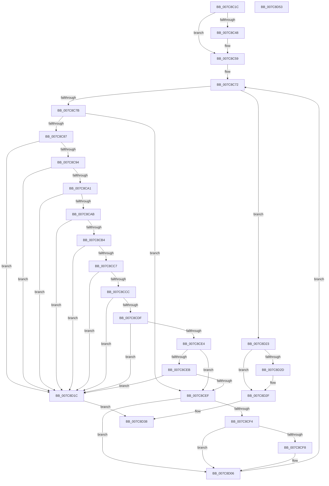

# sub_007C8C1C

- RVA: `0x007C8C1C`–`0x007C8D54` (길이 `312` bytes)
- VA: `0x00000001407C8C1C`
- 실행 섹션: `PAGE`
- PDB 이름 있음: `아니요`; PDB Function 태그: `아니요`
- unwind 정보 RVA: `0x0005E6B4`
- 디코드: `98`개 명령, `312/312` bytes 표시
- 미해석 바이트: `0` (있으면 어셈블리에 `.byte`로 보존)

> 이 문서는 커널 이미지의 기계어와 PDB 기호를 분석해 생성했습니다. 4번과 5번은 함수 원형과 자료형을 바이너리 사용 방식에서 추정한 C 해석이며 원본 소스 복구 결과는 아닙니다.

## 1. Dependencies

- 직접 호출 지점: **1**; 고유 호출 대상: **1**
- 직접 호출자로 확인된 함수: **2**
- RIP 상대 이미지 참조: **0**

### Outgoing calls
- `0x007C8C54` → [memset](../../text/6C/memset_function_006C6C40.md) (function, `0x006C6C40`)

### Direct callers
- [sub_007C87A4](Unknown_function_007C87A4.md) at `0x007C8977`
- [SLUpdateLicenseDataInternal](SLUpdateLicenseDataInternal_function_007C9C04.md) at `0x007CA226`
- [SLUpdateLicenseDataInternal](SLUpdateLicenseDataInternal_function_007C9C04.md) at `0x007CA31F`

### Static image references
- 디코드된 RIP-relative 메모리 참조가 없습니다.

## 2. Other-region calls and transfers

- 다른 실행 섹션으로 향하는 call: **1**
  - `0x007C8C54` → [memset](../../text/6C/memset_function_006C6C40.md) (`PAGE` → `.text`)
- 별도 외부 분기/꼬리 이동을 확인하지 못했습니다.

## 3. Assembly (complete function range)

```asm
007C8C1C  48 8B C4                        mov rax, rsp
007C8C1F  48 89 58 08                     mov qword ptr [rax + 8], rbx
007C8C23  48 89 68 10                     mov qword ptr [rax + 0x10], rbp
007C8C27  48 89 70 18                     mov qword ptr [rax + 0x18], rsi
007C8C2B  48 89 78 20                     mov qword ptr [rax + 0x20], rdi
007C8C2F  41 56                           push r14
007C8C31  48 83 EC 20                     sub rsp, 0x20
007C8C35  33 DB                           xor ebx, ebx
007C8C37  41 8B F1                        mov esi, r9d
007C8C3A  49 8B F8                        mov rdi, r8
007C8C3D  44 8A F2                        mov r14b, dl
007C8C40  48 8B E9                        mov rbp, rcx
007C8C43  4D 85 C0                        test r8, r8
007C8C46  74 11                           je 0x1407c8c59
007C8C48  44 8B C6                        mov r8d, esi
007C8C4B  33 D2                           xor edx, edx
007C8C4D  49 C1 E0 04                     shl r8, 4
007C8C51  48 8B CF                        mov rcx, rdi
007C8C54  E8 E7 DF EF FF                  call 0x1406c6c40
007C8C59  44 8B 55 04                     mov r10d, dword ptr [rbp + 4]
007C8C5D  48 8D 45 14                     lea rax, [rbp + 0x14]
007C8C61  41 83 C2 14                     add r10d, 0x14
007C8C65  33 D2                           xor edx, edx
007C8C67  4D 8D 1C 2A                     lea r11, [r10 + rbp]
007C8C6B  49 3B C3                        cmp rax, r11
007C8C6E  48 0F 45 D0                     cmovne rdx, rax
007C8C72  48 85 D2                        test rdx, rdx
007C8C75  0F 84 A8 00 00 00               je 0x1407c8d23
007C8C7B  48 8B CA                        mov rcx, rdx
007C8C7E  48 2B CD                        sub rcx, rbp
007C8C81  41 80 FE 01                     cmp r14b, 1
007C8C85  75 68                           jne 0x1407c8cef
007C8C87  48 8D 41 14                     lea rax, [rcx + 0x14]
007C8C8B  49 3B C2                        cmp rax, r10
007C8C8E  0F 87 88 00 00 00               ja 0x1407c8d1c
007C8C94  44 0F B7 02                     movzx r8d, word ptr [rdx]
007C8C98  49 8D 04 08                     lea rax, [r8 + rcx]
007C8C9C  49 3B C2                        cmp rax, r10
007C8C9F  77 7B                           ja 0x1407c8d1c
007C8CA1  0F B7 42 02                     movzx eax, word ptr [rdx + 2]
007C8CA5  66 41 3B C0                     cmp ax, r8w
007C8CA9  77 71                           ja 0x1407c8d1c
007C8CAB  49 8D 0C 10                     lea rcx, [r8 + rdx]
007C8CAF  48 3B CA                        cmp rcx, rdx
007C8CB2  72 68                           jb 0x1407c8d1c
007C8CB4  44 8B C0                        mov r8d, eax
007C8CB7  4C 8D 4A 10                     lea r9, [rdx + 0x10]
007C8CBB  48 83 C0 10                     add rax, 0x10
007C8CBF  48 03 C2                        add rax, rdx
007C8CC2  49 3B C1                        cmp rax, r9
007C8CC5  72 55                           jb 0x1407c8d1c
007C8CC7  48 3B C1                        cmp rax, rcx
007C8CCA  77 50                           ja 0x1407c8d1c
007C8CCC  0F B7 42 06                     movzx eax, word ptr [rdx + 6]
007C8CD0  49 83 C0 10                     add r8, 0x10
007C8CD4  4C 03 C0                        add r8, rax
007C8CD7  4C 03 C2                        add r8, rdx
007C8CDA  4D 3B C1                        cmp r8, r9
007C8CDD  72 3D                           jb 0x1407c8d1c
007C8CDF  4C 3B C1                        cmp r8, rcx
007C8CE2  77 38                           ja 0x1407c8d1c
007C8CE4  8B 42 08                        mov eax, dword ptr [rdx + 8]
007C8CE7  85 C0                           test eax, eax
007C8CE9  74 04                           je 0x1407c8cef
007C8CEB  A8 03                           test al, 3
007C8CED  74 2D                           je 0x1407c8d1c
007C8CEF  48 85 FF                        test rdi, rdi
007C8CF2  74 12                           je 0x1407c8d06
007C8CF4  3B DE                           cmp ebx, esi
007C8CF6  73 0E                           jae 0x1407c8d06
007C8CF8  8B C3                           mov eax, ebx
007C8CFA  48 03 C0                        add rax, rax
007C8CFD  C6 04 C7 02                     mov byte ptr [rdi + rax*8], 2
007C8D01  48 89 54 C7 08                  mov qword ptr [rdi + rax*8 + 8], rdx
007C8D06  0F B7 0A                        movzx ecx, word ptr [rdx]
007C8D09  FF C3                           inc ebx
007C8D0B  48 03 CA                        add rcx, rdx
007C8D0E  33 D2                           xor edx, edx
007C8D10  49 3B CB                        cmp rcx, r11
007C8D13  48 0F 45 D1                     cmovne rdx, rcx
007C8D17  E9 56 FF FF FF                  jmp 0x1407c8c72
007C8D1C  B8 3E 00 00 C0                  mov eax, 0xc000003e
007C8D21  EB 15                           jmp 0x1407c8d38
007C8D23  48 8B 44 24 50                  mov rax, qword ptr [rsp + 0x50]
007C8D28  48 85 C0                        test rax, rax
007C8D2B  74 02                           je 0x1407c8d2f
007C8D2D  89 18                           mov dword ptr [rax], ebx
007C8D2F  3B F3                           cmp esi, ebx
007C8D31  1B C0                           sbb eax, eax
007C8D33  25 23 00 00 C0                  and eax, 0xc0000023
007C8D38  48 8B 5C 24 30                  mov rbx, qword ptr [rsp + 0x30]
007C8D3D  48 8B 6C 24 38                  mov rbp, qword ptr [rsp + 0x38]
007C8D42  48 8B 74 24 40                  mov rsi, qword ptr [rsp + 0x40]
007C8D47  48 8B 7C 24 48                  mov rdi, qword ptr [rsp + 0x48]
007C8D4C  48 83 C4 20                     add rsp, 0x20
007C8D50  41 5E                           pop r14
007C8D52  C3                              ret
007C8D53  CC                              int3
```

## 4. C-style interpretation (structured pseudocode)

```c
__int64 __fastcall sub_007C8C1C(__int64 a1, int a2, __int64 a3, int a4, __int64 a5)
{
    __int64 result;
    __int64 v_r10;
    __int64 v_rbx;
    __int64 v_rsp;
    unsigned __int64 v_stack_p10;
    unsigned __int64 v_stack_p18;
    unsigned __int64 v_stack_p20;
    unsigned __int64 v_stack_p8;

    *(unsigned __int64 *)(v_rsp + 8) = v_rbx;
    *(unsigned __int64 *)(v_rsp + 16) = v_rbp;
    *(unsigned __int64 *)(v_rsp + 24) = v_rsi;
    *(unsigned __int64 *)(v_rsp + 32) = v_rdi;
    v_rsp = (v_rsp) - (32);
    v_rbx = 0;
    result = v_rsp;
    if (a3 != 0) {
        a3 = (unsigned int)((unsigned int)(a4));
        a2 = 0;
        a3 = (a3) << (4);
        a1 = a3;
        result = memset(a1, a2, a3, a4);
    }
    v_r10 = (unsigned int)(((unsigned int)(*(unsigned int *)(a1 + 4))) + (20));
    a2 = 0;
    if ((a1 + 20) != (v_r10 + a1 * 1)) { a2 = a1 + 20; }
loc_007C8C72:
    if (a2 == 0) goto loc_007C8D23;
    a1 = (a2) - (a1);
    if (((unsigned __int8)((unsigned __int8)(a2))) != 1) goto loc_007C8CEF;
    if ((a1 + 20) > v_r10) goto loc_007C8D1C;
    if ((*(unsigned __int16 *)(a2) + a1 * 1) > v_r10) goto loc_007C8D1C;
    if (((unsigned __int16)(*(unsigned __int16 *)(a2 + 2))) > ((unsigned __int16)(*(unsigned __int16 *)(a2)))) goto loc_007C8D1C;
    if ((*(unsigned __int16 *)(a2) + a2 * 1) < a2) goto loc_007C8D1C;
    result = (*(unsigned __int16 *)(a2 + 2)) + (16);
    result = (result) + (a2);
    if (result < (a2 + 16)) goto loc_007C8D1C;
    if (result > (*(unsigned __int16 *)(a2) + a2 * 1)) goto loc_007C8D1C;
    a3 = ((unsigned int)((unsigned int)(*(unsigned __int16 *)(a2 + 2)))) + (16);
    a3 = (a3) + (*(unsigned __int16 *)(a2 + 6));
    a3 = (a3) + (a2);
    if (a3 < (a2 + 16)) goto loc_007C8D1C;
    if (a3 > (*(unsigned __int16 *)(a2) + a2 * 1)) goto loc_007C8D1C;
    if ((unsigned int)((unsigned int)(*(unsigned int *)(a2 + 8))) == 0) goto loc_007C8CEF;
    if ((((unsigned __int8)((unsigned int)(*(unsigned int *)(a2 + 8)))) & (3)) == 0) goto loc_007C8D1C;
loc_007C8CEF:
    if (a3 == 0) goto loc_007C8D06;
    result = (unsigned int)(*(unsigned int *)(a2 + 8));
    if (0 < ((unsigned int)((unsigned int)(a4)))) {
        result = 0;
        result = (result) + (result);
        *(unsigned __int8 *)(a3 + result * 8) = 2;
        *(unsigned __int64 *)(a3 + result * 8 + 8) = a2;
    }
    v_rbx = (unsigned int)((v_rbx) + 1);
    a1 = (*(unsigned __int16 *)(a2)) + (a2);
    a2 = 0;
    if (a1 != (v_r10 + a1 * 1)) { a2 = a1; }
    goto loc_007C8C72;
loc_007C8D1C:
    goto loc_007C8D38;
loc_007C8D23:
    if (a5 != 0) {
        *(unsigned int *)(a5) = (unsigned int)(v_rbx);
    }
    result = (unsigned int)((a5) & (0xC0000023ULL));
loc_007C8D38:
    v_rsp = (v_rsp) + (32);
    return result;
}
```

## 5. (Beta) C Style

```c
int64_t sub_007C8C1C(void *Arg1, int32_t Arg2, int64_t Arg3, int32_t Arg4, int64_t Arg5)
{
    uint8_t *arg1 = (uint8_t *)Arg1;

    int64_t result;
    int64_t local_r10;
    int64_t local_rbx;
    int64_t local_rsp;
    uint64_t v_stack_p10;
    uint64_t v_stack_p18;
    uint64_t v_stack_p20;
    uint64_t v_stack_p8;

    *(uint64_t *)(local_rsp + 0x8) = local_rbx;
    *(uint64_t *)(local_rsp + 0x10) = local_rbp;
    *(uint64_t *)(local_rsp + 0x18) = local_rsi;
    *(uint64_t *)(local_rsp + 0x20) = local_rdi;
    local_rsp = (local_rsp) - (32);
    local_rbx = 0;
    result = local_rsp;
    if (Arg3 != 0) {
        Arg3 = (uint32_t)((uint32_t)(Arg4));
        Arg2 = 0;
        Arg3 = (Arg3) << (4);
        Arg1 = Arg3;
        result = memset(Arg1, Arg2, Arg3, Arg4);
    }
    local_r10 = (uint32_t)(((uint32_t)(*(uint32_t *)(arg1 + 0x4))) + (20));
    Arg2 = 0;
    if ((Arg1 + 20) != (local_r10 + Arg1 * 1)) { Arg2 = Arg1 + 20; }
loc_007C8C72:
    if (Arg2 == 0) goto loc_007C8D23;
    Arg1 = (Arg2) - (Arg1);
    if (((uint8_t)((uint8_t)(Arg2))) != 1) goto loc_007C8CEF;
    if ((Arg1 + 20) > local_r10) goto loc_007C8D1C;
    if ((*(uint16_t *)(Arg2) + Arg1 * 1) > local_r10) goto loc_007C8D1C;
    if (((uint16_t)(*(uint16_t *)(Arg2 + 0x2))) > ((uint16_t)(*(uint16_t *)(Arg2)))) goto loc_007C8D1C;
    if ((*(uint16_t *)(Arg2) + Arg2 * 1) < Arg2) goto loc_007C8D1C;
    result = (*(uint16_t *)(Arg2 + 0x2)) + (16);
    result = (result) + (Arg2);
    if (result < (Arg2 + 16)) goto loc_007C8D1C;
    if (result > (*(uint16_t *)(Arg2) + Arg2 * 1)) goto loc_007C8D1C;
    Arg3 = ((uint32_t)((uint32_t)(*(uint16_t *)(Arg2 + 0x2)))) + (16);
    Arg3 = (Arg3) + (*(uint16_t *)(Arg2 + 0x6));
    Arg3 = (Arg3) + (Arg2);
    if (Arg3 < (Arg2 + 16)) goto loc_007C8D1C;
    if (Arg3 > (*(uint16_t *)(Arg2) + Arg2 * 1)) goto loc_007C8D1C;
    if ((uint32_t)((uint32_t)(*(uint32_t *)(Arg2 + 0x8))) == 0) goto loc_007C8CEF;
    if ((((uint8_t)((uint32_t)(*(uint32_t *)(Arg2 + 0x8)))) & (3)) == 0) goto loc_007C8D1C;
loc_007C8CEF:
    if (Arg3 == 0) goto loc_007C8D06;
    result = (uint32_t)(*(uint32_t *)(Arg2 + 0x8));
    if (0 < ((uint32_t)((uint32_t)(Arg4)))) {
        result = 0;
        result = (result) + (result);
        *(uint8_t *)(Arg3 + result * 8) = 2;
        *(uint64_t *)(Arg3 + result * 8 + 0x8) = Arg2;
    }
    local_rbx = (uint32_t)((local_rbx) + 1);
    Arg1 = (*(uint16_t *)(Arg2)) + (Arg2);
    Arg2 = 0;
    if (Arg1 != (local_r10 + Arg1 * 1)) { Arg2 = Arg1; }
    goto loc_007C8C72;
loc_007C8D1C:
    goto loc_007C8D38;
loc_007C8D23:
    if (Arg5 != 0) {
        *(uint32_t *)(Arg5) = (uint32_t)(local_rbx);
    }
    result = (uint32_t)((Arg5) & (0xC0000023ULL));
loc_007C8D38:
    local_rsp = (local_rsp) + (32);
    return result;
}
```

### 관측된 메모리 오프셋

구조체 형식이 확인되지 않은 접근은 인자 기준의 오프셋으로만 기록했습니다.

| 기준 인자 | 오프셋 표현 | 폭 (bit) | 접근 |
|---|---:|---:|---|
| `Arg1` | `+ 0x4` | `32` | `R` |
| `Arg1` | `+ 0x14` | `64` | `R` |

## 6. Execution-region graph

[열기: 2D/3D 그래프와 함수 탐색 컨트롤 패널](../../../control-panel.html?section=page&rva=0x007C8C1C&view=graph)

- 2D 그래프는 위에서 아래로 흐르고, 3D 그래프는 빈 공간을 드래그해 회전합니다. Shift+드래그는 이동, 휠은 확대·축소, 함수 노드 선택은 대상 보고서 이동입니다.

### Static fallback


