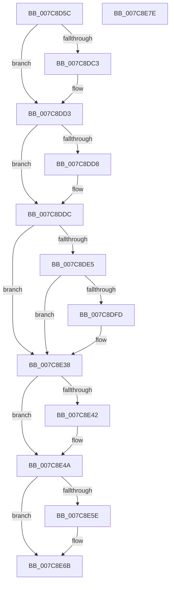

# sub_007C8D5C

- RVA: `0x007C8D5C`–`0x007C8E7F` (길이 `291` bytes)
- VA: `0x00000001407C8D5C`
- 실행 섹션: `PAGE`
- PDB 이름 있음: `아니요`; PDB Function 태그: `아니요`
- unwind 정보 RVA: `0x000D4FDC`
- 디코드: `76`개 명령, `291/291` bytes 표시
- 미해석 바이트: `0` (있으면 어셈블리에 `.byte`로 보존)

> 이 문서는 커널 이미지의 기계어와 PDB 기호를 분석해 생성했습니다. 4번과 5번은 함수 원형과 자료형을 바이너리 사용 방식에서 추정한 C 해석이며 원본 소스 복구 결과는 아닙니다.

## 1. Dependencies

- 직접 호출 지점: **8**; 고유 호출 대상: **8**
- 직접 호출자로 확인된 함수: **1**
- RIP 상대 이미지 참조: **1**

### Outgoing calls
- `0x007C8DAE` → [KeAbPreAcquire](../../text/21/KeAbPreAcquire_function_00210230.md) (function, `0x00210230`)
- `0x007C8DCE` → [ExfAcquirePushLockSharedEx](../../text/21/ExfAcquirePushLockSharedEx_function_0021044C.md) (function, `0x0021044C`)
- `0x007C8DED` → [SpRegOpenRedirectedKey](SpRegOpenRedirectedKey_function_007CAB44.md) (function, `0x007CAB44`)
- `0x007C8E2C` → [ZwSetValueKey](../../text/6A/ZwSetValueKey_function_006ADCD0.md) (function, `0x006ADCD0`)
- `0x007C8E45` → [ExfReleasePushLockShared](../../text/26/ExfReleasePushLockShared_function_00263440.md) (function, `0x00263440`)
- `0x007C8E4D` → [KeAbPostRelease](../../text/2E/KeAbPostRelease_function_002E1600.md) (function, `0x002E1600`)
- `0x007C8E52` → [KeLeaveCriticalRegion](../../text/25/KeLeaveCriticalRegion_function_0025D8B0.md) (function, `0x0025D8B0`)
- `0x007C8E66` → [ZwClose](../../text/6A/ZwClose_function_006AD2B0.md) (function, `0x006AD2B0`)

### Direct callers
- [SLUpdateLicenseDataInternal](SLUpdateLicenseDataInternal_function_007C9C04.md) at `0x007CA815`

### Static image references
- `0x007C8E1D` → RVA `0x00B4BDC8` (`PAGE`; read)

## 2. Other-region calls and transfers

- 다른 실행 섹션으로 향하는 call: **7**
  - `0x007C8DAE` → [KeAbPreAcquire](../../text/21/KeAbPreAcquire_function_00210230.md) (`PAGE` → `.text`)
  - `0x007C8DCE` → [ExfAcquirePushLockSharedEx](../../text/21/ExfAcquirePushLockSharedEx_function_0021044C.md) (`PAGE` → `.text`)
  - `0x007C8E2C` → [ZwSetValueKey](../../text/6A/ZwSetValueKey_function_006ADCD0.md) (`PAGE` → `.text`)
  - `0x007C8E45` → [ExfReleasePushLockShared](../../text/26/ExfReleasePushLockShared_function_00263440.md) (`PAGE` → `.text`)
  - `0x007C8E4D` → [KeAbPostRelease](../../text/2E/KeAbPostRelease_function_002E1600.md) (`PAGE` → `.text`)
  - `0x007C8E52` → [KeLeaveCriticalRegion](../../text/25/KeLeaveCriticalRegion_function_0025D8B0.md) (`PAGE` → `.text`)
  - `0x007C8E66` → [ZwClose](../../text/6A/ZwClose_function_006AD2B0.md) (`PAGE` → `.text`)
- 별도 외부 분기/꼬리 이동을 확인하지 못했습니다.

## 3. Assembly (complete function range)

```asm
007C8D5C  48 8B C4                        mov rax, rsp
007C8D5F  48 89 48 08                     mov qword ptr [rax + 8], rcx
007C8D63  53                              push rbx
007C8D64  56                              push rsi
007C8D65  57                              push rdi
007C8D66  41 56                           push r14
007C8D68  41 57                           push r15
007C8D6A  48 83 EC 40                     sub rsp, 0x40
007C8D6E  48 8B F9                        mov rdi, rcx
007C8D71  45 33 F6                        xor r14d, r14d
007C8D74  44 89 70 18                     mov dword ptr [rax + 0x18], r14d
007C8D78  4C 89 70 20                     mov qword ptr [rax + 0x20], r14
007C8D7C  44 88 70 10                     mov byte ptr [rax + 0x10], r14b
007C8D80  65 48 8B 14 25 88 01 00 00      mov rdx, qword ptr gs:[0x188]
007C8D89  48 89 50 C8                     mov qword ptr [rax - 0x38], rdx
007C8D8D  0F B7 82 E4 01 00 00            movzx eax, word ptr [rdx + 0x1e4]
007C8D94  66 FF C8                        dec ax
007C8D97  66 89 82 E4 01 00 00            mov word ptr [rdx + 0x1e4], ax
007C8D9E  90                              nop
007C8D9F  48 8D 99 F8 B6 00 00            lea rbx, [rcx + 0xb6f8]
007C8DA6  45 33 C0                        xor r8d, r8d
007C8DA9  33 D2                           xor edx, edx
007C8DAB  48 8B CB                        mov rcx, rbx
007C8DAE  E8 7D 74 A4 FF                  call 0x140210230
007C8DB3  48 8B F0                        mov rsi, rax
007C8DB6  33 C0                           xor eax, eax
007C8DB8  45 8D 7E 11                     lea r15d, [r14 + 0x11]
007C8DBC  F0 4C 0F B1 3B                  lock cmpxchg qword ptr [rbx], r15
007C8DC1  74 10                           je 0x1407c8dd3
007C8DC3  4C 8B CB                        mov r9, rbx
007C8DC6  4C 8B C6                        mov r8, rsi
007C8DC9  33 D2                           xor edx, edx
007C8DCB  48 8B CB                        mov rcx, rbx
007C8DCE  E8 79 76 A4 FF                  call 0x14021044c
007C8DD3  48 85 F6                        test rsi, rsi
007C8DD6  74 04                           je 0x1407c8ddc
007C8DD8  C6 46 0A 01                     mov byte ptr [rsi + 0xa], 1
007C8DDC  4C 39 B7 F0 B6 00 00            cmp qword ptr [rdi + 0xb6f0], r14
007C8DE3  74 53                           je 0x1407c8e38
007C8DE5  4C 8D 84 24 88 00 00 00         lea r8, [rsp + 0x88]
007C8DED  E8 52 1D 00 00                  call 0x1407cab44
007C8DF2  89 84 24 80 00 00 00            mov dword ptr [rsp + 0x80], eax
007C8DF9  85 C0                           test eax, eax
007C8DFB  78 3B                           js 0x1407c8e38
007C8DFD  C6 44 24 78 01                  mov byte ptr [rsp + 0x78], 1
007C8E02  48 8B 8F F0 B6 00 00            mov rcx, qword ptr [rdi + 0xb6f0]
007C8E09  8B 01                           mov eax, dword ptr [rcx]
007C8E0B  89 44 24 28                     mov dword ptr [rsp + 0x28], eax
007C8E0F  48 89 4C 24 20                  mov qword ptr [rsp + 0x20], rcx
007C8E14  41 B9 03 00 00 00               mov r9d, 3
007C8E1A  45 33 C0                        xor r8d, r8d
007C8E1D  48 8D 15 A4 2F 38 00            lea rdx, [rip + 0x382fa4]
007C8E24  48 8B 8C 24 88 00 00 00         mov rcx, qword ptr [rsp + 0x88]
007C8E2C  E8 9F 4E EE FF                  call 0x1406adcd0
007C8E31  89 84 24 80 00 00 00            mov dword ptr [rsp + 0x80], eax
007C8E38  49 8B C7                        mov rax, r15
007C8E3B  F0 4C 0F B1 33                  lock cmpxchg qword ptr [rbx], r14
007C8E40  74 08                           je 0x1407c8e4a
007C8E42  48 8B CB                        mov rcx, rbx
007C8E45  E8 F6 A5 A9 FF                  call 0x140263440
007C8E4A  48 8B CB                        mov rcx, rbx
007C8E4D  E8 AE 87 B1 FF                  call 0x1402e1600
007C8E52  E8 59 4A A9 FF                  call 0x14025d8b0
007C8E57  80 7C 24 78 01                  cmp byte ptr [rsp + 0x78], 1
007C8E5C  75 0D                           jne 0x1407c8e6b
007C8E5E  48 8B 8C 24 88 00 00 00         mov rcx, qword ptr [rsp + 0x88]
007C8E66  E8 45 44 EE FF                  call 0x1406ad2b0
007C8E6B  8B 84 24 80 00 00 00            mov eax, dword ptr [rsp + 0x80]
007C8E72  48 83 C4 40                     add rsp, 0x40
007C8E76  41 5F                           pop r15
007C8E78  41 5E                           pop r14
007C8E7A  5F                              pop rdi
007C8E7B  5E                              pop rsi
007C8E7C  5B                              pop rbx
007C8E7D  C3                              ret
007C8E7E  CC                              int3
```

## 4. C-style interpretation (structured pseudocode)

```c
__int64 __fastcall sub_007C8D5C(__int64 a1, __int64 a2, int a3)
{
    __int64 result;
    __int64 v_r14;
    __int64 v_rsp;
    unsigned int v_stack_m40;
    unsigned __int64 v_stack_m48;
    unsigned __int8 v_stack_p10;
    unsigned int v_stack_p18;
    unsigned __int64 v_stack_p20;

    *(unsigned __int64 *)(v_rsp + 8) = a1;
    v_rsp = (v_rsp) - (64);
    v_r14 = 0;
    *(unsigned int *)(v_rsp + 24) = 0;
    *(unsigned __int64 *)(v_rsp + 32) = 0;
    *(unsigned __int8 *)(v_rsp + 16) = 0;
    *(unsigned __int64 *)(v_rsp - 56) = *(unsigned __int64 *)(gs_base + (0 + 392));
    result = (unsigned __int16)((*(unsigned __int16 *)(*(unsigned __int64 *)(gs_base + (0 + 392)) + 484)) - 1);
    *(unsigned __int16 *)(*(unsigned __int64 *)(gs_base + (0 + 392)) + 484) = (unsigned __int16)(result);
    a3 = 0;
    a2 = 0;
    result = KeAbPreAcquire(a1 + 46840, a2, a3, a4);
    result = 0;
    if (!(condition_is_equal)) {
        a4 = a1 + 46840;
        a3 = 0;
        a2 = 0;
        a1 = a1 + 46840;
        result = ExfAcquirePushLockSharedEx(a1, a2, a3, a4);
    }
    if (result != 0) {
        *(unsigned __int8 *)(result + 10) = 1;
    }
    if ((*(unsigned __int64 *)(a1 + 46832)) == 0) goto loc_007C8E38;
    result = SpRegOpenRedirectedKey(a1, a2, v_stack_p20, a4);
    v_stack_p18 = (unsigned int)(result);
    if (!(sign_flag)) {
        v_stack_p10 = 1;
        a1 = *(unsigned __int64 *)(a1 + 46832);
        result = *(unsigned int *)(a1);
        v_stack_m40 = (unsigned int)(result);
        v_stack_m48 = a1;
        a4 = 3;
        a3 = 0;
        a2 = v_rip + 3682212;
        a1 = v_stack_p20;
        result = ZwSetValueKey(a1, a2, a3, a4);
        v_stack_p18 = (unsigned int)(result);
    }
    result = v_r14 + 17;
    if (!(condition_is_equal)) {
        a1 = a1 + 46840;
        result = ExfReleasePushLockShared(a1, a2, a3, a4);
    }
    result = KeAbPostRelease(a1 + 46840, a2, a3, a4);
    result = KeLeaveCriticalRegion(a1 + 46840, a2, a3, a4);
    if (v_stack_p10 == 1) {
        a1 = v_stack_p20;
        result = ZwClose(a1, a2, a3, a4);
    }
    v_rsp = (v_rsp) + (64);
    return (unsigned int)(v_stack_p18);
}
```

## 5. (Beta) C Style

```c
int64_t sub_007C8D5C(void *Arg1, int64_t Arg2, int32_t Arg3)
{
    uint8_t *arg1 = (uint8_t *)Arg1;

    int64_t result;
    int64_t local_r14;
    int64_t local_rsp;
    uint32_t v_stack_m40;
    uint64_t v_stack_m48;
    uint8_t v_stack_p10;
    uint32_t v_stack_p18;
    uint64_t v_stack_p20;

    *(void **)(local_rsp + 0x8) = Arg1;
    local_rsp = (local_rsp) - (64);
    local_r14 = 0;
    *(uint32_t *)(local_rsp + 0x18) = 0;
    *(uint64_t *)(local_rsp + 0x20) = 0;
    *(uint8_t *)(local_rsp + 0x10) = 0;
    *(uint64_t *)(local_rsp - 0x38) = *(uint64_t *)(gs_base + (0 + 0x188));
    result = (uint16_t)((*(uint16_t *)(*(uint64_t *)(gs_base + (0 + 0x188)) + 0x1E4)) - 1);
    *(uint16_t *)(*(uint64_t *)(gs_base + (0 + 0x188)) + 0x1E4) = (uint16_t)(result);
    Arg3 = 0;
    Arg2 = 0;
    result = KeAbPreAcquire(Arg1 + 46840, Arg2, Arg3, a4);
    result = 0;
    if (!(condition_is_equal)) {
        a4 = Arg1 + 46840;
        Arg3 = 0;
        Arg2 = 0;
        Arg1 = Arg1 + 46840;
        result = ExfAcquirePushLockSharedEx(Arg1, Arg2, Arg3, a4);
    }
    if (result != 0) {
        *(uint8_t *)(result + 0xA) = 1;
    }
    if ((*(uint64_t *)(arg1 + 0xB6F0)) == 0) goto loc_007C8E38;
    result = SpRegOpenRedirectedKey(Arg1, Arg2, v_stack_p20, a4);
    v_stack_p18 = (uint32_t)(result);
    if (!(sign_flag)) {
        v_stack_p10 = 1;
        Arg1 = *(uint64_t *)(arg1 + 0xB6F0);
        result = *(uint32_t *)(arg1);
        v_stack_m40 = (uint32_t)(result);
        v_stack_m48 = Arg1;
        a4 = 3;
        Arg3 = 0;
        Arg2 = v_rip + 3682212;
        Arg1 = v_stack_p20;
        result = ZwSetValueKey(Arg1, Arg2, Arg3, a4);
        v_stack_p18 = (uint32_t)(result);
    }
    result = local_r14 + 17;
    if (!(condition_is_equal)) {
        Arg1 = Arg1 + 46840;
        result = ExfReleasePushLockShared(Arg1, Arg2, Arg3, a4);
    }
    result = KeAbPostRelease(Arg1 + 46840, Arg2, Arg3, a4);
    result = KeLeaveCriticalRegion(Arg1 + 46840, Arg2, Arg3, a4);
    if (v_stack_p10 == 1) {
        Arg1 = v_stack_p20;
        result = ZwClose(Arg1, Arg2, Arg3, a4);
    }
    local_rsp = (local_rsp) + (64);
    return (uint32_t)(v_stack_p18);
}
```

### 관측된 메모리 오프셋

구조체 형식이 확인되지 않은 접근은 인자 기준의 오프셋으로만 기록했습니다.

| 기준 인자 | 오프셋 표현 | 폭 (bit) | 접근 |
|---|---:|---:|---|
| `Arg1` | `+ 0x0` | `64` | `R` |
| `Arg1` | `+ 0xB6F0` | `64` | `R` |
| `Arg1` | `+ 0xB6F8` | `64` | `R` |

## 6. Execution-region graph

[열기: 2D/3D 그래프와 함수 탐색 컨트롤 패널](../../../control-panel.html?section=page&rva=0x007C8D5C&view=graph)

- 2D 그래프는 위에서 아래로 흐르고, 3D 그래프는 빈 공간을 드래그해 회전합니다. Shift+드래그는 이동, 휠은 확대·축소, 함수 노드 선택은 대상 보고서 이동입니다.

### Static fallback


