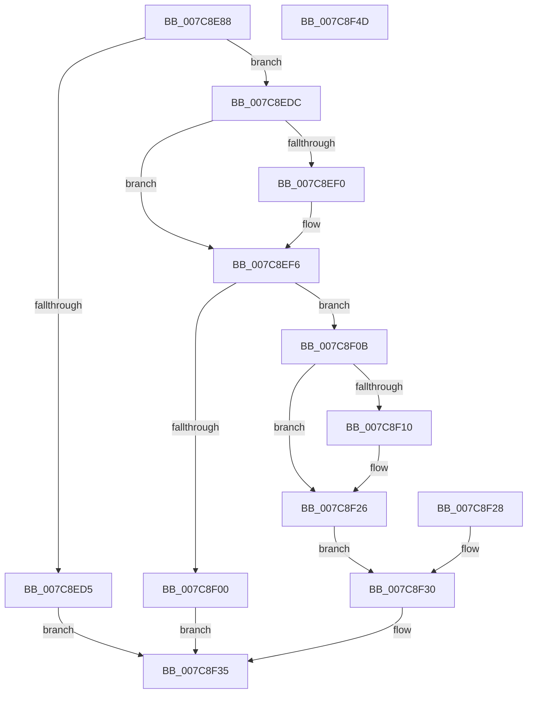

# sub_007C8E88

- RVA: `0x007C8E88`–`0x007C8F4E` (길이 `198` bytes)
- VA: `0x00000001407C8E88`
- 실행 섹션: `PAGE`
- PDB 이름 있음: `아니요`; PDB Function 태그: `아니요`
- unwind 정보 RVA: `0x000D4F6C`
- 디코드: `59`개 명령, `198/198` bytes 표시
- 미해석 바이트: `0` (있으면 어셈블리에 `.byte`로 보존)

> 이 문서는 커널 이미지의 기계어와 PDB 기호를 분석해 생성했습니다. 4번과 5번은 함수 원형과 자료형을 바이너리 사용 방식에서 추정한 C 해석이며 원본 소스 복구 결과는 아닙니다.

## 1. Dependencies

- 직접 호출 지점: **2**; 고유 호출 대상: **2**
- 직접 호출자로 확인된 함수: **1**
- RIP 상대 이미지 참조: **1**

### Outgoing calls
- `0x007C8ECB` → [bsearch](../../text/50/bsearch_function_00500430.md) (function, `0x00500430`)
- `0x007C8F21` → [memcpy](../../text/6C/memcpy_function_006C6840.md) (function, `0x006C6840`)

### Direct callers
- [sub_004BA83C](../../text/4B/Unknown_function_004BA83C.md) at `0x004BA930`

### Static image references
- `0x007C8EB9` → RVA `0x007C8730` (`PAGE`; read)

## 2. Other-region calls and transfers

- 다른 실행 섹션으로 향하는 call: **2**
  - `0x007C8ECB` → [bsearch](../../text/50/bsearch_function_00500430.md) (`PAGE` → `.text`)
  - `0x007C8F21` → [memcpy](../../text/6C/memcpy_function_006C6840.md) (`PAGE` → `.text`)
- 별도 외부 분기/꼬리 이동을 확인하지 못했습니다.

## 3. Assembly (complete function range)

```asm
007C8E88  4C 8B DC                        mov r11, rsp
007C8E8B  49 89 5B 08                     mov qword ptr [r11 + 8], rbx
007C8E8F  49 89 73 10                     mov qword ptr [r11 + 0x10], rsi
007C8E93  49 89 7B 18                     mov qword ptr [r11 + 0x18], rdi
007C8E97  41 56                           push r14
007C8E99  48 83 EC 40                     sub rsp, 0x40
007C8E9D  4D 8B F1                        mov r14, r9
007C8EA0  49 8B F0                        mov rsi, r8
007C8EA3  48 8B C2                        mov rax, rdx
007C8EA6  33 FF                           xor edi, edi
007C8EA8  8B DF                           mov ebx, edi
007C8EAA  89 5C 24 34                     mov dword ptr [rsp + 0x34], ebx
007C8EAE  44 8B 81 E8 B6 00 00            mov r8d, dword ptr [rcx + 0xb6e8]
007C8EB5  48 8D 51 18                     lea rdx, [rcx + 0x18]
007C8EB9  48 8D 0D 70 F8 FF FF            lea rcx, [rip - 0x790]
007C8EC0  49 89 4B D8                     mov qword ptr [r11 - 0x28], rcx
007C8EC4  44 8D 4F 10                     lea r9d, [rdi + 0x10]
007C8EC8  48 8B C8                        mov rcx, rax
007C8ECB  E8 60 75 D3 FF                  call 0x140500430
007C8ED0  48 85 C0                        test rax, rax
007C8ED3  75 07                           jne 0x1407c8edc
007C8ED5  BB 34 00 00 C0                  mov ebx, 0xc0000034
007C8EDA  EB 59                           jmp 0x1407c8f35
007C8EDC  48 8B 50 08                     mov rdx, qword ptr [rax + 8]
007C8EE0  0F B7 4A 06                     movzx ecx, word ptr [rdx + 6]
007C8EE4  48 8B 44 24 78                  mov rax, qword ptr [rsp + 0x78]
007C8EE9  89 08                           mov dword ptr [rax], ecx
007C8EEB  48 85 F6                        test rsi, rsi
007C8EEE  74 06                           je 0x1407c8ef6
007C8EF0  0F B7 42 04                     movzx eax, word ptr [rdx + 4]
007C8EF4  89 06                           mov dword ptr [rsi], eax
007C8EF6  0F B7 42 06                     movzx eax, word ptr [rdx + 6]
007C8EFA  3B 44 24 70                     cmp eax, dword ptr [rsp + 0x70]
007C8EFE  76 0B                           jbe 0x1407c8f0b
007C8F00  BB 23 00 00 C0                  mov ebx, 0xc0000023
007C8F05  89 5C 24 34                     mov dword ptr [rsp + 0x34], ebx
007C8F09  EB 2A                           jmp 0x1407c8f35
007C8F0B  4D 85 F6                        test r14, r14
007C8F0E  74 16                           je 0x1407c8f26
007C8F10  4C 8B C0                        mov r8, rax
007C8F13  0F B7 42 02                     movzx eax, word ptr [rdx + 2]
007C8F17  48 83 C2 10                     add rdx, 0x10
007C8F1B  48 03 D0                        add rdx, rax
007C8F1E  49 8B CE                        mov rcx, r14
007C8F21  E8 1A D9 EF FF                  call 0x1406c6840
007C8F26  EB 08                           jmp 0x1407c8f30
007C8F28  8B D8                           mov ebx, eax
007C8F2A  89 44 24 34                     mov dword ptr [rsp + 0x34], eax
007C8F2E  33 FF                           xor edi, edi
007C8F30  85 DB                           test ebx, ebx
007C8F32  0F 49 DF                        cmovns ebx, edi
007C8F35  8B C3                           mov eax, ebx
007C8F37  48 8B 5C 24 50                  mov rbx, qword ptr [rsp + 0x50]
007C8F3C  48 8B 74 24 58                  mov rsi, qword ptr [rsp + 0x58]
007C8F41  48 8B 7C 24 60                  mov rdi, qword ptr [rsp + 0x60]
007C8F46  48 83 C4 40                     add rsp, 0x40
007C8F4A  41 5E                           pop r14
007C8F4C  C3                              ret
007C8F4D  CC                              int3
```

## 4. C-style interpretation (structured pseudocode)

```c
__int64 __fastcall sub_007C8E88(__int64 a1, __int64 a2, __int64 a3, __int64 a4, unsigned int a5, __int64 a6)
{
    __int64 result;
    __int64 v_rbx;
    __int64 v_rdi;
    __int64 v_rsp;
    unsigned int v_stack_m14;
    unsigned __int64 v_stack_p10;
    unsigned __int64 v_stack_p18;
    unsigned __int64 v_stack_p8;

    *(unsigned __int64 *)(v_rsp + 8) = v_rbx;
    *(unsigned __int64 *)(v_rsp + 16) = v_rsi;
    *(unsigned __int64 *)(v_rsp + 24) = v_rdi;
    v_rsp = (v_rsp) - (64);
    v_rdi = 0;
    v_stack_m14 = 0;
    *(unsigned __int64 *)(v_rsp - 40) = v_rip - 1936;
    result = bsearch(a2, a1 + 24, (unsigned int)(*(unsigned int *)(a1 + 46824)), v_rdi + 16);
    if (result != 0) goto loc_007C8EDC;
    goto loc_007C8F35;
loc_007C8EDC:
    *(unsigned int *)(a6) = (unsigned int)(*(unsigned __int16 *)(*(unsigned __int64 *)(result + 8) + 6));
    result = a6;
    if (a3 != 0) {
        result = *(unsigned __int16 *)(*(unsigned __int64 *)(result + 8) + 4);
        *(unsigned int *)(a3) = (unsigned int)(result);
    }
    if (((unsigned int)(*(unsigned __int16 *)(*(unsigned __int64 *)(result + 8) + 6))) <= a5) goto loc_007C8F0B;
    v_stack_m14 = (unsigned int)((unsigned int)(0xC0000023ULL));
    goto loc_007C8F35;
loc_007C8F0B:
    result = *(unsigned __int16 *)(*(unsigned __int64 *)(result + 8) + 6);
    if (a4 != 0) {
        a3 = *(unsigned __int16 *)(*(unsigned __int64 *)(result + 8) + 6);
        result = *(unsigned __int16 *)(*(unsigned __int64 *)(result + 8) + 2);
        a2 = (*(unsigned __int64 *)(result + 8)) + (16);
        a2 = (a2) + (result);
        a1 = a4;
        result = memcpy(a1, a2, a3, v_rdi + 16);
    }
    goto loc_007C8F30;
loc_007C8F30:
    v_rbx = (unsigned int)(0xC0000023ULL);
    if (!sign_flag) { v_rbx = 0; }
loc_007C8F35:
    v_rsp = (v_rsp) + (64);
    return (unsigned int)((unsigned int)(v_rbx));
}
```

## 5. (Beta) C Style

```c
int64_t sub_007C8E88(void *Arg1, int64_t Arg2, int64_t Arg3, int64_t Arg4, uint32_t Arg5, void *Arg6)
{
    uint8_t *arg1 = (uint8_t *)Arg1;
    uint8_t *arg6 = (uint8_t *)Arg6;

    int64_t result;
    int64_t local_rbx;
    int64_t local_rdi;
    int64_t local_rsp;
    uint32_t v_stack_m14;
    uint64_t v_stack_p10;
    uint64_t v_stack_p18;
    uint64_t v_stack_p8;

    *(uint64_t *)(local_rsp + 0x8) = local_rbx;
    *(uint64_t *)(local_rsp + 0x10) = local_rsi;
    *(uint64_t *)(local_rsp + 0x18) = local_rdi;
    local_rsp = (local_rsp) - (64);
    local_rdi = 0;
    v_stack_m14 = 0;
    *(uint64_t *)(local_rsp - 0x28) = v_rip - 1936;
    result = bsearch(Arg2, Arg1 + 24, (uint32_t)(*(uint32_t *)(arg1 + 0xB6E8)), local_rdi + 16);
    if (result != 0) goto loc_007C8EDC;
    goto loc_007C8F35;
loc_007C8EDC:
    *(uint32_t *)(arg6) = (uint32_t)(*(uint16_t *)(*(uint64_t *)(result + 0x8) + 0x6));
    result = Arg6;
    if (Arg3 != 0) {
        result = *(uint16_t *)(*(uint64_t *)(result + 0x8) + 0x4);
        *(uint32_t *)(Arg3) = (uint32_t)(result);
    }
    if (((uint32_t)(*(uint16_t *)(*(uint64_t *)(result + 0x8) + 0x6))) <= Arg5) goto loc_007C8F0B;
    v_stack_m14 = (uint32_t)((uint32_t)(0xC0000023ULL));
    goto loc_007C8F35;
loc_007C8F0B:
    result = *(uint16_t *)(*(uint64_t *)(result + 0x8) + 0x6);
    if (Arg4 != 0) {
        Arg3 = *(uint16_t *)(*(uint64_t *)(result + 0x8) + 0x6);
        result = *(uint16_t *)(*(uint64_t *)(result + 0x8) + 0x2);
        Arg2 = (*(uint64_t *)(result + 0x8)) + (16);
        Arg2 = (Arg2) + (result);
        Arg1 = Arg4;
        result = memcpy(Arg1, Arg2, Arg3, local_rdi + 16);
    }
    goto loc_007C8F30;
loc_007C8F30:
    local_rbx = (uint32_t)(0xC0000023ULL);
    if (!sign_flag) { local_rbx = 0; }
loc_007C8F35:
    local_rsp = (local_rsp) + (64);
    return (uint32_t)((uint32_t)(local_rbx));
}
```

### 관측된 메모리 오프셋

구조체 형식이 확인되지 않은 접근은 인자 기준의 오프셋으로만 기록했습니다.

| 기준 인자 | 오프셋 표현 | 폭 (bit) | 접근 |
|---|---:|---:|---|
| `Arg1` | `+ 0x18` | `64` | `R` |
| `Arg1` | `+ 0xB6E8` | `32` | `R` |
| `Arg6` | `+ 0x0` | `32` | `W` |

## 6. Execution-region graph

[열기: 2D/3D 그래프와 함수 탐색 컨트롤 패널](../../../control-panel.html?section=page&rva=0x007C8E88&view=graph)

- 2D 그래프는 위에서 아래로 흐르고, 3D 그래프는 빈 공간을 드래그해 회전합니다. Shift+드래그는 이동, 휠은 확대·축소, 함수 노드 선택은 대상 보고서 이동입니다.

### Static fallback


