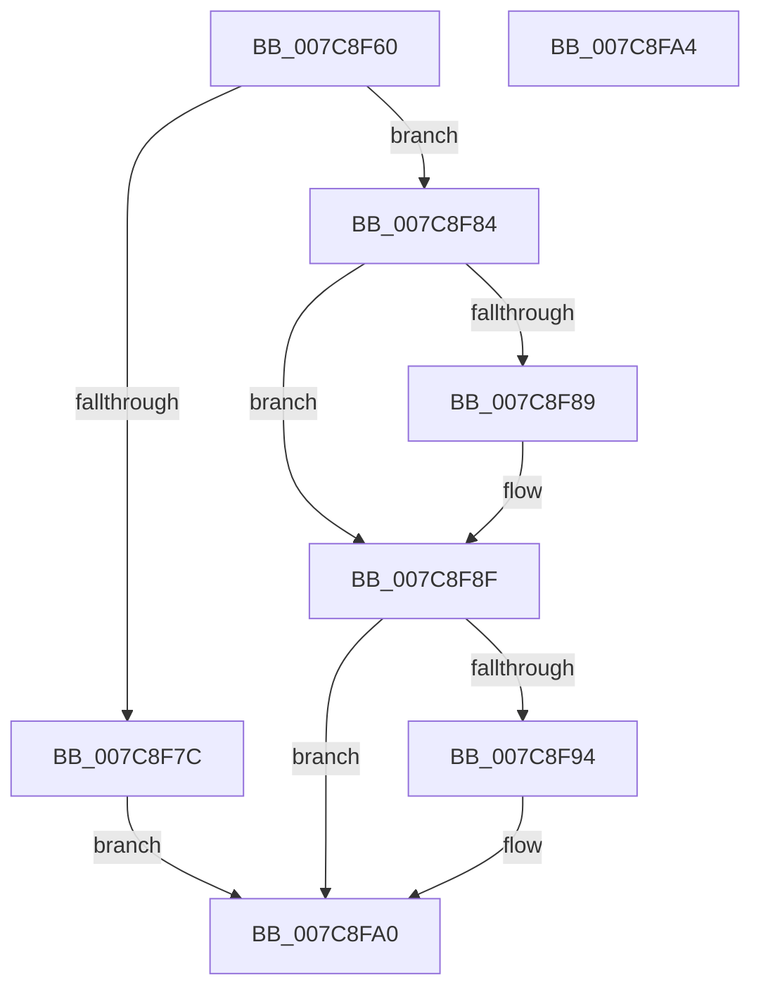

# sub_007C8F60

- RVA: `0x007C8F60`–`0x007C8FA5` (길이 `69` bytes)
- VA: `0x00000001407C8F60`
- 실행 섹션: `PAGE`
- PDB 이름 있음: `아니요`; PDB Function 태그: `아니요`
- unwind 정보 RVA: `0x000DB714`
- 디코드: `19`개 명령, `69/69` bytes 표시
- 미해석 바이트: `0` (있으면 어셈블리에 `.byte`로 보존)

> 이 문서는 커널 이미지의 기계어와 PDB 기호를 분석해 생성했습니다. 4번과 5번은 함수 원형과 자료형을 바이너리 사용 방식에서 추정한 C 해석이며 원본 소스 복구 결과는 아닙니다.

## 1. Dependencies

- 직접 호출 지점: **0**; 고유 호출 대상: **0**
- 직접 호출자로 확인된 함수: **0**
- RIP 상대 이미지 참조: **0**

### Outgoing calls
- 직접 디코드된 call 명령이 없습니다.

### Direct callers
- 이 함수 시작 RVA로 연결되는 직접 call은 확인되지 않았습니다. 간접 호출은 완전히 역산할 수 없습니다.

### Static image references
- 디코드된 RIP-relative 메모리 참조가 없습니다.

## 2. Other-region calls and transfers

- 다른 실행 섹션으로 향하는 call: **0**
- 별도 외부 분기/꼬리 이동을 확인하지 못했습니다.

## 3. Assembly (complete function range)

```asm
007C8F60  48 8B 44 24 30                  mov rax, qword ptr [rsp + 0x30]
007C8F65  45 33 D2                        xor r10d, r10d
007C8F68  C6 00 01                        mov byte ptr [rax], 1
007C8F6B  48 8B 44 24 28                  mov rax, qword ptr [rsp + 0x28]
007C8F70  C7 00 10 00 00 00               mov dword ptr [rax], 0x10
007C8F76  41 83 F9 10                     cmp r9d, 0x10
007C8F7A  73 08                           jae 0x1407c8f84
007C8F7C  41 BA 23 00 00 C0               mov r10d, 0xc0000023
007C8F82  EB 1C                           jmp 0x1407c8fa0
007C8F84  48 85 D2                        test rdx, rdx
007C8F87  74 06                           je 0x1407c8f8f
007C8F89  C7 02 03 00 00 00               mov dword ptr [rdx], 3
007C8F8F  4D 85 C0                        test r8, r8
007C8F92  74 0C                           je 0x1407c8fa0
007C8F94  0F 10 81 91 B7 00 00            movups xmm0, xmmword ptr [rcx + 0xb791]
007C8F9B  F3 41 0F 7F 00                  movdqu xmmword ptr [r8], xmm0
007C8FA0  41 8B C2                        mov eax, r10d
007C8FA3  C3                              ret
007C8FA4  CC                              int3
```

## 4. C-style interpretation (structured pseudocode)

```c
__int64 __fastcall sub_007C8F60(__int64 a1, __int64 a2, __int64 a3, int a4, __int64 a5, __int64 a6)
{
    __int64 v_r10;

    v_r10 = 0;
    *(unsigned __int8 *)(a6) = 1;
    *(unsigned int *)(a5) = 16;
    if (a4 >= 16) goto loc_007C8F84;
    goto loc_007C8FA0;
loc_007C8F84:
    if (a2 != 0) {
        *(unsigned int *)(a2) = 3;
    }
    if (a3 != 0) {
        *(unsigned __int64 *)(a3) = v_xmm0;
    }
    return (unsigned int)((unsigned int)((unsigned int)(0xC0000023ULL)));
}
```

## 5. (Beta) C Style

```c
int64_t sub_007C8F60(void *Arg1, int64_t Arg2, int64_t Arg3, int32_t Arg4, void *Arg5, void *Arg6)
{
    uint8_t *arg1 = (uint8_t *)Arg1;
    uint8_t *arg5 = (uint8_t *)Arg5;
    uint8_t *arg6 = (uint8_t *)Arg6;

    int64_t local_r10;

    local_r10 = 0;
    *(uint8_t *)(arg6) = 1;
    *(uint32_t *)(arg5) = 16;
    if (Arg4 >= 16) goto loc_007C8F84;
    goto loc_007C8FA0;
loc_007C8F84:
    if (Arg2 != 0) {
        *(uint32_t *)(Arg2) = 3;
    }
    if (Arg3 != 0) {
        *(uint64_t *)(Arg3) = v_xmm0;
    }
    return (uint32_t)((uint32_t)((uint32_t)(0xC0000023ULL)));
}
```

### 관측된 메모리 오프셋

구조체 형식이 확인되지 않은 접근은 인자 기준의 오프셋으로만 기록했습니다.

| 기준 인자 | 오프셋 표현 | 폭 (bit) | 접근 |
|---|---:|---:|---|
| `Arg1` | `+ 0xB791` | `128` | `R` |
| `Arg5` | `+ 0x0` | `32` | `W` |
| `Arg6` | `+ 0x0` | `8` | `W` |

## 6. Execution-region graph

[열기: 2D/3D 그래프와 함수 탐색 컨트롤 패널](../../../control-panel.html?section=page&rva=0x007C8F60&view=graph)

- 2D 그래프는 위에서 아래로 흐르고, 3D 그래프는 빈 공간을 드래그해 회전합니다. Shift+드래그는 이동, 휠은 확대·축소, 함수 노드 선택은 대상 보고서 이동입니다.

### Static fallback


