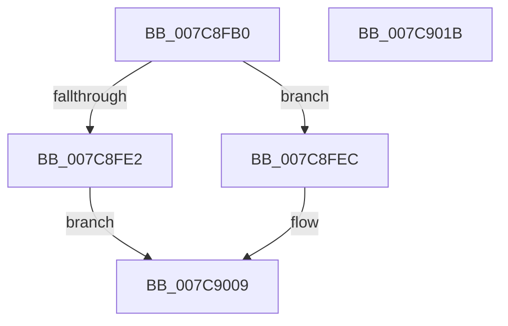

# sub_007C8FB0

- RVA: `0x007C8FB0`–`0x007C901C` (길이 `108` bytes)
- VA: `0x00000001407C8FB0`
- 실행 섹션: `PAGE`
- PDB 이름 있음: `아니요`; PDB Function 태그: `아니요`
- unwind 정보 RVA: `0x000718AC`
- 디코드: `32`개 명령, `108/108` bytes 표시
- 미해석 바이트: `0` (있으면 어셈블리에 `.byte`로 보존)

> 이 문서는 커널 이미지의 기계어와 PDB 기호를 분석해 생성했습니다. 4번과 5번은 함수 원형과 자료형을 바이너리 사용 방식에서 추정한 C 해석이며 원본 소스 복구 결과는 아닙니다.

## 1. Dependencies

- 직접 호출 지점: **2**; 고유 호출 대상: **2**
- 직접 호출자로 확인된 함수: **0**
- RIP 상대 이미지 참조: **0**

### Outgoing calls
- `0x007C8FD1` → [ExpGetLicenseTamperState](../../text/65/ExpGetLicenseTamperState_function_00657740.md) (function, `0x00657740`)
- `0x007C9002` → [sub_007C7CEC](Unknown_function_007C7CEC.md) (function, `0x007C7CEC`)

### Direct callers
- 이 함수 시작 RVA로 연결되는 직접 call은 확인되지 않았습니다. 간접 호출은 완전히 역산할 수 없습니다.

### Static image references
- 디코드된 RIP-relative 메모리 참조가 없습니다.

## 2. Other-region calls and transfers

- 다른 실행 섹션으로 향하는 call: **1**
  - `0x007C8FD1` → [ExpGetLicenseTamperState](../../text/65/ExpGetLicenseTamperState_function_00657740.md) (`PAGE` → `.text`)
- 별도 외부 분기/꼬리 이동을 확인하지 못했습니다.

## 3. Assembly (complete function range)

```asm
007C8FB0  48 8B C4                        mov rax, rsp
007C8FB3  48 89 58 08                     mov qword ptr [rax + 8], rbx
007C8FB7  48 89 70 10                     mov qword ptr [rax + 0x10], rsi
007C8FBB  57                              push rdi
007C8FBC  48 83 EC 40                     sub rsp, 0x40
007C8FC0  83 60 E8 00                     and dword ptr [rax - 0x18], 0
007C8FC4  48 8B F2                        mov rsi, rdx
007C8FC7  48 8D 50 E8                     lea rdx, [rax - 0x18]
007C8FCB  41 8B D9                        mov ebx, r9d
007C8FCE  49 8B F8                        mov rdi, r8
007C8FD1  E8 6A E7 E8 FF                  call 0x140657740
007C8FD6  83 7C 24 30 00                  cmp dword ptr [rsp + 0x30], 0
007C8FDB  48 8B 44 24 78                  mov rax, qword ptr [rsp + 0x78]
007C8FE0  75 0A                           jne 0x1407c8fec
007C8FE2  B9 34 00 00 C0                  mov ecx, 0xc0000034
007C8FE7  C6 00 00                        mov byte ptr [rax], 0
007C8FEA  EB 1D                           jmp 0x1407c9009
007C8FEC  83 64 24 20 00                  and dword ptr [rsp + 0x20], 0
007C8FF1  44 8B C3                        mov r8d, ebx
007C8FF4  4C 8B 4C 24 70                  mov r9, qword ptr [rsp + 0x70]
007C8FF9  48 8B D7                        mov rdx, rdi
007C8FFC  48 8B CE                        mov rcx, rsi
007C8FFF  C6 00 01                        mov byte ptr [rax], 1
007C9002  E8 E5 EC FF FF                  call 0x1407c7cec
007C9007  8B C8                           mov ecx, eax
007C9009  48 8B 5C 24 50                  mov rbx, qword ptr [rsp + 0x50]
007C900E  8B C1                           mov eax, ecx
007C9010  48 8B 74 24 58                  mov rsi, qword ptr [rsp + 0x58]
007C9015  48 83 C4 40                     add rsp, 0x40
007C9019  5F                              pop rdi
007C901A  C3                              ret
007C901B  CC                              int3
```

## 4. C-style interpretation (structured pseudocode)

```c
__int64 __fastcall sub_007C8FB0(__int64 a1, __int64 a2, __int64 a3, int a4, __int64 a5, __int64 a6)
{
    __int64 result;
    __int64 v_rsp;
    unsigned int v_stack_m18;
    unsigned int v_stack_m28;
    unsigned __int64 v_stack_p10;
    unsigned __int64 v_stack_p8;

    *(unsigned __int64 *)(v_rsp + 8) = v_rbx;
    *(unsigned __int64 *)(v_rsp + 16) = v_rsi;
    v_rsp = (v_rsp) - (64);
    result = ExpGetLicenseTamperState(a1, v_rsp - 24, a3, a4);
    if (v_stack_m18 != 0) goto loc_007C8FEC;
    *(unsigned __int8 *)(a6) = 0;
    goto loc_007C9009;
loc_007C8FEC:
    *(unsigned __int8 *)(a6) = 1;
    result = sub_007C7CEC(a2, a3, (unsigned int)((unsigned int)((unsigned int)(a4))), a5);
loc_007C9009:
    v_rsp = (v_rsp) + (64);
    return (unsigned int)((unsigned int)((unsigned int)((unsigned int)(result))));
}
```

## 5. (Beta) C Style

```c
int64_t sub_007C8FB0(int64_t Arg1, int64_t Arg2, int64_t Arg3, int32_t Arg4, int64_t Arg5, void *Arg6)
{
    uint8_t *arg6 = (uint8_t *)Arg6;

    int64_t result;
    int64_t local_rsp;
    uint32_t v_stack_m18;
    uint32_t v_stack_m28;
    uint64_t v_stack_p10;
    uint64_t v_stack_p8;

    *(uint64_t *)(local_rsp + 0x8) = local_rbx;
    *(uint64_t *)(local_rsp + 0x10) = local_rsi;
    local_rsp = (local_rsp) - (64);
    result = ExpGetLicenseTamperState(Arg1, local_rsp - 24, Arg3, Arg4);
    if (v_stack_m18 != 0) goto loc_007C8FEC;
    *(uint8_t *)(arg6) = 0;
    goto loc_007C9009;
loc_007C8FEC:
    *(uint8_t *)(arg6) = 1;
    result = sub_007C7CEC(Arg2, Arg3, (uint32_t)((uint32_t)((uint32_t)(Arg4))), Arg5);
loc_007C9009:
    local_rsp = (local_rsp) + (64);
    return (uint32_t)((uint32_t)((uint32_t)((uint32_t)(result))));
}
```

### 관측된 메모리 오프셋

구조체 형식이 확인되지 않은 접근은 인자 기준의 오프셋으로만 기록했습니다.

| 기준 인자 | 오프셋 표현 | 폭 (bit) | 접근 |
|---|---:|---:|---|
| `Arg6` | `+ 0x0` | `8` | `W` |

## 6. Execution-region graph

[열기: 2D/3D 그래프와 함수 탐색 컨트롤 패널](../../../control-panel.html?section=page&rva=0x007C8FB0&view=graph)

- 2D 그래프는 위에서 아래로 흐르고, 3D 그래프는 빈 공간을 드래그해 회전합니다. Shift+드래그는 이동, 휠은 확대·축소, 함수 노드 선택은 대상 보고서 이동입니다.

### Static fallback


