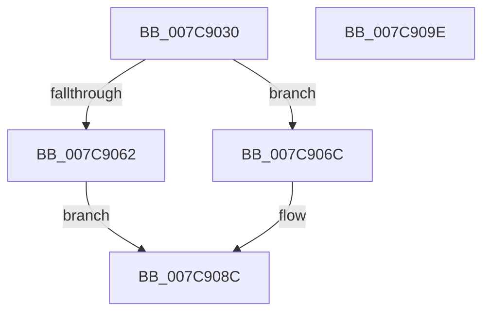

# sub_007C9030

- RVA: `0x007C9030`–`0x007C909F` (길이 `111` bytes)
- VA: `0x00000001407C9030`
- 실행 섹션: `PAGE`
- PDB 이름 있음: `아니요`; PDB Function 태그: `아니요`
- unwind 정보 RVA: `0x000718AC`
- 디코드: `32`개 명령, `111/111` bytes 표시
- 미해석 바이트: `0` (있으면 어셈블리에 `.byte`로 보존)

> 이 문서는 커널 이미지의 기계어와 PDB 기호를 분석해 생성했습니다. 4번과 5번은 함수 원형과 자료형을 바이너리 사용 방식에서 추정한 C 해석이며 원본 소스 복구 결과는 아닙니다.

## 1. Dependencies

- 직접 호출 지점: **2**; 고유 호출 대상: **2**
- 직접 호출자로 확인된 함수: **0**
- RIP 상대 이미지 참조: **0**

### Outgoing calls
- `0x007C9051` → [ExpGetLicenseTamperState](../../text/65/ExpGetLicenseTamperState_function_00657740.md) (function, `0x00657740`)
- `0x007C9085` → [sub_007C7CEC](Unknown_function_007C7CEC.md) (function, `0x007C7CEC`)

### Direct callers
- 이 함수 시작 RVA로 연결되는 직접 call은 확인되지 않았습니다. 간접 호출은 완전히 역산할 수 없습니다.

### Static image references
- 디코드된 RIP-relative 메모리 참조가 없습니다.

## 2. Other-region calls and transfers

- 다른 실행 섹션으로 향하는 call: **1**
  - `0x007C9051` → [ExpGetLicenseTamperState](../../text/65/ExpGetLicenseTamperState_function_00657740.md) (`PAGE` → `.text`)
- 별도 외부 분기/꼬리 이동을 확인하지 못했습니다.

## 3. Assembly (complete function range)

```asm
007C9030  48 8B C4                        mov rax, rsp
007C9033  48 89 58 08                     mov qword ptr [rax + 8], rbx
007C9037  48 89 70 10                     mov qword ptr [rax + 0x10], rsi
007C903B  57                              push rdi
007C903C  48 83 EC 40                     sub rsp, 0x40
007C9040  83 60 E8 00                     and dword ptr [rax - 0x18], 0
007C9044  48 8B F2                        mov rsi, rdx
007C9047  48 8D 50 E8                     lea rdx, [rax - 0x18]
007C904B  41 8B D9                        mov ebx, r9d
007C904E  49 8B F8                        mov rdi, r8
007C9051  E8 EA E6 E8 FF                  call 0x140657740
007C9056  83 7C 24 30 00                  cmp dword ptr [rsp + 0x30], 0
007C905B  48 8B 44 24 78                  mov rax, qword ptr [rsp + 0x78]
007C9060  75 0A                           jne 0x1407c906c
007C9062  B9 34 00 00 C0                  mov ecx, 0xc0000034
007C9067  C6 00 00                        mov byte ptr [rax], 0
007C906A  EB 20                           jmp 0x1407c908c
007C906C  4C 8B 4C 24 70                  mov r9, qword ptr [rsp + 0x70]
007C9071  44 8B C3                        mov r8d, ebx
007C9074  48 8B D7                        mov rdx, rdi
007C9077  C6 00 01                        mov byte ptr [rax], 1
007C907A  48 8B CE                        mov rcx, rsi
007C907D  C7 44 24 20 04 00 00 00         mov dword ptr [rsp + 0x20], 4
007C9085  E8 62 EC FF FF                  call 0x1407c7cec
007C908A  8B C8                           mov ecx, eax
007C908C  48 8B 5C 24 50                  mov rbx, qword ptr [rsp + 0x50]
007C9091  8B C1                           mov eax, ecx
007C9093  48 8B 74 24 58                  mov rsi, qword ptr [rsp + 0x58]
007C9098  48 83 C4 40                     add rsp, 0x40
007C909C  5F                              pop rdi
007C909D  C3                              ret
007C909E  CC                              int3
```

## 4. C-style interpretation (structured pseudocode)

```c
__int64 __fastcall sub_007C9030(__int64 a1, __int64 a2, __int64 a3, int a4, __int64 a5, __int64 a6)
{
    __int64 result;
    __int64 v_rsp;
    unsigned int v_stack_m18;
    unsigned int v_stack_m28;
    unsigned __int64 v_stack_p10;
    unsigned __int64 v_stack_p8;

    *(unsigned __int64 *)(v_rsp + 8) = v_rbx;
    *(unsigned __int64 *)(v_rsp + 16) = v_rsi;
    v_rsp = (v_rsp) - (64);
    result = ExpGetLicenseTamperState(a1, v_rsp - 24, a3, a4);
    if (v_stack_m18 != 0) goto loc_007C906C;
    *(unsigned __int8 *)(a6) = 0;
    goto loc_007C908C;
loc_007C906C:
    *(unsigned __int8 *)(a6) = 1;
    v_stack_m28 = 4;
    result = sub_007C7CEC(a2, a3, (unsigned int)((unsigned int)((unsigned int)(a4))), a5);
loc_007C908C:
    v_rsp = (v_rsp) + (64);
    return (unsigned int)((unsigned int)((unsigned int)((unsigned int)(result))));
}
```

## 5. (Beta) C Style

```c
int64_t sub_007C9030(int64_t Arg1, int64_t Arg2, int64_t Arg3, int32_t Arg4, int64_t Arg5, void *Arg6)
{
    uint8_t *arg6 = (uint8_t *)Arg6;

    int64_t result;
    int64_t local_rsp;
    uint32_t v_stack_m18;
    uint32_t v_stack_m28;
    uint64_t v_stack_p10;
    uint64_t v_stack_p8;

    *(uint64_t *)(local_rsp + 0x8) = local_rbx;
    *(uint64_t *)(local_rsp + 0x10) = local_rsi;
    local_rsp = (local_rsp) - (64);
    result = ExpGetLicenseTamperState(Arg1, local_rsp - 24, Arg3, Arg4);
    if (v_stack_m18 != 0) goto loc_007C906C;
    *(uint8_t *)(arg6) = 0;
    goto loc_007C908C;
loc_007C906C:
    *(uint8_t *)(arg6) = 1;
    v_stack_m28 = 4;
    result = sub_007C7CEC(Arg2, Arg3, (uint32_t)((uint32_t)((uint32_t)(Arg4))), Arg5);
loc_007C908C:
    local_rsp = (local_rsp) + (64);
    return (uint32_t)((uint32_t)((uint32_t)((uint32_t)(result))));
}
```

### 관측된 메모리 오프셋

구조체 형식이 확인되지 않은 접근은 인자 기준의 오프셋으로만 기록했습니다.

| 기준 인자 | 오프셋 표현 | 폭 (bit) | 접근 |
|---|---:|---:|---|
| `Arg6` | `+ 0x0` | `8` | `W` |

## 6. Execution-region graph

[열기: 2D/3D 그래프와 함수 탐색 컨트롤 패널](../../../control-panel.html?section=page&rva=0x007C9030&view=graph)

- 2D 그래프는 위에서 아래로 흐르고, 3D 그래프는 빈 공간을 드래그해 회전합니다. Shift+드래그는 이동, 휠은 확대·축소, 함수 노드 선택은 대상 보고서 이동입니다.

### Static fallback


