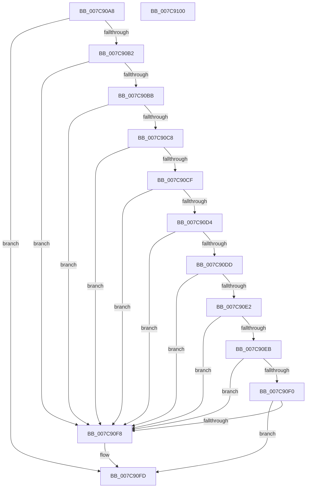

# sub_007C90A8

- RVA: `0x007C90A8`–`0x007C9101` (길이 `89` bytes)
- VA: `0x00000001407C90A8`
- 실행 섹션: `PAGE`
- PDB 이름 있음: `아니요`; PDB Function 태그: `아니요`
- unwind 정보 RVA: `0x000DB714`
- 디코드: `31`개 명령, `89/89` bytes 표시
- 미해석 바이트: `0` (있으면 어셈블리에 `.byte`로 보존)

> 이 문서는 커널 이미지의 기계어와 PDB 기호를 분석해 생성했습니다. 4번과 5번은 함수 원형과 자료형을 바이너리 사용 방식에서 추정한 C 해석이며 원본 소스 복구 결과는 아닙니다.

## 1. Dependencies

- 직접 호출 지점: **0**; 고유 호출 대상: **0**
- 직접 호출자로 확인된 함수: **2**
- RIP 상대 이미지 참조: **0**

### Outgoing calls
- 직접 디코드된 call 명령이 없습니다.

### Direct callers
- [sub_007C87A4](Unknown_function_007C87A4.md) at `0x007C890E`
- [sub_009669C4](../96/Unknown_function_009669C4.md) at `0x00966B9F`

### Static image references
- 디코드된 RIP-relative 메모리 참조가 없습니다.

## 2. Other-region calls and transfers

- 다른 실행 섹션으로 향하는 call: **0**
- 별도 외부 분기/꼬리 이동을 확인하지 못했습니다.

## 3. Assembly (complete function range)

```asm
007C90A8  48 8B 01                        mov rax, qword ptr [rcx]
007C90AB  33 C9                           xor ecx, ecx
007C90AD  48 85 C0                        test rax, rax
007C90B0  74 4B                           je 0x1407c90fd
007C90B2  83 B8 04 40 01 00 03            cmp dword ptr [rax + 0x14004], 3
007C90B9  75 3D                           jne 0x1407c90f8
007C90BB  44 8B 80 00 40 01 00            mov r8d, dword ptr [rax + 0x14000]
007C90C2  41 83 F8 18                     cmp r8d, 0x18
007C90C6  72 30                           jb 0x1407c90f8
007C90C8  8B 10                           mov edx, dword ptr [rax]
007C90CA  44 3B C2                        cmp r8d, edx
007C90CD  72 29                           jb 0x1407c90f8
007C90CF  83 FA 18                        cmp edx, 0x18
007C90D2  72 24                           jb 0x1407c90f8
007C90D4  44 8B 50 04                     mov r10d, dword ptr [rax + 4]
007C90D8  45 3B C2                        cmp r8d, r10d
007C90DB  72 1B                           jb 0x1407c90f8
007C90DD  41 3B D2                        cmp edx, r10d
007C90E0  72 16                           jb 0x1407c90f8
007C90E2  44 8B 48 08                     mov r9d, dword ptr [rax + 8]
007C90E6  45 3B C1                        cmp r8d, r9d
007C90E9  72 0D                           jb 0x1407c90f8
007C90EB  41 3B D1                        cmp edx, r9d
007C90EE  72 08                           jb 0x1407c90f8
007C90F0  43 8D 04 11                     lea eax, [r9 + r10]
007C90F4  3B C2                           cmp eax, edx
007C90F6  76 05                           jbe 0x1407c90fd
007C90F8  B9 3E 00 00 C0                  mov ecx, 0xc000003e
007C90FD  8B C1                           mov eax, ecx
007C90FF  C3                              ret
007C9100  CC                              int3
```

## 4. C-style interpretation (structured pseudocode)

```c
__int64 __fastcall sub_007C90A8(__int64 a1)
{
    a1 = 0;
    if (*(unsigned __int64 *)(a1) == 0) goto loc_007C90FD;
    if ((*(unsigned int *)(*(unsigned __int64 *)(a1) + 81924)) != 3) goto loc_007C90F8;
    if (((unsigned int)((unsigned int)(*(unsigned int *)(*(unsigned __int64 *)(a1) + 81920)))) < 24) goto loc_007C90F8;
    if (((unsigned int)((unsigned int)(*(unsigned int *)(*(unsigned __int64 *)(a1) + 81920)))) < ((unsigned int)((unsigned int)(*(unsigned int *)(*(unsigned __int64 *)(a1)))))) goto loc_007C90F8;
    if (((unsigned int)((unsigned int)(*(unsigned int *)(*(unsigned __int64 *)(a1))))) < 24) goto loc_007C90F8;
    if (((unsigned int)((unsigned int)(*(unsigned int *)(*(unsigned __int64 *)(a1) + 81920)))) < ((unsigned int)((unsigned int)(*(unsigned int *)(*(unsigned __int64 *)(a1) + 4))))) goto loc_007C90F8;
    if (((unsigned int)((unsigned int)(*(unsigned int *)(*(unsigned __int64 *)(a1))))) < ((unsigned int)((unsigned int)(*(unsigned int *)(*(unsigned __int64 *)(a1) + 4))))) goto loc_007C90F8;
    if (((unsigned int)((unsigned int)(*(unsigned int *)(*(unsigned __int64 *)(a1) + 81920)))) < ((unsigned int)((unsigned int)(*(unsigned int *)(*(unsigned __int64 *)(a1) + 8))))) goto loc_007C90F8;
    if (((unsigned int)((unsigned int)(*(unsigned int *)(*(unsigned __int64 *)(a1))))) < ((unsigned int)((unsigned int)(*(unsigned int *)(*(unsigned __int64 *)(a1) + 8))))) goto loc_007C90F8;
    if (((unsigned int)((unsigned int)(*(unsigned int *)(*(unsigned __int64 *)(a1) + 8)) + (unsigned int)(*(unsigned int *)(*(unsigned __int64 *)(a1) + 4)) * 1)) >= = ((unsigned int)((unsigned int)(*(unsigned int *)(*(unsigned __int64 *)(a1)))))) {
        a1 = 0xC000003EULL;
    }
    return (unsigned int)((unsigned int)(a1));
}
```

## 5. (Beta) C Style

```c
int64_t sub_007C90A8(void *Arg1)
{
    uint8_t *arg1 = (uint8_t *)Arg1;

    Arg1 = 0;
    if (*(uint64_t *)(arg1) == 0) goto loc_007C90FD;
    if ((*(uint32_t *)(*(uint64_t *)(arg1) + 0x14004)) != 3) goto loc_007C90F8;
    if (((uint32_t)((uint32_t)(*(uint32_t *)(*(uint64_t *)(arg1) + 0x14000)))) < 24) goto loc_007C90F8;
    if (((uint32_t)((uint32_t)(*(uint32_t *)(*(uint64_t *)(arg1) + 0x14000)))) < ((uint32_t)((uint32_t)(*(uint32_t *)(*(uint64_t *)(arg1)))))) goto loc_007C90F8;
    if (((uint32_t)((uint32_t)(*(uint32_t *)(*(uint64_t *)(arg1))))) < 24) goto loc_007C90F8;
    if (((uint32_t)((uint32_t)(*(uint32_t *)(*(uint64_t *)(arg1) + 0x14000)))) < ((uint32_t)((uint32_t)(*(uint32_t *)(*(uint64_t *)(arg1) + 0x4))))) goto loc_007C90F8;
    if (((uint32_t)((uint32_t)(*(uint32_t *)(*(uint64_t *)(arg1))))) < ((uint32_t)((uint32_t)(*(uint32_t *)(*(uint64_t *)(arg1) + 0x4))))) goto loc_007C90F8;
    if (((uint32_t)((uint32_t)(*(uint32_t *)(*(uint64_t *)(arg1) + 0x14000)))) < ((uint32_t)((uint32_t)(*(uint32_t *)(*(uint64_t *)(arg1) + 0x8))))) goto loc_007C90F8;
    if (((uint32_t)((uint32_t)(*(uint32_t *)(*(uint64_t *)(arg1))))) < ((uint32_t)((uint32_t)(*(uint32_t *)(*(uint64_t *)(arg1) + 0x8))))) goto loc_007C90F8;
    if (((uint32_t)((uint32_t)(*(uint32_t *)(*(uint64_t *)(arg1) + 0x8)) + (uint32_t)(*(uint32_t *)(*(uint64_t *)(arg1) + 0x4)) * 1)) >= = ((uint32_t)((uint32_t)(*(uint32_t *)(*(uint64_t *)(arg1)))))) {
        Arg1 = 0xC000003EULL;
    }
    return (uint32_t)((uint32_t)(Arg1));
}
```

### 관측된 메모리 오프셋

구조체 형식이 확인되지 않은 접근은 인자 기준의 오프셋으로만 기록했습니다.

| 기준 인자 | 오프셋 표현 | 폭 (bit) | 접근 |
|---|---:|---:|---|
| `Arg1` | `+ 0x0` | `64` | `R` |

## 6. Execution-region graph

[열기: 2D/3D 그래프와 함수 탐색 컨트롤 패널](../../../control-panel.html?section=page&rva=0x007C90A8&view=graph)

- 2D 그래프는 위에서 아래로 흐르고, 3D 그래프는 빈 공간을 드래그해 회전합니다. Shift+드래그는 이동, 휠은 확대·축소, 함수 노드 선택은 대상 보고서 이동입니다.

### Static fallback


