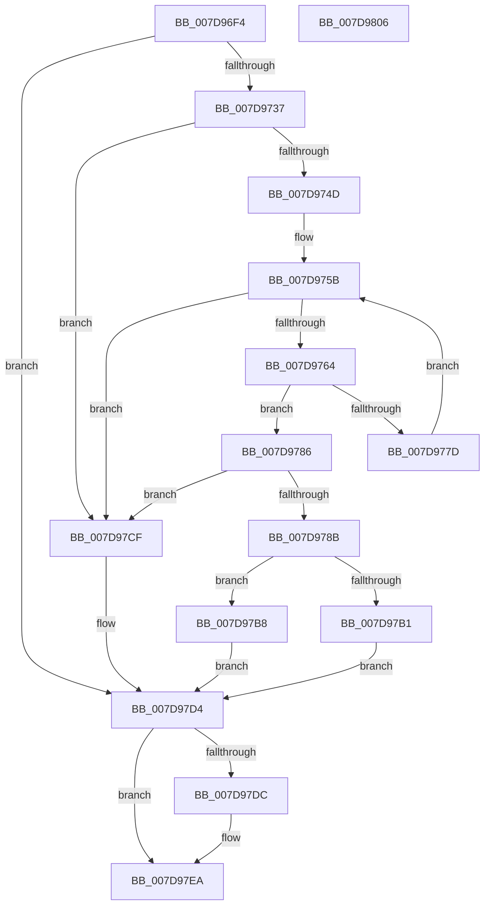

# ApiSetLoadSchemaEx

- RVA: `0x007D96F4`–`0x007D9807` (길이 `275` bytes)
- VA: `0x00000001407D96F4`
- 실행 섹션: `PAGE`
- PDB 이름 있음: `예`; PDB Function 태그: `아니요`
- unwind 정보 RVA: `0x000D60F8`
- 디코드: `77`개 명령, `275/275` bytes 표시
- 미해석 바이트: `0` (있으면 어셈블리에 `.byte`로 보존)

> 이 문서는 커널 이미지의 기계어와 PDB 기호를 분석해 생성했습니다. 4번과 5번은 함수 원형과 자료형을 바이너리 사용 방식에서 추정한 C 해석이며 원본 소스 복구 결과는 아닙니다.

## 1. Dependencies

- 직접 호출 지점: **6**; 고유 호출 대상: **6**
- 직접 호출자로 확인된 함수: **2**
- RIP 상대 이미지 참조: **1**

### Outgoing calls
- `0x007D9728` → [ApiSetpLoadSchemaImage](ApiSetpLoadSchemaImage_function_007D9C54.md) (function, `0x007D9C54`)
- `0x007D973C` → [RtlImageNtHeader](../../text/44/RtlImageNtHeader_function_00443B60.md) (function, `0x00443B60`)
- `0x007D9774` → [strncmp](../../text/6C/strncmp_function_006C6720.md) (function, `0x006C6720`)
- `0x007D97A4` → [ExAllocatePool2](../../poolcode/B8/ExAllocatePool2_function_00B820F0.md) (function, `0x00B820F0`)
- `0x007D97C1` → [memcpy](../../text/6C/memcpy_function_006C6840.md) (function, `0x006C6840`)
- `0x007D97E5` → [ZwUnmapViewOfSection](../../text/6A/ZwUnmapViewOfSection_function_006AD610.md) (function, `0x006AD610`)

### Direct callers
- [ApiSetLoadSchemaWithExtensions](ApiSetLoadSchemaWithExtensions_function_007D9810.md) at `0x007D9844`
- [ApiSetpLoadSchemaExtension](ApiSetpLoadSchemaExtension_function_007D9A0C.md) at `0x007D9ABF`

### Static image references
- `0x007D976A` → RVA `0x00039D18` (`.rdata`; read)

## 2. Other-region calls and transfers

- 다른 실행 섹션으로 향하는 call: **5**
  - `0x007D973C` → [RtlImageNtHeader](../../text/44/RtlImageNtHeader_function_00443B60.md) (`PAGE` → `.text`)
  - `0x007D9774` → [strncmp](../../text/6C/strncmp_function_006C6720.md) (`PAGE` → `.text`)
  - `0x007D97A4` → [ExAllocatePool2](../../poolcode/B8/ExAllocatePool2_function_00B820F0.md) (`PAGE` → `POOLCODE`)
  - `0x007D97C1` → [memcpy](../../text/6C/memcpy_function_006C6840.md) (`PAGE` → `.text`)
  - `0x007D97E5` → [ZwUnmapViewOfSection](../../text/6A/ZwUnmapViewOfSection_function_006AD610.md) (`PAGE` → `.text`)
- 별도 외부 분기/꼬리 이동을 확인하지 못했습니다.

## 3. Assembly (complete function range)

```asm
007D96F4  48 8B C4                        mov rax, rsp
007D96F7  48 89 58 08                     mov qword ptr [rax + 8], rbx
007D96FB  48 89 70 10                     mov qword ptr [rax + 0x10], rsi
007D96FF  48 89 78 18                     mov qword ptr [rax + 0x18], rdi
007D9703  41 54                           push r12
007D9705  41 56                           push r14
007D9707  41 57                           push r15
007D9709  48 83 EC 30                     sub rsp, 0x30
007D970D  48 83 60 D8 00                  and qword ptr [rax - 0x28], 0
007D9712  4C 8D 48 D8                     lea r9, [rax - 0x28]
007D9716  48 83 60 20 00                  and qword ptr [rax + 0x20], 0
007D971B  4D 8B F8                        mov r15, r8
007D971E  4C 8B E2                        mov r12, rdx
007D9721  4C 8D 40 20                     lea r8, [rax + 0x20]
007D9725  48 8B D1                        mov rdx, rcx
007D9728  E8 27 05 00 00                  call 0x1407d9c54
007D972D  8B F8                           mov edi, eax
007D972F  85 C0                           test eax, eax
007D9731  0F 88 9D 00 00 00               js 0x1407d97d4
007D9737  48 8B 4C 24 68                  mov rcx, qword ptr [rsp + 0x68]
007D973C  E8 1F A4 C6 FF                  call 0x140443b60
007D9741  48 8B F0                        mov rsi, rax
007D9744  48 85 C0                        test rax, rax
007D9747  0F 84 82 00 00 00               je 0x1407d97cf
007D974D  0F B7 58 14                     movzx ebx, word ptr [rax + 0x14]
007D9751  48 83 C3 18                     add rbx, 0x18
007D9755  48 03 D8                        add rbx, rax
007D9758  45 33 F6                        xor r14d, r14d
007D975B  0F B7 4E 06                     movzx ecx, word ptr [rsi + 6]
007D975F  4C 3B F1                        cmp r14, rcx
007D9762  73 6B                           jae 0x1407d97cf
007D9764  41 B8 08 00 00 00               mov r8d, 8
007D976A  48 8D 15 A7 05 86 FF            lea rdx, [rip - 0x79fa59]
007D9771  48 8B CB                        mov rcx, rbx
007D9774  E8 A7 CF EE FF                  call 0x1406c6720
007D9779  85 C0                           test eax, eax
007D977B  74 09                           je 0x1407d9786
007D977D  48 83 C3 28                     add rbx, 0x28
007D9781  49 FF C6                        inc r14
007D9784  EB D5                           jmp 0x1407d975b
007D9786  48 85 DB                        test rbx, rbx
007D9789  74 44                           je 0x1407d97cf
007D978B  44 8B 73 14                     mov r14d, dword ptr [rbx + 0x14]
007D978F  41 B8 41 53 63 68               mov r8d, 0x68635341
007D9795  8B 5B 10                        mov ebx, dword ptr [rbx + 0x10]
007D9798  B9 00 01 00 00                  mov ecx, 0x100
007D979D  4C 03 74 24 68                  add r14, qword ptr [rsp + 0x68]
007D97A2  8B D3                           mov edx, ebx
007D97A4  E8 47 89 3A 00                  call 0x140b820f0
007D97A9  48 8B F0                        mov rsi, rax
007D97AC  48 85 C0                        test rax, rax
007D97AF  75 07                           jne 0x1407d97b8
007D97B1  BF 17 00 00 C0                  mov edi, 0xc0000017
007D97B6  EB 1C                           jmp 0x1407d97d4
007D97B8  4C 8B C3                        mov r8, rbx
007D97BB  49 8B D6                        mov rdx, r14
007D97BE  48 8B CE                        mov rcx, rsi
007D97C1  E8 7A D0 EE FF                  call 0x1406c6840
007D97C6  49 89 34 24                     mov qword ptr [r12], rsi
007D97CA  49 89 1F                        mov qword ptr [r15], rbx
007D97CD  EB 05                           jmp 0x1407d97d4
007D97CF  BF 7B 00 00 C0                  mov edi, 0xc000007b
007D97D4  48 83 7C 24 68 00               cmp qword ptr [rsp + 0x68], 0
007D97DA  74 0E                           je 0x1407d97ea
007D97DC  48 8B 54 24 68                  mov rdx, qword ptr [rsp + 0x68]
007D97E1  48 83 C9 FF                     or rcx, 0xffffffffffffffff
007D97E5  E8 26 3E ED FF                  call 0x1406ad610
007D97EA  48 8B 5C 24 50                  mov rbx, qword ptr [rsp + 0x50]
007D97EF  8B C7                           mov eax, edi
007D97F1  48 8B 7C 24 60                  mov rdi, qword ptr [rsp + 0x60]
007D97F6  48 8B 74 24 58                  mov rsi, qword ptr [rsp + 0x58]
007D97FB  48 83 C4 30                     add rsp, 0x30
007D97FF  41 5F                           pop r15
007D9801  41 5E                           pop r14
007D9803  41 5C                           pop r12
007D9805  C3                              ret
007D9806  CC                              int3
```

## 4. C-style interpretation (structured pseudocode)

```c
__int64 __fastcall ApiSetLoadSchemaEx(__int64 a1, __int64 a2, __int64 a3)
{
    __int64 result;
    __int64 v_r14;
    __int64 v_rbx;
    __int64 v_rsp;
    unsigned __int64 v_stack_p10;
    unsigned __int64 v_stack_p18;
    unsigned __int64 v_stack_p20;
    unsigned __int64 v_stack_p8;

    *(unsigned __int64 *)(v_rsp + 8) = v_rbx;
    *(unsigned __int64 *)(v_rsp + 16) = v_rsi;
    *(unsigned __int64 *)(v_rsp + 24) = v_rdi;
    v_rsp = (v_rsp) - (48);
    result = ApiSetpLoadSchemaImage(a1, a1, v_rsp + 32, v_rsp - 40);
    if (sign_flag) goto loc_007D97D4;
    result = RtlImageNtHeader(v_stack_p20, a1, v_rsp + 32, v_rsp - 40);
    if (result == 0) goto loc_007D97CF;
    v_rbx = (*(unsigned __int16 *)(result + 20)) + (24);
    v_rbx = (v_rbx) + (result);
    v_r14 = 0;
loc_007D975B:
    if (0 >= (*(unsigned __int16 *)(result + 6))) goto loc_007D97CF;
    result = strncmp(v_rbx, v_rip - 7993945, 8, v_rsp - 40);
    if ((unsigned int)(result) == 0) goto loc_007D9786;
    v_rbx = (v_rbx) + (40);
    v_r14 = (v_r14) + 1;
    goto loc_007D975B;
loc_007D9786:
    if (v_rbx == 0) goto loc_007D97CF;
    v_r14 = ((unsigned int)(*(unsigned int *)(v_rbx + 20))) + (v_stack_p20);
    result = ExAllocatePool2(256, (unsigned int)((unsigned int)((unsigned int)(*(unsigned int *)(v_rbx + 16)))), (unsigned int)(0x68635341ULL), v_rsp - 40);
    if (result != 0) goto loc_007D97B8;
    goto loc_007D97D4;
loc_007D97B8:
    result = memcpy(result, v_r14, (unsigned int)(*(unsigned int *)(v_rbx + 16)), v_rsp - 40);
    *(unsigned __int64 *)(a2) = result;
    *(unsigned __int64 *)(a3) = (unsigned int)(*(unsigned int *)(v_rbx + 16));
    goto loc_007D97D4;
loc_007D97CF:
loc_007D97D4:
    if (v_stack_p20 != 0) {
        a2 = v_stack_p20;
        a1 = (result) | (-1);
        result = ZwUnmapViewOfSection(a1, a2, (unsigned int)(*(unsigned int *)(v_rbx + 16)), v_rsp - 40);
    }
    v_rsp = (v_rsp) + (48);
    return (unsigned int)((unsigned int)((unsigned int)(0xC000007BULL)));
}
```

## 5. (Beta) C Style

```c
int64_t ApiSetLoadSchemaEx(int64_t Arg1, void *Arg2, void *Arg3)
{
    uint8_t *arg2 = (uint8_t *)Arg2;
    uint8_t *arg3 = (uint8_t *)Arg3;

    int64_t result;
    int64_t local_r14;
    int64_t local_rbx;
    int64_t local_rsp;
    uint64_t v_stack_p10;
    uint64_t v_stack_p18;
    uint64_t v_stack_p20;
    uint64_t v_stack_p8;

    *(uint64_t *)(local_rsp + 0x8) = local_rbx;
    *(uint64_t *)(local_rsp + 0x10) = local_rsi;
    *(uint64_t *)(local_rsp + 0x18) = local_rdi;
    local_rsp = (local_rsp) - (48);
    result = ApiSetpLoadSchemaImage(Arg1, Arg1, local_rsp + 32, local_rsp - 40);
    if (sign_flag) goto loc_007D97D4;
    result = RtlImageNtHeader(v_stack_p20, Arg1, local_rsp + 32, local_rsp - 40);
    if (result == 0) goto loc_007D97CF;
    local_rbx = (*(uint16_t *)(result + 0x14)) + (24);
    local_rbx = (local_rbx) + (result);
    local_r14 = 0;
loc_007D975B:
    if (0 >= (*(uint16_t *)(result + 0x6))) goto loc_007D97CF;
    result = strncmp(local_rbx, v_rip - 7993945, 8, local_rsp - 40);
    if ((uint32_t)(result) == 0) goto loc_007D9786;
    local_rbx = (local_rbx) + (40);
    local_r14 = (local_r14) + 1;
    goto loc_007D975B;
loc_007D9786:
    if (local_rbx == 0) goto loc_007D97CF;
    local_r14 = ((uint32_t)(*(uint32_t *)(local_rbx + 0x14))) + (v_stack_p20);
    result = ExAllocatePool2(256, (uint32_t)((uint32_t)((uint32_t)(*(uint32_t *)(local_rbx + 0x10)))), (uint32_t)(0x68635341ULL), local_rsp - 40);
    if (result != 0) goto loc_007D97B8;
    goto loc_007D97D4;
loc_007D97B8:
    result = memcpy(result, local_r14, (uint32_t)(*(uint32_t *)(local_rbx + 0x10)), local_rsp - 40);
    *(uint64_t *)(arg2) = result;
    *(uint64_t *)(arg3) = (uint32_t)(*(uint32_t *)(local_rbx + 0x10));
    goto loc_007D97D4;
loc_007D97CF:
loc_007D97D4:
    if (v_stack_p20 != 0) {
        Arg2 = v_stack_p20;
        Arg1 = (result) | (-1);
        result = ZwUnmapViewOfSection(Arg1, Arg2, (uint32_t)(*(uint32_t *)(local_rbx + 0x10)), local_rsp - 40);
    }
    local_rsp = (local_rsp) + (48);
    return (uint32_t)((uint32_t)((uint32_t)(0xC000007BULL)));
}
```

### 관측된 메모리 오프셋

구조체 형식이 확인되지 않은 접근은 인자 기준의 오프셋으로만 기록했습니다.

| 기준 인자 | 오프셋 표현 | 폭 (bit) | 접근 |
|---|---:|---:|---|
| `Arg2` | `+ 0x0` | `64` | `W` |
| `Arg3` | `+ 0x0` | `64` | `W` |

## 6. Execution-region graph

[열기: 2D/3D 그래프와 함수 탐색 컨트롤 패널](../../../control-panel.html?section=page&rva=0x007D96F4&view=graph)

- 2D 그래프는 위에서 아래로 흐르고, 3D 그래프는 빈 공간을 드래그해 회전합니다. Shift+드래그는 이동, 휠은 확대·축소, 함수 노드 선택은 대상 보고서 이동입니다.

### Static fallback


