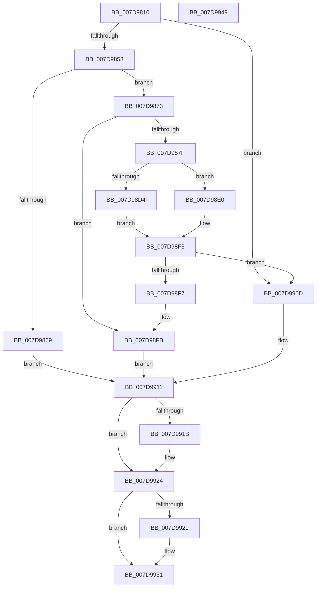

# ApiSetLoadSchemaWithExtensions

- RVA: `0x007D9810`–`0x007D994A` (길이 `314` bytes)
- VA: `0x00000001407D9810`
- 실행 섹션: `PAGE`
- PDB 이름 있음: `예`; PDB Function 태그: `아니요`
- unwind 정보 RVA: `0x000C7B70`
- 디코드: `84`개 명령, `314/314` bytes 표시
- 미해석 바이트: `0` (있으면 어셈블리에 `.byte`로 보존)

> 이 문서는 커널 이미지의 기계어와 PDB 기호를 분석해 생성했습니다. 4번과 5번은 함수 원형과 자료형을 바이너리 사용 방식에서 추정한 C 해석이며 원본 소스 복구 결과는 아닙니다.

## 1. Dependencies

- 직접 호출 지점: **7**; 고유 호출 대상: **7**
- 직접 호출자로 확인된 함수: **1**
- RIP 상대 이미지 참조: **1**

### Outgoing calls
- `0x007D9844` → [ApiSetLoadSchemaEx](ApiSetLoadSchemaEx_function_007D96F4.md) (function, `0x007D96F4`)
- `0x007D985A` → [ApiSetGetSchemaVersion](../../text/66/ApiSetGetSchemaVersion_function_00661F70.md) (function, `0x00661F70`)
- `0x007D9876` → [ApiSetIsSchemaSealed](../../text/66/ApiSetIsSchemaSealed_function_00662D48.md) (function, `0x00662D48`)
- `0x007D98CB` → [ZwOpenKey](../../text/6A/ZwOpenKey_function_006AD310.md) (function, `0x006AD310`)
- `0x007D98EC` → [ApiSetpLoadSchemaExtensions](ApiSetpLoadSchemaExtensions_function_007D9B28.md) (function, `0x007D9B28`)
- `0x007D991B` → [ZwClose](../../text/6A/ZwClose_function_006AD2B0.md) (function, `0x006AD2B0`)
- `0x007D992C` → [ApiSetReleaseSchema](../../text/66/ApiSetReleaseSchema_function_00661F54.md) (function, `0x00661F54`)

### Direct callers
- [PspSiloLoadApiSets](../78/PspSiloLoadApiSets_function_00780848.md) at `0x00780896`

### Static image references
- `0x007D9883` → RVA `0x00039D40` (`.rdata`; read)

## 2. Other-region calls and transfers

- 다른 실행 섹션으로 향하는 call: **5**
  - `0x007D985A` → [ApiSetGetSchemaVersion](../../text/66/ApiSetGetSchemaVersion_function_00661F70.md) (`PAGE` → `.text`)
  - `0x007D9876` → [ApiSetIsSchemaSealed](../../text/66/ApiSetIsSchemaSealed_function_00662D48.md) (`PAGE` → `.text`)
  - `0x007D98CB` → [ZwOpenKey](../../text/6A/ZwOpenKey_function_006AD310.md) (`PAGE` → `.text`)
  - `0x007D991B` → [ZwClose](../../text/6A/ZwClose_function_006AD2B0.md) (`PAGE` → `.text`)
  - `0x007D992C` → [ApiSetReleaseSchema](../../text/66/ApiSetReleaseSchema_function_00661F54.md) (`PAGE` → `.text`)
- 별도 외부 분기/꼬리 이동을 확인하지 못했습니다.

## 3. Assembly (complete function range)

```asm
007D9810  48 89 5C 24 08                  mov qword ptr [rsp + 8], rbx
007D9815  48 89 74 24 10                  mov qword ptr [rsp + 0x10], rsi
007D981A  48 89 7C 24 18                  mov qword ptr [rsp + 0x18], rdi
007D981F  55                              push rbp
007D9820  48 8B EC                        mov rbp, rsp
007D9823  48 83 EC 70                     sub rsp, 0x70
007D9827  48 83 65 B0 00                  and qword ptr [rbp - 0x50], 0
007D982C  49 8B F8                        mov rdi, r8
007D982F  48 83 4D B8 FF                  or qword ptr [rbp - 0x48], 0xffffffffffffffff
007D9834  4C 8D 45 B0                     lea r8, [rbp - 0x50]
007D9838  48 83 65 28 00                  and qword ptr [rbp + 0x28], 0
007D983D  48 8B F2                        mov rsi, rdx
007D9840  48 8D 55 28                     lea rdx, [rbp + 0x28]
007D9844  E8 AB FE FF FF                  call 0x1407d96f4
007D9849  8B D8                           mov ebx, eax
007D984B  85 C0                           test eax, eax
007D984D  0F 88 BA 00 00 00               js 0x1407d990d
007D9853  48 8B 55 28                     mov rdx, qword ptr [rbp + 0x28]
007D9857  48 8B CA                        mov rcx, rdx
007D985A  E8 11 87 E8 FF                  call 0x140661f70
007D985F  B9 02 07 00 00                  mov ecx, 0x702
007D9864  66 3B C1                        cmp ax, cx
007D9867  76 0A                           jbe 0x1407d9873
007D9869  BB 62 A1 00 C0                  mov ebx, 0xc000a162
007D986E  E9 9E 00 00 00                  jmp 0x1407d9911
007D9873  48 8B CA                        mov rcx, rdx
007D9876  E8 CD 94 E8 FF                  call 0x140662d48
007D987B  84 C0                           test al, al
007D987D  75 7C                           jne 0x1407d98fb
007D987F  83 65 EC 00                     and dword ptr [rbp - 0x14], 0
007D9883  48 8D 05 B6 04 86 FF            lea rax, [rip - 0x79fb4a]
007D988A  48 83 65 D8 00                  and qword ptr [rbp - 0x28], 0
007D988F  4C 8D 45 D0                     lea r8, [rbp - 0x30]
007D9893  48 89 45 C8                     mov qword ptr [rbp - 0x38], rax
007D9897  48 8D 4D B8                     lea rcx, [rbp - 0x48]
007D989B  48 8D 45 C0                     lea rax, [rbp - 0x40]
007D989F  48 C7 45 D0 30 00 00 00         mov qword ptr [rbp - 0x30], 0x30
007D98A7  83 65 D4 00                     and dword ptr [rbp - 0x2c], 0
007D98AB  0F 57 C0                        xorps xmm0, xmm0
007D98AE  BA 08 00 00 00                  mov edx, 8
007D98B3  48 89 45 E0                     mov qword ptr [rbp - 0x20], rax
007D98B7  48 C7 45 C0 B2 00 B4 00         mov qword ptr [rbp - 0x40], 0xb400b2
007D98BF  C7 45 E8 40 02 00 00            mov dword ptr [rbp - 0x18], 0x240
007D98C6  F3 0F 7F 45 F0                  movdqu xmmword ptr [rbp - 0x10], xmm0
007D98CB  E8 40 3A ED FF                  call 0x1406ad310
007D98D0  85 C0                           test eax, eax
007D98D2  79 0C                           jns 0x1407d98e0
007D98D4  33 DB                           xor ebx, ebx
007D98D6  3D 34 00 00 C0                  cmp eax, 0xc0000034
007D98DB  0F 45 D8                        cmovne ebx, eax
007D98DE  EB 13                           jmp 0x1407d98f3
007D98E0  48 8B 4D B8                     mov rcx, qword ptr [rbp - 0x48]
007D98E4  4C 8D 45 B0                     lea r8, [rbp - 0x50]
007D98E8  48 8D 55 28                     lea rdx, [rbp + 0x28]
007D98EC  E8 37 02 00 00                  call 0x1407d9b28
007D98F1  8B D8                           mov ebx, eax
007D98F3  85 DB                           test ebx, ebx
007D98F5  78 16                           js 0x1407d990d
007D98F7  48 8B 55 28                     mov rdx, qword ptr [rbp + 0x28]
007D98FB  48 8B 45 B0                     mov rax, qword ptr [rbp - 0x50]
007D98FF  48 89 16                        mov qword ptr [rsi], rdx
007D9902  33 D2                           xor edx, edx
007D9904  48 89 55 28                     mov qword ptr [rbp + 0x28], rdx
007D9908  48 89 07                        mov qword ptr [rdi], rax
007D990B  EB 04                           jmp 0x1407d9911
007D990D  48 8B 55 28                     mov rdx, qword ptr [rbp + 0x28]
007D9911  48 8B 4D B8                     mov rcx, qword ptr [rbp - 0x48]
007D9915  48 83 F9 FF                     cmp rcx, -1
007D9919  74 09                           je 0x1407d9924
007D991B  E8 90 39 ED FF                  call 0x1406ad2b0
007D9920  48 8B 55 28                     mov rdx, qword ptr [rbp + 0x28]
007D9924  48 85 D2                        test rdx, rdx
007D9927  74 08                           je 0x1407d9931
007D9929  48 8B CA                        mov rcx, rdx
007D992C  E8 23 86 E8 FF                  call 0x140661f54
007D9931  4C 8D 5C 24 70                  lea r11, [rsp + 0x70]
007D9936  8B C3                           mov eax, ebx
007D9938  49 8B 5B 10                     mov rbx, qword ptr [r11 + 0x10]
007D993C  49 8B 73 18                     mov rsi, qword ptr [r11 + 0x18]
007D9940  49 8B 7B 20                     mov rdi, qword ptr [r11 + 0x20]
007D9944  49 8B E3                        mov rsp, r11
007D9947  5D                              pop rbp
007D9948  C3                              ret
007D9949  CC                              int3
```

## 4. C-style interpretation (structured pseudocode)

```c
__int64 __fastcall ApiSetLoadSchemaWithExtensions(__int64 a1, __int64 a2, __int64 a3)
{
    __int64 result;
    __int64 v_rbx;
    __int64 v_rsp;
    unsigned __int64 v_stack_m18;
    unsigned int v_stack_m1C;
    unsigned int v_stack_m20;
    unsigned __int64 v_stack_m28;
    unsigned __int64 v_stack_m30;
    unsigned int v_stack_m34;
    unsigned __int64 v_stack_m38;
    unsigned __int64 v_stack_m40;
    unsigned __int64 v_stack_m48;
    unsigned __int64 v_stack_m50;
    unsigned __int64 v_stack_m58;
    unsigned __int64 v_stack_m8;
    unsigned __int64 v_stack_p10;
    unsigned __int64 v_stack_p18;
    unsigned __int64 v_stack_p20;
    unsigned __int64 v_stack_p8;

    v_stack_p8 = v_rbx;
    v_stack_p10 = v_rsi;
    v_stack_p18 = v_rdi;
    v_rsp = (v_rsp) - (112);
    result = ApiSetLoadSchemaEx(a1, v_stack_p20, v_stack_m58, a4);
    if (sign_flag) goto loc_007D990D;
    result = ApiSetGetSchemaVersion(v_stack_p20, v_stack_p20, v_stack_m58, a4);
    if (((unsigned __int16)(result)) <= ((unsigned __int16)((unsigned int)(0x702ULL)))) goto loc_007D9873;
    goto loc_007D9911;
loc_007D9873:
    result = ApiSetIsSchemaSealed(v_stack_p20, v_stack_p20, v_stack_m58, a4);
    if ((unsigned __int8)(result) != 0) goto loc_007D98FB;
    v_stack_m40 = v_rip - 7994186;
    v_stack_m38 = 48;
    v_stack_m28 = v_stack_m48;
    v_stack_m48 = 0xB400B2ULL;
    v_stack_m20 = 576;
    v_stack_m18 = v_xmm0;
    result = ZwOpenKey(v_stack_m50, 8, v_stack_m38, a4);
    if (!sign_flag) goto loc_007D98E0;
    v_rbx = 0;
    if (((unsigned int)(result)) != 0xC0000034ULL) { v_rbx = (unsigned int)(result); }
    goto loc_007D98F3;
loc_007D98E0:
    result = ApiSetpLoadSchemaExtensions(v_stack_m50, v_stack_p20, v_stack_m58, a4);
loc_007D98F3:
    if (sign_flag) goto loc_007D990D;
loc_007D98FB:
    *(unsigned __int64 *)(a2) = v_stack_p20;
    a2 = 0;
    v_stack_p20 = 0;
    *(unsigned __int64 *)(a3) = v_stack_m58;
    goto loc_007D9911;
loc_007D990D:
loc_007D9911:
    result = v_stack_m58;
    if (v_stack_m50 != -1) {
        result = ZwClose(v_stack_m50, v_stack_p20, v_stack_m58, a4);
        a2 = v_stack_p20;
    }
    if (a2 != 0) {
        a1 = a2;
        result = ApiSetReleaseSchema(a1, a2, v_stack_m58, a4);
    }
    return (unsigned int)((unsigned int)((unsigned int)((unsigned int)(result))));
}
```

## 5. (Beta) C Style

```c
int64_t ApiSetLoadSchemaWithExtensions(int64_t Arg1, void *Arg2, void *Arg3)
{
    uint8_t *arg2 = (uint8_t *)Arg2;
    uint8_t *arg3 = (uint8_t *)Arg3;

    int64_t result;
    int64_t local_rbx;
    int64_t local_rsp;
    uint64_t v_stack_m18;
    uint32_t v_stack_m1C;
    uint32_t v_stack_m20;
    uint64_t v_stack_m28;
    uint64_t v_stack_m30;
    uint32_t v_stack_m34;
    uint64_t v_stack_m38;
    uint64_t v_stack_m40;
    uint64_t v_stack_m48;
    uint64_t v_stack_m50;
    uint64_t v_stack_m58;
    uint64_t v_stack_m8;
    uint64_t v_stack_p10;
    uint64_t v_stack_p18;
    uint64_t v_stack_p20;
    uint64_t v_stack_p8;

    v_stack_p8 = local_rbx;
    v_stack_p10 = local_rsi;
    v_stack_p18 = local_rdi;
    local_rsp = (local_rsp) - (112);
    result = ApiSetLoadSchemaEx(Arg1, v_stack_p20, v_stack_m58, a4);
    if (sign_flag) goto loc_007D990D;
    result = ApiSetGetSchemaVersion(v_stack_p20, v_stack_p20, v_stack_m58, a4);
    if (((uint16_t)(result)) <= ((uint16_t)((uint32_t)(0x702ULL)))) goto loc_007D9873;
    goto loc_007D9911;
loc_007D9873:
    result = ApiSetIsSchemaSealed(v_stack_p20, v_stack_p20, v_stack_m58, a4);
    if ((uint8_t)(result) != 0) goto loc_007D98FB;
    v_stack_m40 = v_rip - 7994186;
    v_stack_m38 = 48;
    v_stack_m28 = v_stack_m48;
    v_stack_m48 = 0xB400B2ULL;
    v_stack_m20 = 576;
    v_stack_m18 = v_xmm0;
    result = ZwOpenKey(v_stack_m50, 8, v_stack_m38, a4);
    if (!sign_flag) goto loc_007D98E0;
    local_rbx = 0;
    if (((uint32_t)(result)) != 0xC0000034ULL) { local_rbx = (uint32_t)(result); }
    goto loc_007D98F3;
loc_007D98E0:
    result = ApiSetpLoadSchemaExtensions(v_stack_m50, v_stack_p20, v_stack_m58, a4);
loc_007D98F3:
    if (sign_flag) goto loc_007D990D;
loc_007D98FB:
    *(uint64_t *)(arg2) = v_stack_p20;
    Arg2 = 0;
    v_stack_p20 = 0;
    *(uint64_t *)(arg3) = v_stack_m58;
    goto loc_007D9911;
loc_007D990D:
loc_007D9911:
    result = v_stack_m58;
    if (v_stack_m50 != -1) {
        result = ZwClose(v_stack_m50, v_stack_p20, v_stack_m58, a4);
        Arg2 = v_stack_p20;
    }
    if (Arg2 != NULL) {
        Arg1 = Arg2;
        result = ApiSetReleaseSchema(Arg1, Arg2, v_stack_m58, a4);
    }
    return (uint32_t)((uint32_t)((uint32_t)((uint32_t)(result))));
}
```

### 관측된 메모리 오프셋

구조체 형식이 확인되지 않은 접근은 인자 기준의 오프셋으로만 기록했습니다.

| 기준 인자 | 오프셋 표현 | 폭 (bit) | 접근 |
|---|---:|---:|---|
| `Arg2` | `+ 0x0` | `64` | `W` |
| `Arg3` | `+ 0x0` | `64` | `W` |

## 6. Execution-region graph

[열기: 2D/3D 그래프와 함수 탐색 컨트롤 패널](../../../control-panel.html?section=page&rva=0x007D9810&view=graph)

- 2D 그래프는 위에서 아래로 흐르고, 3D 그래프는 빈 공간을 드래그해 회전합니다. Shift+드래그는 이동, 휠은 확대·축소, 함수 노드 선택은 대상 보고서 이동입니다.

### Static fallback


