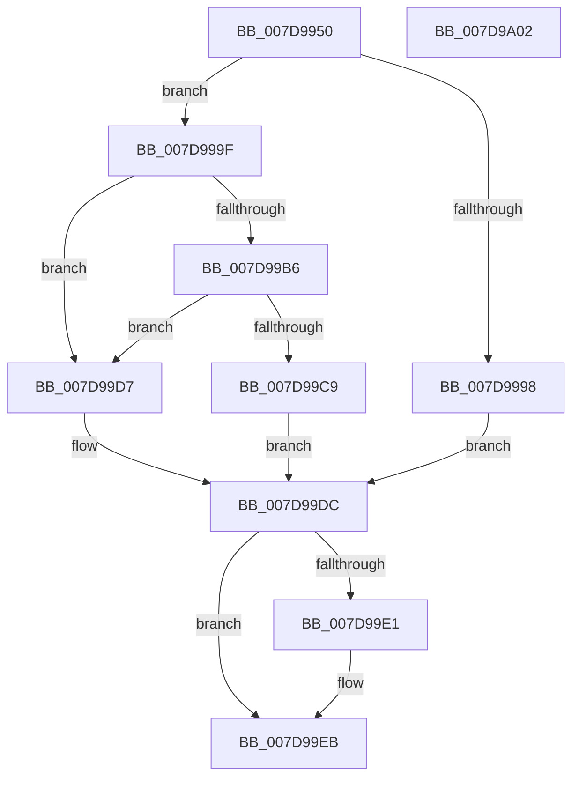

# ApiSetpConstructPathToExtension

- RVA: `0x007D9950`–`0x007D9A03` (길이 `179` bytes)
- VA: `0x00000001407D9950`
- 실행 섹션: `PAGE`
- PDB 이름 있음: `예`; PDB Function 태그: `예`
- unwind 정보 RVA: `0x00066400`
- 디코드: `52`개 명령, `179/179` bytes 표시
- 미해석 바이트: `0` (있으면 어셈블리에 `.byte`로 보존)

> 이 문서는 커널 이미지의 기계어와 PDB 기호를 분석해 생성했습니다. 4번과 5번은 함수 원형과 자료형을 바이너리 사용 방식에서 추정한 C 해석이며 원본 소스 복구 결과는 아닙니다.

## 1. Dependencies

- 직접 호출 지점: **4**; 고유 호출 대상: **3**
- 직접 호출자로 확인된 함수: **1**
- RIP 상대 이미지 참조: **1**

### Outgoing calls
- `0x007D9989` → [ExAllocatePool2](../../poolcode/B8/ExAllocatePool2_function_00B820F0.md) (function, `0x00B820F0`)
- `0x007D99AB` → [RtlAppendUnicodeToString](../../text/40/RtlAppendUnicodeToString_function_0040F990.md) (function, `0x0040F990`)
- `0x007D99BE` → [RtlAppendUnicodeToString](../../text/40/RtlAppendUnicodeToString_function_0040F990.md) (function, `0x0040F990`)
- `0x007D99E6` → [ExFreePoolWithTag](../../poolcode/B8/ExFreePoolWithTag_function_00B82870.md) (function, `0x00B82870`)

### Direct callers
- [ApiSetpLoadSchemaExtension](ApiSetpLoadSchemaExtension_function_007D9A0C.md) at `0x007D9AA5`

### Static image references
- `0x007D999F` → RVA `0x00019940` (`.rdata`; read)

## 2. Other-region calls and transfers

- 다른 실행 섹션으로 향하는 call: **4**
  - `0x007D9989` → [ExAllocatePool2](../../poolcode/B8/ExAllocatePool2_function_00B820F0.md) (`PAGE` → `POOLCODE`)
  - `0x007D99AB` → [RtlAppendUnicodeToString](../../text/40/RtlAppendUnicodeToString_function_0040F990.md) (`PAGE` → `.text`)
  - `0x007D99BE` → [RtlAppendUnicodeToString](../../text/40/RtlAppendUnicodeToString_function_0040F990.md) (`PAGE` → `.text`)
  - `0x007D99E6` → [ExFreePoolWithTag](../../poolcode/B8/ExFreePoolWithTag_function_00B82870.md) (`PAGE` → `POOLCODE`)
- 별도 외부 분기/꼬리 이동을 확인하지 못했습니다.

## 3. Assembly (complete function range)

```asm
007D9950  48 8B C4                        mov rax, rsp
007D9953  48 89 58 08                     mov qword ptr [rax + 8], rbx
007D9957  48 89 68 10                     mov qword ptr [rax + 0x10], rbp
007D995B  48 89 70 18                     mov qword ptr [rax + 0x18], rsi
007D995F  57                              push rdi
007D9960  48 83 EC 30                     sub rsp, 0x30
007D9964  66 83 C2 2C                     add dx, 0x2c
007D9968  49 8B F8                        mov rdi, r8
007D996B  0F B7 D2                        movzx edx, dx
007D996E  48 8B F1                        mov rsi, rcx
007D9971  33 ED                           xor ebp, ebp
007D9973  66 89 50 EA                     mov word ptr [rax - 0x16], dx
007D9977  B9 00 01 00 00                  mov ecx, 0x100
007D997C  89 68 EC                        mov dword ptr [rax - 0x14], ebp
007D997F  41 B8 41 53 63 68               mov r8d, 0x68635341
007D9985  66 89 68 E8                     mov word ptr [rax - 0x18], bp
007D9989  E8 62 87 3A 00                  call 0x140b820f0
007D998E  48 89 44 24 28                  mov qword ptr [rsp + 0x28], rax
007D9993  48 85 C0                        test rax, rax
007D9996  75 07                           jne 0x1407d999f
007D9998  BB 17 00 00 C0                  mov ebx, 0xc0000017
007D999D  EB 3D                           jmp 0x1407d99dc
007D999F  48 8D 15 9A FF 83 FF            lea rdx, [rip - 0x7c0066]
007D99A6  48 8D 4C 24 20                  lea rcx, [rsp + 0x20]
007D99AB  E8 E0 5F C3 FF                  call 0x14040f990
007D99B0  8B D8                           mov ebx, eax
007D99B2  85 C0                           test eax, eax
007D99B4  78 21                           js 0x1407d99d7
007D99B6  48 8B D6                        mov rdx, rsi
007D99B9  48 8D 4C 24 20                  lea rcx, [rsp + 0x20]
007D99BE  E8 CD 5F C3 FF                  call 0x14040f990
007D99C3  8B D8                           mov ebx, eax
007D99C5  85 C0                           test eax, eax
007D99C7  78 0E                           js 0x1407d99d7
007D99C9  0F 10 44 24 20                  movups xmm0, xmmword ptr [rsp + 0x20]
007D99CE  48 8B C5                        mov rax, rbp
007D99D1  F3 0F 7F 07                     movdqu xmmword ptr [rdi], xmm0
007D99D5  EB 05                           jmp 0x1407d99dc
007D99D7  48 8B 44 24 28                  mov rax, qword ptr [rsp + 0x28]
007D99DC  48 85 C0                        test rax, rax
007D99DF  74 0A                           je 0x1407d99eb
007D99E1  33 D2                           xor edx, edx
007D99E3  48 8B C8                        mov rcx, rax
007D99E6  E8 85 8E 3A 00                  call 0x140b82870
007D99EB  48 8B 6C 24 48                  mov rbp, qword ptr [rsp + 0x48]
007D99F0  8B C3                           mov eax, ebx
007D99F2  48 8B 5C 24 40                  mov rbx, qword ptr [rsp + 0x40]
007D99F7  48 8B 74 24 50                  mov rsi, qword ptr [rsp + 0x50]
007D99FC  48 83 C4 30                     add rsp, 0x30
007D9A00  5F                              pop rdi
007D9A01  C3                              ret
007D9A02  CC                              int3
```

## 4. C-style interpretation (structured pseudocode)

```c
__int64 __fastcall ApiSetpConstructPathToExtension(__int64 a1, unsigned __int16 a2, __int64 a3)
{
    __int64 result;
    __int64 v_rbp;
    __int64 v_rsp;
    unsigned __int64 v_stack_m10;
    unsigned __int64 v_stack_m18;
    unsigned __int64 v_stack_p10;
    unsigned __int64 v_stack_p18;
    unsigned __int64 v_stack_p8;

    *(unsigned __int64 *)(v_rsp + 8) = v_rbx;
    *(unsigned __int64 *)(v_rsp + 16) = v_rbp;
    *(unsigned __int64 *)(v_rsp + 24) = v_rsi;
    v_rsp = (v_rsp) - (48);
    a2 = (unsigned __int16)((a2) + (44));
    v_rbp = 0;
    *(unsigned __int16 *)(v_rsp - 22) = a2;
    *(unsigned int *)(v_rsp - 20) = 0;
    *(unsigned __int16 *)(v_rsp - 24) = 0;
    result = ExAllocatePool2(256, a2, (unsigned int)(0x68635341ULL), a4);
    v_stack_m10 = result;
    if (result != 0) goto loc_007D999F;
    goto loc_007D99DC;
loc_007D999F:
    result = RtlAppendUnicodeToString(v_stack_m18, v_rip - 8126566, (unsigned int)(0x68635341ULL), a4);
    if (sign_flag) goto loc_007D99D7;
    result = RtlAppendUnicodeToString(v_stack_m18, a1, (unsigned int)(0x68635341ULL), a4);
    if (sign_flag) goto loc_007D99D7;
    *(unsigned __int64 *)(a3) = v_xmm0;
    goto loc_007D99DC;
loc_007D99D7:
loc_007D99DC:
    result = v_stack_m10;
    if (v_stack_m10 != 0) {
        a2 = 0;
        a1 = v_stack_m10;
        result = ExFreePoolWithTag(a1, a2, (unsigned int)(0x68635341ULL), a4);
    }
    v_rsp = (v_rsp) + (48);
    return (unsigned int)((unsigned int)((unsigned int)((unsigned int)(result))));
}
```

## 5. (Beta) C Style

```c
int64_t ApiSetpConstructPathToExtension(int64_t Arg1, uint16_t Arg2, void *Arg3)
{
    uint8_t *arg3 = (uint8_t *)Arg3;

    int64_t result;
    int64_t local_rbp;
    int64_t local_rsp;
    uint64_t v_stack_m10;
    uint64_t v_stack_m18;
    uint64_t v_stack_p10;
    uint64_t v_stack_p18;
    uint64_t v_stack_p8;

    *(uint64_t *)(local_rsp + 0x8) = local_rbx;
    *(uint64_t *)(local_rsp + 0x10) = local_rbp;
    *(uint64_t *)(local_rsp + 0x18) = local_rsi;
    local_rsp = (local_rsp) - (48);
    Arg2 = (uint16_t)((Arg2) + (44));
    local_rbp = 0;
    *(uint16_t *)(local_rsp - 0x16) = Arg2;
    *(uint32_t *)(local_rsp - 0x14) = 0;
    *(uint16_t *)(local_rsp - 0x18) = 0;
    result = ExAllocatePool2(256, Arg2, (uint32_t)(0x68635341ULL), a4);
    v_stack_m10 = result;
    if (result != 0) goto loc_007D999F;
    goto loc_007D99DC;
loc_007D999F:
    result = RtlAppendUnicodeToString(v_stack_m18, v_rip - 8126566, (uint32_t)(0x68635341ULL), a4);
    if (sign_flag) goto loc_007D99D7;
    result = RtlAppendUnicodeToString(v_stack_m18, Arg1, (uint32_t)(0x68635341ULL), a4);
    if (sign_flag) goto loc_007D99D7;
    *(uint64_t *)(arg3) = v_xmm0;
    goto loc_007D99DC;
loc_007D99D7:
loc_007D99DC:
    result = v_stack_m10;
    if (v_stack_m10 != 0) {
        Arg2 = 0;
        Arg1 = v_stack_m10;
        result = ExFreePoolWithTag(Arg1, Arg2, (uint32_t)(0x68635341ULL), a4);
    }
    local_rsp = (local_rsp) + (48);
    return (uint32_t)((uint32_t)((uint32_t)((uint32_t)(result))));
}
```

### 관측된 메모리 오프셋

구조체 형식이 확인되지 않은 접근은 인자 기준의 오프셋으로만 기록했습니다.

| 기준 인자 | 오프셋 표현 | 폭 (bit) | 접근 |
|---|---:|---:|---|
| `Arg3` | `+ 0x0` | `128` | `W` |

## 6. Execution-region graph

[열기: 2D/3D 그래프와 함수 탐색 컨트롤 패널](../../../control-panel.html?section=page&rva=0x007D9950&view=graph)

- 2D 그래프는 위에서 아래로 흐르고, 3D 그래프는 빈 공간을 드래그해 회전합니다. Shift+드래그는 이동, 휠은 확대·축소, 함수 노드 선택은 대상 보고서 이동입니다.

### Static fallback


