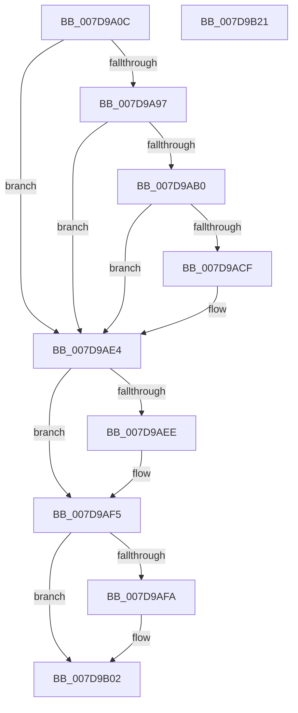

# ApiSetpLoadSchemaExtension

- RVA: `0x007D9A0C`–`0x007D9B22` (길이 `278` bytes)
- VA: `0x00000001407D9A0C`
- 실행 섹션: `PAGE`
- PDB 이름 있음: `예`; PDB Function 태그: `예`
- unwind 정보 RVA: `0x000D1DEC`
- 디코드: `73`개 명령, `278/278` bytes 표시
- 미해석 바이트: `0` (있으면 어셈블리에 `.byte`로 보존)

> 이 문서는 커널 이미지의 기계어와 PDB 기호를 분석해 생성했습니다. 4번과 5번은 함수 원형과 자료형을 바이너리 사용 방식에서 추정한 C 해석이며 원본 소스 복구 결과는 아닙니다.

## 1. Dependencies

- 직접 호출 지점: **7**; 고유 호출 대상: **7**
- 직접 호출자로 확인된 함수: **1**
- RIP 상대 이미지 참조: **2**

### Outgoing calls
- `0x007D9A8C` → [ZwQueryValueKey](../../text/6A/ZwQueryValueKey_function_006AD3B0.md) (function, `0x006AD3B0`)
- `0x007D9AA5` → [ApiSetpConstructPathToExtension](ApiSetpConstructPathToExtension_function_007D9950.md) (function, `0x007D9950`)
- `0x007D9ABF` → [ApiSetLoadSchemaEx](ApiSetLoadSchemaEx_function_007D96F4.md) (function, `0x007D96F4`)
- `0x007D9ADD` → [ApiSetComposeSchema](../../text/66/ApiSetComposeSchema_function_00662684.md) (function, `0x00662684`)
- `0x007D9AF0` → [ExFreePoolWithTag](../../poolcode/B8/ExFreePoolWithTag_function_00B82870.md) (function, `0x00B82870`)
- `0x007D9AFD` → [ApiSetReleaseSchema](../../text/66/ApiSetReleaseSchema_function_00661F54.md) (function, `0x00661F54`)
- `0x007D9B0E` → [_security_check_cookie](../../text/6A/_security_check_cookie_function_006AC640.md) (function, `0x006AC640`)

### Direct callers
- [ApiSetpLoadSchemaExtensions](ApiSetpLoadSchemaExtensions_function_007D9B28.md) at `0x007D9C04`

### Static image references
- `0x007D9A22` → RVA `0x00E0A740` (`.data`; read)
- `0x007D9A39` → RVA `0x00039D20` (`.rdata`; read)

## 2. Other-region calls and transfers

- 다른 실행 섹션으로 향하는 call: **5**
  - `0x007D9A8C` → [ZwQueryValueKey](../../text/6A/ZwQueryValueKey_function_006AD3B0.md) (`PAGE` → `.text`)
  - `0x007D9ADD` → [ApiSetComposeSchema](../../text/66/ApiSetComposeSchema_function_00662684.md) (`PAGE` → `.text`)
  - `0x007D9AF0` → [ExFreePoolWithTag](../../poolcode/B8/ExFreePoolWithTag_function_00B82870.md) (`PAGE` → `POOLCODE`)
  - `0x007D9AFD` → [ApiSetReleaseSchema](../../text/66/ApiSetReleaseSchema_function_00661F54.md) (`PAGE` → `.text`)
  - `0x007D9B0E` → [_security_check_cookie](../../text/6A/_security_check_cookie_function_006AC640.md) (`PAGE` → `.text`)
- 별도 외부 분기/꼬리 이동을 확인하지 못했습니다.

## 3. Assembly (complete function range)

```asm
007D9A0C  40 55                           push rbp
007D9A0E  53                              push rbx
007D9A0F  56                              push rsi
007D9A10  57                              push rdi
007D9A11  41 56                           push r14
007D9A13  48 8D AC 24 60 FF FF FF         lea rbp, [rsp - 0xa0]
007D9A1B  48 81 EC A0 01 00 00            sub rsp, 0x1a0
007D9A22  48 8B 05 17 0D 63 00            mov rax, qword ptr [rip + 0x630d17]
007D9A29  48 33 C4                        xor rax, rsp
007D9A2C  48 89 85 90 00 00 00            mov qword ptr [rbp + 0x90], rax
007D9A33  48 83 64 24 40 00               and qword ptr [rsp + 0x40], 0
007D9A39  48 8D 05 E0 02 86 FF            lea rax, [rip - 0x79fd20]
007D9A40  48 83 64 24 58 00               and qword ptr [rsp + 0x58], 0
007D9A46  4C 8D 4C 24 70                  lea r9, [rsp + 0x70]
007D9A4B  83 64 24 30 00                  and dword ptr [rsp + 0x30], 0
007D9A50  33 FF                           xor edi, edi
007D9A52  48 83 64 24 60 00               and qword ptr [rsp + 0x60], 0
007D9A58  4D 8B F0                        mov r14, r8
007D9A5B  48 89 44 24 50                  mov qword ptr [rsp + 0x50], rax
007D9A60  48 8B F2                        mov rsi, rdx
007D9A63  48 8D 44 24 30                  lea rax, [rsp + 0x30]
007D9A68  48 C7 44 24 48 10 00 12 00      mov qword ptr [rsp + 0x48], 0x120010
007D9A71  48 89 44 24 28                  mov qword ptr [rsp + 0x28], rax
007D9A76  44 8D 47 02                     lea r8d, [rdi + 2]
007D9A7A  48 8D 54 24 48                  lea rdx, [rsp + 0x48]
007D9A7F  C7 44 24 20 14 01 00 00         mov dword ptr [rsp + 0x20], 0x114
007D9A87  48 89 7C 24 38                  mov qword ptr [rsp + 0x38], rdi
007D9A8C  E8 1F 39 ED FF                  call 0x1406ad3b0
007D9A91  8B D8                           mov ebx, eax
007D9A93  85 C0                           test eax, eax
007D9A95  78 4D                           js 0x1407d9ae4
007D9A97  8B 54 24 78                     mov edx, dword ptr [rsp + 0x78]
007D9A9B  4C 8D 44 24 58                  lea r8, [rsp + 0x58]
007D9AA0  48 8D 4C 24 7C                  lea rcx, [rsp + 0x7c]
007D9AA5  E8 A6 FE FF FF                  call 0x1407d9950
007D9AAA  8B D8                           mov ebx, eax
007D9AAC  85 C0                           test eax, eax
007D9AAE  78 34                           js 0x1407d9ae4
007D9AB0  4C 8D 44 24 40                  lea r8, [rsp + 0x40]
007D9AB5  48 8D 54 24 38                  lea rdx, [rsp + 0x38]
007D9ABA  48 8D 4C 24 58                  lea rcx, [rsp + 0x58]
007D9ABF  E8 30 FC FF FF                  call 0x1407d96f4
007D9AC4  48 8B 7C 24 38                  mov rdi, qword ptr [rsp + 0x38]
007D9AC9  8B D8                           mov ebx, eax
007D9ACB  85 C0                           test eax, eax
007D9ACD  78 15                           js 0x1407d9ae4
007D9ACF  44 8B 4C 24 40                  mov r9d, dword ptr [rsp + 0x40]
007D9AD4  4C 8B C7                        mov r8, rdi
007D9AD7  49 8B D6                        mov rdx, r14
007D9ADA  48 8B CE                        mov rcx, rsi
007D9ADD  E8 A2 8B E8 FF                  call 0x140662684
007D9AE2  8B D8                           mov ebx, eax
007D9AE4  48 8B 4C 24 60                  mov rcx, qword ptr [rsp + 0x60]
007D9AE9  48 85 C9                        test rcx, rcx
007D9AEC  74 07                           je 0x1407d9af5
007D9AEE  33 D2                           xor edx, edx
007D9AF0  E8 7B 8D 3A 00                  call 0x140b82870
007D9AF5  48 85 FF                        test rdi, rdi
007D9AF8  74 08                           je 0x1407d9b02
007D9AFA  48 8B CF                        mov rcx, rdi
007D9AFD  E8 52 84 E8 FF                  call 0x140661f54
007D9B02  8B C3                           mov eax, ebx
007D9B04  48 8B 8D 90 00 00 00            mov rcx, qword ptr [rbp + 0x90]
007D9B0B  48 33 CC                        xor rcx, rsp
007D9B0E  E8 2D 2B ED FF                  call 0x1406ac640
007D9B13  48 81 C4 A0 01 00 00            add rsp, 0x1a0
007D9B1A  41 5E                           pop r14
007D9B1C  5F                              pop rdi
007D9B1D  5E                              pop rsi
007D9B1E  5B                              pop rbx
007D9B1F  5D                              pop rbp
007D9B20  C3                              ret
007D9B21  CC                              int3
```

## 4. C-style interpretation (structured pseudocode)

```c
__int64 __fastcall ApiSetpLoadSchemaExtension(__int64 a1, __int64 a2, __int64 a3)
{
    __int64 result;
    __int64 v_rbx;
    __int64 v_rdi;
    __int64 v_rsp;
    unsigned __int64 v_stack_m14C;
    unsigned int v_stack_m150;
    unsigned __int64 v_stack_m158;
    unsigned __int64 v_stack_m168;
    unsigned __int64 v_stack_m170;
    unsigned __int64 v_stack_m178;
    unsigned __int64 v_stack_m180;
    unsigned __int64 v_stack_m188;
    unsigned __int64 v_stack_m190;
    unsigned int v_stack_m198;
    unsigned __int64 v_stack_m1A0;
    unsigned int v_stack_m1A8;
    unsigned __int64 v_stack_m38;
    unsigned __int64 v_stack_mC8;

    v_rsp = (v_rsp) - (416);
    result = (*(unsigned __int64 *)(v_rip + 6491415)) ^ (v_rsp);
    v_stack_m38 = result;
    v_rdi = 0;
    v_stack_m178 = v_rip - 7994656;
    v_stack_m180 = 0x120010ULL;
    v_stack_m1A0 = v_stack_m198;
    v_stack_m1A8 = 276;
    v_stack_m190 = 0;
    result = ZwQueryValueKey(a1, v_stack_m180, v_rdi + 2, v_stack_m158);
    if (sign_flag) goto loc_007D9AE4;
    result = ApiSetpConstructPathToExtension(v_stack_m14C, (unsigned int)(v_stack_m150), v_stack_m170, v_stack_m158);
    if (sign_flag) goto loc_007D9AE4;
    result = ApiSetLoadSchemaEx(v_stack_m170, v_stack_m190, v_stack_m188, v_stack_m158);
    v_rbx = (unsigned int)((unsigned int)(result));
    if (!(sign_flag)) {
        a4 = v_stack_m188;
        a3 = v_stack_m190;
        a2 = a3;
        a1 = a2;
        result = ApiSetComposeSchema(a1, a2, a3, a4);
        v_rbx = (unsigned int)(result);
    }
    if (v_stack_m168 != 0) {
        a2 = 0;
        result = ExFreePoolWithTag(v_stack_m168, a2, a3, a4);
    }
    if (v_stack_m190 != 0) {
        a1 = v_stack_m190;
        result = ApiSetReleaseSchema(a1, a2, a3, a4);
    }
    a1 = (v_stack_m38) ^ (v_rsp);
    result = _security_check_cookie(a1, a2, a3, a4);
    v_rsp = (v_rsp) + (416);
    return result;
}
```

## 5. (Beta) C Style

```c
int64_t ApiSetpLoadSchemaExtension(int64_t Arg1, int64_t Arg2, int64_t Arg3)
{
    int64_t result;
    int64_t local_rbx;
    int64_t local_rdi;
    int64_t local_rsp;
    uint64_t v_stack_m14C;
    uint32_t v_stack_m150;
    uint64_t v_stack_m158;
    uint64_t v_stack_m168;
    uint64_t v_stack_m170;
    uint64_t v_stack_m178;
    uint64_t v_stack_m180;
    uint64_t v_stack_m188;
    uint64_t v_stack_m190;
    uint32_t v_stack_m198;
    uint64_t v_stack_m1A0;
    uint32_t v_stack_m1A8;
    uint64_t v_stack_m38;
    uint64_t v_stack_mC8;

    local_rsp = (local_rsp) - (416);
    result = (*(uint64_t *)(v_rip + 0x630D17)) ^ (local_rsp);
    v_stack_m38 = result;
    local_rdi = 0;
    v_stack_m178 = v_rip - 7994656;
    v_stack_m180 = 0x120010ULL;
    v_stack_m1A0 = v_stack_m198;
    v_stack_m1A8 = 276;
    v_stack_m190 = 0;
    result = ZwQueryValueKey(Arg1, v_stack_m180, local_rdi + 2, v_stack_m158);
    if (sign_flag) goto loc_007D9AE4;
    result = ApiSetpConstructPathToExtension(v_stack_m14C, (uint32_t)(v_stack_m150), v_stack_m170, v_stack_m158);
    if (sign_flag) goto loc_007D9AE4;
    result = ApiSetLoadSchemaEx(v_stack_m170, v_stack_m190, v_stack_m188, v_stack_m158);
    local_rbx = (uint32_t)((uint32_t)(result));
    if (!(sign_flag)) {
        a4 = v_stack_m188;
        Arg3 = v_stack_m190;
        Arg2 = Arg3;
        Arg1 = Arg2;
        result = ApiSetComposeSchema(Arg1, Arg2, Arg3, a4);
        local_rbx = (uint32_t)(result);
    }
    if (v_stack_m168 != 0) {
        Arg2 = 0;
        result = ExFreePoolWithTag(v_stack_m168, Arg2, Arg3, a4);
    }
    if (v_stack_m190 != 0) {
        Arg1 = v_stack_m190;
        result = ApiSetReleaseSchema(Arg1, Arg2, Arg3, a4);
    }
    Arg1 = (v_stack_m38) ^ (local_rsp);
    result = _security_check_cookie(Arg1, Arg2, Arg3, a4);
    local_rsp = (local_rsp) + (416);
    return result;
}
```

## 6. Execution-region graph

[열기: 2D/3D 그래프와 함수 탐색 컨트롤 패널](../../../control-panel.html?section=page&rva=0x007D9A0C&view=graph)

- 2D 그래프는 위에서 아래로 흐르고, 3D 그래프는 빈 공간을 드래그해 회전합니다. Shift+드래그는 이동, 휠은 확대·축소, 함수 노드 선택은 대상 보고서 이동입니다.

### Static fallback


