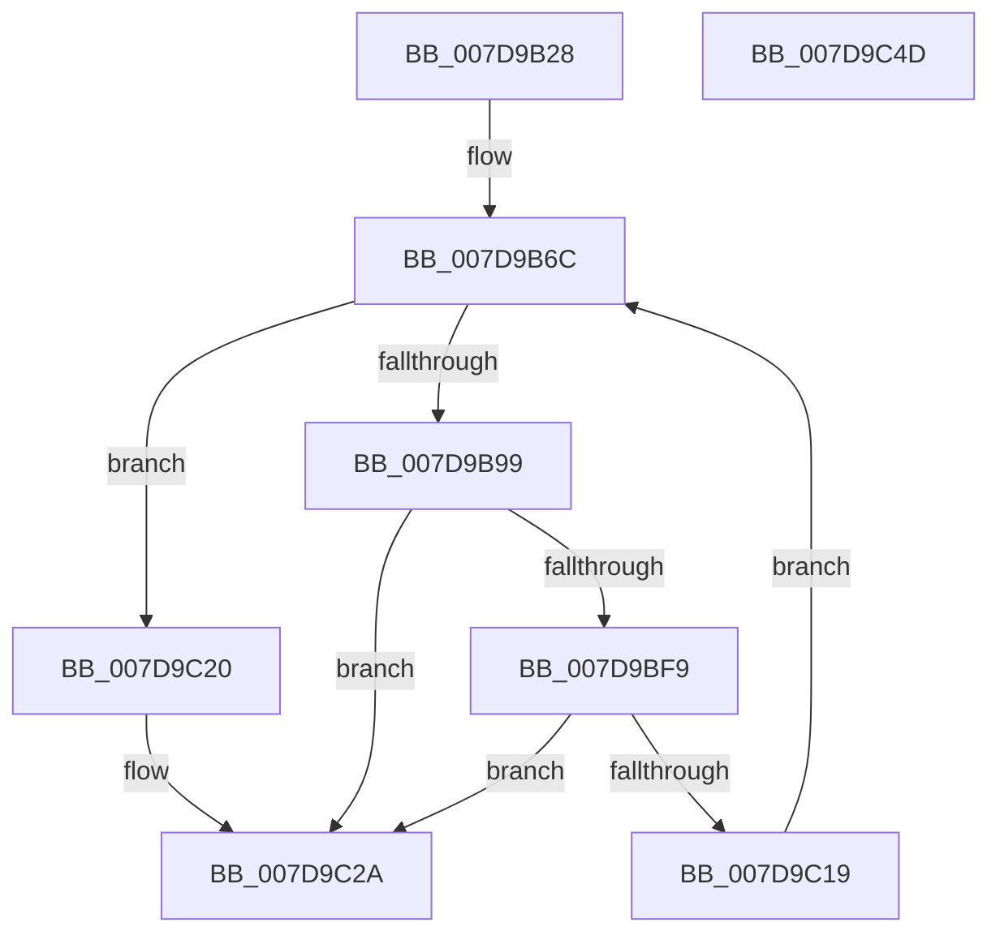

# ApiSetpLoadSchemaExtensions

- RVA: `0x007D9B28`–`0x007D9C4E` (길이 `294` bytes)
- VA: `0x00000001407D9B28`
- 실행 섹션: `PAGE`
- PDB 이름 있음: `예`; PDB Function 태그: `예`
- unwind 정보 RVA: `0x000D60D4`
- 디코드: `77`개 명령, `294/294` bytes 표시
- 미해석 바이트: `0` (있으면 어셈블리에 `.byte`로 보존)

> 이 문서는 커널 이미지의 기계어와 PDB 기호를 분석해 생성했습니다. 4번과 5번은 함수 원형과 자료형을 바이너리 사용 방식에서 추정한 C 해석이며 원본 소스 복구 결과는 아닙니다.

## 1. Dependencies

- 직접 호출 지점: **5**; 고유 호출 대상: **5**
- 직접 호출자로 확인된 함수: **1**
- RIP 상대 이미지 참조: **1**

### Outgoing calls
- `0x007D9B8A` → [ZwEnumerateKey](../../text/6A/ZwEnumerateKey_function_006AD710.md) (function, `0x006AD710`)
- `0x007D9BEE` → [ZwOpenKey](../../text/6A/ZwOpenKey_function_006AD310.md) (function, `0x006AD310`)
- `0x007D9C04` → [ApiSetpLoadSchemaExtension](ApiSetpLoadSchemaExtension_function_007D9A0C.md) (function, `0x007D9A0C`)
- `0x007D9C10` → [ZwClose](../../text/6A/ZwClose_function_006AD2B0.md) (function, `0x006AD2B0`)
- `0x007D9C36` → [_security_check_cookie](../../text/6A/_security_check_cookie_function_006AC640.md) (function, `0x006AC640`)

### Direct callers
- [ApiSetLoadSchemaWithExtensions](ApiSetLoadSchemaWithExtensions_function_007D9810.md) at `0x007D98EC`

### Static image references
- `0x007D9B42` → RVA `0x00E0A740` (`.data`; read)

## 2. Other-region calls and transfers

- 다른 실행 섹션으로 향하는 call: **4**
  - `0x007D9B8A` → [ZwEnumerateKey](../../text/6A/ZwEnumerateKey_function_006AD710.md) (`PAGE` → `.text`)
  - `0x007D9BEE` → [ZwOpenKey](../../text/6A/ZwOpenKey_function_006AD310.md) (`PAGE` → `.text`)
  - `0x007D9C10` → [ZwClose](../../text/6A/ZwClose_function_006AD2B0.md) (`PAGE` → `.text`)
  - `0x007D9C36` → [_security_check_cookie](../../text/6A/_security_check_cookie_function_006AC640.md) (`PAGE` → `.text`)
- 별도 외부 분기/꼬리 이동을 확인하지 못했습니다.

## 3. Assembly (complete function range)

```asm
007D9B28  40 55                           push rbp
007D9B2A  53                              push rbx
007D9B2B  56                              push rsi
007D9B2C  57                              push rdi
007D9B2D  41 54                           push r12
007D9B2F  41 56                           push r14
007D9B31  41 57                           push r15
007D9B33  48 8D AC 24 50 FE FF FF         lea rbp, [rsp - 0x1b0]
007D9B3B  48 81 EC B0 02 00 00            sub rsp, 0x2b0
007D9B42  48 8B 05 F7 0B 63 00            mov rax, qword ptr [rip + 0x630bf7]
007D9B49  48 33 C4                        xor rax, rsp
007D9B4C  48 89 85 A0 01 00 00            mov qword ptr [rbp + 0x1a0], rax
007D9B53  45 33 E4                        xor r12d, r12d
007D9B56  4D 8B F8                        mov r15, r8
007D9B59  4C 89 64 24 38                  mov qword ptr [rsp + 0x38], r12
007D9B5E  41 8B FC                        mov edi, r12d
007D9B61  44 89 64 24 30                  mov dword ptr [rsp + 0x30], r12d
007D9B66  4C 8B F2                        mov r14, rdx
007D9B69  48 8B F1                        mov rsi, rcx
007D9B6C  48 8D 44 24 30                  lea rax, [rsp + 0x30]
007D9B71  45 33 C0                        xor r8d, r8d
007D9B74  48 89 44 24 28                  mov qword ptr [rsp + 0x28], rax
007D9B79  4C 8D 4D 80                     lea r9, [rbp - 0x80]
007D9B7D  8B D7                           mov edx, edi
007D9B7F  C7 44 24 20 18 02 00 00         mov dword ptr [rsp + 0x20], 0x218
007D9B87  48 8B CE                        mov rcx, rsi
007D9B8A  E8 81 3B ED FF                  call 0x1406ad710
007D9B8F  8B D8                           mov ebx, eax
007D9B91  85 C0                           test eax, eax
007D9B93  0F 88 87 00 00 00               js 0x1407d9c20
007D9B99  48 8D 45 90                     lea rax, [rbp - 0x70]
007D9B9D  44 89 64 24 44                  mov dword ptr [rsp + 0x44], r12d
007D9BA2  48 89 44 24 48                  mov qword ptr [rsp + 0x48], rax
007D9BA7  4C 8D 44 24 50                  lea r8, [rsp + 0x50]
007D9BAC  0F B7 45 8C                     movzx eax, word ptr [rbp - 0x74]
007D9BB0  48 8D 4C 24 38                  lea rcx, [rsp + 0x38]
007D9BB5  66 89 44 24 40                  mov word ptr [rsp + 0x40], ax
007D9BBA  0F 57 C0                        xorps xmm0, xmm0
007D9BBD  66 89 44 24 42                  mov word ptr [rsp + 0x42], ax
007D9BC2  BA 19 00 02 00                  mov edx, 0x20019
007D9BC7  48 8D 44 24 40                  lea rax, [rsp + 0x40]
007D9BCC  48 C7 44 24 50 30 00 00 00      mov qword ptr [rsp + 0x50], 0x30
007D9BD5  48 89 44 24 60                  mov qword ptr [rsp + 0x60], rax
007D9BDA  48 C7 44 24 68 40 02 00 00      mov qword ptr [rsp + 0x68], 0x240
007D9BE3  48 89 74 24 58                  mov qword ptr [rsp + 0x58], rsi
007D9BE8  F3 0F 7F 44 24 70               movdqu xmmword ptr [rsp + 0x70], xmm0
007D9BEE  E8 1D 37 ED FF                  call 0x1406ad310
007D9BF3  8B D8                           mov ebx, eax
007D9BF5  85 C0                           test eax, eax
007D9BF7  78 31                           js 0x1407d9c2a
007D9BF9  48 8B 4C 24 38                  mov rcx, qword ptr [rsp + 0x38]
007D9BFE  4D 8B C7                        mov r8, r15
007D9C01  49 8B D6                        mov rdx, r14
007D9C04  E8 03 FE FF FF                  call 0x1407d9a0c
007D9C09  48 8B 4C 24 38                  mov rcx, qword ptr [rsp + 0x38]
007D9C0E  8B D8                           mov ebx, eax
007D9C10  E8 9B 36 ED FF                  call 0x1406ad2b0
007D9C15  85 DB                           test ebx, ebx
007D9C17  78 11                           js 0x1407d9c2a
007D9C19  FF C7                           inc edi
007D9C1B  E9 4C FF FF FF                  jmp 0x1407d9b6c
007D9C20  81 FB 1A 00 00 80               cmp ebx, 0x8000001a
007D9C26  41 0F 44 DC                     cmove ebx, r12d
007D9C2A  8B C3                           mov eax, ebx
007D9C2C  48 8B 8D A0 01 00 00            mov rcx, qword ptr [rbp + 0x1a0]
007D9C33  48 33 CC                        xor rcx, rsp
007D9C36  E8 05 2A ED FF                  call 0x1406ac640
007D9C3B  48 81 C4 B0 02 00 00            add rsp, 0x2b0
007D9C42  41 5F                           pop r15
007D9C44  41 5E                           pop r14
007D9C46  41 5C                           pop r12
007D9C48  5F                              pop rdi
007D9C49  5E                              pop rsi
007D9C4A  5B                              pop rbx
007D9C4B  5D                              pop rbp
007D9C4C  C3                              ret
007D9C4D  CC                              int3
```

## 4. C-style interpretation (structured pseudocode)

```c
__int64 __fastcall ApiSetpLoadSchemaExtensions(__int64 a1, __int64 a2, __int64 a3)
{
    __int64 result;
    __int64 v_r12;
    __int64 v_rbx;
    __int64 v_rdi;
    __int64 v_rsp;
    unsigned __int64 v_stack_m1E8;
    unsigned __int64 v_stack_m258;
    unsigned __int16 v_stack_m25C;
    unsigned __int64 v_stack_m268;
    unsigned __int64 v_stack_m278;
    unsigned __int64 v_stack_m280;
    unsigned __int64 v_stack_m288;
    unsigned __int64 v_stack_m290;
    unsigned __int64 v_stack_m298;
    unsigned __int64 v_stack_m2A0;
    unsigned int v_stack_m2A4;
    unsigned __int16 v_stack_m2A6;
    unsigned __int16 v_stack_m2A8;
    unsigned __int64 v_stack_m2B0;
    unsigned int v_stack_m2B8;
    unsigned __int64 v_stack_m2C0;
    unsigned int v_stack_m2C8;
    unsigned __int64 v_stack_m48;

    v_rsp = (v_rsp) - (688);
    result = (*(unsigned __int64 *)(v_rip + 6491127)) ^ (v_rsp);
    v_stack_m48 = result;
    v_r12 = 0;
    v_stack_m2B0 = 0;
    v_stack_m2B8 = 0;
loc_007D9B6C:
    a3 = 0;
    v_stack_m2C0 = v_stack_m2B8;
    v_stack_m2C8 = 536;
    result = ZwEnumerateKey(a1, 0, a3, v_stack_m268);
    if (sign_flag) goto loc_007D9C20;
    v_stack_m2A4 = 0;
    v_stack_m2A0 = v_stack_m258;
    v_stack_m2A8 = (unsigned __int16)(v_stack_m25C);
    v_stack_m2A6 = (unsigned __int16)(v_stack_m25C);
    v_stack_m298 = 48;
    v_stack_m288 = v_stack_m2A8;
    v_stack_m280 = 576;
    v_stack_m290 = a1;
    v_stack_m278 = v_xmm0;
    result = ZwOpenKey(v_stack_m2B0, (unsigned int)(0x20019ULL), v_stack_m298, v_stack_m268);
    if (sign_flag) goto loc_007D9C2A;
    result = ApiSetpLoadSchemaExtension(v_stack_m2B0, a2, 0, v_stack_m268);
    result = ZwClose(v_stack_m2B0, a2, 0, v_stack_m268);
    if (sign_flag) goto loc_007D9C2A;
    v_rdi = (unsigned int)((0) + 1);
    goto loc_007D9B6C;
loc_007D9C20:
    v_rbx = (unsigned int)((unsigned int)(result));
    if (((unsigned int)((unsigned int)((unsigned int)(result)))) == 0x8000001AULL) { v_rbx = 0; }
loc_007D9C2A:
    a1 = (v_stack_m48) ^ (v_rsp);
    result = _security_check_cookie(a1, a2, 0, v_stack_m268);
    v_rsp = (v_rsp) + (688);
    return result;
}
```

## 5. (Beta) C Style

```c
int64_t ApiSetpLoadSchemaExtensions(int64_t Arg1, int64_t Arg2, int64_t Arg3)
{
    int64_t result;
    int64_t local_r12;
    int64_t local_rbx;
    int64_t local_rdi;
    int64_t local_rsp;
    uint64_t v_stack_m1E8;
    uint64_t v_stack_m258;
    uint16_t v_stack_m25C;
    uint64_t v_stack_m268;
    uint64_t v_stack_m278;
    uint64_t v_stack_m280;
    uint64_t v_stack_m288;
    uint64_t v_stack_m290;
    uint64_t v_stack_m298;
    uint64_t v_stack_m2A0;
    uint32_t v_stack_m2A4;
    uint16_t v_stack_m2A6;
    uint16_t v_stack_m2A8;
    uint64_t v_stack_m2B0;
    uint32_t v_stack_m2B8;
    uint64_t v_stack_m2C0;
    uint32_t v_stack_m2C8;
    uint64_t v_stack_m48;

    local_rsp = (local_rsp) - (688);
    result = (*(uint64_t *)(v_rip + 0x630BF7)) ^ (local_rsp);
    v_stack_m48 = result;
    local_r12 = 0;
    v_stack_m2B0 = 0;
    v_stack_m2B8 = 0;
loc_007D9B6C:
    Arg3 = 0;
    v_stack_m2C0 = v_stack_m2B8;
    v_stack_m2C8 = 536;
    result = ZwEnumerateKey(Arg1, 0, Arg3, v_stack_m268);
    if (sign_flag) goto loc_007D9C20;
    v_stack_m2A4 = 0;
    v_stack_m2A0 = v_stack_m258;
    v_stack_m2A8 = (uint16_t)(v_stack_m25C);
    v_stack_m2A6 = (uint16_t)(v_stack_m25C);
    v_stack_m298 = 48;
    v_stack_m288 = v_stack_m2A8;
    v_stack_m280 = 576;
    v_stack_m290 = Arg1;
    v_stack_m278 = v_xmm0;
    result = ZwOpenKey(v_stack_m2B0, (uint32_t)(0x20019ULL), v_stack_m298, v_stack_m268);
    if (sign_flag) goto loc_007D9C2A;
    result = ApiSetpLoadSchemaExtension(v_stack_m2B0, Arg2, 0, v_stack_m268);
    result = ZwClose(v_stack_m2B0, Arg2, 0, v_stack_m268);
    if (sign_flag) goto loc_007D9C2A;
    local_rdi = (uint32_t)((0) + 1);
    goto loc_007D9B6C;
loc_007D9C20:
    local_rbx = (uint32_t)((uint32_t)(result));
    if (((uint32_t)((uint32_t)((uint32_t)(result)))) == 0x8000001AULL) { local_rbx = 0; }
loc_007D9C2A:
    Arg1 = (v_stack_m48) ^ (local_rsp);
    result = _security_check_cookie(Arg1, Arg2, 0, v_stack_m268);
    local_rsp = (local_rsp) + (688);
    return result;
}
```

## 6. Execution-region graph

[열기: 2D/3D 그래프와 함수 탐색 컨트롤 패널](../../../control-panel.html?section=page&rva=0x007D9B28&view=graph)

- 2D 그래프는 위에서 아래로 흐르고, 3D 그래프는 빈 공간을 드래그해 회전합니다. Shift+드래그는 이동, 휠은 확대·축소, 함수 노드 선택은 대상 보고서 이동입니다.

### Static fallback


