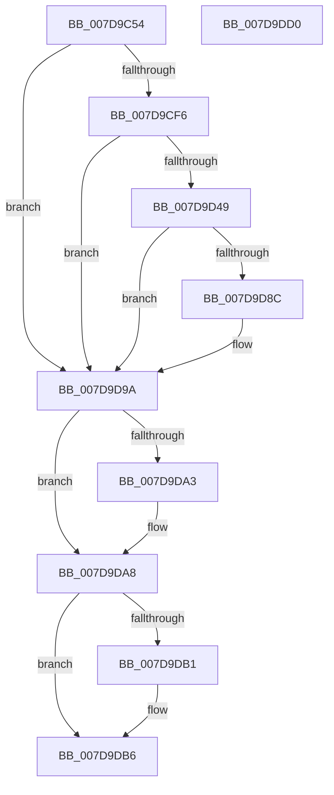

# ApiSetpLoadSchemaImage

- RVA: `0x007D9C54`–`0x007D9DD1` (길이 `381` bytes)
- VA: `0x00000001407D9C54`
- 실행 섹션: `PAGE`
- PDB 이름 있음: `예`; PDB Function 태그: `예`
- unwind 정보 RVA: `0x000D6114`
- 디코드: `95`개 명령, `381/381` bytes 표시
- 미해석 바이트: `0` (있으면 어셈블리에 `.byte`로 보존)

> 이 문서는 커널 이미지의 기계어와 PDB 기호를 분석해 생성했습니다. 4번과 5번은 함수 원형과 자료형을 바이너리 사용 방식에서 추정한 C 해석이며 원본 소스 복구 결과는 아닙니다.

## 1. Dependencies

- 직접 호출 지점: **5**; 고유 호출 대상: **4**
- 직접 호출자로 확인된 함수: **1**
- RIP 상대 이미지 참조: **0**

### Outgoing calls
- `0x007D9CE7` → [ZwOpenFile](../../text/6A/ZwOpenFile_function_006AD730.md) (function, `0x006AD730`)
- `0x007D9D3E` → [ZwCreateSection](../../text/6A/ZwCreateSection_function_006ADA10.md) (function, `0x006ADA10`)
- `0x007D9D81` → [ZwMapViewOfSection](../../text/6A/ZwMapViewOfSection_function_006AD5D0.md) (function, `0x006AD5D0`)
- `0x007D9DA3` → [ZwClose](../../text/6A/ZwClose_function_006AD2B0.md) (function, `0x006AD2B0`)
- `0x007D9DB1` → [ZwClose](../../text/6A/ZwClose_function_006AD2B0.md) (function, `0x006AD2B0`)

### Direct callers
- [ApiSetLoadSchemaEx](ApiSetLoadSchemaEx_function_007D96F4.md) at `0x007D9728`

### Static image references
- 디코드된 RIP-relative 메모리 참조가 없습니다.

## 2. Other-region calls and transfers

- 다른 실행 섹션으로 향하는 call: **5**
  - `0x007D9CE7` → [ZwOpenFile](../../text/6A/ZwOpenFile_function_006AD730.md) (`PAGE` → `.text`)
  - `0x007D9D3E` → [ZwCreateSection](../../text/6A/ZwCreateSection_function_006ADA10.md) (`PAGE` → `.text`)
  - `0x007D9D81` → [ZwMapViewOfSection](../../text/6A/ZwMapViewOfSection_function_006AD5D0.md) (`PAGE` → `.text`)
  - `0x007D9DA3` → [ZwClose](../../text/6A/ZwClose_function_006AD2B0.md) (`PAGE` → `.text`)
  - `0x007D9DB1` → [ZwClose](../../text/6A/ZwClose_function_006AD2B0.md) (`PAGE` → `.text`)
- 별도 외부 분기/꼬리 이동을 확인하지 못했습니다.

## 3. Assembly (complete function range)

```asm
007D9C54  48 8B C4                        mov rax, rsp
007D9C57  48 89 58 18                     mov qword ptr [rax + 0x18], rbx
007D9C5B  48 89 70 20                     mov qword ptr [rax + 0x20], rsi
007D9C5F  48 89 48 08                     mov qword ptr [rax + 8], rcx
007D9C63  55                              push rbp
007D9C64  57                              push rdi
007D9C65  41 57                           push r15
007D9C67  48 8D 68 A1                     lea rbp, [rax - 0x5f]
007D9C6B  48 81 EC D0 00 00 00            sub rsp, 0xd0
007D9C72  48 83 65 C7 00                  and qword ptr [rbp - 0x39], 0
007D9C77  48 8D 4D 6F                     lea rcx, [rbp + 0x6f]
007D9C7B  48 83 65 CF 00                  and qword ptr [rbp - 0x31], 0
007D9C80  33 C0                           xor eax, eax
007D9C82  21 44 24 28                     and dword ptr [rsp + 0x28], eax
007D9C86  0F 57 C0                        xorps xmm0, xmm0
007D9C89  83 65 23 00                     and dword ptr [rbp + 0x23], 0
007D9C8D  49 8B F9                        mov rdi, r9
007D9C90  48 21 45 0F                     and qword ptr [rbp + 0xf], rax
007D9C94  4C 8D 4D 37                     lea r9, [rbp + 0x37]
007D9C98  49 8B F0                        mov rsi, r8
007D9C9B  48 89 55 17                     mov qword ptr [rbp + 0x17], rdx
007D9C9F  49 83 CF FF                     or r15, 0xffffffffffffffff
007D9CA3  48 C7 45 07 30 00 00 00         mov qword ptr [rbp + 7], 0x30
007D9CAB  83 65 0B 00                     and dword ptr [rbp + 0xb], 0
007D9CAF  4C 8D 45 07                     lea r8, [rbp + 7]
007D9CB3  BA 00 00 00 80                  mov edx, 0x80000000
007D9CB8  C7 44 24 20 01 00 00 00         mov dword ptr [rsp + 0x20], 1
007D9CC0  0F 11 45 D7                     movups xmmword ptr [rbp - 0x29], xmm0
007D9CC4  48 89 45 F7                     mov qword ptr [rbp - 9], rax
007D9CC8  0F 11 45 E7                     movups xmmword ptr [rbp - 0x19], xmm0
007D9CCC  89 45 FF                        mov dword ptr [rbp - 1], eax
007D9CCF  0F 11 45 37                     movups xmmword ptr [rbp + 0x37], xmm0
007D9CD3  4C 89 7D 6F                     mov qword ptr [rbp + 0x6f], r15
007D9CD7  4C 89 7D 67                     mov qword ptr [rbp + 0x67], r15
007D9CDB  C7 45 1F 40 02 00 00            mov dword ptr [rbp + 0x1f], 0x240
007D9CE2  F3 0F 7F 45 27                  movdqu xmmword ptr [rbp + 0x27], xmm0
007D9CE7  E8 44 3A ED FF                  call 0x1406ad730
007D9CEC  8B D8                           mov ebx, eax
007D9CEE  85 C0                           test eax, eax
007D9CF0  0F 88 A4 00 00 00               js 0x1407d9d9a
007D9CF6  48 8B 45 6F                     mov rax, qword ptr [rbp + 0x6f]
007D9CFA  4C 8D 45 D7                     lea r8, [rbp - 0x29]
007D9CFE  48 83 65 DF 00                  and qword ptr [rbp - 0x21], 0
007D9D03  41 8D 57 05                     lea edx, [r15 + 5]
007D9D07  48 83 65 E7 00                  and qword ptr [rbp - 0x19], 0
007D9D0C  48 8D 4D 67                     lea rcx, [rbp + 0x67]
007D9D10  48 89 44 24 30                  mov qword ptr [rsp + 0x30], rax
007D9D15  0F 57 C0                        xorps xmm0, xmm0
007D9D18  C7 44 24 28 00 00 00 08         mov dword ptr [rsp + 0x28], 0x8000000
007D9D20  45 33 C9                        xor r9d, r9d
007D9D23  C7 44 24 20 02 00 00 00         mov dword ptr [rsp + 0x20], 2
007D9D2B  C7 45 D7 30 00 00 00            mov dword ptr [rbp - 0x29], 0x30
007D9D32  C7 45 EF 40 02 00 00            mov dword ptr [rbp - 0x11], 0x240
007D9D39  F3 0F 7F 45 F7                  movdqu xmmword ptr [rbp - 9], xmm0
007D9D3E  E8 CD 3C ED FF                  call 0x1406ada10
007D9D43  8B D8                           mov ebx, eax
007D9D45  85 C0                           test eax, eax
007D9D47  78 51                           js 0x1407d9d9a
007D9D49  48 8B 4D 67                     mov rcx, qword ptr [rbp + 0x67]
007D9D4D  48 8D 45 CF                     lea rax, [rbp - 0x31]
007D9D51  C7 44 24 48 02 00 00 00         mov dword ptr [rsp + 0x48], 2
007D9D59  4C 8D 45 C7                     lea r8, [rbp - 0x39]
007D9D5D  83 64 24 40 00                  and dword ptr [rsp + 0x40], 0
007D9D62  45 33 C9                        xor r9d, r9d
007D9D65  C7 44 24 38 02 00 00 00         mov dword ptr [rsp + 0x38], 2
007D9D6D  49 8B D7                        mov rdx, r15
007D9D70  48 89 44 24 30                  mov qword ptr [rsp + 0x30], rax
007D9D75  48 83 64 24 28 00               and qword ptr [rsp + 0x28], 0
007D9D7B  48 83 64 24 20 00               and qword ptr [rsp + 0x20], 0
007D9D81  E8 4A 38 ED FF                  call 0x1406ad5d0
007D9D86  8B D8                           mov ebx, eax
007D9D88  85 C0                           test eax, eax
007D9D8A  78 0E                           js 0x1407d9d9a
007D9D8C  48 8B 45 C7                     mov rax, qword ptr [rbp - 0x39]
007D9D90  48 89 06                        mov qword ptr [rsi], rax
007D9D93  48 8B 45 CF                     mov rax, qword ptr [rbp - 0x31]
007D9D97  48 89 07                        mov qword ptr [rdi], rax
007D9D9A  48 8B 4D 67                     mov rcx, qword ptr [rbp + 0x67]
007D9D9E  49 3B CF                        cmp rcx, r15
007D9DA1  74 05                           je 0x1407d9da8
007D9DA3  E8 08 35 ED FF                  call 0x1406ad2b0
007D9DA8  48 8B 4D 6F                     mov rcx, qword ptr [rbp + 0x6f]
007D9DAC  49 3B CF                        cmp rcx, r15
007D9DAF  74 05                           je 0x1407d9db6
007D9DB1  E8 FA 34 ED FF                  call 0x1406ad2b0
007D9DB6  4C 8D 9C 24 D0 00 00 00         lea r11, [rsp + 0xd0]
007D9DBE  8B C3                           mov eax, ebx
007D9DC0  49 8B 5B 30                     mov rbx, qword ptr [r11 + 0x30]
007D9DC4  49 8B 73 38                     mov rsi, qword ptr [r11 + 0x38]
007D9DC8  49 8B E3                        mov rsp, r11
007D9DCB  41 5F                           pop r15
007D9DCD  5F                              pop rdi
007D9DCE  5D                              pop rbp
007D9DCF  C3                              ret
007D9DD0  CC                              int3
```

## 4. C-style interpretation (structured pseudocode)

```c
__int64 __fastcall ApiSetpLoadSchemaImage(__int64 a1, __int64 a2, __int64 a3, __int64 a4)
{
    __int64 result;
    __int64 v_r15;
    __int64 v_rsp;
    unsigned __int64 v_stack_m18;
    unsigned int v_stack_mA0;
    unsigned int v_stack_mA8;
    unsigned int v_stack_mB0;
    unsigned __int64 v_stack_mB8;
    unsigned int v_stack_mC0;
    unsigned int v_stack_mC8;

    *(unsigned __int64 *)(v_rsp + 24) = v_rbx;
    *(unsigned __int64 *)(v_rsp + 32) = v_rsi;
    *(unsigned __int64 *)(v_rsp + 8) = a1;
    v_rsp = (v_rsp) - (208);
    result = 0;
    *(unsigned __int64 *)(v_rsp - 95 + 23) = a2;
    v_r15 = (v_r15) | (-1);
    *(unsigned __int64 *)(v_rsp - 95 + 7) = 48;
    v_stack_mC8 = 1;
    *(unsigned __int64 *)(v_rsp - 95 - 41) = v_xmm0;
    *(unsigned __int64 *)(v_rsp - 95 - 9) = 0;
    *(unsigned __int64 *)(v_rsp - 95 - 25) = v_xmm0;
    *(unsigned int *)(v_rsp - 95 - 1) = 0;
    *(unsigned __int64 *)(v_rsp - 95 + 55) = v_xmm0;
    *(unsigned __int64 *)(v_rsp - 95 + 111) = v_r15;
    *(unsigned __int64 *)(v_rsp - 95 + 103) = v_r15;
    *(unsigned int *)(v_rsp - 95 + 31) = 576;
    *(unsigned __int64 *)(v_rsp - 95 + 39) = v_xmm0;
    result = ZwOpenFile(v_rsp - 95 + 111, (unsigned int)(0x80000000ULL), v_rsp - 95 + 7, v_rsp - 95 + 55);
    if (sign_flag) goto loc_007D9D9A;
    v_stack_mB8 = *(unsigned __int64 *)(v_rsp - 95 + 111);
    v_stack_mC0 = 0x8000000ULL;
    a4 = 0;
    v_stack_mC8 = 2;
    *(unsigned int *)(v_rsp - 95 - 41) = 48;
    *(unsigned int *)(v_rsp - 95 - 17) = 576;
    *(unsigned __int64 *)(v_rsp - 95 - 9) = v_xmm0;
    result = ZwCreateSection(v_rsp - 95 + 103, v_r15 + 5, v_rsp - 95 - 41, a4);
    if (sign_flag) goto loc_007D9D9A;
    v_stack_mA0 = 2;
    a4 = 0;
    v_stack_mB0 = 2;
    v_stack_mB8 = v_rsp - 95 - 49;
    result = ZwMapViewOfSection(*(unsigned __int64 *)(v_rsp - 95 + 103), v_r15, v_rsp - 95 - 57, a4);
    if (!(sign_flag)) {
        result = *(unsigned __int64 *)(v_rsp - 95 - 57);
        *(unsigned __int64 *)(a3) = result;
        result = *(unsigned __int64 *)(v_rsp - 95 - 49);
        *(unsigned __int64 *)(a4) = result;
    }
    if ((*(unsigned __int64 *)(v_rsp - 95 + 103)) != v_r15) {
        result = ZwClose(*(unsigned __int64 *)(v_rsp - 95 + 103), v_r15, v_rsp - 95 - 57, a4);
    }
    if ((*(unsigned __int64 *)(v_rsp - 95 + 111)) != v_r15) {
        result = ZwClose(*(unsigned __int64 *)(v_rsp - 95 + 111), v_r15, v_rsp - 95 - 57, a4);
    }
    return (unsigned int)((unsigned int)((unsigned int)((unsigned int)(result))));
}
```

## 5. (Beta) C Style

```c
int64_t ApiSetpLoadSchemaImage(int64_t Arg1, int64_t Arg2, void *Arg3, void *Arg4)
{
    uint8_t *arg3 = (uint8_t *)Arg3;
    uint8_t *arg4 = (uint8_t *)Arg4;

    int64_t result;
    int64_t local_r15;
    int64_t local_rsp;
    uint64_t v_stack_m18;
    uint32_t v_stack_mA0;
    uint32_t v_stack_mA8;
    uint32_t v_stack_mB0;
    uint64_t v_stack_mB8;
    uint32_t v_stack_mC0;
    uint32_t v_stack_mC8;

    *(uint64_t *)(local_rsp + 0x18) = local_rbx;
    *(uint64_t *)(local_rsp + 0x20) = local_rsi;
    *(uint64_t *)(local_rsp + 0x8) = Arg1;
    local_rsp = (local_rsp) - (208);
    result = 0;
    *(uint64_t *)(local_rsp - 0x5F + 0x17) = Arg2;
    local_r15 = (local_r15) | (-1);
    *(uint64_t *)(local_rsp - 0x5F + 0x7) = 48;
    v_stack_mC8 = 1;
    *(uint64_t *)(local_rsp - 0x5F - 0x29) = v_xmm0;
    *(uint64_t *)(local_rsp - 0x5F - 0x9) = 0;
    *(uint64_t *)(local_rsp - 0x5F - 0x19) = v_xmm0;
    *(uint32_t *)(local_rsp - 0x5F - 0x1) = 0;
    *(uint64_t *)(local_rsp - 0x5F + 0x37) = v_xmm0;
    *(uint64_t *)(local_rsp - 0x5F + 0x6F) = local_r15;
    *(uint64_t *)(local_rsp - 0x5F + 0x67) = local_r15;
    *(uint32_t *)(local_rsp - 0x5F + 0x1F) = 576;
    *(uint64_t *)(local_rsp - 0x5F + 0x27) = v_xmm0;
    result = ZwOpenFile(local_rsp - 95 + 111, (uint32_t)(0x80000000ULL), local_rsp - 95 + 7, local_rsp - 95 + 55);
    if (sign_flag) goto loc_007D9D9A;
    v_stack_mB8 = *(uint64_t *)(local_rsp - 0x5F + 0x6F);
    v_stack_mC0 = 0x8000000ULL;
    Arg4 = 0;
    v_stack_mC8 = 2;
    *(uint32_t *)(local_rsp - 0x5F - 0x29) = 48;
    *(uint32_t *)(local_rsp - 0x5F - 0x11) = 576;
    *(uint64_t *)(local_rsp - 0x5F - 0x9) = v_xmm0;
    result = ZwCreateSection(local_rsp - 95 + 103, local_r15 + 5, local_rsp - 95 - 41, Arg4);
    if (sign_flag) goto loc_007D9D9A;
    v_stack_mA0 = 2;
    Arg4 = 0;
    v_stack_mB0 = 2;
    v_stack_mB8 = local_rsp - 95 - 49;
    result = ZwMapViewOfSection(*(uint64_t *)(local_rsp - 0x5F + 0x67), local_r15, local_rsp - 95 - 57, Arg4);
    if (!(sign_flag)) {
        result = *(uint64_t *)(local_rsp - 0x5F - 0x39);
        *(uint64_t *)(arg3) = result;
        result = *(uint64_t *)(local_rsp - 0x5F - 0x31);
        *(uint64_t *)(arg4) = result;
    }
    if ((*(uint64_t *)(local_rsp - 0x5F + 0x67)) != local_r15) {
        result = ZwClose(*(uint64_t *)(local_rsp - 0x5F + 0x67), local_r15, local_rsp - 95 - 57, Arg4);
    }
    if ((*(uint64_t *)(local_rsp - 0x5F + 0x6F)) != local_r15) {
        result = ZwClose(*(uint64_t *)(local_rsp - 0x5F + 0x6F), local_r15, local_rsp - 95 - 57, Arg4);
    }
    return (uint32_t)((uint32_t)((uint32_t)((uint32_t)(result))));
}
```

### 관측된 메모리 오프셋

구조체 형식이 확인되지 않은 접근은 인자 기준의 오프셋으로만 기록했습니다.

| 기준 인자 | 오프셋 표현 | 폭 (bit) | 접근 |
|---|---:|---:|---|
| `Arg3` | `+ 0x0` | `64` | `W` |
| `Arg4` | `+ 0x0` | `64` | `W` |

## 6. Execution-region graph

[열기: 2D/3D 그래프와 함수 탐색 컨트롤 패널](../../../control-panel.html?section=page&rva=0x007D9C54&view=graph)

- 2D 그래프는 위에서 아래로 흐르고, 3D 그래프는 빈 공간을 드래그해 회전합니다. Shift+드래그는 이동, 휠은 확대·축소, 함수 노드 선택은 대상 보고서 이동입니다.

### Static fallback


