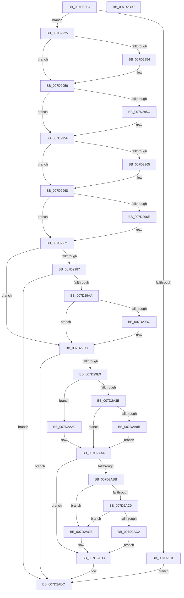

# CMFCheckAccess

- RVA: `0x007D28B4`–`0x007D2B0A` (길이 `598` bytes)
- VA: `0x00000001407D28B4`
- 실행 섹션: `PAGE`
- PDB 이름 있음: `예`; PDB Function 태그: `아니요`
- unwind 정보 RVA: `0x000D5AF4`
- 디코드: `154`개 명령, `598/598` bytes 표시
- 미해석 바이트: `0` (있으면 어셈블리에 `.byte`로 보존)

> 이 문서는 커널 이미지의 기계어와 PDB 기호를 분석해 생성했습니다. 4번과 5번은 함수 원형과 자료형을 바이너리 사용 방식에서 추정한 C 해석이며 원본 소스 복구 결과는 아닙니다.

## 1. Dependencies

- 직접 호출 지점: **13**; 고유 호출 대상: **12**
- 직접 호출자로 확인된 함수: **1**
- RIP 상대 이미지 참조: **4**

### Outgoing calls
- `0x007D28FA` → [memset](../../text/6C/memset_function_006C6C40.md) (function, `0x006C6C40`)
- `0x007D290B` → [memset](../../text/6C/memset_function_006C6C40.md) (function, `0x006C6C40`)
- `0x007D2995` → [CMFCreateSecurityDescriptor](CMFCreateSecurityDescriptor_function_007D2B10.md) (function, `0x007D2B10`)
- `0x007D29C3` → [ExFreePoolWithTag](../../poolcode/B8/ExFreePoolWithTag_function_00B82870.md) (function, `0x00B82870`)
- `0x007D29D6` → [SeCreateAccessState](../8C/SeCreateAccessState_function_008C6AC0.md) (function, `0x008C6AC0`)
- `0x007D29ED` → [SeLockSubjectContext](../8C/SeLockSubjectContext_function_008C64C0.md) (function, `0x008C64C0`)
- `0x007D2A25` → [SePrivilegeCheck](../9B/SePrivilegeCheck_function_009BAE70.md) (function, `0x009BAE70`)
- `0x007D2A79` → [SeAccessCheck](../../text/3A/SeAccessCheck_function_003A6BC0.md) (function, `0x003A6BC0`)
- `0x007D2A8F` → [SeAppendPrivileges](../9D/SeAppendPrivileges_function_009D7980.md) (function, `0x009D7980`)
- `0x007D2A99` → [CmSiFreeMemory](../../text/47/CmSiFreeMemory_function_00475D80.md) (function, `0x00475D80`)
- `0x007D2AA8` → [SeUnlockSubjectContext](../8C/SeUnlockSubjectContext_function_008C6520.md) (function, `0x008C6520`)
- `0x007D2AD7` → [SeDeleteAccessState](../8C/SeDeleteAccessState_function_008C5F70.md) (function, `0x008C5F70`)
- `0x007D2AE8` → [_security_check_cookie](../../text/6A/_security_check_cookie_function_006AC640.md) (function, `0x006AC640`)

### Direct callers
- [NtMapCMFModule](NtMapCMFModule_function_007D4310.md) at `0x007D44DC`
- [NtMapCMFModule](NtMapCMFModule_function_007D4310.md) at `0x007D4AE7`

### Static image references
- `0x007D28D5` → RVA `0x00E0A740` (`.data`; read)
- `0x007D292D` → RVA `0x00FC7800` (`ALMOSTRO`; read)
- `0x007D293E` → RVA `0x00FC6E4C` (`ALMOSTRO`; read)
- `0x007D297D` → RVA `0x00EEEFC8` (`.data`; read)

## 2. Other-region calls and transfers

- 다른 실행 섹션으로 향하는 call: **6**
  - `0x007D28FA` → [memset](../../text/6C/memset_function_006C6C40.md) (`PAGE` → `.text`)
  - `0x007D290B` → [memset](../../text/6C/memset_function_006C6C40.md) (`PAGE` → `.text`)
  - `0x007D29C3` → [ExFreePoolWithTag](../../poolcode/B8/ExFreePoolWithTag_function_00B82870.md) (`PAGE` → `POOLCODE`)
  - `0x007D2A79` → [SeAccessCheck](../../text/3A/SeAccessCheck_function_003A6BC0.md) (`PAGE` → `.text`)
  - `0x007D2A99` → [CmSiFreeMemory](../../text/47/CmSiFreeMemory_function_00475D80.md) (`PAGE` → `.text`)
  - `0x007D2AE8` → [_security_check_cookie](../../text/6A/_security_check_cookie_function_006AC640.md) (`PAGE` → `.text`)
- 별도 외부 분기/꼬리 이동을 확인하지 못했습니다.

## 3. Assembly (complete function range)

```asm
007D28B4  48 89 5C 24 18                  mov qword ptr [rsp + 0x18], rbx
007D28B9  48 89 74 24 20                  mov qword ptr [rsp + 0x20], rsi
007D28BE  55                              push rbp
007D28BF  57                              push rdi
007D28C0  41 55                           push r13
007D28C2  41 56                           push r14
007D28C4  41 57                           push r15
007D28C6  48 8D AC 24 E0 FE FF FF         lea rbp, [rsp - 0x120]
007D28CE  48 81 EC 20 02 00 00            sub rsp, 0x220
007D28D5  48 8B 05 64 7E 63 00            mov rax, qword ptr [rip + 0x637e64]
007D28DC  48 33 C4                        xor rax, rsp
007D28DF  48 89 85 10 01 00 00            mov qword ptr [rbp + 0x110], rax
007D28E6  45 8A F8                        mov r15b, r8b
007D28E9  8B DA                           mov ebx, edx
007D28EB  48 8B F9                        mov rdi, rcx
007D28EE  33 D2                           xor edx, edx
007D28F0  41 B8 A0 00 00 00               mov r8d, 0xa0
007D28F6  48 8D 4D 90                     lea rcx, [rbp - 0x70]
007D28FA  E8 41 43 EF FF                  call 0x1406c6c40
007D28FF  33 D2                           xor edx, edx
007D2901  48 8D 4D 30                     lea rcx, [rbp + 0x30]
007D2905  41 B8 E0 00 00 00               mov r8d, 0xe0
007D290B  E8 30 43 EF FF                  call 0x1406c6c40
007D2910  48 83 64 24 68 00               and qword ptr [rsp + 0x68], 0
007D2916  48 85 FF                        test rdi, rdi
007D2919  75 0A                           jne 0x1407d2925
007D291B  BF 0D 00 00 C0                  mov edi, 0xc000000d
007D2920  E9 B7 01 00 00                  jmp 0x1407d2adc
007D2925  48 8D 47 D0                     lea rax, [rdi - 0x30]
007D2929  48 C1 E8 08                     shr rax, 8
007D292D  48 8D 35 CC 4E 7F 00            lea rsi, [rip + 0x7f4ecc]
007D2934  0F B6 D0                        movzx edx, al
007D2937  0F B6 47 E8                     movzx eax, byte ptr [rdi - 0x18]
007D293B  48 33 D0                        xor rdx, rax
007D293E  0F B6 05 07 45 7F 00            movzx eax, byte ptr [rip + 0x7f4507]
007D2945  48 33 D0                        xor rdx, rax
007D2948  48 8B 34 D6                     mov rsi, qword ptr [rsi + rdx*8]
007D294C  48 83 C6 4C                     add rsi, 0x4c
007D2950  85 DB                           test ebx, ebx
007D2952  79 02                           jns 0x1407d2956
007D2954  0B 1E                           or ebx, dword ptr [rsi]
007D2956  0F BA E3 1E                     bt ebx, 0x1e
007D295A  73 03                           jae 0x1407d295f
007D295C  0B 5E 04                        or ebx, dword ptr [rsi + 4]
007D295F  0F BA E3 1D                     bt ebx, 0x1d
007D2963  73 03                           jae 0x1407d2968
007D2965  0B 5E 08                        or ebx, dword ptr [rsi + 8]
007D2968  0F BA E3 1C                     bt ebx, 0x1c
007D296C  73 03                           jae 0x1407d2971
007D296E  0B 5E 0C                        or ebx, dword ptr [rsi + 0xc]
007D2971  81 E3 FF FF FF 0F               and ebx, 0xfffffff
007D2977  41 BD 00 00 00 C0               mov r13d, 0xc0000000
007D297D  48 83 3D 43 C6 71 00 00         cmp qword ptr [rip + 0x71c643], 0
007D2985  75 41                           jne 0x1407d29c8
007D2987  48 83 64 24 58 00               and qword ptr [rsp + 0x58], 0
007D298D  48 8D 4C 24 58                  lea rcx, [rsp + 0x58]
007D2992  48 8B D6                        mov rdx, rsi
007D2995  E8 76 01 00 00                  call 0x1407d2b10
007D299A  8B C8                           mov ecx, eax
007D299C  8B F8                           mov edi, eax
007D299E  41 23 CD                        and ecx, r13d
007D29A1  41 3B CD                        cmp ecx, r13d
007D29A4  0F 84 32 01 00 00               je 0x1407d2adc
007D29AA  48 8B 4C 24 58                  mov rcx, qword ptr [rsp + 0x58]
007D29AF  33 C0                           xor eax, eax
007D29B1  F0 48 0F B1 0D 0E C6 71 00      lock cmpxchg qword ptr [rip + 0x71c60e], rcx
007D29BA  74 0C                           je 0x1407d29c8
007D29BC  48 8B 4C 24 58                  mov rcx, qword ptr [rsp + 0x58]
007D29C1  33 D2                           xor edx, edx
007D29C3  E8 A8 FE 3A 00                  call 0x140b82870
007D29C8  4C 8B CE                        mov r9, rsi
007D29CB  48 8D 55 30                     lea rdx, [rbp + 0x30]
007D29CF  44 8B C3                        mov r8d, ebx
007D29D2  48 8D 4D 90                     lea rcx, [rbp - 0x70]
007D29D6  E8 E5 40 0F 00                  call 0x1408c6ac0
007D29DB  8B F8                           mov edi, eax
007D29DD  41 23 C5                        and eax, r13d
007D29E0  41 3B C5                        cmp eax, r13d
007D29E3  0F 84 F3 00 00 00               je 0x1407d2adc
007D29E9  48 8D 4D B0                     lea rcx, [rbp - 0x50]
007D29ED  E8 CE 3A 0F 00                  call 0x1408c64c0
007D29F2  83 64 24 5C 00                  and dword ptr [rsp + 0x5c], 0
007D29F7  48 8D 55 B0                     lea rdx, [rbp - 0x50]
007D29FB  83 64 24 7C 00                  and dword ptr [rsp + 0x7c], 0
007D2A00  48 8D 4C 24 78                  lea rcx, [rsp + 0x78]
007D2A05  83 65 88 00                     and dword ptr [rbp - 0x78], 0
007D2A09  45 8A C7                        mov r8b, r15b
007D2A0C  C7 44 24 58 12 00 00 00         mov dword ptr [rsp + 0x58], 0x12
007D2A14  48 8B 44 24 58                  mov rax, qword ptr [rsp + 0x58]
007D2A19  48 89 45 80                     mov qword ptr [rbp - 0x80], rax
007D2A1D  C7 44 24 78 01 00 00 00         mov dword ptr [rsp + 0x78], 1
007D2A25  E8 46 84 1E 00                  call 0x1409bae70
007D2A2A  83 64 24 60 00                  and dword ptr [rsp + 0x60], 0
007D2A2F  44 8A F0                        mov r14b, al
007D2A32  83 64 24 50 00                  and dword ptr [rsp + 0x50], 0
007D2A37  84 C0                           test al, al
007D2A39  75 65                           jne 0x1407d2aa0
007D2A3B  48 8B 0D 86 C5 71 00            mov rcx, qword ptr [rip + 0x71c586]
007D2A42  48 8D 44 24 60                  lea rax, [rsp + 0x60]
007D2A47  48 89 44 24 48                  mov qword ptr [rsp + 0x48], rax
007D2A4C  48 8D 55 B0                     lea rdx, [rbp - 0x50]
007D2A50  48 8D 44 24 50                  lea rax, [rsp + 0x50]
007D2A55  44 8B CB                        mov r9d, ebx
007D2A58  48 89 44 24 40                  mov qword ptr [rsp + 0x40], rax
007D2A5D  41 B0 01                        mov r8b, 1
007D2A60  44 88 7C 24 38                  mov byte ptr [rsp + 0x38], r15b
007D2A65  48 8D 44 24 68                  lea rax, [rsp + 0x68]
007D2A6A  48 89 74 24 30                  mov qword ptr [rsp + 0x30], rsi
007D2A6F  48 89 44 24 28                  mov qword ptr [rsp + 0x28], rax
007D2A74  83 64 24 20 00                  and dword ptr [rsp + 0x20], 0
007D2A79  E8 42 41 BD FF                  call 0x1403a6bc0
007D2A7E  48 8B 54 24 68                  mov rdx, qword ptr [rsp + 0x68]
007D2A83  44 8A F0                        mov r14b, al
007D2A86  48 85 D2                        test rdx, rdx
007D2A89  74 19                           je 0x1407d2aa4
007D2A8B  48 8D 4D 90                     lea rcx, [rbp - 0x70]
007D2A8F  E8 EC 4E 20 00                  call 0x1409d7980
007D2A94  48 8B 4C 24 68                  mov rcx, qword ptr [rsp + 0x68]
007D2A99  E8 E2 32 CA FF                  call 0x140475d80
007D2A9E  EB 04                           jmp 0x1407d2aa4
007D2AA0  89 5C 24 50                     mov dword ptr [rsp + 0x50], ebx
007D2AA4  48 8D 4D B0                     lea rcx, [rbp - 0x50]
007D2AA8  E8 73 3A 0F 00                  call 0x1408c6520
007D2AAD  8B 7C 24 60                     mov edi, dword ptr [rsp + 0x60]
007D2AB1  8B C7                           mov eax, edi
007D2AB3  41 23 C5                        and eax, r13d
007D2AB6  41 3B C5                        cmp eax, r13d
007D2AB9  74 18                           je 0x1407d2ad3
007D2ABB  45 84 F6                        test r14b, r14b
007D2ABE  74 0E                           je 0x1407d2ace
007D2AC0  8B 44 24 50                     mov eax, dword ptr [rsp + 0x50]
007D2AC4  F7 D0                           not eax
007D2AC6  85 C3                           test ebx, eax
007D2AC8  75 04                           jne 0x1407d2ace
007D2ACA  33 FF                           xor edi, edi
007D2ACC  EB 05                           jmp 0x1407d2ad3
007D2ACE  BF 22 00 00 C0                  mov edi, 0xc0000022
007D2AD3  48 8D 4D 90                     lea rcx, [rbp - 0x70]
007D2AD7  E8 94 34 0F 00                  call 0x1408c5f70
007D2ADC  8B C7                           mov eax, edi
007D2ADE  48 8B 8D 10 01 00 00            mov rcx, qword ptr [rbp + 0x110]
007D2AE5  48 33 CC                        xor rcx, rsp
007D2AE8  E8 53 9B ED FF                  call 0x1406ac640
007D2AED  4C 8D 9C 24 20 02 00 00         lea r11, [rsp + 0x220]
007D2AF5  49 8B 5B 40                     mov rbx, qword ptr [r11 + 0x40]
007D2AF9  49 8B 73 48                     mov rsi, qword ptr [r11 + 0x48]
007D2AFD  49 8B E3                        mov rsp, r11
007D2B00  41 5F                           pop r15
007D2B02  41 5E                           pop r14
007D2B04  41 5D                           pop r13
007D2B06  5F                              pop rdi
007D2B07  5D                              pop rbp
007D2B08  C3                              ret
007D2B09  CC                              int3
```

## 4. C-style interpretation (structured pseudocode)

```c
__int64 __fastcall CMFCheckAccess(__int64 a1, int a2, unsigned __int8 a3)
{
    __int64 result;
    __int64 v_rbx;
    __int64 v_rdi;
    __int64 v_rsi;
    __int64 v_rsp;
    unsigned __int64 v_stack_m118;
    unsigned __int64 v_stack_m148;
    unsigned __int64 v_stack_m198;
    unsigned __int64 v_stack_m1B8;
    unsigned int v_stack_m1C0;
    unsigned __int64 v_stack_m1C8;
    unsigned int v_stack_m1CC;
    unsigned __int64 v_stack_m1D0;
    unsigned __int64 v_stack_m1E0;
    unsigned int v_stack_m1E8;
    unsigned int v_stack_m1EC;
    unsigned __int64 v_stack_m1F0;
    unsigned int v_stack_m1F8;
    unsigned __int64 v_stack_m200;
    unsigned __int64 v_stack_m208;
    unsigned __int8 v_stack_m210;
    unsigned __int64 v_stack_m218;
    unsigned __int64 v_stack_m220;
    unsigned int v_stack_m228;
    unsigned __int64 v_stack_m28;
    unsigned __int64 v_stack_m38;
    unsigned __int64 v_stack_p18;
    unsigned __int64 v_stack_p20;

    v_stack_p18 = v_rbx;
    v_stack_p20 = v_rsi;
    v_rsp = (v_rsp) - (544);
    result = (*(unsigned __int64 *)(v_rip + 6520420)) ^ (v_rsp);
    v_stack_m38 = result;
    a2 = 0;
    result = memset(v_stack_m1B8, a2, 160, a4);
    a2 = 0;
    result = memset(v_stack_m118, a2, 224, a4);
    if (a1 != 0) goto loc_007D2925;
    goto loc_007D2ADC;
loc_007D2925:
    result = ((unsigned int)(0xC000000DULL) - 48) >> (8);
    a2 = ((unsigned __int8)(result)) ^ (*(unsigned __int8 *)((unsigned int)(0xC000000DULL) - 24));
    a2 = (a2) ^ (*(unsigned __int8 *)(v_rip + 8340743));
    v_rsi = (*(unsigned __int64 *)(v_rip + 8343244 + a2 * 8)) + (76);
    v_rbx = (unsigned int)(a2);
    if (sign_flag) {
        v_rbx = (unsigned int)(((unsigned int)(a2)) | (*(unsigned int *)(v_rsi)));
    }
    if (!(condition_is_above_or_equal)) {
        v_rbx = (unsigned int)((v_rbx) | (*(unsigned int *)(v_rsi + 4)));
    }
    if (!(condition_is_above_or_equal)) {
        v_rbx = (unsigned int)((v_rbx) | (*(unsigned int *)(v_rsi + 8)));
    }
    if (!(condition_is_above_or_equal)) {
        v_rbx = (unsigned int)((v_rbx) | (*(unsigned int *)(v_rsi + 12)));
    }
    v_rbx = (unsigned int)((v_rbx) & (0xFFFFFFFULL));
    if ((*(unsigned __int64 *)(v_rip + 7456323)) != 0) goto loc_007D29C8;
    result = CMFCreateSecurityDescriptor(v_stack_m1F0, v_rsi, 224, a4);
    a1 = (unsigned int)(((unsigned int)((unsigned int)(result))) & ((unsigned int)((unsigned int)(0xC0000000ULL))));
    if (((unsigned int)(a1)) == ((unsigned int)((unsigned int)(0xC0000000ULL)))) goto loc_007D2ADC;
    result = 0;
    if (!(condition_is_equal)) {
        a1 = v_stack_m1F0;
        a2 = 0;
        result = ExFreePoolWithTag(a1, a2, 224, a4);
    }
    result = SeCreateAccessState(v_stack_m1B8, v_stack_m118, (unsigned int)((unsigned int)(v_rbx)), v_rsi);
    result = (unsigned int)((result) & ((unsigned int)((unsigned int)(0xC0000000ULL))));
    if (((unsigned int)(result)) == ((unsigned int)((unsigned int)(0xC0000000ULL)))) goto loc_007D2ADC;
    result = SeLockSubjectContext(v_stack_m198, v_stack_m118, (unsigned int)((unsigned int)(v_rbx)), v_rsi);
    v_stack_m1F0 = 18;
    v_stack_m1C8 = v_stack_m1F0;
    v_stack_m1D0 = 1;
    result = SePrivilegeCheck(v_stack_m1D0, v_stack_m198, a3, v_rsi);
    if ((unsigned __int8)(result) != 0) goto loc_007D2AA0;
    v_stack_m200 = v_stack_m1E8;
    v_stack_m208 = v_stack_m1F8;
    v_stack_m210 = a3;
    v_stack_m218 = v_rsi;
    v_stack_m220 = v_stack_m1E0;
    result = SeAccessCheck(*(unsigned __int64 *)(v_rip + 7456134), v_stack_m198, 1, (unsigned int)((unsigned int)(v_rbx)));
    if (v_stack_m1E0 == 0) goto loc_007D2AA4;
    result = SeAppendPrivileges(v_stack_m1B8, v_stack_m1E0, 1, (unsigned int)((unsigned int)(v_rbx)));
    result = CmSiFreeMemory(v_stack_m1E0, v_stack_m1E0, 1, (unsigned int)((unsigned int)(v_rbx)));
    goto loc_007D2AA4;
loc_007D2AA0:
    v_stack_m1F8 = (unsigned int)(v_rbx);
loc_007D2AA4:
    result = SeUnlockSubjectContext(v_stack_m198, v_stack_m1E0, 1, (unsigned int)((unsigned int)(v_rbx)));
    result = (unsigned int)(((unsigned int)((unsigned int)((unsigned int)(v_stack_m1E8)))) & ((unsigned int)((unsigned int)(0xC0000000ULL))));
    if (((unsigned int)(result)) == ((unsigned int)((unsigned int)(0xC0000000ULL)))) goto loc_007D2AD3;
    if ((unsigned __int8)((unsigned __int8)(result)) == 0) goto loc_007D2ACE;
    result = (unsigned int)(~((unsigned int)(v_stack_m1F8)));
    if ((((unsigned int)(v_rbx)) & ((unsigned int)(result))) != 0) goto loc_007D2ACE;
    v_rdi = 0;
    goto loc_007D2AD3;
loc_007D2ACE:
loc_007D2AD3:
    result = SeDeleteAccessState(v_stack_m1B8, v_stack_m1E0, 1, (unsigned int)((unsigned int)(v_rbx)));
loc_007D2ADC:
    a1 = (v_stack_m38) ^ (v_rsp);
    result = _security_check_cookie(a1, v_stack_m1E0, 1, (unsigned int)((unsigned int)(v_rbx)));
    return result;
}
```

## 5. (Beta) C Style

```c
int64_t CMFCheckAccess(int64_t Arg1, int32_t Arg2, uint8_t Arg3)
{
    int64_t result;
    int64_t local_rbx;
    int64_t local_rdi;
    int64_t local_rsi;
    int64_t local_rsp;
    uint64_t v_stack_m118;
    uint64_t v_stack_m148;
    uint64_t v_stack_m198;
    uint64_t v_stack_m1B8;
    uint32_t v_stack_m1C0;
    uint64_t v_stack_m1C8;
    uint32_t v_stack_m1CC;
    uint64_t v_stack_m1D0;
    uint64_t v_stack_m1E0;
    uint32_t v_stack_m1E8;
    uint32_t v_stack_m1EC;
    uint64_t v_stack_m1F0;
    uint32_t v_stack_m1F8;
    uint64_t v_stack_m200;
    uint64_t v_stack_m208;
    uint8_t v_stack_m210;
    uint64_t v_stack_m218;
    uint64_t v_stack_m220;
    uint32_t v_stack_m228;
    uint64_t v_stack_m28;
    uint64_t v_stack_m38;
    uint64_t v_stack_p18;
    uint64_t v_stack_p20;

    v_stack_p18 = local_rbx;
    v_stack_p20 = local_rsi;
    local_rsp = (local_rsp) - (544);
    result = (*(uint64_t *)(v_rip + 0x637E64)) ^ (local_rsp);
    v_stack_m38 = result;
    Arg2 = 0;
    result = memset(v_stack_m1B8, Arg2, 160, a4);
    Arg2 = 0;
    result = memset(v_stack_m118, Arg2, 224, a4);
    if (Arg1 != 0) goto loc_007D2925;
    goto loc_007D2ADC;
loc_007D2925:
    result = ((uint32_t)(0xC000000DULL) - 48) >> (8);
    Arg2 = ((uint8_t)(result)) ^ (*(uint8_t *)((uint32_t)(0xC000000DULL) - 0x18));
    Arg2 = (Arg2) ^ (*(uint8_t *)(v_rip + 0x7F4507));
    local_rsi = (*(uint64_t *)(v_rip + 0x7F4ECC + Arg2 * 8)) + (76);
    local_rbx = (uint32_t)(Arg2);
    if (sign_flag) {
        local_rbx = (uint32_t)(((uint32_t)(Arg2)) | (*(uint32_t *)(local_rsi)));
    }
    if (!(condition_is_above_or_equal)) {
        local_rbx = (uint32_t)((local_rbx) | (*(uint32_t *)(local_rsi + 0x4)));
    }
    if (!(condition_is_above_or_equal)) {
        local_rbx = (uint32_t)((local_rbx) | (*(uint32_t *)(local_rsi + 0x8)));
    }
    if (!(condition_is_above_or_equal)) {
        local_rbx = (uint32_t)((local_rbx) | (*(uint32_t *)(local_rsi + 0xC)));
    }
    local_rbx = (uint32_t)((local_rbx) & (0xFFFFFFFULL));
    if ((*(uint64_t *)(v_rip + 0x71C643)) != 0) goto loc_007D29C8;
    result = CMFCreateSecurityDescriptor(v_stack_m1F0, local_rsi, 224, a4);
    Arg1 = (uint32_t)(((uint32_t)((uint32_t)(result))) & ((uint32_t)((uint32_t)(0xC0000000ULL))));
    if (((uint32_t)(Arg1)) == ((uint32_t)((uint32_t)(0xC0000000ULL)))) goto loc_007D2ADC;
    result = 0;
    if (!(condition_is_equal)) {
        Arg1 = v_stack_m1F0;
        Arg2 = 0;
        result = ExFreePoolWithTag(Arg1, Arg2, 224, a4);
    }
    result = SeCreateAccessState(v_stack_m1B8, v_stack_m118, (uint32_t)((uint32_t)(local_rbx)), local_rsi);
    result = (uint32_t)((result) & ((uint32_t)((uint32_t)(0xC0000000ULL))));
    if (((uint32_t)(result)) == ((uint32_t)((uint32_t)(0xC0000000ULL)))) goto loc_007D2ADC;
    result = SeLockSubjectContext(v_stack_m198, v_stack_m118, (uint32_t)((uint32_t)(local_rbx)), local_rsi);
    v_stack_m1F0 = 18;
    v_stack_m1C8 = v_stack_m1F0;
    v_stack_m1D0 = 1;
    result = SePrivilegeCheck(v_stack_m1D0, v_stack_m198, Arg3, local_rsi);
    if ((uint8_t)(result) != 0) goto loc_007D2AA0;
    v_stack_m200 = v_stack_m1E8;
    v_stack_m208 = v_stack_m1F8;
    v_stack_m210 = Arg3;
    v_stack_m218 = local_rsi;
    v_stack_m220 = v_stack_m1E0;
    result = SeAccessCheck(*(uint64_t *)(v_rip + 0x71C586), v_stack_m198, 1, (uint32_t)((uint32_t)(local_rbx)));
    if (v_stack_m1E0 == 0) goto loc_007D2AA4;
    result = SeAppendPrivileges(v_stack_m1B8, v_stack_m1E0, 1, (uint32_t)((uint32_t)(local_rbx)));
    result = CmSiFreeMemory(v_stack_m1E0, v_stack_m1E0, 1, (uint32_t)((uint32_t)(local_rbx)));
    goto loc_007D2AA4;
loc_007D2AA0:
    v_stack_m1F8 = (uint32_t)(local_rbx);
loc_007D2AA4:
    result = SeUnlockSubjectContext(v_stack_m198, v_stack_m1E0, 1, (uint32_t)((uint32_t)(local_rbx)));
    result = (uint32_t)(((uint32_t)((uint32_t)((uint32_t)(v_stack_m1E8)))) & ((uint32_t)((uint32_t)(0xC0000000ULL))));
    if (((uint32_t)(result)) == ((uint32_t)((uint32_t)(0xC0000000ULL)))) goto loc_007D2AD3;
    if ((uint8_t)((uint8_t)(result)) == 0) goto loc_007D2ACE;
    result = (uint32_t)(~((uint32_t)(v_stack_m1F8)));
    if ((((uint32_t)(local_rbx)) & ((uint32_t)(result))) != 0) goto loc_007D2ACE;
    local_rdi = 0;
    goto loc_007D2AD3;
loc_007D2ACE:
loc_007D2AD3:
    result = SeDeleteAccessState(v_stack_m1B8, v_stack_m1E0, 1, (uint32_t)((uint32_t)(local_rbx)));
loc_007D2ADC:
    Arg1 = (v_stack_m38) ^ (local_rsp);
    result = _security_check_cookie(Arg1, v_stack_m1E0, 1, (uint32_t)((uint32_t)(local_rbx)));
    return result;
}
```

## 6. Execution-region graph

[열기: 2D/3D 그래프와 함수 탐색 컨트롤 패널](../../../control-panel.html?section=page&rva=0x007D28B4&view=graph)

- 2D 그래프는 위에서 아래로 흐르고, 3D 그래프는 빈 공간을 드래그해 회전합니다. Shift+드래그는 이동, 휠은 확대·축소, 함수 노드 선택은 대상 보고서 이동입니다.

### Static fallback


