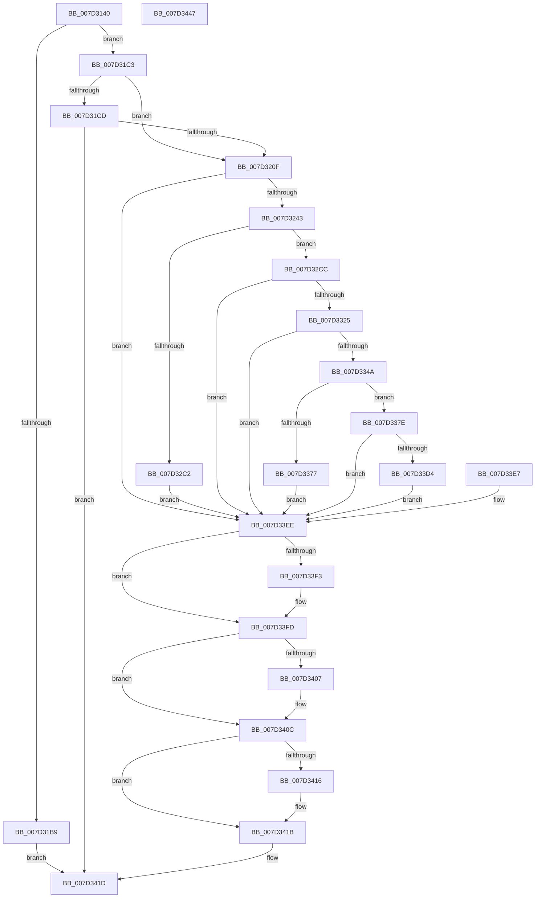

# CMFFlushHitsFile

- RVA: `0x007D3140`–`0x007D3448` (길이 `776` bytes)
- VA: `0x00000001407D3140`
- 실행 섹션: `PAGE`
- PDB 이름 있음: `예`; PDB Function 태그: `아니요`
- unwind 정보 RVA: `0x000D5ABC`
- 디코드: `168`개 명령, `776/776` bytes 표시
- 미해석 바이트: `0` (있으면 어셈블리에 `.byte`로 보존)

> 이 문서는 커널 이미지의 기계어와 PDB 기호를 분석해 생성했습니다. 4번과 5번은 함수 원형과 자료형을 바이너리 사용 방식에서 추정한 C 해석이며 원본 소스 복구 결과는 아닙니다.

## 1. Dependencies

- 직접 호출 지점: **14**; 고유 호출 대상: **13**
- 직접 호출자로 확인된 함수: **1**
- RIP 상대 이미지 참조: **5**

### Outgoing calls
- `0x007D31FF` → [MmFlushVirtualMemory](../9D/MmFlushVirtualMemory_function_009D6F5C.md) (function, `0x009D6F5C`)
- `0x007D3234` → [RtlStringCchPrintfW](../../text/48/RtlStringCchPrintfW_function_00482D5C.md) (function, `0x00482D5C`)
- `0x007D3253` → [RtlInitUnicodeString](../../text/42/RtlInitUnicodeString_function_0042A780.md) (function, `0x0042A780`)
- `0x007D32B3` → [ZwOpenFile](../../text/6A/ZwOpenFile_function_006AD730.md) (function, `0x006AD730`)
- `0x007D3312` → [ZwCreateEvent](../../text/6A/ZwCreateEvent_function_006AD9D0.md) (function, `0x006AD9D0`)
- `0x007D3337` → [CMFGetFileSizeEx](CMFGetFileSizeEx_function_007D3450.md) (function, `0x007D3450`)
- `0x007D3365` → [ExAllocatePool2](../../poolcode/B8/ExAllocatePool2_function_00B820F0.md) (function, `0x00B820F0`)
- `0x007D3387` → [memcpy](../../text/6C/memcpy_function_006C6840.md) (function, `0x006C6840`)
- `0x007D33C6` → [ZwWriteFile](../../text/6A/ZwWriteFile_function_006AD1D0.md) (function, `0x006AD1D0`)
- `0x007D33DE` → [ZwWaitForSingleObject](../../text/6A/ZwWaitForSingleObject_function_006AD150.md) (function, `0x006AD150`)
- `0x007D33F8` → [ExFreePoolWithTag](../../poolcode/B8/ExFreePoolWithTag_function_00B82870.md) (function, `0x00B82870`)
- `0x007D3407` → [ZwClose](../../text/6A/ZwClose_function_006AD2B0.md) (function, `0x006AD2B0`)
- `0x007D3416` → [ZwClose](../../text/6A/ZwClose_function_006AD2B0.md) (function, `0x006AD2B0`)
- `0x007D3428` → [_security_check_cookie](../../text/6A/_security_check_cookie_function_006AC640.md) (function, `0x006AC640`)

### Direct callers
- [NtMapCMFModule](NtMapCMFModule_function_007D4310.md) at `0x007D4BC9`

### Static image references
- `0x007D3158` → RVA `0x00E0A740` (`.data`; read)
- `0x007D31C3` → RVA `0x00EEEFD0` (`.data`; read)
- `0x007D320F` → RVA `0x00E0EC04` (`.data`; read)
- `0x007D3219` → RVA `0x00B08C40` (` ?? ::NNGAKEGL::`string'`; read)
- `0x007D3220` → RVA `0x00B08C10` (` ?? ::NNGAKEGL::`string'`; read)

## 2. Other-region calls and transfers

- 다른 실행 섹션으로 향하는 call: **12**
  - `0x007D3234` → [RtlStringCchPrintfW](../../text/48/RtlStringCchPrintfW_function_00482D5C.md) (`PAGE` → `.text`)
  - `0x007D3253` → [RtlInitUnicodeString](../../text/42/RtlInitUnicodeString_function_0042A780.md) (`PAGE` → `.text`)
  - `0x007D32B3` → [ZwOpenFile](../../text/6A/ZwOpenFile_function_006AD730.md) (`PAGE` → `.text`)
  - `0x007D3312` → [ZwCreateEvent](../../text/6A/ZwCreateEvent_function_006AD9D0.md) (`PAGE` → `.text`)
  - `0x007D3365` → [ExAllocatePool2](../../poolcode/B8/ExAllocatePool2_function_00B820F0.md) (`PAGE` → `POOLCODE`)
  - `0x007D3387` → [memcpy](../../text/6C/memcpy_function_006C6840.md) (`PAGE` → `.text`)
  - `0x007D33C6` → [ZwWriteFile](../../text/6A/ZwWriteFile_function_006AD1D0.md) (`PAGE` → `.text`)
  - `0x007D33DE` → [ZwWaitForSingleObject](../../text/6A/ZwWaitForSingleObject_function_006AD150.md) (`PAGE` → `.text`)
  - `0x007D33F8` → [ExFreePoolWithTag](../../poolcode/B8/ExFreePoolWithTag_function_00B82870.md) (`PAGE` → `POOLCODE`)
  - `0x007D3407` → [ZwClose](../../text/6A/ZwClose_function_006AD2B0.md) (`PAGE` → `.text`)
  - `0x007D3416` → [ZwClose](../../text/6A/ZwClose_function_006AD2B0.md) (`PAGE` → `.text`)
  - `0x007D3428` → [_security_check_cookie](../../text/6A/_security_check_cookie_function_006AC640.md) (`PAGE` → `.text`)
- 별도 외부 분기/꼬리 이동을 확인하지 못했습니다.

## 3. Assembly (complete function range)

```asm
007D3140  4C 8B DC                        mov r11, rsp
007D3143  49 89 73 18                     mov qword ptr [r11 + 0x18], rsi
007D3147  49 89 7B 20                     mov qword ptr [r11 + 0x20], rdi
007D314B  41 54                           push r12
007D314D  41 56                           push r14
007D314F  41 57                           push r15
007D3151  48 81 EC F0 02 00 00            sub rsp, 0x2f0
007D3158  48 8B 05 E1 75 63 00            mov rax, qword ptr [rip + 0x6375e1]
007D315F  48 33 C4                        xor rax, rsp
007D3162  48 89 84 24 E0 02 00 00         mov qword ptr [rsp + 0x2e0], rax
007D316A  4C 8B FA                        mov r15, rdx
007D316D  4C 8B F1                        mov r14, rcx
007D3170  48 83 64 24 50 00               and qword ptr [rsp + 0x50], 0
007D3176  0F 57 C0                        xorps xmm0, xmm0
007D3179  0F 11 84 24 B0 00 00 00         movups xmmword ptr [rsp + 0xb0], xmm0
007D3181  33 C0                           xor eax, eax
007D3183  0F 11 44 24 70                  movups xmmword ptr [rsp + 0x70], xmm0
007D3188  0F 11 84 24 80 00 00 00         movups xmmword ptr [rsp + 0x80], xmm0
007D3190  49 89 83 88 FD FF FF            mov qword ptr [r11 - 0x278], rax
007D3197  89 84 24 98 00 00 00            mov dword ptr [rsp + 0x98], eax
007D319E  0F 11 84 24 C0 00 00 00         movups xmmword ptr [rsp + 0xc0], xmm0
007D31A6  48 21 44 24 58                  and qword ptr [rsp + 0x58], rax
007D31AB  49 21 83 A0 FD FF FF            and qword ptr [r11 - 0x260], rax
007D31B2  33 F6                           xor esi, esi
007D31B4  48 85 C9                        test rcx, rcx
007D31B7  75 0A                           jne 0x1407d31c3
007D31B9  B8 0D 00 00 C0                  mov eax, 0xc000000d
007D31BE  E9 5A 02 00 00                  jmp 0x1407d341d
007D31C3  8B 05 07 BE 71 00               mov eax, dword ptr [rip + 0x71be07]
007D31C9  A8 08                           test al, 8
007D31CB  75 42                           jne 0x1407d320f
007D31CD  4C 89 74 24 68                  mov qword ptr [rsp + 0x68], r14
007D31D2  4C 89 BC 24 A0 00 00 00         mov qword ptr [rsp + 0xa0], r15
007D31DA  65 48 8B 04 25 88 01 00 00      mov rax, qword ptr gs:[0x188]
007D31E3  48 8B 88 B8 00 00 00            mov rcx, qword ptr [rax + 0xb8]
007D31EA  4C 8D 8C 24 B0 00 00 00         lea r9, [rsp + 0xb0]
007D31F2  4C 8D 84 24 A0 00 00 00         lea r8, [rsp + 0xa0]
007D31FA  48 8D 54 24 68                  lea rdx, [rsp + 0x68]
007D31FF  E8 58 3D 20 00                  call 0x1409d6f5c
007D3204  3D 88 00 00 C0                  cmp eax, 0xc0000088
007D3209  0F 85 0E 02 00 00               jne 0x1407d341d
007D320F  8B 05 EF B9 63 00               mov eax, dword ptr [rip + 0x63b9ef]
007D3215  89 44 24 20                     mov dword ptr [rsp + 0x20], eax
007D3219  4C 8D 0D 20 5A 33 00            lea r9, [rip + 0x335a20]
007D3220  4C 8D 05 E9 59 33 00            lea r8, [rip + 0x3359e9]
007D3227  BA 04 01 00 00                  mov edx, 0x104
007D322C  48 8D 8C 24 D0 00 00 00         lea rcx, [rsp + 0xd0]
007D3234  E8 23 FB CA FF                  call 0x140482d5c
007D3239  8B F8                           mov edi, eax
007D323B  85 C0                           test eax, eax
007D323D  0F 88 AB 01 00 00               js 0x1407d33ee
007D3243  48 8D 94 24 D0 00 00 00         lea rdx, [rsp + 0xd0]
007D324B  48 8D 8C 24 C0 00 00 00         lea rcx, [rsp + 0xc0]
007D3253  E8 28 75 C5 FF                  call 0x14042a780
007D3258  C7 44 24 70 30 00 00 00         mov dword ptr [rsp + 0x70], 0x30
007D3260  48 21 74 24 78                  and qword ptr [rsp + 0x78], rsi
007D3265  C7 84 24 88 00 00 00 40 02 00 00  mov dword ptr [rsp + 0x88], 0x240
007D3270  48 8D 84 24 C0 00 00 00         lea rax, [rsp + 0xc0]
007D3278  48 89 84 24 80 00 00 00         mov qword ptr [rsp + 0x80], rax
007D3280  0F 57 C0                        xorps xmm0, xmm0
007D3283  F3 0F 7F 84 24 90 00 00 00      movdqu xmmword ptr [rsp + 0x90], xmm0
007D328C  21 74 24 28                     and dword ptr [rsp + 0x28], esi
007D3290  C7 44 24 20 07 00 00 00         mov dword ptr [rsp + 0x20], 7
007D3298  4C 8D 8C 24 B0 00 00 00         lea r9, [rsp + 0xb0]
007D32A0  4C 8D 44 24 70                  lea r8, [rsp + 0x70]
007D32A5  41 BC 00 00 00 C0               mov r12d, 0xc0000000
007D32AB  41 8B D4                        mov edx, r12d
007D32AE  48 8D 4C 24 50                  lea rcx, [rsp + 0x50]
007D32B3  E8 78 A4 ED FF                  call 0x1406ad730
007D32B8  8B F8                           mov edi, eax
007D32BA  41 23 C4                        and eax, r12d
007D32BD  41 3B C4                        cmp eax, r12d
007D32C0  75 0A                           jne 0x1407d32cc
007D32C2  48 21 74 24 50                  and qword ptr [rsp + 0x50], rsi
007D32C7  E9 22 01 00 00                  jmp 0x1407d33ee
007D32CC  C7 44 24 70 30 00 00 00         mov dword ptr [rsp + 0x70], 0x30
007D32D4  48 21 74 24 78                  and qword ptr [rsp + 0x78], rsi
007D32D9  C7 84 24 88 00 00 00 00 02 00 00  mov dword ptr [rsp + 0x88], 0x200
007D32E4  48 21 B4 24 80 00 00 00         and qword ptr [rsp + 0x80], rsi
007D32EC  0F 57 C0                        xorps xmm0, xmm0
007D32EF  F3 0F 7F 84 24 90 00 00 00      movdqu xmmword ptr [rsp + 0x90], xmm0
007D32F8  40 88 74 24 20                  mov byte ptr [rsp + 0x20], sil
007D32FD  41 B9 01 00 00 00               mov r9d, 1
007D3303  4C 8D 44 24 70                  lea r8, [rsp + 0x70]
007D3308  BA 03 00 1F 00                  mov edx, 0x1f0003
007D330D  48 8D 4C 24 58                  lea rcx, [rsp + 0x58]
007D3312  E8 B9 A6 ED FF                  call 0x1406ad9d0
007D3317  8B F8                           mov edi, eax
007D3319  41 23 C4                        and eax, r12d
007D331C  41 3B C4                        cmp eax, r12d
007D331F  0F 84 C9 00 00 00               je 0x1407d33ee
007D3325  21 74 24 60                     and dword ptr [rsp + 0x60], esi
007D3329  21 74 24 64                     and dword ptr [rsp + 0x64], esi
007D332D  48 8D 54 24 60                  lea rdx, [rsp + 0x60]
007D3332  48 8B 4C 24 50                  mov rcx, qword ptr [rsp + 0x50]
007D3337  E8 14 01 00 00                  call 0x1407d3450
007D333C  8B F8                           mov edi, eax
007D333E  41 23 C4                        and eax, r12d
007D3341  41 3B C4                        cmp eax, r12d
007D3344  0F 84 A4 00 00 00               je 0x1407d33ee
007D334A  8B 7C 24 60                     mov edi, dword ptr [rsp + 0x60]
007D334E  4C 3B FF                        cmp r15, rdi
007D3351  41 0F 42 FF                     cmovb edi, r15d
007D3355  44 8B FF                        mov r15d, edi
007D3358  41 B8 50 66 6D 63               mov r8d, 0x636d6650
007D335E  8B D7                           mov edx, edi
007D3360  B9 00 01 00 00                  mov ecx, 0x100
007D3365  E8 86 ED 3A 00                  call 0x140b820f0
007D336A  48 8B F0                        mov rsi, rax
007D336D  48 89 44 24 68                  mov qword ptr [rsp + 0x68], rax
007D3372  48 85 C0                        test rax, rax
007D3375  75 07                           jne 0x1407d337e
007D3377  BF 17 00 00 C0                  mov edi, 0xc0000017
007D337C  EB 70                           jmp 0x1407d33ee
007D337E  4D 8B C7                        mov r8, r15
007D3381  49 8B D6                        mov rdx, r14
007D3384  48 8B CE                        mov rcx, rsi
007D3387  E8 B4 34 EF FF                  call 0x1406c6840
007D338C  90                              nop
007D338D  48 83 64 24 40 00               and qword ptr [rsp + 0x40], 0
007D3393  48 8D 84 24 A8 00 00 00         lea rax, [rsp + 0xa8]
007D339B  48 89 44 24 38                  mov qword ptr [rsp + 0x38], rax
007D33A0  89 7C 24 30                     mov dword ptr [rsp + 0x30], edi
007D33A4  48 89 74 24 28                  mov qword ptr [rsp + 0x28], rsi
007D33A9  48 8D 84 24 B0 00 00 00         lea rax, [rsp + 0xb0]
007D33B1  48 89 44 24 20                  mov qword ptr [rsp + 0x20], rax
007D33B6  45 33 C9                        xor r9d, r9d
007D33B9  45 33 C0                        xor r8d, r8d
007D33BC  48 8B 54 24 58                  mov rdx, qword ptr [rsp + 0x58]
007D33C1  48 8B 4C 24 50                  mov rcx, qword ptr [rsp + 0x50]
007D33C6  E8 05 9E ED FF                  call 0x1406ad1d0
007D33CB  8B F8                           mov edi, eax
007D33CD  3D 03 01 00 00                  cmp eax, 0x103
007D33D2  75 1A                           jne 0x1407d33ee
007D33D4  45 33 C0                        xor r8d, r8d
007D33D7  33 D2                           xor edx, edx
007D33D9  48 8B 4C 24 58                  mov rcx, qword ptr [rsp + 0x58]
007D33DE  E8 6D 9D ED FF                  call 0x1406ad150
007D33E3  8B F8                           mov edi, eax
007D33E5  EB 07                           jmp 0x1407d33ee
007D33E7  8B F8                           mov edi, eax
007D33E9  48 8B 74 24 68                  mov rsi, qword ptr [rsp + 0x68]
007D33EE  48 85 F6                        test rsi, rsi
007D33F1  74 0A                           je 0x1407d33fd
007D33F3  33 D2                           xor edx, edx
007D33F5  48 8B CE                        mov rcx, rsi
007D33F8  E8 73 F4 3A 00                  call 0x140b82870
007D33FD  48 8B 4C 24 58                  mov rcx, qword ptr [rsp + 0x58]
007D3402  48 85 C9                        test rcx, rcx
007D3405  74 05                           je 0x1407d340c
007D3407  E8 A4 9E ED FF                  call 0x1406ad2b0
007D340C  48 8B 4C 24 50                  mov rcx, qword ptr [rsp + 0x50]
007D3411  48 85 C9                        test rcx, rcx
007D3414  74 05                           je 0x1407d341b
007D3416  E8 95 9E ED FF                  call 0x1406ad2b0
007D341B  8B C7                           mov eax, edi
007D341D  48 8B 8C 24 E0 02 00 00         mov rcx, qword ptr [rsp + 0x2e0]
007D3425  48 33 CC                        xor rcx, rsp
007D3428  E8 13 92 ED FF                  call 0x1406ac640
007D342D  4C 8D 9C 24 F0 02 00 00         lea r11, [rsp + 0x2f0]
007D3435  49 8B 73 30                     mov rsi, qword ptr [r11 + 0x30]
007D3439  49 8B 7B 38                     mov rdi, qword ptr [r11 + 0x38]
007D343D  49 8B E3                        mov rsp, r11
007D3440  41 5F                           pop r15
007D3442  41 5E                           pop r14
007D3444  41 5C                           pop r12
007D3446  C3                              ret
007D3447  CC                              int3
```

## 4. C-style interpretation (structured pseudocode)

```c
__int64 __fastcall CMFFlushHitsFile(__int64 a1, __int64 a2)
{
    __int64 result;
    __int64 v_rdi;
    __int64 v_rsi;
    __int64 v_rsp;
    unsigned __int64 v_stack_m18;
    unsigned __int64 v_stack_m238;
    unsigned __int64 v_stack_m248;
    unsigned __int64 v_stack_m258;
    unsigned __int64 v_stack_m260;
    unsigned __int64 v_stack_m268;
    unsigned int v_stack_m270;
    unsigned __int64 v_stack_m278;
    unsigned __int64 v_stack_m28;
    unsigned int v_stack_m280;
    unsigned __int64 v_stack_m288;
    unsigned __int64 v_stack_m290;
    unsigned __int64 v_stack_m298;
    unsigned __int64 v_stack_m2A0;
    unsigned int v_stack_m2A4;
    unsigned int v_stack_m2A8;
    unsigned __int64 v_stack_m2B0;
    unsigned __int64 v_stack_m2B8;
    unsigned __int64 v_stack_m2C8;
    unsigned __int64 v_stack_m2D0;
    unsigned int v_stack_m2D8;
    unsigned int v_stack_m2E0;
    unsigned int v_stack_m2E8;

    *(unsigned __int64 *)(v_rsp + 24) = v_rsi;
    *(unsigned __int64 *)(v_rsp + 32) = v_rdi;
    v_rsp = (v_rsp) - (752);
    result = (*(unsigned __int64 *)(v_rip + 6518241)) ^ (v_rsp);
    v_stack_m28 = result;
    v_stack_m258 = v_xmm0;
    result = 0;
    v_stack_m298 = v_xmm0;
    v_stack_m288 = v_xmm0;
    *(unsigned __int64 *)(v_rsp - 632) = 0;
    v_stack_m270 = 0;
    v_stack_m248 = v_xmm0;
    v_rsi = 0;
    if (a1 != 0) goto loc_007D31C3;
    goto loc_007D341D;
loc_007D31C3:
    if ((((unsigned __int8)((unsigned int)(*(unsigned int *)(v_rip + 7454215)))) & (8)) != 0) goto loc_007D320F;
    v_stack_m2A0 = a1;
    v_stack_m268 = a2;
    result = MmFlushVirtualMemory(*(unsigned __int64 *)(*(unsigned __int64 *)(gs_base + (0 + 392)) + 184), v_stack_m2A0, v_stack_m268, v_stack_m258);
    if (((unsigned int)(result)) != 0xC0000088ULL) goto loc_007D341D;
loc_007D320F:
    v_stack_m2E8 = (unsigned int)((unsigned int)(*(unsigned int *)(v_rip + 6535663)));
    result = RtlStringCchPrintfW(v_stack_m238, 260, v_rip + 3365353, v_rip + 3365408);
    if (sign_flag) goto loc_007D33EE;
    result = RtlInitUnicodeString(v_stack_m248, v_stack_m238, v_rip + 3365353, v_rip + 3365408);
    v_stack_m298 = 48;
    v_stack_m280 = 576;
    v_stack_m288 = v_stack_m248;
    v_stack_m278 = v_xmm0;
    v_stack_m2E8 = 7;
    result = ZwOpenFile(v_stack_m2B8, (unsigned int)((unsigned int)((unsigned int)(0xC0000000ULL))), v_stack_m298, v_stack_m258);
    result = (unsigned int)((result) & ((unsigned int)((unsigned int)(0xC0000000ULL))));
    if (((unsigned int)(result)) != ((unsigned int)((unsigned int)(0xC0000000ULL)))) goto loc_007D32CC;
    goto loc_007D33EE;
loc_007D32CC:
    v_stack_m298 = 48;
    v_stack_m280 = 512;
    v_stack_m278 = v_xmm0;
    v_stack_m2E8 = 0;
    result = ZwCreateEvent(v_stack_m2B0, (unsigned int)(0x1F0003ULL), v_stack_m298, 1);
    result = (unsigned int)((result) & ((unsigned int)((unsigned int)(0xC0000000ULL))));
    if (((unsigned int)(result)) == ((unsigned int)((unsigned int)(0xC0000000ULL)))) goto loc_007D33EE;
    result = CMFGetFileSizeEx(v_stack_m2B8, v_stack_m2A8, v_stack_m298, 1);
    result = (unsigned int)((result) & ((unsigned int)((unsigned int)(0xC0000000ULL))));
    if (((unsigned int)(result)) == ((unsigned int)((unsigned int)(0xC0000000ULL)))) goto loc_007D33EE;
    v_rdi = (unsigned int)(v_stack_m2A8);
    if (a2 < ((unsigned int)(v_stack_m2A8))) { v_rdi = (unsigned int)(a2); }
    result = ExAllocatePool2(256, (unsigned int)((unsigned int)(v_rdi)), (unsigned int)(0x636D6650ULL), 1);
    v_stack_m2A0 = result;
    if (result != 0) goto loc_007D337E;
    goto loc_007D33EE;
loc_007D337E:
    result = memcpy(result, a1, (unsigned int)((unsigned int)(v_rdi)), 1);
    v_stack_m2D0 = v_stack_m260;
    v_stack_m2D8 = (unsigned int)((unsigned int)(0xC0000017ULL));
    v_stack_m2E0 = result;
    v_stack_m2E8 = v_stack_m258;
    a4 = 0;
    a3 = 0;
    result = ZwWriteFile(v_stack_m2B8, v_stack_m2B0, a3, a4);
    if (((unsigned int)(result)) != 259) goto loc_007D33EE;
    a3 = 0;
    a2 = 0;
    result = ZwWaitForSingleObject(v_stack_m2B0, a2, a3, a4);
    goto loc_007D33EE;
loc_007D33EE:
    if (result != 0) {
        a2 = 0;
        a1 = result;
        result = ExFreePoolWithTag(a1, a2, a3, a4);
    }
    if (v_stack_m2B0 != 0) {
        result = ZwClose(v_stack_m2B0, a2, a3, a4);
    }
    if (v_stack_m2B8 != 0) {
        result = ZwClose(v_stack_m2B8, a2, a3, a4);
    }
loc_007D341D:
    a1 = (v_stack_m28) ^ (v_rsp);
    result = _security_check_cookie(a1, a2, a3, a4);
    return result;
}
```

## 5. (Beta) C Style

```c
int64_t CMFFlushHitsFile(int64_t Arg1, int64_t Arg2)
{
    int64_t result;
    int64_t local_rdi;
    int64_t local_rsi;
    int64_t local_rsp;
    uint64_t v_stack_m18;
    uint64_t v_stack_m238;
    uint64_t v_stack_m248;
    uint64_t v_stack_m258;
    uint64_t v_stack_m260;
    uint64_t v_stack_m268;
    uint32_t v_stack_m270;
    uint64_t v_stack_m278;
    uint64_t v_stack_m28;
    uint32_t v_stack_m280;
    uint64_t v_stack_m288;
    uint64_t v_stack_m290;
    uint64_t v_stack_m298;
    uint64_t v_stack_m2A0;
    uint32_t v_stack_m2A4;
    uint32_t v_stack_m2A8;
    uint64_t v_stack_m2B0;
    uint64_t v_stack_m2B8;
    uint64_t v_stack_m2C8;
    uint64_t v_stack_m2D0;
    uint32_t v_stack_m2D8;
    uint32_t v_stack_m2E0;
    uint32_t v_stack_m2E8;

    *(uint64_t *)(local_rsp + 0x18) = local_rsi;
    *(uint64_t *)(local_rsp + 0x20) = local_rdi;
    local_rsp = (local_rsp) - (752);
    result = (*(uint64_t *)(v_rip + 0x6375E1)) ^ (local_rsp);
    v_stack_m28 = result;
    v_stack_m258 = v_xmm0;
    result = 0;
    v_stack_m298 = v_xmm0;
    v_stack_m288 = v_xmm0;
    *(uint64_t *)(local_rsp - 0x278) = 0;
    v_stack_m270 = 0;
    v_stack_m248 = v_xmm0;
    local_rsi = 0;
    if (Arg1 != 0) goto loc_007D31C3;
    goto loc_007D341D;
loc_007D31C3:
    if ((((uint8_t)((uint32_t)(*(uint32_t *)(v_rip + 0x71BE07)))) & (8)) != 0) goto loc_007D320F;
    v_stack_m2A0 = Arg1;
    v_stack_m268 = Arg2;
    result = MmFlushVirtualMemory(*(uint64_t *)(*(uint64_t *)(gs_base + (0 + 0x188)) + 0xB8), v_stack_m2A0, v_stack_m268, v_stack_m258);
    if (((uint32_t)(result)) != 0xC0000088ULL) goto loc_007D341D;
loc_007D320F:
    v_stack_m2E8 = (uint32_t)((uint32_t)(*(uint32_t *)(v_rip + 0x63B9EF)));
    result = RtlStringCchPrintfW(v_stack_m238, 260, v_rip + 3365353, v_rip + 3365408);
    if (sign_flag) goto loc_007D33EE;
    result = RtlInitUnicodeString(v_stack_m248, v_stack_m238, v_rip + 3365353, v_rip + 3365408);
    v_stack_m298 = 48;
    v_stack_m280 = 576;
    v_stack_m288 = v_stack_m248;
    v_stack_m278 = v_xmm0;
    v_stack_m2E8 = 7;
    result = ZwOpenFile(v_stack_m2B8, (uint32_t)((uint32_t)((uint32_t)(0xC0000000ULL))), v_stack_m298, v_stack_m258);
    result = (uint32_t)((result) & ((uint32_t)((uint32_t)(0xC0000000ULL))));
    if (((uint32_t)(result)) != ((uint32_t)((uint32_t)(0xC0000000ULL)))) goto loc_007D32CC;
    goto loc_007D33EE;
loc_007D32CC:
    v_stack_m298 = 48;
    v_stack_m280 = 512;
    v_stack_m278 = v_xmm0;
    v_stack_m2E8 = 0;
    result = ZwCreateEvent(v_stack_m2B0, (uint32_t)(0x1F0003ULL), v_stack_m298, 1);
    result = (uint32_t)((result) & ((uint32_t)((uint32_t)(0xC0000000ULL))));
    if (((uint32_t)(result)) == ((uint32_t)((uint32_t)(0xC0000000ULL)))) goto loc_007D33EE;
    result = CMFGetFileSizeEx(v_stack_m2B8, v_stack_m2A8, v_stack_m298, 1);
    result = (uint32_t)((result) & ((uint32_t)((uint32_t)(0xC0000000ULL))));
    if (((uint32_t)(result)) == ((uint32_t)((uint32_t)(0xC0000000ULL)))) goto loc_007D33EE;
    local_rdi = (uint32_t)(v_stack_m2A8);
    if (Arg2 < ((uint32_t)(v_stack_m2A8))) { local_rdi = (uint32_t)(Arg2); }
    result = ExAllocatePool2(256, (uint32_t)((uint32_t)(local_rdi)), (uint32_t)(0x636D6650ULL), 1);
    v_stack_m2A0 = result;
    if (result != 0) goto loc_007D337E;
    goto loc_007D33EE;
loc_007D337E:
    result = memcpy(result, Arg1, (uint32_t)((uint32_t)(local_rdi)), 1);
    v_stack_m2D0 = v_stack_m260;
    v_stack_m2D8 = (uint32_t)((uint32_t)(0xC0000017ULL));
    v_stack_m2E0 = result;
    v_stack_m2E8 = v_stack_m258;
    a4 = 0;
    a3 = 0;
    result = ZwWriteFile(v_stack_m2B8, v_stack_m2B0, a3, a4);
    if (((uint32_t)(result)) != 259) goto loc_007D33EE;
    a3 = 0;
    Arg2 = 0;
    result = ZwWaitForSingleObject(v_stack_m2B0, Arg2, a3, a4);
    goto loc_007D33EE;
loc_007D33EE:
    if (result != 0) {
        Arg2 = 0;
        Arg1 = result;
        result = ExFreePoolWithTag(Arg1, Arg2, a3, a4);
    }
    if (v_stack_m2B0 != 0) {
        result = ZwClose(v_stack_m2B0, Arg2, a3, a4);
    }
    if (v_stack_m2B8 != 0) {
        result = ZwClose(v_stack_m2B8, Arg2, a3, a4);
    }
loc_007D341D:
    Arg1 = (v_stack_m28) ^ (local_rsp);
    result = _security_check_cookie(Arg1, Arg2, a3, a4);
    return result;
}
```

## 6. Execution-region graph

[열기: 2D/3D 그래프와 함수 탐색 컨트롤 패널](../../../control-panel.html?section=page&rva=0x007D3140&view=graph)

- 2D 그래프는 위에서 아래로 흐르고, 3D 그래프는 빈 공간을 드래그해 회전합니다. Shift+드래그는 이동, 휠은 확대·축소, 함수 노드 선택은 대상 보고서 이동입니다.

### Static fallback


