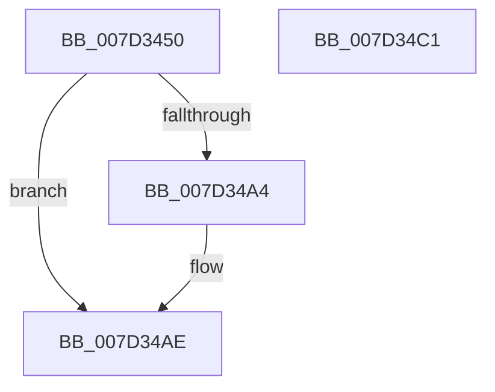

# CMFGetFileSizeEx

- RVA: `0x007D3450`–`0x007D34C2` (길이 `114` bytes)
- VA: `0x00000001407D3450`
- 실행 섹션: `PAGE`
- PDB 이름 있음: `예`; PDB Function 태그: `아니요`
- unwind 정보 RVA: `0x0009EA50`
- 디코드: `31`개 명령, `114/114` bytes 표시
- 미해석 바이트: `0` (있으면 어셈블리에 `.byte`로 보존)

> 이 문서는 커널 이미지의 기계어와 PDB 기호를 분석해 생성했습니다. 4번과 5번은 함수 원형과 자료형을 바이너리 사용 방식에서 추정한 C 해석이며 원본 소스 복구 결과는 아닙니다.

## 1. Dependencies

- 직접 호출 지점: **2**; 고유 호출 대상: **2**
- 직접 호출자로 확인된 함수: **2**
- RIP 상대 이미지 참조: **1**

### Outgoing calls
- `0x007D3492` → [ZwQueryInformationFile](../../text/6A/ZwQueryInformationFile_function_006AD2F0.md) (function, `0x006AD2F0`)
- `0x007D34B6` → [_security_check_cookie](../../text/6A/_security_check_cookie_function_006AC640.md) (function, `0x006AC640`)

### Direct callers
- [CMFFlushHitsFile](CMFFlushHitsFile_function_007D3140.md) at `0x007D3337`
- [CMFSystemThreadRoutine](CMFSystemThreadRoutine_function_007D3A70.md) at `0x007D3D59`

### Static image references
- `0x007D3456` → RVA `0x00E0A740` (`.data`; read)

## 2. Other-region calls and transfers

- 다른 실행 섹션으로 향하는 call: **2**
  - `0x007D3492` → [ZwQueryInformationFile](../../text/6A/ZwQueryInformationFile_function_006AD2F0.md) (`PAGE` → `.text`)
  - `0x007D34B6` → [_security_check_cookie](../../text/6A/_security_check_cookie_function_006AC640.md) (`PAGE` → `.text`)
- 별도 외부 분기/꼬리 이동을 확인하지 못했습니다.

## 3. Assembly (complete function range)

```asm
007D3450  40 53                           push rbx
007D3452  48 83 EC 60                     sub rsp, 0x60
007D3456  48 8B 05 E3 72 63 00            mov rax, qword ptr [rip + 0x6372e3]
007D345D  48 33 C4                        xor rax, rsp
007D3460  48 89 44 24 58                  mov qword ptr [rsp + 0x58], rax
007D3465  33 C0                           xor eax, eax
007D3467  C7 44 24 20 05 00 00 00         mov dword ptr [rsp + 0x20], 5
007D346F  0F 57 C0                        xorps xmm0, xmm0
007D3472  48 89 44 24 50                  mov qword ptr [rsp + 0x50], rax
007D3477  48 8B DA                        mov rbx, rdx
007D347A  4C 8D 44 24 40                  lea r8, [rsp + 0x40]
007D347F  48 8D 54 24 30                  lea rdx, [rsp + 0x30]
007D3484  44 8D 48 18                     lea r9d, [rax + 0x18]
007D3488  0F 11 44 24 40                  movups xmmword ptr [rsp + 0x40], xmm0
007D348D  0F 11 44 24 30                  movups xmmword ptr [rsp + 0x30], xmm0
007D3492  E8 59 9E ED FF                  call 0x1406ad2f0
007D3497  BA 00 00 00 C0                  mov edx, 0xc0000000
007D349C  8B C8                           mov ecx, eax
007D349E  23 CA                           and ecx, edx
007D34A0  3B CA                           cmp ecx, edx
007D34A2  74 0A                           je 0x1407d34ae
007D34A4  48 8B 44 24 48                  mov rax, qword ptr [rsp + 0x48]
007D34A9  48 89 03                        mov qword ptr [rbx], rax
007D34AC  33 C0                           xor eax, eax
007D34AE  48 8B 4C 24 58                  mov rcx, qword ptr [rsp + 0x58]
007D34B3  48 33 CC                        xor rcx, rsp
007D34B6  E8 85 91 ED FF                  call 0x1406ac640
007D34BB  48 83 C4 60                     add rsp, 0x60
007D34BF  5B                              pop rbx
007D34C0  C3                              ret
007D34C1  CC                              int3
```

## 4. C-style interpretation (structured pseudocode)

```c
__int64 __fastcall CMFGetFileSizeEx(__int64 a1, __int64 a2)
{
    __int64 result;
    __int64 v_rsp;
    unsigned __int64 v_stack_m10;
    unsigned __int64 v_stack_m18;
    unsigned __int64 v_stack_m20;
    unsigned __int64 v_stack_m28;
    unsigned __int64 v_stack_m38;
    unsigned int v_stack_m48;

    v_rsp = (v_rsp) - (96);
    result = (*(unsigned __int64 *)(v_rip + 6517475)) ^ (v_rsp);
    v_stack_m10 = result;
    result = 0;
    v_stack_m48 = 5;
    v_stack_m18 = 0;
    v_stack_m28 = v_xmm0;
    v_stack_m38 = v_xmm0;
    result = ZwQueryInformationFile(a1, v_stack_m38, v_stack_m28, result + 24);
    a1 = (unsigned int)(((unsigned int)((unsigned int)(result))) & ((unsigned int)((unsigned int)(0xC0000000ULL))));
    if (((unsigned int)(a1)) != ((unsigned int)((unsigned int)(0xC0000000ULL)))) {
        result = v_stack_m20;
        *(unsigned __int64 *)(a2) = result;
        result = 0;
    }
    a1 = (v_stack_m10) ^ (v_rsp);
    result = _security_check_cookie(a1, (unsigned int)(0xC0000000ULL), v_stack_m28, result + 24);
    v_rsp = (v_rsp) + (96);
    return result;
}
```

## 5. (Beta) C Style

```c
int64_t CMFGetFileSizeEx(int64_t Arg1, void *Arg2)
{
    uint8_t *arg2 = (uint8_t *)Arg2;

    int64_t result;
    int64_t local_rsp;
    uint64_t v_stack_m10;
    uint64_t v_stack_m18;
    uint64_t v_stack_m20;
    uint64_t v_stack_m28;
    uint64_t v_stack_m38;
    uint32_t v_stack_m48;

    local_rsp = (local_rsp) - (96);
    result = (*(uint64_t *)(v_rip + 0x6372E3)) ^ (local_rsp);
    v_stack_m10 = result;
    result = 0;
    v_stack_m48 = 5;
    v_stack_m18 = 0;
    v_stack_m28 = v_xmm0;
    v_stack_m38 = v_xmm0;
    result = ZwQueryInformationFile(Arg1, v_stack_m38, v_stack_m28, result + 24);
    Arg1 = (uint32_t)(((uint32_t)((uint32_t)(result))) & ((uint32_t)((uint32_t)(0xC0000000ULL))));
    if (((uint32_t)(Arg1)) != ((uint32_t)((uint32_t)(0xC0000000ULL)))) {
        result = v_stack_m20;
        *(uint64_t *)(arg2) = result;
        result = 0;
    }
    Arg1 = (v_stack_m10) ^ (local_rsp);
    result = _security_check_cookie(Arg1, (uint32_t)(0xC0000000ULL), v_stack_m28, result + 24);
    local_rsp = (local_rsp) + (96);
    return result;
}
```

### 관측된 메모리 오프셋

구조체 형식이 확인되지 않은 접근은 인자 기준의 오프셋으로만 기록했습니다.

| 기준 인자 | 오프셋 표현 | 폭 (bit) | 접근 |
|---|---:|---:|---|
| `Arg2` | `+ 0x0` | `64` | `W` |

## 6. Execution-region graph

[열기: 2D/3D 그래프와 함수 탐색 컨트롤 패널](../../../control-panel.html?section=page&rva=0x007D3450&view=graph)

- 2D 그래프는 위에서 아래로 흐르고, 3D 그래프는 빈 공간을 드래그해 회전합니다. Shift+드래그는 이동, 휠은 확대·축소, 함수 노드 선택은 대상 보고서 이동입니다.

### Static fallback


