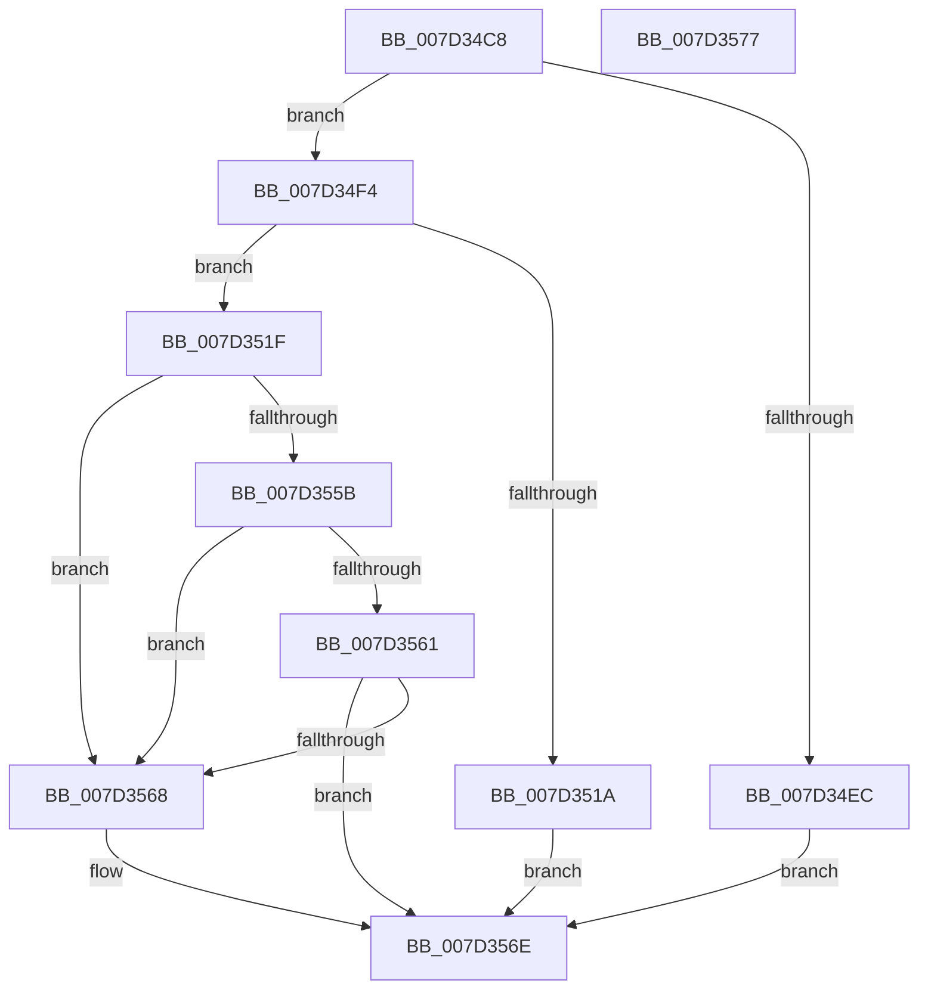

# CMFGetLargePageSectionSize

- RVA: `0x007D34C8`–`0x007D3578` (길이 `176` bytes)
- VA: `0x00000001407D34C8`
- 실행 섹션: `PAGE`
- PDB 이름 있음: `예`; PDB Function 태그: `아니요`
- unwind 정보 RVA: `0x00071750`
- 디코드: `52`개 명령, `176/176` bytes 표시
- 미해석 바이트: `0` (있으면 어셈블리에 `.byte`로 보존)

> 이 문서는 커널 이미지의 기계어와 PDB 기호를 분석해 생성했습니다. 4번과 5번은 함수 원형과 자료형을 바이너리 사용 방식에서 추정한 C 해석이며 원본 소스 복구 결과는 아닙니다.

## 1. Dependencies

- 직접 호출 지점: **0**; 고유 호출 대상: **0**
- 직접 호출자로 확인된 함수: **1**
- RIP 상대 이미지 참조: **0**

### Outgoing calls
- 직접 디코드된 call 명령이 없습니다.

### Direct callers
- [CMFSystemThreadRoutine](CMFSystemThreadRoutine_function_007D3A70.md) at `0x007D3D7B`

### Static image references
- 디코드된 RIP-relative 메모리 참조가 없습니다.

## 2. Other-region calls and transfers

- 다른 실행 섹션으로 향하는 call: **0**
- 별도 외부 분기/꼬리 이동을 확인하지 못했습니다.

## 3. Assembly (complete function range)

```asm
007D34C8  48 89 5C 24 08                  mov qword ptr [rsp + 8], rbx
007D34CD  48 B8 44 02 00 00 80 F7 FF FF   movabs rax, 0xfffff78000000244
007D34D7  45 33 C0                        xor r8d, r8d
007D34DA  4C 8B D2                        mov r10, rdx
007D34DD  48 8B D9                        mov rbx, rcx
007D34E0  44 8B 08                        mov r9d, dword ptr [rax]
007D34E3  49 C1 E9 0C                     shr r9, 0xc
007D34E7  4D 85 C9                        test r9, r9
007D34EA  75 08                           jne 0x1407d34f4
007D34EC  41 B8 BB 00 00 C0               mov r8d, 0xc00000bb
007D34F2  EB 7A                           jmp 0x1407d356e
007D34F4  4C 8B 19                        mov r11, qword ptr [rcx]
007D34F7  49 8B C8                        mov rcx, r8
007D34FA  49 F7 C3 FF 0F 00 00            test r11, 0xfff
007D3501  49 8B C3                        mov rax, r11
007D3504  0F 95 C1                        setne cl
007D3507  48 C1 E8 0C                     shr rax, 0xc
007D350B  48 03 C8                        add rcx, rax
007D350E  33 D2                           xor edx, edx
007D3510  8B C1                           mov eax, ecx
007D3512  49 F7 F1                        div r9
007D3515  48 85 D2                        test rdx, rdx
007D3518  75 05                           jne 0x1407d351f
007D351A  4D 89 1A                        mov qword ptr [r10], r11
007D351D  EB 4F                           jmp 0x1407d356e
007D351F  48 C1 E2 0C                     shl rdx, 0xc
007D3523  49 8B C1                        mov rax, r9
007D3526  48 C1 E0 0C                     shl rax, 0xc
007D352A  48 05 01 F0 FF FF               add rax, -0xfff
007D3530  48 C1 E1 0C                     shl rcx, 0xc
007D3534  48 2B CA                        sub rcx, rdx
007D3537  48 03 C8                        add rcx, rax
007D353A  49 8B C0                        mov rax, r8
007D353D  48 F7 C1 FF 0F 00 00            test rcx, 0xfff
007D3544  49 89 0A                        mov qword ptr [r10], rcx
007D3547  0F 95 C0                        setne al
007D354A  48 C1 E9 0C                     shr rcx, 0xc
007D354E  48 03 C1                        add rax, rcx
007D3551  33 D2                           xor edx, edx
007D3553  49 F7 F1                        div r9
007D3556  48 85 D2                        test rdx, rdx
007D3559  75 0D                           jne 0x1407d3568
007D355B  45 39 42 04                     cmp dword ptr [r10 + 4], r8d
007D355F  75 07                           jne 0x1407d3568
007D3561  8B 03                           mov eax, dword ptr [rbx]
007D3563  41 39 02                        cmp dword ptr [r10], eax
007D3566  73 06                           jae 0x1407d356e
007D3568  41 B8 01 00 00 C0               mov r8d, 0xc0000001
007D356E  48 8B 5C 24 08                  mov rbx, qword ptr [rsp + 8]
007D3573  41 8B C0                        mov eax, r8d
007D3576  C3                              ret
007D3577  CC                              int3
```

## 4. C-style interpretation (structured pseudocode)

```c
__int64 __fastcall CMFGetLargePageSectionSize(__int64 a1, __int64 a2, int a3)
{
    __int64 result;
    unsigned __int64 v_stack_p8;

    v_stack_p8 = v_rbx;
    a3 = 0;
    a4 = ((unsigned int)(*(unsigned int *)(result))) >> (12);
    if (a4 != 0) goto loc_007D34F4;
    goto loc_007D356E;
loc_007D34F4:
    a1 = (((*(unsigned __int64 *)(a1)) & (0xFFFULL)) != 0) ? 1 : 0;
    result = (*(unsigned __int64 *)(a1)) >> (12);
    a1 = (a1) + (result);
    a2 = 0;
    if (0 != 0) goto loc_007D351F;
    *(unsigned __int64 *)(a2) = *(unsigned __int64 *)(a1);
    goto loc_007D356E;
loc_007D351F:
    a2 = (a2) << (12);
    result = (a4) << (12);
    result = (result) + (0xFFFFFFFFFFFFF001ULL);
    a1 = (a1) << (12);
    a1 = (a1) - (a2);
    a1 = (a1) + (result);
    *(unsigned __int64 *)(a2) = a1;
    result = (((a1) & (0xFFFULL)) != 0) ? 1 : 0;
    a1 = (a1) >> (12);
    result = (result) + (a1);
    a2 = 0;
    if (0 != 0) goto loc_007D3568;
    if ((*(unsigned int *)(a2 + 4)) != ((unsigned int)((unsigned int)(0xC00000BBULL)))) goto loc_007D3568;
    if ((*(unsigned int *)(a2)) < ((unsigned int)((unsigned int)(*(unsigned int *)(a1))))) {
        a3 = 0xC0000001ULL;
    }
    return (unsigned int)(a3);
}
```

## 5. (Beta) C Style

```c
int64_t CMFGetLargePageSectionSize(void *Arg1, void *Arg2, int32_t Arg3)
{
    uint8_t *arg1 = (uint8_t *)Arg1;
    uint8_t *arg2 = (uint8_t *)Arg2;

    int64_t result;
    uint64_t v_stack_p8;

    v_stack_p8 = local_rbx;
    Arg3 = 0;
    a4 = ((uint32_t)(*(uint32_t *)(result))) >> (12);
    if (a4 != 0) goto loc_007D34F4;
    goto loc_007D356E;
loc_007D34F4:
    Arg1 = (((*(uint64_t *)(arg1)) & (0xFFFULL)) != 0) ? 1 : 0;
    result = (*(uint64_t *)(arg1)) >> (12);
    Arg1 = (Arg1) + (result);
    Arg2 = 0;
    if (0 != 0) goto loc_007D351F;
    *(uint64_t *)(arg2) = *(uint64_t *)(arg1);
    goto loc_007D356E;
loc_007D351F:
    Arg2 = (Arg2) << (12);
    result = (a4) << (12);
    result = (result) + (0xFFFFFFFFFFFFF001ULL);
    Arg1 = (Arg1) << (12);
    Arg1 = (Arg1) - (Arg2);
    Arg1 = (Arg1) + (result);
    *(void **)(arg2) = Arg1;
    result = (((Arg1) & (0xFFFULL)) != 0) ? 1 : 0;
    Arg1 = (Arg1) >> (12);
    result = (result) + (Arg1);
    Arg2 = 0;
    if (0 != 0) goto loc_007D3568;
    if ((*(uint32_t *)(arg2 + 0x4)) != ((uint32_t)((uint32_t)(0xC00000BBULL)))) goto loc_007D3568;
    if ((*(uint32_t *)(arg2)) < ((uint32_t)((uint32_t)(*(uint32_t *)(arg1))))) {
        Arg3 = 0xC0000001ULL;
    }
    return (uint32_t)(Arg3);
}
```

### 관측된 메모리 오프셋

구조체 형식이 확인되지 않은 접근은 인자 기준의 오프셋으로만 기록했습니다.

| 기준 인자 | 오프셋 표현 | 폭 (bit) | 접근 |
|---|---:|---:|---|
| `Arg1` | `+ 0x0` | `32` | `R` |
| `Arg1` | `+ 0x0` | `64` | `R` |
| `Arg2` | `+ 0x0` | `32` | `R` |
| `Arg2` | `+ 0x0` | `64` | `W` |
| `Arg2` | `+ 0x4` | `32` | `R` |

## 6. Execution-region graph

[열기: 2D/3D 그래프와 함수 탐색 컨트롤 패널](../../../control-panel.html?section=page&rva=0x007D34C8&view=graph)

- 2D 그래프는 위에서 아래로 흐르고, 3D 그래프는 빈 공간을 드래그해 회전합니다. Shift+드래그는 이동, 휠은 확대·축소, 함수 노드 선택은 대상 보고서 이동입니다.

### Static fallback


