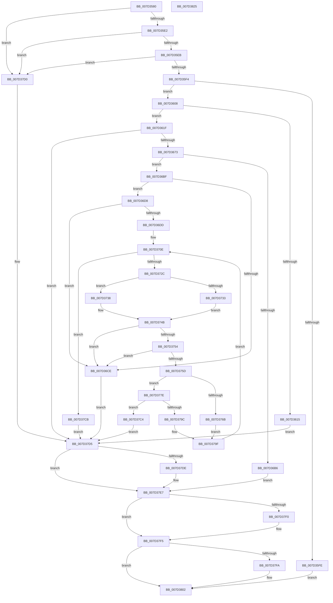

# CMFReadCompressedSegment

- RVA: `0x007D3580`–`0x007D3826` (길이 `678` bytes)
- VA: `0x00000001407D3580`
- 실행 섹션: `PAGE`
- PDB 이름 있음: `예`; PDB Function 태그: `아니요`
- unwind 정보 RVA: `0x000C83C8`
- 디코드: `182`개 명령, `678/678` bytes 표시
- 미해석 바이트: `0` (있으면 어셈블리에 `.byte`로 보존)

> 이 문서는 커널 이미지의 기계어와 PDB 기호를 분석해 생성했습니다. 4번과 5번은 함수 원형과 자료형을 바이너리 사용 방식에서 추정한 C 해석이며 원본 소스 복구 결과는 아닙니다.

## 1. Dependencies

- 직접 호출 지점: **9**; 고유 호출 대상: **8**
- 직접 호출자로 확인된 함수: **1**
- RIP 상대 이미지 참조: **0**

### Outgoing calls
- `0x007D3608` → [XpressDecodeCreate](../../text/6A/XpressDecodeCreate_function_006A8AB4.md) (function, `0x006A8AB4`)
- `0x007D3664` → [ZwCreateSection](../../text/6A/ZwCreateSection_function_006ADA10.md) (function, `0x006ADA10`)
- `0x007D36AB` → [ZwMapViewOfSection](../../text/6A/ZwMapViewOfSection_function_006AD5D0.md) (function, `0x006AD5D0`)
- `0x007D36E3` → [memcpy](../../text/6C/memcpy_function_006C6840.md) (function, `0x006C6840`)
- `0x007D3777` → [memcpy](../../text/6C/memcpy_function_006C6840.md) (function, `0x006C6840`)
- `0x007D3793` → [XpressDecode](../../text/6A/XpressDecode_function_006A8960.md) (function, `0x006A8960`)
- `0x007D37E2` → [ZwUnmapViewOfSection](../../text/6A/ZwUnmapViewOfSection_function_006AD610.md) (function, `0x006AD610`)
- `0x007D37F0` → [ZwClose](../../text/6A/ZwClose_function_006AD2B0.md) (function, `0x006AD2B0`)
- `0x007D37FD` → [XpressDecodeClose](../../text/6A/XpressDecodeClose_function_006A8A88.md) (function, `0x006A8A88`)

### Direct callers
- [CMFSystemThreadRoutine](CMFSystemThreadRoutine_function_007D3A70.md) at `0x007D3F67`

### Static image references
- 디코드된 RIP-relative 메모리 참조가 없습니다.

## 2. Other-region calls and transfers

- 다른 실행 섹션으로 향하는 call: **9**
  - `0x007D3608` → [XpressDecodeCreate](../../text/6A/XpressDecodeCreate_function_006A8AB4.md) (`PAGE` → `.text`)
  - `0x007D3664` → [ZwCreateSection](../../text/6A/ZwCreateSection_function_006ADA10.md) (`PAGE` → `.text`)
  - `0x007D36AB` → [ZwMapViewOfSection](../../text/6A/ZwMapViewOfSection_function_006AD5D0.md) (`PAGE` → `.text`)
  - `0x007D36E3` → [memcpy](../../text/6C/memcpy_function_006C6840.md) (`PAGE` → `.text`)
  - `0x007D3777` → [memcpy](../../text/6C/memcpy_function_006C6840.md) (`PAGE` → `.text`)
  - `0x007D3793` → [XpressDecode](../../text/6A/XpressDecode_function_006A8960.md) (`PAGE` → `.text`)
  - `0x007D37E2` → [ZwUnmapViewOfSection](../../text/6A/ZwUnmapViewOfSection_function_006AD610.md) (`PAGE` → `.text`)
  - `0x007D37F0` → [ZwClose](../../text/6A/ZwClose_function_006AD2B0.md) (`PAGE` → `.text`)
  - `0x007D37FD` → [XpressDecodeClose](../../text/6A/XpressDecodeClose_function_006A8A88.md) (`PAGE` → `.text`)
- 별도 외부 분기/꼬리 이동을 확인하지 못했습니다.

## 3. Assembly (complete function range)

```asm
007D3580  48 8B C4                        mov rax, rsp
007D3583  48 89 58 10                     mov qword ptr [rax + 0x10], rbx
007D3587  48 89 70 18                     mov qword ptr [rax + 0x18], rsi
007D358B  48 89 78 20                     mov qword ptr [rax + 0x20], rdi
007D358F  55                              push rbp
007D3590  41 54                           push r12
007D3592  41 55                           push r13
007D3594  41 56                           push r14
007D3596  41 57                           push r15
007D3598  48 8D 68 A1                     lea rbp, [rax - 0x5f]
007D359C  48 81 EC B0 00 00 00            sub rsp, 0xb0
007D35A3  45 33 FF                        xor r15d, r15d
007D35A6  33 C0                           xor eax, eax
007D35A8  48 89 45 27                     mov qword ptr [rbp + 0x27], rax
007D35AC  0F 57 C0                        xorps xmm0, xmm0
007D35AF  89 45 2F                        mov dword ptr [rbp + 0x2f], eax
007D35B2  49 8B F1                        mov rsi, r9
007D35B5  4C 89 7D FF                     mov qword ptr [rbp - 1], r15
007D35B9  45 8B E0                        mov r12d, r8d
007D35BC  4C 89 7D E7                     mov qword ptr [rbp - 0x19], r15
007D35C0  48 8B FA                        mov rdi, rdx
007D35C3  4C 89 7D EF                     mov qword ptr [rbp - 0x11], r15
007D35C7  48 8B D9                        mov rbx, rcx
007D35CA  4C 89 7D D7                     mov qword ptr [rbp - 0x29], r15
007D35CE  45 8B F7                        mov r14d, r15d
007D35D1  0F 11 45 07                     movups xmmword ptr [rbp + 7], xmm0
007D35D5  0F 11 45 17                     movups xmmword ptr [rbp + 0x17], xmm0
007D35D9  48 85 C9                        test rcx, rcx
007D35DC  0F 84 EE 01 00 00               je 0x1407d37d0
007D35E2  4D 85 C9                        test r9, r9
007D35E5  0F 84 E5 01 00 00               je 0x1407d37d0
007D35EB  48 85 D2                        test rdx, rdx
007D35EE  0F 84 DC 01 00 00               je 0x1407d37d0
007D35F4  41 81 79 54 00 04 00 00         cmp dword ptr [r9 + 0x54], 0x400
007D35FC  76 0A                           jbe 0x1407d3608
007D35FE  BB 0D 00 00 C0                  mov ebx, 0xc000000d
007D3603  E9 FA 01 00 00                  jmp 0x1407d3802
007D3608  E8 A7 54 ED FF                  call 0x1406a8ab4
007D360D  4C 8B F0                        mov r14, rax
007D3610  48 85 C0                        test rax, rax
007D3613  75 0A                           jne 0x1407d361f
007D3615  BB 17 00 00 C0                  mov ebx, 0xc0000017
007D361A  E9 B6 01 00 00                  jmp 0x1407d37d5
007D361F  41 BD 02 00 00 00               mov r13d, 2
007D3625  48 89 5C 24 30                  mov qword ptr [rsp + 0x30], rbx
007D362A  0F 57 C0                        xorps xmm0, xmm0
007D362D  C7 44 24 28 00 00 00 08         mov dword ptr [rsp + 0x28], 0x8000000
007D3635  45 33 C9                        xor r9d, r9d
007D3638  C7 45 07 30 00 00 00            mov dword ptr [rbp + 7], 0x30
007D363F  4C 8D 45 07                     lea r8, [rbp + 7]
007D3643  4C 89 7D 0F                     mov qword ptr [rbp + 0xf], r15
007D3647  41 8D 55 02                     lea edx, [r13 + 2]
007D364B  C7 45 1F 40 02 00 00            mov dword ptr [rbp + 0x1f], 0x240
007D3652  48 8D 4D E7                     lea rcx, [rbp - 0x19]
007D3656  4C 89 7D 17                     mov qword ptr [rbp + 0x17], r15
007D365A  F3 0F 7F 45 27                  movdqu xmmword ptr [rbp + 0x27], xmm0
007D365F  44 89 6C 24 20                  mov dword ptr [rsp + 0x20], r13d
007D3664  E8 A7 A3 ED FF                  call 0x1406ada10
007D3669  8B D8                           mov ebx, eax
007D366B  85 C0                           test eax, eax
007D366D  0F 88 62 01 00 00               js 0x1407d37d5
007D3673  48 8B 4D E7                     mov rcx, qword ptr [rbp - 0x19]
007D3677  48 8D 45 EF                     lea rax, [rbp - 0x11]
007D367B  44 89 6C 24 48                  mov dword ptr [rsp + 0x48], r13d
007D3680  4C 8D 45 D7                     lea r8, [rbp - 0x29]
007D3684  C7 44 24 40 00 00 40 00         mov dword ptr [rsp + 0x40], 0x400000
007D368C  45 33 C9                        xor r9d, r9d
007D368F  44 89 6C 24 38                  mov dword ptr [rsp + 0x38], r13d
007D3694  48 83 CA FF                     or rdx, 0xffffffffffffffff
007D3698  48 89 44 24 30                  mov qword ptr [rsp + 0x30], rax
007D369D  48 8D 45 FF                     lea rax, [rbp - 1]
007D36A1  48 89 44 24 28                  mov qword ptr [rsp + 0x28], rax
007D36A6  4C 89 7C 24 20                  mov qword ptr [rsp + 0x20], r15
007D36AB  E8 20 9F ED FF                  call 0x1406ad5d0
007D36B0  8B D8                           mov ebx, eax
007D36B2  85 C0                           test eax, eax
007D36B4  79 09                           jns 0x1407d36bf
007D36B6  4C 89 7D D7                     mov qword ptr [rbp - 0x29], r15
007D36BA  E9 28 01 00 00                  jmp 0x1407d37e7
007D36BF  48 8B 5D EF                     mov rbx, qword ptr [rbp - 0x11]
007D36C3  41 B8 60 10 00 00               mov r8d, 0x1060
007D36C9  49 3B D8                        cmp rbx, r8
007D36CC  73 0A                           jae 0x1407d36d8
007D36CE  BB 06 02 00 C0                  mov ebx, 0xc0000206
007D36D3  E9 FD 00 00 00                  jmp 0x1407d37d5
007D36D8  45 3B E0                        cmp r12d, r8d
007D36DB  72 F1                           jb 0x1407d36ce
007D36DD  48 8B D6                        mov rdx, rsi
007D36E0  48 8B CF                        mov rcx, rdi
007D36E3  E8 58 31 EF FF                  call 0x1406c6840
007D36E8  48 8B 4D D7                     mov rcx, qword ptr [rbp - 0x29]
007D36EC  44 8D 83 A0 EF FF FF            lea r8d, [rbx - 0x1060]
007D36F3  8B 5E 50                        mov ebx, dword ptr [rsi + 0x50]
007D36F6  4C 8D 97 60 10 00 00            lea r10, [rdi + 0x1060]
007D36FD  48 81 C1 60 10 00 00            add rcx, 0x1060
007D3704  45 8B EF                        mov r13d, r15d
007D3707  41 81 C4 A0 EF FF FF            add r12d, 0xffffefa0
007D370E  8B 46 54                        mov eax, dword ptr [rsi + 0x54]
007D3711  44 8B DB                        mov r11d, ebx
007D3714  4C 89 55 F7                     mov qword ptr [rbp - 9], r10
007D3718  44 8B CB                        mov r9d, ebx
007D371B  48 89 4D DF                     mov qword ptr [rbp - 0x21], rcx
007D371F  44 89 45 67                     mov dword ptr [rbp + 0x67], r8d
007D3723  44 3B E8                        cmp r13d, eax
007D3726  0F 83 9F 00 00 00               jae 0x1407d37cb
007D372C  FF C8                           dec eax
007D372E  44 3B E8                        cmp r13d, eax
007D3731  75 05                           jne 0x1407d3738
007D3733  8B 7E 58                        mov edi, dword ptr [rsi + 0x58]
007D3736  EB 13                           jmp 0x1407d374b
007D3738  48 8B 4D DF                     mov rcx, qword ptr [rbp - 0x21]
007D373C  41 8D 55 01                     lea edx, [r13 + 1]
007D3740  8B 7C 96 5C                     mov edi, dword ptr [rsi + rdx*4 + 0x5c]
007D3744  41 8B C5                        mov eax, r13d
007D3747  2B 7C 86 5C                     sub edi, dword ptr [rsi + rax*4 + 0x5c]
007D374B  41 3B F8                        cmp edi, r8d
007D374E  0F 87 7A FF FF FF               ja 0x1407d36ce
007D3754  45 85 E4                        test r12d, r12d
007D3757  0F 84 71 FF FF FF               je 0x1407d36ce
007D375D  45 3B CC                        cmp r9d, r12d
007D3760  41 8B DC                        mov ebx, r12d
007D3763  41 0F 46 DB                     cmovbe ebx, r11d
007D3767  3B FB                           cmp edi, ebx
007D3769  75 13                           jne 0x1407d377e
007D376B  48 8B D1                        mov rdx, rcx
007D376E  44 8B C3                        mov r8d, ebx
007D3771  49 8B CA                        mov rcx, r10
007D3774  44 8B FB                        mov r15d, ebx
007D3777  E8 C4 30 EF FF                  call 0x1406c6840
007D377C  EB 21                           jmp 0x1407d379f
007D377E  89 7C 24 28                     mov dword ptr [rsp + 0x28], edi
007D3782  44 8B CB                        mov r9d, ebx
007D3785  48 89 4C 24 20                  mov qword ptr [rsp + 0x20], rcx
007D378A  44 8B C3                        mov r8d, ebx
007D378D  49 8B CE                        mov rcx, r14
007D3790  49 8B D2                        mov rdx, r10
007D3793  E8 C8 51 ED FF                  call 0x1406a8960
007D3798  3B C3                           cmp eax, ebx
007D379A  75 28                           jne 0x1407d37c4
007D379C  44 8B FB                        mov r15d, ebx
007D379F  48 8B 4D DF                     mov rcx, qword ptr [rbp - 0x21]
007D37A3  44 2B E3                        sub r12d, ebx
007D37A6  44 8B 45 67                     mov r8d, dword ptr [rbp + 0x67]
007D37AA  41 FF C5                        inc r13d
007D37AD  4C 8B 55 F7                     mov r10, qword ptr [rbp - 9]
007D37B1  44 2B C7                        sub r8d, edi
007D37B4  8B C7                           mov eax, edi
007D37B6  4D 03 D7                        add r10, r15
007D37B9  48 03 C8                        add rcx, rax
007D37BC  45 33 FF                        xor r15d, r15d
007D37BF  E9 4A FF FF FF                  jmp 0x1407d370e
007D37C4  BB 5F 02 00 C0                  mov ebx, 0xc000025f
007D37C9  EB 0A                           jmp 0x1407d37d5
007D37CB  41 8B DF                        mov ebx, r15d
007D37CE  EB 05                           jmp 0x1407d37d5
007D37D0  BB 0D 00 00 C0                  mov ebx, 0xc000000d
007D37D5  48 8B 55 D7                     mov rdx, qword ptr [rbp - 0x29]
007D37D9  48 85 D2                        test rdx, rdx
007D37DC  74 09                           je 0x1407d37e7
007D37DE  48 83 C9 FF                     or rcx, 0xffffffffffffffff
007D37E2  E8 29 9E ED FF                  call 0x1406ad610
007D37E7  48 8B 4D E7                     mov rcx, qword ptr [rbp - 0x19]
007D37EB  48 85 C9                        test rcx, rcx
007D37EE  74 05                           je 0x1407d37f5
007D37F0  E8 BB 9A ED FF                  call 0x1406ad2b0
007D37F5  4D 85 F6                        test r14, r14
007D37F8  74 08                           je 0x1407d3802
007D37FA  49 8B CE                        mov rcx, r14
007D37FD  E8 86 52 ED FF                  call 0x1406a8a88
007D3802  4C 8D 9C 24 B0 00 00 00         lea r11, [rsp + 0xb0]
007D380A  8B C3                           mov eax, ebx
007D380C  49 8B 5B 38                     mov rbx, qword ptr [r11 + 0x38]
007D3810  49 8B 73 40                     mov rsi, qword ptr [r11 + 0x40]
007D3814  49 8B 7B 48                     mov rdi, qword ptr [r11 + 0x48]
007D3818  49 8B E3                        mov rsp, r11
007D381B  41 5F                           pop r15
007D381D  41 5E                           pop r14
007D381F  41 5D                           pop r13
007D3821  41 5C                           pop r12
007D3823  5D                              pop rbp
007D3824  C3                              ret
007D3825  CC                              int3
```

## 4. C-style interpretation (structured pseudocode)

```c
__int64 __fastcall CMFReadCompressedSegment(__int64 a1, __int64 a2, int a3, __int64 a4)
{
    __int64 result;
    __int64 v_r10;
    __int64 v_r12;
    __int64 v_r13;
    __int64 v_r15;
    __int64 v_rbx;
    __int64 v_rdi;
    __int64 v_rsp;
    unsigned __int64 v_stack_m28;
    unsigned int v_stack_m90;
    unsigned int v_stack_m98;
    unsigned int v_stack_mA0;
    unsigned __int64 v_stack_mA8;
    unsigned int v_stack_mB0;
    unsigned int v_stack_mB8;

    *(unsigned __int64 *)(v_rsp + 16) = v_rbx;
    *(unsigned __int64 *)(v_rsp + 24) = v_rsi;
    *(unsigned __int64 *)(v_rsp + 32) = v_rdi;
    v_rsp = (v_rsp) - (176);
    v_r15 = 0;
    result = 0;
    *(unsigned __int64 *)(v_rsp - 95 + 39) = 0;
    *(unsigned int *)(v_rsp - 95 + 47) = 0;
    *(unsigned __int64 *)(v_rsp - 95 - 1) = 0;
    *(unsigned __int64 *)(v_rsp - 95 - 25) = 0;
    *(unsigned __int64 *)(v_rsp - 95 - 17) = 0;
    *(unsigned __int64 *)(v_rsp - 95 - 41) = 0;
    *(unsigned __int64 *)(v_rsp - 95 + 7) = v_xmm0;
    *(unsigned __int64 *)(v_rsp - 95 + 23) = v_xmm0;
    if (a1 == 0) goto loc_007D37D0;
    if (a4 == 0) goto loc_007D37D0;
    if (a2 == 0) goto loc_007D37D0;
    if ((*(unsigned int *)(a4 + 84)) <= 0x400ULL) goto loc_007D3608;
    goto loc_007D3802;
loc_007D3608:
    result = XpressDecodeCreate(a1, a2, a3, a4);
    if (result != 0) goto loc_007D361F;
    goto loc_007D37D5;
loc_007D361F:
    v_stack_mA8 = (unsigned int)(0xC0000017ULL);
    v_stack_mB0 = 0x8000000ULL;
    a4 = 0;
    *(unsigned int *)(v_rsp - 95 + 7) = 48;
    *(unsigned __int64 *)(v_rsp - 95 + 15) = 0;
    *(unsigned int *)(v_rsp - 95 + 31) = 576;
    *(unsigned __int64 *)(v_rsp - 95 + 23) = 0;
    *(unsigned __int64 *)(v_rsp - 95 + 39) = v_xmm0;
    v_stack_mB8 = 2;
    result = ZwCreateSection(v_rsp - 95 - 25, 2 + 2, v_rsp - 95 + 7, a4);
    if (sign_flag) goto loc_007D37D5;
    v_stack_m90 = 2;
    v_stack_m98 = 0x400000ULL;
    a4 = 0;
    v_stack_mA0 = 2;
    a2 = (2 + 2) | (-1);
    v_stack_mA8 = v_rsp - 95 - 17;
    v_stack_mB0 = v_rsp - 95 - 1;
    v_stack_mB8 = 0;
    result = ZwMapViewOfSection(*(unsigned __int64 *)(v_rsp - 95 - 25), a2, v_rsp - 95 - 41, a4);
    if (!sign_flag) goto loc_007D36BF;
    *(unsigned __int64 *)(v_rsp - 95 - 41) = 0;
    goto loc_007D37E7;
loc_007D36BF:
    if ((*(unsigned __int64 *)(v_rsp - 95 - 17)) >= ((unsigned int)(0x1060ULL))) goto loc_007D36D8;
loc_007D36CE:
    goto loc_007D37D5;
loc_007D36D8:
    if (((unsigned int)((unsigned int)(a3))) < ((unsigned int)((unsigned int)(0x1060ULL)))) goto loc_007D36CE;
    result = memcpy(a2, 0, (unsigned int)(0x1060ULL), a4);
    a1 = (*(unsigned __int64 *)(v_rsp - 95 - 41)) + (0x1060ULL);
    v_r12 = (unsigned int)(((unsigned int)(a3)) + (0xFFFFEFA0ULL));
loc_007D370E:
    *(unsigned __int64 *)(v_rsp - 95 - 9) = a2 + 4192;
    *(unsigned __int64 *)(v_rsp - 95 - 33) = a1;
    *(unsigned int *)(v_rsp - 95 + 103) = (unsigned int)((unsigned int)(0xC0000206ULL) - 4192);
    if (0 >= ((unsigned int)((unsigned int)(*(unsigned int *)(a4 + 84))))) goto loc_007D37CB;
    result = (unsigned int)(((unsigned int)(*(unsigned int *)(a4 + 84))) - 1);
    if (0 != ((unsigned int)(result))) goto loc_007D3738;
    goto loc_007D374B;
loc_007D3738:
    v_rdi = (unsigned int)(((unsigned int)(*(unsigned int *)(a4 + 0 + 1 * 4 + 92))) - (*(unsigned int *)(a4 + 0 * 4 + 92)));
loc_007D374B:
    if (((unsigned int)(v_rdi)) > ((unsigned int)((unsigned int)(0xC0000206ULL) - 4192))) goto loc_007D36CE;
    if ((unsigned int)(v_r12) == 0) goto loc_007D36CE;
    v_rbx = (unsigned int)((unsigned int)(v_r12));
    if (((unsigned int)((unsigned int)((unsigned int)((unsigned int)(*(unsigned int *)(a4 + 80)))))) <= ((unsigned int)(v_r12))) { v_rbx = (unsigned int)((unsigned int)((unsigned int)((unsigned int)(*(unsigned int *)(a4 + 80))))); }
    if (((unsigned int)(v_rdi)) != ((unsigned int)(v_rbx))) goto loc_007D377E;
    result = memcpy(a2 + 4192, *(unsigned __int64 *)(v_rsp - 95 - 33), (unsigned int)((unsigned int)(v_rbx)), (unsigned int)((unsigned int)((unsigned int)(*(unsigned int *)(a4 + 80)))));
    goto loc_007D379F;
loc_007D377E:
    v_stack_mB0 = (unsigned int)(v_rdi);
    v_stack_mB8 = a2 + 4192;
    result = XpressDecode(result, a2 + 4192, (unsigned int)((unsigned int)(v_rbx)), (unsigned int)((unsigned int)(v_rbx)));
    if (((unsigned int)(result)) != ((unsigned int)(v_rbx))) goto loc_007D37C4;
loc_007D379F:
    v_r12 = (unsigned int)((v_r12) - ((unsigned int)(v_rbx)));
    v_r13 = (unsigned int)((0) + 1);
    a3 = (unsigned int)(((unsigned int)(*(unsigned int *)(v_rsp - 95 + 103))) - ((unsigned int)(v_rdi)));
    v_r10 = (*(unsigned __int64 *)(v_rsp - 95 - 9)) + ((unsigned int)((unsigned int)(v_rbx)));
    a1 = (*(unsigned __int64 *)(v_rsp - 95 - 33)) + ((unsigned int)((unsigned int)(v_rdi)));
    v_r15 = 0;
    goto loc_007D370E;
loc_007D37C4:
    goto loc_007D37D5;
loc_007D37CB:
    goto loc_007D37D5;
loc_007D37D0:
loc_007D37D5:
    result = (unsigned int)((unsigned int)(v_rdi));
    if (*(unsigned __int64 *)(v_rsp - 95 - 41) != 0) {
        a1 = (a1) | (-1);
        result = ZwUnmapViewOfSection(a1, *(unsigned __int64 *)(v_rsp - 95 - 41), a3, (unsigned int)((unsigned int)(v_rbx)));
    }
    if (*(unsigned __int64 *)(v_rsp - 95 - 25) != 0) {
        result = ZwClose(*(unsigned __int64 *)(v_rsp - 95 - 25), *(unsigned __int64 *)(v_rsp - 95 - 41), a3, (unsigned int)((unsigned int)(v_rbx)));
    }
    if (result != 0) {
        a1 = result;
        result = XpressDecodeClose(a1, *(unsigned __int64 *)(v_rsp - 95 - 41), a3, (unsigned int)((unsigned int)(v_rbx)));
    }
    return (unsigned int)((unsigned int)((unsigned int)(0xC000000DULL)));
}
```

## 5. (Beta) C Style

```c
int64_t CMFReadCompressedSegment(int64_t Arg1, void *Arg2, int32_t Arg3, void *Arg4)
{
    uint8_t *arg2 = (uint8_t *)Arg2;
    uint8_t *arg4 = (uint8_t *)Arg4;

    int64_t result;
    int64_t local_r10;
    int64_t local_r12;
    int64_t local_r13;
    int64_t local_r15;
    int64_t local_rbx;
    int64_t local_rdi;
    int64_t local_rsp;
    uint64_t v_stack_m28;
    uint32_t v_stack_m90;
    uint32_t v_stack_m98;
    uint32_t v_stack_mA0;
    uint64_t v_stack_mA8;
    uint32_t v_stack_mB0;
    uint32_t v_stack_mB8;

    *(uint64_t *)(local_rsp + 0x10) = local_rbx;
    *(uint64_t *)(local_rsp + 0x18) = local_rsi;
    *(uint64_t *)(local_rsp + 0x20) = local_rdi;
    local_rsp = (local_rsp) - (176);
    local_r15 = 0;
    result = 0;
    *(uint64_t *)(local_rsp - 0x5F + 0x27) = 0;
    *(uint32_t *)(local_rsp - 0x5F + 0x2F) = 0;
    *(uint64_t *)(local_rsp - 0x5F - 0x1) = 0;
    *(uint64_t *)(local_rsp - 0x5F - 0x19) = 0;
    *(uint64_t *)(local_rsp - 0x5F - 0x11) = 0;
    *(uint64_t *)(local_rsp - 0x5F - 0x29) = 0;
    *(uint64_t *)(local_rsp - 0x5F + 0x7) = v_xmm0;
    *(uint64_t *)(local_rsp - 0x5F + 0x17) = v_xmm0;
    if (Arg1 == 0) goto loc_007D37D0;
    if (Arg4 == NULL) goto loc_007D37D0;
    if (Arg2 == NULL) goto loc_007D37D0;
    if ((*(uint32_t *)(arg4 + 0x54)) <= 0x400ULL) goto loc_007D3608;
    goto loc_007D3802;
loc_007D3608:
    result = XpressDecodeCreate(Arg1, Arg2, Arg3, Arg4);
    if (result != 0) goto loc_007D361F;
    goto loc_007D37D5;
loc_007D361F:
    v_stack_mA8 = (uint32_t)(0xC0000017ULL);
    v_stack_mB0 = 0x8000000ULL;
    Arg4 = 0;
    *(uint32_t *)(local_rsp - 0x5F + 0x7) = 48;
    *(uint64_t *)(local_rsp - 0x5F + 0xF) = 0;
    *(uint32_t *)(local_rsp - 0x5F + 0x1F) = 576;
    *(uint64_t *)(local_rsp - 0x5F + 0x17) = 0;
    *(uint64_t *)(local_rsp - 0x5F + 0x27) = v_xmm0;
    v_stack_mB8 = 2;
    result = ZwCreateSection(local_rsp - 95 - 25, 2 + 2, local_rsp - 95 + 7, Arg4);
    if (sign_flag) goto loc_007D37D5;
    v_stack_m90 = 2;
    v_stack_m98 = 0x400000ULL;
    Arg4 = 0;
    v_stack_mA0 = 2;
    Arg2 = (2 + 2) | (-1);
    v_stack_mA8 = local_rsp - 95 - 17;
    v_stack_mB0 = local_rsp - 95 - 1;
    v_stack_mB8 = 0;
    result = ZwMapViewOfSection(*(uint64_t *)(local_rsp - 0x5F - 0x19), Arg2, local_rsp - 95 - 41, Arg4);
    if (!sign_flag) goto loc_007D36BF;
    *(uint64_t *)(local_rsp - 0x5F - 0x29) = 0;
    goto loc_007D37E7;
loc_007D36BF:
    if ((*(uint64_t *)(local_rsp - 0x5F - 0x11)) >= ((uint32_t)(0x1060ULL))) goto loc_007D36D8;
loc_007D36CE:
    goto loc_007D37D5;
loc_007D36D8:
    if (((uint32_t)((uint32_t)(Arg3))) < ((uint32_t)((uint32_t)(0x1060ULL)))) goto loc_007D36CE;
    result = memcpy(Arg2, 0, (uint32_t)(0x1060ULL), Arg4);
    Arg1 = (*(uint64_t *)(local_rsp - 0x5F - 0x29)) + (0x1060ULL);
    local_r12 = (uint32_t)(((uint32_t)(Arg3)) + (0xFFFFEFA0ULL));
loc_007D370E:
    *(void **)(local_rsp - 0x5F - 0x9) = Arg2 + 4192;
    *(uint64_t *)(local_rsp - 0x5F - 0x21) = Arg1;
    *(uint32_t *)(local_rsp - 0x5F + 0x67) = (uint32_t)((uint32_t)(0xC0000206ULL) - 4192);
    if (0 >= ((uint32_t)((uint32_t)(*(uint32_t *)(arg4 + 0x54))))) goto loc_007D37CB;
    result = (uint32_t)(((uint32_t)(*(uint32_t *)(arg4 + 0x54))) - 1);
    if (0 != ((uint32_t)(result))) goto loc_007D3738;
    goto loc_007D374B;
loc_007D3738:
    local_rdi = (uint32_t)(((uint32_t)(*(uint32_t *)(arg4 + 0x0 + 0x1 * 4 + 0x5C))) - (*(uint32_t *)(arg4 + 0x0 * 4 + 0x5C)));
loc_007D374B:
    if (((uint32_t)(local_rdi)) > ((uint32_t)((uint32_t)(0xC0000206ULL) - 4192))) goto loc_007D36CE;
    if ((uint32_t)(local_r12) == 0) goto loc_007D36CE;
    local_rbx = (uint32_t)((uint32_t)(local_r12));
    if (((uint32_t)((uint32_t)((uint32_t)((uint32_t)(*(uint32_t *)(arg4 + 0x50)))))) <= ((uint32_t)(local_r12))) { local_rbx = (uint32_t)((uint32_t)((uint32_t)((uint32_t)(*(uint32_t *)(arg4 + 0x50))))); }
    if (((uint32_t)(local_rdi)) != ((uint32_t)(local_rbx))) goto loc_007D377E;
    result = memcpy(Arg2 + 4192, *(uint64_t *)(local_rsp - 0x5F - 0x21), (uint32_t)((uint32_t)(local_rbx)), (uint32_t)((uint32_t)((uint32_t)(*(uint32_t *)(arg4 + 0x50)))));
    goto loc_007D379F;
loc_007D377E:
    v_stack_mB0 = (uint32_t)(local_rdi);
    v_stack_mB8 = Arg2 + 4192;
    result = XpressDecode(result, Arg2 + 4192, (uint32_t)((uint32_t)(local_rbx)), (uint32_t)((uint32_t)(local_rbx)));
    if (((uint32_t)(result)) != ((uint32_t)(local_rbx))) goto loc_007D37C4;
loc_007D379F:
    local_r12 = (uint32_t)((local_r12) - ((uint32_t)(local_rbx)));
    local_r13 = (uint32_t)((0) + 1);
    Arg3 = (uint32_t)(((uint32_t)(*(uint32_t *)(local_rsp - 0x5F + 0x67))) - ((uint32_t)(local_rdi)));
    local_r10 = (*(uint64_t *)(local_rsp - 0x5F - 0x9)) + ((uint32_t)((uint32_t)(local_rbx)));
    Arg1 = (*(uint64_t *)(local_rsp - 0x5F - 0x21)) + ((uint32_t)((uint32_t)(local_rdi)));
    local_r15 = 0;
    goto loc_007D370E;
loc_007D37C4:
    goto loc_007D37D5;
loc_007D37CB:
    goto loc_007D37D5;
loc_007D37D0:
loc_007D37D5:
    result = (uint32_t)((uint32_t)(local_rdi));
    if (*(uint64_t *)(local_rsp - 0x5F - 0x29) != 0) {
        Arg1 = (Arg1) | (-1);
        result = ZwUnmapViewOfSection(Arg1, *(uint64_t *)(local_rsp - 0x5F - 0x29), Arg3, (uint32_t)((uint32_t)(local_rbx)));
    }
    if (*(uint64_t *)(local_rsp - 0x5F - 0x19) != 0) {
        result = ZwClose(*(uint64_t *)(local_rsp - 0x5F - 0x19), *(uint64_t *)(local_rsp - 0x5F - 0x29), Arg3, (uint32_t)((uint32_t)(local_rbx)));
    }
    if (result != 0) {
        Arg1 = result;
        result = XpressDecodeClose(Arg1, *(uint64_t *)(local_rsp - 0x5F - 0x29), Arg3, (uint32_t)((uint32_t)(local_rbx)));
    }
    return (uint32_t)((uint32_t)((uint32_t)(0xC000000DULL)));
}
```

### 관측된 메모리 오프셋

구조체 형식이 확인되지 않은 접근은 인자 기준의 오프셋으로만 기록했습니다.

| 기준 인자 | 오프셋 표현 | 폭 (bit) | 접근 |
|---|---:|---:|---|
| `Arg2` | `+ 0x1060` | `64` | `R` |
| `Arg4` | `+ 0x50` | `32` | `R` |
| `Arg4` | `+ 0x54` | `32` | `R` |
| `Arg4` | `+ 0x58` | `32` | `R` |
| `Arg4` | `+ 0x5C + rax*4` | `32` | `R` |
| `Arg4` | `+ 0x5C + rdx*4` | `32` | `R` |

## 6. Execution-region graph

[열기: 2D/3D 그래프와 함수 탐색 컨트롤 패널](../../../control-panel.html?section=page&rva=0x007D3580&view=graph)

- 2D 그래프는 위에서 아래로 흐르고, 3D 그래프는 빈 공간을 드래그해 회전합니다. Shift+드래그는 이동, 휠은 확대·축소, 함수 노드 선택은 대상 보고서 이동입니다.

### Static fallback


