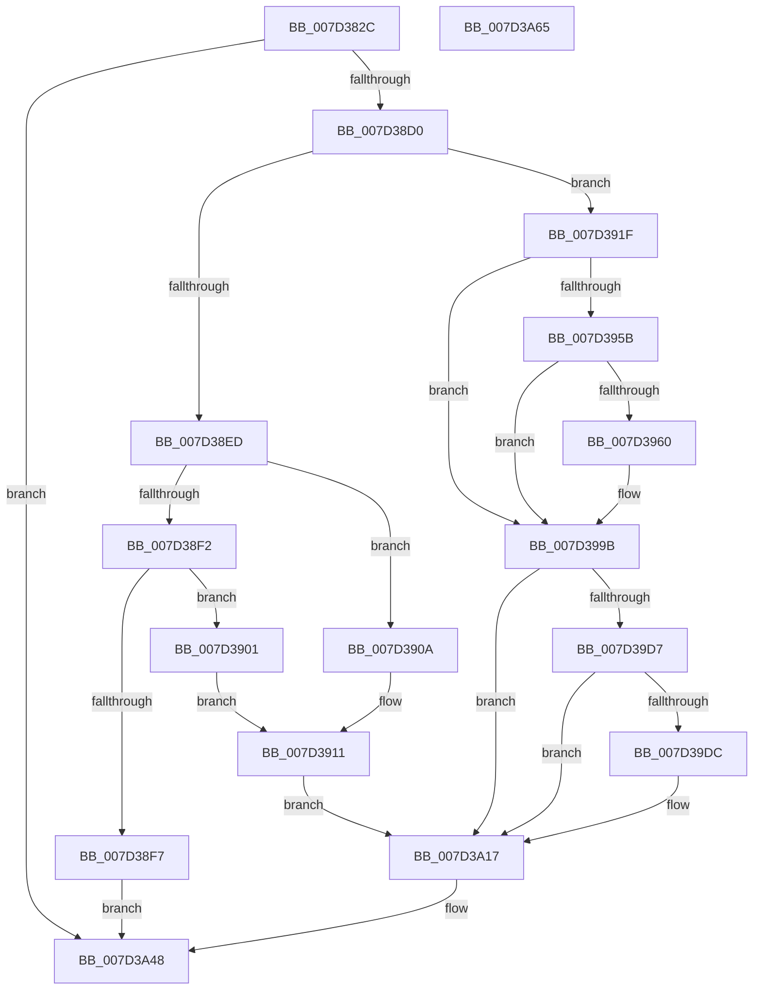

# CMFRegisterEventTime

- RVA: `0x007D382C`–`0x007D3A66` (길이 `570` bytes)
- VA: `0x00000001407D382C`
- 실행 섹션: `PAGE`
- PDB 이름 있음: `예`; PDB Function 태그: `아니요`
- unwind 정보 RVA: `0x000BA42C`
- 디코드: `133`개 명령, `570/570` bytes 표시
- 미해석 바이트: `0` (있으면 어셈블리에 `.byte`로 보존)

> 이 문서는 커널 이미지의 기계어와 PDB 기호를 분석해 생성했습니다. 4번과 5번은 함수 원형과 자료형을 바이너리 사용 방식에서 추정한 C 해석이며 원본 소스 복구 결과는 아닙니다.

## 1. Dependencies

- 직접 호출 지점: **14**; 고유 호출 대상: **6**
- 직접 호출자로 확인된 함수: **1**
- RIP 상대 이미지 참조: **7**

### Outgoing calls
- `0x007D387A` → [RtlInitUnicodeString](../../text/42/RtlInitUnicodeString_function_0042A780.md) (function, `0x0042A780`)
- `0x007D38C3` → [ZwCreateKey](../../text/6A/ZwCreateKey_function_006AD470.md) (function, `0x006AD470`)
- `0x007D3915` → [RtlInitUnicodeString](../../text/42/RtlInitUnicodeString_function_0042A780.md) (function, `0x0042A780`)
- `0x007D392A` → [RtlInitUnicodeString](../../text/42/RtlInitUnicodeString_function_0042A780.md) (function, `0x0042A780`)
- `0x007D3952` → [ZwQueryValueKey](../../text/6A/ZwQueryValueKey_function_006AD3B0.md) (function, `0x006AD3B0`)
- `0x007D3972` → [RtlInitUnicodeString](../../text/42/RtlInitUnicodeString_function_0042A780.md) (function, `0x0042A780`)
- `0x007D3996` → [ZwSetValueKey](../../text/6A/ZwSetValueKey_function_006ADCD0.md) (function, `0x006ADCD0`)
- `0x007D39A6` → [RtlInitUnicodeString](../../text/42/RtlInitUnicodeString_function_0042A780.md) (function, `0x0042A780`)
- `0x007D39CE` → [ZwQueryValueKey](../../text/6A/ZwQueryValueKey_function_006AD3B0.md) (function, `0x006AD3B0`)
- `0x007D39EE` → [RtlInitUnicodeString](../../text/42/RtlInitUnicodeString_function_0042A780.md) (function, `0x0042A780`)
- `0x007D3A12` → [ZwSetValueKey](../../text/6A/ZwSetValueKey_function_006ADCD0.md) (function, `0x006ADCD0`)
- `0x007D3A36` → [ZwSetValueKey](../../text/6A/ZwSetValueKey_function_006ADCD0.md) (function, `0x006ADCD0`)
- `0x007D3A41` → [ZwClose](../../text/6A/ZwClose_function_006AD2B0.md) (function, `0x006AD2B0`)
- `0x007D3A4F` → [_security_check_cookie](../../text/6A/_security_check_cookie_function_006AC640.md) (function, `0x006AC640`)

### Direct callers
- [NtMapCMFModule](NtMapCMFModule_function_007D4310.md) at `0x007D45C4`
- [NtMapCMFModule](NtMapCMFModule_function_007D4310.md) at `0x007D4743`
- [NtMapCMFModule](NtMapCMFModule_function_007D4310.md) at `0x007D4A95`

### Static image references
- `0x007D383E` → RVA `0x00E0A740` (`.data`; read)
- `0x007D3854` → RVA `0x00B08B90` (` ?? ::NNGAKEGL::`string'`; read)
- `0x007D3901` → RVA `0x00B08D20` (` ?? ::NNGAKEGL::`string'`; read)
- `0x007D390A` → RVA `0x00B08B70` (` ?? ::NNGAKEGL::`string'`; read)
- `0x007D3963` → RVA `0x00B08CF0` (` ?? ::NNGAKEGL::`string'`; read)
- `0x007D399B` → RVA `0x00B08CD0` (` ?? ::NNGAKEGL::`string'`; read)
- `0x007D39DF` → RVA `0x00B08D40` (` ?? ::NNGAKEGL::`string'`; read)

## 2. Other-region calls and transfers

- 다른 실행 섹션으로 향하는 call: **14**
  - `0x007D387A` → [RtlInitUnicodeString](../../text/42/RtlInitUnicodeString_function_0042A780.md) (`PAGE` → `.text`)
  - `0x007D38C3` → [ZwCreateKey](../../text/6A/ZwCreateKey_function_006AD470.md) (`PAGE` → `.text`)
  - `0x007D3915` → [RtlInitUnicodeString](../../text/42/RtlInitUnicodeString_function_0042A780.md) (`PAGE` → `.text`)
  - `0x007D392A` → [RtlInitUnicodeString](../../text/42/RtlInitUnicodeString_function_0042A780.md) (`PAGE` → `.text`)
  - `0x007D3952` → [ZwQueryValueKey](../../text/6A/ZwQueryValueKey_function_006AD3B0.md) (`PAGE` → `.text`)
  - `0x007D3972` → [RtlInitUnicodeString](../../text/42/RtlInitUnicodeString_function_0042A780.md) (`PAGE` → `.text`)
  - `0x007D3996` → [ZwSetValueKey](../../text/6A/ZwSetValueKey_function_006ADCD0.md) (`PAGE` → `.text`)
  - `0x007D39A6` → [RtlInitUnicodeString](../../text/42/RtlInitUnicodeString_function_0042A780.md) (`PAGE` → `.text`)
  - `0x007D39CE` → [ZwQueryValueKey](../../text/6A/ZwQueryValueKey_function_006AD3B0.md) (`PAGE` → `.text`)
  - `0x007D39EE` → [RtlInitUnicodeString](../../text/42/RtlInitUnicodeString_function_0042A780.md) (`PAGE` → `.text`)
  - `0x007D3A12` → [ZwSetValueKey](../../text/6A/ZwSetValueKey_function_006ADCD0.md) (`PAGE` → `.text`)
  - `0x007D3A36` → [ZwSetValueKey](../../text/6A/ZwSetValueKey_function_006ADCD0.md) (`PAGE` → `.text`)
  - `0x007D3A41` → [ZwClose](../../text/6A/ZwClose_function_006AD2B0.md) (`PAGE` → `.text`)
  - `0x007D3A4F` → [_security_check_cookie](../../text/6A/_security_check_cookie_function_006AC640.md) (`PAGE` → `.text`)
- 별도 외부 분기/꼬리 이동을 확인하지 못했습니다.

## 3. Assembly (complete function range)

```asm
007D382C  48 89 5C 24 08                  mov qword ptr [rsp + 8], rbx
007D3831  55                              push rbp
007D3832  48 8D 6C 24 A9                  lea rbp, [rsp - 0x57]
007D3837  48 81 EC E0 00 00 00            sub rsp, 0xe0
007D383E  48 8B 05 FB 6E 63 00            mov rax, qword ptr [rip + 0x636efb]
007D3845  48 33 C4                        xor rax, rsp
007D3848  48 89 45 47                     mov qword ptr [rbp + 0x47], rax
007D384C  33 C0                           xor eax, eax
007D384E  0F B7 D9                        movzx ebx, cx
007D3851  21 45 1B                        and dword ptr [rbp + 0x1b], eax
007D3854  48 8D 15 35 53 33 00            lea rdx, [rip + 0x335335]
007D385B  48 21 45 B7                     and qword ptr [rbp - 0x49], rax
007D385F  48 8D 4D EF                     lea rcx, [rbp - 0x11]
007D3863  21 45 BF                        and dword ptr [rbp - 0x41], eax
007D3866  0F 57 C0                        xorps xmm0, xmm0
007D3869  0F 57 C9                        xorps xmm1, xmm1
007D386C  89 45 03                        mov dword ptr [rbp + 3], eax
007D386F  21 45 03                        and dword ptr [rbp + 3], eax
007D3872  0F 11 45 EF                     movups xmmword ptr [rbp - 0x11], xmm0
007D3876  0F 11 4D C7                     movups xmmword ptr [rbp - 0x39], xmm1
007D387A  E8 01 6F C5 FF                  call 0x14042a780
007D387F  48 83 64 24 30 00               and qword ptr [rsp + 0x30], 0
007D3885  48 8D 45 EF                     lea rax, [rbp - 0x11]
007D3889  83 64 24 28 00                  and dword ptr [rsp + 0x28], 0
007D388E  4C 8D 45 FF                     lea r8, [rbp - 1]
007D3892  48 83 65 07 00                  and qword ptr [rbp + 7], 0
007D3897  48 8D 4D B7                     lea rcx, [rbp - 0x49]
007D389B  48 83 64 24 20 00               and qword ptr [rsp + 0x20], 0
007D38A1  0F 57 C0                        xorps xmm0, xmm0
007D38A4  45 33 C9                        xor r9d, r9d
007D38A7  48 89 45 0F                     mov qword ptr [rbp + 0xf], rax
007D38AB  BA 1F 00 02 00                  mov edx, 0x2001f
007D38B0  C7 45 FF 30 00 00 00            mov dword ptr [rbp - 1], 0x30
007D38B7  F3 0F 7F 45 1F                  movdqu xmmword ptr [rbp + 0x1f], xmm0
007D38BC  C7 45 17 40 02 00 00            mov dword ptr [rbp + 0x17], 0x240
007D38C3  E8 A8 9B ED FF                  call 0x1406ad470
007D38C8  85 C0                           test eax, eax
007D38CA  0F 88 78 01 00 00               js 0x1407d3a48
007D38D0  8B CB                           mov ecx, ebx
007D38D2  48 B8 14 00 00 00 80 F7 FF FF   movabs rax, 0xfffff78000000014
007D38DC  BB 0B 00 00 00                  mov ebx, 0xb
007D38E1  48 8B 00                        mov rax, qword ptr [rax]
007D38E4  48 89 45 E7                     mov qword ptr [rbp - 0x19], rax
007D38E8  83 E9 01                        sub ecx, 1
007D38EB  74 32                           je 0x1407d391f
007D38ED  83 E9 01                        sub ecx, 1
007D38F0  74 18                           je 0x1407d390a
007D38F2  83 F9 02                        cmp ecx, 2
007D38F5  74 0A                           je 0x1407d3901
007D38F7  B8 0D 00 00 C0                  mov eax, 0xc000000d
007D38FC  E9 47 01 00 00                  jmp 0x1407d3a48
007D3901  48 8D 15 18 54 33 00            lea rdx, [rip + 0x335418]
007D3908  EB 07                           jmp 0x1407d3911
007D390A  48 8D 15 5F 52 33 00            lea rdx, [rip + 0x33525f]
007D3911  48 8D 4D C7                     lea rcx, [rbp - 0x39]
007D3915  E8 66 6E C5 FF                  call 0x14042a780
007D391A  E9 F8 00 00 00                  jmp 0x1407d3a17
007D391F  48 8D 15 4A 52 33 00            lea rdx, [rip + 0x33524a]
007D3926  48 8D 4D C7                     lea rcx, [rbp - 0x39]
007D392A  E8 51 6E C5 FF                  call 0x14042a780
007D392F  48 8B 4D B7                     mov rcx, qword ptr [rbp - 0x49]
007D3933  48 8D 45 BF                     lea rax, [rbp - 0x41]
007D3937  48 89 44 24 28                  mov qword ptr [rsp + 0x28], rax
007D393C  4C 8D 4D 2F                     lea r9, [rbp + 0x2f]
007D3940  41 B8 02 00 00 00               mov r8d, 2
007D3946  C7 44 24 20 14 00 00 00         mov dword ptr [rsp + 0x20], 0x14
007D394E  48 8D 55 C7                     lea rdx, [rbp - 0x39]
007D3952  E8 59 9A ED FF                  call 0x1406ad3b0
007D3957  85 C0                           test eax, eax
007D3959  78 40                           js 0x1407d399b
007D395B  39 5D 33                        cmp dword ptr [rbp + 0x33], ebx
007D395E  75 3B                           jne 0x1407d399b
007D3960  0F 57 C0                        xorps xmm0, xmm0
007D3963  48 8D 15 86 53 33 00            lea rdx, [rip + 0x335386]
007D396A  48 8D 4D D7                     lea rcx, [rbp - 0x29]
007D396E  0F 11 45 D7                     movups xmmword ptr [rbp - 0x29], xmm0
007D3972  E8 09 6E C5 FF                  call 0x14042a780
007D3977  48 8B 4D B7                     mov rcx, qword ptr [rbp - 0x49]
007D397B  48 8D 45 3B                     lea rax, [rbp + 0x3b]
007D397F  C7 44 24 28 08 00 00 00         mov dword ptr [rsp + 0x28], 8
007D3987  48 8D 55 D7                     lea rdx, [rbp - 0x29]
007D398B  44 8B CB                        mov r9d, ebx
007D398E  48 89 44 24 20                  mov qword ptr [rsp + 0x20], rax
007D3993  45 33 C0                        xor r8d, r8d
007D3996  E8 35 A3 ED FF                  call 0x1406adcd0
007D399B  48 8D 15 2E 53 33 00            lea rdx, [rip + 0x33532e]
007D39A2  48 8D 4D C7                     lea rcx, [rbp - 0x39]
007D39A6  E8 D5 6D C5 FF                  call 0x14042a780
007D39AB  48 8B 4D B7                     mov rcx, qword ptr [rbp - 0x49]
007D39AF  48 8D 45 BF                     lea rax, [rbp - 0x41]
007D39B3  48 89 44 24 28                  mov qword ptr [rsp + 0x28], rax
007D39B8  4C 8D 4D 2F                     lea r9, [rbp + 0x2f]
007D39BC  41 B8 02 00 00 00               mov r8d, 2
007D39C2  C7 44 24 20 14 00 00 00         mov dword ptr [rsp + 0x20], 0x14
007D39CA  48 8D 55 C7                     lea rdx, [rbp - 0x39]
007D39CE  E8 DD 99 ED FF                  call 0x1406ad3b0
007D39D3  85 C0                           test eax, eax
007D39D5  78 40                           js 0x1407d3a17
007D39D7  39 5D 33                        cmp dword ptr [rbp + 0x33], ebx
007D39DA  75 3B                           jne 0x1407d3a17
007D39DC  0F 57 C0                        xorps xmm0, xmm0
007D39DF  48 8D 15 5A 53 33 00            lea rdx, [rip + 0x33535a]
007D39E6  48 8D 4D D7                     lea rcx, [rbp - 0x29]
007D39EA  0F 11 45 D7                     movups xmmword ptr [rbp - 0x29], xmm0
007D39EE  E8 8D 6D C5 FF                  call 0x14042a780
007D39F3  48 8B 4D B7                     mov rcx, qword ptr [rbp - 0x49]
007D39F7  48 8D 45 3B                     lea rax, [rbp + 0x3b]
007D39FB  C7 44 24 28 08 00 00 00         mov dword ptr [rsp + 0x28], 8
007D3A03  48 8D 55 D7                     lea rdx, [rbp - 0x29]
007D3A07  44 8B CB                        mov r9d, ebx
007D3A0A  48 89 44 24 20                  mov qword ptr [rsp + 0x20], rax
007D3A0F  45 33 C0                        xor r8d, r8d
007D3A12  E8 B9 A2 ED FF                  call 0x1406adcd0
007D3A17  48 8B 4D B7                     mov rcx, qword ptr [rbp - 0x49]
007D3A1B  48 8D 45 E7                     lea rax, [rbp - 0x19]
007D3A1F  C7 44 24 28 08 00 00 00         mov dword ptr [rsp + 0x28], 8
007D3A27  48 8D 55 C7                     lea rdx, [rbp - 0x39]
007D3A2B  44 8B CB                        mov r9d, ebx
007D3A2E  48 89 44 24 20                  mov qword ptr [rsp + 0x20], rax
007D3A33  45 33 C0                        xor r8d, r8d
007D3A36  E8 95 A2 ED FF                  call 0x1406adcd0
007D3A3B  48 8B 4D B7                     mov rcx, qword ptr [rbp - 0x49]
007D3A3F  8B D8                           mov ebx, eax
007D3A41  E8 6A 98 ED FF                  call 0x1406ad2b0
007D3A46  8B C3                           mov eax, ebx
007D3A48  48 8B 4D 47                     mov rcx, qword ptr [rbp + 0x47]
007D3A4C  48 33 CC                        xor rcx, rsp
007D3A4F  E8 EC 8B ED FF                  call 0x1406ac640
007D3A54  48 8B 9C 24 F0 00 00 00         mov rbx, qword ptr [rsp + 0xf0]
007D3A5C  48 81 C4 E0 00 00 00            add rsp, 0xe0
007D3A63  5D                              pop rbp
007D3A64  C3                              ret
007D3A65  CC                              int3
```

## 4. C-style interpretation (structured pseudocode)

```c
__int64 __fastcall CMFRegisterEventTime(unsigned __int16 a1, __int64 a2, __int64 a3, int a4)
{
    __int64 result;
    __int64 v_rsp;
    unsigned __int64 v_stack_m18;
    unsigned __int64 v_stack_m24;
    unsigned int v_stack_m2C;
    unsigned __int64 v_stack_m30;
    unsigned __int64 v_stack_m40;
    unsigned int v_stack_m44;
    unsigned int v_stack_m48;
    unsigned __int64 v_stack_m50;
    unsigned __int64 v_stack_m58;
    unsigned int v_stack_m5C;
    unsigned __int64 v_stack_m5F;
    unsigned __int64 v_stack_m60;
    unsigned __int64 v_stack_m70;
    unsigned __int64 v_stack_m78;
    unsigned __int64 v_stack_m88;
    unsigned __int64 v_stack_m98;
    unsigned int v_stack_mA0;
    unsigned __int64 v_stack_mA8;
    unsigned __int64 v_stack_mB8;
    unsigned int v_stack_mC0;
    unsigned __int64 v_stack_mC8;
    unsigned __int64 v_stack_p8;

    v_stack_p8 = v_rbx;
    v_rsp = (v_rsp) - (224);
    result = (*(unsigned __int64 *)(v_rip + 6516475)) ^ (v_rsp);
    v_stack_m18 = result;
    result = 0;
    v_stack_m5C = 0;
    v_stack_m70 = v_xmm0;
    v_stack_m98 = v_xmm1;
    result = RtlInitUnicodeString(v_stack_m70, v_rip + 3363637, a3, a4);
    a4 = 0;
    v_stack_m50 = v_stack_m70;
    v_stack_m60 = 48;
    v_stack_m40 = v_xmm0;
    v_stack_m48 = 576;
    result = ZwCreateKey(v_stack_mA8, (unsigned int)(0x2001FULL), v_stack_m60, a4);
    if (sign_flag) goto loc_007D3A48;
    v_stack_m78 = *(unsigned __int64 *)(result);
    a1 = (unsigned int)(((unsigned int)(a1)) - (1));
    if (condition_is_equal) goto loc_007D391F;
    a1 = (unsigned int)((a1) - (1));
    if (condition_is_equal) goto loc_007D390A;
    if (a1 == 2) goto loc_007D3901;
    goto loc_007D3A48;
loc_007D3901:
    goto loc_007D3911;
loc_007D390A:
loc_007D3911:
    result = RtlInitUnicodeString(v_stack_m98, v_rip + 3363423, v_stack_m60, a4);
    goto loc_007D3A17;
loc_007D391F:
    result = RtlInitUnicodeString(v_stack_m98, v_rip + 3363402, v_stack_m60, a4);
    v_stack_mC0 = v_stack_mA0;
    v_stack_mC8 = 20;
    result = ZwQueryValueKey(v_stack_mA8, v_stack_m98, 2, v_stack_m30);
    if (sign_flag) goto loc_007D399B;
    if (v_stack_m2C == 11) {
        a2 = v_rip + 3363718;
        a1 = v_stack_m88;
        v_stack_m88 = v_xmm0;
        result = RtlInitUnicodeString(a1, a2, 2, v_stack_m30);
        a1 = v_stack_mA8;
        result = v_stack_m24;
        v_stack_mC0 = 8;
        a2 = v_stack_m88;
        a4 = 11;
        v_stack_mC8 = result;
        a3 = 0;
        result = ZwSetValueKey(a1, a2, a3, a4);
    }
    result = RtlInitUnicodeString(v_stack_m98, v_rip + 3363630, a3, a4);
    v_stack_mC0 = v_stack_mA0;
    v_stack_mC8 = 20;
    result = ZwQueryValueKey(v_stack_mA8, v_stack_m98, 2, v_stack_m30);
    if (sign_flag) goto loc_007D3A17;
    if (v_stack_m2C == 11) {
        a2 = v_rip + 3363674;
        a1 = v_stack_m88;
        v_stack_m88 = v_xmm0;
        result = RtlInitUnicodeString(a1, a2, 2, v_stack_m30);
        a1 = v_stack_mA8;
        result = v_stack_m24;
        v_stack_mC0 = 8;
        a2 = v_stack_m88;
        a4 = 11;
        v_stack_mC8 = result;
        a3 = 0;
        result = ZwSetValueKey(a1, a2, a3, a4);
    }
    v_stack_mC0 = 8;
    v_stack_mC8 = v_stack_m78;
    a3 = 0;
    result = ZwSetValueKey(v_stack_mA8, v_stack_m98, a3, 11);
    result = ZwClose(v_stack_mA8, v_stack_m98, a3, 11);
loc_007D3A48:
    a1 = (v_stack_m18) ^ (v_rsp);
    result = _security_check_cookie(a1, v_stack_m98, a3, 11);
    v_rsp = (v_rsp) + (224);
    return result;
}
```

## 5. (Beta) C Style

```c
int64_t CMFRegisterEventTime(uint16_t Arg1, int64_t Arg2, int64_t Arg3, int32_t Arg4)
{
    int64_t result;
    int64_t local_rsp;
    uint64_t v_stack_m18;
    uint64_t v_stack_m24;
    uint32_t v_stack_m2C;
    uint64_t v_stack_m30;
    uint64_t v_stack_m40;
    uint32_t v_stack_m44;
    uint32_t v_stack_m48;
    uint64_t v_stack_m50;
    uint64_t v_stack_m58;
    uint32_t v_stack_m5C;
    uint64_t v_stack_m5F;
    uint64_t v_stack_m60;
    uint64_t v_stack_m70;
    uint64_t v_stack_m78;
    uint64_t v_stack_m88;
    uint64_t v_stack_m98;
    uint32_t v_stack_mA0;
    uint64_t v_stack_mA8;
    uint64_t v_stack_mB8;
    uint32_t v_stack_mC0;
    uint64_t v_stack_mC8;
    uint64_t v_stack_p8;

    v_stack_p8 = local_rbx;
    local_rsp = (local_rsp) - (224);
    result = (*(uint64_t *)(v_rip + 0x636EFB)) ^ (local_rsp);
    v_stack_m18 = result;
    result = 0;
    v_stack_m5C = 0;
    v_stack_m70 = v_xmm0;
    v_stack_m98 = v_xmm1;
    result = RtlInitUnicodeString(v_stack_m70, v_rip + 3363637, Arg3, Arg4);
    Arg4 = 0;
    v_stack_m50 = v_stack_m70;
    v_stack_m60 = 48;
    v_stack_m40 = v_xmm0;
    v_stack_m48 = 576;
    result = ZwCreateKey(v_stack_mA8, (uint32_t)(0x2001FULL), v_stack_m60, Arg4);
    if (sign_flag) goto loc_007D3A48;
    v_stack_m78 = *(uint64_t *)(result);
    Arg1 = (uint32_t)(((uint32_t)(Arg1)) - (1));
    if (condition_is_equal) goto loc_007D391F;
    Arg1 = (uint32_t)((Arg1) - (1));
    if (condition_is_equal) goto loc_007D390A;
    if (Arg1 == 2) goto loc_007D3901;
    goto loc_007D3A48;
loc_007D3901:
    goto loc_007D3911;
loc_007D390A:
loc_007D3911:
    result = RtlInitUnicodeString(v_stack_m98, v_rip + 3363423, v_stack_m60, Arg4);
    goto loc_007D3A17;
loc_007D391F:
    result = RtlInitUnicodeString(v_stack_m98, v_rip + 3363402, v_stack_m60, Arg4);
    v_stack_mC0 = v_stack_mA0;
    v_stack_mC8 = 20;
    result = ZwQueryValueKey(v_stack_mA8, v_stack_m98, 2, v_stack_m30);
    if (sign_flag) goto loc_007D399B;
    if (v_stack_m2C == 11) {
        Arg2 = v_rip + 3363718;
        Arg1 = v_stack_m88;
        v_stack_m88 = v_xmm0;
        result = RtlInitUnicodeString(Arg1, Arg2, 2, v_stack_m30);
        Arg1 = v_stack_mA8;
        result = v_stack_m24;
        v_stack_mC0 = 8;
        Arg2 = v_stack_m88;
        Arg4 = 11;
        v_stack_mC8 = result;
        Arg3 = 0;
        result = ZwSetValueKey(Arg1, Arg2, Arg3, Arg4);
    }
    result = RtlInitUnicodeString(v_stack_m98, v_rip + 3363630, Arg3, Arg4);
    v_stack_mC0 = v_stack_mA0;
    v_stack_mC8 = 20;
    result = ZwQueryValueKey(v_stack_mA8, v_stack_m98, 2, v_stack_m30);
    if (sign_flag) goto loc_007D3A17;
    if (v_stack_m2C == 11) {
        Arg2 = v_rip + 3363674;
        Arg1 = v_stack_m88;
        v_stack_m88 = v_xmm0;
        result = RtlInitUnicodeString(Arg1, Arg2, 2, v_stack_m30);
        Arg1 = v_stack_mA8;
        result = v_stack_m24;
        v_stack_mC0 = 8;
        Arg2 = v_stack_m88;
        Arg4 = 11;
        v_stack_mC8 = result;
        Arg3 = 0;
        result = ZwSetValueKey(Arg1, Arg2, Arg3, Arg4);
    }
    v_stack_mC0 = 8;
    v_stack_mC8 = v_stack_m78;
    Arg3 = 0;
    result = ZwSetValueKey(v_stack_mA8, v_stack_m98, Arg3, 11);
    result = ZwClose(v_stack_mA8, v_stack_m98, Arg3, 11);
loc_007D3A48:
    Arg1 = (v_stack_m18) ^ (local_rsp);
    result = _security_check_cookie(Arg1, v_stack_m98, Arg3, 11);
    local_rsp = (local_rsp) + (224);
    return result;
}
```

## 6. Execution-region graph

[열기: 2D/3D 그래프와 함수 탐색 컨트롤 패널](../../../control-panel.html?section=page&rva=0x007D382C&view=graph)

- 2D 그래프는 위에서 아래로 흐르고, 3D 그래프는 빈 공간을 드래그해 회전합니다. Shift+드래그는 이동, 휠은 확대·축소, 함수 노드 선택은 대상 보고서 이동입니다.

### Static fallback


