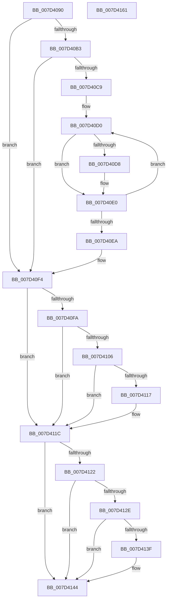

# CMFUnmapModules

- RVA: `0x007D4090`–`0x007D4162` (길이 `210` bytes)
- VA: `0x00000001407D4090`
- 실행 섹션: `PAGE`
- PDB 이름 있음: `예`; PDB Function 태그: `아니요`
- unwind 정보 RVA: `0x0005E6B4`
- 디코드: `58`개 명령, `210/210` bytes 표시
- 미해석 바이트: `0` (있으면 어셈블리에 `.byte`로 보존)

> 이 문서는 커널 이미지의 기계어와 PDB 기호를 분석해 생성했습니다. 4번과 5번은 함수 원형과 자료형을 바이너리 사용 방식에서 추정한 C 해석이며 원본 소스 복구 결과는 아닙니다.

## 1. Dependencies

- 직접 호출 지점: **4**; 고유 호출 대상: **2**
- 직접 호출자로 확인된 함수: **1**
- RIP 상대 이미지 참조: **4**

### Outgoing calls
- `0x007D40D8` → [ObfDereferenceObject](../../text/2F/ObfDereferenceObject_function_002F9350.md) (function, `0x002F9350`)
- `0x007D40EF` → [ExFreePoolWithTag](../../poolcode/B8/ExFreePoolWithTag_function_00B82870.md) (function, `0x00B82870`)
- `0x007D4117` → [ObfDereferenceObject](../../text/2F/ObfDereferenceObject_function_002F9350.md) (function, `0x002F9350`)
- `0x007D413F` → [ObfDereferenceObject](../../text/2F/ObfDereferenceObject_function_002F9350.md) (function, `0x002F9350`)

### Direct callers
- [NtMapCMFModule](NtMapCMFModule_function_007D4310.md) at `0x007D45BA`

### Static image references
- `0x007D40B3` → RVA `0x00EEEFC0` (`.data`; read)
- `0x007D40BD` → RVA `0x00EEEFC0` (`.data`; read/write)
- `0x007D40FA` → RVA `0x00EEEFA0` (`.data`; read)
- `0x007D4122` → RVA `0x00EEEF98` (`.data`; read)

## 2. Other-region calls and transfers

- 다른 실행 섹션으로 향하는 call: **4**
  - `0x007D40D8` → [ObfDereferenceObject](../../text/2F/ObfDereferenceObject_function_002F9350.md) (`PAGE` → `.text`)
  - `0x007D40EF` → [ExFreePoolWithTag](../../poolcode/B8/ExFreePoolWithTag_function_00B82870.md) (`PAGE` → `POOLCODE`)
  - `0x007D4117` → [ObfDereferenceObject](../../text/2F/ObfDereferenceObject_function_002F9350.md) (`PAGE` → `.text`)
  - `0x007D413F` → [ObfDereferenceObject](../../text/2F/ObfDereferenceObject_function_002F9350.md) (`PAGE` → `.text`)
- 별도 외부 분기/꼬리 이동을 확인하지 못했습니다.

## 3. Assembly (complete function range)

```asm
007D4090  48 8B C4                        mov rax, rsp
007D4093  48 89 58 08                     mov qword ptr [rax + 8], rbx
007D4097  48 89 68 10                     mov qword ptr [rax + 0x10], rbp
007D409B  48 89 70 18                     mov qword ptr [rax + 0x18], rsi
007D409F  48 89 78 20                     mov qword ptr [rax + 0x20], rdi
007D40A3  41 56                           push r14
007D40A5  48 83 EC 20                     sub rsp, 0x20
007D40A9  45 33 F6                        xor r14d, r14d
007D40AC  8B F1                           mov esi, ecx
007D40AE  F6 C1 20                        test cl, 0x20
007D40B1  74 41                           je 0x1407d40f4
007D40B3  48 8B 3D 06 AF 71 00            mov rdi, qword ptr [rip + 0x71af06]
007D40BA  41 8B C6                        mov eax, r14d
007D40BD  48 87 05 FC AE 71 00            xchg qword ptr [rip + 0x71aefc], rax
007D40C4  48 85 FF                        test rdi, rdi
007D40C7  74 2B                           je 0x1407d40f4
007D40C9  48 8B DF                        mov rbx, rdi
007D40CC  41 8D 6E 1E                     lea ebp, [r14 + 0x1e]
007D40D0  48 8B 0B                        mov rcx, qword ptr [rbx]
007D40D3  48 85 C9                        test rcx, rcx
007D40D6  74 08                           je 0x1407d40e0
007D40D8  E8 73 52 B2 FF                  call 0x1402f9350
007D40DD  4C 89 33                        mov qword ptr [rbx], r14
007D40E0  48 83 C3 08                     add rbx, 8
007D40E4  48 83 ED 01                     sub rbp, 1
007D40E8  75 E6                           jne 0x1407d40d0
007D40EA  33 D2                           xor edx, edx
007D40EC  48 8B CF                        mov rcx, rdi
007D40EF  E8 7C E7 3A 00                  call 0x140b82870
007D40F4  40 F6 C6 10                     test sil, 0x10
007D40F8  74 22                           je 0x1407d411c
007D40FA  48 8B 0D 9F AE 71 00            mov rcx, qword ptr [rip + 0x71ae9f]
007D4101  48 85 C9                        test rcx, rcx
007D4104  74 16                           je 0x1407d411c
007D4106  48 8B C1                        mov rax, rcx
007D4109  F0 4C 0F B1 35 8E AE 71 00      lock cmpxchg qword ptr [rip + 0x71ae8e], r14
007D4112  48 3B C8                        cmp rcx, rax
007D4115  75 05                           jne 0x1407d411c
007D4117  E8 34 52 B2 FF                  call 0x1402f9350
007D411C  0F BA E6 08                     bt esi, 8
007D4120  73 22                           jae 0x1407d4144
007D4122  48 8B 0D 6F AE 71 00            mov rcx, qword ptr [rip + 0x71ae6f]
007D4129  48 85 C9                        test rcx, rcx
007D412C  74 16                           je 0x1407d4144
007D412E  48 8B C1                        mov rax, rcx
007D4131  F0 4C 0F B1 35 5E AE 71 00      lock cmpxchg qword ptr [rip + 0x71ae5e], r14
007D413A  48 3B C8                        cmp rcx, rax
007D413D  75 05                           jne 0x1407d4144
007D413F  E8 0C 52 B2 FF                  call 0x1402f9350
007D4144  48 8B 5C 24 30                  mov rbx, qword ptr [rsp + 0x30]
007D4149  33 C0                           xor eax, eax
007D414B  48 8B 6C 24 38                  mov rbp, qword ptr [rsp + 0x38]
007D4150  48 8B 74 24 40                  mov rsi, qword ptr [rsp + 0x40]
007D4155  48 8B 7C 24 48                  mov rdi, qword ptr [rsp + 0x48]
007D415A  48 83 C4 20                     add rsp, 0x20
007D415E  41 5E                           pop r14
007D4160  C3                              ret
007D4161  CC                              int3
```

## 4. C-style interpretation (structured pseudocode)

```c
__int64 __fastcall CMFUnmapModules(int a1, int a2)
{
    __int64 result;
    __int64 v_r14;
    __int64 v_rbp;
    __int64 v_rbx;
    __int64 v_rsp;
    unsigned __int64 v_stack_p10;
    unsigned __int64 v_stack_p18;
    unsigned __int64 v_stack_p20;
    unsigned __int64 v_stack_p8;

    *(unsigned __int64 *)(v_rsp + 8) = v_rbx;
    *(unsigned __int64 *)(v_rsp + 16) = v_rbp;
    *(unsigned __int64 *)(v_rsp + 24) = v_rsi;
    *(unsigned __int64 *)(v_rsp + 32) = v_rdi;
    v_rsp = (v_rsp) - (32);
    v_r14 = 0;
    if ((((unsigned __int8)(a1)) & (32)) == 0) goto loc_007D40F4;
    if (*(unsigned __int64 *)(v_rip + 7450374) == 0) goto loc_007D40F4;
loc_007D40D0:
    result = 0;
    if (*(unsigned __int64 *)(*(unsigned __int64 *)(v_rip + 7450374)) != 0) {
        result = ObfDereferenceObject(*(unsigned __int64 *)(*(unsigned __int64 *)(v_rip + 7450374)), a2, a3, a4);
        *(unsigned __int64 *)(*(unsigned __int64 *)(v_rip + 7450374)) = 0;
    }
    v_rbx = (*(unsigned __int64 *)(v_rip + 7450374)) + (8);
    v_rbp = (v_r14 + 30) - (1);
    if (condition_is_not_equal) goto loc_007D40D0;
    a2 = 0;
    result = ExFreePoolWithTag(*(unsigned __int64 *)(v_rip + 7450374), a2, a3, a4);
loc_007D40F4:
    if ((((unsigned __int8)((unsigned int)(a1))) & (16)) == 0) goto loc_007D411C;
    if (*(unsigned __int64 *)(v_rip + 7450271) == 0) goto loc_007D411C;
    result = *(unsigned __int64 *)(v_rip + 7450271);
    if ((*(unsigned __int64 *)(v_rip + 7450271)) == (*(unsigned __int64 *)(v_rip + 7450271))) {
        result = ObfDereferenceObject(*(unsigned __int64 *)(v_rip + 7450271), a2, a3, a4);
    }
    if ((*(unsigned __int64 *)(v_rip + 7450271)) >= (*(unsigned __int64 *)(v_rip + 7450271))) goto loc_007D4144;
    if (*(unsigned __int64 *)(v_rip + 7450223) == 0) goto loc_007D4144;
    result = *(unsigned __int64 *)(v_rip + 7450223);
    if ((*(unsigned __int64 *)(v_rip + 7450223)) == (*(unsigned __int64 *)(v_rip + 7450223))) {
        result = ObfDereferenceObject(*(unsigned __int64 *)(v_rip + 7450223), a2, a3, a4);
    }
    result = 0;
    v_rsp = (v_rsp) + (32);
    return result;
}
```

## 5. (Beta) C Style

```c
int64_t CMFUnmapModules(int32_t Arg1, int32_t Arg2)
{
    int64_t result;
    int64_t local_r14;
    int64_t local_rbp;
    int64_t local_rbx;
    int64_t local_rsp;
    uint64_t v_stack_p10;
    uint64_t v_stack_p18;
    uint64_t v_stack_p20;
    uint64_t v_stack_p8;

    *(uint64_t *)(local_rsp + 0x8) = local_rbx;
    *(uint64_t *)(local_rsp + 0x10) = local_rbp;
    *(uint64_t *)(local_rsp + 0x18) = local_rsi;
    *(uint64_t *)(local_rsp + 0x20) = local_rdi;
    local_rsp = (local_rsp) - (32);
    local_r14 = 0;
    if ((((uint8_t)(Arg1)) & (32)) == 0) goto loc_007D40F4;
    if (*(uint64_t *)(v_rip + 0x71AF06) == 0) goto loc_007D40F4;
loc_007D40D0:
    result = 0;
    if (*(uint64_t *)(*(uint64_t *)(v_rip + 0x71AF06)) != 0) {
        result = ObfDereferenceObject(*(uint64_t *)(*(uint64_t *)(v_rip + 0x71AF06)), Arg2, a3, a4);
        *(uint64_t *)(*(uint64_t *)(v_rip + 0x71AF06)) = 0;
    }
    local_rbx = (*(uint64_t *)(v_rip + 0x71AF06)) + (8);
    local_rbp = (local_r14 + 30) - (1);
    if (condition_is_not_equal) goto loc_007D40D0;
    Arg2 = 0;
    result = ExFreePoolWithTag(*(uint64_t *)(v_rip + 0x71AF06), Arg2, a3, a4);
loc_007D40F4:
    if ((((uint8_t)((uint32_t)(Arg1))) & (16)) == 0) goto loc_007D411C;
    if (*(uint64_t *)(v_rip + 0x71AE9F) == 0) goto loc_007D411C;
    result = *(uint64_t *)(v_rip + 0x71AE9F);
    if ((*(uint64_t *)(v_rip + 0x71AE9F)) == (*(uint64_t *)(v_rip + 0x71AE9F))) {
        result = ObfDereferenceObject(*(uint64_t *)(v_rip + 0x71AE9F), Arg2, a3, a4);
    }
    if ((*(uint64_t *)(v_rip + 0x71AE9F)) >= (*(uint64_t *)(v_rip + 0x71AE9F))) goto loc_007D4144;
    if (*(uint64_t *)(v_rip + 0x71AE6F) == 0) goto loc_007D4144;
    result = *(uint64_t *)(v_rip + 0x71AE6F);
    if ((*(uint64_t *)(v_rip + 0x71AE6F)) == (*(uint64_t *)(v_rip + 0x71AE6F))) {
        result = ObfDereferenceObject(*(uint64_t *)(v_rip + 0x71AE6F), Arg2, a3, a4);
    }
    result = 0;
    local_rsp = (local_rsp) + (32);
    return result;
}
```

## 6. Execution-region graph

[열기: 2D/3D 그래프와 함수 탐색 컨트롤 패널](../../../control-panel.html?section=page&rva=0x007D4090&view=graph)

- 2D 그래프는 위에서 아래로 흐르고, 3D 그래프는 빈 공간을 드래그해 회전합니다. Shift+드래그는 이동, 휠은 확대·축소, 함수 노드 선택은 대상 보고서 이동입니다.

### Static fallback


