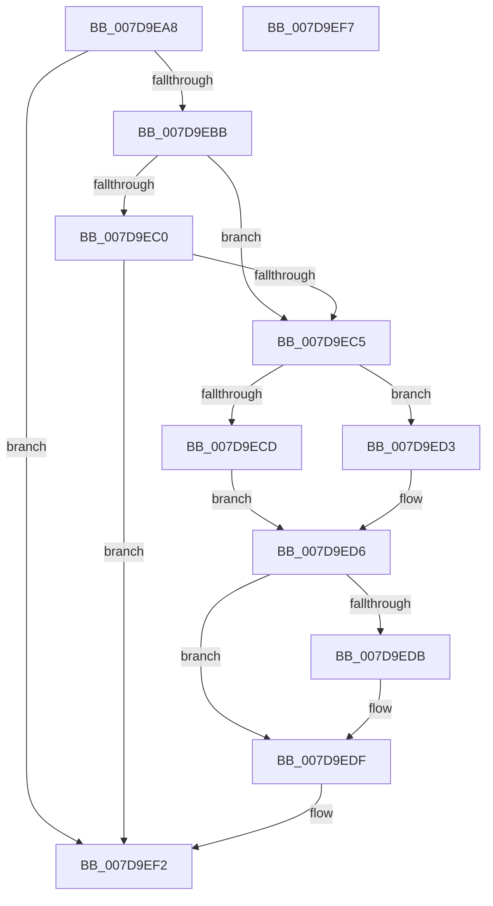

# CmBootLastKnownGood

- RVA: `0x007D9EA8`–`0x007D9EF8` (길이 `80` bytes)
- VA: `0x00000001407D9EA8`
- 실행 섹션: `PAGE`
- PDB 이름 있음: `예`; PDB Function 태그: `아니요`
- unwind 정보 RVA: `0x0005D2F4`
- 디코드: `26`개 명령, `80/80` bytes 표시
- 미해석 바이트: `0` (있으면 어셈블리에 `.byte`로 보존)

> 이 문서는 커널 이미지의 기계어와 PDB 기호를 분석해 생성했습니다. 4번과 5번은 함수 원형과 자료형을 바이너리 사용 방식에서 추정한 C 해석이며 원본 소스 복구 결과는 아닙니다.

## 1. Dependencies

- 직접 호출 지점: **1**; 고유 호출 대상: **1**
- 직접 호출자로 확인된 함수: **1**
- RIP 상대 이미지 참조: **1**

### Outgoing calls
- `0x007D9EEC` → [KeBugCheckEx](../../text/4F/KeBugCheckEx_function_004FD660.md) (function, `0x004FD660`)

### Direct callers
- [sub_00B2CB5C](../B2/Unknown_function_00B2CB5C.md) at `0x00B2CC97`

### Static image references
- `0x007D9EAC` → RVA `0x00FD80D0` (`PAGEDATA`; read)

## 2. Other-region calls and transfers

- 다른 실행 섹션으로 향하는 call: **1**
  - `0x007D9EEC` → [KeBugCheckEx](../../text/4F/KeBugCheckEx_function_004FD660.md) (`PAGE` → `.text`)
- 별도 외부 분기/꼬리 이동을 확인하지 못했습니다.

## 3. Assembly (complete function range)

```asm
007D9EA8  48 83 EC 38                     sub rsp, 0x38
007D9EAC  80 3D 1D E2 7F 00 01            cmp byte ptr [rip + 0x7fe21d], 1
007D9EB3  49 8B C0                        mov rax, r8
007D9EB6  4D 63 D1                        movsxd r10, r9d
007D9EB9  75 37                           jne 0x1407d9ef2
007D9EBB  83 E9 02                        sub ecx, 2
007D9EBE  74 05                           je 0x1407d9ec5
007D9EC0  83 F9 01                        cmp ecx, 1
007D9EC3  75 2D                           jne 0x1407d9ef2
007D9EC5  45 33 C0                        xor r8d, r8d
007D9EC8  48 85 C0                        test rax, rax
007D9ECB  74 06                           je 0x1407d9ed3
007D9ECD  4C 8B 48 08                     mov r9, qword ptr [rax + 8]
007D9ED1  EB 03                           jmp 0x1407d9ed6
007D9ED3  4D 8B C8                        mov r9, r8
007D9ED6  48 85 D2                        test rdx, rdx
007D9ED9  74 04                           je 0x1407d9edf
007D9EDB  4C 8B 42 08                     mov r8, qword ptr [rdx + 8]
007D9EDF  BA 01 00 00 00                  mov edx, 1
007D9EE4  4C 89 54 24 20                  mov qword ptr [rsp + 0x20], r10
007D9EE9  8D 4A 59                        lea ecx, [rdx + 0x59]
007D9EEC  E8 6F 37 D2 FF                  call 0x1404fd660
007D9EF1  CC                              int3
007D9EF2  48 83 C4 38                     add rsp, 0x38
007D9EF6  C3                              ret
007D9EF7  CC                              int3
```

## 4. C-style interpretation (structured pseudocode)

```c
__int64 __fastcall CmBootLastKnownGood(int a1, __int64 a2, __int64 a3, int a4)
{
    __int64 result;
    __int64 v_rsp;
    unsigned __int64 v_stack_m18;

    v_rsp = (v_rsp) - (56);
    if ((*(unsigned __int8 *)(v_rip + 8380957)) != 1) goto loc_007D9EF2;
    a1 = (unsigned int)((a1) - (2));
    if (condition_is_equal) goto loc_007D9EC5;
    if (a1 != 1) goto loc_007D9EF2;
loc_007D9EC5:
    a3 = 0;
    if (0 == 0) goto loc_007D9ED3;
    goto loc_007D9ED6;
loc_007D9ED3:
loc_007D9ED6:
    if (a2 != 0) {
        a3 = *(unsigned __int64 *)(a2 + 8);
    }
    v_stack_m18 = (int)(a4);
    result = KeBugCheckEx(1 + 89, 1, a3, 0);
loc_007D9EF2:
    v_rsp = (v_rsp) + (56);
    return result;
}
```

## 5. (Beta) C Style

```c
int64_t CmBootLastKnownGood(int32_t Arg1, int64_t Arg2, int64_t Arg3, int32_t Arg4)
{
    int64_t result;
    int64_t local_rsp;
    uint64_t v_stack_m18;

    local_rsp = (local_rsp) - (56);
    if ((*(uint8_t *)(v_rip + 0x7FE21D)) != 1) goto loc_007D9EF2;
    Arg1 = (uint32_t)((Arg1) - (2));
    if (condition_is_equal) goto loc_007D9EC5;
    if (Arg1 != 1) goto loc_007D9EF2;
loc_007D9EC5:
    Arg3 = 0;
    if (0 == 0) goto loc_007D9ED3;
    goto loc_007D9ED6;
loc_007D9ED3:
loc_007D9ED6:
    if (Arg2 != 0) {
        Arg3 = *(uint64_t *)(Arg2 + 0x8);
    }
    v_stack_m18 = (int32_t)(Arg4);
    result = KeBugCheckEx(1 + 89, 1, Arg3, 0);
loc_007D9EF2:
    local_rsp = (local_rsp) + (56);
    return result;
}
```

## 6. Execution-region graph

[열기: 2D/3D 그래프와 함수 탐색 컨트롤 패널](../../../control-panel.html?section=page&rva=0x007D9EA8&view=graph)

- 2D 그래프는 위에서 아래로 흐르고, 3D 그래프는 빈 공간을 드래그해 회전합니다. Shift+드래그는 이동, 휠은 확대·축소, 함수 노드 선택은 대상 보고서 이동입니다.

### Static fallback


